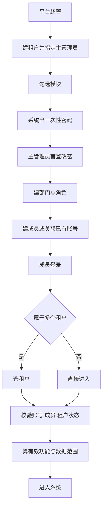
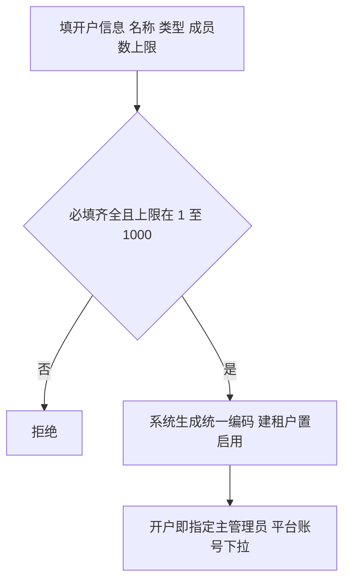
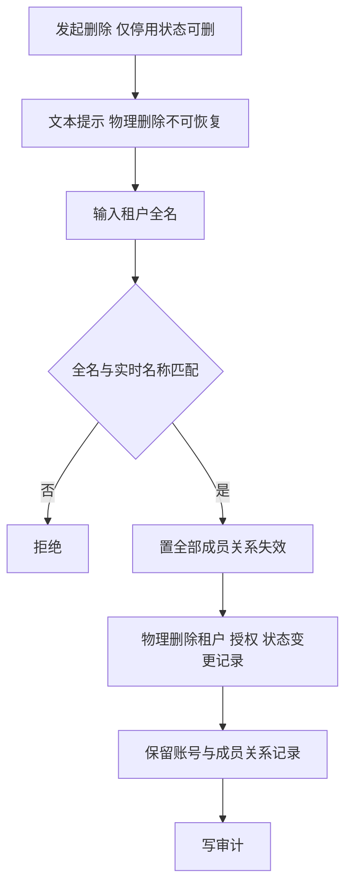
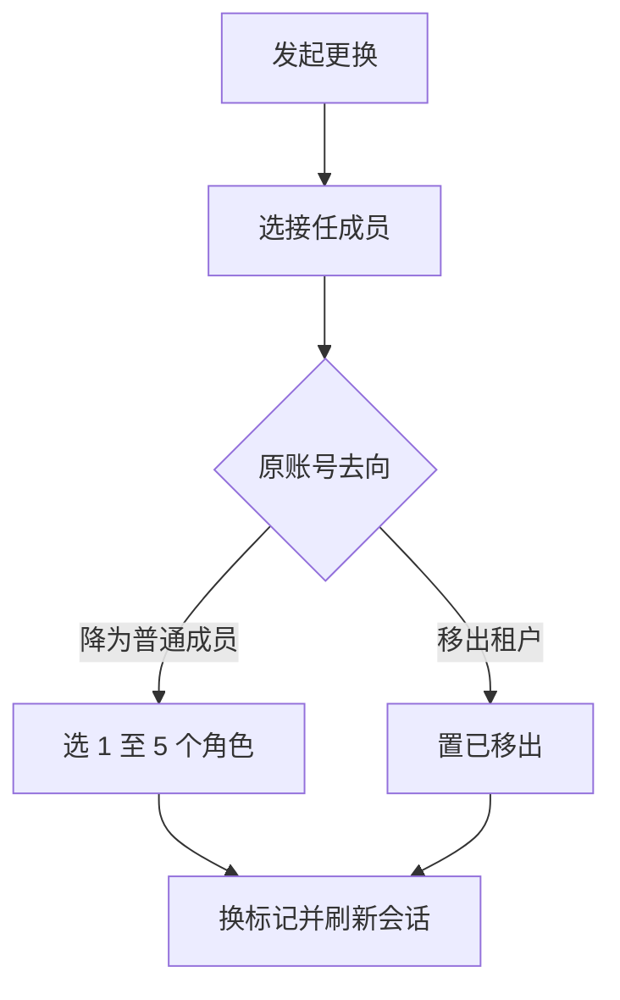
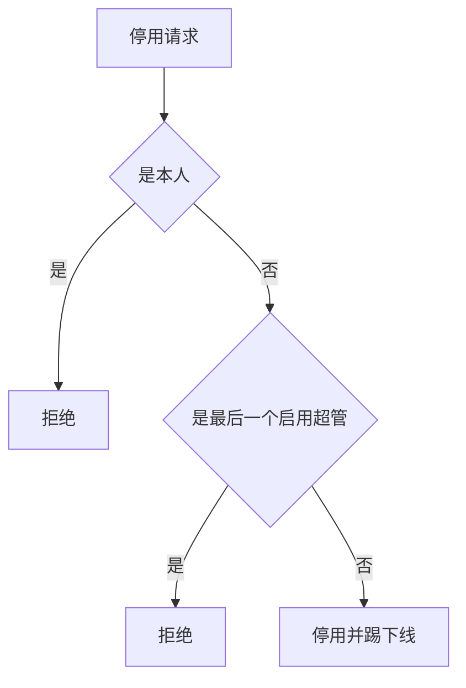
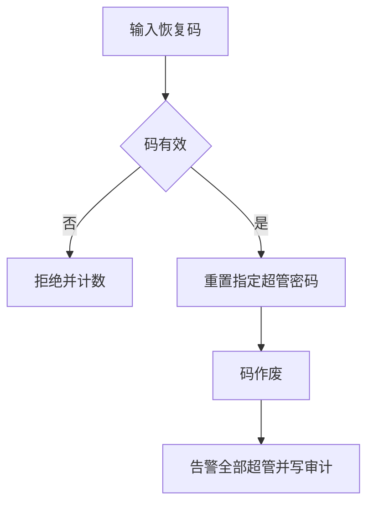
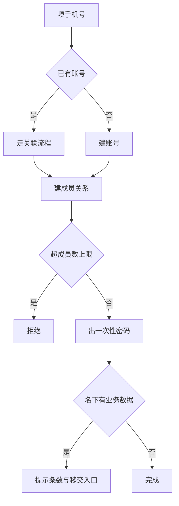
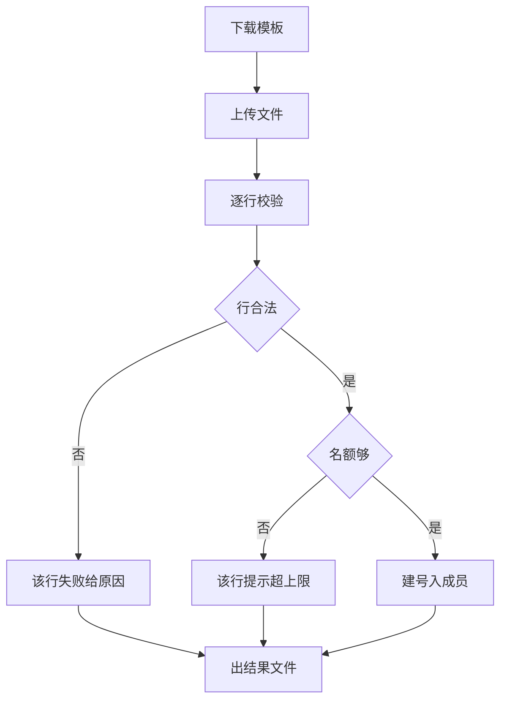
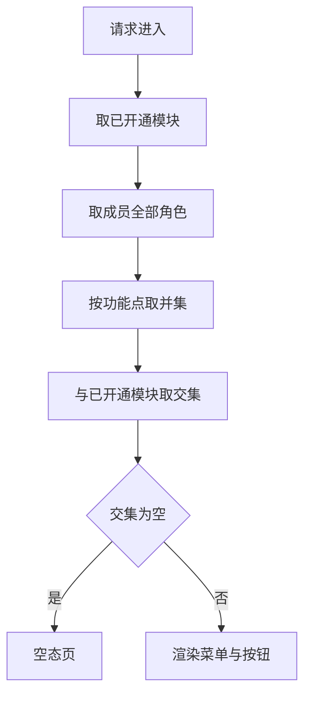
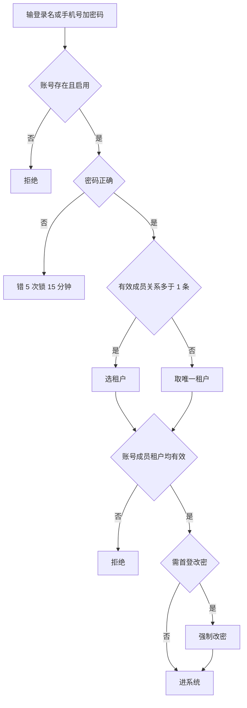

# 产品碳足迹核算工具 · 用户体系 PRD（精简版）

| 项 | 内容 |
|---|---|
| 版本 | v3.5.3 |
| 日期 | 2026-10-21 |
| 范围 | 平台后台、租户端（企业 / 政府单位 / 机构） |
| 依据 | 用户体系 PRD v2.2.0 |

> v3.5.5 变更：新建 / 编辑改为弹窗；开户弹窗主管理员改从「平台账号（不含超管）」下拉选择、不自动建号；删除仅「停用」状态可删、删除界面仅文本提示 + 输入当前全名确认（无双人复核、无只读导出）；状态变更记录并入详情页「操作记录」；其余沿用 v3.5.3：极简三字段 + 统一编码系统生成，成员数上限默认 1000，模块授权纳入「系统管理」组。
>
> v3.5.6 变更：**内置角色收敛**——平台侧只内置「超级管理员、平台运营人员」，租户侧只内置「租户管理员」；财务、客服、核算员、只读等岗位角色不再预置，改为由超级管理员 / 租户管理员按需新增（§5.3.1、§5.7.1）。

---

## 1. 需求描述

一个账号一次登录，按租户隔离数据、按角色控功能、按范围控行，替代原五域割裂模型。

---

## 2. 整体业务流程

---

## 3. 功能清单

一级模块即系统菜单，操作功能即菜单内按钮。

### 3.1 平台后台

下列功能码默认配置给超级管理员，实际可见性由平台角色勾选决定；系统管理整组仅超级管理员可勾。二级模块为空（—）表示该菜单即一个功能，不再下分。

| 角色 | 系统 | 一级模块 | 二级模块 | 业务用例 | 操作功能 | 调整说明 |
|---|---|---|---|---|---|---|
| 平台超管 | 平台后台 | 租户管理 | — | 开户、变更、停用、退租、管理员交接、兜底排查 | 新建、编辑、停用、启用、删除、模块授权、更换主管理员、重置主管理员密码、调整成员数上限、进入租户 | 【新增】 |
| 平台超管 | 平台后台 | 平台账号 | — | 团队分岗、冻结账号、超管失联 | 新建、编辑、分配平台角色、停用、启用、重置密码、注销、生成恢复码、凭码重置 | 【新增】 |
| 平台超管 | 平台后台 | 角色管理 | — | 划分运营、财务、客服职责 | 新建、编辑（含勾选平台功能码）、复制、删除、查看成员、移除成员 | 【调整】与租户端共用同一功能，按归属范围区分 |
| 平台超管 | 平台后台 | 系统管理 | 功能码目录 | 维护全站功能码 | 查看树、改名称、排序、启用、停用、同步代码注册项 | 【新增】 |
| 平台超管 | 平台后台 | 系统管理 | 系统参数 | 调密码与锁定策略 | 改密码复杂度、锁定阈值、会话时长、成员数默认上限 | 【新增】 |
| 平台超管 | 平台后台 | 审计日志 | — | 追溯平台操作 | 查询、导出 | 【新增】 |

> 区划数据为本期静态基础数据，不设独立菜单，仅在租户属地选择时引用。

### 3.2 租户端

| 角色 | 系统 | 一级模块 | 二级模块 | 业务用例 | 操作功能 | 调整说明 |
|---|---|---|---|---|---|---|
| 租户管理员 | 租户端 | 成员管理 | — | 入职、调岗、离岗、离职、核查权限 | 新建、关联已有账号、编辑、停用、启用、移出、重置密码、查看有效权限 | 【新增】 |
| 租户管理员 | 租户端 | 成员管理 | 批量导入 | 一次建多人 | 下载模板、上传文件、查看结果、下载结果文件 | 【新增】 |
| 租户管理员 | 租户端 | 部门管理 | — | 搭组织架构、撤并部门 | 新建、编辑、删除、停用、启用 | 【新增】 |
| 租户管理员 | 租户端 | 角色管理 | — | 配岗位、控范围 | 新建、编辑（含勾选功能点与设数据范围）、复制、删除、查看成员 | 【调整】与平台后台共用同一功能，按归属范围区分 |
| 租户管理员 | 租户端 | 审计日志 | — | 追溯租户内操作 | 查询、导出 | 【新增】 |
| 全部成员 | 租户端 | 个人设置 | — | 确认属于哪几家 | 查看、退出租户、修改密码 | 【新增】 |

### 3.3 公共

| 角色 | 系统 | 一级模块 | 二级模块 | 业务用例 | 操作功能 | 调整说明 |
|---|---|---|---|---|---|---|
| 全部成员 | 公共 | 登录 | — | 进入系统 | 账号或手机号加密码登录、选租户、切换租户、首登改密 | 【新增】 |

> 权限底座为系统机制，无独立菜单；功能与数据校验规则见 5.3、5.7。

### 3.4 删除与合并项

| 原功能 | 处理 |
|---|---|
| 政府与机构独立开户入口 | 并入租户管理 【删除】 |
| 机构资质审核 | 并入租户管理 【删除】 |
| 到期与续期 | 只留启用停用 【删除】 |
| 政府与机构短信验证码 | 统一账密 【删除】 |
| 自助找回密码 | 改管理员重置 【删除】 |
| 多身份选择、身份切换 | 并入登录选租户 【调整】 |
| 平台角色、租户角色各做一套功能 | 合并为一个角色管理，按归属范围区分 【调整】 |

---

## 5. 系统功能

### 5.1 租户管理

#### 5.1.1 新建与编辑

1. 必填（开户弹窗）：名称、类型、成员数上限、主管理员账号。统一编码由系统自动生成租户编号，创建后不可改。
2. 属地（省、市、区）本期不在开户表单内，留空待补；取自内置省市区三级数据，本期不可增删改。
3. 类型四选一：企业、政府单位、机构、园区。
4. 成员数上限默认 1000，仅超管改。
5. 下调上限不强制移出，只禁新增。
6. 主管理员在开户弹窗直接指定：从平台账号（不含超级管理员）下拉选择，不自动建号；主管理员关系、成员记录、账号侧租户身份同步写入。模块授权仍在详情页建后配置。
7. 主管理员写定后，系统在该租户内自动创建内置角色「租户管理员」并分配给该账号，默认勾选租户端全部功能点、数据范围读写均「全部」（实际生效仍取「已开通模块 ∩ 角色勾选」）。
8. 平台角色与租户角色完全隔离、不混用：平台角色只授予平台人员，不向租户下发；租户角色由租户自建自管，只在租户内生效，不跨租户复用。

#### 5.1.2 停用与删除

1. 停用即全员掉线，数据冻结。
2. 恢复不启用此前单独停用的成员。
3. 删除仅允许「停用」状态租户；确认时输入租户当前全名，须与实时名称一致（无双人复核、无只读导出）。
4. 删除即物理删除，不可恢复。
5. 删除只清除租户、模块授权、状态变更记录，账号与成员关系记录保留。

#### 5.1.3 主管理员

1. 每租户 1 个主管理员，是成员标记，不是角色。
2. 主管理员不可停用、不可移出，只能更换或指定。
3. 发起方为超管（租户端自助交接列入后置，不本期实现）。
4. 无在任主管理员时可「指定」，有在任主管理员时走「更换」；原账号去向必选，不可跳过。
5. 降级时角色至少 1 个。
6. 转移后原账号立即失权。
7. 主管理员密码重置本期移出操作集（不在平台后台提供）。

#### 5.1.4 模块授权

1. 模块按产品一级功能划分，后台不可自定义。
2. 只授到模块，不到功能点。
3. 授权按「产品碳足迹应用 / 系统管理」两组；系统管理组（成员管理 / 部门管理 / 角色管理 / 审计日志 / 个人设置）纳入授权列表。
4. 取消模块须二次确认，提示影响人数。
5. 取消后功能点下次请求即失效。
6. 变更记前后值。

#### 5.1.5 进入租户

1. 仅超管可进，原因必填。
2. 进入后顶部常驻横幅。
3. 业务数据只读，写操作全禁。
4. 进出均写审计，租户侧可见。

---

### 5.2 平台账号

#### 5.2.1 账号维护

1. 登录名、手机号各自全局唯一。
2. 平台账号靠平台角色取权限，不建成员关系，不占租户名额。
3. 建号时至少分配 1 个平台角色。
4. 首登强制改密。
5. 不可停用自己。
6. 不可停用或注销最后一个持有超级管理员角色的账号。
7. 任一超管可重置其他平台账号密码，不可重置自己。
8. 重置须填原因，旧密码立即失效。

#### 5.2.2 应急恢复

1. 恢复码部署时生成 5 个，一次一用。
2. 恢复码加密存储，实施方与客户方分持。
3. 前两路失效走运维恢复，双人复核加复盘。

---

### 5.3 角色管理（平台）

角色管理是一个功能，按归属范围分平台与租户两个切片。本节写平台侧，租户侧见 5.7。

1. 角色表加归属类型字段，取值平台 / 租户，不用租户标识为空推断。
2. 两切片互不引用，角色不可跨归属复制或指派。
3. 平台角色只挂平台账号，只给平台端功能码，不产生数据范围。
4. 租户角色的定义、功能码、数据范围、成员绑定属租户数据，超管默认不可见不可改。
5. 超管进入租户时，角色页只读。
6. 功能码同表，用适用端区分，勾选列表互不出现对方条目。
7. 角色成员页签按归属类型查不同对象：平台查平台账号，租户查成员关系。

#### 5.3.1 角色配置

1. 内置 2 个：超级管理员、平台运营人员。其余平台岗位角色不预置，由超级管理员按需新增。内置不可改不可删，可复制。
2. 自定义平台角色上限 20 个。
3. 角色名平台内唯一。
4. 有账号引用时不可删。
5. 超级管理员为保护角色，不可删、不可停用、不可取消。
6. 表单不含数据范围字段。
7. 新建时归属类型固定为平台，不可改。

#### 5.3.2 功能分配

1. 平台功能码范围：租户管理、平台账号、角色管理、系统管理、审计日志；系统管理整组仅超级管理员可勾。
2. 一人可挂多个平台角色，按功能码取并集。
3. 变更立即生效，持有者被踢下线重取权限。
4. 变更记前后值。

#### 5.3.3 角色成员

1. 移除成员即收回该角色，不影响其他角色。
2. 移除最后一个超级管理员时拒绝。

---

### 5.4 系统管理

#### 5.4.1 功能码目录

1. 平台端与租户端功能码同表，用适用端区分。
2. 功能码由代码注册，发布时同步，后台不可手工新建。
3. 后台可改：显示名称、排序、分组、启用、停用。
4. 停用后该功能码对所有角色失效，菜单与接口同时拒绝。
5. 租户端功能码额外带适用租户类型。
6. 代码已删但目录仍在的功能码标记失效，仅可查看。
7. 目录变更记前后值。

#### 5.4.2 系统参数

1. 可配：密码最小长度与字符类型、连续错误锁定次数、锁定时长、会话有效期、成员数默认上限。
2. 改后对新请求生效，已登录会话不追溯。
3. 取值范围设下限保护，不允许配得比默认更宽松。
4. 变更记前后值。

---

### 5.5 成员管理

#### 5.5.1 成员维护

1. 必填：姓名、登录名、手机号、密码、角色；部门可空。
2. 登录名禁 11 位纯数字，创建后不可改。
3. 密码可随机或自填，均标首登改密。
4. 角色 1 至 5 个，至少 1 个。
5. 同账号同租户仅 1 条成员关系，数据库唯一。
6. 关联已有账号不建号、不设密码、立即生效。
7. 被关联方可主动退出该租户。
8. 停用只作用本租户，不影响他租户。
9. 移出后记录保留，不可登录本租户。
10. 停用与移出均计入成员数。
11. 离职只提示数据条数，不阻断、不改业务数据。
12. 账号注销不删记录，责任人可追溯。

#### 5.5.2 批量导入

1. 模板列：姓名、手机号、部门、角色。
2. 模板无密码列，导入后系统生成随机密码。
3. 部分失败不影响成功行。
4. 结果文件仅可下载一次。
5. 角色超 5 个与角色不存在分别报错。

#### 5.5.3 查看有效权限

1. 展示所持角色、合并功能点数、按功能点分列的数据范围。
2. 只读，不可编辑。
3. 仅持成员查看权限的角色可见。
4. 每次打开写审计。

---

### 5.6 部门管理

1. 三种租户均可建部门树。
2. 同一上级下名称不重复。
3. 层级上限 5 层。
4. 有成员或有下级时不可删。
5. 停用后不可挂新成员，存量成员范围不变。
6. 本部门及下级按树实时算，不用快照。

---

### 5.7 角色管理（租户）

与 5.3 同一功能，差异只在数据范围与成员对象。

#### 5.7.1 角色配置

1. 角色属租户，不跨租户复用；租户角色由租户管理员自建自管，只在租户内生效，平台侧不代建代改。
2. 内置角色 1 个：租户管理员；随租户创建初始化，在开户时自动分配给主管理员并默认勾选租户端全部功能点，不可删除、不可停用。其余岗位角色不预置，由租户管理员按需新增。
3. 内置不可改不可删，可复制。
4. 自定义角色上限 20 个。
5. 角色名租户内唯一。
6. 有成员引用时不可删。
7. 改角色立即生效，须提示影响人数。
8. 归属类型固定为租户，勾选树只出现租户端功能码，表单含数据范围。

#### 5.7.2 功能权限

1. 有效功能等于模块内功能点与角色勾选功能点的交集。
2. 多角色按功能点分别取并集。
3. 功能点由代码注册，后台不可新增。
4. 功能点带适用租户类型，按类型过滤勾选树。
5. 前后端同一套编码，两侧各自校验。

#### 5.7.3 数据权限

1. 五档：全部、本部门及下级、本部门、仅本人、指定部门。
2. 读写各配一档，写范围不宽于读范围。
3. 多角色同一功能点取最宽一档。
4. 仅本人按责任人判定，不按创建人。
5. 成员无部门时按仅本人。
6. 范围条件拼在查询语句，禁止前端过滤。
7. 业务表必备三字段：租户、部门、责任人。
8. 租户标识由服务端注入，不接收前端传值。
9. 部门标识存创建时快照。
10. 指定部门存 ID 列表，部门删除后自动移除。

---

### 5.8 审计日志

1. 记录范围：登录登出、账号增删改停用、平台角色增删改与功能码分配、租户增删改停用、模块变更、成员增删改移出、租户角色增删改指派、部门增删改、功能码目录变更、系统参数变更、进入租户、密码重置。
2. 审计只增不改不删。
3. 角色与模块变更记前后值。
4. 进入租户记录同步写租户侧，客户可查。
5. 支持按时间、操作人、类型、结果筛选。
6. 导出需二次确认并写审计。

---

### 5.9 登录

1. 登录名或手机号均可登录，二选一入口。
2. 登录名不区分大小写，输入去空格、转半角。
3. 密码复杂度按系统参数取值，默认不少于 8 位且含三类字符。
4. 连续错误按系统参数锁定，默认连错 5 次锁 15 分钟。
5. 无自助找回，成员由租户管理员重置，主管理员由超管重置。
6. 首登强制改密，随机与自填均适用。
7. 多租户时选完租户再算权限，选完清空缓存。
8. 切换租户后菜单、按钮、范围全部重算。
9. 同账号重复登录，后者生效，前者被踢。

---

> 本方案为产品设计参考，具体实施请结合公司合规与法务要求确认。
