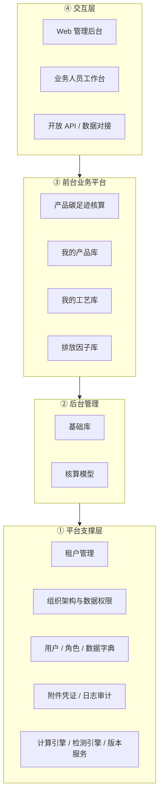
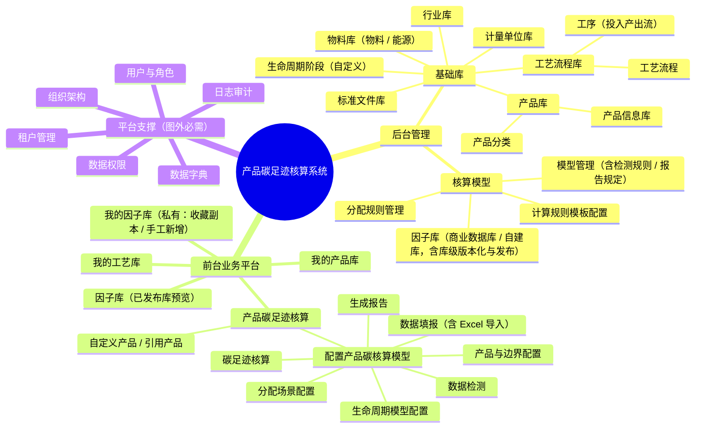
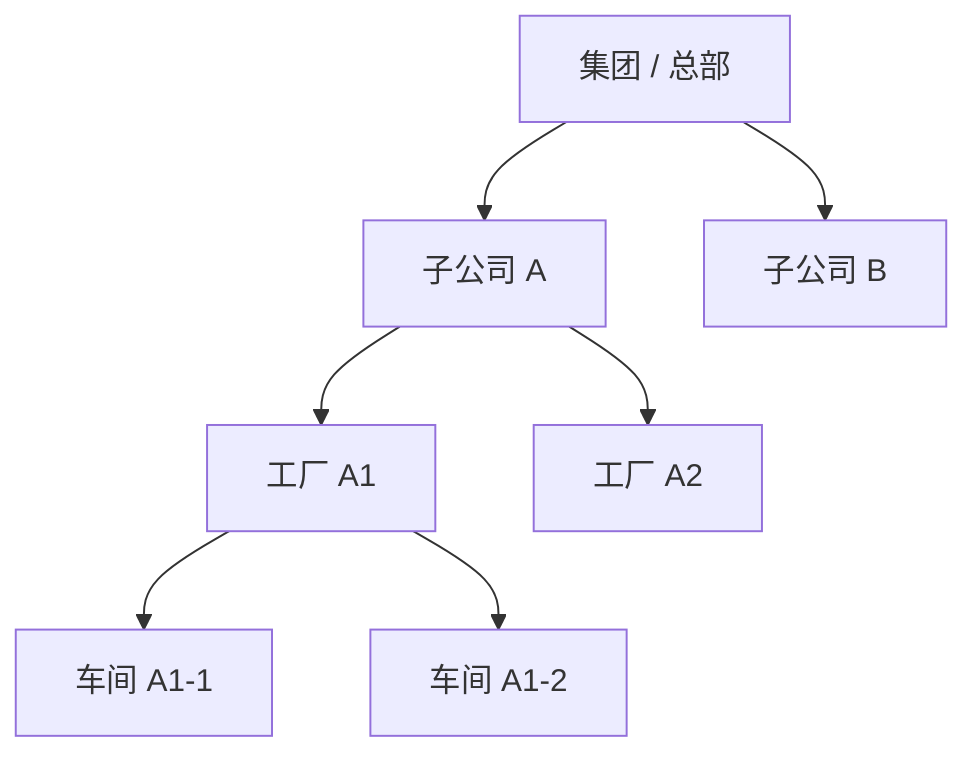
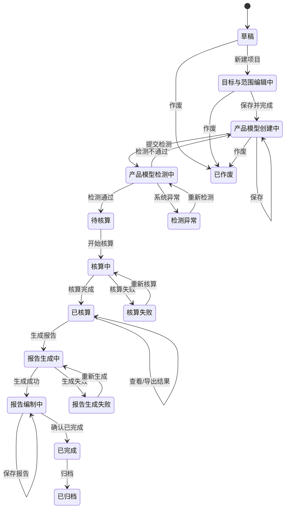
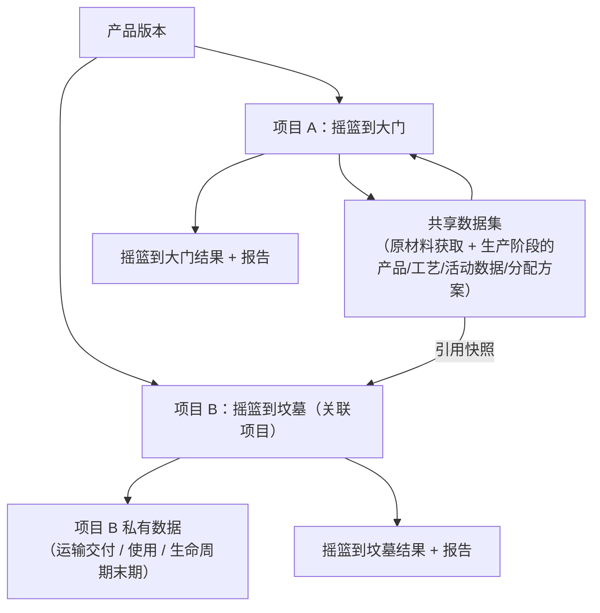

# 通用产品碳足迹核算系统 · 整体设计方案

| 项 | 内容 |
|---|---|
| 文档版本 | v1.3（含二次评审修订 + 本版本决策 D1–D4 落地 + 基础库落地偏离回改 + 因子库字段精简） |
| 编制日期 | 2026-09-20 |
| 文档定位 | 系统级整体设计（业务架构 + 应用架构 + 领域模型 + 关键机制），不涉及数据库表结构、接口定义与具体技术选型实现 |
| 输入依据 | 业务功能架构图（后台管理 / 前台业务平台）、MVP业务模型v1.0.xlsx、《MVP范围与功能清单》《MVP业务对象模型》、v1.1 评审意见 |
| 适用范围 | **通用产品碳足迹核算系统**，不绑定行业；木竹产品仅作为首个验证场景 |
| 本期聚焦 | 把「产品碳足迹核算」主链做深做透；组织架构先满足**数据权限**诉求即可 |
| 本期核算口径 | **温室气体范围本期限定为 CO₂**（含生物碳 CO₂ 吸收的简化处理）；CH₄/N₂O 等其他气体的特征化（GWP 集）作为扩展点预留，见 6.1.2 |

---

> # ⚠️ 重大修订声明（2026-09-24）：「核算模型」已废弃，公式下沉到工序
>
> 本方案原以「核算模型」（§4.3.1 / §4.3.2 / A2-3~A2-5）作为「边界 + 生命周期阶段 + 公式绑定 + 检测/报告口径」的承载核心。经业务确认，**核算模型与产品信息库在「阶段结构 + 工序结构」上职责重叠，导致项目核算时存在两套工序数据来源（产品副本 + 模型工序），现已废弃核算模型**。本文正文凡涉及「核算模型」的口径按以下新规则理解（已在前端原型与各 PRD 落地）：
>
> | 原口径 | 新口径 |
> | :--- | :--- |
> | 核算模型实体（A2-3 模型配置 / A2-4 检测规则 / A2-5 版本化发布） | **删除**（检测 / 报告口径本就系统内置、只读，不落字段） |
> | 项目引用核算模型（§4.3.2，引用即复制快照） | **项目直接选择产品 → 复制带入工艺 + 工序（含公式）** |
> | 生命周期阶段（模型内私有副本、可增删改） | 降级为**工序/工艺的「所属生命周期阶段」标签**，不再作为可增删改的独立层级；报告仍按阶段分组披露 |
> | 排放项级公式（模型内绑定） | **下沉到「工序的投入产出项」**（系统默认带出 + 可手工覆盖或「不参与计算」），随工序 → 工艺 → 产品 → 项目「引用即复制」 |
> | 产品总碳排放公式（模型内受控表达式） | **固定规则：产品总碳排放 = Σ 各工序排放**（工序排放 = Σ 其投入产出项结果，引擎自动汇总，无需配置；减碳扣减由「回收信用法」等公式返回负值自动抵扣） |
> | 核算边界 / 标准依据（核算方法） | **项目级**（项目步骤①直接选择，不再由模型承载） |
>
> 具体规则见《工序业务 PRD》§4.8 / R-023 / R-024、《产品信息业务 PRD》C9，以及《核算模型业务 PRD》文首废弃声明。**本文正文暂不做全文改写**，待各 PRD 定稿后统一回改。

---

> # ⚠️ 补充修订声明（2026-10-09）：公式级配置回归，成为核算唯一入口
>
> 在 2026-09-24「公式下沉到工序」的基础上进一步调整：**「公式管理」（后台 · 核算配置，行级 / 阶段汇总 / 全局三层受控表达式）成为核算引擎的唯一计算入口**，项目在步骤①引用「已发布」公式；未引用或表达式非法时回退默认口径。
>
> | 2026-09-24 口径 | 2026-10-09 新口径（V0.4 已落地原型） |
> | :--- | :--- |
> | 产品总碳排放 = Σ 各工序排放（**固定规则，无需配置**） | **全局公式**（默认 `SUM(各阶段碳排)`）；**改公式即改算法**，可承载标准差异与产品特有折算 |
> | 排放项级公式**下沉到工序的投入产出项** | **行级公式**作用于「阶段数据项」（行），变量为 `[当前行.活动数据]` / `[当前行.单位换算系数]` / `[当前行.排放因子]`；阶段汇总为独立一层公式 |
> | 单位换算系数「后置」 | 引擎按计量单位库「**基准中转**」计算 `[当前行.单位换算系数]`，**本期落地** |
> | 公式级自定义「后置」 | **本期开放**（A2-1 / A2-2 口径同步调整） |
>
> 具体规则见 **§6.1.1**、〔后台〕《**公式管理字段清单**》《**公式管理业务 PRD**》（`02prd/02-1后台管理/08计算引擎配置/`）、〔前台〕《碳足迹核算业务 PRD》§6、《碳足迹核算字段清单》§1.1。

---

## v1.2 相对 v1.1 的修订

| # | 修订内容 |
|---|---|
| 1 | **移除「核算规则包」概念**：标准依据、阶段约束、检测规则、报告模板全部并入「核算模型」，全文统一用词，不再出现规则包 |
| 2 | **明确「一项目一边界」**：摇篮到大门 / 摇篮到坟墓各建独立项目，通过「关联项目 + 共享数据集」复用基础数据（修订 1.3 / 1.4 / 5.3，替换原「一产品两版本」表述） |
| 3 | **核算气体范围收窄为 CO₂**，计算引擎预留「气体维度」扩展位（见 6.1.2）；生物碳/固碳本期按**负排放因子**简化处理，作为模型可配置开关（见 6.5 / 待确认） |
| 4 | **分配机制对齐 ISO 14044 层级**：避免分配 → 物理关系 → 经济价值的强制顺序约束；分配场景新增「替代法 / 系统扩展」（见 4.5 / 6.4） |
| 5 | **计算规则模板化**：计算引擎配置由「用户配置公式」降级为「内置标准公式模板 + 参数级自定义」，公式级自定义后置（见 4.3.1 / A2-1） |
| 6 | **新增数据质量轻量预留**：活动数据与因子增加数据质量等级字段（三档），因子支持 Excel 批量导入，电网因子按区域 + 年度管理（见 4.4 / 4.6） |
| 7 | **状态机修正**：「已完成」为终态，修订版 = 新建关联项目；新增「已归档 / 已作废」终态；补充并发编辑与解锁规则（见 5.2） |
| 8 | **报告全版本留存**：修正原「仅保留最近一次正式版本」与追溯要求的矛盾；报告章节要素对齐 ISO 14067（见 4.8） |
| 9 | **权限矩阵修正**：补充组织管理员对组织自建基础数据的权限，补充「我的产品库 / 工艺库 / 因子库」行（见 7.2） |
| 10 | **数据归属与 SELF 可见性判定规则明确**（见 3.3.4） |
| 11 | **异常编号说明**：E02 / E06 为源文件保留编号（源 Excel 中未定义）；新增 E14（核算周期覆盖性）、E15（能量平衡提示）（见 5.4） |
| 12 | **明确 SaaS 多租户优先**的部署形态与隔离设计（见 3.0 / 九） |
| 13 | 快照机制补充「不可变对象」落地原则（见 4.9）；因子匹配优先级明确为「组织自建优先」（见 4.4） |
| 14 | 页面清单标注**最小闭环范围**，支撑阶段一内部排期（见 八）；路线图预留第三方核查工作流（见 十） |
| 15 | 待确认事项更新：移除已决策项，新增背景因子库选型、cut-off 默认阈值等（见 十一） |
| 16 | **二次评审修正**：区分「平台运营人员（SaaS 运营方）」与租户内角色，平台运营默认不可见租户业务数据，`ALL` 数据域限定为租户内（见 3.3.2 / 7.1 / 7.2 / 九） |
| 17 | **生物碳对称性规则**：开启固碳开关且计入 CO₂ 吸收后，摇篮到坟墓项目末期必须对称计入生物碳释放或注明长期储存（新增异常 E16，见 5.4 / 5.5 / 6.5） |
| 18 | 报告版本措辞修正：仅草稿阶段可编辑说明性内容，正式版本一律只读（见 4.8） |
| 19 | 5.5 准入表补充能量平衡与生物碳对称检查行；CO₂ / CO₂e 口径统一说明（见 6.1.1）；租户管理页优先级说明（见 八）；共享数据集主从关系与分配方案归属说明（见 5.3） |
| 20 | **本版本决策落地（v1.2 r3）**：决策 D1 报告本版本固定模板；D2 生命周期阶段默认基线按行业预置多套；D3 首发标准依据对齐 GB/T 24067-2024；D4 核算模型「因子规定」本版本固定（结构化预置 + 只读，仅开放少量开关），不做配置页（见 4.3.1 / 4.4 / 十一） |
| 21 | **基础库落地偏离回改（v1.2 r4）**：基础库（物料库 / 工艺库 / 计量单位库 / 生命周期阶段）的字段清单与业务 PRD 编制过程中产生 6 项实质性偏离，本版本统一回改：① 物料移除「默认单位」；② 能源移除「默认单位」、改「热值单位」；③ 能源类型分层（燃料 / 电力 / 热力）；④ 计量单位换算改「基准中转」；⑤ 「数据来源」术语拆分，业务口径下沉到活动数据；⑥ 生命周期纳入规则统一为三态。另有 2 项**待确认偏离**（物料/能源新增「适用行业」、工序/工艺流程「模板 + 引用即复制」）已在附录登记（见 **附录二 · 基础库落地偏离清单**） |

## v1.3 相对 v1.2 的修订

| # | 修订内容 |
|---|---|
| 1 | **因子库字段精简**（见 §4.4）：因子移除「**因子分类**」（6 类）与「**适用行业**」；原 6 类枚举降级为**核算结果的「排放源归类」**（非因子字段）；匹配维度改用「适用对象 / 适用阶段 + 单位 + 区域 / 年度」 |
| 2 | 因子移除全部「**来源信息**」（来源类别 / 发布年份 / 发布日期 / 发布国家·组织 / 发布机构全称·简称 / 数据来源文件）；「来源」语义由**库来源（商业数据库 / 自建）**表达；因子详情无「来源信息」区块、因子表单无「来源信息」页签 |
| 3 | 商业数据库因子「数据基本信息」收敛为 **产品名称 / CAS号 / 所有者 / 过程描述** 四项；输入 / 输出表列头分别为「**上游过程名称 / 下游过程名称**」 |
| 4 | **核算公式成为引擎唯一计算入口（见 §6.1.1 / 补充修订声明 2026-10-09）**：行级 → 阶段汇总 → 全局三层受控表达式；单位换算系数按计量单位库「基准中转」由引擎计算；单位产品碳足迹 = 全局公式结果 |

---

## 目录

1. [方案概述](#一方案概述)
2. [系统总体架构与功能清单](#二系统总体架构与功能清单)
3. [通用组织架构与数据权限](#三通用组织架构与数据权限)
4. [核心领域模型设计](#四核心领域模型设计)
5. [核心业务流程与状态机](#五核心业务流程与状态机)
6. [关键机制设计](#六关键机制设计)
7. [角色与权限矩阵](#七角色与权限矩阵)
8. [页面清单](#八页面清单)
9. [非功能设计](#九非功能设计)
10. [演进路线](#十演进路线)
11. [待确认事项](#十一待确认事项)

---

# 一、方案概述

## 1.1 建设目标

建设一套**通用的产品碳足迹核算系统**：以「产品碳足迹核算」为核心主线，让用户走通

```text
创建核算项目 → 建立产品版本 → 选择生命周期边界 → 配置生命周期阶段 → 采集阶段活动数据
→ 匹配排放因子 → 配置分配规则 → 执行核算 → 质量校验 → 确认结果 → 生成碳足迹报告
```

并可在此基础上沉淀企业自己的**产品库、工艺库、工序库、因子库**，形成可复用的碳数据资产。

## 1.2 系统定位：通用优先

```text
本版本定位 = 通用产品碳足迹核算平台（不绑定行业、不绑定单一标准）

通用性体现在四个可配置：
  ├── 生命周期阶段可自定义（系统给默认阶段基线，用户可增删改）
  ├── 产品 / 工艺 / 工序可自定义（同时支持"引用"与"自定义"两种来源）
  ├── 核算模型可配置（模型 = 边界 + 生命周期阶段 + 计算规则 + 因子规定 + 分配规则 + 检测规则 + 报告规定的组合）
  └── 排放因子可扩展（多因子库：商业数据库 + 自建库；前台「我的因子库」私有）

行业只作为"配置结果"存在：
  木竹 / 钢铁 / 纺织 / 食品 …… 均通过「行业库 + 阶段配置 + 因子集 + 规则模板」组合接入，
  引擎与数据模型不感知具体行业。
```

> **关键立场**：木竹产品（如 240mm 全竹碳化筷子）在本方案中只作为**验证通用能力是否成立的样板场景**，不是设计约束。凡是只在木竹成立、不能通用的设计，一律不作为本版本方案。

## 1.3 设计原则

| 原则 | 说明 |
|---|---|
| 通用先行 | 能力以「可配置」形式提供，不为单一行业硬编码 |
| 一个产品，多种边界 | 同一产品若需多种边界核算，**分别创建关联项目**（摇篮到大门 / 摇篮到坟墓各一个），通过「共享数据集」复用基础数据，结果不混算（见 5.3） |
| 共享基础数据 | 原材料获取、生产阶段的数据在关联项目间通过共享数据集复用；运输/交付、使用、生命周期末期为摇篮到坟墓项目的扩展数据 |
| 数据可追溯 | 每条活动数据记录来源、凭证、数据状态、核验人和核验时间，保留原始值与分配值 |
| 先校验、后出报告 | 关键数据缺失、因子缺失、分配未确认或阶段未闭合时，不允许生成正式报告 |
| 引用优于复制 | 能用系统预置或共享数据就引用，自定义只用于确有差异的场景 |
| 配置即数据 | 模型、因子、分配规则全部版本化，核算结果与「当时用的版本」强绑定 |
| 分配层级合规 | 分配须遵循 ISO 14044 层级：避免分配（细分/系统扩展）→ 物理关系 → 经济价值（见 4.5） |
| 主链优先 | 本期把「产品碳足迹核算」做深，其他能力均为支撑 |

## 1.4 核心术语

| 术语 | 含义 |
|---|---|
| PCF | 产品碳足迹（Product Carbon Footprint），本系统主体对象 |
| 核算项目 | 一次 PCF 核算工作的业务载体，**绑定 1 个产品 + 1 种边界 + 1 套核算模型**；同一产品多边界 = 多个关联项目 |
| 关联项目 | 同一产品版本下针对不同边界创建的、共享基础数据的项目组关系（见 5.3） |
| 共享数据集 | 关联项目间复用的基础数据集合（原材料获取、生产阶段的产品/工艺/活动数据），在共享项目内维护，其他项目引用快照 |
| 核算边界 | 摇篮到大门（Cradle-to-Gate）/ 摇篮到坟墓（Cradle-to-Grave） |
| 生命周期阶段 | 用于组织填报、检测、汇总与报告的阶段结构，支持一级/二级，可自定义 |
| 核算工序 | 生产工序与单元过程的合并对象，是活动数据填报与排放计算的最小单元 |
| 投入产出流 | 工序的输入（原料/能源）与输出（中间品/成品/副产品） |
| 排放因子 | 活动数据 → 碳排放量的换算系数；**本期口径为 CO₂ / CO₂e（以 CO₂ 为准）** |
| 分配 | 共用能源/材料/运输/废弃物在多个产品或工序间的分摊 |
| 核算模型 | 边界 + 生命周期阶段 + 计算规则 + 因子规定 + 分配规则 + 检测规则 + 报告规定的组合，版本化可发布；**承载标准差异（ISO 14067 / PAS 2050 / GB/T 24067 / PEF 等）的唯一入口** |
| 计量单位 | 活动数据、因子、功能单位、结果表达的统一口径基础，含换算关系 |
| 数据质量等级（DQR） | 活动数据/因子的质量标记，本期为三档轻量预留（见 4.6） |
| 租户 | SaaS 部署下的最高隔离单元，对应一个企业集团（见 3.0） |

---

# 二、系统总体架构与功能清单

## 2.1 总体架构分层



| 层级 | 内容 | 说明 |
|---|---|---|
| ① 平台支撑层 | 租户、组织、权限、字典、附件、审计、引擎服务 | 图中未列但系统必需，本方案单独标注 |
| ② 后台管理 | 基础库、核算模型 | 由系统/专业配置人员维护，沉淀"标准" |
| ③ 前台业务平台 | 产品碳足迹核算 + 我的产品库 / 工艺库 / 因子库 | 核算人员的日常作业面 |
| ④ 交互层 | Web 后台 + 业务工作台 + 开放 API | 本期不含移动端填报 |

> **本期不做**：移动端数据填报、分析域（多产品对比、多组织对标、可视化看板、降碳优化模拟）、物联设备与计量器具接入、批次全流程追溯、CH₄/N₂O 等非 CO₂ 气体的特征化核算。

## 2.2 功能架构（严格对齐业务功能架构图）



## 2.3 功能清单（以图为准）

### A. 后台管理

#### A1 基础库

| 编号 | 二级模块 | 功能点 | 说明 |
|---|---|---|---|
| A1-1 | 物料库 | 物料管理 | 物料分类、适用行业、增删改、来源（系统预置 / 组织自建）；支持引用/自定义。**不绑定单位**（单位在工序行选择，见 4.2.1） |
| A1-2 | 物料库 | 能源管理 | 能源类型（**燃料 / 电力 / 热力**，具体品名放能源名称）、适用行业、**热值 + 热值单位**、来源。**不绑定填报单位**（见 4.2.1） |
| A1-3 | 标准文件库 | 标准文件管理 | 上传核算标准文件，记录名称、编号、版本、适用范围、生效日期；供核算模型引用 |
| A1-4 | 行业库 | 行业管理 | 行业分类与行业参数模板，供行业化配置复用 |
| A1-5 | 产品库 | 产品分类 | 产品分类树维护（多级） |
| A1-6 | 产品库 | 产品信息库 | **产品 = 产品基本信息 + 工艺 + 工序的组合**；支持增删改、上架、版本化 |
| A1-7 | 工艺流程库 | 工艺流程 | 工艺流程定义、适用产品、版本管理 |
| A1-8 | 工艺流程库 | 工序 | 工序定义 + **投入产出流**（原料 / 能源 / 中间品 / 成品 / 副产品） |
| A1-9 | 计量单位库 | 计量单位 | 单位字典（重量/能量/距离/体积/数量等）+ **单位换算关系**（见 4.2.3） |
| A1-10 | 生命周期阶段 | 自定义生命周期阶段 | 系统给默认阶段基线，用户可新增、调整、启用/排除阶段（支持一级/二级） |

#### A2 核算模型

| 编号 | 二级模块 | 功能点 | 说明 |
|---|---|---|---|
| A2-1 | 计算规则模板 | 标准公式模板 | 内置燃烧、电力、运输、废弃物等**标准公式模板**（如 `活动数据 × 换算系数 × 因子`），作为**默认口径**可直接使用，也可复制后微调 |
| A2-2 | 计算规则模板 | 公式级自定义（V0.4 开放） | 后台「**公式管理**」（`/model/formula`）配置**三层受控表达式**（行级 / 阶段汇总 / 全局），由项目在步骤①引用「已发布」版本；**改公式即改算法**（见 6.1.1） |
| A2-3 | 模型管理 | 模型配置 | **模型 = 边界 + 生命周期阶段 + 计算规则 + 因子规定 + 分配规则 + 检测规则 + 报告规定的组合**；可绑定标准文件库中的标准依据 |
| A2-4 | 模型管理 | 检测规则配置 | 模型内配置检测项（阻断级 / 提示级）、阈值参数（如质量平衡误差阈值、cut-off 阈值） |
| A2-5 | 模型管理 | 版本化 / 发布 | 模型版本管理，发布后**不可修改**，只能出新版本；发布后方可被项目引用 |
| A2-6 | 排放因子库 | 因子库（多库） | **多因子库（库级版本化 + 发布；商业数据库/自建库）**：库来源 = 商业数据库（`external`，整库导入、库内只读）/ 自建库（`builtin`，库内因子可增删改、支持 Excel 批量导入）；电网类因子按「区域 + 年度」管理。<br>*（V0.2 变更注记：原「environment 库」单库预置口径改为**多库模型**；v1.3 注记：因子字段精简，移除「因子分类 / 适用行业」与全部「来源信息」，来源由**库来源**表达）* |
| A2-7 | 排放因子库 | 库版本与发布 | **库级版本化与发布**：新建版本（草稿）→ 发布（旧版本自动冻结）→ 前台默认展示最新已发布版本；**发布后不可修改，只能新建版本**。<br>*（V0.2 变更注记：原「自定义因子库」改为「库版本与发布」，与 A2-6 合并为同一**多库 + 库级版本化**模型）* |
| A2-8 | 分配规则管理 | 分配方法库 | 按产量、质量、能耗、体积、面积、经济价值等方法；标注方法层级（物理 / 经济）（见 4.5） |
| A2-9 | 分配规则管理 | 分配场景模板 | 预置典型场景：共用能源、多产品共线、副产品（分摊 / 替代法）、跨阶段共用、下游主产品归属、系统扩展 |
| A2-10 | 分配规则管理 | 分配规则配置 | 场景 + 方法 + 依据 + 校验规则（合计 = 100%）+ 层级合规校验 |
| A2-11 | 分配规则管理 | 方案版本发布 | 分配方案版本化发布，供项目引用 |

### B. 前台业务平台

#### B1 产品碳足迹核算（本期主链）

| 编号 | 功能点 | 说明 |
|---|---|---|
| B1-1 | 自定义产品 / 引用产品 | 项目内确定被核算产品：从产品库引用，或直接自定义 |
| B1-2 | 配置产品碳核算模型 | 项目内实例化核算模型（引用已发布模型 + 项目级调整），形成项目快照 |
| B1-3 | ├ 生命周期模型配置 | 配置启用阶段、阶段顺序、工艺流程、核算工序、投入产出流、默认参数 |
| B1-4 | ├ 产品与边界配置 | 产品基本信息、功能单位、核算方法、核算周期、核算地点、边界选择 |
| B1-5 | ├ 分配场景配置 | 项目内确定分配场景与分配比例（受 4.5 层级约束） |
| B1-6 | ├ 数据填报 | 按阶段与核算工序录入活动数据、数据来源、凭证；**支持 Excel 模板批量导入** |
| B1-7 | ├ 数据检测 | 提交并检测，输出问题清单，支持修改后再次检测 |
| B1-8 | ├ 碳足迹核算 | 执行核算，按阶段/工序/排放源汇总 |
| B1-9 | └ 生成报告 | 生成对应边界的报告，支持预览、编辑说明性内容、确认、下载 |
| B1-10 | 关联项目 / 共享数据集 | 同一产品多边界时创建关联项目、维护共享数据集（见 5.3） |

#### B2 我的产品库

| 编号 | 功能点 | 说明 |
|---|---|---|
| B2-1 | 自定义产品 / 引用产品 | 引用标准产品或自建产品 |
| B2-2 | 产品基本信息 + 工艺 + 工序组合 | 组装形成完整产品定义，支持版本化 |

#### B3 我的工艺库

| 编号 | 功能点 | 说明 |
|---|---|---|
| B3-1 | 工艺流程 — 引用工艺 | 引用已有工艺模板 |
| B3-2 | 工艺流程 — 自定义工艺 | 自建工艺并保存复用 |
| B3-3 | 工序 — 引用工序 | 引用已有工序 |
| B3-4 | 工序 — 自定义工序 | 自建工序与投入产出流 |

#### B4 我的因子库（前台私有库）

> **V0.2 变更注记**：原前台模块「排放因子库（environment 库 + 自定义因子库）」调整为「**我的因子库**」—— 前台为**组织私有库（不发布、不参与平台共享、不版本化）**；后台多因子库模型见 A2-6 / A2-7。

| 编号 | 功能点 | 说明 |
|---|---|---|
| B4-1 | 已发布库预览 | 预览后台**多因子库（库级版本化 + 发布；商业数据库/自建库）**的**最新已发布版本**因子，只读（商业数据库按 ISIC 门类 A~S 分类、自建库按系统 6 分类） |
| B4-2 | 收藏 / 我的因子库 | **收藏 = 复制式快照**（源库后续更新**不自动影响**副本）；源库发布新版本且因子值变化时显示「有新版本可更新」角标，支持**一键更新**；支持**手工新增因子**；私有库**不发布、不版本化** |

### C. 平台支撑能力（图中未列，系统必需）

| 编号 | 模块 | 功能点 | 为什么必需 |
|---|---|---|---|
| C0 | 租户管理 | 租户开通、隔离配置 | SaaS 多租户部署下，租户为最高隔离单元（见 3.0） |
| C1 | 组织架构 | 组织树维护 | 业务数据需要归属主体，且需求明确要求支持集团—子公司—工厂—车间 |
| C2 | 用户与角色 | 用户、角色、授权 | 决定"谁能操作什么" |
| C3 | 数据权限 | 数据可见范围 | 决定"谁能看到哪些组织的数据"，本期组织能力的核心 |
| C4 | 数据字典 | 产品类别、数据来源、运输方式等 | 各类下拉项的统一来源 |
| C5 | 日志审计 | 操作日志、数据变更记录 | 碳数据需要可追溯、可审计 |
| C6 | 附件管理 | 凭证上传与关联 | 活动数据需要凭证支撑 |

---

# 三、通用组织架构与数据权限

## 3.0 租户模型（SaaS 多租户优先）

```text
租户（Tenant）= 一个企业集团，是数据隔离的最高边界
├── 1 个租户 : 1 棵组织树（集团 → 子公司 → 工厂 → 车间……）
├── 租户间数据完全隔离（行级 tenant_id 隔离 + 附件存储隔离）
├── 系统预置数据（商业数据库因子、标准文件、阶段基线等）为平台级，全部租户只读共享
└── 保留私有化部署可能性：架构不依赖多租户特性，私有化时租户 = 唯一实例
```

> **本期不做**：跨租户数据共享、租户级计费与配额管理。

## 3.1 设计原则：组织架构要通用

| 原则 | 说明 |
|---|---|
| 层数不固定 | 不硬编码"四级"。组织层数由企业实际决定，通过 `组织类型` 配置表达 |
| 类型可自定义 | 集团、事业部、子公司、工厂、车间、产线、部门等均为**可配置的组织类型** |
| 层级可裁剪 | 只有两级的企业就用两级，不影响系统使用 |
| 业务数据带组织 | 所有业务数据都记录归属组织，作为权限判定的唯一依据 |

## 3.2 组织模型

```text
组织（Organization）
├── org_id        组织标识
├── tenant_id     所属租户
├── org_name      组织名称
├── org_type      组织类型（来自组织类型字典，可自定义）
├── parent_id     上级组织
├── org_path      层级路径（如 /G01/C03/F12/W05，用于"含下级"查询）
├── org_level     层级序号
├── status        启用 / 停用
└── 其他          负责人、联系方式、备注
```



**典型组织类型字典（可增删）**

| 组织类型 | 说明 | 是否必需 |
|---|---|---|
| 集团 / 总部 | 最高层级 | 视企业而定 |
| 事业部 / 区域 | 中间管理维度 | 可选 |
| 子公司 / 法人 | 独立法人 | 常见 |
| 工厂 / 生产基地 | 实际生产单元 | 常见 |
| 车间 / 产线 | 生产执行单元 | 可选 |
| 部门 | 非生产组织 | 可选 |

> 说明：用户需求中提到的「集团 — 子公司 — 工厂 — 车间」是**一组典型示例**，系统按其实现，但通过组织类型字典保持通用，不把四级写死。

## 3.3 数据权限模型（本期核心）

### 3.3.1 权限判定公式

```text
用户最终可操作的数据 = 组织归属匹配 × 角色功能权限

组织归属匹配：数据.owner_org_id ∈ 用户的数据可见范围
角色功能权限：用户在数据所属组织下的角色，决定"可读 / 可写 / 可删 / 可审批"
```

### 3.3.2 数据可见范围（Data Scope）五档

| 数据域 | 代码 | 含义 | 典型使用人 |
|---|---|---|---|
| 仅本人 | `SELF` | 只看自己创建的数据 | 数据填报人 |
| 本组织 | `CURRENT` | 只看当前所在组织的数据 | 工厂核算员 |
| 本组织及下级 | `SUB_TREE` | 含所有下级组织（基于 `org_path`） | 子公司管理员 / 集团管理员 |
| 指定组织 | `SPECIFIED` | 手工勾选若干组织节点 | 跨子公司协作、外部顾问 |
| 全部 | `ALL` | 本租户内全部业务数据（平台运营人员默认不可见） | 租户管理员（集团层组织管理员） |

### 3.3.3 数据归属与可见性（简化版两档）

考虑到本期只需要满足数据权限，数据可见性简化为两档：

| 可见性 | 代码 | 含义 | 适用数据 |
|---|---|---|---|
| 组织内 | `ORG` | 归属组织内可见（上级按数据域可见） | 业务数据默认：核算项目、活动数据、报告 |
| 全平台 | `PUBLIC` | 所有租户可引用（只读） | 系统预置数据：商业数据库因子、标准文件、行业库、计量单位、生命周期阶段基线 |

**「引用 / 自定义」的落地方式（对应思维导图）**

| 来源 | 可见性 | 可编辑 | 对应前台入口 |
|---|---|---|---|
| 系统预置 | `PUBLIC` | 否，只读引用 | 排放因子库 → 商业数据库（整库导入、只读） |
| 组织自建 | `ORG` | 是 | 我的产品库 / 我的工艺库 / 我的因子库（后台对应自建库） |

> **v1.3 注记**：原「environment 库」口径已由**多因子库（商业数据库 / 自建库，库级版本化 + 发布）**取代；前台对应「**我的因子库**（组织私有库）」。因子不再设「来源」字段，归属档位由**库来源**表达。

> 后续若需要"集团建标准、子公司引用"的强管控，可在两档基础上扩展为多级共享（`GROUP` / `SUB_TREE` 等），本版本不展开。

### 3.3.4 活动数据的归属与 SELF 过滤判定规则（明确）

```text
规则 1：活动数据的 owner_org_id 恒等于所属核算项目的「核算主体组织」，
        不随填报人所在组织变化（保证项目内数据聚合一致）。
规则 2：活动数据额外记录「创建人 created_by」（车间填报人）。
规则 3：数据可见范围过滤按「组织过滤在前、创建人过滤在后」叠加：
        SELF   = 组织范围内 再过滤 created_by = 当前用户
        CURRENT / SUB_TREE / SPECIFIED / ALL = 仅按组织过滤，不看创建人。
示例：车间 A1-1 填报人在工厂 A1 项目下填报，数据归属工厂 A1；
      填报人本人（SELF）可见自己填的；工厂核算员（CURRENT）可见工厂 A1 项目下全部数据。
```

## 3.4 组织与业务数据的关联

| 业务对象 | 组织关联方式 |
|---|---|
| 核算项目 | 绑定 1 个**核算主体组织**（通常为工厂），项目下所有数据默认归属该组织 |
| 产品 / 工艺 / 工序 / 因子 | 记录归属组织（系统预置的归属为"平台"） |
| 活动数据 / 检测结果 / 核算结果 / 报告 | 继承所属项目的组织归属（见 3.3.4 规则 1） |
| 用户 | 归属 1 个主组织 + 可兼任若干组织角色 |

**上级可见规则**：上级组织始终可以查看下级组织的数据（管控需要）；下级**不可查看上级的业务数据**，但可以**引用上级/系统共享的主数据**。

## 3.5 本期不做（明确边界）

| 不做项 | 原因 |
|---|---|
| 主数据多级继承 / 扩展 / 覆写 | 规则复杂，本期先满足"数据权限"即可 |
| 分组分级填报与协同（车间填报→工厂审核→子公司汇总） | 本期未要求协作流程 |
| 多级汇总与合并 | 属于分析域，本期不做 |
| 组织变更数据迁移工具 | 组织调整频率低，可人工处理 |
| 跨组织因子优先级匹配 | 本期因子来源简化为"系统预置 / 组织自建" |
| 跨租户数据共享 | SaaS 隔离边界，不做 |

---

# 四、核心领域模型设计

## 4.1 领域分层

```text
一、平台支撑域
├── 租户            ├── 组织 / 用户 / 角色 / 数据权限
├── 数据字典        └── 附件 / 日志

二、基础库域（标准沉淀）
├── 物料 / 能源      ├── 产品分类 / 产品 / 产品版本
├── 标准文件 / 行业   ├── 工艺流程 / 工序 / 投入产出流
├── 计量单位 / 换算   └── 生命周期阶段

三、核算模型域（怎么算）
├── 计算规则模板     ├── 模型（含检测规则 / 报告规定）
├── 排放因子         └── 分配方法 / 场景模板 / 规则

四、核算业务域（一次核算）
├── 核算项目         ├── 产品与边界配置（快照）
├── 关联项目 / 共享数据集 ├── 生命周期模型
├── 投入产出流       ├── 活动数据 / 凭证
└── 因子匹配 / 分配结果

五、检测与结果域
├── 检测任务 / 结果 / 问题项
├── 核算任务 / 核算结果 / 结果明细
└── 报告 / 报告版本（全版本留存）
```

> 核心关系：**基础库与核算模型 = 可复用的"标准"；核算业务 = 一次核算的"实例"**。标准变化不影响历史项目，因为项目做的是**快照引用**（见 4.9）。

## 4.2 基础库

### 4.2.1 物料库与能源库

| 对象 | 关键字段 |
|---|---|
| 物料 | 物料编码、物料名称、物料分类、**适用行业**、描述、数据来源、使用状态 |
| 能源 | 能源编码、能源名称、能源类型（燃料 / 电力 / 热力）、**适用行业**、**热值 + 热值单位**、描述、数据来源、使用状态 |

> **修订说明（v1.2 r4）**
>
> | 修订项 | 原表述 | 现状 | 理由 |
> |---|---|---|---|
> | **物料与能源均移除「默认单位」** | 原字段含「默认单位」 | 物料/能源**不绑定填报单位**；单位在**工序的投入项 / 产出项**中逐行选择 | 物料只回答"是什么"；同一物料在不同工序可用不同单位，在主数据上预设默认值反而制造口径不一致。E04（因子单位不匹配）与 E09（质量平衡）的校验以**工序行的单位**为准，链路不受影响。与行业平台（南平铝业）做法一致 |
> | **能源「热值单位」保留** | 原字段为「热值或折算系数」 | 能源持有「**热值 + 热值单位**」两个字段（如 `44.8` + `MJ/kg`） | 热值是**比值**，没有分母则数值无意义。**「热值单位」≠「默认单位」**：前者是热值的定义域，后者是填报语义，不可互相替代 |
> | **能源类型分层** | 原为「电、柴油、天然气、蒸汽、热力」（类型与品名混列） | 类型 = **燃料 / 电力 / 热力**；具体品名（柴油、天然气、蒸汽）放入**能源名称** | 原枚举把"类型"与"品名"混在一个枚举里，后续新增能源会不断往枚举里塞品名 |
> | **「数据来源」术语拆分** | 原字段「数据来源」在 §4.2.1 指"数据是怎么来的"，在 §3.3.3 又指"系统预置 / 组织自建" | 「**数据来源**」统一为**归属口径**（系统预置 / 组织自建，仅用于权限与可见性判定）；「数据是怎么来的」（实测 / 统计 / 估算 / 供应商 / 数据库，见 §4.6）**下沉到活动数据**，在数据填报时记录 | 消除一词两义。DQR 的承载点也随之落在活动数据（与 §4.6 一致） |
> | **新增「适用行业」** | 原字段清单无此字段 | 物料与能源新增「适用行业」（多选，引用行业库 A1-4） | **待确认偏离**，对标行业平台后补充；见附录二 |
> | 「归属组织」「可见性」 | 原列为独立字段 | 保留「归属组织」；**「可见性」由「数据来源」推导**，不单独设字段 | 与基础库各模块统一口径 |

### 4.2.2 产品、工艺与工序

**产品定义（严格对齐业务功能架构图）**

```text
产品 = 产品基本信息 + 工艺 + 工序的组合
产品基本信息：名称、分类、型号、规格、单位、描述、状态
版本化：V1.0 → V1.1 → V2.0，支持上架 / 下架
```

**投入产出流（工序的核心）**

| 流类型 | 说明 | 示例 |
|---|---|---|
| 原料投入 | 进入工序的原材料 | 原竹、木材 |
| 能源投入 | 进入工序的能源 | 电力、柴油、天然气 |
| 中间品 | 工序间流转的中间产物 | 竹条、碳化竹材 |
| 成品 | 工序产出的最终产品 | 成品筷子 |
| 副产品 | 工序产出的非主产品 | 边角料、竹粉 |

> 设计要点：**工序是"投入产出流"的载体**，投入产出流是后续活动数据与排放因子的挂载点，也是不同工序互相衔接的纽带（上游工序的"成品/中间品"= 下游工序的"原料投入"）。

> **修订说明（v1.2 r4）**
>
> | 修订项 | 现状 | 理由 |
> |---|---|---|
> | **5 类流拆为「投入项 / 产出项」两张子表** | 投入项承载「原料投入 / 能源投入」（引用物料库 / 能源库）；产出项承载「中间品 / 成品 / 副产品」（引用物料库）。**5 类流的语义不变** | 两张表字段语义更集中（投入侧要选物料或能源，产出侧只选物料），避免单表内"物料字段与能源字段互斥"的空值歧义；与行业平台的交互习惯一致 |
> | **工序不做版本化** | 工序仅用「启用 / 禁用」表达生命周期；**版本化只落在「工艺流程」层**（A1-7） | 原方案仅对工艺流程提出「版本管理」要求，未对工序提出；工序作为模板，其变更不影响已建模型（见下条） |
> | **模板 + 引用即复制** | 基础库（工序 / 工艺流程）= **模板库**；被**产品版本**引用时**复制**一份定义到产品侧，副本归产品版本所有、可在产品侧修改；基础库后续调整**不回写**副本。**复制点在产品版本层**，不双层复制 | 原 §4.9 的落地方式为「对象 id + 版本号」引用 + 对象不可变。改为**复制**后，模板可自由编辑且不影响已建模型，**追溯由副本保证**。§4.9「禁止实时引用最新版本」的原则**未被违反** —— 仍是"引用后冻结"，只是实现方式不同（见 4.9 修订说明） |
> | **「中间品」不记录上下游工序关联** | 工序链衔接由「工艺流程」中的**工序顺序**推导，不双处维护；衔接判定按**物料对象一致** | 避免工序与工艺流程两处维护衔接关系而冲突 |

### 4.2.3 计量单位库（作用说明）

> 本模块在业务功能架构图中的名称为「计量单位库」。它不是业务功能，而是**核算引擎的底层依赖设施**。

| 作用 | 说明 |
|---|---|
| ① 统一填报口径 | 活动数据单位五花八门（度、kWh、吨、kg、m³、双、件、千米），统一字典让用户下拉选择，避免混填 |
| ② 支撑单位换算 | 活动数据单位与因子单位常不一致（如活动数据"12000 度"、因子 `kgCO₂e/kWh`），**没有换算关系则 `活动数据 × 排放因子` 无法计算**，会直接触发异常 E04 |
| ③ 统一功能单位与结果口径 | 功能单位（每双/每件/每千克）与结果单位（gCO₂e / kgCO₂e / tCO₂e）均来自单位库，支持结果换算展示 |
| ④ 支撑质量平衡校验 | 投入/产出/损耗的加总校验依赖单位可换算（异常 E09 常见原因即为单位不统一） |

**模型设计（v1.2 r4 修订：换算改为「基准中转」）**

```text
计量单位（单一对象，无子表）
├── 单位名称 / 单位符号
├── 单位类型（重量 / 能量 / 距离 / 体积 / 面积 / 时间 / 数量 / 碳排放量 —— 系统内置枚举）
├── 是否基准单位 / 关联基准单位
├── 换算系数（相对基准单位的乘数）
├── 数据来源（系统预置 / 组织自建） / 使用状态
└── 备注

换算机制：任意两单位 A ↔ B 的换算，统一经「基准单位」中转
        值_B = 值_A × 系数_A ÷ 系数_B
```

> **修订说明（v1.2 r4）**：原设计为独立的「单位换算关系」对象（源单位 → 目标单位 + 系数 / 公式 + 适用对象）。
>
> | 修订项 | 原设计 | 现状 | 理由 |
> |---|---|---|---|
> | **换算建模改「基准中转」** | 独立「单位换算关系」对象，为每两个单位维护一条关系 | **取消该对象**；每个非基准单位只记录「关联基准单位 + 换算系数」；任意两单位换算经基准单位中转（N 条记录） | 原设计维护量按 N² 增长（10 个单位需 45 条），且同一对单位可能出现矛盾关系（`A→B` 与 `B→A` 系数不一致）。基准中转为 N 条记录，结构上不可能矛盾 |
> | **新增「数量类不可换算」语义** | 无此约束 | 「是否可换算」为**单位类型级属性**：**数量类（个 / 件 / 双 / 套）之间不可换算**，其余类型可换算；**跨类型换算一律不支持** | 个 / 件 / 双 之间不存在固定换算关系，若按"同类型即可换算"处理会算出错误结果 |
> | **新增「碳排放量」单位类型** | 结果单位（gCO₂e / kgCO₂e / tCO₂e）未明确归类 | 单列为「碳排放量」类型，基准 `kgCO₂e` | 避免 `kg` 与 `kgCO₂e` 被判为同类型可换算 |
> | **公式型换算后置** | 原含「换算系数 / 换算公式」 | 本期**只支持乘除系数**，公式留扩展位 | 与决策 D4 精神一致（公式级自定义后置） |
> | **按物料专属换算不做** | 原含「适用对象（通用 / 指定物料 / 指定能源）」 | 本期不做（见 §十一 待确认事项） | 如木材 m³ ↔ kg 需含水率与密度，属非线性换算，后置 |

**作用范围**：数据填报（选择单位）→ 因子匹配（校验单位一致性）→ 核算（换算后计算）→ 检测（单位检测）→ 结果展示（结果单位换算），贯穿核算全链路。

### 4.2.4 生命周期阶段

```text
系统提供默认阶段基线（一级 + 二级），用户可自定义：
├── 阶段名称、阶段描述、阶段顺序
├── 一级 / 二级归属（仅两级，不支持三级）
├── 摇篮到大门纳入规则（三态）
├── 摇篮到坟墓纳入规则（三态）
├── 适用行业（多选；为空 = 全行业通用）
└── 数据来源（系统预置 / 组织自建） / 使用状态
```

**默认阶段基线（示例结构，可按需增删）**

| 一级阶段 | 二级阶段示例 | 摇篮到大门 | 摇篮到坟墓 |
|---|---|:--:|:--:|
| 原材料获取 | 原材料获取、原材料运输 | 必须纳入 | 必须纳入 |
| 生产 | 生产过程、生产过程废弃物处理 | 必须纳入 | 必须纳入 |
| 运输/交付 | 运输 | 不纳入 | 必须纳入 |
| 使用 | 仓储、产品使用 | 不纳入 | 按场景纳入 |
| 生命周期末期 | 回收与最终处置 | 不纳入 | 必须纳入 |

> 该基线是**默认值**，不同行业可通过自定义阶段适配（如增加"种植/培育"阶段）。
>
> **本版本决策 D2**：默认阶段基线**按行业预置多套**（一套通用/制造业基线 + 木竹基线 + 后续行业基线），每套含「一级 + 二级 + 按边界的默认纳入规则」；项目创建时按「行业 + 边界」自动加载对应基线，用户仍可在项目内启用/排除/新增阶段（排除项必须填原因）。行业基线由行业库承载，与核算模型解耦。

> **修订说明（v1.2 r4）**
>
> | 修订项 | 原表述 | 现状 | 理由 |
> |---|---|---|---|
> | **纳入规则统一为三态** | §4.2.4 写「**是否默认纳入（按边界）**」（两态）；§4.3.1 写「必须纳入 / 可选纳入 / 排除」（三态）—— **两处表述不一致** | 统一为**三态**：《**必须纳入 / 可选纳入 / 不纳入**》，两个边界各一个字段 | 两态无法表达「必须纳入」与「可选纳入」的区别，而该区别**直接决定 E10 是否阻断**（必须纳入阶段缺数据 → 阻断；可选纳入可排除） |
> | **「基线」不是独立对象** | 未明确 | 基线 = 按「**行业 + 边界**」从阶段库**查询出来的阶段集合**（适用行业为空或含该项目行业，再按边界读取纳入规则）；**不另建「阶段基线」实体** | 阶段字段已含「适用行业」与「按边界的纳入规则」，再建基线对象会造成两层维护；此口径同样满足 D2「按行业预置多套」的诉求 |
> | **「排除 + 填原因」归项目级** | §5.1 要求「排除项必须有原因」，未明确存放位置 | 排除动作与原因**保存在核算项目内**（P20 生命周期模型配置），**不回写阶段主数据** | 不同产品对同一阶段的排除理由不同，写回主数据会互相覆盖 |
> | **木竹基线补充专属阶段** | 仅脚注举例「如增加"种植/培育"阶段」 | 木竹基线专属阶段：一级「**种植与培育**」（育苗与种植、抚育管理）、二级「**碳化处理**」、二级「**生物碳释放**」（摇篮到坟墓必须纳入，对齐 §6.5 / E16） | 补齐 D2 要求的行业基线样例；生物碳释放是 §6.5 固碳对称性规则的落地承载 |
> | **阶段变更不追溯已建项目** | 未明确 | 项目按加载时的基线**快照**冻结；阶段主数据变更不影响已建项目，需按新基线重算走 **E13** | 与 §4.9 快照机制一致 |

### 4.2.5 标准文件库与行业库

| 模块 | 作用 |
|---|---|
| 标准文件库 | 沉淀核算依据的标准文件（名称、编号、版本、发布机构、适用范围、生效日期），**供核算模型绑定引用**（标准差异由不同版本的核算模型承载，见 4.3.1） |
| 行业库 | 沉淀行业分类与行业参数模板，作为通用平台"行业化配置"的入口，是**通用 → 行业**的唯一扩展点 |

## 4.3 核算模型

### 4.3.1 模型定义

核算模型是承载「怎么算、要什么数据、怎么校验、怎么出报告」与**标准差异**的唯一对象：

| 组成 | 说明 |
|---|---|
| 模型基本信息 | 名称、版本、适用行业、适用产品分类、**绑定的标准依据（引用标准文件库）**、状态 |
| 边界定义 | 摇篮到大门 / 摇篮到坟墓（可扩展） |
| 生命周期阶段规定 | 各边界下必须纳入 / 可选纳入 / 排除的阶段；**本版本决策 D2：默认阶段基线按行业预置多套**（非单一套），项目引用其中一套后可按边界启用/排除（见 4.2.4） |
| 计算规则 | 引用**标准公式模板**（默认口径）或项目步骤①引用的**核算公式**（公式管理 · 已发布，三层表达式）；V0.4 起**开放公式级配置**（见 6.1.1） |
| 因子规定 | 各活动数据应匹配的因子类型与匹配规则；**本版本决策 D4：作为模型的结构化配置段预置，随模型版本快照冻结，只读展示，不做配置页**；*——后续修订（2026-09-23）：原拟开放的「生物碳固碳开关 / 是否允许手工指定因子 / 区域与年度口径」**已全部删除**，模型侧不保留任何因子开关；E16 归项目侧，详见 10 模型管理 V1.8* |
| 报告规定 | 报告模板版本、必填章节、数据质量声明要求；**本版本决策 D1：固定模板，不支持自定义模板配置** |
| 分配规则 | 触发分配的场景、默认分配方法（受层级约束，见 4.5）、比例校验规则 |
| 检测规则 | 检测项清单（阻断级 / 提示级）+ 阈值参数（质量平衡误差、cut-off 阈值、周期覆盖要求等） |
| 版本化 / 发布 | 模型版本管理，发布后不可修改，只能出新版本；发布后可被项目引用 |

> **标准差异的承载方式**：不同标准（ISO 14067 / PAS 2050 / GB/T 24067 / PEF）= 不同的标准依据绑定 + 不同的阶段/检测/报告配置组合，以不同模型版本交付；不引入独立的规则包对象。
>
> **本版本决策 D3**：首发标准依据对齐 **GB/T 24067-2024**，首个核算模型（如 `通用·GB/T 24067-2024·v1.0`）绑定该标准文件；其他标准后续以新模型版本接入，本版本不并行交付多标准模型。

### 4.3.2 模型的使用方式

```text
后台配置模型（核算模型 → 模型管理）
        ↓ 发布（发布后不可变，只能出新版本）
前台引用模型（产品碳足迹核算 → 配置产品碳核算模型）
        ↓ 项目级实例化
项目核算模型快照（随项目版本锁定，不受模型后续变更影响）
```

## 4.4 排放因子库

| 维度 | 设计 |
|---|---|
| 分类（**核算结果的排放源归类，非因子字段**） | 材料、能源、运输、废弃物处理、末期处理、**生物碳（负排放，见 6.5）**；**因子本身不设「因子分类」与「适用行业」字段**（v1.3 修订） |
| 来源（**库来源**） | `external` 商业数据库（整库导入、库内只读）/ `builtin` 自建库（库内可增删改、Excel 批量导入）；**因子级不设来源字段**（原 `environment 库` / `自定义因子库` 口径见下修订说明） |
| 关键字段 | 因子编码、因子名称、数值、**分子 / 分母单位**、适用对象、适用阶段、**区域**、**适用年度**、状态、归属库 / 归属库版本、**数据质量等级**、`ext` / `exchanges`（商业数据库专有）；**不含 分类 / 适用行业 / 来源信息**（v1.3 修订） |
| 电网类因子 | 按「区域 + 年度」管理（如省级电网因子逐年发布），支持历史项目按当年因子追溯 |
| 匹配 | 按「活动类型 + 阶段 + 区域」自动推荐；**优先级：组织自建因子 > 系统预置因子**，匹配结果须人工确认并留痕 |
| 单位一致性 | 因子单位与活动单位必须可换算，否则触发检测阻断（异常 E04） |
| **因子规定（决策 D4）** | **本版本固定，不做配置页**：① 匹配规则「活动类型 + 阶段 + 区域 + 年度 → 因子类型」与优先级（组织自建 > 平台预置）由系统内置预置，作为核算模型的**结构化配置段**随模型版本快照冻结、只读展示；② 真正开放配置的是**因子数据本身**（因子库 CRUD / Excel 导入 / 区域年度 / 版本），见 L1；③ *（后续修订 2026-09-23：原拟开放的三开关**已全部删除**，模型侧不保留任何因子开关，详见 10 模型管理 V1.8）*；④ 匹配结果**始终人工确认，允许替换并留痕**，作为规则覆盖不足时的兜底。**开放配置化的触发条件**：接入第二套标准（ISO 14067 / PEF）、出现行业间匹配规则冲突、或客户明确要求改因子优先级 |
| 导入 | 支持 Excel 模板批量导入因子（**自建库**运营端 / 用户导入）、**商业数据库整库导入**，导入记录来源与批次 |
| 版权合规 | 背景库的具体选型与商用授权（Ecoinvent / CLCD / 省级电网因子等）为**待确认事项**（见 十一），选型结论影响运营成本与交付形态 |

> **修订说明（V0.2：多库模型 / 库级版本化 / 前后台对象分离）**
>
> | 修订项 | 原表述 | 现状 | 理由 |
> |---|---|---|---|
> | **多库模型** | 单库：`environment 库` + `自定义因子库` 两档来源的**扁平单表** | **多因子库**：一个平台可有多个库（如「中国官方排放因子库」「行业实测因子库」「Ecoinvent」）；**库来源** = `external` 商业数据库（整库导入、库内只读）/ `builtin` 自建（库内可增删改） | 商业数据库整库导入、库级只读在扁平单表下无法承载；库数量会持续增长，需可扩展的库容器 |
> | **库级版本化** | 因子级版本（因子自带「版本 / 版本状态」） | **版本化上移到「库版本（FactorLibraryVersion）」**：一个库多版本，状态 = `draft` 草稿 / `published` 已发布 / `frozen` 已冻结；**发布后不可修改，只能新建版本**；**发布新版本时上一已发布版本自动冻结**；前台默认展示最新已发布版本；**支持版本下架 / 整库下架**，且**库内必须始终保留 ≥1 个已发布版本（防空在线版本）** | 版本载体与发布粒度统一到库，避免「因子级 + 库级」两套版本并存的歧义；「一库多版本」更贴合商业数据库的版本发布形态 |
> | **浏览形态** | 顶部 Tab 切库 | **库列表（搜索 + 按来源/状态筛选 + 卡片网格）→ 库详情（左分类树 + 右因子表）** 的层级导航 | 库数量持续增长，顶部 Tab 在库多时会溢出、不可扩展 |
> | **前后台对象分离** | 后台 / 前台「同一对象、一套字段」 | **字段同源、对象分离**：后台「因子库」= 多库 + 库级版本化 + 发布；前台「我的因子库」= 组织私有库（收藏副本 + 手工新增，**不发布、不参与平台共享、不版本化**） | 前台是核算人员的私有工作区，不应发布 / 共享；后台是平台级标准沉淀，二者生命周期不同 |
> | **收藏机制** | 因子被引用（referenced） | **收藏 = 复制式快照**：前台收藏后台已发布版本因子形成**独立副本**，源库后续更新**不自动影响**副本，仅通过「更新提醒 + 一键更新」手动刷新 | 保证副本稳定、可追溯，避免源库变更破坏已使用数据 |
>
> 本节 V0.2 变化为**定点修订**，详见《排放因子库业务 PRD》V0.2、《排放因子库字段清单》V0.2、《我的因子库业务 PRD》V0.1、《我的因子库字段清单》V0.1。
>
> **V0.5 注记（2026-10-14，按原型对齐）**：① 库来源展示名统一为**商业数据库**（枚举 `external` 不变）；② 新增**整库下架 / 上架**（库级，前台不可见 / 不匹配，可恢复）；③ 新增**版本下架**与**防空在线版本**（库内须保留 ≥1 个已发布版本）、**空在线版本校验**（空草稿不可发布）、**版本号唯一性**；④ 删库约束收紧为「曾发布过（含已冻结）不可删除」。详见《排放因子库业务 PRD》V0.5 / 《排放因子库字段清单》V0.5。
>
> **修订说明（v1.3：因子字段精简）**：依据业务要求，因子字段进一步精简 —— ① **移除「因子分类」（6 类）与「适用行业」**：分类枚举降级为**核算结果的「排放源归类」**（原型 `PcfCalcSourceType`，非因子字段），不再作为因子维护 / 匹配维度；匹配维度改用「适用对象 / 适用阶段 + 单位 + 区域 / 年度」。② **移除全部「来源信息」**（来源类别 / 发布年份 / 发布日期 / 发布国家·组织 / 发布机构全称·简称 / 数据来源文件）：因子详情无「来源信息」区块、因子表单无「来源信息」页签（表单只剩「因子信息」）；「来源」由**库来源**表达。③ 商业数据库因子「数据基本信息」收敛为 **产品名称 / CAS号 / 所有者 / 过程描述** 四项，输入 / 输出表列头为「**上游过程名称 / 下游过程名称**」。对齐《排放因子库字段清单》V0.3、《排放因子库业务 PRD》V0.3。

## 4.5 分配规则

| 组成 | 说明 |
|---|---|
| 分配方法库 | 物理类：按产量、质量、能耗、体积、面积、个数；经济类：按经济价值。**每个方法标注所属层级**（物理 / 经济） |
| 分配层级约束 | 遵循 ISO 14044 程序：**① 避免分配优先（工序细分 / 系统扩展）→ ② 物理关系方法 → ③ 经济价值方法**。选择下层方法时必须填写「无法使用上层方法的原因」并留痕（检测项校验） |
| 分配场景模板 | 共用能源分配、多产品共线、副产品分配（**分摊法 / 替代法**）、跨阶段共用、下游主产品归属、系统扩展 |
| 副产品替代法 | 副产品按其避免生产的同等产品排放进行**扣减**（负排放计入主产品），木竹边角料/竹粉作为生物质能源回收时常用；采用替代法时须记录替代产品及其排放来源 |
| 分配规则配置 | 场景 + 方法 + 依据 + 校验规则（合计必须 = 100%）+ 层级合规校验 |
| 方案版本发布 | 分配方案版本化，项目快照引用 |

> 关键约定：**原始数据不直接参与核算，必须经分配形成"产品活动量"后再核算**（异常 E08）。

## 4.6 活动数据

```text
数据名称 / 数值 / 单位 / 所属一级阶段 / 所属二级阶段 / 所属工艺 / 所属核算工序
/ 数据来源（实测/统计/估算/供应商/数据库） / 数据期间或批次
/ 数据质量等级（DQR：高 / 中 / 低，三档轻量标记，默认随数据来源生成，可人工调整）
/ 是否估算 / 数据状态（待核验/已确认/待整改） / 核验人 / 核验时间
/ 备注与凭证 / 归属组织 / 原始值 / 分配后值 / 创建人（用于 SELF 过滤，见 3.3.4）
```

> 数据期间覆盖性：核算周期为年度时，活动数据的数据期间必须覆盖核算周期，不足则触发阻断 E14（见 5.4）。

## 4.7 核算结果

| 结果维度 | 展示内容 |
|---|---|
| 总体 | 单位产品碳足迹（= **全局公式结果**）、模型总碳排、结果单位、项目「单位」、**核算公式名称** |
| 换算口径 | 项目填了「单位转换系数」时，并列展示换算口径（如 `kg`） |
| 一级/二级阶段 | 各阶段排放量与占比 |
| 数据项 | 各数据项排放量与贡献率（按排放量降序） |
| 排放源 | 材料、能源、运输、废弃物、末期处理、生物碳 |
| 数据说明 | 核算方法、核算公式、边界、单位、数据周期、因子版本、cut-off 阈值、数据质量等级分布 |
| 导出 | 结果明细导出，作为报告数据来源 |

## 4.8 报告

| 项 | 设计 |
|---|---|
| 生成 | 基于「项目配置 + 检测结果 + 核算结果」生成初稿，按边界区分模板 |
| 章节要素 | 对齐 ISO 14067 / GB/T 24067 报告要求：目标与范围声明、功能单位与系统边界、数据质量说明（DQR 分布）、分配方法及层级说明、cut-off 规则披露、假设与情景、结果与结论、局限性 |
| 编辑边界 | **仅可修改说明性与展示性内容**；活动数据、因子、分配比例、公式不可在报告页直接改 |
| 版本 | **草稿与正式版本全量留存**；仅**草稿阶段**可编辑说明性内容，确认后的正式版本一律只读 |
| 确认 | 确认后项目状态 → 已完成，锁定最新正式版本 |
| 输出 | PDF / 系统规定格式，支持下载、打印 |

## 4.9 版本化与快照机制

| 对象 | 版本策略 |
|---|---|
| 产品 | 版本化，项目引用版本快照 |
| 核算模型 | 版本化 + 发布，发布后**不可变**，项目引用已发布版本 |
| 排放因子 | 版本化 + 有效期，核算记录所用因子版本 |
| 分配方案 | 版本化 + 发布 |
| 核算结果 | 每次核算生成结果版本，保留历史 |
| 报告 | 全版本留存（草稿 + 全部正式版本） |
| 工艺流程 | 版本化 + 发布（A1-7 要求） |
| **工序** | **不做版本化**（v1.2 r4 修订）：仅用启用 / 禁用表达生命周期；作为**模板**存在，靠下列「引用即复制」机制保证已建模型不受影响 |

> **v1.2 r4 修订：不可变对象机制的两种实现口径**
>
> ```text
> 口径 1（本文档原设计）：对象 id + 版本号引用 + 对象不可变
>     修改 = 创建新版本，旧版本保持原样
>
> 口径 2（v1.2 r4 新增，适用于基础库「模板类」对象：工序 / 工艺流程）：
>     基础库 = 模板库，模板可自由编辑
>     被【产品版本】引用时【复制】一份定义到产品侧
>     ├── 副本归产品版本所有，可在产品侧修改
>     ├── 副本保留「来源模板标识」（模板编码 + 复制时点）
>     └── 基础库模板后续调整【不回写】副本，仅在副本上标记「来源模板已更新」
>
> 两种口径的共同点：引用后即冻结，历史项目永远还原当时的标准。
> 因此「禁止在实现层退化为实时引用最新版本」的原则未被违反 —— 口径 2 仍是"引用后冻结"，
> 只是实现方式是复制而非版本号引用，追溯由【副本】而非【对象不可变】保证。
>
> 复制点：仅在【产品版本层】复制（基础库 → 产品版本）；核算项目引用产品版本时走既有快照机制。
>         不采用双层复制，避免溯源链过长。
> ```
>
> | 对象 | 适用口径 |
> |---|---|
> | 核算模型 / 排放因子 / 分配方案 | 口径 1（版本化 + 发布 + 不可变） |
> | 产品 | 口径 1（版本化；被项目引用后只读） |
> | **工序 / 工艺流程** | **口径 2（模板 + 引用即复制）** |
> | 单位换算关系 / 阶段配置 | 口径 1（基础字典，变更走 E13） |


**落地原则（不可变对象）**：

```text
所有被快照引用的"标准"对象（模型、因子、分配方案、产品版本、单位换算关系、阶段配置）
发布 / 被项目引用后即转为不可变：
├── 修改 = 创建新版本，旧版本保持原样
├── 项目快照记录「对象 id + 版本号」，历史项目永远还原当时的标准
├── 禁止在实现层退化为"实时引用最新版本"
└── 下线 / 作废的旧版本仅停止新建引用，不影响已存在的历史引用

数据变更 → 必须重新检测 + 重新核算 + 生成新版本（异常 E13）
```

---

# 五、核心业务流程与状态机

## 5.1 主流程

| # | 业务阶段 | 业务动作 | 责任角色 | 系统处理 | 主要输出 | 状态 |
|---|---|---|---|---|---|---|
| 1 | 项目创建 | 填写企业、年度、名称；**选择边界（一项目一边界）**；如多边界需求，创建或关联既有项目 | 项目负责人 | 生成项目编号，建立关联项目关系 | 核算项目 | 草稿 |
| 2 | 产品建档 | 建立产品与产品版本，定义功能单位 | 项目/产品负责人 | 生成版本号，记录生效状态 | 产品档案 | 草稿 |
| 3 | 边界与共享数据集 | 摇篮到大门项目维护基础数据集并共享；摇篮到坟墓项目引用共享数据集并补充下游数据 | 核算人员 | 生成边界版本，按边界自动加载阶段范围 | 边界版本 / 共享数据集 | 待配置 |
| 4 | 配置生命周期阶段 | 配置一级/二级阶段，启用或排除 | 核算人员 | 按「行业 + 边界」默认加载阶段；排除项必须有原因，**排除动作与原因保存在项目内、不回写阶段主数据**（v1.2 r4） | 阶段配置 | 待配置 |
| 5 | 物料与产出 | 录入原材料、包装、成品、损耗与质量平衡 | 数据填报人 | 按二级阶段归类，校验质量平衡 | 物料/产出数据 | 待核验 |
| 6 | 年度生产与能源 | 录入年度产量、用电、柴油、天然气台账（支持 Excel 导入） | 数据填报人 | 保存原始数据并关联生产阶段，不直接覆盖单位产品数据 | 年度原始台账 | 待核验 |
| 7 | 供应商与运输 | 录入原材料运输、成品运输、仓储与距离 | 数据填报人 | 原材料运输归入对应阶段；成品运输归入运输/交付；仓储归入使用 | 运输数据 | 待核验 |
| 8 | 使用与生命周期末期 | 配置使用、报废、回收、末端处理情景 | 核算/填报人 | 校验情景比例，不适用必须填理由 | 情景数据 | 待确认 |
| 9 | 排放因子匹配 | 为各二级阶段活动数据匹配因子 | 核算人员 | 按阶段和活动类型推荐因子（组织自建优先），检查单位匹配，人工确认 | 因子匹配结果 | 待核验 |
| 10 | 分配规则 | 配置能源、共用工序与副产品分配 | 核算人员 | 校验层级合规与比例，将原始量分配到产品 | 分配结果 | 待确认 |
| 11 | 执行核算 | 运行分阶段碳足迹计算 | 系统 | 按一级/二级阶段生成明细并汇总 | 核算明细/阶段结果 | 计算中/完成 |
| 12 | 质量校验 | 检查缺失、待确认、单位、边界覆盖、质量平衡、周期覆盖、能量平衡 | 核算/审核人员 | 生成问题清单 | 质量检查结果 | 待整改/待审核 |
| 13 | 结果确认 | 确认结果、口径与版本 | 审核人员 | 锁定结果版本，记录审核人和时间 | 已确认结果 | 已确认 |
| 14 | 生成报告 | 生成对应边界的正式报告 | 审核/项目负责人 | 按边界模板生成报告，展示阶段结果 | 碳足迹报告 | 报告已生成 |

## 5.2 项目状态机



**状态流转约束**

1. 「提交并检测」为单次用户操作，检测不通过自动回到产品模型创建中；
2. 仅「检测通过」的项目可进入核算；
3. 已核算项目修改数据后，必须重新走检测 → 核算，生成新结果版本；
4. **「已完成」为终态**，正式版本只读；如需修订，**创建修订版（新的关联项目）**，引用原项目快照作为基线，原项目保持已完成状态；修订版与原项目通过关联关系追溯；
5. 报告编辑不得直接改活动数据；
6. **解锁规则**：已完成项目确因数据错误需重算时，须由审核人员发起「解锁」，系统强制记录解锁原因、操作人与时间（审计留痕），解锁后回到产品模型创建中重走检测→核算→报告→确认；解锁记录随项目永久留存；
7. **并发编辑**：项目处于可编辑状态时，同一时间仅允许一个用户持有「编辑锁」（进入编辑页面加锁、提交/超时释放），其他用户只读，避免填报人与核算人的编辑冲突。

## 5.3 双边界核算：一项目一边界 + 共享数据集



**规则**：

1. **一项目一边界**：每个项目只承载一种边界，报告准入、状态机、数据归属彼此独立；
2. **共享数据集**：摇篮到大门项目（主项目）将原材料获取、生产阶段的产品、工艺、活动数据、分配方案发布为「共享数据集」；摇篮到坟墓项目（关联项目）引用其**快照**；
3. **结果不混算**：两种边界各自独立生成核算结果与报告；
4. **数据联动**：主项目数据修订并重新发布共享数据集后，关联项目收到变更通知，由用户决定是否升级到新快照；**升级后关联项目必须重走检测 → 核算 → 报告**；已确认的主项目修订走 5.2 约束 4 的修订版流程；
5. **主从关系**：共享数据集发布方为主项目（通常为摇篮到大门项目）；若先创建摇篮到坟墓项目，也可由其发布共享数据集反向供大门项目引用；**分配方案是否纳入共享数据集由双方确认**，未纳入共享的阶段（如末期处理）在关联项目内单独配置分配。

## 5.4 异常流程与阻断条件

> 编号 E01–E13 与源文件《02 异常流程》保持一致，**E02 / E06 为源文件保留编号（源文件中未定义）**，本方案新增 E14 / E15。

| 编号 | 触发场景 | 影响环节 | 处理动作 | 责任角色 | 阻断计算 | 阻断报告 | 验收重点 |
|---|---|---|---|---|---|---|---|
| E01 | 产品净重为空 | 数据填报/结果 | 补实测净重并核验 | 项目负责人 | 是 | 是 | 不能用默认值静默替代 |
| E03 | 排放因子缺失 | 因子/核算 | 选因子或维护新因子 | 核算人员 | 是 | 是 | 禁止按 0 排放 |
| E04 | 因子单位不匹配 | 因子/核算 | 补换算关系或重选因子 | 核算人员 | 是 | 是 | 记录换算来源 |
| E05 | 运输距离为空 | 运输 | 补距离、方式、重量 | 填报人 | 摇篮到坟墓：是 | 是 | 显示运输假设 |
| E07 | 分配比例非法 | 分配 | 修正比例或依据 | 核算人员 | 是 | 是 | 规则可配置 |
| E08 | 年度能源未分配 | 分配/核算 | 补分配规则、比例、凭证 | 核算人员 | 是 | 是 | 原始数据不直接核算 |
| E09 | 质量平衡不通过 | 物料/校验 | 检查单位、含水率、损耗 | 填报/核算人员 | 可计算但标风险 | 是 | 误差阈值可配 |
| E10 | 需纳入下游阶段却无数据 | 生命周期 | 补数据；不适用填理由 | 填报/核算人员 | 是 | 是 | 不能把空白当 0 |
| E11 | 阶段不适用无理由 | 生命周期 | 选择不适用并填理由 | 核算人员 | 可计算但标风险 | 是 | 留痕 |
| E12 | 末期处理比例 ≠ 100% | 末期阶段 | 修正处理比例 | 核算人员 | 是 | 是 | 不闭合不得出报告 |
| E13 | 修改后未重算 | 核算/报告 | 重新核算并生成新版本 | 系统/核算人员 | 是 | 是 | 保留旧版本 |
| E14 | 数据期间未覆盖核算周期 | 数据/校验 | 补充缺失期间数据或调整核算周期 | 填报/核算人员 | 是 | 是 | 核算年度数据须覆盖核算周期 |
| E15 | 能量平衡异常 | 能源/校验 | 核对投入能源与单位产品能耗的合理性 | 核算人员 | 否（提示级） | 是 | 异常须说明原因 |
| E16 | 生物碳吸收已计入但末期未对称处理 | 末期/结果 | 配置末期生物碳释放计入或注明长期储存 | 核算人员 | 否 | 摇篮到坟墓：是 | 吸收与释放须对称（见 6.5） |

## 5.5 报告生成准入条件

判断逻辑：先按边界检查必需阶段，再检查数据、因子、分配、质量；**任何阻断项未关闭，只能生成草稿或问题清单**。

| 检查类别 | 检查项 | 摇篮到大门要求 | 摇篮到坟墓要求 | 阻断级别 | 验收重点 |
|---|---|---|---|---|---|
| 项目基础 | 企业、项目、年度、产品、功能单位 | 必填且一致 | 必填且一致 | 阻断 | 边界和功能单位显著展示 |
| 产品产出 | 产量、净重、物料与质量平衡 | 必须完成 | 必须完成 | 阻断 | 单位换算正确 |
| 生命周期 | 阶段配置与边界一致 | 必需阶段完成 | 各阶段完成或明确不适用 | 阻断 | 不能把空白当 0 |
| 活动数据 | 关键原材料、能源、运输、废弃物；数据期间覆盖核算周期 | 必需阶段完整 | 增加下游阶段数据或说明 | 阻断 | 保留原始和分配数据 |
| 排放因子 | 参与计算的数据均有有效因子 | 必须满足 | 必须满足 | 阻断 | 单位和来源可追溯 |
| 分配规则 | 比例、依据、凭证完整；层级合规 | 必须满足 | 必须满足 | 阻断 | 可解释、可复核 |
| 数据状态 | 关键项无待确认或待核验 | 不得有阻断项 | 不得有阻断项 | 阻断 | 状态和责任人清晰 |
| 能量平衡 | 投入能源与单位产品能耗合理性 | 无异常或有说明 | 无异常或有说明 | 阻断（报告） | 异常须说明原因（E15） |
| 生物碳对称 | 吸收计入时末期释放对称配置 | 不涉及（无末期阶段） | 必须对称或注明长期储存 | 阻断（坟墓报告） | 吸收与释放对称（E16） |
| 计算结果 | 明细、阶段汇总、总结果生成 | 必须生成 | 必须生成 | 阻断 | 结果版本可追溯 |
| 报告输出 | 边界、单位、假设、因子、结果、DQR、cut-off 完整 | 大门报告 | 坟墓报告 | 阻断 | 模板区分两种边界 |

---

# 六、关键机制设计

## 6.1 计算引擎

### 6.1.1 本期计算链路（CO₂ 口径）

> **V0.4 落地口径（2026-10-09，以原型实现为准）**：核算引擎**以「核算公式」为唯一计算入口**——项目在步骤①引用「公式管理」中**已发布**的公式配置，引擎按「行级 → 阶段汇总 → 全局」三层依次求值；任一层未配置 / 表达式非法时回退默认口径，不阻断核算。

```text
输入：活动数据（分配后） + 排放因子 + 单位换算系数 + 核算公式（行级 / 阶段汇总 / 全局）
处理：逐条填报行（行级公式） → 逐阶段汇总（阶段汇总公式） → 全局公式 → 核算结果
输出：核算明细 + 阶段结果 + 核算结果（单位产品碳足迹）

行级默认公式：行碳排 = 活动数据 × 单位换算系数 × 排放因子
阶段默认公式：阶段碳排 = SUM(该阶段各行碳排)
全局默认公式：核算结果 = SUM(各阶段碳排)
单位换算系数：经计量单位库「基准中转」由「活动数据单位 → 因子分母单位」换算（无法换算时为 1）
因子口径：本期温室气体仅含 CO₂，因子与结果统一以 CO₂e 表达（本期 CO₂e ≡ CO₂），
          如电力 kgCO₂e/kWh；全文档中 CO₂ 与 CO₂e 单位等同视之
```

| 设计点 | 说明 |
|---|---|
| **公式即算法（V0.4）** | 核算公式**可配置**：行级 / 阶段汇总 / 全局三层受控表达式（变量占位 + 数字 + `+ - * / ( )` 与 `SUM()`，不支持脚本）。**改公式即改算法**，用于承载标准差异与产品特有折算；公式变更后在项目内「重新计算」生效 |
| 规则模板化 | 引擎内置默认口径（活动数据×因子、SUM 汇总），行业通过选择 / 微调公式配置适配；引擎不硬编码行业公式 |
| 单位换算落地 | 引擎按计量单位库「基准中转」计算 `[当前行.单位换算系数]`，解决「活动数据单位 ≠ 因子分母单位」时的量纲不统一 |
| 异步执行 | 核算任务异步化，支持状态查看与失败重试 |
| 幂等与版本 | 每次核算生成新结果版本，旧版本保留 |
| 可解释 | 每个结果可下钻至「数据 → 因子 → 公式 → 分配」四要素，并标注所引用的核算公式名称 |

> **与旧口径的差异**：原设计「本期计算链路」为「计算规则模板 + 参数配置、**不开放公式级自定义**」；V0.4 起**开放公式级配置**（公式管理 `/model/formula`，行级 / 阶段汇总 / 全局），单位换算由「后置」转为**本期落地**。

### 6.1.2 气体维度扩展点（本期预留，不实现）

```text
计算链路预留「气体维度」扩展位：
  活动数据 → 分气体活动水平 → 分气体排放因子 → 特征化（GWP 集） → CO₂e 汇总

本期实现：单气体（CO₂）一步计算，因子直接给出 CO₂ 口径
预留设计：活动数据/因子对象预留「气体种类」字段（默认 CO₂）；
          未来引入「GWP 特征化集」对象（版本化，按 IPCC AR5/AR6），引擎增加特征化步骤，
          现有公式模板向上兼容（单气体 = 特征化集只含 CO₂ 的特例）
后置内容：CH₄ / N₂O 分气体台账、GWP 基准切换、生物碳延迟氧化与时间加权、填埋甲烷（MCF）
```

## 6.2 检测引擎

- 检测规则来自**核算模型内的检测规则配置**，规则版本随项目冻结；
- 检测项分「阻断级」与「提示级」；阈值参数（质量平衡误差、cut-off 阈值、周期覆盖要求、能量平衡区间）在模型内可配；
- 同一数据 + 同一规则版本 → 同一结论（可复现）；
- 检测结果输出：问题总数、问题等级、所属阶段、所属工序、问题数据项、问题说明、修改入口、再次检测入口。

## 6.3 数据版本与追溯

| 追溯对象 | 追溯内容 |
|---|---|
| 活动数据 | 创建人、时间、修改历史、凭证、核验人、数据状态、数据质量等级 |
| 核算结果 | 使用的模型版本、因子版本、分配方案版本、数据版本 |
| 报告 | 关联核算结果版本、编辑记录、确认人、确认时间；**全版本留存** |
| 组织归属 | 数据归属组织与创建组织 |

## 6.4 分配机制

```text
触发条件：一份数据服务多个产品或工序
方法层级（ISO 14044）：避免分配（细分/系统扩展） → 物理关系（质量/能耗/个数…） → 经济价值
                        ——选择下层方法须填写放弃上层方法的原因并留痕
替代法：副产品按"避免生产的同等产品排放"扣减，须记录替代产品及排放来源
分配链路：原始数据 → 分配规则 → 分配系数 → 产品活动量 → 参与核算
校验：比例合计 = 100%，层级合规，依据可解释，凭证可复核
```

## 6.5 通用化扩展点（保证"通用先行"落地）

| 扩展点 | 通用机制 | 行业落地方式 |
|---|---|---|
| 生命周期阶段 | 自定义阶段 | 行业通过配置阶段集适配 |
| 产品 / 工艺 / 工序 | 引用 + 自定义 | 行业通过自定义工艺库适配 |
| 排放因子 | 多因子库（商业数据库 / 自建库）+ 我的因子库 | 行业通过补充因子集适配 |
| 计算规则 | 公式模板 + 参数配置 | 行业通过选择模板与配置参数适配 |
| 核算标准 | 标准文件库 + 模型版本化（标准依据绑定） | 新标准以新版本核算模型接入 |
| **生物碳 / 固碳** | **本期简化方案**：固碳以**负排放因子（CO₂ 吸收）**计入，是否计入由模型内**可配置开关**控制（开启时须填报生物碳含量或吸收量依据）；**对称性规则：吸收计入后，摇篮到坟墓项目必须在生命周期末期对称计入生物碳释放（焚烧/降解返回大气）或注明长期储存，否则触发 E16**；延迟氧化、时间加权、填埋甲烷等复杂处理后置（见 6.1.2 / 十一） | 木竹场景通过开启开关 + 生物碳因子适配 |
| 多气体特征化 | 气体维度扩展位（见 6.1.2） | 后续版本引入 GWP 特征化集 |

---

# 七、角色与权限矩阵

## 7.1 角色清单

| 角色 | 建议数据域 | 核心职责 |
|---|---|---|
| 平台运营管理员 | 平台域（SaaS 运营侧，**默认不可见租户业务数据**） | 租户开通、系统参数、商业数据库因子运营、日志 |
| 组织管理员 | SUB_TREE | 本组织及下级的用户与数据权限；**管理本组织自建的基础数据（产品/工艺/因子）** |
| 专业配置人员 | SUB_TREE（只读业务） | 基础库、核算模型、因子、分配规则维护 |
| 项目负责人 / 核算人员 | CURRENT | 创建项目、配置模型、数据填报、发起核算、生成报告 |
| 数据填报人 | SELF / CURRENT | 填报活动数据、上传凭证 |
| 审核人员 | SUB_TREE | 结果确认、报告确认、项目解锁发起 |
| 只读观察者 | SPECIFIED | 查看与下载，无编辑权 |

> 相比 MVP 设计，本版本保留「审核人员」角色（结果确认环节需要），但不设复杂多级会签。

## 7.2 权限矩阵（示例）

| 功能 | 平台运营（SaaS 方） | 组织管理员 | 专业配置人员 | 核算人员 | 填报人 | 审核员 |
|---|:--:|:--:|:--:|:--:|:--:|:--:|
| 租户管理 | ✓ | — | — | — | — | — |
| 组织架构 | — | 本组织及下级 | — | — | — | — |
| 用户与角色 | — | 本组织及下级 | — | — | — | — |
| 基础库（物料/产品/工艺/工序/单位/阶段） | ✓ | 本组织自建项 | ✓（平台级） | 引用 | 引用 | 引用 |
| 我的产品库 / 我的工艺库（组织自建） | — | ✓ | 查看 | ✓（组织自建） | 引用 | 查看 |
| 核算模型 / 计算规则模板 / 分配规则 | ✓ | — | ✓（平台级） | 引用 | — | 引用 |
| 排放因子库 | ✓（商业数据库 / 自建库运营） | 本组织自建因子 | ✓（平台级） | 引用/自定义 | 引用 | 引用 |
| 核算项目 | —（仅审计日志） | 本组织及下级 | 查看 | 管理 | 参与填报 | 查看 |
| 数据填报 | — | — | — | ✓ | ✓ | — |
| 结果 / 报告确认 | — | — | — | — | — | ✓ |
| 项目解锁 | — | — | — | — | — | 发起 |

> 说明：平台级基础库 / 核算模型由专业配置人员在平台维度维护；组织管理员与核算人员维护**本组织自建**的数据（我的产品库 / 我的工艺库 / 自定义因子库）。**平台运营人员仅维护平台级预置数据与租户开通，默认不可见租户业务数据**（故障排查等受限访问须审批并审计留痕）。细化权限粒度在接口与实现阶段定义。

## 7.3 用户—组织—角色授权示例

```text
员工张三：
  ├── 子公司A（核算人员）   → 数据域：子公司A
  └── 工厂A1（填报人）      → 数据域：本人
登录后可在「组织切换器」中切换当前视角，菜单与数据随视角变化
```

---

# 八、页面清单

> 优先级说明：**P0 = 最小闭环（走通一个木竹样板项目所必需）**；P1 = 阶段一完整交付；P2 = 可在阶段一中后期交付。

| 编号 | 页面名称 | 所属模块 | 主要操作 | 优先级 |
|---|---|---|---|:--:|
| P01 | 组织架构管理 | 平台支撑 | 维护组织树、组织类型、启停用 | P0 |
| P02 | 用户与角色 | 平台支撑 | 用户、角色、数据权限授权 | P0 |
| P03 | 数据字典 | 平台支撑 | 字典项维护 | P0 |
| P04 | 物料库 / 能源库 | 后台管理 · 基础库 | 物料与能源维护 | P0 |
| P05 | 标准文件库 | 后台管理 · 基础库 | 标准文件维护 | P1 |
| P06 | 行业库 | 后台管理 · 基础库 | 行业分类与参数模板 | P2 |
| P07 | 产品分类 | 后台管理 · 基础库 | 分类树维护 | P0 |
| P08 | 产品信息库 | 后台管理 · 基础库 | 产品增删改、上架、版本化 | P0 |
| P09 | 工艺流程库 | 后台管理 · 基础库 | 工艺流程维护 | P0 |
| P10 | 工序管理 | 后台管理 · 基础库 | 工序与投入产出流维护 | P0 |
| P11 | 计量单位库 | 后台管理 · 基础库 | 单位与换算关系维护 | P0 |
| P12 | 生命周期阶段 | 后台管理 · 基础库 | 默认阶段与自定义阶段 | P0 |
| P13 | 计算规则模板 | 后台管理 · 核算模型 | 标准公式模板、参数配置、换算规则 | P0 |
| P14 | 模型管理 | 后台管理 · 核算模型 | 模型配置、检测规则、报告规定、版本化、发布 | P0 |
| P15 | 排放因子库 | 后台管理 · 核算模型 | 多因子库（商业数据库 / 自建库）、库版本管理与发布、因子维护、Excel 导入 | P0 |
| P16 | 分配规则管理 | 后台管理 · 核算模型 | 方法库、场景模板、规则配置、发布 | P0 |
| P17 | 核算项目列表 | 前台 · 产品碳足迹核算 | 新建 / 查看 / 编辑 / 删除项目、关联项目视图 | P0 |
| P18 | 新建核算项目 | 前台 · 产品碳足迹核算 | 项目基础信息、核算主体、边界选择 | P0 |
| P19 | 产品与边界配置 | 前台 · 产品碳足迹核算 | 产品信息、功能单位、边界选择 | P0 |
| P20 | 生命周期模型配置 | 前台 · 产品碳足迹核算 | 阶段、工艺、核算工序、投入产出流 | P0 |
| P21 | 分配场景配置 | 前台 · 产品碳足迹核算 | 分配场景与比例、层级合规提示 | P0 |
| P22 | 数据填报 | 前台 · 产品碳足迹核算 | 按阶段与工序录入活动数据、Excel 导入 | P0 |
| P23 | 数据检测结果 | 前台 · 产品碳足迹核算 | 提交并检测、查看问题、修改 | P0 |
| P24 | 碳足迹核算 | 前台 · 产品碳足迹核算 | 开始核算、查看状态 | P0 |
| P25 | 核算结果 | 前台 · 产品碳足迹核算 | 总量、阶段、工序、排放源 | P0 |
| P26 | 报告生成与编辑 | 前台 · 产品碳足迹核算 | 生成、预览、编辑、确认、下载 | P0 |
| P27 | 我的产品库 | 前台 | 引用/自定义产品、产品组合 | P1 |
| P28 | 我的工艺库 | 前台 | 引用/自定义工艺与工序 | P1 |
| P29 | 我的因子库 | 前台 | 已发布库预览、收藏副本、手工新增、一键更新 | P1 |
| P30 | 关联项目 / 共享数据集 | 前台 · 产品碳足迹核算 | 共享数据集发布、关联项目、快照升级 | P1 |
| P31 | 租户管理 | 平台支撑 | 租户开通与配置（**租户数据隔离架构为 P0**；计费/配额等运营界面为 P2） | P2 |
| P32 | 工作台 | 前台 · 工作台 | 项目概览、待办事项、快捷入口（可简化实现） | P1 |

> **v1.3 注记**：P15「排放因子库」与 P29「我的因子库」已按**多因子库（商业数据库 / 自建库，库级版本化 + 发布）+ 我的因子库（前台私有库）**口径更新，替代原「environment 库 + 自定义因子库」表述。

---

# 九、非功能设计

| 类别 | 要求 |
|---|---|
| 部署形态 | **SaaS 多租户优先**：租户 = 企业集团，行级 tenant_id 隔离 + 附件存储隔离；架构不依赖多租户特性，保留私有化部署能力（私有化时单租户实例） |
| 性能 | 单项目核算（≤50 核算工序、≤2000 条活动数据）≤ 30s；列表查询 ≤ 2s；Excel 导入 2000 条 ≤ 60s |
| 并发 | 支持多租户、多组织并发核算任务，任务队列按租户隔离 |
| 可用性 | 核心核算链路可用性 ≥ 99.5%；核算失败可重试且幂等；数据库与附件定期备份，支持恢复演练 |
| 安全 | 租户数据隔离、组织数据权限行级过滤、操作审计全留痕、附件访问鉴权、编辑锁防并发冲突；**平台运营人员默认不可见租户业务数据**（受限访问须审批并留痕） |
| 可扩展 | 新行业通过「行业库 + 阶段配置 + 因子集 + 规则模板参数」组合接入，不改引擎；计算引擎预留气体维度扩展位 |
| 可配置 | 生命周期阶段、产品工艺、因子、分配规则、检测阈值（含 cut-off）全部配置化；**计算公式以「默认模板 + 公式级配置（三层表达式）」形式配置**（V0.4） |
| 可维护 | 组织层数与类型可配置；规则与因子版本化管理；标准公式模板集中升级 |
| 数据留存 | 核算结果、报告（全版本）、审计日志长期留存；历史版本不可篡改（不可变对象机制，见 4.9） |

---

# 十、演进路线

**总体方向：先做通用平台，再落行业。**


| 阶段 | 目标 | 关键交付 |
|---|---|---|
| 阶段一 · 通用平台（**本版本**） | 通用能力全量交付，任何行业都能配置使用 | 基础库（物料/标准文件/行业/产品/工艺工序/计量单位/生命周期阶段）、核算模型（计算规则模板/模型管理/因子库/分配规则）、产品碳足迹核算主链（CO₂ 口径）、关联项目与共享数据集、我的产品库/工艺库/因子库、组织架构与数据权限、SaaS 多租户基础 |
| 阶段二 · 行业包 | 用行业包快速适配垂直场景 | 木竹产品行业包、其他行业包；行业阶段集、行业因子集、行业工艺模板、行业参数包；多气体特征化（GWP 集）按行业需求启动 |
| 阶段三 · 组织协同与数据资产 | 提升多组织使用效率 | 多级数据共享、分级填报协同、组织变更迁移、数据质量评价（DQR 完整评分）、批次追溯、**第三方核查角色与核查工作流（只读访问、核查意见留痕、核查声明入报告）** |
| 阶段四 · 分析与优化 | 从核算走向决策 | 结果对比与多组织对标、可视化看板、降碳路径模拟、外部体系对接（EPD / PACT Pathfinder 数据交换）、公式级自定义引擎（DSL） |

> 说明：阶段一**不做行业特化**，木竹产品仅作为阶段二的第一个行业包，同时作为阶段一的验证场景（用木竹数据验证通用配置能力是否够用）。

---

# 十一、待确认事项

| # | 待确认事项 | 影响 |
|---|---|---|
| 1 | 「计量单位库」是否需要支持按物料设置专属换算（如木材 m³ ↔ kg 需含水率与密度） | 影响单位模型复杂度 |
| 2 | **背景因子库选型与商用授权**（Ecoinvent / CLCD / 省级电网因子等）：选型结论影响版权成本、交付形态与私有能力 | 影响商业数据库建设与报价 |
| 3 | cut-off 截止规则的默认阈值（如按质量 1% / 按排放贡献 1%） | 影响检测规则参数与报告披露口径 |
| 4 | 生物碳负因子方案中，「吸收量依据」的填报粒度（按物料碳含量 / 按产品碳储量） | 影响物料库与因子库字段 |
| 5 | SaaS 计费与配额模式（按项目数 / 按组织数 / 按报告数） | 影响租户管理模块设计深度 |

> **已决策事项（从待确认移除）**：
> ① 审核人员环节本版本保留（见 7.1）；② 生物碳/固碳本期采用负因子简化方案 + 开关（见 6.5）；③ 组织数据权限支持「指定组织」数据域（见 3.3.2）；④ 部署形态 SaaS 多租户优先（见 3.0 / 九）；
> **⑤ D1 报告：本版本固定模板**，不支持自定义模板配置（见 4.3.1 / 4.8）；
> **⑥ D2 生命周期阶段：默认基线按行业预置多套**，不是单一套（见 4.2.4 / 4.3.1）；
> **⑦ D3 首发标准依据：对齐 GB/T 24067-2024**，首个核算模型绑定该标准（见 4.3.1）；
> **⑧ D4 因子规定：本版本固定**（匹配规则内置预置 + 随模型版本快照冻结 + 只读展示，仅开放少量开关；因子数据仍完全可配置；匹配结果人工确认可替换），不做配置页（见 4.3.1 / 4.4）。

---

## 附：本方案与现有业务设计的承接关系

| 现有资产 | 本方案承接方式 |
|---|---|
| 业务功能架构图 | 第 2.2 / 2.3 节功能架构与功能清单（完全以图为准） |
| Excel《01 业务主流程》 | 第 5.1 节主流程 |
| Excel《02 异常流程》 | 第 5.4 节异常与阻断（E01–E13，E02/E06 为源文件保留编号；新增 E14/E15） |
| Excel《03 角色与状态》 | 第 5.2 节状态机 + 第 7 章角色权限 |
| Excel《04 生命周期阶段》 | 第 4.2.4 节生命周期阶段自定义 + 第 5.3 节双边界 |
| Excel《05 报告准入》 | 第 5.5 节报告生成准入条件 |
| 《MVP业务对象模型》 | 第 4 章领域模型 |
| 《MVP范围与功能清单》 | 仅作参考，功能范围以业务功能架构图为准 |
| v1.1 评审意见 | v1.2 修订记录（15 项），P0/P1 问题已全部处理或明确决策 |

---

## 附录二 · 基础库落地偏离清单（v1.2 r4 + 基础库 V0.4 追加）

> **背景**：基础库 5 个模块（物料库 / 产品库 / 工艺库 / 计量单位库 / 生命周期管理）的字段清单与业务 PRD 编制过程中，产生了一批对本方案的实质性偏离。本附录**统一登记**，避免「方案与实现不一致」成为隐性债务。
>
> **口径**：本附录是偏离事项的**唯一登记处**；各模块文档仍以自身字段清单为字段级真相源，凡与本方案冲突处，以本附录为准。

### 一、已回改（本版本已直接修订方案正文）

| # | 模块 | 原表述 | 现状 | 理由（摘要） |
| :-: | :--- | :--- | :--- | :--- |
| 1 | 物料 | §4.2.1 物料字段含「默认单位」 | **移除**；物料不绑定单位，单位在工序投入项 / 产出项逐行选择 | 物料只回答"是什么"；同一物料在不同工序可用不同单位。E04 / E09 校验以工序行的单位为准 |
| 2 | 能源 | §4.2.1 能源字段含「默认单位」 | **移除**；且**本期不落「热值 + 热值单位」**（见第二节第 5 项）；能源主对象精简为 6 项 | 「默认单位」属填报语义，本就应由工序行承载；热值是否必需取决于排放因子库的因子表达口径（按物理量 vs 按能量），未确认前不落字段 |
| 3 | 能源 | §2.3 A1-2 能源类型 = 电 / 柴油 / 天然气 / 蒸汽 / 热力 | **分层**：类型 = 燃料 / 电力 / 热力；具体品名放「能源名称」 | 原枚举把"类型"与"品名"混列，后续新增能源会不断往枚举里塞品名 |
| 4 | 计量单位库 | §4.2.3 独立「单位换算关系」对象（源 → 目标 + 系数 / 公式 + 适用对象） | **取消该对象**，改「**基准中转**」：每个非基准单位只记「关联基准单位 + 换算系数」，任意两单位经基准单位中转 | 原设计维护量 N² 且可能出现矛盾关系；基准中转 N 条且结构上不会矛盾。另新增「数量类不可换算」语义与「碳排放量」单位类型 |
| 5 | 术语（跨模块） | 「数据来源」一词两义：§4.2.1 指"数据是怎么来的"，§3.3.3 指"系统预置 / 组织自建" | **拆分**：「**数据来源**」= 归属口径（系统预置 / 组织自建，仅用于权限与可见性判定）；「**数据获取方式**」（实测 / 统计 / 估算 / 供应商 / 数据库）**下沉到活动数据**，在填报时记录。**DQR 承载点随之落在活动数据** | 消除一词两义 |
| 6 | 生命周期阶段 | §4.2.4 写「是否默认纳入（按边界）」（两态）；§4.3.1 写「必须纳入 / 可选纳入 / 排除」（三态）—— **同一文档内不一致** | **统一为三态**：《必须纳入 / 可选纳入 / 不纳入》 | 两态无法表达「必须」与「可选」的区别，而该区别**直接决定 E10 是否阻断** |
| 7 | 工序 | §4.2.2 投入产出流为单表 + 5 类流 | **拆为「投入项 / 产出项」两张子表**：投入项 = 原辅料 / 能源 / 自然资源输入；产出项 = 中间品 / 产品 / 副产品 / 排放物（**流类型由 5 类扩为 7 类，见第二节第 2 项**） | 两张表字段语义更集中，避免单表内"物料字段与能源字段互斥"的空值歧义；流类型与物料类型同源，保证挂接可一一对应 |
| 8 | 工序 | A1-8 未提版本管理 | **不做版本化**；仅用启用 / 禁用；版本化只落在「工艺流程」层（A1-7） | 方案仅对工艺流程提出「版本管理」要求 |
| 9 | 工序 / 工艺流程 | §4.9 落地方式为「对象 id + 版本号引用 + 对象不可变」 | 新增**口径 2「模板 + 引用即复制」**：基础库为模板库、模板可自由编辑；被**产品版本**引用时复制一份副本，副本归产品版本所有、可修改、保留来源模板标识；基础库调整不回写副本。**复制点仅在产品版本层** | 追溯由**副本**保证而非对象不可变；§4.9「禁止实时引用最新版本」的原则**未被违反**（仍是"引用后冻结"）。详见 §4.9 修订说明 |
| 10 | 工序 | §4.2.2 未明确中间品衔接的记录方式 | **中间品不记录上下游工序关联**；衔接由「工艺流程」的工序顺序推导，判定按**物料对象一致** | 避免工序与工艺流程两处维护衔接关系而冲突 |
| 11 | 生命周期阶段 | 未明确「基线」是否为独立对象 | **不另建实体**：基线 = 按「行业 + 边界」从阶段库查询出来的集合；阶段自带「适用行业」与「按边界的纳入规则」 | 再建基线对象会造成两层维护；此口径同样满足 D2 |
| 12 | 生命周期阶段 | §5.1 要求「排除项必须有原因」，未明确存放位置 | **排除动作与原因保存在项目内**（P20），**不回写阶段主数据** | 不同产品对同一阶段的排除理由不同 |
| 13 | 生命周期阶段 | 仅脚注举例「如增加"种植/培育"阶段」 | 木竹基线专属阶段明确为：一级「种植与培育」、二级「碳化处理」、二级「**生物碳释放**」（摇篮到坟墓必须纳入，对齐 §6.5 / E16） | 补齐 D2 要求的行业基线样例 |
| 14 | 产品库 | 未明确「产品净重」的维护位置；字段清单曾把「产品净重 / 净重单位」列为主对象必填字段 | **净重不作为产品主数据字段**：改由核算项目 · 产品与边界配置（P19）/ 数据填报（P22）**按批次录入实测值**；E01 的影响环节由「产品/结果」调整为「**数据填报/结果**」 | 净重随批次与含水率波动，属**核算参数**而非产品固有属性；E01 的责任角色本就是「项目负责人」、处理动作为「补**实测**净重并核验」。同批一并精简：删除「功能单位数量」（其本身即含数量语义）、功能单位改为**选填（留空取计量单位）** |

### 二、原型落地偏离（V0.4 追加，已按现状落地；**方案正文待回改**）

> 来源：《物料字段清单》《物料业务PRD》《能源字段清单》《能源业务PRD》V0.4，以及物料库 / 能源库前端原型落地。
> 与第一节的区别：第一节各项**已直接修订方案正文**；本节各项**尚未回改**，待业务确认后移入第一节。

| # | 模块 | 原表述 | 现状（已落地） | 理由（摘要） |
| :-: | :--- | :--- | :--- | :--- |
| 1 | 物料 / 能源 | §3.3.3「数据来源」= 系统预置 / 组织自建，系统预置仅平台运营可维护 | **移除该字段**：不区分归属、不推导「可见性」、不设只读档 | 该字段不参与计算；「数据是怎么来的」已下沉到活动数据（见第一节第 5 项），剩余职责（权限档位）与「基础库保持轻量」冲突 |
| 2 | 物料 | §4.2.1 物料字段为「物料分类」7 类扁平枚举（原料 / 辅料 / 包装材料 / 中间品 / 成品 / 副产品 / 废弃物）；§4.2.2 投入产出流为 5 类 | **物料类型 = 工序的投入产出流**：一级 6 类（原辅料 / 自然资源输入 / 中间品 / 产品 / 副产品 / 排放物）+ **原辅料二级子类**（原料 / 辅料 / 包装材料） | 保证「物料类型 ↔ 工序流类型」同源、可一一挂接；原 5 类流缺「自然资源输入」「排放物」，原「原料投入」细化并改称「原辅料」、原「成品」改称「产品」 |
| 3 | 物料 / 能源 | 未见明文规定引用约束（各模块文档曾按「被引用不可禁用 / 删除」撰写） | **不设「引用状态」控制**：编辑与启用 / 禁用不受下游引用约束；**删除改为「仅『已禁用』可删除」** | 避免基础数据一旦被引用即不可维护；删除由使用状态决定，入口在启用态隐藏 |
| 4 | 物料 / 能源 | 未规定维护形态 | **列表 + 查看 / 新增 / 编辑弹窗**；不设独立详情页与独立新增 / 编辑页 | 轻量基础数据，与物料库 / 能源库前端实现一致 |
| 5 | 能源 | §4.2.1 能源含「热值 + 热值单位」（经第一节第 2 项回改后） | **本期不落「热值 + 热值单位」**，能源主对象精简为 6 项（编码 / 名称 / 类型 / 适用行业 / 使用状态 / 描述） | 热值是否必需取决于排放因子库的因子表达口径（按物理量 vs 按能量），未确认前不落字段（见第五节后续动作第 4 项） |

### 三、待确认偏离（已按现状落地，但需业务确认）

| # | 模块 | 事项 | 现状（已落地） | 待确认点 | 影响 |
| :-: | :--- | :--- | :--- | :--- | :--- |
| 1 | 物料 / 能源 | **新增「适用行业」字段** | 已作为字段加入，多选引用行业库（A1-4） | 是否正式采纳；行业库（P2）未交付时该字段如何降级 | 字段范围；行业库交付排期 |
| 2 | 工艺流程 | **「适用产品」双向引用冲突**：A1-7 要求工艺流程含「适用产品」，A1-6 / §4.2.2 又要求产品引用工艺流程 | 按**口径 1** 处理：「适用产品」为**只读反查**（由产品侧引用关系反推），不可维护、不参与校验；保留「适用产品分类」作说明性字段 | 是否采纳口径 1（另有口径 2「强约束」、口径 3「取消该字段」） | 工艺流程字段区设计；是否存在维护顺序死锁 |
| 3 | 计量单位库 | 换算建模口径（已按「基准中转」回改） | 已回改 | 是否正式确认基准中转（vs 保留原「单位换算关系」对象） | 单位库对象结构 |
| 4 | 生命周期阶段 | 纳入规则三态（已按三态回改） | 已回改 | 是否正式确认三态 | E10 阻断逻辑 |
| 5 | 生命周期阶段 | 「排除 + 原因」归项目级（已按项目级回改） | 已回改 | 是否正式确认 | P20 页面设计 |
| 6 | 生命周期阶段 | 木竹基线专属阶段枚举 | 已按 §4.2.4 修订说明列出 | 是否为正确枚举 | 木竹样板演示 |
| 7 | 标准文件 | **组织能否自建标准文件** | 已按「允许组织自建」撰写（数据来源 = 组织自建，可见性 `ORG`） | 是否开放该能力（方案 §3.3.3 将标准文件列为 `PUBLIC` 系统预置） | 字段与权限设计 |
| 8 | 标准文件 | **是否上传标准文件本体（附件）** | 已按「元数据 + 可选附件」撰写；附件仅限内部查阅，**不得作为对外交付物** | 是否采纳（涉及标准文本版权合规） | 功能范围与合规边界 |
| 9 | 计算引擎 | **公式级自定义由「后置」改为「本期开放」**（§6.1.1 / A2-1 / A2-2 / §4.3.1 原表述为「公式级自定义后置」） | 已落地：后台「**公式管理**」（`/model/formula`，`FC-xxx`，行级 / 阶段汇总 / 全局三层受控表达式）**成为核算引擎的唯一计算入口**；项目步骤①引用「已发布」版本；单位换算系数按计量单位库「基准中转」由引擎计算；未引用 / 表达式非法时回退默认口径 | 是否正式采纳「公式可配置」为产品能力（对应业务诉求：需要可配置算法） | 后台公式管理模块范围；核算引擎口径与追溯方式（公式**不做版本化**、变更不追溯已核算结果） |

### 四、未偏离但方案缺省的补充项（供参考，不需要回改）

| 模块 | 补充内容 |
| :--- | :--- |
| 物料 / 能源 | 批量启用 / 停用能力；「描述」字段（≤500 字符） |
| 工序 | 「工序类型」枚举（主工序 / 辅助工序 / 处置工序）；「工序图标」字段 |
| 工艺库 | 工序明细行数上限（单工艺流程 ≤50 道工序） |
| 计量单位库 | 单位类型枚举 8 类（含「碳排放量」）；组织自建单位能力 |
| 生命周期阶段 | 阶段顺序范围 1～99；一级 / 二级各自独立排序 |
| 标准文件 | 补充字段：**标准类型**（国标 / 行标 / 地标 / 团标 / 国际 / 国外 / 企业）、**标准状态**（现行 / 被替代 / 作废）、**被替代标准**（自引用，表达版本替代关系）、**失效日期**、**标准文件附件**；口径：**一个版本 = 一条记录**（不引入版本化字段） |
| 标准文件 | 首发预置数据：**`GB/T 24067` / `2024`**（承接决策 D3），供首个核算模型绑定 |

### 五、后续动作

| # | 动作 | 状态 |
| :-: | :--- | :--- |
| 1 | 各模块文档中「需同步修订方案」的提示，在本附录登记后可移除或改为指向本附录 | 待办 |
| 2 | **第二节「原型落地偏离」5 项**需业务确认后回改方案正文（§2.3 / §3.3.3 / §4.2.1 / §4.2.2 / §八），并从第二节移入第一节「已回改」 | 待办 |
| 3 | 待确认偏离项（第三节 8 项）需业务确认后，从「待确认」移入「已回改」 | 待办 |
| 4 | 后续模块（标准文件库 / 行业库 / 排放因子库 / 核算模型 / 核算项目等）产生的偏离，一律登记在本附录 | 持续 |
| 5 | **排放因子库**编制时需回答：因子表达口径（按物理量 vs 按能量）→ 决定能源库的「热值 + 热值单位」是否必需（**当前按「不落」处理**，见第二节第 5 项） | 待办 |

> **版本**：本附录随方案 v1.2 r4 首次建立；**基础库 V0.4 追加第二节「原型落地偏离」共 5 项**（来源：物料库 / 能源库字段清单与业务 PRD 的 V0.4 修订，及其前端原型落地）。
