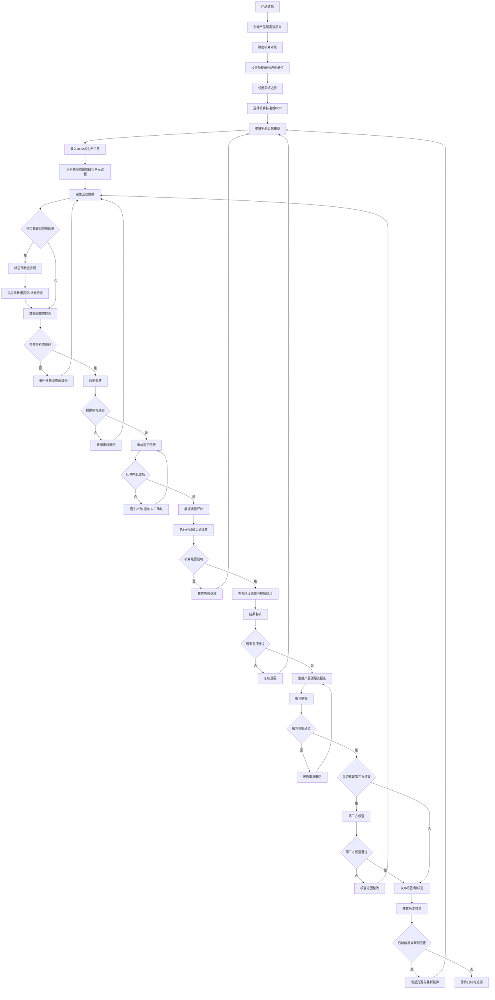

# 竹木行业产品碳足迹业务总流程

> 文档定位：基于 `03业务分析/竹木_业务需求分析.md` 梳理产品碳足迹核算业务闭环。  
> 输出边界：仅梳理业务流程，不设计系统功能架构、菜单结构或页面交互。  
> 业务边界：本系统只围绕竹木行业产品碳足迹核算、报告、审核、追溯和重新核算闭环展开，不覆盖企业碳盘查、企业碳管理、碳资产管理或碳交易管理。  
> 不确定口径：需求文件未明确或依赖试点确认的内容，统一标记为“待确认”。

---

## 一、业务总流程概述

竹木行业产品碳足迹业务从产品建档开始，先确定核算对象是具体产品、产品型号、产品批次或产品族，并绑定功能单位、声明单位、产品规格、材质、含水率、适用标准或 PCR；随后依据核算目标设置生命周期边界，搭建覆盖采伐/原料获取、生产加工、运输仓储、使用阶段、废弃处置/循环利用的生命周期模型，识别各阶段单元过程并采集活动数据、供应商碳足迹数据、凭证附件和数据质量信息；经完整性检查和数据审核通过后，按规则集匹配排放因子、单位换算、分配规则、GWP 版本和生物碳/碳固存处理口径，执行产品碳足迹计算，形成生命周期阶段结果、排放热点、碳储存及生物源/化石排放分项；结果经内部复核、报告审批或第三方核查后生成产品碳足迹报告、碳标签和披露材料，并冻结活动数据、因子、规则、公式、计算结果、报告和附件快照；后续如基础数据、活动数据、因子、规则或边界发生变更，应发起数据变更与重新核算，形成新的核算版本，历史已发布版本保持可追溯。

---

## 二、产品碳足迹业务总流程

### 2.1 主流程

1. 产品建档  
   建立产品、品类、规格、材质、密度、含水率、功能单位、声明单位、适用标准/PCR、工艺路线等基础资料。企业、组织、供应商信息仅作为产品碳足迹核算所需的基础资料。

2. 创建产品碳足迹项目  
   围绕一个核算目标创建项目，明确核算目的、报告用途、责任组织、核算期间、是否需要碳标签、是否需要上报或第三方核查等信息。报告用途在需求中包括客户披露、绿色认证、碳标签、监管/集团上报和内部低碳管理，但具体项目用途需逐项确认。

3. 确定核算对象  
   选择具体产品、产品型号、产品批次或产品族作为核算对象。需求文件明确支持产品级、批次级、生命周期阶段级核算，但首批品类、是否以产品族作为一期对象仍为待确认。

4. 设置功能单位或声明单位  
   绑定产品规格、材质、含水率、生命周期假设、产品寿命等关键参数。功能单位和声明单位须与选定标准/PCR一致，具体品类口径待确认。

5. 设置系统边界  
   明确采用摇篮到坟墓、摇篮到大门、大门到大门或其他边界；选择纳入阶段、排除项、阶段取舍、忽略项和废弃/循环情景。业务需求要求覆盖全生命周期五阶段，但单个项目边界需按核算目标和标准/PCR确认。

6. 选择核算标准或 PCR
  一个产品碳足迹项目选择一个主核算标准或 PCR，作为正式核算和报告依据；系统保留标准/PCR 配置能力，但一期不做同一项目多标准并行对比核算。需求文件明确支持 GB/T 24067-2024、GB/T 24064、ISO 14067、PAS 2050、GB/T 44290-2024 及木竹专项规则，具体标准范围以设计方案为准。

7. 搭建生命周期模型  
   按生命周期阶段建立过程链路，明确采伐/原料、加工、运输仓储、使用、废弃与循环等阶段之间的产品流、物料流、能耗流和碳流关系。

8. 录入 BOM 与生产工艺  
   录入原料、辅料、包装、能源、工序、产量、损耗、边角料、废品、工时、设备等数据结构，为活动数据采集和分配规则设置提供基础。

9. 识别生命周期阶段和单元过程  
   将产品生命周期拆解到可采集、可核算、可审核的单元过程，例如采伐、集材、干燥、热压、胶合、砂光、涂装、原料运输、成品运输、使用维护、回收、焚烧、填埋等。

10. 采集活动数据  
    采集数量、单位、期间、来源、填报人、来源系统、凭证附件、数据质量等级、估算方法等信息。数据来源可包括人工填报、台账、文件上传、移动端、物联设备、ERP/MES/WMS/TMS/SRM 对接等，其中移动端、物联和 ERP/MES 对接在需求中属于三期能力。

11. 供应商数据协同  
    对上游物料、辅料、包装、物流等供应商碳足迹数据进行收集、授权、验证状态管理、边界说明和依据文件维护。是否需要供应商在线填报、供应商门户或外部 SRM 对接为待确认。

12. 数据完整性检查  
    检查必填项、单位、期间、阶段覆盖、凭证、数量逻辑、异常波动、缺失项、边界一致性和数据质量信息。检查不通过时退回填报或补充说明。

13. 数据审核  
    审核人员确认活动数据、凭证、估算方法、供应商数据、边界归属和异常处理。审核不通过时退回相应填报节点，保留审核意见和驳回原因。

14. 排放因子匹配  
    按规则集、地区、年份、能源类型、物料类型、工艺、单位、适用条件和采信等级匹配排放因子；必要时执行单位换算、因子替换申请或人工确认。因子未匹配或冲突时进入因子处理。

15. 数据质量评价  
    对活动数据和因子进行质量评分、不确定性说明、实测/估算比例统计、缺失项披露和采信等级记录。需求文件要求缺失填充必须留痕。

16. 执行产品碳足迹计算  
    按生命周期模型、活动数据、排放因子、分配规则、GWP 版本、生物碳和碳固存处理口径执行计算。碳储存、生物源 CO2、化石 CO2、CH4、N2O 应分开核算和披露，默认不自动抵扣总排放。

17. 查看生命周期阶段结果  
    查看采伐/原料、加工、运输仓储、使用、废弃/循环等阶段结果，以及产品级、批次级、工序级、活动类型级明细。

18. 查看排放热点  
    识别高排放阶段、工序、物料、能源或运输环节。排放热点可用于内部低碳诊断和后续减排模拟，深度分析能力在需求中属于三期。

19. 结果复核  
    复核计算过程、规则版本、因子来源、分配规则、边界取舍、碳固存口径、异常数据和结果合理性。复核不通过时退回数据、因子、模型或核算节点。

20. 生成产品碳足迹报告  
    基于核算结果生成报告草稿，披露标准依据、系统边界、功能单位、因子来源、数据质量、生物碳、废弃假设、限制说明和附件清单。

21. 报告审批或第三方核查  
    内部审批确认报告、碳标签、二维码和披露字段；如项目用途需要认证、监管上报或客户要求，则进入第三方核查或外部核验流程。是否每个项目均需要第三方核查为待确认。

22. 发布报告或碳标签  
    审批或核查通过后发布报告、碳标签、二维码和披露材料。对外披露字段、脱敏规则、水印、下载控制和二维码展示内容需按项目确认。

23. 核算版本归档  
    冻结活动数据、因子、规则、公式、模型、计算结果、报告、标签和附件快照，形成可追溯版本。已发布历史版本不因后续因子或规则更新自动改变。

24. 数据变更与重新核算  
    当活动数据、因子、规则、产品参数、生命周期边界、BOM、工艺或供应商数据变更时，发起变更审核和重新核算，生成新版本并保留与历史版本的差异说明。

### 2.2 与建议流程的调整说明

提示词建议流程与业务需求分析总体一致。结合需求文件，流程中强化了以下内容：

- 将“产品建档、项目创建、核算对象、功能单位、系统边界、标准/PCR”前置，因为业务需求明确核算任务必须绑定产品、标准/规则集/PCR、功能单位和系统边界。
- 将“数据完整性检查”和“数据审核”拆分，原因是需求文件同时要求自动校验、异常预警和审核流转，两者责任与状态不同。
- 将“碳固存、生物源排放、废弃/循环情景、分配规则、GWP 版本”纳入核算关键节点，原因是竹木行业业务需求强调生物碳和长期碳固存口径。
- 将“第三方核查、监管/集团上报、行业数据集贡献”作为发布前后可选业务路径，不默认每个产品碳足迹项目都发生，具体触发条件待确认。

---

## 三、业务总流程图

---

## 四、流程节点说明表

| 流程节点 | 业务目标 | 参与角色 | 前置条件 | 输入数据 | 业务动作 | 系统动作 | 输出结果 | 状态变化 | 审核要求 | 异常情况 | 退回或修改规则 | 是否影响最终碳足迹结果 | 是否需要版本追溯 | 关联数据对象 | 待确认事项 |
| :--- | :--- | :--- | :--- | :--- | :--- | :--- | :--- | :--- | :--- | :--- | :--- | :--- | :--- | :--- | :--- |
| 产品建档 | 建立核算对象基础资料 | 系统管理员、业务操作人员 | 品类和组织基础资料可用 | 产品编码、品类、规格、材质、密度、含水率、工艺、功能单位 | 维护产品主数据 | 校验编码、单位、必填项和启停状态 | 产品档案 | 无项目状态或项目为待完善基础信息 | 关键字段变更需审核或留痕 | 产品重复、单位不一致、关键参数缺失 | 退回补充产品资料；已引用产品修改需触发影响分析 | 是 | 是 | 产品、品类、规格、材质、工艺、单位 | 首批品类、编码规则、产品族口径待确认 |
| 创建产品碳足迹项目 | 建立一次核算工作的业务载体 | 业务操作人员、审核人员 | 产品档案已建立 | 核算目的、报告用途、责任组织、核算期间、是否标签/上报/核查 | 创建项目并指定责任人 | 生成项目编号和初始状态 | 产品碳足迹项目 | 草稿 -> 待完善基础信息 | 项目关键用途可审批确认 | 核算目的不清、责任组织不明 | 草稿可修改；进入审核后修改需留痕 | 是 | 是 | 项目、组织、产品、报告用途 | 项目用途分类和审批触发条件待确认 |
| 确定核算对象 | 明确本次核算范围 | 业务操作人员、审核人员 | 项目已创建 | 产品、型号、批次、产品族、核算期间 | 选择并锁定核算对象 | 校验对象状态和权限 | 核算对象清单 | 待完善基础信息 | 核算对象变更需审核 | 对象与报告用途不匹配 | 审核前可改；审核后改需重新核算 | 是 | 是 | 产品、型号、批次、产品族 | 产品族是否纳入一期待确认 |
| 设置功能单位 | 确保结果可比和可披露 | 业务操作人员、审核人员 | 核算对象已确定 | 功能单位、声明单位、产品寿命、含水率、规格参数 | 设置计量口径 | 校验单位与标准/PCR一致性 | 功能单位配置 | 待完善基础信息 | 需与标准/PCR一致 | 单位错误、规格不完整 | 退回补充；发布后变更需新版本 | 是 | 是 | 功能单位、声明单位、产品参数 | 各品类功能单位待确认 |
| 设置系统边界 | 明确纳入和排除范围 | 业务操作人员、审核人员 | 功能单位已确定 | 生命周期边界、阶段取舍、排除项、忽略项、废弃情景 | 选择边界并说明取舍理由 | 记录边界配置和限制说明 | 系统边界配置 | 待生命周期建模 | 边界取舍需审核 | 边界与标准不一致、阶段缺失 | 退回修改边界；边界变更需重算 | 是 | 是 | 边界、阶段、排除项、废弃情景 | 首批采用摇篮到大门还是摇篮到坟墓待确认 |
| 选择核算标准或 PCR | 确定核算依据 | 系统管理员、业务操作人员、审核人员 | 标准库和规则集可用 | 标准、PCR、规则集、GWP版本、因子优先级 | 为项目选择一个主核算标准或 PCR | 冻结规则版本并带入计算参数 | 核算规则配置 | 待生命周期建模 | 标准适用性需审核 | 标准过期、PCR不适用 | 退回重新选择；已发布不自动跟随新规则 | 是 | 是 | 标准、PCR、规则集、GWP版本 | 已确认：一期不做同一项目多标准并行对比核算 |
| 搭建生命周期模型 | 构建产品过程链路 | 业务操作人员、审核人员 | 边界和规则已确定 | 阶段、单元过程、产品流、物料流、能耗流、碳流 | 建立生命周期模型 | 检查模型完整性和阶段覆盖 | 生命周期模型 | 待生命周期建模 -> 待数据填报 | 模型发布前需审核 | 阶段遗漏、过程重复、流向不闭合 | 退回建模；模型变更需触发重算 | 是 | 是 | 生命周期模型、阶段、单元过程 | 是否提供行业模板待确认 |
| 录入 BOM 与生产工艺 | 支撑过程级数据采集和分配 | 业务操作人员 | 生命周期模型已建立 | BOM、工序、设备、工时、产量、损耗、边角料 | 维护产品工艺与投入产出 | 校验物料单位、工序顺序和损耗逻辑 | BOM 与工艺资料 | 待数据填报 | 关键工艺变更需审核 | BOM缺失、工艺不完整 | 退回补充；已核算项目变更需新版本 | 是 | 是 | BOM、工艺、工序、物料、损耗 | 与 ERP/MES 的主数据边界待确认 |
| 识别生命周期阶段和单元过程 | 明确数据采集颗粒度 | 业务操作人员、审核人员 | BOM 和工艺可用 | 阶段、单元过程、活动类型 | 将模型拆解为采集任务 | 生成阶段和单元过程数据清单 | 数据采集范围 | 待数据填报 | 需覆盖已选边界 | 单元过程无法采集、口径不清 | 退回模型或边界配置 | 是 | 是 | 阶段、单元过程、采集任务 | 最小核算颗粒度待确认 |
| 采集活动数据 | 形成可计算的活动数据台账 | 业务操作人员、供应商、审核人员 | 采集范围已确定 | 数量、单位、期间、来源、凭证、估算方法、质量等级 | 填报、导入或对接活动数据 | 校验格式、单位、必填项和凭证 | 活动数据台账 | 待数据填报 -> 数据填报中 -> 待数据审核 | 填报完成后提交审核 | 数据缺失、凭证缺失、异常波动 | 退回填报；估算和缺失填充必须留痕 | 是 | 是 | 活动数据、凭证、来源系统、质量等级 | 移动端、物联、系统对接范围待确认 |
| 供应商数据协同 | 获取上游碳足迹数据 | 供应商、业务操作人员、审核人员 | 涉及外购物料或外部物流 | 供应商数据、边界、报告期、验证状态、依据文件 | 邀请、收集、补充、确认供应商数据 | 管理授权、状态和附件 | 供应商碳足迹数据 | 数据填报中 | 供应商数据需验证或内部审核 | 供应商不响应、边界不一致、文件缺失 | 可退回供应商补充；缺失时按规则估算并披露 | 是 | 是 | 供应商、物料、供应商报告、依据文件 | 是否供应商在线填报待确认 |
| 数据完整性检查 | 发现缺失和逻辑问题 | 业务操作人员、审核人员 | 活动数据提交 | 活动数据、供应商数据、模型、边界、凭证 | 检查完整性和合理性 | 自动校验、预警和生成问题清单 | 完整性检查结果 | 待数据审核或数据审核退回 | 问题关闭后进入审核 | 必填缺失、单位不匹配、阶段缺失 | 退回对应填报节点 | 是 | 是 | 校验规则、问题清单、活动数据 | 发布门槛阈值待确认 |
| 数据审核 | 确认数据可用于核算 | 审核人员、业务操作人员 | 完整性检查通过或问题已说明 | 活动数据、凭证、估算说明、供应商数据 | 审核通过、驳回或要求补充 | 记录审核意见和状态 | 审核通过的数据集 | 待数据审核 -> 待因子匹配；或数据审核退回 | 必须记录审核人、意见和时间 | 凭证不可信、估算无依据、边界归属错误 | 退回填报并保留驳回原因 | 是 | 是 | 审核记录、活动数据、凭证 | 审核层级和审批链待确认 |
| 排放因子匹配 | 将活动数据转换为可计算参数 | 业务操作人员、审核人员、系统管理员 | 数据审核通过 | 活动数据、因子库、规则集、地区、年份、单位 | 自动匹配、人工确认、申请替换 | 匹配因子、换算单位、记录来源 | 因子匹配结果 | 待因子匹配 -> 因子匹配中 -> 待核算 | 人工替换或新增因子需审核 | 无适用因子、因子过期、单位冲突 | 退回因子处理或补充数据 | 是 | 是 | 排放因子、单位换算、因子来源 | 外部因子库接入和采信等级待确认 |
| 数据质量评价 | 标识结果可信度 | 业务操作人员、审核人员 | 数据和因子匹配完成 | 数据来源、质量等级、不确定性、估算比例 | 评价数据质量并说明缺失项 | 计算质量评分和披露项 | 数据质量评价结果 | 待核算 | 质量低于门槛需说明或整改 | 缺失比例过高、不确定性过高 | 可退回采集或因子匹配 | 是 | 是 | 数据质量评分、不确定性、缺失项 | 质量评分模型和门槛待确认 |
| 执行产品碳足迹计算 | 得出产品碳足迹结果 | 业务操作人员、审核人员 | 模型、数据、因子、规则均就绪 | 活动数据、因子、分配规则、GWP、生物碳参数 | 发起核算或重算 | 执行计算、保存明细和日志 | 核算结果和计算明细 | 待核算 -> 核算中 -> 待结果复核；失败则核算失败 | 核算完成后需复核 | 公式错误、参数缺失、分配失败、单位换算失败 | 核算失败退回模型、数据、因子或规则处理 | 是 | 是 | 核算任务、计算明细、结果、日志 | 联产品分配规则默认口径待确认 |
| 查看阶段结果与排放热点 | 解释结果结构和关键贡献 | 业务操作人员、审核人员、查看人员 | 核算成功 | 阶段结果、工序结果、活动明细 | 查看产品级、阶段级、工序级结果 | 汇总和展示贡献度 | 结果分析视图 | 待结果复核 | 作为复核依据 | 结果异常、热点不符合业务经验 | 可退回复核或重新检查数据 | 间接影响 | 是 | 阶段结果、热点、贡献度 | 三期深度分析范围待确认 |
| 结果复核 | 确保计算可信和可披露 | 审核人员、业务操作人员 | 核算成功 | 计算明细、规则、因子、边界、数据质量、碳固存口径 | 复核并出具意见 | 记录复核意见和问题清单 | 复核结论 | 待结果复核 -> 待报告生成；或结果复核退回 | 必须记录复核人和意见 | 结果异常、口径错误、分配不合理 | 退回模型、数据、因子或核算节点 | 是 | 是 | 复核记录、核算结果、问题清单 | 复核标准和责任角色待确认 |
| 生成产品碳足迹报告 | 形成可披露材料 | 业务操作人员、审核人员 | 结果复核通过 | 核算结果、边界、标准、因子、数据质量、限制说明、附件 | 生成报告草稿和标签草稿 | 套用模板、生成快照草稿 | 报告草稿、标签草稿 | 待报告生成 -> 待报告审批 | 报告发布前必须审批 | 模板不适用、披露字段缺失 | 退回报告编辑或结果复核 | 否，除非发现结果问题 | 是 | 报告、标签、二维码、附件 | 报告模板和披露字段待确认 |
| 报告审批 | 控制对外披露风险 | 审核人员、业务操作人员、查看人员 | 报告草稿生成 | 报告、标签、二维码、脱敏规则、附件 | 审批通过或退回 | 冻结审批记录和意见 | 审批结论 | 待报告审批 -> 待第三方核查/已发布；或报告审批退回 | 必须审批对外披露内容 | 敏感信息、负碳表述不当、附件不完整 | 退回报告修改；涉及结果则退回复核 | 通常否 | 是 | 审批记录、报告、标签、披露字段 | 审批层级和脱敏规则待确认 |
| 第三方核查 | 支撑认证、客户或监管要求 | 第三方核查人员、审核人员、业务操作人员 | 报告审批通过且需要核查 | 审计文件包、只读视图、报告、计算明细、凭证 | 核查、提问、整改、复核 | 提供只读证据链和问题闭环 | 核查结论 | 待第三方核查 -> 已发布；或第三方核查退回 | 核查意见需留痕 | 核查不通过、材料缺失、口径争议 | 退回整改，可回到数据、模型、报告节点 | 可能影响 | 是 | 核查记录、问题清单、审计文件包 | 是否必经第三方核查待确认 |
| 发布报告或碳标签 | 对内或对外发布结果 | 审核人员、业务操作人员、查看人员 | 审批或核查通过 | 报告终稿、标签、二维码、披露范围 | 发布、下载、共享或上报 | 生成发布版本和访问控制 | 已发布报告/碳标签 | 已发布 | 发布动作需授权 | 披露范围错误、二维码字段不当 | 发布前可退回；发布后更正应作废或新版本 | 否 | 是 | 发布版本、二维码、披露记录 | 是否需要监管/集团同步上报待确认 |
| 核算版本归档 | 保证历史结果可追溯 | 系统管理员、审核人员、业务操作人员 | 已发布或项目终止 | 活动数据、因子、规则、模型、结果、报告、附件、日志 | 归档并冻结版本 | 保存快照和版本关系 | 归档版本 | 已发布 -> 已归档 | 归档后原则上不可直接修改 | 快照缺失、附件丢失 | 需补齐后归档；错误版本可作废并新建版本 | 否 | 是 | 版本快照、归档记录、操作日志 | 归档保留年限待确认 |
| 数据变更与重新核算 | 处理后续变化并形成新版本 | 业务操作人员、审核人员、系统管理员 | 已核算或已发布项目存在变更 | 变更项、变更原因、影响范围 | 发起变更、审核、重算 | 影响分析、复制版本、执行重算 | 新核算版本 | 已发布/已归档 -> 草稿或待生命周期建模；旧版本保留 | 关键变更需审批 | 数据修正、因子更新、规则变化、边界变化 | 不修改历史发布版本；通过新版本体现 | 是 | 是 | 变更记录、新旧版本、差异说明 | 变更审批和版本命名规则待确认 |

---

## 五、产品碳足迹项目状态流转

| 状态 | 状态含义 | 进入条件 | 可执行操作 | 下一状态 | 不允许的操作 | 责任角色 |
| :--- | :--- | :--- | :--- | :--- | :--- | :--- |
| 草稿 | 项目已创建但信息未提交 | 新建项目 | 编辑项目基础信息、选择产品、删除草稿 | 待完善基础信息、已作废 | 发起核算、发布报告 | 业务操作人员 |
| 待完善基础信息 | 产品、对象、单位、边界或标准信息未完整 | 草稿提交或被退回 | 补充产品资料、核算对象、功能单位、边界、标准/PCR | 待生命周期建模、已作废 | 发起数据填报、发起核算 | 业务操作人员 |
| 待生命周期建模 | 已具备基础口径，需建立过程模型 | 基础信息完整 | 搭建模型、录入 BOM 和工艺、识别单元过程 | 待数据填报、待完善基础信息 | 发起核算、发布报告 | 业务操作人员 |
| 待数据填报 | 采集范围已确定，尚未开始填报 | 模型建立完成 | 分派填报任务、导入台账、邀请供应商 | 数据填报中、待生命周期建模 | 发起核算、发布报告 | 业务操作人员 |
| 数据填报中 | 活动数据和供应商数据正在采集 | 开始填报 | 录入、导入、补充凭证、供应商协同 | 待数据审核、待数据填报 | 发起核算、发布报告 | 业务操作人员、供应商 |
| 待数据审核 | 数据已提交，等待审核 | 填报提交且完整性检查通过或已说明 | 审核通过、驳回、要求补充 | 待因子匹配、数据审核退回 | 修改已提交数据、发起核算 | 审核人员 |
| 数据审核退回 | 数据审核未通过 | 审核驳回 | 查看意见、修改数据、补充凭证、重新提交 | 数据填报中、待数据审核 | 跳过审核、直接核算 | 业务操作人员 |
| 待因子匹配 | 数据审核通过，等待匹配因子 | 数据审核通过 | 启动自动匹配、选择因子、申请新增因子 | 因子匹配中、待核算 | 修改已审活动数据、发布报告 | 业务操作人员 |
| 因子匹配中 | 因子正在匹配或人工确认 | 发起因子匹配 | 自动匹配、人工确认、单位换算、替换申请 | 待核算、待因子匹配 | 发起报告生成 | 业务操作人员、审核人员 |
| 待核算 | 模型、数据、因子和规则已就绪 | 因子匹配完成且数据质量评价完成 | 发起核算、返回修改数据或因子 | 核算中、待因子匹配、待数据填报 | 生成报告、发布标签 | 业务操作人员 |
| 核算中 | 正在执行产品碳足迹计算 | 发起核算 | 查看计算进度、取消待确认 | 待结果复核、核算失败 | 修改模型、修改数据、发布报告 | 业务操作人员 |
| 核算失败 | 计算未完成或出现错误 | 计算异常 | 查看失败原因、修正模型/数据/因子、重新核算 | 待生命周期建模、待数据填报、待因子匹配、待核算 | 生成报告、发布标签 | 业务操作人员、系统管理员 |
| 待结果复核 | 核算成功，等待结果复核 | 计算成功 | 查看结果、复核通过、复核退回 | 待报告生成、结果复核退回 | 直接发布报告 | 审核人员 |
| 结果复核退回 | 结果复核发现问题 | 复核驳回 | 按问题修改模型、数据、因子或规则，重新核算 | 待生命周期建模、待数据填报、待因子匹配、待核算 | 直接生成终稿 | 业务操作人员 |
| 待报告生成 | 结果复核通过，等待生成报告 | 复核通过 | 选择模板、生成报告、生成标签草稿 | 待报告审批 | 修改核算结果、直接发布 | 业务操作人员 |
| 待报告审批 | 报告和标签草稿等待审批 | 报告生成完成 | 审批通过、审批退回、要求脱敏 | 待第三方核查、已发布、报告审批退回 | 修改核算明细 | 审核人员 |
| 报告审批退回 | 报告内容或披露字段未通过 | 审批驳回 | 修改报告、补充说明、重新提交 | 待报告生成、待报告审批 | 跳过审批发布 | 业务操作人员 |
| 待第三方核查 | 报告通过内部审批且需要外部核查 | 审批通过且项目标记需要核查 | 提交审计文件包、答复问题、接收核查意见 | 已发布、第三方核查退回 | 修改已提交材料不留痕、直接发布 | 第三方核查人员、审核人员 |
| 第三方核查退回 | 第三方核查提出整改 | 核查驳回 | 整改数据、报告或说明，重新提交 | 数据填报中、待报告生成、待第三方核查 | 直接归档 | 业务操作人员、审核人员 |
| 已发布 | 报告、标签或披露材料正式发布 | 审批通过且无需核查，或核查通过 | 查看、下载、二维码披露、上报、发起归档、发起变更 | 已归档、已作废、草稿/待建模的新版本 | 直接修改已发布快照 | 审核人员、查看人员 |
| 已归档 | 已发布版本完成快照冻结 | 发布后归档 | 查看历史版本、导出归档材料、发起新版本 | 已作废、新版本草稿 | 修改归档数据 | 系统管理员、审核人员 |
| 已作废 | 项目或版本不再有效 | 草稿删除、错误发布、业务取消 | 查看作废原因、创建新项目或新版本 | 无或新项目草稿 | 恢复发布、继续核算 | 系统管理员、审核人员 |

---

## 六、关键子流程识别

| 关键子流程 | 为什么需要单独展开 | 涉及角色 | 复杂点 | 对系统设计的影响 |
| :--- | :--- | :--- | :--- | :--- |
| 产品建档流程 | 产品档案是功能单位、BOM、工艺、含水率、品类规则和报告模板的基础 | 系统管理员、业务操作人员、审核人员 | 品类、规格、材质、含水率、产品族、型号和批次之间关系复杂 | 需要主数据、版本、启停、引用影响分析和权限控制 |
| 产品碳足迹项目创建流程 | 每次核算需要明确目标、用途、对象、期间和责任人 | 业务操作人员、审核人员、查看人员 | 报告用途会影响边界、标准、审批、核查和披露 | 需要项目维度承载状态流转、权限和快照 |
| 生命周期建模流程 | 模型决定活动数据采集范围和最终计算结构 | 业务操作人员、审核人员 | 竹木产品涉及采伐、加工、运输、使用、废弃、循环和长期碳固存 | 需要支持阶段、单元过程、物料流、能耗流、碳流和模板复用 |
| 活动数据采集流程 | 活动数据是计算结果的核心输入 | 业务操作人员、供应商、审核人员 | 数据来源分散，存在人工、台账、凭证、估算、物联和系统对接多种方式 | 需要数据台账、凭证、质量等级、估算留痕、导入和接口能力 |
| 供应商数据协同流程 | 上游物料、辅料、包装和物流数据会显著影响产品碳足迹 | 供应商、业务操作人员、审核人员 | 供应商边界、报告期、验证状态和依据文件可能不一致 | 需要供应商碳足迹库、授权、依据文件、验证状态和缺失替代规则 |
| 数据审核流程 | 确保进入核算的数据可采信 | 审核人员、业务操作人员 | 需要同时审核凭证、估算、边界归属、供应商数据和异常处理 | 需要审核意见、退回、问题清单、状态流转和日志 |
| 排放因子匹配流程 | 因子来源、版本和适用条件直接决定计算结果 | 系统管理员、业务操作人员、审核人员 | 因子存在地区、年份、单位、GWP、采信等级、适用条件差异 | 需要因子库、自动匹配、人工确认、单位换算、版本和审核 |
| 产品碳足迹计算流程 | 将模型、数据、因子和规则转化为结果 | 业务操作人员、审核人员 | 涉及分配规则、生物碳、碳固存、废弃情景、GWP 和多阶段计算 | 需要计算明细、公式追溯、失败处理、重算和版本冻结 |
| 结果复核流程 | 防止错误结果进入报告和对外披露 | 审核人员、业务操作人员 | 需要复核结果合理性、热点、规则、因子、边界和碳固存表达 | 需要复核记录、问题闭环和回退路径 |
| 报告生成与审批流程 | 报告和标签是对外披露载体 | 业务操作人员、审核人员、查看人员 | 披露字段、限制说明、脱敏、水印、二维码和负碳表述有合规风险 | 需要报告模板、标签模板、审批、快照和访问控制 |
| 第三方核查流程 | 支撑认证、客户、监管或集团核查 | 第三方核查人员、审核人员、业务操作人员 | 核查需要只读证据链、问题清单、整改和复核闭环 | 需要审计文件包、只读视图、核查权限和整改状态 |
| 数据变更与重新核算流程 | 已发布结果不能被直接覆盖，变更必须形成新版本 | 业务操作人员、审核人员、系统管理员 | 数据、因子、规则、边界、BOM 和模型变更均可能影响结果 | 需要影响分析、新旧版本对比、重算、作废和归档机制 |

---

## 七、业务流程与系统能力初步映射

| 业务流程节点 | 需要的系统能力 | 涉及角色 | 关键数据对象 | 是否MVP必须 | 说明 |
| :--- | :--- | :--- | :--- | :--- | :--- |
| 产品建档 | 产品主数据、品类、规格、材质、含水率、工艺基础数据维护 | 系统管理员、业务操作人员 | 产品、品类、工艺、含碳量检测 | 是 | 一期核算闭环必需 |
| 创建产品碳足迹项目 | 项目管理、责任分配、报告用途记录、状态流转 | 业务操作人员、审核人员 | 项目、组织、核算期间、用途 | 是 | 不展开为菜单，仅作为流程载体 |
| 确定核算对象 | 产品/型号/批次/产品族选择和权限校验 | 业务操作人员 | 产品、型号、批次、产品族 | 是 | 产品族是否一期支持待确认 |
| 设置功能单位 | 功能单位、声明单位、产品参数维护和校验 | 业务操作人员、审核人员 | 功能单位、声明单位、产品参数 | 是 | 与标准/PCR一致 |
| 设置系统边界 | 生命周期边界、阶段取舍、排除项、废弃情景配置 | 业务操作人员、审核人员 | 边界、阶段、排除项 | 是 | 需求要求支持多边界 |
| 选择核算标准或 PCR | 标准库、规则集、PCR、GWP 和版本冻结 | 系统管理员、业务操作人员 | 标准、PCR、规则集、GWP | 是 | 一个项目选择一个主核算标准或 PCR，一期不做多标准并行对比 |
| 搭建生命周期模型 | 生命周期阶段、单元过程、产品流和碳流建模 | 业务操作人员 | 生命周期模型、单元过程 | 是 | 核算主闭环核心能力 |
| 录入 BOM 与生产工艺 | BOM、工序、能耗、辅料、损耗和分配基础维护 | 业务操作人员 | BOM、工序、物料、损耗 | 是 | 支撑工序级核算 |
| 识别生命周期阶段和单元过程 | 采集任务生成、阶段覆盖检查 | 业务操作人员、审核人员 | 阶段、单元过程、采集任务 | 是 | 保证边界落实到数据 |
| 采集活动数据 | 数据台账、导入、凭证、估算留痕、质量等级 | 业务操作人员、供应商 | 活动数据、凭证、质量等级 | 是 | 移动和物联可后续增强 |
| 供应商数据协同 | 供应商碳足迹库、授权、依据文件、验证状态 | 供应商、业务操作人员 | 供应商、物料、供应商报告 | 否 | 二期为完整协同闭环；一期可用人工附件替代，待确认 |
| 数据完整性检查 | 自动校验、异常预警、问题清单、缺失项统计 | 业务操作人员、审核人员 | 校验规则、问题清单 | 是 | 数据质量控制基础能力 |
| 数据审核 | 审核流转、驳回、意见、日志 | 审核人员、业务操作人员 | 审核记录、活动数据 | 是 | 发布和追溯必需 |
| 排放因子匹配 | 因子库、自动匹配、单位换算、人工确认、因子审核 | 系统管理员、业务操作人员 | 排放因子、单位换算、来源 | 是 | 直接影响核算结果 |
| 数据质量评价 | 数据质量评分、不确定性、估算比例和缺失披露 | 业务操作人员、审核人员 | 质量评分、不确定性 | 是 | 报告披露必需 |
| 执行产品碳足迹计算 | 计算引擎、公式、分配规则、GWP、生物碳和碳固存处理 | 业务操作人员 | 核算任务、计算明细、结果 | 是 | 一期核心闭环 |
| 查看生命周期阶段结果 | 阶段、工序、活动类型结果汇总和明细追溯 | 业务操作人员、审核人员、查看人员 | 阶段结果、工序结果 | 是 | 支撑解释和复核 |
| 查看排放热点 | 贡献度、热点识别、异常波动初步分析 | 审核人员、查看人员 | 热点、贡献度 | 否 | 深度诊断和模拟属于三期 |
| 结果复核 | 结果复核、问题清单、退回重算 | 审核人员 | 复核记录、核算结果 | 是 | 发布前控制点 |
| 生成产品碳足迹报告 | 报告模板、标签模板、二维码草稿、附件汇总 | 业务操作人员 | 报告、标签、附件 | 是 | 一期要求能出报告和标签 |
| 报告审批 | 审批、脱敏、水印、披露字段控制 | 审核人员 | 审批记录、披露字段 | 是 | 避免对外披露风险 |
| 第三方核查 | 只读核查视图、审计文件包、核查问题闭环 | 第三方核查人员、审核人员 | 核查记录、审计文件包 | 否 | 二期能力；是否项目必经待确认 |
| 发布报告或碳标签 | 发布版本、二维码、访问控制、上报包 | 审核人员、查看人员 | 发布版本、二维码、上报包 | 是 | 是否上报取决于项目用途 |
| 核算版本归档 | 快照冻结、历史版本、操作日志、导出 | 系统管理员、审核人员 | 版本快照、日志 | 是 | 追溯和复核基础 |
| 数据变更与重新核算 | 变更申请、影响分析、重算、新旧版本对比 | 业务操作人员、审核人员 | 变更记录、新旧版本 | 是 | 保证历史版本不被覆盖 |

---

## 八、待确认问题

**已确认口径**

- Q-04：一个产品碳足迹项目选择一个主核算标准或 PCR，作为正式核算和报告依据；系统保留标准/PCR 配置能力，但一期不做同一项目多标准并行对比核算。

| 编号 | 待确认问题 | 影响范围 | 建议优先级 |
| :--- | :--- | :--- | :--- |
| Q-01 | 首批核算对象以产品、产品型号、产品批次还是产品族为主？ | 产品建档、项目创建、功能单位、报告模板、验收样例 | 必须 |
| Q-02 | 首批试点产品品类、规格和目标企业是什么？ | 标准/PCR、生命周期模型、字段、因子、模板 | 必须 |
| Q-03 | 默认生命周期边界采用摇篮到大门、摇篮到坟墓、大门到大门还是按项目选择？ | 阶段纳入、活动数据范围、报告披露 | 必须 |
| Q-05 | 首批主标准/PCR 是 GB/T 24067-2024、ISO 14067、PAS 2050、木竹专项规则，还是企业自定义规则集？ | 计算口径、模板、审核依据 | 必须 |
| Q-06 | 是否需要供应商在线填报？若需要，供应商通过独立门户、移动端、SRM 对接还是线下附件提交？ | 供应商协同、权限、数据质量、二期范围 | 应该 |
| Q-07 | 供应商碳足迹数据缺失时，采用行业均值、默认因子、估算模型还是人工说明？ | 数据质量、因子匹配、报告披露 | 必须 |
| Q-08 | 是否所有对外报告都需要第三方核查，还是仅认证、监管上报或客户要求时触发？ | 状态流转、审计文件包、交付周期 | 必须 |
| Q-09 | 是否需要碳标签作为一期必交付物？二维码披露哪些字段？ | 标签模板、二维码、脱敏和发布审批 | 必须 |
| Q-10 | 生物源 CO2、化石 CO2、CH4、N2O 的披露粒度和报告格式如何确定？ | 计算结果结构、报告模板、核查口径 | 必须 |
| Q-11 | 产品碳储存默认仅列示不抵扣，是否存在按 PCR 抵扣或延迟排放折算的场景？ | 核算规则、报告声明、合规风险 | 必须 |
| Q-12 | 联产品、副产品、边角料、余热利用等分配规则按重量、产值、数量、工时还是其他方法确定？ | 工序级核算、计算结果、复核 | 必须 |
| Q-13 | 回收、再生、焚烧、填埋、堆肥、能源回收等生命周期末端是否在首期全部纳入？默认处置比例如何确定？ | 废弃阶段核算、边界、报告 | 必须 |
| Q-14 | 报告主要用于认证、客户披露、监管/集团上报、内部管理还是多用途？ | 审批、核查、模板、披露字段 | 必须 |
| Q-15 | 项目建设主体、运营主体、部署模式和数据归属是什么？ | 组织权限、数据隔离、上报责任、运维 | 必须 |
| Q-16 | 各期验收指标是什么，例如核算产品数、报告样例、追溯深度、对接系统清单？ | 分期交付、验收范围、实施计划 | 必须 |
| Q-17 | ERP/MES/WMS/TMS/SRM 和物联设备具体对接哪些系统、字段和上线批次？ | 数据采集、接口、三期范围 | 应该 |
| Q-18 | 数据质量评分模型、缺失项容忍阈值和发布门槛如何确定？ | 审核、报告披露、核查 | 必须 |
| Q-19 | 报告公开范围、脱敏规则、水印、下载控制和二维码访问权限如何确定？ | 对外披露、数据安全、发布审批 | 应该 |
| Q-20 | 已发布报告发现错误时，是作废原版本、发布更正版，还是保留原版本并新增重算版本？ | 版本追溯、合规风险、客户通知 | 必须 |
