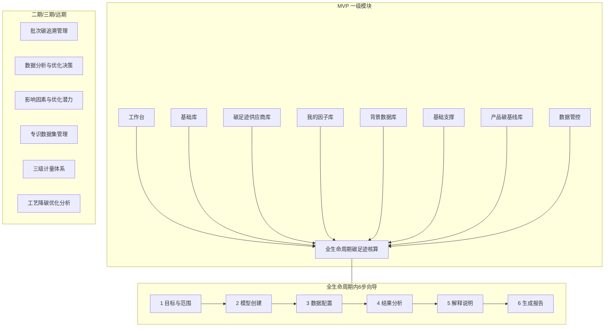
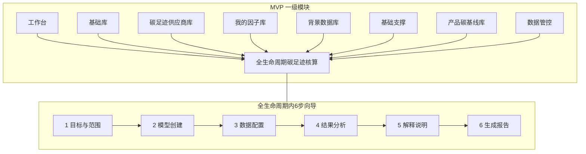

# 竹木行业产品碳足迹服务系统功能架构

> 文档定位：基于 `04产品设计管理/01架构和流程设计/业务总流程.md` 推导 **PC 端**系统功能架构。  
> 设计边界：当前阶段只输出功能架构，不设计页面原型、菜单样式或技术实现。  
> 范围说明：**本文档仅覆盖 PC 端**；`移动端 H5` 不在本文范围内，后续单独编制移动端功能清单。  
> 业务边界：系统只做竹木行业产品碳足迹，不做企业碳盘查、企业碳管理、碳资产管理、碳交易管理。  
> 分期口径：`MVP` 支撑产品碳足迹核算主闭环；`二期` 支撑供应商协同、批次追溯、上报和核查增强；`远期` 支撑物联、ERP/MES 对接、深度分析和优化模拟。  
> 已确认口径：一个产品碳足迹项目选择一个主核算标准或 PCR，作为正式核算和报告依据；系统保留标准/PCR 配置能力，但一期不做同一项目多标准并行对比核算。

---

## 一、系统建设目标

### 1.1 系统定位

本系统定位为面向竹木行业企业的产品碳足迹全生命周期核算与披露服务系统，围绕产品从建档、建模、数据采集、数据审核、因子匹配、碳足迹计算、结果分析、报告/碳标签生成、审批发布、版本归档和重新核算的完整闭环建设。

系统不是通用企业碳管理平台，也不是企业年度碳排放核算平台。企业、组织、供应商等信息仅作为产品碳足迹核算所需的基础资料和权限边界。

### 1.2 核心服务对象

| 服务对象 | 核心诉求 | 系统响应 |
| :--- | :--- | :--- |
| 竹木行业企业 | 核算产品碳足迹，输出报告和碳标签 | 提供产品建档、项目核算、报告生成、标签发布 |
| 企业内部核算人员 | 采集数据、匹配因子、执行计算 | 提供活动数据台账、因子匹配、计算任务和结果明细 |
| 企业内部审核人员 | 审核数据、复核结果、审批报告 | 提供审核流转、退回、复核、审批和日志 |
| 企业管理或查看人员 | 查看报告、结果和历史版本 | 提供只读查看、版本追溯和导出控制 |
| 供应链协同人员 | 收集供应商数据和依据文件 | MVP 支持内部代填/导入，二期扩展供应商协同 |
| 第三方核查人员 | 查看核算证据链和审计文件包 | 二期可选支持，MVP 暂不作为主流程 |

### 1.3 核算对象

系统核算对象包括竹木行业的具体产品、产品型号、产品批次或产品族。当前已确认产品品类尚未固定，因此后台管理应支持品类树配置；目标企业为竹木行业企业。产品族是否纳入 MVP 主核算对象仍为待确认。

### 1.4 核心业务闭环

产品建档 → 创建产品碳足迹项目 → 确定核算对象 → 设置功能单位 → 设置系统边界 → 选择核算标准或 PCR → 生命周期建模 → BOM 与工艺维护 → 活动数据采集/导入 → 数据完整性检查 → 数据审核 → 排放因子匹配 → 数据质量评价 → 产品碳足迹计算 → 阶段结果与热点查看 → 结果复核 → 报告与碳标签生成 → 报告审批 → 发布 → 版本归档 → 数据变更与重新核算。

### 1.5 用户主操作向导

参考竞品的产品碳足迹建模体验，系统前台不直接暴露完整的 20 多个业务节点，而是将用户主操作收敛为 6 步项目核算向导：

1. 目标与范围：创建项目、确定核算对象、设置功能单位、选择生命周期边界、选择主标准/PCR。
2. 模型创建：搭建生命周期模型，维护 BOM、工艺路线、阶段和单元过程。
3. 数据配置：填写或导入活动数据，补充凭证，选择供应商数据，匹配排放因子，完成数据质量说明。
4. 结果分析：执行产品碳足迹计算，查看生命周期阶段结果、工序结果和排放热点。
5. 解释说明：复核结果，补充数据质量、边界取舍、生物碳、碳固存、分配规则和异常说明。
6. 生成报告：生成产品碳足迹报告和一期碳标签，完成审批、发布和版本归档。

6 步向导是面向业务用户的操作入口；产品库、因子库、规则配置、权限、消息、版本追溯等仍作为后台支撑模块存在，不作为主向导中的独立步骤。

**菜单设计原则：** 一级功能模块以功能清单 Excel「功能类别」为主；**我的因子库**、**背景数据库**独立为一级菜单（自 Excel「排放因子库」拆出）。`全生命周期碳足迹核算` 内通过项目 + 6 步向导组织建模、填数、计算、报告；**核算规则引擎**为该项目下的二级能力，不单设一级菜单。

**工作台二级模块（参考竞品）：** 竞品将「产品碳足迹核算」作为工作台内的业务工作区，左侧二级导航为「首页 / 项目空间 / 我的模型库 / 报告信息管理 / 产品对比分析」，首页聚合流程引导、指标卡、当前任务与企业概览；待办、进度、异常不作为独立菜单，而在首页卡片呈现。本系统沿用该模式：`工作台` 承载核算主操作入口，二级模块对齐竞品结构并映射至本系统能力域；`我的待办 / 项目概览 / 异常提醒` 降级为首页组件，不单独占菜单项。

### 1.6 系统需要支撑的关键能力

- 产品库、品类树、BOM、工艺、功能单位和基础参数管理。
- 产品碳足迹项目全生命周期状态流转。
- 6 步式项目核算向导，降低用户操作复杂度。
- 按项目选择生命周期边界，至少保留“摇篮到大门”和“摇篮到坟墓”。
- 标准/PCR、核算规则、排放因子、GWP、生物碳和碳固存口径配置。
- 企业人员填写、管理员填写或导入活动数据。
- 数据完整性检查、审核退回、异常处理和消息提醒。
- 因子人工选择、匹配确认、单位换算和来源追溯。
- 产品碳足迹计算、核算失败处理、结果复核和重算。
- 产品碳足迹报告、一期碳标签、二维码和发布审批。
- 核算版本归档、快照冻结、历史版本追溯和变更重算。

### 1.7 不包含的业务范围

系统明确不包含以下业务：

- 企业碳盘查。
- 企业年度碳排放核算。
- 组织层面的范围一、范围二、范围三核算。
- 碳资产管理。
- 碳交易管理。
- 碳配额管理。
- 企业碳中和路径管理。

---

## 二、业务流程到功能模块映射

| 业务流程节点 | 业务目标 | 需要的系统功能 | 建议所属模块 | 主要角色 | 输入数据 | 输出结果 | 是否MVP必须 | 说明 |
| :--- | :--- | :--- | :--- | :--- | :--- | :--- | :--- | :--- |
| 产品建档 | 建立核算对象基础资料 | 产品档案、品类树、规格参数、启停状态、引用影响提示 | 基础库 | 企业管理员、项目负责人 | 产品编码、品类、规格、材质、含水率 | 产品档案 | 是 | 品类未定，需支持后台品类树配置 |
| 创建产品碳足迹项目 | 建立一次核算工作载体 | 项目创建、责任人、核算期间、用途、状态流转 | 全生命周期碳足迹核算 | 项目负责人 | 产品、组织、核算期间、报告用途 | 项目草稿 | 是 | 报告用途会影响审批和发布 |
| 确定核算对象 | 明确本次核算范围 | 对象选择、产品/型号/批次/产品族关联 | 全生命周期碳足迹核算、基础库 | 项目负责人 | 产品档案、批次或型号 | 核算对象 | 是 | 产品族口径待确认 |
| 设置功能单位 | 保证结果可比 | 功能单位、声明单位、产品寿命、参数校验 | 基础库、全生命周期碳足迹核算（核算规则引擎） | 核算人员 | 产品规格、单位、标准/PCR | 功能单位配置 | 是 | 各品类默认功能单位待确认 |
| 设置系统边界 | 明确纳入阶段 | 边界选择、阶段取舍、排除项、废弃情景 | 全生命周期碳足迹核算 | 核算人员 | 核算目标、标准/PCR | 生命周期边界 | 是 | 按项目选择，至少支持摇篮到大门、摇篮到坟墓 |
| 选择核算标准或 PCR | 确定核算依据 | 标准/PCR库、规则集选择、版本冻结 | 全生命周期碳足迹核算（核算规则引擎） | 企业管理员、核算人员 | 标准、PCR、规则集 | 项目主规则集 | 是 | 一个项目一个主标准/PCR |
| 搭建生命周期模型 | 构建过程链路 | 阶段模型、单元过程、物料流/能耗流/碳流 | 全生命周期碳足迹核算 | 核算人员 | 边界、产品工艺、规则集 | 生命周期模型 | 是 | 项目内直接创建 LCA 模型 |
| 录入 BOM 与生产工艺 | 支撑采集和分配 | BOM、工艺路线、工序、损耗、边角料、分配基础 | 基础库 | 核算人员、生产数据填报人员 | BOM、工艺、物料、工序 | BOM 与工艺资料 | 是 | 基础资料维护；项目建模时引用 |
| 识别阶段和单元过程 | 明确采集颗粒度 | 采集任务生成、单元过程数据项配置 | 全生命周期碳足迹核算 | 核算人员 | 生命周期模型 | 数据采集清单 | 是 | 项目内 LCA 模型步骤 |
| 采集活动数据 | 形成可计算台账 | 手工填报、管理员代填、导入、附件、估算留痕 | 全生命周期碳足迹核算 | 核算人员、生产填报人员、企业管理员 | 数量、单位、期间、凭证、来源 | 活动数据台账 | 是 | 项目内数据配置步骤 |
| 供应商数据协同 | 获取上游数据 | 供应商基础资料、供应商数据代填/导入、依据文件 | 碳足迹供应商库、全生命周期碳足迹核算 | 采购或供应链协同人员 | 供应商数据、报告、附件 | 供应商碳足迹数据 | 部分 | MVP 支持企业人员代填或导入；二期再做在线协同 |
| 数据完整性检查 | 提前发现缺失 | 必填校验、单位校验、阶段覆盖、问题清单、提醒 | 数据管控 | 核算人员、审核人员 | 活动数据、模型、边界 | 完整性检查结果 | 是 | 退回节点必须保留 |
| 数据审核 | 确认可核算数据 | 审核通过、退回、意见、整改闭环、日志 | 数据管控 | 内部审核人员 | 活动数据、凭证、问题清单 | 审核通过数据集 | 是 | 支撑状态流转 |
| 排放因子匹配 | 建立数据到计算参数的映射 | 因子库、人工选择、单位换算、匹配确认 | **我的因子库**、**背景数据库** | 核算人员、企业管理员 | 活动数据、因子 | 因子匹配结果 | 是 | 因子在独立一级模块维护；匹配在项目内完成 |
| 数据质量评价 | 标识结果可信度 | 质量等级、估算比例、缺失项、不确定性说明 | 数据管控 | 核算人员、审核人员 | 数据来源、因子来源、凭证 | 数据质量评价 | 是 | 评分模型待确认 |
| 执行产品碳足迹计算 | 生成碳足迹结果 | 计算任务、分配规则、生物碳、碳固存、失败处理 | 全生命周期碳足迹核算 | 核算人员 | 模型、数据、因子、规则 | 计算结果和明细 | 是 | 项目内结果分析步骤 |
| 查看阶段结果 | 解释结果 | 产品级、阶段级、工序级、活动类型结果 | 全生命周期碳足迹核算 | 核算人员、审核人员、查看人员 | 计算结果 | 阶段结果 | 是 | 支撑复核和报告 |
| 查看排放热点 | 识别关键贡献 | 热点排名、贡献度、异常波动 | 全生命周期碳足迹核算 | 核算人员、审核人员 | 阶段结果、工序结果 | 热点分析 | 是 | MVP 做基础热点，远期做深度模拟 |
| 结果复核 | 控制结果质量 | 复核通过、退回、问题清单、重算触发 | 数据管控 | 内部审核人员 | 计算明细、结果、规则 | 复核结论 | 是 | 复核退回可回到模型、数据、因子 |
| 生成报告 | 形成披露材料 | 报告模板、报告草稿、附件汇总、限制说明 | 全生命周期碳足迹核算 | 核算人员 | 核算结果、边界、标准、数据质量 | 报告草稿 | 是 | 项目内生成报告步骤 |
| 生成碳标签 | 支撑产品披露 | 标签模板、展示字段、二维码草稿 | 全生命周期碳足迹核算、产品碳基线库 | 核算人员 | 报告结果、标签模板 | 碳标签草稿 | 是 | 已确认一期需要 |
| 报告审批 | 控制发布风险 | 审批、退回、脱敏、水印、发布权限 | 数据管控 | 内部审核人员 | 报告、标签、披露字段 | 审批结论 | 是 | 第三方核查暂不进入 MVP |
| 第三方核查 | 支撑外部核验 | 只读视图、审计文件包、问题整改 | 数据管控 | 第三方核查人员、审核人员 | 报告、凭证、计算明细 | 核查结论 | 否 | 待定，先不用第三方核查 |
| 发布报告或碳标签 | 输出正式版本 | 发布、二维码、访问控制、导出、上报包预留 | 全生命周期碳足迹核算 | 内部审核人员、报告查看人员 | 审批通过报告/标签 | 已发布版本 | 是 | 上报是否纳入 MVP 待确认 |
| 核算版本归档 | 保持可追溯 | 快照冻结、版本号、历史查看、差异记录 | 全生命周期碳足迹核算 | 企业管理员、审核人员 | 数据、因子、模型、结果、报告 | 归档版本 | 是 | 历史版本不可被直接覆盖 |
| 数据变更与重新核算 | 处理更新和纠错 | 变更申请、影响分析、复制版本、重新核算 | 全生命周期碳足迹核算 | 项目负责人、审核人员 | 变更项、原版本 | 新核算版本 | 是 | 发布后变更必须形成新版本 |
| 消息提醒 | 保证任务推进 | 待办、审核提醒、退回提醒、失败提醒 | 数据管控、工作台 | 全部相关角色 | 状态变化、问题清单 | 待办消息 | 是 | 支撑所有审核、退回和失败处理 |

---

## 三、系统一级功能模块

> **口径说明：** 一级模块以功能清单 Excel「功能类别」为主，并**独立增设**「我的因子库」「背景数据库」两个一级模块（Excel 原合并在「排放因子库」项下）。PC 端共 14 项功能类别 + 工作台。  
> **操作组织：** `全生命周期碳足迹核算` 内以「产品碳足迹项目 + 6 步向导」承载 LCA 建模、活动数据、计算、报告；各阶段核算为项目内 Tab，不单设一级菜单。  
> **关于「核算规则引擎」：** 见下文 3.0 节说明——它是 Excel 的**二级功能模块**，不是一级菜单。

### 3.0 「核算规则引擎」是什么

| 维度 | 说明 |
| :--- | :--- |
| **在 Excel 中的位置** | `全生命周期碳足迹核算` 下的**二级功能模块**（列 B），与采伐/加工/运输等阶段核算并列 |
| **不是什么** | **不是**一级功能模块，**不是**独立菜单，**不包含**因子库和背景数据库 |
| **是什么** | 产品碳足迹的**核算规则与计算执行能力**，包含：① 核算模型配置（标准/PCR、分配、碳固存、GWP 等）；② 边界与范围配置；③ 一键核算与重算（计算引擎） |
| **与因子库的关系** | 项目核算时**调用**「我的因子库」「背景数据库」中的因子数据；规则引擎负责「用什么规则算、怎么算」，因子库负责「因子数据从哪来」 |
| **在本架构中的落地** | 规则配置能力 → 第四节 **4.8 核算规则引擎**；计算执行 → **4.4 全生命周期碳足迹核算** 内「结果分析」步骤 |

| 一级模块（功能类别） | 二级功能模块（Excel） | 模块定位 | 分期 | MVP必须 | 说明 |
| :--- | :--- | :--- | :--- | :--- | :--- |
| 工作台 | 首页、项目空间、我的模型库、报告信息管理、产品对比分析（三期） | 核算业务工作区：流程引导、项目入口、模型库、报告管理；待办/进度/异常在首页呈现 | MVP | 是 | 辅助入口，非 Excel 清单项 |
| 基础支撑 | 基础数据配置、文件管理 | 数据字典、系统参数、文件上传/预览/版本/格式校验 | MVP | 是 | Excel R2-R4 |
| 产品碳基线库 | 行业基线录入、产品碳标签模板 | 行业基线、分阶段基准值、碳标签模板配置 | MVP | 是 | Excel R5-R6 |
| 基础库 | 产品品类管理、产品信息管理、含碳量检测库、产品工艺库 | 品类树、产品档案、含碳量检测、工艺流程/BOM | MVP | 是 | Excel R7-R10 |
| **我的因子库** | 我的因子库 | **一级模块**：企业自建排放因子维护、版本、审核；项目内人工匹配时选用 | MVP | 是 | 自 Excel「排放因子库」拆出；菜单可简称「因子库」 |
| **背景数据库** | 背景数据库 | **一级模块**：国标/行标/IPCC/地方/木竹专用背景因子、区域数据、采信等级 | MVP/二期 | 是 | 自 Excel「排放因子库」拆出；对应政策「碳足迹背景数据库」 |
| 碳足迹供应商库 | 碳足迹供应商库 | 供应商基本信息、数据边界、碳足迹数据存储与建模引用 | MVP/二期 | 部分 | Excel R11-R13 |
| 全生命周期碳足迹核算 | 采伐/加工/运输/使用/废弃阶段核算、**核算规则引擎** | **核心模块**：项目、6步向导、LCA建模、阶段数据、**调用规则引擎执行核算**、报告/标签、版本归档 | MVP | 是 | Excel R14-R33；因子匹配调用因子库/背景库 |
| 批次碳追溯管理 | 批次全流程建档、全链路追溯、数据质量控制 | 原料/生产/物流批次、正反向追溯、二维码 | 二期 | 否 | Excel R34-R42 |
| 数据分析与优化决策 | 可视化驾驶舱、排放诊断、减排模拟、统计报表、优势分析 | 看板、热点、波动、情景模拟、报表、行业对标 | 三期 | 否 | Excel R43-R55 |
| 影响因素与优化潜力 | 原料来源、工艺优化、区域差异、优化潜力总览 | 原料系数、工艺方案库、区域修正、潜力诊断 | 三期 | 否 | Excel R56-R65 |
| 专识数据集管理 | 碳核算知识库、行业数据集管理、数据贡献机制 | 标准库、专题库、案例库、数据集归集/上报/审核 | 二期 | 否 | Excel R66-R74 |
| 数据管控 | 数据脱敏与安全、多组织与多工厂、核算辅助工具、数据台账 | 脱敏/水印、集团架构、缺失填充、单位换算、因子匹配辅助、审核 | MVP/二期 | 是 | Excel R82-R90；审核/权限/质量 |
| 三级计量体系 | 设备管理 | 计量器具、物联设备、通信适配、在线监控 | 远期 | 否 | Excel R91-R94 |
| 工艺降碳优化分析 | 高碳环节识别、降碳模拟建议 | 排放贡献度、工艺参数关联、优化方案规划 | 三期 | 否 | Excel R95-R97 |

**全生命周期碳足迹核算 — 二级模块与项目内操作对应：**

| Excel 二级模块 | 项目内组织方式 | 说明 |
| :--- | :--- | :--- |
| 采伐阶段核算 | 项目→数据配置（采伐阶段 Tab） | 林地、采伐量、出材率、设备油耗等 |
| 加工阶段核算 | 项目→数据配置（加工阶段 Tab） | 能耗台账、辅料、工序排放、边角料 |
| 运输阶段核算 | 项目→数据配置（运输阶段 Tab） | 运输台账、分方式排放、装卸仓储 |
| 使用阶段核算 | 项目→数据配置（使用阶段 Tab） | 使用场景参数、使用排放、长期碳固存 |
| 废弃与循环核算 | 项目→数据配置（废弃阶段 Tab） | 处置方式、废弃排放、循环利用减排 |
| 核算规则引擎 | 项目内配置页 + 计算时调用 | **仅含**：核算模型/标准配置、边界与范围配置、一键核算与重算；**不含**因子库 |
| （项目与向导） | 项目列表 + 6 步向导 | 目标与范围→模型创建→数据配置→结果分析→解释说明→生成报告 |

**较 Excel 清单的架构增补：**

| Excel 原条目 | 本架构一级模块 |
| :--- | :--- |
| 排放因子库（在核算规则引擎下） | 拆为独立一级：**我的因子库** + **背景数据库** |
| 核算规则引擎 | 保留为「全生命周期碳足迹核算」内二级能力，不单设一级菜单 |

### 3.1 用户主操作向导与一级模块关系

6 步向导归属「全生命周期碳足迹核算」，是项目内的主操作路径：

| 向导步骤 | 用户看到的核心动作 | 调用的一级模块 | 说明 |
| :--- | :--- | :--- | :--- |
| 目标与范围 | 创建项目、选择产品、设置功能单位、选择边界和主标准/PCR | 基础库、全生命周期碳足迹核算、核算规则引擎 | 选产品；选标准/PCR、边界规则 |
| 模型创建 | 搭建 LCA 模型，维护阶段、单元过程；引用产品工艺/BOM | 基础库 | **项目内直接创建 LCA 模型** |
| 数据配置 | 按阶段填写/导入活动数据，补充凭证，选择供应商数据和排放因子 | 碳足迹供应商库、**我的因子库**、**背景数据库** | 因子从两个独立因子库选用 |
| 结果分析 | 执行核算，查看阶段结果、工序结果、热点和异常 | 全生命周期碳足迹核算、核算规则引擎 | **调用规则引擎执行一键核算** |
| 解释说明 | 复核结果，补充边界、数据质量、碳固存、分配和异常说明 | 数据管控 | 质量说明与复核 |
| 生成报告 | 生成报告、碳标签，完成审批、发布和归档 | 数据管控、产品碳基线库 | 调用碳标签模板 |

### 3.2 分层功能架构图

### 3.3 分层功能清单

> 完整功能点以 `08reference/功能清单（裁剪）.xlsx` 为准。下表按 Excel「功能类别 → 功能模块 → 功能点」三级展开 MVP 必建部分；「归属一级模块」与第三节主表一致。

#### 3.3.1 基础支撑

| 功能类别 | 功能模块 | 功能点 | 分期 |
| :--- | :--- | :--- | :--- |
| 基础支撑 | 基础数据配置 | 数据字典、系统参数配置 | MVP |
| 基础支撑 | 文件管理 | 文件管理 | MVP |

#### 3.3.2 产品碳基线库

| 功能类别 | 功能模块 | 功能点 | 分期 |
| :--- | :--- | :--- | :--- |
| 产品碳基线库 | 行业基线录入 | 行业基线录入 | MVP |
| 产品碳基线库 | 产品碳标签模板 | 产品碳标签模板 | MVP |

#### 3.3.3 基础库

| 功能类别 | 功能模块 | 功能点 | 分期 |
| :--- | :--- | :--- | :--- |
| 基础库 | 产品品类管理 | 产品品类管理 | MVP |
| 基础库 | 产品信息管理 | 产品信息管理 | MVP |
| 基础库 | 含碳量检测库 | 含碳量检测库 | MVP |
| 基础库 | 产品工艺库 | 产品工艺库 | MVP |

#### 3.3.4 我的因子库

| 功能类别 | 功能模块 | 功能点（摘要） | 分期 |
| :--- | :--- | :--- | :--- |
| 我的因子库 | 我的因子库 | 企业自有因子维护、因子版本、因子审核、单位换算 | MVP |

#### 3.3.5 背景数据库

| 功能类别 | 功能模块 | 功能点（摘要） | 分期 |
| :--- | :--- | :--- | :--- |
| 背景数据库 | 背景数据库 | 国标/行标/IPCC/地方/木竹专用背景因子、区域数据、采信等级、外部库对接 | MVP/二期 |

#### 3.3.6 碳足迹供应商库

| 功能类别 | 功能模块 | 功能点 | 分期 |
| :--- | :--- | :--- | :--- |
| 碳足迹供应商库 | 碳足迹供应商库 | 供应商基本信息录入、供应商数据边界录入、供应商碳足迹数据存储 | MVP |

#### 3.3.7 全生命周期碳足迹核算

| 功能类别 | 功能模块 | 功能点（摘要） | 分期 |
| :--- | :--- | :--- | :--- |
| 全生命周期碳足迹核算 | 项目与向导 | 项目列表、6步向导、LCA建模、版本归档 | MVP |
| 全生命周期碳足迹核算 | 采伐阶段核算 | 采伐基础数据、采伐排放计算、碳固存初步计算 | MVP |
| 全生命周期碳足迹核算 | 加工阶段核算 | 加工能耗台账、辅料投入、工序碳排放、边角料与废品 | MVP |
| 全生命周期碳足迹核算 | 运输阶段核算 | 运输台账、分方式排放、装卸与仓储排放 | MVP |
| 全生命周期碳足迹核算 | 使用阶段核算 | 使用场景参数、使用阶段排放、长期碳固存核算 | MVP |
| 全生命周期碳足迹核算 | 废弃与循环核算 | 处置方式、废弃排放、循环利用减排 | MVP |
| 全生命周期碳足迹核算 | 核算规则引擎 | 核算模型配置、边界与范围配置、一键核算与重算 | MVP |

#### 3.3.8 数据管控

| 功能类别 | 功能模块 | 功能点（摘要） | 分期 |
| :--- | :--- | :--- | :--- |
| 数据管控 | 数据脱敏与安全 | 敏感数据脱敏、水印管理、数据备份提醒 | MVP/二期 |
| 数据管控 | 多组织与多工厂 | 集团化管理、数据隔离 | MVP |
| 数据管控 | 核算辅助工具 | 缺失数据填充、单位自动换算、排放因子匹配 | MVP |
| 数据管控 | 数据台账 | 数据台账 | MVP |
| 数据管控 | 审核与质量 | 完整性检查、数据审核、结果复核、质量评价、报告审批 | MVP |

#### 3.3.9 二期及远期模块（Excel 已有，MVP 暂不建设）

| 功能类别 | 二级功能模块 | 分期 |
| :--- | :--- | :--- |
| 批次碳追溯管理 | 批次全流程建档、全链路追溯、数据质量控制 | 二期 |
| 数据分析与优化决策 | 可视化驾驶舱、排放诊断分析、减排情景模拟、统计报表、优势分析 | 三期 |
| 影响因素与优化潜力 | 原料来源影响、工艺优化参数、区域差异系数、优化潜力总览 | 三期 |
| 专识数据集管理 | 碳核算知识库、行业数据集管理、数据贡献机制 | 二期 |
| 三级计量体系 | 设备管理（计量器具、物联设备、通信适配、在线监控） | 远期 |
| 工艺降碳优化分析 | 高碳环节识别、降碳模拟建议 | 三期 |

---

## 四、完整功能架构

> 本节按**能力域**展开详细功能点。章节编号沿用设计推导顺序；与 Excel 功能类别的对应关系见下表。

| 本节章节 | 对应 Excel 功能类别 |
| :--- | :--- |
| 4.1 工作台 | 工作台（辅助，非 Excel 项） |
| 4.2 产品管理 | 基础库 |
| 4.3 供应商管理 | 碳足迹供应商库 |
| 4.4 产品碳足迹项目管理 | 全生命周期碳足迹核算（项目内操作） |
| 4.5 数据管控 | 数据管控（审核与质量） |
| 4.6 我的因子库 | 我的因子库（一级模块） |
| 4.7 背景数据库 | 背景数据库（一级模块） |
| 4.8 核算规则引擎 | 全生命周期碳足迹核算 → 核算规则引擎（二级，非一级菜单） |
| 4.9 用户与权限管理 | 数据管控 → 多组织与多工厂 |
| 4.10 消息与任务中心 | 数据管控 / 工作台 |
| 4.11 系统配置 | 基础支撑；产品碳基线库 → 产品碳标签模板 |

### 4.1 工作台

> **导航结构（参考竞品）：** 进入「工作台」后，左侧展示核算业务二级导航；右侧为对应工作区。首页聚合原「待办 / 概览 / 异常」能力，不再单独占菜单。

| 竞品二级模块 | 本系统二级模块 | 映射能力 | 分期 |
| :--- | :--- | :--- | :--- |
| 首页 | 首页 | 6 步向导引导、指标卡、当前任务、企业/项目概览、碳足迹与报告快览 | MVP |
| 项目空间 | 项目空间 | 项目列表、筛选、创建项目、进入 6 步向导 | MVP |
| 我的模型库 | 我的模型库 | 企业/品类 LCA 模型模板，项目「模型创建」步骤可引用 | MVP（模板二期增强） |
| 报告信息管理 | 报告信息管理 | 报告草稿、已发布报告、碳标签列表与导出 | MVP |
| 产品对比分析 | 产品对比分析 | 多产品/多版本结果对比、行业基线对标 | 三期 |

#### 4.1.1 首页

| 功能区块 | 功能点 | 功能说明 | 对应流程节点 | 目标用户 | 输入数据 | 输出结果 | 关键业务规则 | 异常情况 | 关联模块 | 优先级 | 是否MVP必须 |
| :--- | :--- | :--- | :--- | :--- | :--- | :--- | :--- | :--- | :--- | :--- | :--- |
| 流程引导 | 6 步向导条 | 展示「目标与范围→模型创建→数据配置→结果分析→解释说明→生成报告」，可点击跳转对应步骤 | 全流程 | 全部业务角色 | 当前项目、步骤完成度 | 引导入口 | 无项目时引导创建项目 | 步骤不可越级 | 项目与向导 | MVP | 是 |
| 指标卡 | 核算进度统计 | 待计算/已计算/待审核/已发布等项目或产品数量 | 项目管理 | 项目负责人、核算人员 | 项目状态 | 统计卡片 | 按角色和数据权限过滤 | 无数据时展示空态 | 项目空间 | MVP | 是 |
| 当前任务 | 待办与快捷入口 | 展示待填报、待审核、待复核、待审批、核算失败等待办；「去完成」直达处理节点 | 全流程 | 全部业务角色 | 项目状态、任务分派 | 待办清单 | 每条待办绑定项目与步骤 | 无权限不可见 | 项目、审核、消息 | MVP | 是 |
| 企业概览 | 组织核算概况 | 展示本企业已核算产品数、进行中项目数、已发布报告/标签数 | 项目管理 | 企业管理员、项目负责人 | 项目、报告汇总 | 概览卡片 | 不展示企业碳盘查指标 | 数据不完整时提示 | 项目、报告 | MVP | 是 |
| 碳足迹快览 | 近期核算结果 | 列出近期完成核算的产品及碳足迹结果，可跳转项目详情 | 查看阶段结果 | 核算人员、查看人员 | 计算结果 | 结果快览 | 仅展示有权限项目 | 无结果时展示引导 | 结果分析 | MVP | 是 |
| 报告快览 | 近期报告 | 列出近期报告/碳标签草稿与已发布项 | 生成报告、发布 | 核算人员、查看人员 | 报告、标签 | 报告快览 | 草稿与已发布分开展示 | 无报告时展示引导 | 报告信息管理 | MVP | 是 |
| 异常提醒 | 退回和失败提醒 | 展示数据退回、因子缺失、核算失败、报告退回 | 审核退回、核算失败 | 核算人员、审核人员 | 问题清单、状态变化 | 异常列表 | 每条异常需指向处理节点 | 已关闭问题不可重复处理 | 消息、审核、计算 | MVP | 是 |

#### 4.1.2 项目空间

| 二级模块 | 功能点 | 功能说明 | 对应流程节点 | 目标用户 | 输入数据 | 输出结果 | 关键业务规则 | 异常情况 | 关联模块 | 优先级 | 是否MVP必须 |
| :--- | :--- | :--- | :--- | :--- | :--- | :--- | :--- | :--- | :--- | :--- | :--- |
| 项目列表 | 全部项目 | 按状态、产品、责任人、期间筛选项目；支持进入 6 步向导 | 创建项目、状态流转 | 项目负责人、核算人员 | 项目、产品 | 项目清单 | 列表为进入核算的主入口 | 无项目时引导创建 | 项目与向导 | MVP | 是 |
| 项目创建 | 新建项目 | 从项目空间发起创建，选择产品、期间、用途、责任人 | 创建项目 | 项目负责人 | 产品、组织、期间 | 项目草稿 | 必须关联产品档案 | 产品未建档 | 基础库 | MVP | 是 |
| 项目分组 | 进行中/已发布 | 按草稿、进行中、待审核、已发布、已归档分组或 Tab 展示 | 状态流转 | 项目负责人、审核人员 | 项目状态 | 分组视图 | 状态不可越级跳转 | 非法筛选 | 数据管控 | MVP | 是 |

#### 4.1.3 我的模型库

| 二级模块 | 功能点 | 功能说明 | 对应流程节点 | 目标用户 | 输入数据 | 输出结果 | 关键业务规则 | 异常情况 | 关联模块 | 优先级 | 是否MVP必须 |
| :--- | :--- | :--- | :--- | :--- | :--- | :--- | :--- | :--- | :--- | :--- | :--- |
| 模型列表 | 企业模型库 | 维护可复用的 LCA 生命周期模型（阶段、单元过程）；项目「模型创建」可引用复制 | 搭建模型 | 核算人员、企业管理员 | 边界、品类、工艺 | 模型模板 | 模型与具体项目解耦，引用后可在项目内调整 | 模型不适用当前边界 | 项目与向导、基础库 | MVP | 是 |
| 行业模板 | 平台预置模板 | 预置竹木品类模型模板，支持复制到企业模型库或项目 | 搭建模型 | 平台管理员、核算人员 | 品类、标准 | 行业模板 | 模板只作起点，项目需确认 | 模板不适用 | 产品、规则 | 二期 | 否 |

#### 4.1.4 报告信息管理

| 二级模块 | 功能点 | 功能说明 | 对应流程节点 | 目标用户 | 输入数据 | 输出结果 | 关键业务规则 | 异常情况 | 关联模块 | 优先级 | 是否MVP必须 |
| :--- | :--- | :--- | :--- | :--- | :--- | :--- | :--- | :--- | :--- | :--- | :--- |
| 碳足迹报告 | 报告列表 | 汇总各项目报告草稿、审批中、已发布报告；支持查看、导出、跳转项目 | 生成报告、发布 | 核算人员、审核人员、查看人员 | 报告、项目 | 报告清单 | 已发布版本只读 | 无权限不可导出 | 项目内报告步骤 | MVP | 是 |
| 碳标签 | 标签列表 | 汇总碳标签草稿与已发布标签；支持二维码预览与发布状态查看 | 生成碳标签、发布 | 核算人员、查看人员 | 标签、报告 | 标签清单 | 二维码字段受权限和脱敏控制 | 未审批不可发布 | 产品碳基线库 | MVP | 是 |

#### 4.1.5 产品对比分析（三期）

| 二级模块 | 功能点 | 功能说明 | 对应流程节点 | 目标用户 | 输入数据 | 输出结果 | 关键业务规则 | 异常情况 | 关联模块 | 优先级 | 是否MVP必须 |
| :--- | :--- | :--- | :--- | :--- | :--- | :--- | :--- | :--- | :--- | :--- | :--- |
| 产品对比 | 多产品对比 | 对比不同产品或同一产品不同版本的碳足迹结果 | 查看阶段结果 | 管理层、核算人员 | 计算结果、版本 | 对比视图 | 一期不做同一项目多标准并行对比 | 边界不一致不可比 | 数据分析与优化决策 | 三期 | 否 |
| 基线对标 | 行业基线对比 | 与产品碳基线库中的行业基准值对比 | 优势分析 | 企业管理员 | 结果、行业基线 | 对标结论 | 基线口径需明示 | 基线缺失 | 产品碳基线库 | 三期 | 否 |

### 4.2 基础库（产品管理）

| 二级模块 | 功能点 | 功能说明 | 对应流程节点 | 目标用户 | 输入数据 | 输出结果 | 关键业务规则 | 异常情况 | 关联模块 | 优先级 | 是否MVP必须 |
| :--- | :--- | :--- | :--- | :--- | :--- | :--- | :--- | :--- | :--- | :--- | :--- |
| 品类树管理 | 品类配置 | 支持竹木产品一/二/三级品类树新增、编辑、启停、排序和导出 | 产品建档 | 企业管理员、平台管理员 | 品类名称、层级、编码 | 品类树 | 品类被产品引用后不可直接删除 | 重复编码、被引用删除 | 产品档案、模板 | MVP | 是 |
| 产品档案 | 产品建档 | 维护产品编码、名称、品类、规格、材质、密度、含水率、标准工艺、适用生命周期边界 | 产品建档 | 企业管理员、项目负责人 | 产品基础信息 | 产品档案 | 产品编码唯一；关键参数变更需留痕 | 编码重复、参数缺失 | 项目、BOM、模型 | MVP | 是 |
| 产品参数 | 核算参数维护 | 维护功能单位、声明单位、产品寿命、含碳率等 | 设置功能单位 | 核算人员 | 产品参数、标准要求 | 核算参数 | 功能单位需与标准/PCR一致 | 单位不匹配 | 规则、报告 | MVP | 是 |
| 含碳量检测库 | 检测数据管理 | 含碳量检测数据新增、编辑、删除、导出、上下架；关联实验室报告 | 产品建档、碳固存核算 | 核算人员、企业管理员 | 检测值、样品、报告、有效期 | 含碳量检测记录 | 支撑 GB/T 44290 含碳率引用；检测业务流程不在范围内 | 检测数据过期、无报告佐证 | 规则、计算、报告 | MVP | 是 |
| 产品状态 | 启停和引用影响 | 管理产品是否可用于新项目，展示引用项目 | 产品建档 | 企业管理员 | 产品状态 | 启停记录 | 已引用产品停用不影响历史项目 | 停用后仍被新项目选择 | 项目、版本 | MVP | 是 |
| 工艺路线 | 产品工艺库 | 工艺流程统一管理；维护干燥、热压、胶合、砂光、涂装等工序及默认能耗、辅料、损耗、工时参数 | 录入 BOM 与生产工艺 | 核算人员、生产填报人员 | 工序、顺序、设备、产量 | 工艺路线 | 工序需关联生命周期阶段；项目建模时可引用 | 工序未归属阶段 | 项目、采集 | MVP | 是 |
| BOM管理 | BOM维护 | 维护原料、辅料、包装、用量和单位 | 录入 BOM 与生产工艺 | 核算人员 | 物料、用量、单位 | 产品 BOM | BOM 版本需留痕；项目建模时可引用 | 物料缺失、单位错误 | 项目、采集、计算 | MVP | 是 |
| 损耗与分配基础 | 损耗和分配参数 | 维护损耗率、边角料、联产品、副产品、工时等分配基础 | 计算、数据采集 | 核算人员 | 损耗、工时、产量、分配基准 | 分配基础数据 | 分配规则 Q12 暂不确定，需支持人工选择 | 分配基准缺失 | 规则、计算 | MVP | 是 |

### 4.3 碳足迹供应商库（供应商管理）

| 二级模块 | 功能点 | 功能说明 | 对应流程节点 | 目标用户 | 输入数据 | 输出结果 | 关键业务规则 | 异常情况 | 关联模块 | 优先级 | 是否MVP必须 |
| :--- | :--- | :--- | :--- | :--- | :--- | :--- | :--- | :--- | :--- | :--- | :--- |
| 供应商档案 | 供应商基本信息录入 | 录入供应商物料、名称等；支持总量指标、分项指标采集供应链活动排放因子 | 供应商数据协同 | 采购或供应链协同人员 | 供应商资料、指标 | 供应商档案 | 供应商只作为产品核算基础数据 | 信息不完整 | 产品、项目 | MVP | 是 |
| 供应商数据边界 | 数据边界录入 | 设置时间边界，补充文字说明，上传 png/jpg/pdf/doc 等依据文件 | 供应商数据协同 | 采购人员、企业管理员 | 时间边界、说明、附件 | 边界与依据记录 | 边界不一致需标注 | 依据缺失 | 审核、项目 | MVP | 是 |
| 供应商数据 | 碳足迹数据存储 | 存储上游供应商碳足迹数据；项目建模过程可直接引用 | 供应商数据协同 | 采购人员、企业管理员 | 供应商报告、因子、附件 | 供应商数据记录 | MVP 支持企业代填/导入；不做供应商在线填报 | 数据边界不一致 | 项目、因子 | MVP | 是 |
| 在线协同 | 供应商填报入口 | 供应商登录填报、提交、退回和补充附件 | 供应商数据协同 | 供应商填报人员 | 在线表单、附件 | 供应商提交数据 | 二期启用 | 供应商不响应 | 消息、审核 | 二期 | 否 |

### 4.4 全生命周期碳足迹核算（项目内全部核算能力）

> 以下 4.4.1～4.4.8 为项目内的二级能力域，用户在项目详情/6 步向导中操作，**不设独立菜单**。

#### 4.4.1 项目与向导

| 二级模块 | 功能点 | 功能说明 | 对应流程节点 | 目标用户 | 输入数据 | 输出结果 | 关键业务规则 | 异常情况 | 关联模块 | 优先级 | 是否MVP必须 |
| :--- | :--- | :--- | :--- | :--- | :--- | :--- | :--- | :--- | :--- | :--- | :--- |
| 项目核算向导 | 6步向导 | 按目标与范围、模型创建、数据配置、结果分析、解释说明、生成报告组织项目操作 | 全流程 | 项目负责人、核算人员 | 项目、产品、模型、数据、因子、结果 | 当前步骤、完成状态、下一步任务 | 向导是项目内主入口，步骤可串联 | 前置步骤未完成、审核退回、核算失败 | 工作台、审核、消息 | MVP | 是 |
| 项目创建 | 创建项目 | 选择产品、核算期间、用途、责任人 | 创建项目 | 项目负责人 | 产品、组织、期间、用途 | 项目草稿 | 项目必须关联产品档案 | 产品未建档 | 产品、权限 | MVP | 是 |
| 核算对象 | 对象选择 | 选择产品、型号、批次或产品族 | 确定核算对象 | 项目负责人 | 产品档案、批次 | 核算对象 | 产品族是否支持待确认 | 对象不符合品类规则 | 产品、版本 | MVP | 是 |
| 项目状态 | 状态流转 | 管理草稿、待填报、待审核、待核算、已发布等状态 | 全流程 | 项目负责人、审核人员 | 操作、审核结论 | 项目状态 | 状态不可越级跳转 | 非法状态操作 | 消息、权限 | MVP | 是 |
| 项目作废 | 作废项目或版本 | 对错误或取消项目进行作废并记录原因 | 已作废 | 企业管理员、审核人员 | 作废原因 | 作废记录 | 已发布作废需保留历史 | 误作废 | 版本、日志 | MVP | 是 |

#### 4.4.2 LCA 模型（项目内模型创建步骤）

| 二级模块 | 功能点 | 功能说明 | 对应流程节点 | 目标用户 | 输入数据 | 输出结果 | 关键业务规则 | 异常情况 | 关联模块 | 优先级 | 是否MVP必须 |
| :--- | :--- | :--- | :--- | :--- | :--- | :--- | :--- | :--- | :--- | :--- | :--- |
| 边界设置 | 生命周期边界 | 按项目选择摇篮到大门、摇篮到坟墓等边界 | 设置系统边界 | 核算人员 | 核算目标、标准/PCR | 边界配置 | 已确认按项目选择 | 边界与标准不匹配 | 规则、报告 | MVP | 是 |
| 阶段管理 | 生命周期阶段 | 管理采伐/原料、加工、运输、使用、废弃/循环阶段 | 搭建模型 | 核算人员 | 边界、产品工艺 | 阶段清单 | 选定边界内阶段必须覆盖 | 阶段缺失 | 采集、计算 | MVP | 是 |
| 单元过程 | 单元过程建模 | 将阶段拆解为可采集、可计算的单元过程；可引用产品 BOM/工艺 | 识别单元过程 | 核算人员 | 工序、活动类型 | 单元过程 | 每个单元过程需定义数据项 | 过程重复 | 产品、采集 | MVP | 是 |
| 模型模板 | 行业模板 | 预置竹木品类模型模板，支持复制调整 | 搭建模型 | 平台管理员、核算人员 | 品类、标准 | 模板模型 | 模板只作起点，项目需确认 | 模板不适用 | 产品、规则 | 二期 | 否 |

#### 4.4.3 活动数据（项目内数据配置步骤）

| 二级模块 | 功能点 | 功能说明 | 对应流程节点 | 目标用户 | 输入数据 | 输出结果 | 关键业务规则 | 异常情况 | 关联模块 | 优先级 | 是否MVP必须 |
| :--- | :--- | :--- | :--- | :--- | :--- | :--- | :--- | :--- | :--- | :--- | :--- |
| 数据填报 | 活动数据录入 | 按阶段和单元过程填写数量、单位、期间、来源 | 采集活动数据 | 核算人员、生产填报人员 | 活动数据 | 活动数据记录 | 需关联项目、阶段和单元过程 | 必填缺失 | 模型、审核 | MVP | 是 |
| 数据导入 | 批量导入 | 支持通过模板导入活动数据和供应商数据 | 采集活动数据 | 企业管理员、核算人员 | 导入文件 | 导入结果 | 导入失败需返回错误明细 | 模板错误、单位错误 | 文件、审核 | MVP | 是 |
| 附件凭证 | 凭证管理 | 上传发票、台账、报告、检测文件等依据 | 采集活动数据 | 填报人员、核算人员 | 文件、说明 | 凭证附件 | 关键活动数据建议有凭证 | 附件缺失 | 文件、审核 | MVP | 是 |
| 估算留痕 | 缺失数据说明 | 对估算、缺失填充和人工选择记录原因 | 数据质量评价 | 核算人员 | 估算方法、原因 | 估算记录 | 缺失填充必须留痕 | 无依据估算 | 质量、报告 | MVP | 是 |

#### 4.4.4 核算与结果（项目内结果分析步骤）

| 二级模块 | 功能点 | 功能说明 | 对应流程节点 | 目标用户 | 输入数据 | 输出结果 | 关键业务规则 | 异常情况 | 关联模块 | 优先级 | 是否MVP必须 |
| :--- | :--- | :--- | :--- | :--- | :--- | :--- | :--- | :--- | :--- | :--- | :--- |
| 计算任务 | 发起核算 | 在项目内发起产品碳足迹计算或重新核算 | 执行计算 | 核算人员 | 模型、数据、因子、规则 | 计算任务 | 数据审核和因子匹配完成后才能核算 | 前置缺失 | 审核、因子 | MVP | 是 |
| 计算明细 | 计算过程追溯 | 保存公式、参数、因子、分配和阶段明细 | 执行计算 | 核算人员、审核人员 | 计算任务 | 计算明细 | 明细需可追溯到输入数据 | 明细缺失 | 版本、报告 | MVP | 是 |
| 失败处理 | 核算失败处理 | 展示失败原因并退回模型、数据、因子或规则 | 核算失败处理 | 核算人员 | 错误日志 | 失败处理记录 | 失败不可直接生成报告 | 参数缺失、单位错误 | 消息、审核 | MVP | 是 |
| 重新核算 | 重算 | 对变更后的项目生成新计算结果 | 数据变更与重新核算 | 项目负责人、核算人员 | 变更记录、新数据 | 新计算结果 | 不覆盖历史发布结果 | 版本冲突 | 版本 | MVP | 是 |
| 阶段结果 | 阶段结果查看 | 展示各生命周期阶段排放和占比 | 查看阶段结果 | 核算人员、审核人员、查看人员 | 计算结果 | 阶段结果 | 需区分边界内阶段 | 阶段结果为空 | 报告 | MVP | 是 |
| 工序结果 | 工序/活动结果 | 展示工序、活动类型和物料贡献 | 查看阶段结果 | 核算人员、审核人员 | 计算明细 | 工序结果 | 需可追溯到活动数据 | 明细缺失 | 追溯 | MVP | 是 |
| 热点分析 | 排放热点 | 展示高排放阶段、工序、能源、物料 | 查看排放热点 | 核算人员、审核人员 | 阶段和工序结果 | 热点清单 | MVP 做基础排序和占比 | 结果异常 | 复核、报告 | MVP | 是 |
| 优化模拟 | 减排情景 | 工艺、物流、循环利用情景模拟 | 查看排放热点 | 管理层、核算人员 | 情景参数 | 模拟结果 | 远期扩展 | 参数不确定 | 规则 | 远期 | 否 |

#### 4.4.5 报告与碳标签（项目内生成报告步骤）

| 二级模块 | 功能点 | 功能说明 | 对应流程节点 | 目标用户 | 输入数据 | 输出结果 | 关键业务规则 | 异常情况 | 关联模块 | 优先级 | 是否MVP必须 |
| :--- | :--- | :--- | :--- | :--- | :--- | :--- | :--- | :--- | :--- | :--- | :--- |
| 报告模板 | 模板维护 | 维护产品碳足迹报告模板和披露字段 | 生成报告 | 企业管理员 | 模板、字段 | 报告模板 | 报告用途 Q14 暂不确定，模板需可配置 | 字段缺失 | 标签、规则 | MVP | 是 |
| 报告生成 | 生成报告草稿 | 生成包含边界、标准、因子、数据质量、结果的报告 | 生成报告 | 核算人员 | 计算结果、质量评价 | 报告草稿 | 结果复核通过后生成 | 结果未复核 | 审核 | MVP | 是 |
| 报告审批 | 报告审批 | 审批报告、退回修改、记录意见 | 报告审批 | 内部审核人员 | 报告草稿 | 审批结论 | 审批通过后才能发布 | 披露风险 | 消息、版本 | MVP | 是 |
| 报告发布 | 发布/导出 | 发布报告、导出 PDF/文件、保留快照 | 发布报告 | 内部审核人员、查看人员 | 审批通过报告 | 已发布报告 | 发布版本需冻结 | 发布字段错误 | 版本、权限 | MVP | 是 |
| 标签模板 | 标签模板配置 | 维护碳标签展示字段、样式和二维码规则 | 生成碳标签 | 企业管理员 | 标签字段、二维码字段 | 标签模板 | 已确认一期需要碳标签 | 披露字段待确认 | 报告、权限 | MVP | 是 |
| 标签生成 | 标签草稿 | 基于报告结果生成碳标签和二维码 | 发布报告或碳标签 | 核算人员 | 报告结果、模板 | 标签草稿 | 报告审批通过后发布 | 结果未审批 | 版本 | MVP | 是 |
| 标签发布 | 标签发布 | 发布标签、生成二维码访问链接 | 发布报告或碳标签 | 内部审核人员 | 标签草稿、披露范围 | 已发布标签 | 二维码字段需受权限和脱敏控制 | 字段泄露 | 权限、追溯 | MVP | 是 |

#### 4.4.6 版本与追溯（项目内归档操作）

| 二级模块 | 功能点 | 功能说明 | 对应流程节点 | 目标用户 | 输入数据 | 输出结果 | 关键业务规则 | 异常情况 | 关联模块 | 优先级 | 是否MVP必须 |
| :--- | :--- | :--- | :--- | :--- | :--- | :--- | :--- | :--- | :--- | :--- | :--- |
| 版本归档 | 快照冻结 | 冻结活动数据、因子、规则、模型、结果、报告、标签 | 核算版本归档 | 企业管理员、审核人员 | 发布项目 | 归档版本 | 已发布历史版本不可直接修改 | 快照缺失 | 全模块 | MVP | 是 |
| 追溯查询 | 证据链追溯 | 从结果追溯到活动数据、因子、规则、公式和附件 | 版本追溯 | 核算人员、审核人员 | 项目版本 | 追溯链路 | 需双向可查 | 链路断裂 | 计算、报告 | MVP | 是 |
| 变更管理 | 数据变更 | 发起变更申请、影响分析和审批 | 数据变更与重新核算 | 项目负责人、审核人员 | 变更项、原因 | 变更记录 | 发布后变更生成新版本 | 未审批变更 | 计算 | MVP | 是 |
| 版本对比 | 新旧版本对比 | 对比不同版本结果、边界、因子和报告差异 | 重新核算 | 核算人员、审核人员 | 两个版本 | 差异说明 | 不能覆盖旧版本 | 版本缺失 | 报告、计算 | 二期 | 否 |

### 4.5 数据管控（审核中心）

| 二级模块 | 功能点 | 功能说明 | 对应流程节点 | 目标用户 | 输入数据 | 输出结果 | 关键业务规则 | 异常情况 | 关联模块 | 优先级 | 是否MVP必须 |
| :--- | :--- | :--- | :--- | :--- | :--- | :--- | :--- | :--- | :--- | :--- | :--- |
| 完整性检查 | 自动校验 | 检查必填、单位、阶段覆盖、凭证和逻辑异常 | 数据完整性检查 | 核算人员、审核人员 | 活动数据、模型 | 问题清单 | 不通过不可进入审核或需说明 | 阶段缺失 | 项目、消息 | MVP | 是 |
| 数据审核 | 审核/退回 | 审核活动数据、供应商数据、凭证和估算说明 | 数据审核 | 内部审核人员 | 数据、凭证、问题清单 | 审核结论 | 退回必须填写原因 | 审核意见缺失 | 项目 | MVP | 是 |
| 结果复核 | 复核/退回 | 复核计算明细、规则、因子、边界和结果 | 结果复核 | 内部审核人员 | 计算结果、明细 | 复核结论 | 复核退回可触发重算 | 结果异常 | 项目、报告 | MVP | 是 |
| 质量评价 | 数据质量说明 | 记录来源等级、估算比例、不确定性、缺失项 | 数据质量评价 | 核算人员、审核人员 | 数据来源、因子来源 | 质量评价 | 评分模型待确认 | 质量低于门槛 | 报告 | MVP | 是 |
| 内部审批 | 审批流 | 管理数据审核、结果复核、报告审批 | 数据审核、结果复核、报告审批 | 内部审核人员 | 业务数据、报告 | 审批记录 | MVP 必须支持内部审核 | 审批链待确认 | 项目、消息 | MVP | 是 |
| 第三方视图 | 只读核查视图 | 第三方查看报告、数据、因子、计算明细和附件 | 第三方核查 | 第三方核查人员 | 审计材料 | 核查视图 | 当前先不用第三方核查 | 权限泄露 | 权限、版本 | 二期 | 否 |
| 审计文件包 | 核查材料导出 | 导出报告、明细、凭证、日志和快照 | 第三方核查 | 审核人员 | 项目版本 | 审计文件包 | 是否用于认证待确认 | 材料缺失 | 报告、追溯 | 二期 | 否 |
| 整改闭环 | 核查问题整改 | 记录第三方问题、企业整改和复核 | 第三方核查退回 | 第三方、审核人员 | 问题清单 | 整改记录 | 二期功能 | 整改超期 | 消息、项目 | 二期 | 否 |

### 4.6 我的因子库

> **一级功能模块。** 维护企业自建排放因子；项目「数据配置」步骤中人工选用。与「背景数据库」并列，分属不同一级菜单。

| 二级模块 | 功能点 | 功能说明 | 对应流程节点 | 目标用户 | 输入数据 | 输出结果 | 关键业务规则 | 异常情况 | 关联模块 | 优先级 | 是否MVP必须 |
| :--- | :--- | :--- | :--- | :--- | :--- | :--- | :--- | :--- | :--- | :--- | :--- |
| 因子维护 | 企业自有因子 | 维护企业自建因子名称、值、单位、来源、年份、适用条件 | 排放因子匹配 | 企业管理员、核算人员 | 因子资料 | 企业排放因子 | 因子需有来源和版本；新增需审核 | 因子过期、来源缺失 | 项目、计算 | MVP | 是 |
| 因子审核 | 因子新增审核 | 企业新增或替换因子需审核 | 排放因子匹配 | 企业管理员、审核人员 | 新增因子、来源 | 审核因子 | 人工新增因子不可无来源 | 来源缺失 | 数据管控、日志 | MVP | 是 |
| 因子匹配 | 人工选择/匹配 | 项目内按活动数据人工选择或确认适用因子（含自有因子） | 排放因子匹配 | 核算人员 | 活动数据、因子 | 匹配结果 | 已确认由人工手动选择 | 无适用因子 | 项目、背景数据库 | MVP | 是 |
| 单位换算 | 因子单位换算 | 支持活动数据单位与因子单位换算 | 排放因子匹配 | 核算人员 | 单位、换算关系 | 换算结果 | 换算需留痕 | 无换算关系 | 基础支撑 | MVP | 是 |

### 4.7 背景数据库

> **一级功能模块。** 维护平台/行业背景排放因子（国标、IPCC、区域等）；对应政策「碳足迹背景数据库」建设要求。项目「数据配置」步骤中人工选用。

| 二级模块 | 功能点 | 功能说明 | 对应流程节点 | 目标用户 | 输入数据 | 输出结果 | 关键业务规则 | 异常情况 | 关联模块 | 优先级 | 是否MVP必须 |
| :--- | :--- | :--- | :--- | :--- | :--- | :--- | :--- | :--- | :--- | :--- | :--- |
| 背景因子库 | 背景因子维护 | 维护国标、行标、IPCC、地方及木竹专用排放因子；支持版本与溯源 | 排放因子匹配 | 平台管理员 | 因子资料、标准来源 | 背景排放因子 | 背景因子需标注来源、采信等级、适用地区/年份 | 因子过期、口径不一致 | 项目、计算 | MVP | 是 |
| 区域数据 | 区域因子数据 | 维护区域能源结构、电网排放因子等区域化背景数据 | 排放因子匹配 | 平台管理员 | 区域、能源结构 | 区域因子集 | MVP 可先维护必要区域数据 | 区域缺失 | 背景因子库 | MVP/二期 | 部分 |
| 采信等级 | 来源与采信等级 | 标注因子来源机构、采信等级、有效期、启停状态 | 排放因子匹配 | 平台管理员、审核人员 | 来源、等级规则 | 采信记录 | 项目选因子时需展示采信等级 | 等级不明 | 报告、审核 | MVP | 是 |
| 因子引用 | 项目内引用 | 项目因子匹配时可检索并引用背景数据库因子 | 排放因子匹配 | 核算人员 | 活动数据、检索条件 | 匹配结果 | 与我的因子库并列可选；选中后留痕 | 无适用因子 | 我的因子库、项目 | MVP | 是 |
| 外部库对接 | 外部因子库接口 | 预留对接外部商业因子库或行业数据集 | 排放因子匹配 | 平台管理员 | 接口配置 | 同步因子 | 二期扩展；采信等级由系统控制 | 接口失败 | 专识数据集管理 | 二期 | 否 |

### 4.8 核算规则引擎（全生命周期碳足迹核算 · 二级能力）

> **非一级菜单。** 对应 Excel「核算规则引擎」二级模块，归属「全生命周期碳足迹核算」。负责**算什么、怎么算**，不负责因子数据维护（因子数据见 4.6、4.7）。

| 二级模块 | 功能点 | 功能说明 | 对应流程节点 | 目标用户 | 输入数据 | 输出结果 | 关键业务规则 | 异常情况 | 关联模块 | 优先级 | 是否MVP必须 |
| :--- | :--- | :--- | :--- | :--- | :--- | :--- | :--- | :--- | :--- | :--- | :--- |
| 标准/PCR | 标准配置 | 维护标准、PCR、规则集和适用品类 | 选择标准或 PCR | 平台管理员、企业管理员 | 标准、PCR、附件 | 标准/PCR记录 | 一个项目选择一个主标准/PCR | 标准不适用 | 项目、报告 | MVP | 是 |
| 边界规则 | 边界规则配置 | 配置摇篮到大门、摇篮到坟墓等边界的默认阶段 | 设置系统边界 | 企业管理员、核算人员 | 边界、阶段 | 边界规则 | 项目可选择边界 | 阶段缺失 | 模型 | MVP | 是 |
| 分配规则 | 分配方法 | 支持重量、产值、数量、工时等分配方法预留 | 计算 | 核算人员 | 分配方法、基准 | 分配规则 | Q12 暂不确定，MVP 支持人工选择并留痕 | 基准缺失 | BOM、计算 | MVP | 是 |
| 碳固存口径 | 生物碳和碳储存规则 | 配置碳储存列示/抵扣等口径 | 计算、报告 | 企业管理员、核算人员 | 规则、参数 | 碳固存规则 | Q11 暂不确定，默认不自动抵扣 | 口径不一致 | 计算、报告 | MVP | 是 |
| 废弃情景 | 末端处置规则 | 配置回收、焚烧、填埋等处置路径 | 设置边界、计算 | 核算人员 | 处置方式、比例 | 废弃情景 | Q13 暂不确定，先预留配置 | 比例不合计 | 模型、计算 | MVP | 是 |
| 行业基线录入 | 行业基线维护 | 录入行业基线，维护分阶段排放基准值，支撑对标与优势分析 | 优势分析 | 平台管理员、企业管理员 | 品类、阶段、基准值、来源 | 行业基线记录 | 基线来源和适用口径需明示 | 基线过期、口径不一致 | 项目、报告 | MVP | 是 |

### 4.9 用户与权限管理

| 二级模块 | 功能点 | 功能说明 | 对应流程节点 | 目标用户 | 输入数据 | 输出结果 | 关键业务规则 | 异常情况 | 关联模块 | 优先级 | 是否MVP必须 |
| :--- | :--- | :--- | :--- | :--- | :--- | :--- | :--- | :--- | :--- | :--- | :--- |
| 用户管理 | 用户维护 | 管理企业用户、角色和启停 | 全流程 | 平台管理员、企业管理员 | 用户信息 | 用户账号 | 用户按企业和组织隔离 | 用户无组织 | 全模块 | MVP | 是 |
| 角色权限 | 权限配置 | 配置查看、新增、编辑、提交、审核、核算、发布等权限 | 全流程 | 平台管理员、企业管理员 | 角色、权限点 | 权限配置 | 敏感操作单独授权 | 越权操作 | 全模块 | MVP | 是 |
| 数据范围 | 数据权限 | 按企业、组织、项目、供应商限制数据可见范围 | 全流程 | 企业管理员 | 组织、用户、项目 | 数据范围 | 供应商只能看授权数据 | 数据越权 | 供应商、报告 | MVP | 是 |

### 4.10 消息与任务中心

| 二级模块 | 功能点 | 功能说明 | 对应流程节点 | 目标用户 | 输入数据 | 输出结果 | 关键业务规则 | 异常情况 | 关联模块 | 优先级 | 是否MVP必须 |
| :--- | :--- | :--- | :--- | :--- | :--- | :--- | :--- | :--- | :--- | :--- | :--- |
| 待办任务 | 任务分派 | 根据项目状态生成填报、审核、复核、审批待办 | 全流程 | 全部业务角色 | 状态变化 | 待办任务 | 待办需绑定责任人 | 责任人缺失 | 项目、审核 | MVP | 是 |
| 消息提醒 | 通知提醒 | 提醒退回、核算失败、审批通过、发布完成 | 审核退回、核算失败 | 全部业务角色 | 操作事件 | 消息记录 | 重要节点必须通知 | 通知失败 | 工作台 | MVP | 是 |

### 4.11 基础支撑与产品碳基线库（系统配置）

| 二级模块 | 功能点 | 功能说明 | 对应流程节点 | 目标用户 | 输入数据 | 输出结果 | 关键业务规则 | 异常情况 | 关联模块 | 优先级 | 是否MVP必须 |
| :--- | :--- | :--- | :--- | :--- | :--- | :--- | :--- | :--- | :--- | :--- | :--- |
| 数据字典 | 字典维护 | 维护产品类别、单位、区域、运输方式、燃料类型、生命周期阶段等字典 | 全流程 | 平台管理员 | 字典项 | 字典配置 | 被引用字典不可随意删除 | 字典冲突 | 全模块 | MVP | 是 |
| 系统参数配置 | 全局参数 | 配置核算规则默认值、默认因子、报告模板、存储与消息等系统参数 | 全流程 | 平台管理员、企业管理员 | 参数项 | 参数配置 | 关键参数变更需留痕 | 参数冲突 | 全模块 | MVP | 是 |
| 产品碳标签模板 | 标签模板库 | 按品类配置碳标签样式、展示字段、二维码规则（全局模板，项目生成时选用） | 生成碳标签 | 企业管理员 | 标签字段、样式、二维码规则 | 标签模板 | 与项目内标签生成联动 | 字段缺失 | 项目、报告 | MVP | 是 |
| 单位换算 | 单位规则 | 维护单位换算关系 | 因子匹配、数据采集 | 平台管理员 | 单位、换算系数 | 换算规则 | 换算需留版本 | 换算缺失 | 因子、采集 | MVP | 是 |
| 文件管理 | 文件存储 | 单据/凭证上传、预览、版本管理、格式校验 | 采集、报告、核查 | 全部业务角色 | 文件 | 文件记录 | 文件需关联业务对象 | 文件丢失 | 采集、报告 | MVP | 是 |
| ERP/MES接口 | 业务系统对接 | 获取物料、BOM、工序、产量、能耗等数据 | 活动数据采集 | 企业管理员 | 接口数据 | 对接数据台账 | 接口范围待确认 | 接口失败 | 采集、日志 | 远期 | 否 |
| 物联采集 | 计量设备接入 | 接入电表、燃气表、蒸汽表等计量数据 | 活动数据采集 | 企业管理员 | 设备数据 | 时序活动数据 | 物联范围待确认 | 数据断点 | 采集、质量 | 远期 | 否 |

---

## 五、MVP功能范围

### 5.1 MVP建设目标

MVP 目标是完成竹木行业产品碳足迹核算主闭环：能建立产品档案，能按项目选择生命周期边界和主标准/PCR，能采集或导入活动数据，能审核数据，能人工选择排放因子，能执行产品碳足迹计算，能查看阶段结果和热点，能生成报告和一期碳标签，能审批发布并归档版本。

### 5.2 MVP必须包含的一级模块

| 一级模块（功能类别） | MVP理由 |
| :--- | :--- |
| 工作台 | 支撑待办和异常推进 |
| 基础支撑 | 数据字典、系统参数、文件管理 |
| 产品碳基线库 | 行业基线、碳标签模板 |
| 基础库 | 品类、产品、含碳量检测、工艺/BOM |
| **我的因子库** | 企业自建排放因子维护、审核、版本 |
| **背景数据库** | 平台/行业背景因子、区域数据、采信等级 |
| 碳足迹供应商库 | 供应商信息与数据（MVP 代填/导入） |
| 全生命周期碳足迹核算 | **核心**，6 步向导、五阶段数据、核算规则引擎（标准/边界/计算）、报告与标签 |
| 数据管控 | 审核、质量、权限、辅助工具、脱敏 |

### 5.3 MVP必须包含的核心功能

- 品类树配置、产品档案、产品参数和产品启停。
- 项目创建、核算对象选择、状态流转、作废。
- 按项目选择生命周期边界，至少支持摇篮到大门和摇篮到坟墓。
- 一个项目选择一个主核算标准或 PCR。
- BOM、工艺路线、工序、损耗和分配基础维护。
- 生命周期阶段、单元过程和采集任务生成。
- 活动数据手工填报、管理员填写、导入、附件凭证、估算留痕。
- 供应商基础资料和供应商数据企业代填/导入。
- 完整性检查、数据审核、审核退回、结果复核、报告审批。
- 我的因子库、背景数据库、人工选择因子、单位换算、因子来源/采信等级和版本。
- 数据质量评价、缺失项说明、不确定性说明。
- 产品碳足迹计算、失败处理、计算明细、重新核算。
- 阶段结果、工序结果、排放热点基础查看。
- 报告模板、报告生成、报告审批、报告发布。
- 碳标签模板、标签生成、二维码、标签发布。
- 版本归档、快照冻结、追溯查询、变更重算。
- 用户、角色、数据范围、待办消息和文件管理。

### 5.4 MVP暂不包含的功能

| 暂不包含功能 | 原因 | 建议分期 |
| :--- | :--- | :--- |
| 供应商在线填报门户 | 已确认当前主要由企业人员或管理员填写/导入 | 二期 |
| 第三方核查只读视图 | 已确认先不用第三方核查 | 二期 |
| 审计文件包和核查整改闭环 | 依赖第三方核查流程 | 二期 |
| 监管/集团上报接口 | 报告用途和上报目标待确认 | 二期 |
| 批次正反向追溯二维码深度链路 | 当前 MVP 先围绕项目核算闭环 | 二期 |
| ERP/MES/WMS/TMS/SRM 自动对接 | 对接系统和字段待确认 | 远期 |
| 物联计量自动采集 | 现场设备范围待确认 | 远期 |
| 减排情景模拟和工艺优化 | 超出 MVP 核算闭环 | 远期 |
| 同一项目多标准并行对比核算 | 已确认一期不做 | 远期/待确认 |

### 5.5 MVP核心业务流程

MVP 面向用户采用 6 步项目核算向导：

目标与范围 → 模型创建 → 数据配置 → 结果分析 → 解释说明 → 生成报告。

后台完整闭环仍保留为：产品建档 → 创建产品碳足迹项目 → 设置核算对象、功能单位、边界和主标准/PCR → 生命周期建模 → BOM 与工艺维护 → 活动数据填写/导入 → 完整性检查 → 数据审核 → 人工选择排放因子 → 数据质量评价 → 产品碳足迹计算 → 查看阶段结果和热点 → 结果复核 → 生成报告和碳标签 → 报告审批 → 发布 → 版本归档 → 数据变更与重新核算。

### 5.6 MVP验收标准

| 验收项 | 验收标准 |
| :--- | :--- |
| 产品建档 | 可维护品类树和至少一个竹木产品档案，产品可被项目引用 |
| 项目创建 | 可创建产品碳足迹项目并完成状态流转 |
| 生命周期边界 | 项目可选择摇篮到大门或摇篮到坟墓 |
| 标准/PCR | 项目可绑定一个主核算标准或 PCR 并冻结版本 |
| 活动数据 | 可按阶段填报/导入活动数据，支持附件和估算说明 |
| 数据审核 | 可完成完整性检查、审核通过、审核退回和意见记录 |
| 因子匹配 | 可人工选择排放因子并完成单位换算和来源记录 |
| 核算计算 | 可生成产品级、阶段级、工序级结果和计算明细 |
| 结果分析 | 可查看生命周期阶段结果和基础排放热点 |
| 报告标签 | 可生成报告和碳标签草稿，并完成审批发布 |
| 版本追溯 | 已发布版本可冻结快照，并追溯数据、因子、规则和报告 |
| 变更重算 | 已发布后变更可生成新版本，不覆盖历史版本 |

### 5.7 MVP上线风险

| 风险 | 影响 | 控制建议 |
| :--- | :--- | :--- |
| 产品品类未定 | 字段、模板、功能单位和模型模板难以固定 | 通过品类树和可配置字段承接，先选试点品类验收 |
| Q11-Q14 未确认 | 碳固存、分配、废弃末端和报告用途可能影响计算和报告 | 默认采用流程中保守口径，配置预留，报告中标注限制说明 |
| 数据质量不足 | 报告可信度不足 | 强化完整性检查、估算留痕和质量评价 |
| 因子采信不一致 | 结果复核或披露风险 | 因子来源、版本和人工选择必须留痕 |
| MVP范围偏大 | 建设周期被拉长 | 将供应商在线协同、第三方核查、接口和深度分析放到二期/远期 |

### 5.8 二期补充功能

- 供应商在线填报、提交、退回和补充附件。
- 批次正向/反向追溯和追溯二维码增强。
- 第三方核查只读视图、审计文件包和整改闭环。
- 监管/集团上报包、上报状态、回执和补正记录。
- 行业数据集贡献、审核入库和版本管理。
- 版本对比和多版本差异分析。

### 5.9 远期扩展功能

- ERP/MES/WMS/TMS/SRM 接口对接。
- 物联计量设备自动采集和时序数据管理。
- 减排情景模拟、工艺优化、区域差异分析。
- 多标准对比核算或国际披露扩展，是否建设待确认。

---

## 六、角色与功能权限关系

### 6.1 角色权限矩阵

| 功能模块（功能类别） | 平台管理员 | 企业管理员 | 项目负责人 | 碳核算人员 | 生产数据填报人员 | 采购/供应链协同人员 | 供应商填报人员 | 内部审核人员 | 第三方核查人员 | 报告查看人员 |
| :--- | :--- | :--- | :--- | :--- | :--- | :--- | :--- | :--- | :--- | :--- |
| 工作台 | 查看 | 查看 | 查看 | 查看 | 查看 | 查看 | 二期待确认 | 查看 | 二期查看 | 查看 |
| 基础支撑 | 查看/新增/编辑/删除 | 查看/配置 | 查看 | 查看 | 无 | 无 | 无 | 查看 | 无 | 无 |
| 产品碳基线库 | 查看/新增/编辑 | 查看/配置 | 查看 | 查看 | 无 | 无 | 无 | 查看 | 无 | 查看 |
| 基础库 | 查看/新增/编辑/删除/导入/导出 | 查看/新增/编辑/删除/导入/导出 | 查看/新增/编辑 | 查看 | 查看 | 查看 | 无 | 查看/审核 | 无 | 查看 |
| 我的因子库 | 查看/配置 | 查看/新增/编辑/审核 | 查看 | 查看/新增/编辑/匹配 | 无 | 无 | 无 | 查看/审核 | 无 | 查看 |
| 背景数据库 | 查看/新增/编辑/删除 | 查看 | 查看 | 查看/引用 | 无 | 无 | 无 | 查看 | 无 | 查看 |
| 碳足迹供应商库 | 查看/配置 | 查看/新增/编辑/导入/导出 | 查看 | 查看/编辑 | 无 | 查看/新增/编辑/导入 | 二期提交 | 查看/审核 | 二期查看 | 查看 |
| 全生命周期碳足迹核算 | 查看/配置 | 查看/新增/编辑/作废 | 查看/新增/编辑/提交/核算/生成报告 | 查看/编辑/提交/核算/生成报告 | 查看/填写/提交 | 查看/填写/提交 | 二期待确认 | 查看/审核/退回/复核/发布报告 | 二期查看 | 查看 |
| 数据管控 | 查看/配置 | 查看/新增/编辑 | 查看 | 查看/提交 | 查看 | 查看 | 无 | 查看/审核/退回/复核 | 二期查看 | 查看 |
| 批次碳追溯管理 | 配置 | 配置 | 二期 | 二期 | 无 | 二期 | 无 | 二期查看 | 二期查看 | 二期查看 |
| 数据分析与优化决策 | 查看/配置 | 查看/导出 | 查看/导出 | 查看/导出 | 无 | 查看 | 无 | 查看 | 无 | 查看 |
| 专识数据集管理 | 查看/新增/编辑 | 查看/贡献 | 查看 | 查看 | 无 | 无 | 无 | 查看/审核 | 二期查看 | 查看 |
| 三级计量体系 | 配置 | 配置 | 无 | 查看 | 无 | 无 | 无 | 查看 | 无 | 无 |

### 6.2 特殊权限说明

| 权限类型 | 权限说明 |
| :--- | :--- |
| 供应商数据权限 | MVP 阶段供应商数据主要由企业人员或管理员填写/导入；二期若开放供应商账号，供应商只能查看和提交被授权物料、项目或任务的数据，不可查看企业完整项目和其他供应商数据 |
| 第三方核查权限 | 当前先不用第三方核查；二期开放后仅提供只读视图和问题反馈权限，不允许修改活动数据、因子、规则、计算结果和报告 |
| 报告发布权限 | 报告和碳标签发布必须单独授权，建议仅内部审核人员或企业管理员具备发布权限 |
| 数据变更权限 | 已发布或已归档版本不可直接修改，变更必须发起变更申请，审核后形成新版本 |
| 版本归档权限 | 归档权限建议由企业管理员或内部审核人员持有；归档后数据、因子、规则、模型、结果、报告和标签快照冻结 |
| 导出权限 | 活动数据、计算明细、报告、标签和审计文件包导出应单独授权，并受脱敏和水印控制 |

---

## 七、系统功能架构图

---

## 八、功能架构合理性检查

### 8.1 已覆盖的流程节点

| 流程节点 | 覆盖模块（功能类别） |
| :--- | :--- |
| 产品建档 | 基础库、基础支撑 |
| 创建产品碳足迹项目 | 全生命周期碳足迹核算 |
| 确定核算对象 | 全生命周期碳足迹核算、基础库 |
| 设置功能单位 | 基础库、全生命周期碳足迹核算（核算规则引擎） |
| 设置系统边界 | 全生命周期碳足迹核算、核算规则引擎 |
| 选择核算标准或 PCR | 全生命周期碳足迹核算（核算规则引擎） |
| 搭建生命周期模型 | 全生命周期碳足迹核算 |
| 录入 BOM 与生产工艺 | 基础库；项目内引用 |
| 识别阶段和单元过程 | 全生命周期碳足迹核算 |
| 采集活动数据 | 全生命周期碳足迹核算 |
| 供应商数据协同 | 碳足迹供应商库、全生命周期碳足迹核算 |
| 数据完整性检查 | 数据管控 |
| 数据审核 | 数据管控 |
| 排放因子匹配 | **我的因子库**、**背景数据库** |
| 数据质量评价 | 数据管控 |
| 执行产品碳足迹计算 | 全生命周期碳足迹核算 |
| 查看阶段结果 | 全生命周期碳足迹核算 |
| 查看排放热点 | 全生命周期碳足迹核算 |
| 结果复核 | 数据管控 |
| 生成报告 | 全生命周期碳足迹核算 |
| 报告审批 | 数据管控 |
| 第三方核查 | 数据管控，二期 |
| 发布报告或碳标签 | 全生命周期碳足迹核算 |
| 核算版本归档 | 全生命周期碳足迹核算 |
| 数据变更与重新核算 | 全生命周期碳足迹核算 |
| 消息提醒 | 数据管控、工作台 |

### 8.2 未覆盖的流程节点

当前功能架构已覆盖业务总流程中的主要节点。未作为 MVP 独立建设的节点包括第三方核查、供应商在线填报、监管/集团上报、物联采集、ERP/MES 对接和减排情景模拟，这些节点已放入二期或远期。

### 8.3 功能重复或边界不清的模块

| 模块边界 | 风险 | 建议 |
| :--- | :--- | :--- |
| 功能清单一级模块 vs 项目内操作 | 采伐/加工/运输等阶段核算被误设为独立一级菜单 | 一级模块对齐 Excel「功能类别」；阶段核算作为「全生命周期碳足迹核算」内 Tab/步骤 |
| 基础库 vs 项目内 LCA 模型 | 产品 BOM/工艺与项目模型可能混淆 | 基础库维护基础资料；项目内建模时引用并允许项目级调整 |
| 数据管控 vs 项目内审核 | 审核入口分散 | 数据管控为审核人员入口；项目内提交后亦可处理 |
| 核算规则引擎 vs 因子库 | 规则配置与因子数据混淆 | **核算规则引擎**（二级）只管标准/PCR、边界、分配、碳固存、计算执行；**我的因子库**、**背景数据库**为独立一级模块管因子数据 |
| 我的因子库 vs 背景数据库 | 背景因子与企业自有因子混淆 | **背景数据库**管平台/行业背景因子（国标、IPCC、区域等）；**我的因子库**管企业自建因子；项目内匹配时两者并列可选 |
| 背景数据库 vs 产品碳基线库 | 因子、规则、基线影响计算 | 背景数据库管排放因子及采信来源；产品碳基线库管行业对标基线与碳标签模板 |
| 碳足迹供应商库 vs 项目数据 | 供应商档案和项目数据可能混淆 | 供应商库维护档案；项目数据配置步骤中选用 |

### 8.4 可能缺失的支撑能力

| 支撑能力 | 是否已纳入 | 说明 |
| :--- | :--- | :--- |
| 操作日志 | 已纳入版本与追溯、系统配置 | 关键操作需留痕 |
| 文件管理 | 已纳入系统配置 | 支持凭证、报告、附件 |
| 数据导入错误明细 | 已纳入产品碳足迹项目管理（数据配置步骤） | MVP 必须支持 |
| 脱敏和水印 | 已纳入报告发布和权限 | 报告发布风险控制 |
| 上报包 | 部分预留 | 是否纳入 MVP 待确认 |
| 数据质量发布门槛 | 待确认 | 影响报告是否可发布 |

### 8.5 MVP范围是否过大

MVP 范围偏大但仍围绕产品碳足迹主闭环。建议严格控制以下范围，避免一期膨胀：

- 供应商不做在线账号协同，仅支持企业代填或导入。
- 第三方核查不作为 MVP 主流程。
- 不做 ERP/MES/物联自动对接。
- 不做减排情景模拟和工艺优化。
- 不做同一项目多标准并行对比核算。
- 碳标签做基础生成、审批和发布，复杂样式和外部认证标识待确认。

### 8.6 需要进一步确认的问题

继续深化功能设计前，仍需重点确认产品族口径、各品类功能单位、报告用途、碳固存处理、分配规则、废弃末端情景、数据质量评分、发布脱敏规则和上报范围。

---

## 九、待确认问题

| 类型 | 待确认问题 | 为什么需要确认 | 影响模块 | 建议优先级 |
| :--- | :--- | :--- | :--- | :--- |
| 核算对象 | 产品族是否纳入 MVP 核算对象？ | 影响产品库结构、项目对象选择和报告口径 | 产品管理、项目管理、报告 | 必须 |
| 核算对象 | 产品编码规则是否沿用企业 ERP，还是系统自定义？ | 影响产品建档、导入、后续对接 | 产品管理、系统集成 | 应该 |
| 核算对象 | 首批试点品类和规格是什么？ | 影响品类树、字段、BOM、模型模板和验收 | 产品管理、模型、报告 | 必须 |
| 生命周期边界 | 除摇篮到大门、摇篮到坟墓外，是否 MVP 支持大门到大门？ | 影响边界配置和阶段模型 | 生命周期模型、规则配置 | 应该 |
| 生命周期边界 | 使用阶段是否纳入首期项目？ | 影响数据采集、计算、报告 | 模型、采集、计算 | 必须 |
| 生命周期边界 | 废弃/循环末端是否纳入首期，默认处置比例如何确定？ | Q13 暂不确定，影响计算和报告 | 模型、规则、计算、报告 | 必须 |
| 核算规则 | 设计方案中具体采用哪些标准/PCR作为首批内置规则？ | 影响标准库、规则集、报告模板 | 核算规则配置、报告 | 必须 |
| 核算规则 | 产品碳储存是否仅列示不抵扣，是否存在按 PCR 抵扣场景？ | Q11 暂不确定，影响计算和披露风险 | 规则配置、计算、报告 | 必须 |
| 核算规则 | 联产品、副产品、边角料的默认分配方法是什么？ | Q12 暂不确定，影响结果 | BOM与工艺、规则、计算 | 必须 |
| 数据来源 | 活动数据导入模板是否按阶段统一，还是按品类/工序配置？ | 影响采集效率和模板设计 | 产品碳足迹项目管理、系统配置 | 应该 |
| 数据来源 | 数据质量评分模型和发布门槛如何确定？ | 影响报告能否发布和核查可信度 | 数据审核与质量、报告 | 必须 |
| 供应商协同 | 供应商在线填报是否二期必做？ | 影响供应商账号、权限和协同流程 | 供应商管理、权限、消息 | 应该 |
| 供应商协同 | 供应商数据缺失时，人工选择的替代数据来源范围是什么？ | 已确认人工选择，但需确认可选来源 | 因子库、采集、质量评价 | 必须 |
| 审核与核查 | 内部审核层级是一人审核还是多级审核？ | 影响状态流转和审批配置 | 数据审核、报告审批、权限 | 必须 |
| 审核与核查 | 第三方核查何时启用、是否用于认证？ | 当前先不用，但二期范围需明确 | 第三方核查、报告、追溯 | 应该 |
| 报告和碳标签 | 报告主要用于认证、客户披露、监管/集团上报还是内部管理？ | Q14 暂不确定，影响模板和审批 | 报告、标签、权限 | 必须 |
| 报告和碳标签 | 碳标签二维码披露哪些字段？ | 已确认一期需要标签，但披露范围未定 | 碳标签、权限、追溯 | 必须 |
| 权限边界 | 报告发布权限归企业管理员还是内部审核人员？ | 影响发布责任和风险控制 | 权限、报告、标签 | 必须 |
| 权限边界 | 已发布版本作废、更正和重新发布的权限如何分配？ | 影响版本追溯和合规 | 版本追溯、报告 | 必须 |
| 系统集成 | ERP/MES/WMS/TMS/SRM 是否为远期必接，首批对接哪个系统？ | 影响数据导入和接口设计 | 系统集成、采集、BOM | 应该 |
| 系统集成 | 物联计量设备范围和数据颗粒度是什么？ | 影响远期自动采集 | 系统集成、采集、质量 | 应该 |
| MVP范围 | MVP 是否包含监管/集团上报包？ | 影响报告发布后流程 | 报告、版本、上报 | 应该 |
| MVP范围 | MVP 验收样例是几个产品、几个生命周期边界、几份报告？ | 影响交付范围和验收标准 | 全模块 | 必须 |
