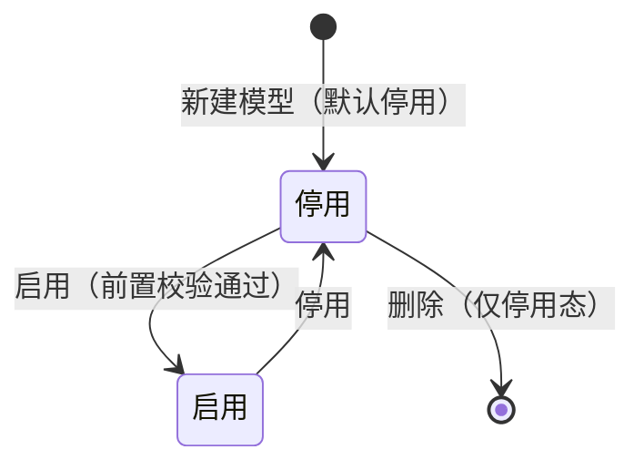

# 核算模型业务 PRD

> **【本文档已废弃 · 2026-09-24】**
>
> 本模块（核算模型 / 模型管理）已**整体废弃**，前端原型已删除「模型管理」菜单、路由与页面，`pages/model` 目录与模型相关类型 / 种子 / 服务已移除。
>
> **废弃原因**：模型库与产品信息库在「生命周期阶段结构 + 工序结构」上职责重叠，项目核算时存在两套工序数据来源（产品副本 + 模型工序），易造成匹配混乱。
>
> **替代方案**（以下口径已在前端原型落地，详见产品信息 / 工序 / 工艺流程 / 核算项目 PRD 最新版）：
> - **核算模型实体 → 删除**；
> - **核算边界、标准依据（核算方法）→ 项目级**：项目步骤①直接选择，不再选模型；
> - **生命周期阶段 → 降级为「工序/工艺的『所属生命周期阶段』标签」**：不再作为可增删改的独立层级，报告仍可按阶段分组披露；
> - **排放项级公式 → 下沉到「工序的投入产出项」**：系统默认带出（按流类型 / 名称关键词）、可手工覆盖或「不参与计算」，随工序 → 工艺 → 产品 → 项目整条链「引用即复制」带入；
> - **产品总碳排放公式 → 固定规则**：`产品总碳排放 = Σ 各工序排放`（工序排放 = Σ 其投入产出项结果，引擎自动汇总，**无需配置**）；减碳扣减项由「回收信用法」等公式本身返回负值自动抵扣；
> - **因子匹配 / 检测规则 / 报告模板 → 系统内置 / 固定模板**：本就只读、不落字段，删除模型对它们零影响。
>
> 本文档以下内容仅作历史留档，**不再维护**。

## 0. 文档基础信息

| 项目 | 内容 |
| :--- | :--- |
| 文档名称 | 核算模型业务 PRD（模型管理） |
| 版本 | V0.1 |
| 状态 | 草稿 |
| 模块名称 | 模型管理（对象：核算模型） |
| 模块类型 | **核算模型域对象（配置类）** —— **不做版本化**（用启用 / 停用控制可用性）、**无审核流**、无单据下推 |
| 维护形态 | 列表 + **分步配置向导**（基本信息 → 生命周期阶段 → 工序与公式 → 启用）+ 只读详情页 |
| 所属层级 | 后台管理 → 核算模型 → 模型管理（方案 §2.3 A2-3 / A2-4 / A2-5、§4.3.1、§4.3.2、§八 P14；原型 `/model/list`、`/model/list/:id`） |
| 字段真相源 | `02prd/02-1后台管理/10模型管理/核算模型字段清单.md` |
| 更新时间 | 2026-09-22 |

**变更记录**

| 日期 | 版本 | 变更内容 |
| :--- | :--- | :--- |
| 2026-09-22 | V0.1 | 初版（分批产出）；按已确认口径撰写：**① 不做模型版本化**（P3，启用 / 停用控制，追溯由项目快照"引用即复制"保证）；**② 不做「计算规则模板」**，计算规则以「计算公式」为准（P1 / P2）；**③ 暂不修订 08**，模型字段以本模块字段清单为唯一真相源、冲突以本模块为准（P4）；**④ 决策 D3 绑标准依据（`GB/T 24067-2024`）、D4 因子三开关落字段、D1 报告固定模板、D2 阶段基线不另建实体** |
| 2026-09-22 | V0.2 | 落地减重与可用性决策：**P5 覆盖度检查**（§3 新增「已绑定清单 / 启用体检」；§5.4 默认公式为启用前置；§5.8 新增 **E17** 与「命中默认公式」提示）；**P6** 文案改「默认公式（未精确匹配时使用）」；**P7** 绑定对象收敛 3 类（§5.4）；**P8** 登记「上游工序结果」数据因素依赖（§5.4 / §8 / Q18）；R-002 前置校验补「已配置默认公式」 |
| 2026-09-23 | V0.3 | 按业务反馈落地**两处决策反转 + 交互重构**：**P9** 生命周期阶段由「只读视图」改为**模型内可维护私有副本**（§4 / §5.3 / R-008 改写）；**P10 新增模型内工序**（二级阶段下引用工序库）；**P11 公式绑定三级**（工序 → 阶段 → 模型总公式）且绑定对象编码改用**模型内编码** `ST-xx` / `OP-xx`；§3 功能清单新增**分步配置向导**（Step1〜4）；新增 Q19 / Q20 |
| 2026-09-23 | V0.4 | 按「防信息过载」反馈简化为 **P12 界面极简口径**：§5.3 新增「界面极简口径」与「新增阶段默认值」两行；Step2 阶段列表改为**按边界过滤 + 仅显示名称 + 一级可收起展开**；新增 / 编辑**仅名称与层级**，顺序 / 纳入规则 / 使用状态 / 来源标记均改由系统维护 |
| 2026-09-23 | V0.5 | 原型走查后按业务裁定修订：**P13** 适用行业**变更即清空阶段**（二次确认）、**行业为空不自动带出**、新增「**按行业带出阶段**」主动入口（§5.3 新增 3 行 / R-008 处理逻辑）；**P14** 工序**只挂「最末级」阶段**（取代"二级阶段"硬编码）；Q20 由待确认改为**已裁定** |
| 2026-09-23 | **V0.6** | 按业务三条调整重构：**P15 阶段改为「勾选式」并合并进基本信息**（向导 **4 步 → 3 步**；行业/边界变更改为**阶段池刷新 + 自动移除失效阶段**，取消"清空 + 二次确认"）；**P16 公式改为四级 1:1**（排放项 → 工序默认 → 阶段默认；**产品总公式 = Σ 阶段结果 − 减碳扣减，非兜底**；工序/阶段由引擎自动汇总）；**P17 排放项公式系统默认带出**（中间品 / 产品默认**不参与计算**）；§3 功能清单、§5.3 / §5.4、R-002 / R-004 / R-008 同步改写 |
| 2026-09-23 | **V0.7** | 按业务三条追加修订（**P18**）：① 阶段**选完边界即时带出**（不依赖先创建模型）；② **默认该边界阶段全部加入** + 「已加入 ⇄ 未加入」双向切换 + 「全部加入 / 全部取消」；③ **取消「新增自定义阶段」**；④ 「核算边界」与「生命周期阶段」**相邻排列**；§5.3 / R-008 同步 |
| 2026-09-23 | **V0.8** | 按竞品形态改造**产品总碳排放公式（P19）**：改为**模型内表达式**，页面**默认只读展示阶段累计和 + 「点击配置」**，可增删项 / 改减项 / 恢复默认，**不能为空**、**父子阶段互斥**；§5.4 表格与说明改写；R-002 启用前置同步；产品总公式**不再占用模型公式绑定行** |
| 2026-09-23 | **V0.9** | 「点击配置」升级为**计算器式公式编辑器**（对齐竞品）：表达式显示区 + 数字键盘 + 运算符圆按钮 + 「可用的数据因素」+ 清空 / 删除 / 撤销；落库对象改为**受控表达式**；父子冲突因素**置灰并提示原因**；§5.4 说明同步 |
| 2026-09-23 | **V1.0** | 按业务三条追加修订（**P20**）：① **产品总公式按「最末级生命周期阶段」汇总**（因素池 = 全部末级阶段；默认式按阶段树顺序）；② **配置界面左右分栏**（左**生命周期树形结构**、右**公式配置**）；③ **阶段与工序改为系统自动汇总、不再关联公式**（**取消阶段默认 / 工序默认公式**；§5.4 表格由"四级"改为"两处公式"；兜底链取消） |
| 2026-09-23 | **V1.1** | 「工序与公式」步布局再调整（**P21**）：**总公式置顶高亮**、**生命周期树移至右下**（末级可点选）、**左下为选中阶段的工序面板**（工序列 + 公式绑定 + 添加工序）、**公式以气泡呈现且悬停显示式子**；§5.3 新增一行；§5.4 说明同步 |
| 2026-09-23 | **V1.2** | 配置界面按「**实际用户可见**」标准收敛（**P22**）：**移除内部术语**（末级 / 系统自动汇总 / 工序自动汇总 / 含 N 个末级阶段 / 来源编码 / 设计编号）与**说明性文案**（区块提示、字段 hint、页面描述内部口径）；仅保留字段标签、数据、操作按钮与必要状态标签 |
| 2026-09-23 | **V1.8** | **生物碳固碳开关一并移除（P27）**：模型侧不再有任何因子规定开关；产品总公式不再自动置负项；启用体检不再输出生物碳提示；**E16 归项目侧**（§5.5 / R-010 / G6 / S05 / §6 E16 同步） | §5.3、§5.5、§5.8、§6、§7、R-010、变更记录 |
| 2026-09-23 | **V1.7** | 因子规定开关**由 3 个收敛为 1 个**（**P26**）：删除「是否允许手工指定因子」「区域与年度口径」；**生物碳「固存」判定改为显式关键词**并按模型内实际阶段判断「吸收是否计入 / 是否已对称」（§5.5 / R-010 / G6 / S05 / E03 同步） | §5.3、§5.5、§5.8、§7、R-010、变更记录 |
| 2026-09-23 | **V1.6** | **详情页再精简（P25 补充）**：移除「启用体检」「检测规则与报告规定」「引用情况」三块卡片；详情页最终只保留 **基本信息（含阶段勾选态）/ 工序与公式 / 制单信息**；启用校验只在向导「完成并启用」步呈现 | §5.7、变更记录 |
| 2026-09-23 | **V1.5** | **模型详情页改为「配置模型向导的只读复刻」（P25）**：卡片结构对齐向导三步（基本信息含阶段勾选态 → 工序与公式含产品总公式横幅 + 生命周期树 + 工序面板 → 启用体检），**一律不可编辑**（无「点击配置」/ 无勾选操作/无按钮）；原独立的「因子规定」「已绑定清单」「公式表格」合并或移除；§5.7 详情页条目同步改写 | §5.7、变更记录 |
| 2026-09-23 | **V1.4** | 按业务走查收口两项（**P24**）：① **启用校验精简为 4 条**（删除基本信息步的重复阻断：模型名称 / 核算边界 / 区域与年度口径 / 标准依据；§5.3 新增「启用校验规则」）；② **阶段 / 工序取消「启用 / 停用」字段**；③ 界面术语通俗化（系统已自动配好 / 人工修改 / 不参与计算 / 未配公式）；④ 全文「冻结」措辞统一为「启用中不可修改」 | §5.3、§5.4、§6、§7、变更记录 |
| 2026-09-23 | **V1.3** | 界面三条再调整（**P23**）：① **左下 / 右下互换**（左下 = 生命周期树、右下 = 工序面板）；② **工序取消启用 / 停用**，移除改为**图标按钮**；③ **取消「仅看已调整项」筛选** |

**关联链接**

| 文档 | 路径 |
| :--- | :--- |
| 字段清单（字段唯一真相源） | `02prd/02-1后台管理/10模型管理/核算模型字段清单.md` |
| 整体设计方案 v1.2（§4.3.1 模型定义 · 第一真相源） | `04产品设计管理/00业务设计/产品碳足迹核算系统_整体设计方案_v1.2.md` |
| 计算引擎配置业务 PRD（**上下游边界**：公式与"绑定"动作） | `02prd/02-1后台管理/08计算引擎配置/计算引擎配置业务PRD.md` |
| 因子库业务 PRD（**章节结构与规则写法参照**，同批次最新） | `02prd/02-1后台管理/09因子库/排放因子库业务PRD.md` |
| 标准文件业务 PRD（**绑定的标准依据**引用源） | `02prd/02-1后台管理/06标准文件/标准文件业务PRD.md` |
| 分配规则管理（A2-8–A2-11 / P16，**待交付**） | `02prd/02-1后台管理/11分配规则/` |
| 方案附录二（**偏离登记唯一处**） | `04产品设计管理/00业务设计/产品碳足迹核算系统_整体设计方案_v1.2.md` 附录二 |

**文档分工表**

| 文档 | 负责内容 | 不负责内容 |
| :--- | :--- | :--- |
| 字段清单 | 字段、类型、来源、必填性、枚举、字段级约束（D01～D15） | 业务规则、状态与冻结、引用与快照、上下游联动 |
| 业务 PRD（本文） | 定位边界、启用 / 停用与冻结规则、标准依据与因子开关口径、阶段加载、检测与报告口径、引用与快照、状态矩阵、上下游关系 | 完整字段表、页面控件与布局、算法实现 |
| Demo PRD | 页面骨架、控件选型、弹窗、校验展示、Mock 数据 | 业务规则定义 |
| 计算引擎配置（08） | **计算公式 + 数据因素 + "绑定"动作本身与命中优先级** | 模型本体字段、模型状态与冻结规则、因子 / 检测 / 报告 / 阶段口径（**归本文**） |
| 分配规则管理（P16） | 分配方法库、场景模板、分配规则配置与发布 | 模型侧的分配规则引用口径（本文只写边界） |

---

## 1. 需求概述

### 1.1 需求背景

核算模型是**核算项目的前置标准** —— 项目必须先引用一套模型，才能确定边界、生命周期阶段、计算规则、检测规则与报告口径：

```text
后台配置模型（停用态） → 启用（启用即冻结，可被项目引用） → 前台引用模型
→ 项目级实例化：【引用即复制快照】 → 项目后续核算与报告基于该快照   （方案 §4.3.2，按 P3 调整）
```

**没有可引用的模型，项目无法确定核算口径**；模型同时是**标准差异的唯一承载点**（方案 §4.3.1）—— 不同标准（ISO 14067 / PAS 2050 / GB/T 24067 / PEF）= 不同标准依据绑定 + 不同配置组合。

**本模块的两个关键口径（已确认，贯穿全文）**

| # | 口径 | 说明 |
| :-: | :--- | :--- |
| **P3** | **不做版本化** | 不设「模型版本 / 版本状态」；用**使用状态（启用 / 停用）**控制可用性；**追溯由项目快照（引用即复制）保证**，即方案 §4.9 **口径 2（模板 + 引用即复制）** |
| **P4 / C1** | **字段与职责以本文为准** | 暂不修订 `08计算引擎配置业务 PRD / 字段清单`；**08 负责公式与"绑定"动作，本文负责模型本体 + 状态与冻结 + 标准依据 + 因子开关 + 检测 / 报告口径**；**冲突以本文为准** |

**与下游的边界（模型管什么、不管什么）**

| 归属 | 模块 | 模型管理的角色 |
| :--- | :--- | :--- |
| 模型基本信息、核算边界、使用状态、标准依据、因子开关、说明 | **模型管理（本模块）** | 唯一维护方 |
| 公式表达式、数据因素、公式绑定与命中优先级 | **计算引擎配置（08）** | 模型侧只**引用公式**、只表达"绑定到哪" |
| 生命周期阶段结构 | **生命周期阶段（A1-10）** | 模型侧**只读展示**按「行业 + 边界」查出的阶段集合 |
| 因子数值 / 单位 / 区域 / 年度 / 因子版本 | **排放因子库（A2-6 / A2-7）** | 模型只承载**匹配规则的只读展示 + 3 个开关**（D4） |
| 分配方法库 / 场景模板 / 规则配置与发布 | **分配规则管理（P16）** | 模型**不承载**（本文只声明遵循 §6.4 层级） |
| 检测执行、问题清单、再次检测 | **前台数据检测（P23）** | 模型只承载"检测规则随快照冻结"的口径 |
| 报告模板与章节 | **报告（§4.8）** | **D1 固定模板**，模型不配置 |
| 项目级实例化快照 | **核算项目（P17–P20）** | 模型只写"启用后可被引用 + 引用即复制" |

### 1.2 需求目标

| # | 目标 | 可验证口径 |
| :-: | :--- | :--- |
| G1 | **仅「启用」模型可被项目引用** | 项目引用候选只返回「使用状态 = 启用」的模型；停用模型不出现在候选中 |
| G2 | **启用态不可编辑，调整须先停用** | 启用态下「编辑 / 维护公式绑定 / 删除」入口不可用；停用后方可操作 |
| G3 | **模型变更不污染已建项目** | 模型编辑后，已引用项目的结果与报告不变；采用新口径须重走检测 → 核算 → 报告并留新结果版本（**E13**） |
| G4 | **检测规则随项目快照冻结、结论可复现** | 同一数据 + 同一项目快照 → 同一检测结论（§6.2） |
| G5 | **首发模型绑定 `GB/T 24067-2024`** | 首个预置模型（`MD-001`）的「绑定的标准依据」= `GB/T 24067` / `2024`（**D3**） |
| G6 | **因子规定只读** | 匹配规则与优先级不可编辑（**D4**）；**模型侧不开放任何开关**（P27）；生物碳对称性（E16）归**项目侧**判定（§6.5） |

### 1.3 范围（In Scope / Out of Scope）

**In Scope**

| # | 范围 |
| :-: | :--- |
| 1 | 模型**基本信息**维护：模型编码（系统生成）、模型名称、**核算边界（单选）**、适用行业（多选）、模型说明 |
| 2 | **绑定的标准依据**（D3，单选引用标准文件库；**未交付时降级为自由文本 / 允空**） |
| 3 | 因子规定：**模型侧无开关**（匹配规则与优先级只读） |
| 4 | **公式绑定**：引用「计算公式」（启用态），绑定到整模型 / 生命周期阶段 / 核算工序 / 投入项 / 产出项，设默认与命中优先级 |
| 5 | **启用 / 停用 / 删除**（仅「停用」可编辑、可删；两态双向可逆） |
| 6 | **生命周期阶段规定**：按「行业 + 边界」的**只读展示**（不落字段） |
| 7 | **检测规则 / 报告规定的口径**：随项目快照冻结；报告固定模板（D1） |
| 8 | 引用情况**只读反查**（被哪些项目引用） |

**Out of Scope**

| # | 不做 | 依据 |
| :-: | :--- | :--- |
| 1 | **模型版本化**（无版本字段、不产生新版本） | P3（业务决策） |
| 2 | **「计算规则模板」功能**（公式以「计算公式」为准） | P1 / P2 |
| 3 | 因子规定**配置页**（匹配规则与优先级不可配） | D4 |
| 4 | 报告**模板自定义** | D1 |
| 5 | 公式**级自定义 DSL**（沿用受控表达式） | 方案修订 5 / P2 |
| 6 | **多标准并行模型**（其他标准后续以新模型接入） | D3 |
| 7 | 模型内**阶段基线实体**（不另建对象） | D2 / §4.2.4 |
| 8 | 组织**自建模型**（模型仅平台级，待确认） | §9 Q09 |
| 9 | 模型**导入** | 字段清单 §1.3 |

### 1.4 涉及角色

| 角色 | 数据域 | 本模块职责 | 依据 |
| :--- | :--- | :--- | :--- |
| **平台运营管理员** | 平台域 | 平台级模型与**首发模型**（`GB/T 24067-2024`）维护 | §7.1 / §7.2 |
| **专业配置人员** | SUB_TREE（只读业务） | 模型新建 / 编辑、公式绑定、因子开关、检测与报告口径 | §7.1 / §7.2 |
| **组织管理员** | SUB_TREE | 若开放组织自建则维护本组织模型（**待确认 Q09**）；当前**无该权限** | §7.2 |
| **核算人员** | CURRENT | **引用**已启用模型（项目侧） | §7.2 |
| **审核员** | SUB_TREE | 引用与查看 | §7.2 |
| **填报人 / 只读观察者** | SELF / SPECIFIED | 无本模块操作权 | §7.2 |

### 1.5 影响范围

| 方向 | 模块 | 影响 |
| :--- | :--- | :--- |
| 下游 | 核算项目 P17–P20 | 引用已启用模型 → **引用即复制快照**；边界一致性校验 |
| 下游 | 检测引擎 §6.2 / P23 | 检测规则与阈值随项目快照冻结，结论可复现 |
| 下游 | 计算引擎 §6.1.1 / P24 | 公式绑定与命中优先级决定"算什么" |
| 下游 | 报告 §4.8 / P26 | 报告规定（D1 固定模板）；披露标准依据 |
| 下游 | 核算结果 §4.7 / §6.3 | 可还原"当时用的模型配置快照" |
| 上游 | 生命周期阶段 A1-10 | 「行业 + 边界」→ 阶段规定的只读视图（D2） |
| 上游 | 排放因子库 A2-6 / A2-7 | 因子开关（D4）联动；匹配规则只读 |
| 上游 | 标准文件库 A1-3 | 绑定的标准依据（D3）；**未交付时降级** |
| 上游 | 行业库 A1-4 | 适用行业；**行业库 P2 未交付时降级** |
| 关联 | 计算引擎配置（08） | **公式与"绑定"动作归 08**；模型字段以本文为准（C1 / P4） |
| 关联 | 分配规则管理（P16，待交付） | 分配规则**不落在模型**，本文只写边界 |
| 关联 | 组织与权限 §7.1 / §7.2 | 谁能维护模型 |

---

## 2. 用户与使用场景

> 每条含：触发条件 → 操作流程 → 预期结果。

### S01 新建模型

| 项 | 内容 |
| :--- | :--- |
| 触发条件 | 专业配置人员需要为一类产品 / 行业 / 标准建立核算口径 |
| 操作流程 | 模型管理列表 → 「新增模型」→ 填基本信息（名称 / 核算边界 / 适用行业 / 模型说明）→ 绑定标准依据（D3）→ 保存 |
| 预期结果 | 生成模型编码（`MD-{三位}`）；**使用状态 = 停用**（默认）；可在停用态继续配置 |

### S02 选择生命周期阶段（勾选加入模型）

| 项 | 内容 |
| :--- | :--- |
| 触发条件 | 确定「适用行业 + 核算边界」后，需要圈定本模型纳入哪些阶段 |
| 操作流程 | 配置模型 → 基本信息 → 「生命周期阶段」区**勾选**（已加入 ⇄ 未加入 / 全部加入 / 全部取消）；详情页同位置**只读回显勾选态** |
| 预期结果 | 阶段池按「适用行业 + 核算边界」即时查出（`excluded` 不展示）；勾选二级自动纳入其一级；模型内阶段 = 阶段库阶段的**子集**（不支持新增自定义阶段、不另建基线实体） |

### S03 配置计算公式（排放项级 1:1 + 产品总公式）

| 项 | 内容 |
| :--- | :--- |
| 触发条件 | 模型需确定"算什么、算在哪" |
| 操作流程 | 配置模型 → 工序与公式 → ① **排放项行下拉选择公式**（每行 1 条，系统已自动配好，仅改例外）；② 顶部「产品总碳排放公式」点「点击配置」用公式编辑器调整 |
| 预期结果 | **每「模型 + 对象」至多 1 条**（再次选择即替换）；排放项公式**系统默认带出**，可「恢复默认」；**产品总公式 = Σ 阶段核算结果 − 减碳扣减项**（独立汇总式、非兜底）；**工序 = Σ 排放项结果、阶段 = Σ 其下工序结果**（引擎自动汇总，不绑公式） |

### S04 查看检测规则

| 项 | 内容 |
| :--- | :--- |
| 触发条件 | 需了解核算时会触发哪些检测项 |
| 操作流程 | **模型侧不展示**（检测规则不在模型页呈现，归系统参数与项目侧检测） |
| 预期结果 | 检测项清单与级别（阻断级 / 提示级）在**项目侧**展示；规则随项目快照锁定、结论可复现 |

### S05 配置因子规定开关

| 项 | 内容 |
| :--- | :--- |
| 触发条件 | 模型需要确认因子匹配口径 |
| 操作流程 | 模型侧**无需配置**：因子匹配规则与优先级由系统内置、随模型冻结、只读展示；取值口径固定「按项目核算周期年度取因子」 |
| 预期结果 | 开关随模型保存并随项目快照锁定；**模型内不提供因子匹配规则配置页** |

### S06 报告规定

| 项 | 内容 |
| :--- | :--- |
| 触发条件 | 需要确认报告口径 |
| 操作流程 | **模型侧不展示**（报告模板与模型配置无关） |
| 预期结果 | 报告采用系统**固定模板**，不支持自定义模板配置 |

### S07 启用模型

| 项 | 内容 |
| :--- | :--- |
| 触发条件 | 模型配置完成，准备供项目引用 |
| 操作流程 | 配置模型 → **「完成并启用」** → 查看 **4 项启用体检**（生命周期阶段 / 模型内工序 / 产品总碳排放公式 / 排放项公式）→ 「启用模型」→ 确认 |
| 预期结果 | 校验通过则 **使用状态 = 启用**，**阶段 / 工序 / 公式绑定不可再修改**，进入项目引用候选；不通过则**列明待补项并禁用「启用模型」** |

### S08 停用 / 重新启用 / 删除

| 项 | 内容 |
| :--- | :--- |
| 触发条件 | 模型下架、需调整，或需清理 |
| 操作流程 | ①「停用」→ 可回到「配置模型」继续调整；②「启用」→ 再次锁定；③「删除」（仅停用态）→ 二次确认 |
| 预期结果 | 停用后**不可被新项目引用**，**已引用项目的历史快照保留**；**启用 ⇄ 停用双向可逆、无终态**；删除同时清理该模型全部绑定行 |

### S09 复制 / 另存为（待确认 Q10）

| 项 | 内容 |
| :--- | :--- |
| 触发条件 | 需要以既有模型为起点建新模型 |
| 操作流程 | 模型详情 → 「复制」→ 生成新模型（新编码）→ 编辑 |
| 预期结果 | 副本**默认「停用」**、保留来源标记；（是否本期交付见 Q10） |

### S10 查看模型详情

| 项 | 内容 |
| :--- | :--- |
| 触发条件 | 需了解模型配置与影响面 |
| 操作流程 | 模型详情（**配置向导的只读复刻**）→ ① 基本信息（含生命周期阶段勾选态）；② 工序与公式（产品总公式 + 生命周期树 + 工序面板）；③ 制单信息 |
| 预期结果 | 与配置向导**同构呈现、一律不可编辑**；被项目引用情况在项目侧反查（本期项目模块未交付） |

### S11 模型变更对已建项目的影响处理

| 项 | 内容 |
| :--- | :--- |
| 触发条件 | 模型（或其所引用的因子 / 阶段 / 公式）发生变更，已建项目希望采用新口径 |
| 操作流程 | 停用模型 → 修改 → 启用 → 在项目中**更新快照** → 重走检测 → 核算 → 报告 |
| 预期结果 | 旧结果版本保留；新结果基于新快照；符合 **E13** 要求 |

---

## 3. 功能清单

| 模块 | 功能点 | 功能描述 | 优先级 |
| :--- | :--- | :--- | :---: |
| 模型列表 | 列表与查询 | 按**模型编码 / 模型名称 / 核算边界 / 适用行业 / 使用状态**检索（参与检索的字段以字段清单为准） | P0 |
| 模型列表 | 新增模型（**分步配置向导**） | 进入向导：**Step1 基本信息（含标准依据 + **生命周期阶段勾选**）** → 创建模型 → 在 Step1 内**勾选阶段** → **Step2 工序与公式（一屏一表 · 四级 1:1）** → **Step3 完成并启用**（**3 步**，P15） | P0 |
| 向导 · Step2 | 模型内阶段增删改 | **模型私有副本**：新增 / 编辑（名称 / 层级 / 顺序 / 纳入规则 / 备注）/ 删除（级联）/ 启用停用 | P0 |
| 向导 · Step2 | 模型内工序 | 在**最末级阶段**下**引用工序库**工序；移除时清理其排放项公式 | P0 |
| 向导 · Step2 | **排放项级公式** | **一个投入产出物 1 条公式**；系统按映射表**默认带出**；可覆盖 / 恢复默认；中间品 / 产品默认**不计入** | P0 |
| 向导 · Step2 | 工序默认 / 阶段默认公式 | 每级**至多 1 条**，未指定即向上继承；**下拉即改**（无"设默认 / 解除"动作） | P0 |
| 向导 · Step2 | **产品总碳排放公式** | `Σ 各阶段结果 − 减碳扣减项`；骨架按已勾选阶段自动生成 | P0 |
| 向导 · Step3 | 完成并启用 | 启用体检（**4 项**：已选生命周期阶段 / 已添加工序 / 已配产品总公式 / 排放项均已配公式）通过后启用 | P0 |
| 模型列表 | 查看模型 | 进入详情页 | P0 |
| 模型列表 | 启用 / 停用 | 行操作或详情操作；启用前置校验；两态双向可逆 | P0 |
| 模型列表 | 删除模型 | **仅「停用」可删**；二次确认；删除清理绑定行 | P0 |
| 模型详情 | 编辑基本信息 | **统一在「配置模型」向导中进行**；「启用」中不可修改（需先「停用」） | P0 |
| 模型详情 | 配置绑定的标准依据 | 单选引用标准文件库（D3）；未交付降级为自由文本 / 允空 | P0 |
| 模型详情 | **与向导 Step1 同构**：基本信息 + 生命周期阶段 | 基本信息字段按向导同序只读展示（含使用状态）；**生命周期阶段 = 向导勾选态只读**（禁用勾选框 + 「已加入 N / 共 M 个阶段」+ 一级可收起展开） | P0 |
| 模型详情 | **与向导 Step2 同构**：工序与公式 | **产品总碳排放公式横幅**（高亮·只读无「点击配置」）+ **左下生命周期树**（可点选切换查看）+ **右下工序面板**（工序 + 排放项级公式气泡，悬停看式子）——**全部只读、无任何操作按钮** | P0 |
| 模型详情 | **工序与公式面板即「已绑定清单」** | 工序面板逐阶段展示「工序 + 其排放项级公式」，替代原独立清单（**P5 覆盖度检查·模型侧**） | P0 |
| 模型详情 | 检测与报告口径（只读） | 展示检测项与级别、【Q08】；展示固定报告模板（D1） | P1 |
| 模型列表 | 复制 / 另存为 | 以既有模型为起点新建（默认停用 + 来源标记）——**待确认 Q10** | P2 |
| 模型列表 | 导出 | 导出模型清单 / 配置（**待确认 Q12**） | P2 |
| 模型列表 | 批量操作 | 批量停用 / 启用 / 删除（部分成功处理）——**待确认 Q13** | P2 |

---

## 4. 模型的定位边界（**核心章节之一**）

必须写清「模型管理**管什么、不管什么**」。下表逐项划清边界；**凡"归属"列不是"模型管理"的，本文只写边界与引用关系，不定义对方字段**。

| 边界对象 | 归属 | 模型管理的写法 |
| :--- | :--- | :--- |
| 模型基本信息（模型编码 / 名称 / **核算边界** / 适用行业 / **使用状态** / 模型说明） | **模型管理** | 本模块维护；**无「版本 / 版本状态」**（P3）；**无「适用产品分类」** |
| **绑定的标准依据**（D3，`GB/T 24067-2024`） | 标准文件库（A1-3） | 只**引用**（单选）；**标准文件库未交付时降级为自由文本 / 允空**；模型不定义标准文件字段 |
| **边界定义**（摇篮到大门 / 摇篮到坟墓） | **模型管理** | 本模块维护（**单选**）；与「一项目一边界」（§5.3）一致；与项目边界不一致时**阻断引用**（R-007） |
| **生命周期阶段规定** | **模型管理（模型私有副本）** + 项目级排除 | **P9 决策反转**：创建模型时按「适用行业 + 核算边界」从阶段库（A1-10）**复制**一份到模型内，**可增删改**；**不影响阶段库主数据**、基础库变更也不回写副本；**不另建"基线"实体**（§4.2.4）；排除动作与原因**归项目级（P20）** |
| **模型内工序** | **模型管理（模型私有）** | **P10**：在模型内**二级阶段**下**引用工序库（A1-8）**的工序，形成「阶段 → 工序」结构；**不影响工序库**；是工序级公式绑定的载体 |
| **计算公式 + 数据因素 + "绑定"动作** | **计算引擎配置（08）** | **不做「计算规则模板」（A2-1 / A2-2）**；模型侧只写「引用哪些公式、绑定到哪个对象、命中优先级」，**不定义公式字段、不定义绑定字段**（C1 / P4） |
| **因子规定**（匹配规则与优先级） | **模型管理**（结构化配置段，D4） | **只读展示、不做配置页**；**模型内不开放任何开关**（P27）；规则随模型冻结、随项目快照复制 |
| 因子数据本身（数值 / 单位 / 区域 / 年度 / 版本 / 有效期） | 排放因子库（A2-6 / A2-7） | 只引用；模型**不承载因子数值** |
| **分配规则**（触发场景 / 默认方法 / 比例校验） | 分配规则管理（A2-8–A2-11 / P16，**待交付**） | **不落字段**；模型只声明遵循 §6.4 的 ISO 14044 层级（避免分配 → 物理关系 → 经济价值） |
| **检测规则与阈值参数** | **模型管理**（A2-4） | 展示检测项与级别；**规则随项目快照冻结**；是否落字段见 **Q08**（当前按只读展示、不落字段） |
| 检测执行、问题清单、再次检测 | 前台数据检测（P23 / §6.2） | 只写规则来源与冻结口径，**不写检测页面与流程** |
| **报告规定**（模板 / 必填章节 / DQR 声明） | **模型管理**（D1 固定） | 只读固定、**不落字段**；**不做模板配置** |
| 报告生成、编辑、确认、下载 | 报告（§4.8 / P26） | 只写边界 |
| **项目级实例化快照** | 核算项目（§4.3.2 / P17–P20） | 只写"**启用后**可被引用 + **引用即复制**"，**不定义项目侧字段** |
| 「模型版本 / 版本状态」 | **不设**（P3） | 模型不做版本化；可用性由**启用 / 停用**控制，追溯由**项目快照**保证 |
| 组织归属与可见性 | 全局口径 §3.3.3 | **仅平台级**（`PUBLIC`，租户只读引用）；**不落「数据来源 / 归属组织 / 可见性」字段** |
| 标准差异（ISO 14067 / PAS 2050 / PEF） | 未来**新模型** | 写明"新标准 = 新建模型"的接入方式；**本版本不交付** |

---

## 5. 模型组成与配置机制（**核心章节之二**）

逐项写清方案 §4.3.1 的 **8 项组成**在**本版本如何落地**（与字段清单一一对应）。**凡"不落字段"项，均在详情页以只读形式展示，不作为可维护配置。**

### 5.1 模型基本信息

| 组成项 | 落地方式 | 说明 |
| :--- | :--- | :--- |
| 模型编码 | **落字段** | 系统生成 `MD-{三位}`（现状 `MD-001`）；全局唯一、编辑只读 |
| 模型名称 | **落字段** | 1–100 字符；不唯一 |
| 核算边界 | **落字段（单选）** | 摇篮到大门 / 摇篮到坟墓（§4.3.1 定义"可扩展"，本期仅两值） |
| 适用行业 | **落字段（多选）** | 引用行业库（A1-4）；**为空 = 全行业通用**；行业库未交付时降级为名称字符串（Q11） |
| 使用状态 | **落字段** | 启用 / 停用（见 §5.9） |
| 模型说明 | **落字段（选填）** | ≤500 字符 |
| 适用产品分类 | **不落字段** | 本期无下游使用；产品分类归基础库产品分类树（Q07） |

### 5.2 边界定义

- **单选**，与"一项目一边界"（方案 §5.3）保持一致：同一产品多边界 = **分别创建关联项目**，各自引用对应模型；
- **一致性约束**：项目边界必须与模型边界一致，否则**阻断引用**（R-007）。

### 5.3 生命周期阶段规定与模型内工序（**P9 / P10，模型私有副本**）

```text
创建模型 → 按「模型.适用行业 + 模型.核算边界」从阶段库（A1-10）复制一份到模型内：
  复制范围 = 阶段库「启用」阶段，且（适用行业为空 或 含模型行业）
  纳入规则 = 按边界取「三态」中的对应值（gate / grave）
复制后 → 模型内阶段可【增 / 删 / 改】：名称、顺序、层级、纳入规则、启用停用
        新增阶段 = 模型内自建（无来源标记）；保留【来源阶段编码】用于追溯
基础库变更 → 【不回写】模型副本 → 历史模型永远还原复制当时的阶段结构
```

| 项 | 口径 |
| :--- | :--- |
| **与阶段库的关系** | **复制**（非实时引用）；模型副本**完全解耦**，阶段库被替代 / 作废**不自动同步**（Q19） |
| **与"不另建基线实体"的关系** | 仍**不建"基线"对象**——基线仍是"按行业 + 边界查出来的集合"，只是该集合被**复制并冻结**在模型内（§4.2.4 原则未被违反） |
| **模型内工序（P10 / P16）** | 在模型内**「最末级」阶段**下**引用工序库（A1-8）**的工序（判定：该阶段其下**不再有子阶段**；一级阶段若无二级阶段，其自身即最末级，可直接挂工序）；**同一阶段不可重复引用同一工序**；仅「启用」工序可引用 |
| **阶段「勾选式」加入（P15 / P18）** | 阶段池 = 该「行业 + 边界」下的阶段库阶段（`excluded` 不展示），**按「边界 + 行业」即时查询**：**选完「核算边界」立刻带出**（无需先点「下一步」创建模型，勾选态先在本地、保存时一并落库）；**默认该边界阶段「全部加入」**，可「已加入 ⇄ 未加入」双向切换，并提供「**全部加入 / 全部取消**」；**勾选二级阶段其一级自动纳入**，取消一级其下二级一并取消；**不提供「新增自定义阶段」**（模型内阶段 = 阶段库阶段的子集） |
| **行业 / 边界变更（P15 / D27）** | 阶段池**就地刷新**，模型内**不再适用的既有阶段自动移除**（级联清理工序 / 公式 / 排放项覆盖）；**不再有"清空 + 二次确认"**（用户当场重选） |
| **公式仅两处（P20）** | ① **排放项级**：一个投入产出物 = 1 条公式（**系统已自动配好**）；② **产品总公式**：1 条；**阶段与工序不再绑定公式**——**工序 = Σ 排放项结果**、**阶段 = Σ 其下工序结果**（引擎自动汇总）；排放项未配公式且非「不参与计算」→ **阻断启用**（兜底链已取消） |
| **启用校验规则（P24）** | **阻断项只有 4 条**（且都能在向导内补齐）：① 尚未选择生命周期阶段；② 尚未添加工序；③ 尚未配置「产品总碳排放公式」；④ 有排放项未配公式（列出前 3 个）。**模型名称 / 核算边界 / 标准依据不在此重复阻断**（前两者已在「基本信息」步强制，标准依据为选填） |
| **产品总碳排放公式（P19 / P20 / P21）** | 按**最末级生命周期阶段**汇总（父阶段不参与，天然无重复计算）；**模型内受控表达式、不参与兜底**；默认表达式按**阶段树顺序**生成；**启用前置条件**；界面位于「工序与公式」步的**顶部并高亮凸显**（下方：右为生命周期树、左为选中阶段的工序面板） |
| **「工序与公式」步布局（P21 / P23）** | ① **顶部**：产品总碳排放公式（**高亮**）+「点击配置」；② **左下**：**生命周期树**（末级阶段可点选、选中态高亮）；③ **右下**：选中阶段的**工序面板**（工序列表 + 排放项公式绑定 + 「+ 添加工序」）；④ **公式绑定后以气泡呈现，悬停显示具体公式式子**；⑤ **工序不设启用 / 停用**（加入即参与核算），**移除用图标按钮**；⑥ 不提供「仅看已调整项」筛选 |
| **删除级联（D22）** | 删除阶段 → 级联删除其二级阶段、阶段内工序与**相关公式绑定**；删除工序 → 清理其公式绑定 |
| **编辑权限** | 模型内阶段 / 工序的增删改**仅「停用」模型可操作**；「启用」后不可修改 |
| **界面极简口径（P12，防信息过载）** | ① **按所选边界仅带出该边界阶段**（「不纳入」不展示）；② 阶段列表**仅显示名称**，一级阶段**可收起展开**；③ 新增 / 编辑**仅「名称 + 层级（+ 所属一级阶段）」**；④ 顺序 / 纳入规则 / 使用状态 / 来源标记**界面一律不展示、不可编辑** |
| **新增阶段的默认值** | 顺序 = 同级最大值 +10（系统自动）；纳入规则 = **「可选纳入」**（系统赋值，不由用户选择）；使用状态 = 启用 |
| **行业变更 → 阶段清空（P13）** | 「适用行业」**发生变化**时，**清空该模型全部阶段**（级联清理阶段内工序与相关公式绑定），操作前**二次确认**；清空后由用户**重新选择**阶段 |
| **行业为空 → 不带出（P13）** | 「适用行业」为空（全行业通用）时**不自动带出阶段**；「按行业带出阶段」入口**禁用**，引导用户先选行业或**手动新增**阶段 |
| **按行业带出阶段（P13）** | 提供**用户主动触发**的「按行业带出阶段」入口（按当前「行业 + 边界」从阶段库复制，**覆盖式**）；**行业为空时不可用** |
| **项目级排除** | 项目内仍可启用 / 排除阶段，**排除必须填原因**，原因**保存在项目内、不回写模型与阶段主数据** |
| **追溯** | 模型变更**不追溯**已建项目（快照） |

### 5.4 计算规则（以「计算公式」为准）

- **不做「计算规则模板」（A2-1 / A2-2）**（P1 / P2）；
- 计算规则**一律以「计算公式」为准**（`/model/calc-engine`，字段与规则真相源 = `08计算引擎配置`）；
- **参数配置归 08 计算公式**，模型侧**不承载**（P2 剩余项已确认）。

**公式四级 1:1（P16，取代原"三级 + 多条 + 默认唯一"）**

| 级别 | 对象 | 本期 | 说明 |
| :-: | :--- | :---: | :--- |
| **排放项（投入项 / 产出项）** | **一个投入产出物 = 1 条公式**；由**系统按标准映射默认带出**（P17），用户仅调整例外；可「恢复默认」 | ✅ | 每项**至多 1 条** |
| **产品总碳排放公式** | 按**最末级生命周期阶段**汇总（`Σ 末级阶段结果`，可含减项）；**模型内表达式**（因素 = 「阶段核算结果」，**不引用公式库**）；页面**默认只读展示 + 「点击配置」**；**不能为空**（≥1 个末级阶段因素）；**启用前置条件**（P19 / P20） | ✅ | **1 条** |
| 生命周期阶段 / 核算工序 | **系统自动汇总**（工序 = Σ 排放项结果；阶段 = Σ 其下工序结果） | **不绑定公式** | **已取消「阶段默认公式」「工序默认公式」**（P20 / D36） |

**继承链**：`排放项 → 工序默认公式 → 阶段默认公式 → ⛔ 阻断`（**产品总公式不参与该链**）

**汇总关系（引擎自动，不写公式）**：**工序 = Σ 排放项结果**；**阶段 = Σ 工序结果**。

`>` **产品总公式不参与兜底**（P16 明确），故原「默认公式（未精确匹配时使用）」文案**作废**，全文统一为**「产品总碳排放公式」**。
`>` **产品总公式的形态（P19）**：**默认只读展示**「各阶段核算结果累计和」，右侧「**点击配置**」进入**计算器式公式编辑器**——表达式显示区 + 数字键盘（`1-9 0 . % ( ) [ ]`）+ 运算符大圆按钮（`+ - * /`）+「**可用的数据因素**」（= 模型内阶段，同名去重）+「**清空 / 删除 / 撤销**」；默认表达式 = **全部末级阶段相加**（**减碳扣减项由用户手工加 `-`**，不再自动置负）；**父阶段与其子阶段不可同时出现**（冲突因素**置灰**并提示原因）；提供「**恢复默认**」；**为空则阻断启用**（对齐竞品「计算公式不能为空」）。
`>` **产品总公式不落「模型公式绑定」子表**（它由「产品总公式项」承载），绑定行仅剩**阶段 / 工序**两级默认公式。
`>` 绑定对象编码使用**模型内编码**（阶段 `ST-xx`、工序 `OP-xx`），产品总公式编码 = 模型编码；**不再直接引用阶段库 / 工序库编码**。

**排放项公式的系统默认带出（P17）**

- 按「排放项 → 标准公式」映射表逐项带出（电力 → 电力排放 / 蒸汽 → 净外购热力法 / 燃料 → 燃料燃烧 / 制冷剂 → 泄漏法 / 运输 → t·km 法 / 回收 → 回收信用（负项）/ 末期废弃 → 末期处理 / 其余 → 因子法）；
- **中间品 / 产品（不论投入或产出方向）默认「不计入」**（避免重复计算）；
- 用户可**逐项覆盖**或**恢复默认**；「不计入」可一键改为「计入」（回落通用兜底公式）；
- 规则明细见字段清单 **§1.6**。

**已登记的数据因素扩展（P8 / Q18，归 `08计算引擎配置`）**

- 新增数据因素来源「**上游工序结果**」：自动引用上游工序的产出量，**支持"竹条由上游碳化工序产出自动带出"**；
- 落地口径（建议，与 §4.2.2「中间品不记录上下游工序关联、按物料对象一致 + 工艺流程工序顺序推导」一致）：
  ① 按**中间品物料**引用（不硬编码工序关联）；② 按**工艺流程工序顺序正向求值、全链自动传递**；③ 单位不可换算触发 **E04**；④ 默认**只读、不可填报覆盖**；⑤ 上游缺失 / 未算 → **E17** 阻断。

### 5.5 因子规定（D4）

| 部分 | 落地方式 |
| :--- | :--- |
| 匹配规则与优先级（活动类型 + 阶段 + 区域 + 年度 → 因子类型；**组织自建 > 系统预置**） | **结构化配置段**：系统内置、随模型冻结、**只读展示、不落字段**；**不做配置页** |
| ~~是否允许手工指定因子~~ | **已删除**：恒为「允许」——因子匹配结果始终人工确认、可替换留痕，字段无实际作用 |
| ~~区域与年度口径~~ | **已删除**：口径固定「**按项目核算周期年度取因子**」；如需历史追溯 / 严格匹配口径，走系统参数 |
| 匹配结果 | **始终人工确认、允许替换并留痕** |

**开放配置化的触发条件**（本版本不开放，但须写明后置路径）：接入第二套标准（ISO 14067 / PEF）· 出现行业间匹配规则冲突 · 客户明确要求修改因子优先级。

### 5.6 报告规定（D1）

- **本版本固定模板**，**不支持自定义模板配置**；模型侧**不落字段**，详情页**只读展示**；
- 报告章节要素对齐 ISO 14067 / GB/T 24067（§4.8），由报告模块承载。

### 5.7 分配规则

- **模型侧不落字段**：分配方法库、场景模板、规则配置与发布归**分配规则管理（A2-8–A2-11 / P16）**；
- 模型侧只声明"遵循 §6.4 层级约束"：**避免分配（细分 / 系统扩展）→ 物理关系 → 经济价值**；
- **校验责任**：层级合规与比例合计 = 100% 的校验由 **P16 + 项目分配场景配置（P21）** 承担。

### 5.8 检测规则（A2-4）

- 检测规则**来自模型**（§6.2），但**随项目快照冻结**：同一数据 + 同一快照 → **同一结论**（可复现）；
- 检测项分 **阻断级 / 提示级**；
- 阈值参数（质量平衡误差 / cut-off / 周期覆盖 / 能量平衡区间）**【待确认 Q08】**——当前按**只读展示、不落字段**、阈值走系统参数处理；
- **模型与异常（E01–E16）的对应关系**：

| 异常 | 触发场景 | 级别 | 模型侧口径 |
| :--- | :--- | :--- | :--- |
| E03 | 排放因子缺失 | 阻断 | 由因子规定（D4）+ 因子库承担；模型侧兜底为**匹配结果人工确认、可替换留痕**（**禁止按 0 排放**） |
| E04 | 因子单位不匹配 | 阻断 | 归计量单位库 + 因子库；模型不配置 |
| E05 | 运输距离为空 | 阻断（摇篮到坟墓） | 检测项随快照冻结；模型不配置具体字段 |
| E07 | 分配比例非法 | 阻断 | 归 P16 / P21 |
| E08 | 年度能源未分配 | 阻断 | 归 P16 / P21 |
| E09 | 质量平衡不通过 | **提示级**（可计算但标风险） | **误差阈值**是否落模型 → **Q08** |
| E10 | 需纳入下游阶段却无数据 | 阻断 | 由**模型「适用行业 + 边界」推出的阶段规定** + 项目级排除共同判定 |
| E11 | 阶段不适用无理由 | 提示级 | 项目级排除必须填原因（§5.3） |
| E12 | 末期处理比例 ≠ 100% | 阻断 | 项目侧（末期阶段） |
| E13 | 模型变更后未重算 | 阻断 | **模型变更 → 项目须重走检测 → 核算 → 报告**（R-006 / S11） |
| E14 | 数据期间未覆盖核算周期 | 阻断 | **周期覆盖要求**阈值是否落模型 → **Q08** |
| E15 | 能量平衡异常 | 提示级 | **能量平衡区间**阈值是否落模型 → **Q08** |
| **E16** | 生物碳吸收已计入但末期未对称处理 | 阻断（坟墓报告） | **项目侧判定**（摇篮到坟墓 + 末期是否计入释放）；**模型侧不声明开关**（P27，§6.5） |
| **E17** | **核算工序 / 投入项无可用公式（含默认公式）** | 阻断 | **由「覆盖度检查」判定**（§5.4 / P5）：回模型补绑定 → 项目更新快照 → 重算 |
| — | 命中「默认公式」而非精确绑定 | 提示 | 结果中标注「**命中默认公式**」，供审核判断口径是否够细（P5） |
| — | 模型绑定存在、但本产品未使用该对象 | 提示 | **不阻断**（模型为多产品共用，属正常） |

> E01（产品净重为空）不属模型可控项（归数据填报）；**E02 / E06 为源文件保留编号**（方案 §5.4）。

### 5.9 启用 / 停用（**取代"版本化 / 发布"**，P3）

```text
停用（默认）──启用──► 启用（冻结：不可编辑 / 不可删 / 绑定锁定；可被项目引用）
    ▲                    │
    └──────停用──────────┘   （下架：不可被新项目引用；可重新编辑）

唯一键 = 模型编码（不做版本化）
编辑 / 删除 / 维护绑定：仅「停用」允许
追溯：模型 = 模板；项目引用时【复制快照】；模型后续改动【不回写快照】
```

- **偏离声明**：方案 §4.9 将核算模型列入**口径 1（版本化 + 发布 + 不可变）**；本模块按 P3 改为**口径 2（模板 + 引用即复制）**，与「工序 / 工艺流程」同口径，**须在方案附录二登记**；
- §4.9 的「**禁止实时引用最新版本**」原则**未被违反**——口径 2 仍是"引用后冻结"，只是追溯由**副本**而非"版本不可变"保证。
- **与因子库 / 标准文件的口径差异（说明，非冲突）**：因子库与标准文件**保留版本化**——它们是"**引用型主数据**"（因子有数值 / 单位 / 适用年度 / 有效期，标准有版本替代关系），**必须按版本追溯**；**模型不设版本**——它是"**组合配置**"（由边界 + 阶段 + 公式绑定 + 因子开关组合而成），**追溯由项目快照（引用即复制）承担**。两者适用场景不同，**不视为口径冲突**。

---

## 6. 业务规则（R-001 起）

> 每条含：**触发条件 / 处理逻辑 / 例外策略**。

### R-001 模型唯一性与基本信息约束

| 项 | 内容 |
| :--- | :--- |
| **触发条件** | 新建 / 编辑模型保存时 |
| **处理逻辑** | 模型编码系统生成（`MD-{三位}`）、**全局唯一、编辑只读**；模型名称不唯一（1–100 字符）；**核算边界单选**；适用行业多选引用行业库（A1-4），**为空 = 全行业通用**；模型说明 ≤500 字符；**「绑定的标准依据」单选引用标准文件库（A1-3）**，首发 `GB/T 24067` / `2024`（D3） |
| **例外策略** | **标准文件库（P1）未交付**→该字段**降级为自由文本 / 允空**；**行业库（P2）未交付**→「适用行业」降级为名称字符串；两项降级须在**方案附录二**登记 |

### R-002 启用规则

| 项 | 内容 |
| :--- | :--- |
| **触发条件** | 点击「启用」 |
| **处理逻辑** | 前置校验（=「**启用体检**」，P5）：① 模型名称非空 ② 核算边界已选 ③ **已勾选 ≥1 个生命周期阶段** ④ **已添加 ≥1 道工序** ⑤ **已配置「产品总碳排放公式」**（P16，D32） ⑥ **无未覆盖排放项**（`disposal = formula` 且无公式，D34） 校验通过 → **使用状态 = 启用**、**配置与公式不可再修改**、进入项目引用候选 |
| **例外策略** | 校验不通过 → **阻断并列出待补项**；**仅「停用」模型可启用**（重复启用无效） |

### R-003 停用规则

| 项 | 内容 |
| :--- | :--- |
| **触发条件** | 点击「停用」 |
| **处理逻辑** | **使用状态 = 停用**；**不可被新项目引用**；**已引用项目的历史快照保留**；停用后恢复可编辑 / 可删；**启用 ⇄ 停用双向可逆、无终态** |
| **例外策略** | 已被项目引用时给出**影响提示**（明示"不影响历史快照，但新项目不可再选"）；停用**无需审批** |

### R-004 编辑与绑定维护规则

| 项 | 内容 |
| :--- | :--- |
| **触发条件** | 编辑基本信息 / 选择或替换各级公式 / 排放项「改为计入 / 不计入」/「恢复默认」 |
| **处理逻辑** | **仅「使用状态 = 停用」允许**；启用态**全部只读**；公式候选**仅返回「启用」状态的公式**；**四级 1:1**——同一「模型 + 对象」**至多 1 条**，**再次选择 = 直接替换**（不再有"设默认 / 解除"）；排放项公式**默认由系统带出**，用户覆盖后标记「已调整」并出现「**恢复默认**」 |
| **例外策略** | 公式被**禁用 / 删除**后，**历史绑定保留**并在公式名后标注「已禁用」或显示「公式已删除」；排放项「改为计入」时未指定公式 → **回落系统通用兜底公式**（FM-001 因子法） |

### R-005 删除规则

| 项 | 内容 |
| :--- | :--- |
| **触发条件** | 点击「删除」 |
| **处理逻辑** | **仅「停用」可删**；二次确认；删除同时**清理该模型全部绑定行** |
| **例外策略** | 已被项目引用时**展示引用清单并提示**（删除不影响历史快照）；**启用态不可删** |

### R-006 无版本化与快照追溯规则（**P3 核心规则**）

| 项 | 内容 |
| :--- | :--- |
| **触发条件** | 项目引用模型；模型内容发生变更 |
| **处理逻辑** | 模型**不产生新版本、不保留历史版本**；项目引用时**复制快照**（含基本信息 / 因子开关 / 公式绑定 / 阶段规定视图）；模型后续改动**不回写快照**；历史项目**永远还原引用当时的配置**（§4.9 口径 2）；**禁止项目实时引用最新模型** |
| **例外策略** | 已建项目欲采用新口径 → 在项目中**更新快照**并重走检测 → 核算 → 报告，生成**新结果版本**（**E13**）；**旧结果版本保留**；核算结果可还原所用的**模型配置快照**（§6.3） |

### R-007 边界一致性规则

| 项 | 内容 |
| :--- | :--- |
| **触发条件** | 项目引用模型（选模型时） |
| **处理逻辑** | 项目边界必须与模型「核算边界」**一致**；**不一致 → 阻断引用**（引用候选按项目边界过滤） |
| **例外策略** | 同一产品多边界 → **分别创建关联项目**（§5.3「一项目一边界」），各自引用对应模型；共享数据集按 §5.3 复用 |

### R-008 生命周期阶段「勾选」与工序维护规则（**P15 / P16**）

| 项 | 内容 |
| :--- | :--- |
| **触发条件** | 在向导 **Step1「基本信息」下方勾选阶段**；在向导 **Step2 增删工序** |
| **处理逻辑** | ① **选定「核算边界」后立即**展示该「**行业 + 边界**」下的阶段清单（`excluded` 不展示），**无需先创建模型**；② **默认「全部加入」**，支持「已加入 ⇄ 未加入」双向切换与「全部加入 / 全部取消」；**勾选二级阶段时其一级阶段自动纳入**，取消一级其下二级一并取消；③ 勾选态先在页面本地维护，**点「下一步」时随基本信息一并保存**；④ **不提供「新增自定义阶段」**（模型内阶段 = 阶段库阶段子集）；⑤ 模型内**「最末级」阶段下可引用工序库（A1-8）**的工序（P14）；⑥ 阶段侧**不维护顺序 / 纳入规则 / 使用状态**（系统维护）；⑦ 修改须**先停用模型** |
| **例外策略** | **行业 / 边界变更 → 阶段池就地刷新**，模型内**不再适用的既有阶段自动移除**（级联清理工序 / 公式 / 排放项覆盖），**不再需要"清空 + 二次确认"**；删除阶段 / 工序 → **级联删除**其下级阶段、工序、公式绑定与排放项覆盖（D22）；必需阶段缺数据 → **E10 阻断**；阶段不适用无理由 → **E11 标风险**；模型变更**不追溯**已建项目（快照冻结） |
| **与 §4.2.4 的关系** | 仍**不建"基线"实体**——基线仍是"按行业 + 边界查出来的集合"，只是**被勾选并冻结**在模型内，原原则未被违反 |

### R-009 检测规则与报告规定规则

| 项 | 内容 |
| :--- | :--- |
| **触发条件** | 配置模型检测口径；项目提交检测 |
| **处理逻辑** | 检测规则与阈值**随项目快照冻结**；**同一数据 + 同一快照 → 同一结论**（§6.2，可复现）；检测项分**阻断级 / 提示级**；**报告规定为固定模板（D1）**，模型不配置模板与章节 |
| **例外策略** | **【待确认 Q08】**检测项与阈值是否落字段（当前按**只读展示、不落字段**，阈值走系统参数）；**cut-off 默认阈值**（方案 §十一 3）归系统参数，不随模型配置 |

### R-010 因子规定与开关联动规则

| 项 | 内容 |
| :--- | :--- |
| **触发条件** | 配置模型因子口径；项目执行因子匹配与核算 |
| **处理逻辑** | 匹配规则与优先级（活动类型 + 阶段 + 区域 + 年度 → 因子类型；**组织自建 > 系统预置**）由系统内置、随模型冻结、**只读展示、不提供配置页**（D4）；**模型侧不开放任何开关**（P27）；**匹配结果始终人工确认、允许替换留痕**（口径固定「按项目核算周期年度取因子」） |
| **例外策略** | 生物碳对称性（E16）**不在模型侧**：由**项目侧**按「摇篮到坟墓 + 末期是否计入释放」判定（§6.5）；**模型侧无开关可配**（P27）；**开放配置化的触发条件**见 §5.5（本版本不开放） |

---

## 7. 状态与操作矩阵

**状态维度**：**使用状态**（停用 / 启用）× **引用状态**（未被项目引用 / 已被项目引用）。**无版本维度**（P3）。

### 7.1 状态机（必须闭环、无死状态）



- **仅两态、双向可逆**：`停用 ⇄ 启用`；**无终态**（唯一离开状态机的方式是"删除"）；
- 「启用 → 停用」**不影响已建项目的历史快照**（R-003 / R-006）。

### 7.2 状态-操作映射表

| 使用状态 | 引用状态 | 查看详情 | 编辑基本信息 | 维护公式绑定 | 配置因子开关 | 启用 | 停用 | 删除 | 复制 | 查看引用情况 |
| :--- | :--- | :---: | :---: | :---: | :---: | :---: | :---: | :---: | :---: | :---: |
| 停用 | 未被引用 | ✓ | ✓ | ✓ | ✓ | ✓ | — | ✓ | ✓（若采纳 Q10） | ✓ |
| 停用 | **已被项目引用** | ✓ | ✓ | ✓ | ✓ | ✓ | — | **✓（需引用提示）** | ✓（若采纳 Q10） | ✓ |
| 启用 | 未被引用 | ✓ | — | — | — | —（已启用） | ✓ | — | ✓（若采纳 Q10） | ✓ |
| 启用 | 已被项目引用 | ✓ | — | — | — | —（已启用） | ✓ | — | ✓（若采纳 Q10） | ✓ |

### 7.3 冻结口径（继承 08 既有约束，状态术语按 P3 映射）

| 维度 | 停用（默认） | 启用 |
| :--- | :--- | :--- |
| 编辑基本信息 | **允许** | **只读**（须先停用） |
| 公式绑定维护（新增 / 设默认 / 解除） | **允许** | **冻结** |
| 删除 | **允许**（已被引用时需提示） | **禁止** |
| 被新项目引用 | **否** | **是** |

> **映射说明**：08 的既有约束 D09–D14 中「仅草稿可编辑 / 可删」→ 本文「**仅停用可编辑 / 可删**」；08 的「已发布模型绑定冻结」→ 本文「**启用即冻结**」；其余（仅启用公式可绑定 / 同对象默认唯一 / 同对象不可重复绑定同一公式 / 公式禁用删除后历史绑定保留）**原样继承**。

---

## 8. 上下游与引用关系

| 方向 | 关联模块 | 引用字段 | 联动规则 |
| :--- | :--- | :--- | :--- |
| 下游 | 核算项目 P17–P20 | 模型编码 / 核算边界 | **仅「启用」模型可被引用**；**引用即复制快照**（R-006）；**边界须一致**（R-007） |
| 下游 | 检测引擎 §6.2 / P23 | 检测规则 / 阈值 | 规则**随项目快照冻结**；同一数据 + 同一快照 → 同一结论（R-009） |
| 下游 | 计算引擎 §6.1.1 / P24 | 公式绑定 / 命中优先级 | 由绑定决定"算什么、算在哪"（字段与规则归 08） |
| 关联 | **计算引擎配置（08）· 数据因素来源** | **「上游工序结果」**（**P8 / Q18**） | 新增一类因素来源：自动引用上游工序产出（按中间品物料 + 工艺流程顺序）；**归 08 落地**，本文只登记依赖与五项口径 |
| 下游 | 报告 §4.8 / P26 | 报告规定 / 标准依据 | **D1 固定模板**；报告披露所绑定的标准依据（D3） |
| 下游 | 核算结果 §4.7 / §6.3 | 模型配置快照 | 结果可还原"当时用的模型配置快照"（R-006） |
| 上游 | 生命周期阶段 A1-10 | 适用行业 → 阶段规定 | 按「**行业 + 边界**」加载基线（D2）；排除归项目级（R-008） |
| 上游 | 排放因子库 A2-6 / A2-7 | 因子规定（D4） | 匹配规则**只读**（**模型侧无开关**）；生物碳对称性 → **E16** 归**项目侧** |
| 上游 | 标准文件库 A1-3 | 绑定的标准依据 | 引用（D3）；**未交付时降级为自由文本 / 允空**（R-001） |
| 上游 | 行业库 A1-4 | 适用行业 | 引用；**行业库 P2 未交付时降级为名称字符串**（Q11） |
| 关联 | **计算引擎配置（08）** | 计算公式 / 数据因素 / 绑定动作 | **公式与"绑定"动作归 08**；模型字段以本文为准；**冲突以本文为准**（C1 / P4） |
| 关联 | 分配规则管理 A2-8–A2-11 / P16（待交付） | —（模型**不落字段**） | 分配层级与比例校验由 P16 + P21 承担（§5.7） |
| 关联 | 组织与权限 §7.1 / §7.2 | 维护权限 | 平台运营 / 专业配置人员维护；核算人员引用（§1.4） |
| 关联 | 数据字典（§C4 / C3） | 区域取值 | 因子匹配的区域取值来源；**口径固定「按项目核算周期年度」**（§5.5） |

---

## 9. 待确认事项

> 与字段清单 `10模型管理/核算模型字段清单.md` §9 交叉引用；**不得偷换为已确认事实**。

### 9.1 已确认（本文按此撰写，不再重复讨论）

| 编号 | 结论 |
| :--- | :--- |
| **P1 / P2** | **不做「计算规则模板」**，计算规则**以「计算公式」为准**；采用受控表达式点选；**须登记附录二偏离** |
| **P3** | **模型不做版本化**：用 **启用 / 停用** 控制；**启用即冻结**；追溯由**项目快照（引用即复制）**保证（**口径 2**）；**须登记附录二偏离** |
| **P4 / C1** | **暂不修订 08**；**模型字段与职责以本文为准**；08 负责公式与"绑定"动作；**冲突以本文为准**（仅剩"何时回改 08"的排期） |
| **D1** | 报告规定**固定模板**，不支持自定义；**不落字段** |
| **D2** | 阶段基线按「行业 + 边界」预置多套；**模型侧只读展示、不落字段、不另建基线实体**；排除归项目级 |
| **D3** | 首发标准依据对齐 **`GB/T 24067-2024`**；**未交付时降级为自由文本 / 允空** |
| **D4** | 因子规定**只读展示、不做配置页**；**模型侧不落任何开关字段**（P27） |
| **P5** | **新增「覆盖度检查」**：模型侧「已绑定清单」+「启用体检」、项目侧「待补充清单」；新增异常 **E17（公式无命中）**；命中默认公式为**提示级** |
| **P6** | 绑定对象文案统一为「**默认公式（未精确匹配时使用）**」 |
| **P7** | **本期开放 3 类绑定对象**（整模型 / 生命周期阶段 / 核算工序）；投入项 / 产出项级**后置**（历史数据只读保留） |
| **P8** | 登记「**上游工序结果**」数据因素来源依赖（归 `08计算引擎配置` 落地，口径见 §5.4） |

### 9.2 优先未决

| 编号 | 问题 | 影响 | 当前建议 | 状态 |
| :--- | :--- | :--- | :--- | :--- |
| **Q08** | **检测规则与阈值参数是否落字段**；**cut-off 默认阈值**（方案 §十一 3）归模型还是系统参数 | §5.8 / R-009 / 检测引擎 P23 | **只读展示、不落字段**（与 D4 精神一致，且 cut-off 阈值本身待确认）；若客户要求可配再落「检测规则」子表 | 待确认 |

### 9.3 其他待确认

| 编号 | 问题 | 影响 | 当前建议 | 状态 |
| :--- | :--- | :--- | :--- | :--- |
| **Q05** | 因子规定开关的**默认值与联动口径** | §5.5、R-010 | **已裁定（2026-09-23）**：**模型侧因子规定开关全部移除**（生物碳固碳 / 是否允许手工指定因子 / 区域与年度口径）；取值口径固定「按项目核算周期年度取因子」；E16 归项目侧 | 已确认 |
| **Q06** | 项目快照的**复制范围**（基本信息 / 因子开关 / 公式绑定 / 阶段规定视图是否全复制）与**快照时点留痕方式** | R-006、§6.3 追溯 | 全量复制 + 记录引用时点 | 待确认 |
| **Q07** | 分配规则**完全不落模型**后，已建项目如何关联分配方案 | §5.7、P16 / P21 | 归 P16，项目侧引用；模型只声明遵循层级 | 待确认 |
| **Q09** | 模型是否**仅平台级**；是否允许**组织自建模型** | §1.4、§4、角色权限 | 仅平台级（对齐 §7.2），不落「数据来源 / 归属组织」 | 待确认 |
| **Q10** | **复制 / 另存为**是否本期交付；副本的编码、默认状态与来源标记 | §7.2、§3 | 本期建议交付，副本为新编码 + 默认停用 + 来源标记 | 待确认 |
| **Q11** | 「适用行业」**引用行业库编码** vs **名称字符串**；行业库 P2 未交付的降级 | R-001、§5.1 | 目标引用编码；未交付降级为名称字符串（= 原型现状） | 待确认 |
| **Q12** | 是否支持**导出**、**引用情况反查**、**批量启用 / 停用 / 删除** | §3 功能清单 | 导出与引用反查支持；批量操作 P2 | 待确认 |
| **Q13** | **首发预置模型**：是否按 D3 出 `通用 · GB/T 24067-2024`；现有 `MD-001 / MD-002 / MD-003` 的处置与**初始状态** | §3、Mock 数据 | 保留三条并补标准依据（`MD-001` → `GB/T 24067` / `2024`），按业务需要置启用 / 停用 | 待确认 |
| **Q14** | **原型破坏性改造范围与时机**：删除 `version` 字段、状态枚举由 `草稿 / 已发布 / 已停用` 改为 `启用 / 停用` | `06prototypes` 的 `types` / `mock` / 页面；`08` 字段清单 §3 | 本文定义**目标态**；改造另行排期，建议与 08 回改同批 | 待确认 |
| **Q15** | 新增模型**默认状态**（停用 vs 启用） | §5.9、R-002 | 保持默认**停用**（先配置后启用） | 待确认 |
| **Q16** | 是否需「模型图标 / 排序号 / 标签 / 是否默认模型」等展示性或匹配性字段 | §5.1 | 若加须写理由，否则**不加** | 待确认 |
| **Q17** | **覆盖度检查**是否采纳（已绑定清单 / 启用体检 / 待补充清单）与 **E17** 是否新增 | §3、§5.4、§5.8 | **已按 P5 落地**，待最终确认 | 待确认 |
| **Q18** | **「上游工序结果」**的落地口径（按中间品物料 / 工艺流程顺序求值 / 可否被填报覆盖） | §5.4、§8、`08计算引擎配置` | 按 §5.4 五项要点 | 待确认 |
| **Q19** | **模型内阶段副本的解耦口径**：模型内编码（`ST-xx`）与阶段库编码（`LS-xx`）完全解耦；阶段库被替代 / 作废时**是否要提示同步** | §5.3、D20 | 本期**不做同步**，仅保留来源标记 | 待确认 |
| **Q20** | **模型内工序的挂载层级与来源** | §5.3、D21 / D28 | **已裁定（2026-09-23）**：工序**只允许引用工序库**（不自建），且**只能挂在「最末级」阶段**下；原"二级阶段"硬编码取消 | 已确认 |

---

> **文档状态**：本文档 §0～§9 已完整产出（V0.1，草稿）。待 **Q08 / Q14** 确认后，可进入 Demo PRD 与原型改造。
