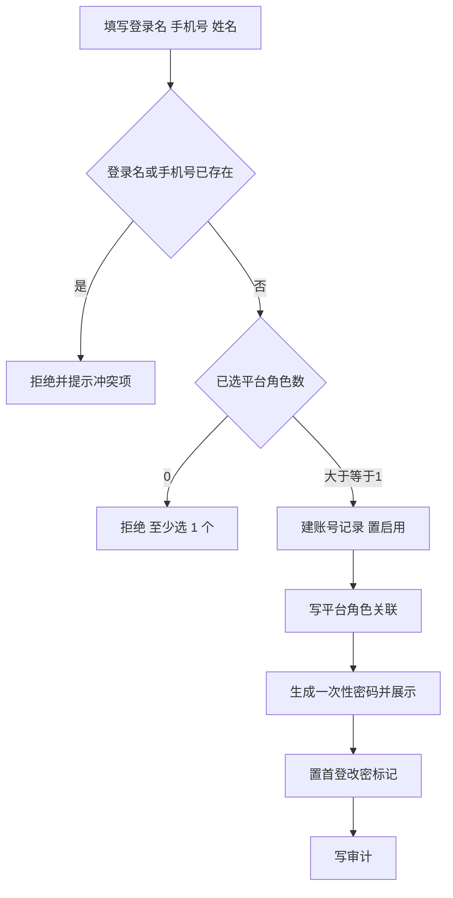
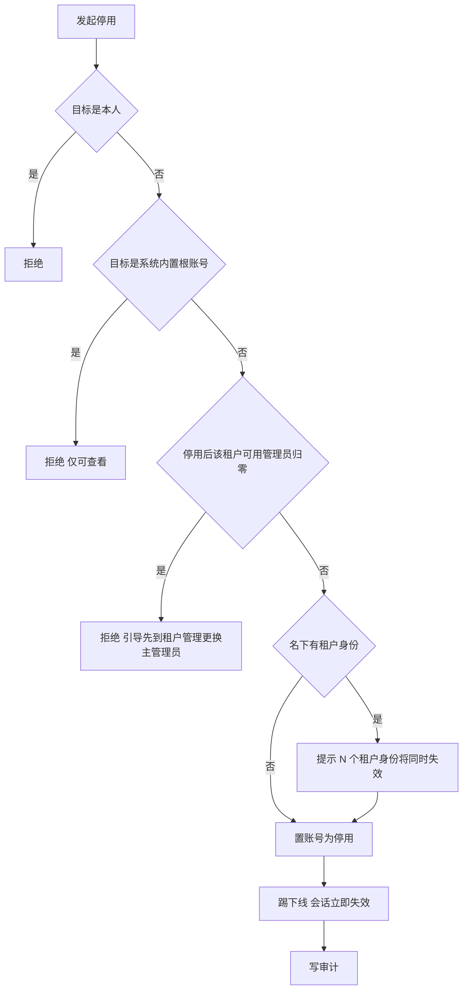
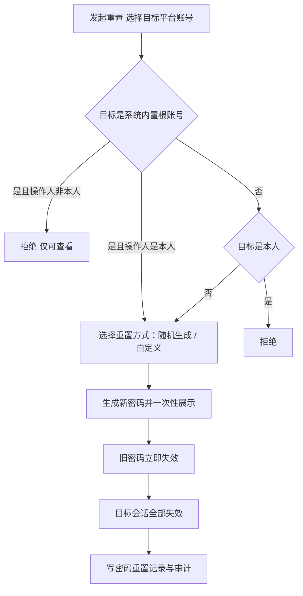

# 平台账号业务 PRD

## 0. 文档基础信息

| 项目 | 内容 |
| :--- | :--- |
| 文档名称 | 平台账号业务 PRD |
| 版本 | V0.20 |
| 状态 | 草稿 |
| 模块名称 | 账号管理 |
| 所属层级 | 平台后台 → 账号管理（「平台账号 / 全部账号」两个视图） |
| 依据 | 产品碳足迹核算工具-用户体系 PRD（精简版）v3.5.1 §5.2 |
| 范围边界 | 只做账号管理：「平台账号」视图（§1–§9）与「全部账号」视图（§10）。不涉及租户开户、租户成员日常维护、租户角色；平台角色只引用定义不重写；账号层能力（重置密码 / 停用 / 启用）统一由超管兜底并对全部账号生效，租户成员行的**改角色 / 移出 / 编辑资料**仍归租户端成员管理，本模块不提供 |
| 更新时间 | 2026-10-30 |

**变更记录**

| 日期 | 版本 | 变更内容 |
| :--- | :--- | :--- |
| 2026-10-30 | V0.20 | **根账号例外改走「重置密码」**：根账号本人的唯一写操作由「修改密码」改为**「重置密码」**——账号管理中根账号行 / 详情页仅对本人显示「重置密码」，走标准重置流程（随机 / 自定义，新密码一次性展示，重置后标记首登改密）；**删除「修改密码」入口**，他人对根账号重置仍一律拒绝（§5.12-4/5、E24、AC53–AC54） |
| 2026-10-30 | V0.19 | **明确根账号的「唯一例外」与「完整超管能力」**：① 根账号在账号管理中只读，但**允许本人修改自己的密码**（个人账户信息 → 密码 → 修改，或账号管理行内「修改密码」），他人不可重置其密码（§5.12-4、E24）；② 澄清只读限制**只作用于「针对根账号自身」的写操作**——根账号登录后仍拥有完整超管能力，可对全部非根账号执行新建 / 编辑 / 分配角色 / 重置 / 停用 / 启用 / 注销（§5.12-8）；③ 新增 AC53–AC54 |
| 2026-10-30 | V0.18 | **区分「系统内置根账号」与「普通超管」**：① 系统初始化时在账号表内置 1 个超管根账号（`is_builtin = 1`，创建人固定「系统初始化」），保证任何时候都存在一个不受平台内部操作接管的超管入口；② 根账号在账号管理中**只读**——只能查看，不可编辑 / 分配角色 / 重置密码 / 停用 / 启用 / 注销，页面与接口双侧收敛（§1.3、§5.12、E22–E24）；③ **非内置账号即使持有超级管理员角色，也按普通平台账号开放全部操作**（查看 / 编辑 / 分配角色 / 重置 / 注销 / 停用 / 启用），原「超管账号整体冻结」口径取消（§4、§5.2–§5.7、§10.3）；④ 新建账号并赋予超管角色由内置根账号完成（§5.1-15）；⑤ 「至少保留 1 个启用超管」由根账号不可停用 / 不可注销 / 不可移除角色结构性保证（§1.3 P2）；⑥ 新增 D21、AC48–AC51 |
| 2026-10-30 | V0.17 | **账号层能力统一收敛（重置密码 / 停用 / 启用）**：① 停用 / 注销的保护条件由「是某租户在任主管理员」改为**结果判定**——操作后该租户可用管理员是否归零（可用管理员 = 成员正常 + 账号启用 + 持「租户管理员」角色），判定时**不看租户状态**（§5.4-4、§5.7-4、E19、D19）；② 「全部账号」视图的租户成员行开放 **重置密码 / 停用 / 启用**，改角色与移出仍不开放（§4、§10.1、§10.3-7）；③ 对租户成员的兜底操作**原因必填**并列跨租户影响，重置记录 `reset_type = 4`（§5.6、§10.3-11、字段清单 §3）；④ 新增 E21、AC46–AC47 |
| 2026-10-29 | V0.16 | **全部账号视图能力对齐**：平台账号行支持与「平台账号」视图一致的全部操作（编辑 / 分配角色 / 停用启用 / 重置密码 / 注销）；所有账号支持查看详情（租户成员只读）；租户成员行仍只保留超管「注销孤账号」（§4、§10.1、§10.3、D18） |
| 2026-10-29 | V0.15 | **合并为「账号管理」**：「平台账号」与原「账号查询」合并为单一菜单的两个视图（平台账号 / 全部账号），功能码 M217 + M221 归并（§4、§10、D18）。**平台角色与租户成员互斥**：持平台角色的账号不得成为租户成员，反之亦然；存量双身份按例外（§1.1、§1.2、§5.9、D13）。**平台侧对租户成员只做治理**：查看 + 注销孤账号，不提供重置密码 / 改角色 / 启停；强制下线列为后置（§10.3）。登录侧支持多租户选择与登录后切换（用户体系 §5.9、租户管理 D48） |
| 2026-10-29 | V0.14 | **注销改为物理删除并补齐引用处理**：注销即物理删除账号、回收平台角色关联、删除密码重置记录、释放登录名与手机号；该账号全部有效成员关系置「已移出」（移出方式记「账号注销」）并保留账号快照；取消「注销」状态与状态矩阵注销行，账号状态收敛为启用 / 停用；同步取消「账号查询展示注销账号」（§1.2、§5.7、§8、§9 D05、§10，字段清单 V0.11）。**停用 / 注销补主管理员前置校验**：目标为任一租户在任主管理员时阻断，引导先到租户管理更换（§3.2、§5.4、§5.7、E19、AC42–AC45） |
| 2026-10-23 | V0.13 | **新增「账号查询」（原型 `/system/account-query`，菜单 M221）**：平台管理员跨域只读查看全部账号（平台账号 + 租户成员），可下钻平台账号详情，无任何写入口；详见新增 §10，功能清单与决策 D18 同步补充。另清理重置密码「原因」残留条目（§5.6、E11、AC13、AC17），与 V0.9「不再收集原因」口径对齐 |
| 2026-10-23 | V0.12 | **同步角色隔离口径**：平台角色只授予平台人员，不向租户下发；分配平台角色的候选列表不出现任何租户角色，接口层拒绝跨归属指派（§5.3、§5.9、D17）；账号被指定为租户主管理员时由租户侧自动授予「租户管理员」角色，不在本模块分配（租户管理 PRD §4.17） |
| 2026-10-21 | V0.11 | **同步原型详情页调整**：详情页以「操作记录」（账号级审计轨迹：创建 / 编辑 / 分配角色 / 停用 / 启用 / 注销 / 重置密码，含操作人与客户端 IP）取代原「密码重置记录」明细表，不再展示密码重置专项记录；密码重置记录表仍按字段清单 §3 落库，仅不在前端详情页呈现 |
| 2026-10-21 | V0.10 | **同步原型两项交互优化**：① 列表不再展示头像列；② 操作列按钮超过 3 个时收起到「更多」下拉（查看 / 编辑 / 分配角色常驻，停用 · 启用 · 重置密码 · 注销归入更多）。功能清单展示字段相应调整 §4 |
| 2026-10-21 | V0.9 | **同步原型四项增强**：① 列表去掉「密码」「名下租户身份」两列，新增「邮箱」列；② 重置密码不再收集原因（原 E11 删除），仅随机生成 / 自定义二选一；③ 新增邮箱字段（非必填）于新建、编辑、详情与字段清单 §1；④ 手机号脱敏维持列表与详情展示 §5.10。决策补 D13，验收 AC13、AC17 去除原因相关步骤 |
| 2026-10-21 | V0.8 | **同步原型三项增强**：① 新增头像字段（非必填，未上传以姓名首字占位）§5.11；② 重置密码支持随机生成与自定义两种方式，默认随机，自定义按复杂度校验 §5.6；③ 手机号在列表与详情脱敏（前 3 后 4），编辑表单展示明文，不设明文查看入口 §5.10。新增 AC28–AC41 与 E11a–E11c，决策补 D14–D16 |
| 2026-10-21 | V0.7 | **手机号改为可编辑**：§5.2 补「操作人修改手机号」与格式、全局唯一校验，审计记前后值；D02 改为「登录名不可改、手机号可改」；新增 §7.6 编辑账号验收 AC25–AC27 |
| 2026-10-21 | V0.6 | **取消账号归属类型**：平台侧识别改为「是否存在生效平台角色关联」，同一账号可同时持有平台角色与租户成员关系（D13）；**停用增加租户身份影响提示**：§5.4 补统计与提示两条、§3.2 补分支、补 AC11 并重排验收编号 |
| 2026-10-21 | V0.5 | **待确认全部落定**：§9 由「待确认事项」改为「设计决策」D01–D12；停用明确连带租户端登录失效；重置密码补首登改密；注销补不释放登录名与手机号；建号补不设数量上限；功能清单补展示字段范围 |
| 2026-10-21 | V0.4 | **密码改为一次性展示**：删除「显示密码明文」功能点与 §5.9 明文查看规则，不做可逆存储；通用规则补充「只在生成时展示、弹窗关闭后无查询入口」；重置密码补「遗失只能再次重置」；验收改 AC21–AC23，异常改 E18 |
| 2026-10-21 | V0.3 | **账号表合并为一张**：平台账号表即全系统账号表，租户成员关联本表；识别改为「账号归属类型 = 平台」显式字段；删除账号双身份的入口待确认项。**新增密码明文查看**：§5.9 与「显示密码明文」功能点，默认掩码、可开关、强制审计；超管最小数定为 1 个 |
| 2026-10-21 | V0.2 | **取消恢复码方案**：删除「生成恢复码」「凭码重置」两个功能点、凭恢复码重置流程、恢复码状态矩阵与 6 条验收用例；超管全灭改由运维恢复兜底（双人复核 + 复盘 + 审计）；待确认删 3 条、补 2 条 |
| 2026-10-21 | V0.1 | 初版：输出前置问题、功能 PRD 与四张表字段清单 |

**关联链接**

| 文档 | 路径 |
| :--- | :--- |
| 字段清单（字段唯一真相源） | `02prd/02-1后台管理/12 平台账号/平台账号字段清单.md` |
| 用户体系 PRD v3.5.1 | `00业务设计/产品碳足迹核算工具-用户体系v3.0.md` |
| 平台角色定义（5.3，只引用） | 同上 §5.3 |

---

## 1. 前置问题

### 1.1 平台账号与租户成员是否共用一张账号表

**结论：共用一张表。平台账号表即全系统账号表，租户成员关联本表，不另建账号表。**

| 对象 | 落表 | 关系 | 说明 |
| :--- | :--- | :--- | :--- |
| 账号 | 账号表，全局 1 份 | 主对象 | 登录名、手机号、密码、账号状态、锁定计数、首登改密标记 |
| 平台侧身份 | 平台角色关联 | N:N | 有则出现在平台账号列表，靠角色取权限 |
| 租户侧身份 | 成员关系表，本模块不写 | N:N | 关联本表账号，只引用；与平台角色互斥（存量双身份为例外） |

判断依据：

1. §5.9 只有一套登录入口，登录名或手机号二选一，凭证必须唯一，不能按域分裂成两套。
2. §5.2.1-1 要求登录名、手机号各自全局唯一；§5.5.1-6 要求成员「关联已有账号、不建号」——所有账号只有一处存放。
3. §5.3.1-7 角色成员页签「平台查平台账号、租户查成员关系」，两者查的是同一批账号的两个不同切面。

推论：

1. 账号只有一份，平台侧与租户侧都是在同一账号上挂载身份，账号本身不设归属标签。
2. 平台角色与租户成员**互斥**：持平台角色的账号不得成为租户成员，租户成员不得被分配平台角色；存量双身份按例外处理并逐步清理。
3. 平台后台「平台账号」菜单只展示持有生效平台角色的账号，无平台角色的账号不在本菜单出现（改由「账号管理 · 全部账号」视图查看）。

### 1.2 平台账号如何被识别为平台账号

**结论：靠是否持有生效平台角色识别，不设账号归属标签。**

| 项 | 内容 |
| :--- | :--- |
| 识别判据 | 账号存在至少 1 条未收回的平台角色关联 |
| 不采用的判据 | ① 账号上的归属类型字段（会把「同时是平台人员与租户成员」这个合法状态卡死）② 无租户成员关系（可同时具备租户身份）③ 登录入口（全站同一入口） |

判断依据：

1. 平台角色天然只挂平台侧功能码、只产生平台端权限（§5.3.2-1），持有平台角色即构成平台侧身份。
2. 平台账号至少保留 1 个平台角色（§5.3），角色不会被清空，因此账号不会因角色收回而从列表消失。
3. 账号不设归属标签；平台角色与租户成员互斥，持平台角色的账号不得挂租户成员关系（存量双身份按例外）；平台人员查看租户数据走「进入租户」只读。

**识别 ≠ 准入**，两层分开：

| 层次 | 判据 |
| :--- | :--- |
| 识别为平台账号 | 存在至少 1 条未收回的平台角色关联（账号状态只有启用 / 停用两态，注销即物理删除，不存在注销态账号） |
| 允许进入平台后台 | 识别成立 且 账号状态为启用 |

### 1.3 超级管理员如何判定与保护

**结论：超管身份按角色持有动态判定；账号保护只针对「系统内置根账号」这一个 `is_builtin` 标记，不针对「超管」这个角色。**

两层口径必须分开：

| 层次 | 判据 | 作用 |
| :--- | :--- | :--- |
| 是不是超管 | 账号持有「角色 = 超级管理员」的生效关联，且账号状态为启用 | 决定能否进入平台后台、能否执行超管专属动作（重置密码） |
| 是不是内置根账号 | 账号表 `is_builtin = 1`（系统初始化写入，全系统仅 1 条） | 决定该账号是否在账号管理中**只读** |

| 项 | 内容 |
| :--- | :--- |
| 有效超管计数 | 满足「持超管角色 + 启用」的账号数，每次操作前实时统计（根账号始终计入） |
| 根账号数量 | 全系统恒为 1 个，由初始化脚本写入，产品内不可新增、不可删除 |
| 超管角色变更入口 | 只能经「分配平台角色」增加或移除，不设「设为超管」独立按钮；根账号不可经此入口变更 |
| 根账号的初始口令 | 初始化脚本写入，由部署实施方线下交付；登录后由本人自助维护，产品内不提供他人重置入口 |

保护措施：

| # | 保护措施 | 作用对象 | 依据 |
| :--- | :--- | :--- | :--- |
| P1 | 超级管理员角色不可删、不可停用、不可取消内置 | 角色本身 | §5.3.1-5 |
| P2 | 系统内置根账号在账号管理中只读：不可编辑、不可分配角色、不可停用、不可启用、不可注销；**例外：允许本人重置自己的密码**（走标准重置流程，新密码一次性展示） | 根账号 | §5.12、E22–E24 |
| P2a | 根账号登录后仍是完整超管：可对全部非根账号执行新建 / 编辑 / 分配角色 / 重置 / 启停 / 注销 | 根账号（作为操作人） | §5.12-8 |
| P3 | 根账号恒为启用状态且恒持超级管理员角色，因此系统结构性保证始终存在 1 个可登录超管；非内置超管被停用 / 注销 / 移除超管角色时无需再计数阻断 | 全部账号 | §1.3、§3.2 |
| P4 | 任一超管可重置其他非根账号的密码，不可重置自己，也不可重置根账号 | 全部账号 | §5.6 |
| P5 | 根账号口令遗失、或全部超管均无法登录时，产品内不设自助恢复入口，统一转运维恢复，须双人复核并出复盘 | 全部账号 | §5.8、§5.12-5 |

> 保护阈值不再按「剩余超管数」动态计算：根账号不可停用 / 不可注销 / 不可移除角色，已天然满足「至少 1 个可登录超管」，且不会被平台内部任何操作接管。本期仍只保留 1 个根账号，不提高至 2 个。

---

## 2. 需求描述

维护平台自有账号：建号授角色、改档、停用启用、重置密码、注销。系统初始化时内置 1 个只读的超管根账号，作为兜底建号与授权入口（建号并分配超管角色由它完成）；由它建立的非内置超管账号按普通平台账号运维。

---

## 3. 业务流程

### 3.1 新建平台账号

### 3.2 停用账号

> 非内置超管停用后，系统仍有根账号可用，故不再按「最后一个启用超管」阻断。

### 3.3 重置密码

### 3.4 超管全灭兜底

本模块不设产品内自助恢复入口，无可画分支。全部超管均无法登录时转运维恢复，规则见 §5.8。

---

## 4. 功能清单

| 角色 | 系统 | 一级模块 | 二级模块 | 业务用例 | 操作功能 | 调整说明 |
| :--- | :--- | :--- | :--- | :--- | :--- | :--- |
| 平台账号操作角色 | 平台后台 | 账号管理 | 平台账号 | 核查平台团队 | 查看列表与详情 | 【新增】 |
| 平台账号操作角色 | 平台后台 | 账号管理 | 平台账号 | 团队分岗 | 新建 | 【新增】 |
| 平台账号操作角色 | 平台后台 | 账号管理 | 平台账号 | 团队分岗 | 编辑 | 【新增】 |
| 平台账号操作角色 | 平台后台 | 账号管理 | 平台账号 | 团队分岗 | 分配平台角色 | 【新增】 |
| 平台账号操作角色 | 平台后台 | 账号管理 | 平台账号 | 冻结账号 | 停用 | 【新增】 |
| 平台账号操作角色 | 平台后台 | 账号管理 | 平台账号 | 冻结账号 | 启用 | 【新增】 |
| 平台账号操作角色 | 平台后台 | 账号管理 | 平台账号 | 离职回收 | 注销 | 【新增】 |
| 平台超管 | 平台后台 | 账号管理 | 平台账号 | 超管失联 | 重置密码 | 【新增】 |
| 持「全部账号」功能码的平台角色 | 平台后台 | 账号管理 | 全部账号 | 跨域核查 | 查看全局账号列表（平台账号 + 租户成员，只读） | 【合并】原账号查询（M221） |
| 持「全部账号」功能码的平台角色 | 平台后台 | 账号管理 | 全部账号 | 跨域核查 | 按姓名 / 登录名 / 手机号 / 账号类型 / 账号状态查询 | 【合并】 |
| 持「全部账号」功能码的平台角色 | 平台后台 | 账号管理 | 全部账号 | 下钻详情 | 平台账号姓名下钻至平台账号详情（只读） | 【合并】 |
| 平台账号操作角色 | 平台后台 | 账号管理 | 全部账号 | 团队运维 | 对平台账号执行编辑 / 分配角色 / 停用 / 启用 / 重置密码 / 注销 | 【新增】与平台账号视图同权限 |
| 持「全部账号」功能码的平台角色 | 平台后台 | 账号管理 | 全部账号 | 下钻详情 | 查看所有账号详情（平台账号可操作，租户成员只读） | 【调整】 |
| 平台超管 | 平台后台 | 账号管理 | 全部账号 | 清理孤账号 | 注销账号（仅无有效成员关系、无平台角色） | 【新增】 |
| 平台超管 | 平台后台 | 账号管理 | 全部账号 | 租户成员兜底 | 对租户成员执行重置密码 / 停用 / 启用 | 【新增】账号层能力统一兜底（D19）；原因必填、跨租户影响提示；**不含改角色 / 移出 / 编辑资料** |
| 系统内置根账号 | 平台后台 | 账号管理 | 平台账号 / 全部账号 | 兜底入口 | 只读查看根账号本身（不可编辑 / 分配角色 / 重置 / 注销 / 停用 / 启用） | 【新增】D21；任何角色对根账号均只读 |
> 「平台账号操作角色」指持有「账号管理 · 平台账号」功能码的平台角色，角色定义见 §5.3，本文不重写。
> 「账号管理」为合并后的单一菜单：「平台账号」视图承载现有全部写操作，「全部账号」视图只读 + 超管注销孤账号；两视图共用同一账号表。
> **系统内置根账号**（`is_builtin = 1`）在账号管理中只读，操作列仅保留「查看」，页面按钮与接口校验双侧收敛；**唯一例外是本人重置自己的密码**（行内「重置密码」，仅 `isSelf` 可见）。**其他账号（含非内置的超管）按状态矩阵正常开放全部操作**（§1.3、§5.12）。
> 新建账号并赋予超级管理员角色由内置根账号完成：非内置账号被授予超管后，与普通平台账号一样可被编辑 / 分配角色 / 停用 / 启用 / 重置 / 注销（§5.1-15）。
> 「重置密码」按 §5.2.1-7 限定为超管，不下放给其他平台角色；「全部账号」视图**仅对超管开放**重置密码与启停（租户成员同样适用，见 §10.3-7），其他平台角色不可见；**根账号仅限本人重置自己的密码，他人不可重置**（§5.12）。
> 本期不设「生成恢复码」「凭码重置」两个功能，超管全灭走运维恢复，见 §5.8。
> 密码只在生成时一次性展示，不提供事后查看入口，见 §5.9。
> 手机号在列表与详情脱敏展示，编辑表单内展示明文，见 §5.10。
> 头像为非必填字段，未上传时以姓名首字占位，见 §5.11。
> 平台账号列表展示：姓名、登录名、手机号（脱敏）、邮箱、平台角色、状态、创建时间；详情另含头像与密码掩码；列表不展示密码列与名下租户身份；操作列按钮超过 3 个时收起到「更多」下拉。

---

## 5. 业务规则

### 5.1 新建

1. 操作人填写登录名、手机号、姓名；邮箱为非必填字段，可不填。
2. 系统校验登录名全局唯一。
3. 系统校验手机号全局唯一。
4. 系统校验登录名不为 11 位纯数字。
5. 系统校验登录名不区分大小写、去空格、转半角后判重。
6. 操作人分配 1 至 5 个平台角色。
7. 系统拒绝 0 个平台角色的提交。
8. 系统生成一次性密码并一次性展示。
9. 系统置首登改密标记。
10. 系统置平台账号为启用。
11. 系统记录创建人。
12. 系统写审计。
13. 系统不限制平台账号总数。
14. 系统允许头像为空。
15. 系统允许操作人在新建时分配「超级管理员」角色，超管账号由内置根账号建立（引导路径）；新建的超管账号**不是**内置根账号（`is_builtin = 0`），此后按普通平台账号运维，可被编辑 / 重新分配角色 / 停用 / 启用 / 重置 / 注销。
16. 系统不因新建超管账号而复制、修改或替换内置根账号；根账号不受建号流程影响。

### 5.2 编辑

1. 操作人修改姓名。
2. 操作人修改手机号。
3. 系统校验手机号格式。
4. 系统校验手机号全局唯一。
5. 系统不修改登录名。
6. 操作人上传、更换或移除头像。
7. 系统允许头像为空。
8. 系统记录更新人与更新时间。
9. 系统写审计并记手机号前后值。
10. 系统拒绝编辑**系统内置根账号**（`is_builtin = 1`）：根账号姓名、手机号、邮箱、头像均不可改，接口返回「系统内置根账号受保护，仅支持查看」（E22）。

> 登录名创建后不可改，手机号可改，见 §9 D02。
> 头像非必填，见 §5.11。

### 5.3 分配平台角色

1. 操作人为目标平台账号增减平台角色。
2. 系统只展示归属类型为平台的启用角色。
3. 系统校验增减后角色总数在 1 至 5 之间。
4. 系统校验增减后至少保留 1 个平台角色。
5. 系统对非内置账号校验有效超管数：移除其超级管理员角色后若系统已无启用超管则拒绝；内置根账号恒持超级管理员角色，故该场景实际不会命中。
6. 系统实时生效并踢目标账号下线。
7. 系统写审计并记前后值。
8. 系统只展示归属类型为平台的启用角色（角色定义与维护在平台侧「平台角色管理」），不出现任何租户角色；提交含租户角色时拒绝（平台角色只授予平台人员，与租户角色完全隔离）。
9. 系统不把平台角色写入该账号的租户成员关系，也不因账号持有租户成员关系而改动其平台角色。
10. 系统拒绝为**系统内置根账号**增减平台角色：根账号的角色组合由初始化写入（超级管理员），产品内不可变更（E23）。

### 5.4 停用

1. 操作人对目标平台账号发起停用。
2. 系统校验目标不是操作人本人。
3. 系统校验目标不是**系统内置根账号**：根账号不可停用，命中即阻断（E24）。
4. 系统校验目标停用后**不会使任一启用中的租户失去可用管理员**：按「可用管理员 = 成员状态正常 且 账号启用 且 持『租户管理员』角色」逐租户计算，扣减本账号后为 0 则阻断，提示「该人员为在任『XX 租户』的主管理员，暂时不允许停用，请先更换管理员」，并提供直达「租户管理 → 更换主管理员」的入口。
   - 判定**不看租户状态**：租户已停用时不纳入保护范围（停用期间无人在用），允许停用其管理员账号；该租户再启用时由租户管理另做管理员校验（租户管理 PRD E38）。
5. 系统统计该账号名下的有效租户成员关系数（仅存量双身份例外会存在）。
6. 系统在确认弹窗展示受影响租户身份数与租户名称。
7. 操作人确认后系统置账号为停用。
8. 系统踢目标账号下线并使会话立即失效。
9. 系统不改该账号的租户成员关系记录。
10. 系统不收回平台角色关联。
11. 系统使该账号在租户端的登录同时失效。
12. 系统写审计，记受影响租户身份数。

### 5.5 启用

1. 操作人对停用状态的平台账号发起启用。
2. 系统校验目标至少持有 1 个生效平台角色。
3. 目标角色为 0 时系统引导先分配角色。
4. 系统置平台账号为启用。
5. 系统写审计。
6. 系统不接受对**系统内置根账号**的启用请求：根账号恒为启用态，不存在停用态与启用动作（E24）。

### 5.6 重置密码

1. 超管对目标平台账号发起重置。
2. 系统校验目标不是操作人本人。
3. 操作人选择重置方式。
4. 系统提供随机生成与自定义两种方式，默认随机生成。
5. 操作人选择自定义时填写新密码与确认新密码。
6. 系统校验自定义密码不少于 8 位。
7. 系统校验自定义密码含大写、小写、数字、特殊字符中的三类。
8. 系统校验两次输入一致。
9. 系统生成新密码并一次性展示。
10. 系统使旧密码立即失效。
11. 系统使目标账号全部会话失效。
12. 系统写密码重置记录并记重置方式。
13. 系统写审计。
14. 系统置首登改密标记。
15. 新密码遗失时系统只允许再次重置，不提供明文找回。
16. 系统允许超管对**租户成员账号**发起重置（「全部账号」视图入口，见 §10.3-7）；对象含租户主管理员，与租户管理 PRD §4.18 共用同一重置服务，不新增功能码。
17. 系统在对租户成员执行重置时，**重置原因必填**（枚举：忘记密码 / 人员失联 / 安全事件 / 租户管理员无法处理 · 平台协助，可附补充说明）。
18. 系统在对租户成员执行重置时，弹窗展示跨租户影响：该账号同时属于 N 个租户、重置将使其在**全部租户**的会话失效，并要求确认。
19. 系统写重置记录时按对象区分 `reset_type`：平台账号记 1（超管重置），租户成员记 4（超管兜底重置租户成员），并记 `source_channel`（account）与 `tenant_id`（当前上下文租户，可空）。
20. 系统拒绝**他人**重置系统内置根账号的密码（含超管重置）：避免任一超管借此接管根账号（E24）。**唯一例外：根账号本人可重置自己的密码**（账号管理行内 / 详情页「重置密码」，仅 `isSelf` 可见，§5.12-5）；重置后标记首登改密，下次登录强制换新密码；口令遗失按 §5.8 走运维恢复。

> 平台账号的重置不收集原因（原型已取消，见 Changelog V0.9）；**租户成员的兜底重置必须收集原因**——跨租户操作需可追责，这是唯一的差异化口径。随机 / 自定义二选一与密码复杂度校验两种对象一致。

### 5.7 注销（物理删除）

1. 操作人对目标平台账号发起注销。
2. 系统校验目标不是操作人本人。
3. 系统校验目标不是**系统内置根账号**：根账号不可注销，命中即阻断（E24）。
4. 系统校验注销后**不会使任一启用中的租户失去可用管理员**（口径同 §5.4-4）；命中则阻断，提示先到「租户管理 → 更换主管理员」完成交接。
5. 系统统计该账号名下的有效租户成员关系数（仅存量双身份例外会存在），二次确认弹窗展示影响说明（租户名称、将失效的租户身份数）并要求勾选知悉。
6. 操作人确认后，系统把该账号的全部有效租户成员关系置为「已移出」，移出方式记「账号注销」（removed_type = 3），记录保留并保存账号姓名 / 手机号快照。
7. 系统物理删除该账号的全部平台角色关联。
8. 系统物理删除该账号的密码重置记录。
9. 系统物理删除账号记录。
10. 系统踢目标账号下线并使全部会话失效。
11. 系统释放登录名与手机号，二者可被重新注册使用。
12. 系统写审计，冗余记录姓名、登录名、手机号快照、操作人、受影响租户身份数，审计长期保留。
13. 注销后该账号不再出现在平台账号列表、账号查询与租户成员的有效列表中。
14. 系统拒绝注销**系统内置根账号**（`is_builtin = 1`）：根账号记录不可物理删除，其登录名与手机号也不释放（E24）。

### 5.8 超管全灭兜底

1. 系统不提供登录页自助找回密码入口。
2. 系统不提供凭码或凭令牌绕过登录的密码重置入口。
3. 系统在全部超管均无法登录时，转运维恢复流程。
4. 运维恢复须由实施方双人复核。
5. 运维恢复须留存操作记录并出具复盘报告。
6. 运维恢复后系统要求受影响账号首登改密。
7. 系统写审计日志。
8. 内置根账号恒存在且不可删除，故「超管全灭」在结构上只可能由**根账号口令失联**引起：根账号恢复走本流程，恢复后标记首登改密（§5.12-5）。

> 恢复码方案已取消，依据见本文 Changelog 与字段清单 V0.2。

### 5.9 通用

1. 系统按是否存在生效平台角色关联识别平台账号。
2. 系统按「存在生效平台角色关联 且 启用」放行平台后台。
3. 系统不允许同一账号同时持有平台角色与租户成员关系（互斥）；存量双身份按例外处理，禁止新增。
4. 系统按角色持有实时统计有效超管数。
5. 系统不因分配平台角色而创建或修改成员关系。
6. 系统不将平台账号计入租户成员数。
7. 系统不接收前端传入的操作人身份。
8. 系统对所有写操作记录审计。
9. 系统只在生成时一次性展示密码明文。
10. 系统在弹窗关闭后不提供密码明文查询入口。
11. 系统在列表与详情以掩码展示密码。
12. 系统只在平台侧分配平台角色：租户角色由租户管理员在租户端分配，本模块不展示、不分配、不回收（角色管理 PRD §5.11-5）。
13. 系统在本账号被指定为某租户主管理员时，不为其分配任何平台角色；该账号的租户权限来自租户侧自动授予的「租户管理员」角色（租户管理 PRD §4.17）。
14. 系统按账号表 `is_builtin` 识别系统内置根账号（全系统 1 条）：根账号只读，任何写操作均在接口层拒绝并写审计；`is_builtin` 只由初始化脚本写入，产品功能不得修改。

### 5.10 手机号脱敏

1. 系统在列表脱敏展示手机号。
2. 系统在详情脱敏展示手机号。
3. 系统在编辑表单展示手机号明文。
4. 系统保留手机号前 3 位与后 4 位。
5. 系统将手机号中间 4 位替换为掩码。
6. 系统不提供列表与详情的明文查看入口。

### 5.11 头像

1. 系统允许账号头像为空。
2. 系统在上传后展示头像图片。
3. 系统在头像为空时以姓名首字占位。
4. 操作人可更换或移除头像。
5. 系统不限制头像尺寸与格式。
6. 系统将头像与账号记录同事务保存。

### 5.12 系统内置根账号

1. 系统在初始化（建库部署）时向账号表写入 **1 个**超管根账号，`is_builtin = 1`，创建人与更新人固定为「系统初始化」，全系统仅此 1 条。
2. 根账号的登录名、手机号、姓名在初始化脚本中固定，产品内不提供资料修改入口；初始口令由脚本写入、部署实施方线下交付，**本人可在账号管理中重置自己的密码**（第 5 条）。
3. 根账号恒持「超级管理员」角色且恒为启用状态；角色与状态不随任何页面操作变化。
4. 根账号在账号管理中**只读**：列表与详情仅提供「查看」，不提供编辑 / 分配角色 / 停用 / 启用 / 注销；接口层对上述动作一律拒绝（E22–E24）。**唯一例外：允许根账号本人重置自己的密码**（走标准「重置密码」流程，入口见第 5 条）。
5. 根账号本人重置密码的入口有两个，能力同源：① 账号管理中该账号行 / 详情页的「重置密码」（仅 `isSelf` 可见）；② 顶栏「个人账户信息 → 密码 → 修改」。走重置流程：随机生成 / 自定义新密码，**新密码一次性展示**，旧密码与既有会话立即失效，并标记首登改密；**不提供「修改密码」这一独立操作**。
6. 根账号口令遗失或本人无法登录时，按 §5.8 转运维恢复；**他人重置根账号密码一律拒绝**，防止任一超管借此接管根账号。
7. 系统不允许新建第二个内置根账号：`is_builtin = 1` 不对产品功能开放，仅初始化脚本可写。
8. **根账号作为操作人拥有完整超管能力**：第 4 条的只读限制只作用于「针对根账号自身」的写操作；根账号登录后可对全部非根账号执行新建 / 编辑 / 分配平台角色 / 重置密码 / 停用 / 启用 / 注销，与其他超管无差异。
9. 非内置账号被授予超级管理员角色后**不受本条约束**：可被查看 / 编辑 / 分配角色 / 重置密码 / 注销 / 停用 / 启用，与普通平台账号完全一致。

---

## 6. 异常与拦截

| # | 场景 | 拦截环节 | 系统行为 |
| :--- | :--- | :--- | :--- |
| E01 | 登录名与已有账号重复 | 新建保存 | 阻断，提示登录名已存在 |
| E02 | 手机号与已有账号重复 | 新建 / 编辑保存 | 阻断，提示手机号已存在 |
| E03 | 登录名为 11 位纯数字 | 新建保存 | 阻断，提示改用非纯数字登录名 |
| E04 | 未分配任何平台角色 | 新建保存 | 阻断，提示至少分配 1 个平台角色 |
| E05 | 分配角色超过 5 个 | 保存 | 阻断，提示上限 5 个 |
| E06 | 停用目标为本人 | 停用提交 | 阻断，提示不可停用自己 |
| E07 | 停用目标是系统内置根账号 | 停用提交 | 阻断，提示「系统内置根账号受保护，仅支持查看」 |
| E08 | 注销目标是系统内置根账号 | 注销提交 | 阻断，提示同上；根账号记录不可删除、登录名与手机号不释放 |
| E09 | 为系统内置根账号变更平台角色 | 分配平台角色提交 | 阻断，提示同上；根账号恒持超级管理员角色 |
| E10 | 重置密码目标为本人 | 重置提交 | 阻断，提示不可重置自己的密码 |
| E11a | 自定义密码少于 8 位 | 重置提交 | 阻断，提示密码长度不少于 8 位 |
| E11b | 自定义密码字符种类不足三类 | 重置提交 | 阻断，提示须含大写、小写、数字、特殊字符中的三类 |
| E11c | 两次输入的新密码不一致 | 重置提交 | 阻断，提示两次输入不一致 |
| E12 | 启用后角色数为 0 | 启用提交 | 阻断，提示先分配平台角色 |
| E13 | 无「平台账号」功能码 | 进入菜单 | 阻断，菜单不渲染、接口拒绝 |
| E14 | 非超管调用重置密码接口 | 重置提交 | 阻断，返回无权限 |
| E15 | 目标账号已被他人先改为停用 | 停用提交 | 阻断，提示状态已变更需刷新 |
| E16 | 全部超管均无法登录 | 登录页 | 无自助找回入口，提示联系运维恢复 |
| E17 | 调用已下线的凭码重置接口 | 接口层 | 返回不存在，写审计 |
| E18 | 尝试查询已关闭弹窗的一次性密码 | 详情页 | 无入口，只展示掩码，提示走重置 |
| E19 | 停用 / 注销后某启用中租户的「可用管理员」归零 | 停用 / 注销提交 | 阻断，提示「该人员为在任『XX 租户』的主管理员，暂时不允许停用，请先更换管理员」，并给直达「租户管理 → 更换主管理员」的入口；被拦截的尝试写操作记录（结果 = 失败） |
| E20 | 注销后再次访问该账号详情或相关接口 | 详情 / 接口层 | 账号不存在（已物理删除），提示刷新列表并写审计 |
| E21 | 对租户成员执行停用 / 重置未选择原因 | 停用 / 重置提交 | 阻断，提示请选择操作原因（租户成员必填，平台账号不要求） |
| E22 | 编辑系统内置根账号，或直接访问其编辑地址 | 编辑保存 / 表单加载 | 阻断并挡回详情页，提示「系统内置根账号不可编辑，仅支持查看」 |
| E23 | 对系统内置根账号调用分配平台角色接口 | 接口层 | 拒绝并写审计，返回「系统内置根账号受保护，仅支持查看」 |
| E24 | **他人**对系统内置根账号执行重置密码 / 停用 / 启用 | 提交 / 接口层 | 阻断，提示根账号只读；口令遗失统一走运维恢复（§5.8）。**根账号本人重置自己的密码不受此限**（唯一例外，走标准重置流程） |

---

## 7. 验收标准

### 7.1 新建平台账号

| # | Given | When | Then |
| :--- | :--- | :--- | :--- |
| AC01 | 超管已登录，登录名与手机号均未被占用 | 提交新建并分配 1 个平台角色 | 创建成功，列表出现该账号，状态为启用 |
| AC02 | 已存在登录名 `ops01` 的账号 | 用登录名 `OPS01` 新建 | 阻断，提示登录名已存在 |
| AC03 | 新建表单未勾选任何平台角色 | 提交 | 阻断，提示至少分配 1 个平台角色 |
| AC04 | 新建成功且拿到一次性密码 | 该账号首次登录平台后台 | 强制进入改密页，改密后方可进入 |
| AC05 | 新建成功 | 查看审计日志 | 存在一条新建平台账号记录，含操作人与时间 |

### 7.2 停用账号

| # | Given | When | Then |
| :--- | :--- | :--- | :--- |
| AC06 | 操作人已登录 | 对本人发起停用 | 阻断，提示不可停用自己 |
| AC07 | 目标为系统内置根账号 | 对该账号发起停用 | 阻断，提示「系统内置根账号受保护，仅支持查看」 |
| AC08 | 目标为持有超级管理员角色的**非内置**账号，且系统另有内置根账号可用 | 停用该账号 | 成功，该账号状态为停用；根账号不受影响 |
| AC09 | 目标账号处于在线会话 | 停用该账号 | 目标会话立即失效，下次请求被踢出 |
| AC10 | 目标账号同时是某租户成员 | 停用该账号 | 账号状态为停用，租户端登录同时失效，成员关系记录保留 |
| AC11 | 目标账号名下有 3 个有效租户身份 | 点击停用 | 确认弹窗展示「3 个租户身份将同时失效」并列出租户名称，确认后才执行 |

### 7.3 重置密码

| # | Given | When | Then |
| :--- | :--- | :--- | :--- |
| AC12 | 操作人为超管 | 对本人发起重置密码 | 阻断，提示不可重置自己 |
| AC13 | 操作人为超管 | 对他人发起重置，默认随机生成 | 成功，新密码一次性展示，旧密码立即失效 |
| AC14 | 操作人为超管，选择自定义密码并输入合规密码 | 对他人发起重置 | 成功，一次性展示该密码，记录记重置方式为「自定义」 |
| AC15 | 目标账号存在在线会话 | 重置其密码 | 目标全部会话失效 |
| AC16 | 非超管但持有平台账号功能码 | 调用重置密码接口 | 拒绝，返回无权限 |
| AC17 | 重置成功 | 查看密码重置记录与审计日志 | 各存在 1 条记录，含目标、操作人、重置方式、时间 |

### 7.4 超管全灭兜底

| # | Given | When | Then |
| :--- | :--- | :--- | :--- |
| AC18 | 全部超管均无法登录 | 在登录页寻找自助找回密码入口 | 页面无入口，提示联系运维恢复 |
| AC19 | 全部超管均无法登录 | 调用任何绕过登录的密码重置接口 | 接口返回不存在，操作写审计 |
| AC20 | 运维已执行超管密码恢复 | 查看审计日志 | 存在 1 条人工恢复事件，含操作方与时间 |
| AC21 | 运维恢复已完成 | 该超管首次登录 | 强制进入改密页，改密后方可进入 |

### 7.5 密码展示

| # | Given | When | Then |
| :--- | :--- | :--- | :--- |
| AC22 | 打开任一平台账号详情 | 查看密码字段 | 展示掩码，不展示明文 |
| AC23 | 建号或重置成功 | 关闭一次性密码弹窗后再次打开详情 | 无明文入口，提示忘记密码请联系超管重置 |
| AC24 | 查询系统日志与接口响应 | 检索密码明文 | 均不含明文 |

### 7.6 编辑账号

| # | Given | When | Then |
| :--- | :--- | :--- | :--- |
| AC25 | 目标手机号未被占用 | 修改手机号并保存 | 保存成功，详情展示新手机号 |
| AC26 | 已存在手机号 `13800000000` 的账号 | 把另一账号改为该手机号 | 阻断，提示手机号已存在 |
| AC27 | 修改手机号成功 | 查看审计日志 | 存在 1 条记录，含手机号前值与后值 |

### 7.7 手机号脱敏

| # | Given | When | Then |
| :--- | :--- | :--- | :--- |
| AC28 | 账号手机号为 `13800000001` | 查看平台账号列表 | 手机号列展示 `138****0001` |
| AC29 | 账号手机号为 `13800000001` | 打开该账号详情 | 手机号展示 `138****0001` |
| AC30 | 打开任一账号编辑页 | 查看手机号输入框 | 展示完整明文，可修改 |
| AC31 | 在列表与详情查找明文查看入口 | 遍历页面 | 无入口，只有掩码 |

### 7.8 头像

| # | Given | When | Then |
| :--- | :--- | :--- | :--- |
| AC32 | 新建账号时未上传头像 | 提交保存 | 保存成功，列表与详情以姓名首字占位 |
| AC33 | 编辑账号时上传一张图片 | 保存后查看列表与详情 | 展示该头像图片 |
| AC34 | 账号已有头像 | 点击移除并保存 | 头像清空，恢复姓名首字占位 |

### 7.9 重置密码方式

| # | Given | When | Then |
| :--- | :--- | :--- | :--- |
| AC35 | 打开重置密码弹窗 | 查看重置方式 | 默认选中「随机生成」，另有「自定义密码」可选 |
| AC36 | 选择自定义密码，输入 `Abc12345` | 提交重置 | 成功，一次性展示该密码 |
| AC37 | 选择自定义密码，输入 `abc` | 提交重置 | 阻断，提示密码长度不少于 8 位 |
| AC38 | 选择自定义密码，输入 `abcdefgh` | 提交重置 | 阻断，提示须含三类字符 |
| AC39 | 选择自定义密码，两次输入不一致 | 提交重置 | 阻断，提示两次输入不一致 |
| AC40 | 选择随机生成 | 提交重置 | 成功，展示 12 位随机密码 |
| AC41 | 重置成功 | 查看密码重置记录 | 记录含重置方式（随机生成或自定义） |

### 7.10 注销（物理删除）与主管理员保护

| # | Given | When | Then |
| :--- | :--- | :--- | :--- |
| AC42 | 目标账号是某启用租户的唯一可用管理员 | 对该账号发起停用 | 阻断，提示「该人员为在任『XX 租户』的主管理员，暂时不允许停用，请先更换管理员」，并展示「去更换主管理员」入口 |
| AC43 | 目标账号是某租户管理员，但该租户还有其他可用管理员 | 对该账号发起停用 | 允许执行，仅提示跨租户影响；停用后该租户仍有可用管理员 |
| AC44 | 目标为存量双身份账号（有 2 个有效租户身份、非主管理员） | 确认注销 | 账号记录、平台角色关联、密码重置记录物理删除；2 条成员关系置「已移出」（removed_type = 3）并保留姓名/手机号快照；登录名与手机号释放 |
| AC45 | 注销已完成 | 查看平台账号列表、账号查询与该账号详情 | 列表与账号查询均不出现该账号；访问详情返回账号不存在；审计存在 1 条注销记录（含姓名、登录名、手机号快照与受影响租户身份数） |
| AC46 | 「全部账号」视图内的租户成员账号为启用状态 | 查看其操作列 | 提供「查看 / 重置密码 / 停用」；停用后再查看提供「启用」；全程不出现「改角色 / 移出 / 编辑资料」 |
| AC47 | 对某租户成员执行重置密码 | 提交 | 阻断直至选择原因；弹窗展示其所属 N 个租户；提交后新密码一次性展示、该账号全部会话失效、重置记录 `reset_type = 4`、平台与租户侧各 1 条审计 |

### 7.11 系统内置根账号与普通超管

| # | Given | When | Then |
| :--- | :--- | :--- | :--- |
| AC48 | 完成系统初始化 | 查看账号表与平台账号列表 | 账号表存在且仅存在 1 条 `is_builtin = 1` 的超管账号；创建人为「系统初始化」，状态启用，持「超级管理员」角色 |
| AC49 | 以其他超管身份打开根账号所在行 | 查看操作列与详情页页头 | 只有「查看」；不出现编辑 / 分配角色 / 重置密码 / 停用 / 启用 / 注销；直接访问编辑地址被挡回详情并提示根账号只读 |
| AC50 | 某账号被内置根账号新建并分配「超级管理员」角色（`is_builtin = 0`） | 打开该账号行 | 与普通平台账号一致：提供查看 / 编辑 / 分配角色 / 停用（或启用）/ 重置密码 / 注销，全部可执行 |
| AC51 | 根账号密码遗失 | 任一超管尝试在账号管理中重置根账号密码 | 阻断，提示根账号只读；按 §5.8 走运维恢复，恢复后写审计 |
| AC52 | 非内置超管账号已被停用 | 查看根账号与系统可登录超管 | 根账号始终启用，系统仍有 1 个可登录超管，不触发「至少保留 1 个启用超管」阻断 |
| AC53 | 以根账号本人登录 | 打开根账号所在行 / 详情页 | 除「查看」外额外提供「重置密码」（仅本人可见）；其他写操作仍不出现 |
| AC54 | 根账号本人执行「重置密码」 | 提交（随机或自定义新密码） | 成功；新密码一次性展示、旧密码与既有会话失效、标记首登改密、重置记录与审计各 1 条；账号仍为启用且仍持超级管理员角色 |

---

## 8. 状态与操作矩阵

| 状态 | 可编辑 | 可分配角色 | 可重置密码 | 可停用 | 可启用 | 可注销 | 可登录平台后台 |
| :--- | :---: | :---: | :---: | :---: | :---: | :---: | :---: |
| 启用 | 是 | 是 | 是 | 是 | 否 | 是 | 是 |
| 停用 | 是 | 是 | 是 | 否 | 是 | 是 | 否 |

> 账号状态只有启用 / 停用两态；注销为物理删除，不设「注销」状态行，执行后账号记录不存在。主管理员（任一租户在任）在启用 / 停用两态下均不可停用、不可注销，须先完成主管理员交接。
> 本矩阵只适用于**非内置账号**：系统内置根账号不受状态矩阵约束，任何状态下都只提供「查看」+「重置密码（仅本人）」（§5.12）。矩阵中「可重置密码」对根账号仅对**本人**成立，**他人重置根账号一律阻断**（E24）。

---

## 9. 设计决策

| 编号 | 事项 | 决议 | 落点 |
| :--- | :--- | :--- | :--- |
| D01 | 停用范围 | 账号级停用，平台端与租户端登录同时失效；执行前提示 N 个租户身份将失效 | §5.4 |
| D02 | 登录名、手机号可否编辑 | 登录名不可改；手机号可改，须校验格式与全局唯一 | §5.2 |
| D03 | 重置后是否强制首登改密 | 强制，与建号口径一致 | §5.6 |
| D04 | 重置密码权限 | 仅限超管，不下放给其他平台角色 | §4、§5.6 |
| D05 | 注销语义与凭证 | **物理删除**：账号记录、平台角色关联、密码重置记录一并删除；登录名与手机号释放、可重新注册；有效成员关系置「已移出」（removed_type = 3）并保留账号快照；审计长期保留并冗余姓名 / 登录名 / 手机号快照 | §5.7 |
| D06 | 启用状态超管最小数量 | 保留 1 个，不提高至 2 个 | §1.3 P2 |
| D07 | 运维恢复留痕 | 只在审计日志记 1 条人工恢复事件，不建独立表 | §5.8、字段清单 §4 |
| D08 | 密码重置记录 | 独立建表，审计只记事件摘要 | 字段清单 §3 |
| D09 | 密码明文展示 | 仅生成时一次性展示，不做可逆存储，不提供事后查看 | §5.9 |
| D10 | 列表与详情展示字段 | 列表：姓名、登录名、手机号（脱敏）、邮箱、平台角色、状态、创建时间（不展示头像与密码列）；详情另含头像与密码掩码；详情「操作记录」展示账号级审计轨迹（不含密码重置明细） | §4 |
| D11 | 注销复核 | 不设双人复核，仅二次确认 | §5.7 |
| D12 | 平台账号数量 | 不设上限 | §5.1 |
| D13 | 账号身份 | 不设归属字段；平台角色与租户成员**互斥**，持平台角色的账号不得成为租户成员，租户成员不得分配平台角色；存量双身份按例外逐步清理 | §1.1、§1.2、§5.9 |
| D14 | 手机号脱敏 | 列表与详情脱敏（前 3 后 4），编辑表单展示明文，不设明文查看入口 | §5.10 |
| D15 | 头像 | 非必填，未上传以姓名首字占位，不限制尺寸与格式 | §5.11 |
| D16 | 重置密码方式 | 随机生成与自定义二选一，默认随机；自定义按密码复杂度校验 | §5.6 |
| D17 | **角色隔离** | 平台角色与租户角色完全隔离、不混用：本模块只分配平台角色给平台人员（角色定义在平台侧「平台角色管理」，只展示平台角色），不出现、不下发租户角色；账号成为租户主管理员时的租户权限由租户侧「租户管理员」角色自动授予，与本模块无关 | §5.3、§5.9-12/13 |
| D18 | **账号管理（两视图）** | 原「平台账号」与「账号查询」合并为单一菜单「账号管理」：「平台账号」视图只列平台账号；「全部账号」视图跨域列出全部账号，其中**平台账号行支持与平台账号视图一致的全部操作**；所有行均可查看详情。两视图共用同一账号表（M217 / M221 归并）；注销为物理删除。租户成员行的操作边界由 D19 定义（V0.17 起开放重置密码 / 启停） | §4、§10 |
| D19 | **账号层能力归属平台，治理权留在租户** | 重置密码 / 启停是**账号级凭证能力**，统一由平台超管兜底并对全部账号生效，租户成员同样适用；改角色 / 移出 / 编辑资料是**租户内部治理**，仍只在租户端成员管理提供。判定原则：能恢复或降低访问权的归平台，能改变租户权力结构的留在租户。密码重置只有一套服务、一张记录表、一个功能码，租户管理入口只是第二渲染点 | §5.6、§10.3-7、D18 |
| D20 | **停用 / 注销按「可用管理员归零」判定** | 判定不再看「是不是在任主管理员」，而是看操作后该租户「可用管理员」（成员正常 + 账号启用 + 持「租户管理员」角色）是否归零；判定时**不看租户状态**，租户停用期间允许停用管理员账号，由租户启用校验兜底（租户管理 PRD E38） | §5.4-4、§5.7-4、E19 |
| D21 | **只锁「内置根账号」，不锁「超管角色」** | 系统初始化内置 1 个超管根账号（`is_builtin = 1`）并设为只读，保证任何内部操作都无法接管或删除最后一个入口；**超管是角色、不是保护对象**，非内置账号被授予超管后仍按普通平台账号运维（查看 / 编辑 / 分配角色 / 重置 / 注销 / 停用 / 启用）。只读限制只作用于「针对根账号自身」的写操作，**根账号作为操作人仍是完整超管**；唯一例外是**本人可重置自己的密码**（走标准重置流程，不设独立「修改密码」操作）。原「所有超管账号仅可查看与重置密码」口径取消——它会冻结所有超管，导致超管无法被运维，且与「由根账号建号并分配超管」的诉求冲突 | §1.3、§5.12、§4、§10.3 |

---

## 10. 全部账号视图（账号管理 · 全局只读 + 超管治理）

### 10.1 定位

**结论：「全部账号」是账号管理的第二个视图，跨域展示全部账号（平台账号 + 租户成员）；默认只读，仅超管可对「孤账号」执行注销。**

| 项 | 内容 |
| :--- | :--- |
| 菜单 | 平台后台 → 系统管理 → 组织与权限 → 账号管理 · 全部账号（视图切换；功能编码沿用 `M221`，`scope = platform`，由平台角色勾选控制） |
| 数据范围 | 全系统账号表全局一份（不含已注销并物理删除的账号）：既含持平台角色的平台账号，也含不持平台角色的租户成员 |
| 账号类型判定 | 由「是否存在生效平台角色关联」动态判定（与 §1.2 识别口径一致），不设账号归属字段 |
| 写操作 | 平台账号行支持与「平台账号」视图一致的全部操作（编辑 / 分配角色 / 停用启用 / 重置密码 / 注销）；**系统内置根账号行只读，仅「查看」**；租户成员行支持**重置密码 / 停用 / 启用**（账号层能力，规则与平台账号一致），并可对**孤账号**执行注销（无有效成员关系、无平台角色、非任何租户主管理员）；**改角色 / 移出 / 编辑资料不提供**（归租户端成员管理） |
| 下钻 | 所有账号的姓名均可下钻详情：平台账号进入可操作的平台账号详情；租户成员进入只读详情，不提供任何运维动作 |
| 与平台账号视图的分界 | 平台账号视图 = 仅平台账号；全部账号视图 = 平台账号（同权限操作）+ 租户成员（只读 + 孤账号注销） |

### 10.2 查询与展示

1. 列表字段：姓名、登录名、手机号（脱敏，前 3 后 4）、邮箱、账号类型（平台账号 / 租户成员）、账号状态、最近登录时间、所属组织（生效成员关系对应的租户名）、创建人、创建时间。
2. 筛选条件：姓名 / 登录名 / 手机号关键字、账号类型（平台账号 / 租户成员）、账号状态（启用 / 停用）。
3. 排序：平台账号在前、租户成员在后；同类内启用状态在前，其余按更新时间倒序。
4. 分页：每页 20 条。
5. 工具栏统计：总条数、平台账号条数、租户成员条数（账号表全局唯一一份，两域共享）。
6. 手机号脱敏口径与本模块 §5.10 一致；本页不展示密码与头像。

### 10.3 业务规则

1. 平台账号行沿用「平台账号」视图的操作矩阵（编辑 / 分配角色 / 停用启用 / 重置密码 / 注销，受状态矩阵与本人规则约束）；**系统内置根账号行只保留「查看」**，不提供任何写操作（§5.12）；租户成员行提供**重置密码 / 停用 / 启用**与孤账号「注销」（见第 7、11 条；V0.17 起开放，改角色与移出仍不提供）。
2. 账号类型动态判定：存在生效平台角色关联即为「平台账号」，否则为「租户成员」；同一账号不会因同时持有两种身份而出现两行。
3. 租户成员行的「所属组织」取其生效成员关系对应的租户名称；无生效成员关系时展示「—」。
4. 访问控制：由平台角色勾选「账号查询」功能码控制；无功能码时菜单不渲染、直接调接口返回无权限并写审计。
5. 平台账号行的详情下钻复用平台账号详情页口径（操作记录 / 角色 / 状态等），不在本页重复展示。
6. 注销账号已物理删除，不在本页出现；账号状态筛选项只有「启用 / 停用」，不提供「注销」选项。
7. **平台侧对租户成员的操作边界**：提供查看（只读）、**重置密码**、**停用 / 启用**、注销孤账号；**不提供改角色、移出、编辑资料**。
   - 判定原则：**能降低访问权（停用）与恢复访问权（重置密码 / 启用）归平台兜底；改变租户内部权力结构（改角色 / 移出）留在租户域**。
   - 租户管理员仍是成员治理的第一责任人；平台动作仅在租户侧无法处理时使用，且原因必填、租户侧审计可见。
8. **孤账号判定**：该账号无任何有效成员关系、无任何平台角色、不是任何租户的在任主管理员；三项同时成立才允许注销。有成员关系的账号须先由租户管理员移出。
9. **强制下线**列为后置能力：仅在安全事件（疑似盗号）时由超管使用，本期不提供独立入口；停用 / 重置密码 / 移出已自带会话失效。
10. **所有账号支持查看详情**：本视图每行均提供「查看」；平台账号可操作，租户成员只读。
11. **租户成员的停用 / 重置前置**：停用 / 注销沿用 §5.4-4 的「可用管理员归零」判定（E19），命中时阻断并给「去更换主管理员」出口；重置密码要求目标账号为启用状态，原因必填，并展示跨租户影响（§5.6-16～19）。
