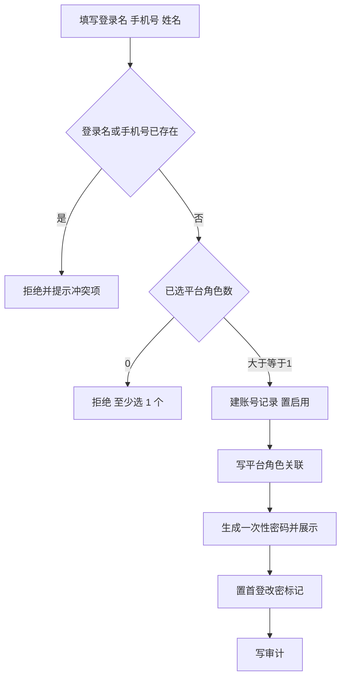
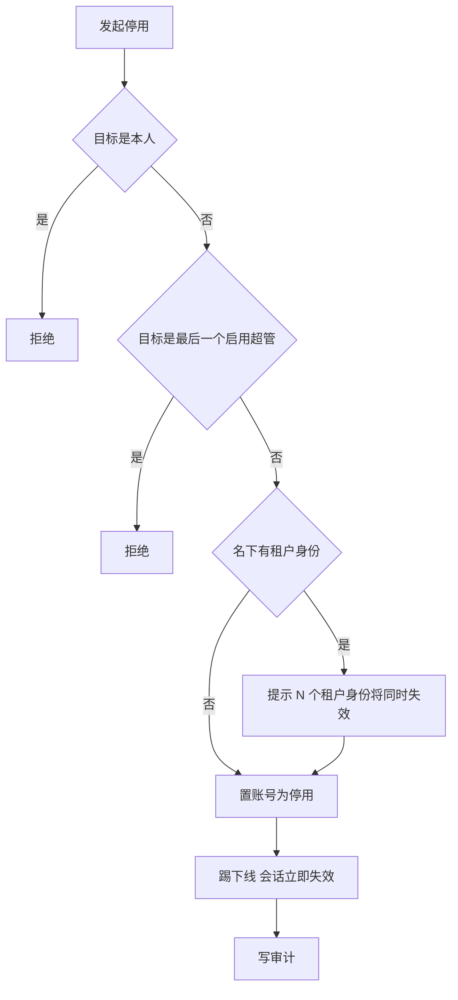
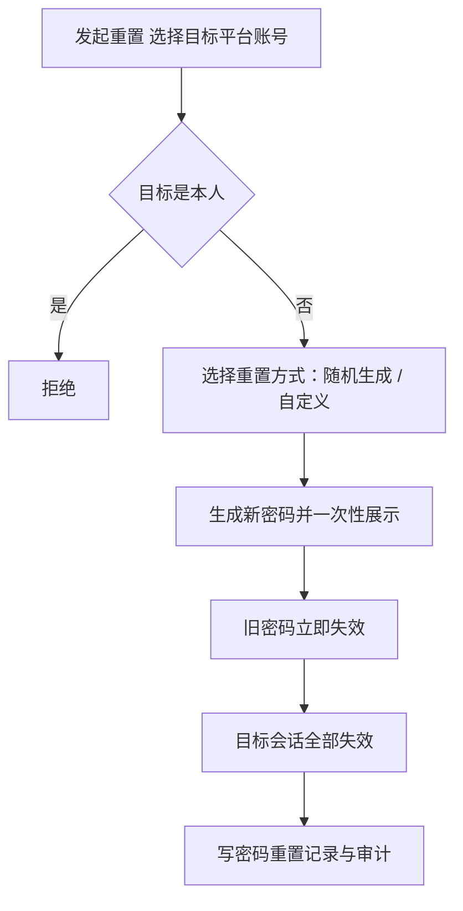

# 平台账号业务 PRD

## 0. 文档基础信息

| 项目 | 内容 |
| :--- | :--- |
| 文档名称 | 平台账号业务 PRD |
| 版本 | V0.13 |
| 状态 | 草稿 |
| 模块名称 | 平台账号 |
| 所属层级 | 平台后台 → 平台账号（另含配套只读视图「账号查询」） |
| 依据 | 产品碳足迹核算工具-用户体系 PRD（精简版）v3.5.1 §5.2 |
| 范围边界 | 只做平台账号与配套的账号查询只读视图（§10）。不涉及租户开户、租户成员、租户角色；平台角色只引用定义不重写；不引入成员关系逻辑 |
| 更新时间 | 2026-10-23 |

**变更记录**

| 日期 | 版本 | 变更内容 |
| :--- | :--- | :--- |
| 2026-10-23 | V0.13 | **新增「账号查询」（原型 `/system/account-query`，菜单 M221）**：平台管理员跨域只读查看全部账号（平台账号 + 租户成员），可下钻平台账号详情，无任何写入口；详见新增 §10，功能清单与决策 D18 同步补充。另清理重置密码「原因」残留条目（§5.6、E11、AC13、AC17），与 V0.9「不再收集原因」口径对齐 |
| 2026-10-23 | V0.12 | **同步角色隔离口径**：平台角色只授予平台人员，不向租户下发；分配平台角色的候选列表不出现任何租户角色，接口层拒绝跨归属指派（§5.3、§5.9、D17）；账号被指定为租户主管理员时由租户侧自动授予「租户管理员」角色，不在本模块分配（租户管理 PRD §4.17） |
| 2026-10-21 | V0.11 | **同步原型详情页调整**：详情页以「操作记录」（账号级审计轨迹：创建 / 编辑 / 分配角色 / 停用 / 启用 / 注销 / 重置密码，含操作人与客户端 IP）取代原「密码重置记录」明细表，不再展示密码重置专项记录；密码重置记录表仍按字段清单 §3 落库，仅不在前端详情页呈现 |
| 2026-10-21 | V0.10 | **同步原型两项交互优化**：① 列表不再展示头像列；② 操作列按钮超过 3 个时收起到「更多」下拉（查看 / 编辑 / 分配角色常驻，停用 · 启用 · 重置密码 · 注销归入更多）。功能清单展示字段相应调整 §4 |
| 2026-10-21 | V0.9 | **同步原型四项增强**：① 列表去掉「密码」「名下租户身份」两列，新增「邮箱」列；② 重置密码不再收集原因（原 E11 删除），仅随机生成 / 自定义二选一；③ 新增邮箱字段（非必填）于新建、编辑、详情与字段清单 §1；④ 手机号脱敏维持列表与详情展示 §5.10。决策补 D13，验收 AC13、AC17 去除原因相关步骤 |
| 2026-10-21 | V0.8 | **同步原型三项增强**：① 新增头像字段（非必填，未上传以姓名首字占位）§5.11；② 重置密码支持随机生成与自定义两种方式，默认随机，自定义按复杂度校验 §5.6；③ 手机号在列表与详情脱敏（前 3 后 4），编辑表单展示明文，不设明文查看入口 §5.10。新增 AC28–AC41 与 E11a–E11c，决策补 D14–D16 |
| 2026-10-21 | V0.7 | **手机号改为可编辑**：§5.2 补「操作人修改手机号」与格式、全局唯一校验，审计记前后值；D02 改为「登录名不可改、手机号可改」；新增 §7.6 编辑账号验收 AC25–AC27 |
| 2026-10-21 | V0.6 | **取消账号归属类型**：平台侧识别改为「是否存在生效平台角色关联」，同一账号可同时持有平台角色与租户成员关系（D13）；**停用增加租户身份影响提示**：§5.4 补统计与提示两条、§3.2 补分支、补 AC11 并重排验收编号 |
| 2026-10-21 | V0.5 | **待确认全部落定**：§9 由「待确认事项」改为「设计决策」D01–D12；停用明确连带租户端登录失效；重置密码补首登改密；注销补不释放登录名与手机号；建号补不设数量上限；功能清单补展示字段范围 |
| 2026-10-21 | V0.4 | **密码改为一次性展示**：删除「显示密码明文」功能点与 §5.9 明文查看规则，不做可逆存储；通用规则补充「只在生成时展示、弹窗关闭后无查询入口」；重置密码补「遗失只能再次重置」；验收改 AC21–AC23，异常改 E18 |
| 2026-10-21 | V0.3 | **账号表合并为一张**：平台账号表即全系统账号表，租户成员关联本表；识别改为「账号归属类型 = 平台」显式字段；删除账号双身份的入口待确认项。**新增密码明文查看**：§5.9 与「显示密码明文」功能点，默认掩码、可开关、强制审计；超管最小数定为 1 个 |
| 2026-10-21 | V0.2 | **取消恢复码方案**：删除「生成恢复码」「凭码重置」两个功能点、凭恢复码重置流程、恢复码状态矩阵与 6 条验收用例；超管全灭改由运维恢复兜底（双人复核 + 复盘 + 审计）；待确认删 3 条、补 2 条 |
| 2026-10-21 | V0.1 | 初版：输出前置问题、功能 PRD 与四张表字段清单 |

**关联链接**

| 文档 | 路径 |
| :--- | :--- |
| 字段清单（字段唯一真相源） | `02prd/02-1后台管理/12 平台账号/平台账号字段清单.md` |
| 用户体系 PRD v3.5.1 | `00业务设计/产品碳足迹核算工具-用户体系v3.0.md` |
| 平台角色定义（5.3，只引用） | 同上 §5.3 |

---

## 1. 前置问题

### 1.1 平台账号与租户成员是否共用一张账号表

**结论：共用一张表。平台账号表即全系统账号表，租户成员关联本表，不另建账号表。**

| 对象 | 落表 | 关系 | 说明 |
| :--- | :--- | :--- | :--- |
| 账号 | 账号表，全局 1 份 | 主对象 | 登录名、手机号、密码、账号状态、锁定计数、首登改密标记 |
| 平台侧身份 | 平台角色关联 | N:N | 有则出现在平台账号列表，靠角色取权限 |
| 租户侧身份 | 成员关系表，本模块不写 | N:N | 关联本表账号，只引用 |

判断依据：

1. §5.9 只有一套登录入口，登录名或手机号二选一，凭证必须唯一，不能按域分裂成两套。
2. §5.2.1-1 要求登录名、手机号各自全局唯一；§5.5.1-6 要求成员「关联已有账号、不建号」——所有账号只有一处存放。
3. §5.3.1-7 角色成员页签「平台查平台账号、租户查成员关系」，两者查的是同一批账号的两个不同切面。

推论：

1. 账号只有一份，平台侧与租户侧都是在同一账号上挂载身份，账号本身不设归属标签。
2. 同一账号可同时持有平台角色与成员关系，二者不互斥，不引入多值字段。
3. 平台后台「平台账号」菜单只展示持有生效平台角色的账号，无平台角色的账号不在本菜单出现。

### 1.2 平台账号如何被识别为平台账号

**结论：靠是否持有生效平台角色识别，不设账号归属标签。**

| 项 | 内容 |
| :--- | :--- |
| 识别判据 | 账号存在至少 1 条未收回的平台角色关联 |
| 不采用的判据 | ① 账号上的归属类型字段（会把「同时是平台人员与租户成员」这个合法状态卡死）② 无租户成员关系（可同时具备租户身份）③ 登录入口（全站同一入口） |

判断依据：

1. 平台角色天然只挂平台侧功能码、只产生平台端权限（§5.3.2-1），持有平台角色即构成平台侧身份。
2. 平台账号至少保留 1 个平台角色（§5.3），角色不会被清空，因此账号不会因角色收回而从列表消失。
3. 账号不设归属标签，同一账号可同时挂平台角色与租户成员关系，两者互不干扰。

**识别 ≠ 准入**，两层分开：

| 层次 | 判据 |
| :--- | :--- |
| 识别为平台账号 | 存在至少 1 条未收回的平台角色关联，且账号状态不为注销 |
| 允许进入平台后台 | 识别成立 且 账号状态为启用 |

### 1.3 超级管理员如何判定与保护

**结论：按角色持有动态判定，不设账号上的布尔标记。**

| 项 | 内容 |
| :--- | :--- |
| 判定方式 | 账号持有「角色 = 超级管理员」的生效关联，且账号状态为启用 |
| 有效超管计数 | 满足上述判定条件的账号数，每次操作前实时统计 |
| 不设标记的原因 | §5.1.3-1 已明确租户主管理员是「成员标记，不是角色」；§5.3 将超级管理员定义为平台内置角色，二者口径不同，平台侧不照搬标记做法 |
| 变更入口 | 只能经「分配平台角色」增加或移除，不设「设为超管」独立按钮 |

保护措施：

| # | 保护措施 | 依据 |
| :--- | :--- | :--- |
| P1 | 超级管理员角色不可删、不可停用、不可取消内置 | §5.3.1-5 |
| P2 | 不可停用或注销最后一个启用状态的超管账号 | §5.2.1-6 |
| P3 | 不可移除最后一个超管账号的超级管理员角色关联 | §5.3.3-2 |
| P4 | 任一超管可重置其他平台账号密码，不可重置自己 | §5.2.1-7 |
| P5 | 超管全部失联时，产品内不设自助恢复入口，统一转运维恢复，须双人复核并出复盘 | §5.2.2-3 §5.8 |

保护判定阈值：待减员的超管数 = 1 时拒绝，即系统始终保留至少 1 个可登录超管。本期定 1 个，不提高至 2 个。

---

## 2. 需求描述

维护平台自有账号：建号授角色、改档、停用启用、重置密码、注销。

---

## 3. 业务流程

### 3.1 新建平台账号

### 3.2 停用账号

### 3.3 重置密码

### 3.4 超管全灭兜底

本模块不设产品内自助恢复入口，无可画分支。全部超管均无法登录时转运维恢复，规则见 §5.8。

---

## 4. 功能清单

| 角色 | 系统 | 一级模块 | 二级模块 | 业务用例 | 操作功能 | 调整说明 |
| :--- | :--- | :--- | :--- | :--- | :--- | :--- |
| 平台账号操作角色 | 平台后台 | 平台账号 | — | 核查平台团队 | 查看列表与详情 | 【新增】 |
| 平台账号操作角色 | 平台后台 | 平台账号 | — | 团队分岗 | 新建 | 【新增】 |
| 平台账号操作角色 | 平台后台 | 平台账号 | — | 团队分岗 | 编辑 | 【新增】 |
| 平台账号操作角色 | 平台后台 | 平台账号 | — | 团队分岗 | 分配平台角色 | 【新增】 |
| 平台账号操作角色 | 平台后台 | 平台账号 | — | 冻结账号 | 停用 | 【新增】 |
| 平台账号操作角色 | 平台后台 | 平台账号 | — | 冻结账号 | 启用 | 【新增】 |
| 平台账号操作角色 | 平台后台 | 平台账号 | — | 离职回收 | 注销 | 【新增】 |
| 平台超管 | 平台后台 | 平台账号 | — | 超管失联 | 重置密码 | 【新增】 |
| 持「账号查询」功能码的平台角色 | 平台后台 | 系统管理 · 账号查询 | — | 跨域核查 | 查看全局账号列表（平台账号 + 租户成员，只读） | 【新增】原型菜单 M221 |
| 持「账号查询」功能码的平台角色 | 平台后台 | 系统管理 · 账号查询 | — | 跨域核查 | 按姓名 / 登录名 / 手机号 / 账号类型 / 账号状态查询 | 【新增】 |
| 持「账号查询」功能码的平台角色 | 平台后台 | 系统管理 · 账号查询 | — | 下钻详情 | 平台账号姓名下钻至平台账号详情（只读） | 【新增】 |
> 「平台账号操作角色」指持有「平台账号」功能码的平台角色，角色定义见 §5.3，本文不重写。
> 「重置密码」按 §5.2.1-7 限定为超管，不下放给其他平台角色。
> 本期不设「生成恢复码」「凭码重置」两个功能，超管全灭走运维恢复，见 §5.8。
> 密码只在生成时一次性展示，不提供事后查看入口，见 §5.9。
> 手机号在列表与详情脱敏展示，编辑表单内展示明文，见 §5.10。
> 头像为非必填字段，未上传时以姓名首字占位，见 §5.11。
> 列表展示：姓名、登录名、手机号（脱敏）、邮箱、平台角色、状态、创建时间；详情另含头像与密码掩码；列表不展示密码列与名下租户身份；操作列按钮超过 3 个时收起到「更多」下拉。

---

## 5. 业务规则

### 5.1 新建

1. 操作人填写登录名、手机号、姓名；邮箱为非必填字段，可不填。
2. 系统校验登录名全局唯一。
3. 系统校验手机号全局唯一。
4. 系统校验登录名不为 11 位纯数字。
5. 系统校验登录名不区分大小写、去空格、转半角后判重。
6. 操作人分配 1 至 5 个平台角色。
7. 系统拒绝 0 个平台角色的提交。
8. 系统生成一次性密码并一次性展示。
9. 系统置首登改密标记。
10. 系统置平台账号为启用。
11. 系统记录创建人。
12. 系统写审计。
13. 系统不限制平台账号总数。
14. 系统允许头像为空。

### 5.2 编辑

1. 操作人修改姓名。
2. 操作人修改手机号。
3. 系统校验手机号格式。
4. 系统校验手机号全局唯一。
5. 系统不修改登录名。
6. 操作人上传、更换或移除头像。
7. 系统允许头像为空。
8. 系统记录更新人与更新时间。
9. 系统写审计并记手机号前后值。

> 登录名创建后不可改，手机号可改，见 §9 D02。
> 头像非必填，见 §5.11。

### 5.3 分配平台角色

1. 操作人为目标平台账号增减平台角色。
2. 系统只展示归属类型为平台的启用角色。
3. 系统校验增减后角色总数在 1 至 5 之间。
4. 系统校验增减后至少保留 1 个平台角色。
5. 系统拒绝移除最后一个启用超管的超级管理员角色。
6. 系统实时生效并踢目标账号下线。
7. 系统写审计并记前后值。
8. 系统只展示归属类型为平台的启用角色（角色定义与维护在平台侧「平台角色管理」），不出现任何租户角色；提交含租户角色时拒绝（平台角色只授予平台人员，与租户角色完全隔离）。
9. 系统不把平台角色写入该账号的租户成员关系，也不因账号持有租户成员关系而改动其平台角色。

### 5.4 停用

1. 操作人对目标平台账号发起停用。
2. 系统校验目标不是操作人本人。
3. 系统校验目标不是最后一个启用超管。
4. 系统统计该账号名下的有效租户成员关系数。
5. 系统在确认弹窗展示受影响租户身份数与租户名称。
6. 操作人确认后系统置账号为停用。
7. 系统踢目标账号下线并使会话立即失效。
8. 系统不改该账号的租户成员关系记录。
9. 系统不收回平台角色关联。
10. 系统使该账号在租户端的登录同时失效。
11. 系统写审计，记受影响租户身份数。

### 5.5 启用

1. 操作人对停用状态的平台账号发起启用。
2. 系统校验目标至少持有 1 个生效平台角色。
3. 目标角色为 0 时系统引导先分配角色。
4. 系统置平台账号为启用。
5. 系统写审计。

### 5.6 重置密码

1. 超管对目标平台账号发起重置。
2. 系统校验目标不是操作人本人。
3. 操作人选择重置方式。
4. 系统提供随机生成与自定义两种方式，默认随机生成。
5. 操作人选择自定义时填写新密码与确认新密码。
6. 系统校验自定义密码不少于 8 位。
7. 系统校验自定义密码含大写、小写、数字、特殊字符中的三类。
8. 系统校验两次输入一致。
9. 系统生成新密码并一次性展示。
10. 系统使旧密码立即失效。
11. 系统使目标账号全部会话失效。
12. 系统写密码重置记录并记重置方式。
13. 系统写审计。
14. 系统置首登改密标记。
15. 新密码遗失时系统只允许再次重置，不提供明文找回。

> 重置密码不再收集原因（原型已取消，见 Changelog V0.9）：随机生成 / 自定义二选一，仅密码复杂度校验。

### 5.7 注销

1. 操作人对目标平台账号发起注销。
2. 系统校验目标不是操作人本人。
3. 系统校验目标不是最后一个启用超管。
4. 系统二次确认并展示影响说明。
5. 系统置平台账号为注销。
6. 系统踢目标账号下线。
7. 系统保留账号记录与角色关联记录。
8. 系统不释放登录名与手机号。
9. 系统写审计。

### 5.8 超管全灭兜底

1. 系统不提供登录页自助找回密码入口。
2. 系统不提供凭码或凭令牌绕过登录的密码重置入口。
3. 系统在全部超管均无法登录时，转运维恢复流程。
4. 运维恢复须由实施方双人复核。
5. 运维恢复须留存操作记录并出具复盘报告。
6. 运维恢复后系统要求受影响账号首登改密。
7. 系统写审计日志。

> 恢复码方案已取消，依据见本文 Changelog 与字段清单 V0.2。

### 5.9 通用

1. 系统按是否存在生效平台角色关联识别平台账号。
2. 系统按「存在生效平台角色关联 且 启用」放行平台后台。
3. 系统允许同一账号同时持有平台角色与租户成员关系。
4. 系统按角色持有实时统计有效超管数。
5. 系统不因分配平台角色而创建或修改成员关系。
6. 系统不将平台账号计入租户成员数。
7. 系统不接收前端传入的操作人身份。
8. 系统对所有写操作记录审计。
9. 系统只在生成时一次性展示密码明文。
10. 系统在弹窗关闭后不提供密码明文查询入口。
11. 系统在列表与详情以掩码展示密码。
12. 系统只在平台侧分配平台角色：租户角色由租户管理员在租户端分配，本模块不展示、不分配、不回收（角色管理 PRD §5.11-5）。
13. 系统在本账号被指定为某租户主管理员时，不为其分配任何平台角色；该账号的租户权限来自租户侧自动授予的「租户管理员」角色（租户管理 PRD §4.17）。

### 5.10 手机号脱敏

1. 系统在列表脱敏展示手机号。
2. 系统在详情脱敏展示手机号。
3. 系统在编辑表单展示手机号明文。
4. 系统保留手机号前 3 位与后 4 位。
5. 系统将手机号中间 4 位替换为掩码。
6. 系统不提供列表与详情的明文查看入口。

### 5.11 头像

1. 系统允许账号头像为空。
2. 系统在上传后展示头像图片。
3. 系统在头像为空时以姓名首字占位。
4. 操作人可更换或移除头像。
5. 系统不限制头像尺寸与格式。
6. 系统将头像与账号记录同事务保存。

---

## 6. 异常与拦截

| # | 场景 | 拦截环节 | 系统行为 |
| :--- | :--- | :--- | :--- |
| E01 | 登录名与已有账号重复 | 新建保存 | 阻断，提示登录名已存在 |
| E02 | 手机号与已有账号重复 | 新建 / 编辑保存 | 阻断，提示手机号已存在 |
| E03 | 登录名为 11 位纯数字 | 新建保存 | 阻断，提示改用非纯数字登录名 |
| E04 | 未分配任何平台角色 | 新建保存 | 阻断，提示至少分配 1 个平台角色 |
| E05 | 分配角色超过 5 个 | 保存 | 阻断，提示上限 5 个 |
| E06 | 停用目标为本人 | 停用提交 | 阻断，提示不可停用自己 |
| E07 | 停用目标是最后一个启用超管 | 停用提交 | 阻断，提示系统至少保留 1 个启用超管 |
| E08 | 注销目标是最后一个启用超管 | 注销提交 | 阻断，提示系统至少保留 1 个启用超管 |
| E09 | 移除最后一个超管的超管角色 | 分配平台角色提交 | 阻断，提示系统至少保留 1 个启用超管 |
| E10 | 重置密码目标为本人 | 重置提交 | 阻断，提示不可重置自己的密码 |
| E11a | 自定义密码少于 8 位 | 重置提交 | 阻断，提示密码长度不少于 8 位 |
| E11b | 自定义密码字符种类不足三类 | 重置提交 | 阻断，提示须含大写、小写、数字、特殊字符中的三类 |
| E11c | 两次输入的新密码不一致 | 重置提交 | 阻断，提示两次输入不一致 |
| E12 | 启用后角色数为 0 | 启用提交 | 阻断，提示先分配平台角色 |
| E13 | 无「平台账号」功能码 | 进入菜单 | 阻断，菜单不渲染、接口拒绝 |
| E14 | 非超管调用重置密码接口 | 重置提交 | 阻断，返回无权限 |
| E15 | 目标账号已被他人先改为停用 | 停用提交 | 阻断，提示状态已变更需刷新 |
| E16 | 全部超管均无法登录 | 登录页 | 无自助找回入口，提示联系运维恢复 |
| E17 | 调用已下线的凭码重置接口 | 接口层 | 返回不存在，写审计 |
| E18 | 尝试查询已关闭弹窗的一次性密码 | 详情页 | 无入口，只展示掩码，提示走重置 |

---

## 7. 验收标准

### 7.1 新建平台账号

| # | Given | When | Then |
| :--- | :--- | :--- | :--- |
| AC01 | 超管已登录，登录名与手机号均未被占用 | 提交新建并分配 1 个平台角色 | 创建成功，列表出现该账号，状态为启用 |
| AC02 | 已存在登录名 `ops01` 的账号 | 用登录名 `OPS01` 新建 | 阻断，提示登录名已存在 |
| AC03 | 新建表单未勾选任何平台角色 | 提交 | 阻断，提示至少分配 1 个平台角色 |
| AC04 | 新建成功且拿到一次性密码 | 该账号首次登录平台后台 | 强制进入改密页，改密后方可进入 |
| AC05 | 新建成功 | 查看审计日志 | 存在一条新建平台账号记录，含操作人与时间 |

### 7.2 停用账号

| # | Given | When | Then |
| :--- | :--- | :--- | :--- |
| AC06 | 操作人已登录 | 对本人发起停用 | 阻断，提示不可停用自己 |
| AC07 | 系统仅 1 个启用状态超管 | 对该超管发起停用 | 阻断，提示至少保留 1 个启用超管 |
| AC08 | 系统有 2 个启用状态超管 | 停用其中 1 个 | 成功，该账号状态为停用 |
| AC09 | 目标账号处于在线会话 | 停用该账号 | 目标会话立即失效，下次请求被踢出 |
| AC10 | 目标账号同时是某租户成员 | 停用该账号 | 账号状态为停用，租户端登录同时失效，成员关系记录保留 |
| AC11 | 目标账号名下有 3 个有效租户身份 | 点击停用 | 确认弹窗展示「3 个租户身份将同时失效」并列出租户名称，确认后才执行 |

### 7.3 重置密码

| # | Given | When | Then |
| :--- | :--- | :--- | :--- |
| AC12 | 操作人为超管 | 对本人发起重置密码 | 阻断，提示不可重置自己 |
| AC13 | 操作人为超管 | 对他人发起重置，默认随机生成 | 成功，新密码一次性展示，旧密码立即失效 |
| AC14 | 操作人为超管，选择自定义密码并输入合规密码 | 对他人发起重置 | 成功，一次性展示该密码，记录记重置方式为「自定义」 |
| AC15 | 目标账号存在在线会话 | 重置其密码 | 目标全部会话失效 |
| AC16 | 非超管但持有平台账号功能码 | 调用重置密码接口 | 拒绝，返回无权限 |
| AC17 | 重置成功 | 查看密码重置记录与审计日志 | 各存在 1 条记录，含目标、操作人、重置方式、时间 |

### 7.4 超管全灭兜底

| # | Given | When | Then |
| :--- | :--- | :--- | :--- |
| AC18 | 全部超管均无法登录 | 在登录页寻找自助找回密码入口 | 页面无入口，提示联系运维恢复 |
| AC19 | 全部超管均无法登录 | 调用任何绕过登录的密码重置接口 | 接口返回不存在，操作写审计 |
| AC20 | 运维已执行超管密码恢复 | 查看审计日志 | 存在 1 条人工恢复事件，含操作方与时间 |
| AC21 | 运维恢复已完成 | 该超管首次登录 | 强制进入改密页，改密后方可进入 |

### 7.5 密码展示

| # | Given | When | Then |
| :--- | :--- | :--- | :--- |
| AC22 | 打开任一平台账号详情 | 查看密码字段 | 展示掩码，不展示明文 |
| AC23 | 建号或重置成功 | 关闭一次性密码弹窗后再次打开详情 | 无明文入口，提示忘记密码请联系超管重置 |
| AC24 | 查询系统日志与接口响应 | 检索密码明文 | 均不含明文 |

### 7.6 编辑账号

| # | Given | When | Then |
| :--- | :--- | :--- | :--- |
| AC25 | 目标手机号未被占用 | 修改手机号并保存 | 保存成功，详情展示新手机号 |
| AC26 | 已存在手机号 `13800000000` 的账号 | 把另一账号改为该手机号 | 阻断，提示手机号已存在 |
| AC27 | 修改手机号成功 | 查看审计日志 | 存在 1 条记录，含手机号前值与后值 |

### 7.7 手机号脱敏

| # | Given | When | Then |
| :--- | :--- | :--- | :--- |
| AC28 | 账号手机号为 `13800000001` | 查看平台账号列表 | 手机号列展示 `138****0001` |
| AC29 | 账号手机号为 `13800000001` | 打开该账号详情 | 手机号展示 `138****0001` |
| AC30 | 打开任一账号编辑页 | 查看手机号输入框 | 展示完整明文，可修改 |
| AC31 | 在列表与详情查找明文查看入口 | 遍历页面 | 无入口，只有掩码 |

### 7.8 头像

| # | Given | When | Then |
| :--- | :--- | :--- | :--- |
| AC32 | 新建账号时未上传头像 | 提交保存 | 保存成功，列表与详情以姓名首字占位 |
| AC33 | 编辑账号时上传一张图片 | 保存后查看列表与详情 | 展示该头像图片 |
| AC34 | 账号已有头像 | 点击移除并保存 | 头像清空，恢复姓名首字占位 |

### 7.9 重置密码方式

| # | Given | When | Then |
| :--- | :--- | :--- | :--- |
| AC35 | 打开重置密码弹窗 | 查看重置方式 | 默认选中「随机生成」，另有「自定义密码」可选 |
| AC36 | 选择自定义密码，输入 `Abc12345` | 提交重置 | 成功，一次性展示该密码 |
| AC37 | 选择自定义密码，输入 `abc` | 提交重置 | 阻断，提示密码长度不少于 8 位 |
| AC38 | 选择自定义密码，输入 `abcdefgh` | 提交重置 | 阻断，提示须含三类字符 |
| AC39 | 选择自定义密码，两次输入不一致 | 提交重置 | 阻断，提示两次输入不一致 |
| AC40 | 选择随机生成 | 提交重置 | 成功，展示 12 位随机密码 |
| AC41 | 重置成功 | 查看密码重置记录 | 记录含重置方式（随机生成或自定义） |

---

## 8. 状态与操作矩阵

| 状态 | 可编辑 | 可分配角色 | 可重置密码 | 可停用 | 可启用 | 可注销 | 可登录平台后台 |
| :--- | :---: | :---: | :---: | :---: | :---: | :---: | :---: |
| 启用 | 是 | 是 | 是 | 是 | 否 | 是 | 是 |
| 停用 | 是 | 是 | 是 | 否 | 是 | 是 | 否 |
| 注销 | 否 | 否 | 否 | 否 | 否 | 否 | 否 |

---

## 9. 设计决策

| 编号 | 事项 | 决议 | 落点 |
| :--- | :--- | :--- | :--- |
| D01 | 停用范围 | 账号级停用，平台端与租户端登录同时失效；执行前提示 N 个租户身份将失效 | §5.4 |
| D02 | 登录名、手机号可否编辑 | 登录名不可改；手机号可改，须校验格式与全局唯一 | §5.2 |
| D03 | 重置后是否强制首登改密 | 强制，与建号口径一致 | §5.6 |
| D04 | 重置密码权限 | 仅限超管，不下放给其他平台角色 | §4、§5.6 |
| D05 | 注销后登录名与手机号 | 不释放，记录不可恢复，保留档案备审计 | §5.7 |
| D06 | 启用状态超管最小数量 | 保留 1 个，不提高至 2 个 | §1.3 P2 |
| D07 | 运维恢复留痕 | 只在审计日志记 1 条人工恢复事件，不建独立表 | §5.8、字段清单 §4 |
| D08 | 密码重置记录 | 独立建表，审计只记事件摘要 | 字段清单 §3 |
| D09 | 密码明文展示 | 仅生成时一次性展示，不做可逆存储，不提供事后查看 | §5.9 |
| D10 | 列表与详情展示字段 | 列表：姓名、登录名、手机号（脱敏）、邮箱、平台角色、状态、创建时间（不展示头像与密码列）；详情另含头像与密码掩码；详情「操作记录」展示账号级审计轨迹（不含密码重置明细） | §4 |
| D11 | 注销复核 | 不设双人复核，仅二次确认 | §5.7 |
| D12 | 平台账号数量 | 不设上限 | §5.1 |
| D13 | 账号身份 | 不设归属字段，同一账号可同时持有平台角色与租户成员关系 | §1.1、§1.2 |
| D14 | 手机号脱敏 | 列表与详情脱敏（前 3 后 4），编辑表单展示明文，不设明文查看入口 | §5.10 |
| D15 | 头像 | 非必填，未上传以姓名首字占位，不限制尺寸与格式 | §5.11 |
| D16 | 重置密码方式 | 随机生成与自定义二选一，默认随机；自定义按密码复杂度校验 | §5.6 |
| D17 | **角色隔离** | 平台角色与租户角色完全隔离、不混用：本模块只分配平台角色给平台人员（角色定义在平台侧「平台角色管理」，只展示平台角色），不出现、不下发租户角色；账号成为租户主管理员时的租户权限由租户侧「租户管理员」角色自动授予，与本模块无关 | §5.3、§5.9-12/13 |
| D18 | **账号查询** | 账号查询为平台侧独立只读视图（原型 `/system/account-query`，菜单 M221）：跨域展示全部账号（平台账号 + 租户成员），不提供任何写入口；账号类型按「是否存在生效平台角色关联」动态判定，与 §1.2 识别口径一致；平台账号行可下钻至平台账号详情 | §10 |

---

## 10. 账号查询（平台全局只读视图，原型 `/system/account-query`）

### 10.1 定位

**结论：账号查询是平台管理员的全局账号视图，跨域只读展示全部账号（平台账号 + 租户成员），不提供任何编辑入口。**

| 项 | 内容 |
| :--- | :--- |
| 菜单 | 平台后台 → 系统管理 → 组织与权限 → 账号查询（功能编码 `M221`，`scope = platform`，由平台角色勾选控制） |
| 数据范围 | 全系统账号表全局一份：既含持平台角色的平台账号，也含不持平台角色的租户成员 |
| 账号类型判定 | 由「是否存在生效平台角色关联」动态判定（与 §1.2 识别口径一致），不设账号归属字段 |
| 写操作 | 无。所有写操作仍走平台账号列表 / 详情等既有入口，本页不暴露任何写入口 |
| 下钻 | 平台账号的姓名可下钻至平台账号详情（本 PRD §1 模块）；租户成员行不下钻（租户侧数据由租户自管） |

### 10.2 查询与展示

1. 列表字段：姓名、登录名、手机号（脱敏，前 3 后 4）、邮箱、账号类型（平台账号 / 租户成员）、账号状态、最近登录时间、所属组织（生效成员关系对应的租户名）、创建人、创建时间。
2. 筛选条件：姓名 / 登录名 / 手机号关键字、账号类型（平台账号 / 租户成员）、账号状态（启用 / 停用）。
3. 排序：平台账号在前、租户成员在后；同类内启用状态在前，其余按更新时间倒序。
4. 分页：每页 20 条。
5. 工具栏统计：总条数、平台账号条数、租户成员条数（账号表全局唯一一份，两域共享）。
6. 手机号脱敏口径与本模块 §5.10 一致；本页不展示密码与头像。

### 10.3 业务规则

1. 账号查询为只读视图：页面不提供新建 / 编辑 / 分配角色 / 停用 / 启用 / 注销 / 重置密码任何入口。
2. 账号类型动态判定：存在生效平台角色关联即为「平台账号」，否则为「租户成员」；同一账号不会因同时持有两种身份而出现两行。
3. 租户成员行的「所属组织」取其生效成员关系对应的租户名称；无生效成员关系时展示「—」。
4. 访问控制：由平台角色勾选「账号查询」功能码控制；无功能码时菜单不渲染、直接调接口返回无权限并写审计。
5. 平台账号行的详情下钻复用平台账号详情页口径（操作记录 / 角色 / 状态等），不在本页重复展示。
