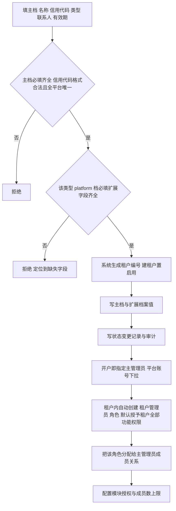
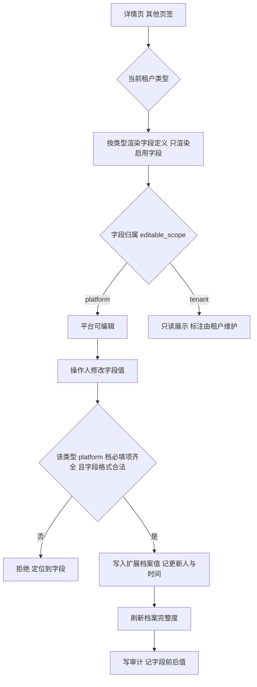
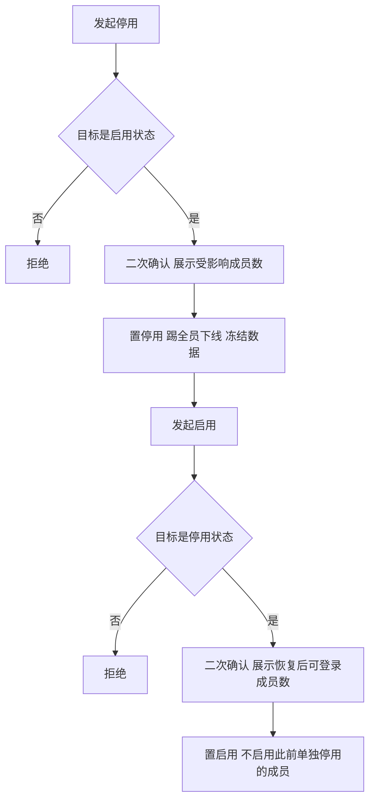
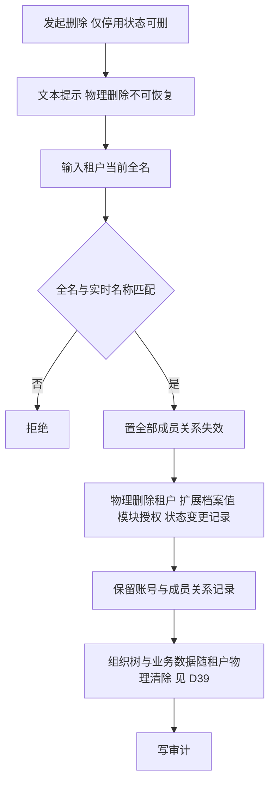
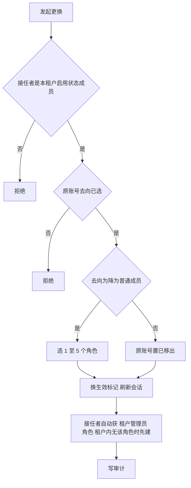
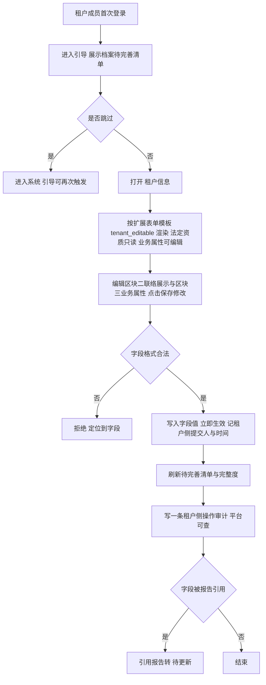

# 租户管理业务 PRD

## 0. 文档基础信息

| 项目 | 内容 |
| :--- | :--- |
| 文档名称 | 租户管理业务 PRD |
| 版本 | V0.10 |
| 状态 | 草稿 |
| 模块名称 | 租户管理 |
| 所属层级 | 平台后台 → 租户管理 |
| 依据 | 产品碳足迹核算工具-用户体系 PRD（精简版）v3.5.5 §3.1、§5.1、§5.8、§5.9；《租户管理澄清清单》V0.1；《组织架构业务 PRD》V0.1；角色口径补充：平台角色与租户角色完全隔离（2026-10-23） |
| 范围边界 | 只做租户管理。不涉及平台账号、租户端成员、租户角色的定义与功能勾选（角色管理 PRD 覆盖），本模块只在开户 / 指定 / 更换主管理员时触发「租户管理员」角色的自动创建与分配；组织树维护不在此。租户端「租户信息」页面的字段归属、可编辑范围与引导规则在本文定义，页面详细交互与组件拆解另立文档 |
| 更新时间 | 2026-10-23 |

**变更记录**

| 日期 | 版本 | 变更内容 |
| :--- | :--- | :--- |
| 2026-10-23 | V0.10 | **租户端「租户信息」业务信息区块改MVP极简版**：取消审批流，改为「部分只读 + 部分自编辑」——法定资质类字段（企业信用代码、机关编码、机构资质编号、园区区划等）纯只读（灰底）并提示「如需修改请联系平台」；业务属性类字段（行业、规模、注册资本、官网、编制数、面积等）由租户管理员直接编辑（白底），保存后立即生效。字段定义新增 `tenant_editable` 决定前端渲染输入框还是只读文本；区块二「日常联络展示信息」与区块三「业务属性信息」共用【保存修改】按钮；租户修改写一条操作审计日志。原「我的单位信息」更名为「租户信息」；§4.14 重写，§4.16 调整为平台侧能力保留，新增 D47 |
| 2026-10-23 | V0.9 | **开户闭环到租户角色初始化**：明确平台角色与租户角色完全隔离、不混用；平台管理员创建租户并关联主管理员后，系统在该租户内自动创建「租户管理员」角色、分配给该账号，并默认授予租户全部功能权限；指定 / 更换主管理员时按同一口径接力。新增 §1.4、§4.17，修订 §2.1、§2.5、§3、§4.1、§4.11、E32–E34、AC45–AC48、D43–D46 |
| 2026-10-22 | V0.8 | **扩展档案维护权重构为字段归属三档**（platform / tenant / both）+ 租户端新增「租户信息」自助维护页面与首次登录引导：开户不再校验租户可维护字段的必填；「档案待完善」由平台侧提示改为租户端待完善清单 + 首次登录引导，不阻断登录；平台独占字段改为「租户提交变更申请、平台审批生效」；修订 D17、D34、T09，新增 D36 至 D42 |
| 2026-10-22 | V0.7 | 新建 / 编辑改为**独立内容页**（替代 V0.5 弹窗方案）；表单分「租户信息」与「其他」两段，租户信息内合并主档统一字段与授权配额（成员数上限、主管理员前置）；界面术语「扩展档案」调整为「其他」 |
| 2026-10-22 | V0.6 | **租户管理重构为三段式**：租户主档（统一字段：名称、统一社会信用代码/组织机构代码、类型、状态、联系人（非必填）、有效期（非必填））+ 按类型扩展档案（配置化字段定义）+ 模块授权。属地省市区与注册地址由主档下沉为扩展档案公共字段；成员数上限改归「授权与配额」不再作为主档展示字段；新增扩展档案维护、档案完整度、有效期提示规则；模块码 `department` 更名为 `org` |
| 2026-10-21 | V0.5 | 新建 / 编辑改为弹窗；主管理员改从「平台账号（不含超管）」下拉选择、不自动建号；删除仅停用状态可删、界面仅文本提示 + 输入全名确认（无双人复核、无只读导出）；状态变更记录并入详情页「操作记录」。同步上游 PRD 升 v3.5.5 |
| 2026-10-21 | V0.4 | 开户表单新增「主管理员姓名 + 手机号」必填：手机号命中现有账号则关联、否则新建账号并设为该租户主管理员（生成初始密码），解决新建租户无管理员账号的引导缺口（本轮已改为平台账号下拉选择，本条为历史记录）。同步上游 PRD 升 v3.5.4 |
| 2026-10-21 | V0.3 | 评审意见落地：开户极简三字段（统一编码系统生成、主管理员与模块授权建后配置）；成员数上限默认 1000；删除取消双人复核；模块授权分「产品碳足迹应用 / 系统管理」两组；列表仅留名称/类型/状态/创建时间/操作，重置密码移出操作集。同步上游 PRD 升 v3.5.3 |
| 2026-10-21 | V0.2 | T01 闭环：上游用户体系 PRD 升 v3.5.2，§5.1.2 删除规则同步改为真删、取消冷静期，两文档对齐 |
| 2026-10-21 | V0.1 | 初版：澄清清单答复落定，删除改为真删无冷静期（偏离上游 PRD §5.1.2，见 §8 D01），输出功能 PRD 与四张表字段清单 |

**关联链接**

| 文档 | 路径 |
| :--- | :--- |
| 字段清单（字段唯一真相源） | `02prd/02-1后台管理/13租户管理/租户管理字段清单.md` |
| 澄清清单（阶段一产物，含答复记录与假设） | `02prd/02-1后台管理/13租户管理/租户管理澄清清单.md` |
| 组织架构业务 PRD（模块授权对象，只引用） | `02prd/02-2前台业务功能/08组织架构/组织架构业务PRD.md` |
| 用户体系 PRD v3.5.5 | `00业务设计/产品碳足迹核算工具-用户体系v3.0.md` |
| 平台账号业务 PRD（账号表口径，只引用） | `02prd/02-1后台管理/12 平台账号/平台账号业务PRD.md` |
| 租户端「租户信息」页面 PRD（**待新建**，本文只定字段归属与规则） | `02prd/02-2前台业务功能/09 租户信息/租户信息业务PRD.md` |

---

## 1. 需求描述

平台超管维护租户生命周期：**建租户（主档 + 平台独占档案字段）→ 配模块授权 → 指定主管理员 → 自动初始化租户管理员角色**；业务档案字段由租户在租户端「租户信息」自维护（§1.3）。后续做编辑、停用启用、真删、主管理员交接。

> 角色口径（2026-10-23 定稿）：平台角色与租户角色**完全隔离、不混用**；平台角色只授予平台人员，不向租户下发；租户角色由租户自行创建与管理，只在租户内生效。租户的权限起点由开户时的角色初始化给出，不复用任何平台角色（§1.4）。

### 1.1 三段式定位

| 段 | 内容 | 归属 | 本模块职责 |
| :--- | :--- | :--- | :--- |
| 租户主档（统一字段） | 名称、统一社会信用代码/组织机构代码、类型、状态、联系人（非必填）、有效期（非必填） | 平台 | 开户与编辑，全类型同一套字段 |
| 扩展档案 | 按租户类型差异化维护的档案字段（企业 / 政府单位 / 机构 / 园区），字段定义由平台配置 | 平台 / 租户（按字段归属分档） | 开户只校验平台独占字段的必填；建后平台按权限补录，租户端「租户信息」自助维护租户可维护字段 |
| 模块授权 | 「产品碳足迹应用」组 + 「系统管理」组；成员数上限等配额 | 平台 | 勾选授权、调整配额 |

> 三段式的目的：**主档保持稳定与极简，类型差异全部收敛到扩展档案，商业能力收敛到模块授权**。后续新增租户类型只新增字段定义，不改主档与代码。
> 界面承载（V0.7）：新建 / 编辑为独立内容页，页面只分「租户信息」与「其他」两段——租户信息 = 主档统一字段 + 成员数上限 + 主管理员，其他 = 按类型渲染的扩展档案。文档内「主档 / 扩展档案」保留为数据口径，界面不再出现这两个词。
> 维护方（V0.8）：扩展档案**不再全部由平台维护**。字段级归属见 §1.3，租户可维护字段由租户端自助填写，平台只读与复核。

### 1.2 与组织架构的边界

租户主档、模块授权均由平台维护；扩展档案按 §1.3 字段归属分档维护；**租户内组织树由租户自行维护**（见《组织架构业务 PRD》）。本模块只做两件事：

1. 授权「系统管理 → 组织架构」模块，决定租户端是否渲染该菜单；
2. 新建租户时可选「初始组织模板」，由租户端首次进入时套用，但不代租户维护组织树。

### 1.3 扩展档案字段归属三档（V0.8）

> 定位：新增租户时**平台只录主档与准入必需字段**；租户自身的业务事实由租户在租户端「租户信息」自助维护。字段归属在字段定义上配置（`editable_scope`），新增字段只改数据不改代码。

| 归属 | 含义 | 谁填写 | 平台侧 | 租户侧 | 典型字段 |
| :--- | :--- | :--- | :--- | :--- | :--- |
| `platform` | 平台独占 | 平台运营 | 可编辑，值纳入开户必填校验 | 只读；如需修改请联系平台 | 机构类别、资质证书编号、发证机关、资质有效期、园区级别、行政级别、管辖辖区 |
| `tenant` | 租户可维护 | 租户自己 | 可查看、可复核，不代改原文 | 主管理员默认可编辑，普通成员按功能点授权；可查看 | 属地、注册地址、法定代表人 / 负责人、企业规模、所属行业、主要产品、年综合能耗、运营主体 |
| `both` | 双方可维护 | 平台或租户 | 可编辑 | 主管理员可编辑，留痕 | 仅在字段定义明确声明时使用；缺省按 `tenant` 处理 |

规则要点：

1. `tenant` 档字段**不作为开户必填项**，开户只校验 `platform` 档必填字段（§4.1-14）。
2. `platform` 档字段在租户端只读展示（灰底），提示「如需修改请联系平台」，由平台线下受理后平台侧代录。
3. `tenant` 档字段由租户端维护时，平台侧详情页该字段只读展示；平台运营如需订正，走同一编辑入口并记录平台侧修改留痕。
4. 档案完整度仍按必填字段计算，但必填范围只含 `platform` 档必填字段；租户可自编辑（`tenant_editable = 1`）必填字段的缺口在租户端以「待完善清单」呈现（§4.15）。
5. `tenant` 档字段变更若被报告引用，沿用「引用报告转待更新」（报告生成 PRD R-114）。
6. 字段定义新增 `tenant_editable`（V0.10）：决定租户端「租户信息」把字段渲染成输入框（业务属性类）还是只读文本（法定资质类），与 `editable_scope` 正交——`platform` 档字段强制 `tenant_editable = 0`，`tenant` / `both` 档按字段性质划分（如园区地理位置 / 行政归属区划属法定资质类取 0）。

### 1.4 租户角色初始化（V0.9）

> 定位：租户的权限起点由平台开户动作给出，租户此后自行扩建角色体系。平台只交付「一个租户 + 一个主管理员 + 一个租户管理员角色」，不代租户做岗位拆分。

| 环节 | 系统动作 | 归属 |
| :--- | :--- | :--- |
| 平台管理员创建租户并关联主管理员 | 在该租户内自动创建内置角色「租户管理员」，并把该角色分配给主管理员的成员关系 | 租户数据，平台触发 |
| 租户管理员角色初始化权限 | 默认勾选**租户端全部功能点**（数据范围默认「全部」） | 租户数据 |
| 后续租户内岗位拆分 | 由租户管理员在租户端「角色管理」自建自定义角色，平台不参与 | 租户自管 |

四条口径：

1. **隔离**：平台角色只给平台人员，租户角色只给租户成员，两侧不混用、不互相可见、不可跨归属复制或指派。
2. **平台只发起点**：平台管理员不创建、不编辑、不删除租户角色，只在开户 / 主管理员交接时触发「租户管理员」角色的创建与分配。
3. **租户自管**：租户角色由租户管理员在租户端创建与管理，只在租户内生效，不跨租户复用、不跨租户可见。
4. **默认全权限**：自动创建的「租户管理员」角色默认拥有租户全部功能权限；实际生效范围仍受模块授权约束（有效功能 = 已开通模块内功能点 ∩ 角色勾选功能点，见角色管理 PRD §1.4）。

> 「租户全部功能权限」的解释：指角色勾选侧默认全选租户端功能点（按租户类型过滤后），不意味着绕过模块授权；未开通模块内的功能点仍不生效。
> 数据范围：默认读写均取「全部」，后续由租户管理员按需收窄，见 §4.17-6。

---

## 2. 业务流程

> 按澄清清单 C01 答复，删除不设软删与冷静期，§2.4 画真删流程；其余分支与上游 PRD 一致。

### 2.1 新建租户（主档 + 扩展档案）

> I1 / I2 为系统自动动作，无独立按钮；租户内已存在「租户管理员」角色时只做分配，不重复创建（§4.17）。

### 2.2 维护扩展档案（平台侧）

> 平台侧只编辑 `platform` 档字段；`tenant` 档字段在详情页只读展示并标注「由租户维护」，值取自租户端「租户信息」的最近提交。

### 2.3 停用与恢复

### 2.4 删除（真删，无冷静期，无双人复核）

### 2.5 更换主管理员

### 2.6 租户端维护租户信息（MVP极简版，含首次登录引导）

---

## 3. 功能清单

| 角色 | 系统 | 一级模块 | 二级模块 | 业务用例 | 操作功能 | 调整说明 |
| :--- | :--- | :--- | :--- | :--- | :--- | :--- |
| 租户管理操作角色 | 平台后台 | 租户管理 | — | 核查租户 | 查看列表与详情 | 【新增】 |
| 租户管理操作角色 | 平台后台 | 租户管理 | 租户信息 | 开户 | 新建（独立内容页） | 【调整】内容页分「租户信息（含授权与配额）/ 其他」两段 |
| 租户管理操作角色 | 平台后台 | 租户管理 | 租户信息 | 变更资料 | 编辑租户信息 | 【调整】仅名称、信用代码、联系人、有效期、成员数上限、主管理员可改 |
| 租户管理操作角色 | 平台后台 | 租户管理 | 其他 | 补录类型档案 | 编辑其他信息 | 【调整】按类型动态渲染扩展字段；`platform` 档字段可编辑，`tenant` 档字段只读并标注「由租户维护」 |
| 租户管理操作角色 | 平台后台 | 租户管理 | 其他 | 配置类型字段 | 字段定义维护 | 【调整】增删启停字段、设必填、排序、**设字段归属（platform / tenant / both）** |
| 租户管理操作角色 | 平台后台 | 租户管理 | 其他 | 受理变更申请 | 审批变更申请 | 【调整】租户端「租户信息」已取消申请入口，本条为平台侧能力保留：处理存量申请、代录法定资质类字段，审批后生效并写审计 |
| 租户管理操作角色 | 平台后台 | 租户管理 | — | 冻结经营 | 停用 | 【新增】 |
| 租户管理操作角色 | 平台后台 | 租户管理 | — | 恢复经营 | 启用 | 【新增】 |
| 租户管理操作角色 | 平台后台 | 租户管理 | — | 退租清退 | 删除 | 【新增】 |
| 租户管理操作角色 | 平台后台 | 租户管理 | 模块授权 | 功能开通 | 模块授权 | 【新增】 |
| 租户管理操作角色 | 平台后台 | 租户管理 | 模块授权 | 名额与配额 | 调整成员数上限 | 【调整】从主档移入配额区 |
| 租户管理操作角色 | 平台后台 | 租户管理 | — | 管理员交接 | 更换主管理员 | 【新增】 |
| 租户管理操作角色 | 平台后台 | 租户管理 | — | 管理员交接 | 指定主管理员 | 【新增；开户后无主管理员时提供】 |
| 租户管理操作角色 | 平台后台 | 租户管理 | — | 初始化租户权限 | 自动创建租户管理员角色 | 【新增】随开户 / 指定主管理员由系统自动执行，无独立按钮；默认授予租户全部功能权限（§4.17） |
| 租户管理操作角色 | 平台后台 | 租户管理 | — | 兜底排查 | 进入租户 | 【新增】 |
| 租户管理操作角色 | 平台后台 | 租户管理 | 组织架构全景 | 跨租户查看组织 | 查看组织树（只读） | 【新增；见《组织架构业务 PRD》§4.2】 |
| 租户主管理员 | 租户端 | 系统管理 | 租户信息 | 维护租户信息 | 查看；编辑日常联络展示信息与业务属性信息 | 【调整】区块二 / 区块三白底直编、保存立即生效；法定资质类字段只读（如需修改请联系平台）；无「单位信息维护」功能点的成员只读 |
| 租户成员 | 租户端 | 系统管理 | 租户信息 | 查看租户信息 | 只读查看 | 【新增】无「单位信息维护」功能点时不可编辑 |
| 租户主管理员 | 租户端 | 工作台 | 首次登录引导 | 完善单位档案 | 引导至「租户信息」 | 【新增】可跳过、可再次触发，不阻断登录与业务 |

> 「租户管理操作角色」指持有「租户管理」功能码的平台角色，角色定义见用户体系 PRD §5.3，本文不重写。
> 表中「租户主管理员 / 租户成员」为租户端功能点口径：主管理员默认持有「单位信息维护」，普通成员是否可编辑由该功能点决定，功能点定义见用户体系 PRD §5.4，本文不重写。
> 「删除」按钮的二次确认弹窗内提供「进入租户（只读）」导出入口，不单设按钮，见 §4.8。
> 上游 PRD §3.4 的「政府与机构独立开户入口」「机构资质审核」并入本模块「新建」流程；「到期与续期」不实现自动流转，只做有效期记录与到期提示（见 D32）。
> 列表仅展示：租户名称、类型、状态、档案完整度、创建时间、操作。操作列直接显示「查看 / 编辑 / 停用（启用）」，其余（字段定义维护、调整上限、模块授权、指定/更换主管理员、进入租户、删除）收入「更多」下拉。
> 详情页展示四块：**主档信息**（名称、信用代码、类型、状态、联系人、有效期、租户编号、创建时间）、**扩展档案**（按类型渲染，含档案完整度；`platform` 档字段可编辑，`tenant` 档字段只读并标注「由租户维护」与最近提交人/时间）、**授权与配额**（模块授权分组、成员数/上限）、**操作记录**（状态变更、变更申请审批与审计合并）。

---

## 4. 业务规则

### 4.1 新建租户

1. 操作人填写租户名称。
2. 操作人填写统一社会信用代码 / 组织机构代码。
3. 操作人选择租户类型：企业、政府单位、机构、园区。
4. 操作人选填联系人姓名与联系人手机号。
5. 操作人选填有效期起止日期。
6. 系统校验租户名称非空且长度 1 至 100。
7. 系统校验统一社会信用代码 / 组织机构代码非空，格式为 8 / 9 / 18 位大写字母与数字组合。
8. 系统校验统一社会信用代码 / 组织机构代码全平台唯一，入库前统一转大写判重。
9. 系统校验租户类型为 1 至 4 之一。
10. 系统在校验联系人时要求姓名与手机号成对填写：两者都为空，或两者都非空。
11. 系统在校验手机号时要求 11 位中国大陆手机号格式。
12. 系统在校验有效期时要求结束日期不早于开始日期；两者均空表示长期有效。
13. 系统按所选类型加载扩展档案字段定义，只加载启用字段；`tenant` 档字段在开户表单中仅作展示预览，不纳入必填校验。
14. 系统校验该类型**`platform` 档**必填扩展字段已填写且格式合法；`tenant` 档必填字段不作为开户阻断项，缺口在租户端待完善清单呈现（§4.15）。
15. 系统生成租户编号（TC + 8 位序号），全平台唯一，创建后不可改。
16. 系统以 1000 为成员数上限默认值。
17. 系统建租户记录并置状态为启用。
18. 系统写入扩展档案字段值。
19. 系统写租户状态变更记录（新建，变更后状态为启用）。
20. 系统写审计，记主档与扩展档案的全部字段值。
21. 主管理员在开户页面「租户信息」段内从平台账号（启用状态、不含超级管理员）下拉指定，不自动建号；模块授权在开户完成后于详情页配置。
22. 系统在租户创建成功且主管理员写定后，在该租户内自动创建内置角色「租户管理员」，归属类型固定为租户，创建人为「系统（开户初始化）」。
23. 系统把该「租户管理员」角色分配给主管理员的成员关系，并默认勾选租户端全部功能点、数据范围默认读写均为「全部」。
24. 系统不创建、不分配任何平台角色给该账号；主管理员的租户权限只来自租户角色，与账号是否持有平台角色无关（§1.4）。

### 4.2 扩展档案维护

1. 操作人进入租户详情页「其他」页签。
2. 系统按该租户类型读取启用的字段定义，按排序号渲染。
3. 系统按 `editable_scope` 区分控件态：`platform` 与 `both` 档字段可编辑；`tenant` 档字段只读展示，并标注「由租户维护」及最近提交人、提交时间（标注口径与租户端一致：仅 `tenant_editable = 1` 的字段标「由租户维护」）。
4. `tenant` 档字段的值由租户端「租户信息」写入（§4.14），平台侧不代改；平台需订正时使用同一编辑入口并记录平台侧修改留痕。
3. 系统按字段类型渲染控件：单行文本、多行文本、数字、日期、单选、多选、省市区级联、布尔。
4. 操作人修改字段值。
5. 系统校验 `platform` 档必填扩展字段非空；`tenant` 档必填字段的缺口不阻断平台侧保存，仅提示转租户端补录。
6. 系统按字段定义校验长度、数值范围、选项合法性与省市区隶属关系。
7. 系统按 `(租户ID, 字段编码)` 覆盖写入字段值。
8. 系统计算并展示档案完整度 = 已填必填字段数 / 应填必填字段数。
9. 系统在完整度小于 100% 时于列表与详情标「档案待完善」。
10. 系统记录更新人与更新时间。
11. 系统写审计并记字段前后值。

### 4.3 类型字段定义维护

1. 操作人选择租户类型并新增字段。
2. 操作人填写字段名称、字段类型、是否必填、排序号。
3. 操作人在文本类型时填写最大长度；在单选 / 多选时维护选项。
4. 系统校验字段名称在同一租户类型内不重复。
5. 系统校验字段编码在同一租户类型内唯一，字段编码创建后不可改。
6. 系统校验字段类型为单行文本、多行文本、数字、日期、单选、多选、省市区级联、布尔之一。
7. 系统允许停用字段：停用后新开户表单不再渲染，已有值保留且只读展示。
8. 系统禁止物理删除已有值的字段定义。
9. 系统禁止把「已有租户未填值」的选填字段直接改为必填，须先确认存量影响或改用新增字段。
10. 系统写审计。
11. 操作人可为字段设置归属 `editable_scope`（platform / tenant / both），缺省 `tenant`。
12. 系统禁止把已有 `tenant` 档值的字段改为 `platform` 档后直接清空其值：改为 `platform` 档只影响可编辑权，不影响存量值。
13. 系统在把 `tenant` 档字段改为 `platform` 档（或将 `tenant_editable` 置 0）时提示「该字段将只读展示给租户，如需修改请联系平台」，并记录归属变更前后值。
14. 系统在把 `platform` 档字段改为 `tenant` 档时二次确认，提示「该字段将交由租户自助维护，平台不再代改」。

### 4.4 编辑主档

1. 操作人修改租户名称。
2. 操作人修改统一社会信用代码 / 组织机构代码。
3. 操作人修改联系人姓名与手机号。
4. 操作人修改有效期起止。
5. 系统校验名称非空且长度 1 至 100。
6. 系统校验信用代码格式合法且全平台唯一（排除本租户）。
7. 系统在校验信用代码变更时要求二次确认，提示「主体标识变更将影响对外报告与合同核对」。
8. 系统校验联系人成对与手机号格式。
9. 系统校验有效期止不早于起。
10. 系统不修改租户类型（创建后不可改）。
11. 系统不修改租户编号。
12. 系统记录更新人与更新时间。
13. 系统写审计并记变更字段前后值。

### 4.5 调整成员数上限

1. 操作人修改成员数上限。
2. 系统校验取值在 1 至 1000 之间。
3. 系统展示当前成员用量。
4. 系统允许上限下调至低于当前用量。
5. 系统在用量达上限时禁止新增成员。
6. 系统不强制移出存量成员。
7. 系统记录更新人与更新时间。
8. 系统写审计并记前后值。

### 4.6 停用

1. 操作人对启用状态租户发起停用。
2. 系统校验目标状态为启用。
3. 系统二次确认并展示受影响成员数。
4. 操作人确认后系统置租户为停用。
5. 系统踢该租户全部在线成员下线。
6. 系统使该租户全部会话立即失效。
7. 系统拒绝该租户成员登录。
8. 系统拒绝该租户一切写操作。
9. 系统保留该租户全部数据。
10. 系统写租户状态变更记录。
11. 系统写审计。

### 4.7 启用

1. 操作人对停用状态租户发起启用。
2. 系统校验目标状态为停用。
3. 系统二次确认并展示恢复后可登录成员数。
4. 操作人确认后系统置租户为启用。
5. 系统不启用此前被单独停用的成员。
6. 系统写租户状态变更记录。
7. 系统写审计。

### 4.8 删除

1. 操作人对「停用状态」租户发起删除（启用状态不可删，须先停用）。
2. 系统文本提示物理删除不可恢复、无冷静期。
3. 操作人输入租户当前全名。
4. 系统校验输入与实时名称精确匹配。
5. 系统置该租户全部成员关系失效。
6. 系统拒绝该租户成员登录。
7. 系统物理删除租户记录。
8. 系统物理删除该租户的扩展档案字段值。
9. 系统物理删除该租户的模块授权记录。
10. 系统物理删除该租户的状态变更记录。
11. 系统物理删除该租户的组织树与租户内业务数据（见 D39）。
12. 系统保留账号记录。
13. 系统保留成员关系记录。
14. 系统不注销主管理员账号。
15. 系统写审计。

### 4.9 模块授权

1. 操作人勾选或取消业务模块。
2. 系统按两组展示模块：「产品碳足迹应用」（碳足迹核算、报告管理、产品库、工艺库、因子管理、模型管理）与「系统管理」（成员管理、组织架构、角色管理、审计日志、个人设置）。
3. 系统在取消时二次确认并提示影响人数。
4. 系统在勾选时写授权记录。
5. 系统在取消时置授权记录失效。
6. 系统使取消模块的功能点对下次请求即失效。
7. 系统保留租户已有角色的功能点勾选。
8. 系统在重新授权后恢复原勾选生效。
9. 系统写审计并记前后值。

### 4.10 有效期与到期提示

1. 系统在列表与详情按有效期计算展示态：未填 = 长期有效、未到期 = 有效期内、已过期 = 已过期。
2. 系统在已过期时于列表行与详情页顶部展示「已过期」标记。
3. 系统在到期前 30 天于详情页展示「即将到期」提示。
4. 系统不因有效期到期自动停用租户、不自动拒绝登录。
5. 系统在筛选条件中提供「已过期 / 30 天内到期」快捷筛选项。

### 4.11 指定与更换主管理员

1. 操作人对租户发起指定或更换主管理员。
2. 系统在无在任主管理员时进入「指定」模式，从平台账号（启用状态、不含超管）下拉选定即生效。
3. 系统在已有在任主管理员时进入「更换」模式，展示平台账号（启用状态、不含超管，排除现任）。
4. 操作人选择接任账号。
5. 系统校验接任账号处于启用状态。
6. 操作人在更换时选择原账号去向。
7. 系统校验去向为降为普通成员或移出租户。
8. 操作人在降级时选 1 至 5 个角色。
9. 系统校验降级角色数在 1 至 5 之间。
10. 系统置原主管理员关系记录为已卸任并记录去向（指定时无原记录）。
11. 系统写新的主管理员关系记录并标生效。
12. 系统使原账号立即失权。
13. 系统刷新相关会话。
14. 系统写审计。
15. 系统为接任者分配该租户的「租户管理员」角色；租户内尚无该角色时先创建，创建口径与开户一致（§4.17）。
16. 系统在「降为普通成员」时，按所选 1 至 5 个角色写回，所选角色只能是本租户的启用租户角色，不得含「租户管理员」以外的平台角色。
17. 系统不因主管理员交接而改动原账号的平台角色关联，也不把租户角色写入平台账号的角色分配入口。

### 4.12 进入租户

1. 超管选择目标租户。
2. 系统校验目标状态为启用或停用。
3. 操作人填写进入原因。
4. 系统校验原因非空。
5. 系统置顶部常驻横幅。
6. 系统禁全部写操作。
7. 系统只读展示业务数据、扩展档案与组织树。
8. 系统在进入时写平台审计。
9. 系统在退出时写平台审计。
10. 系统同步写租户侧审计。

### 4.13 通用

1. 系统按角色持有校验租户管理功能码。
2. 系统在无功能码时不渲染菜单并拒绝接口。
3. 系统不接收前端传入的操作人身份。
4. 系统对所有写操作写审计。
5. 系统按生效主管理员关系识别租户主管理员。
6. 系统按成员数上限与当前用量校验新增成员。
7. 系统在目标状态已被他人变更时阻断本次操作。
8. 系统按租户类型隔离扩展档案字段定义，不接受跨类型字段值写入。
9. 系统按字段归属与 `tenant_editable` 隔离可编辑权：`tenant` 档字段不接受平台后台的普通编辑写入（平台订正走留痕入口），`platform` 档与法定资质类字段不接受租户端直写（租户侧只读，如需修改请联系平台）。

### 4.14 租户端「租户信息」自助维护（MVP极简版，V0.10）

> 定位：业务信息区块**取消审批流**，采用「部分只读 + 部分自编辑」模式；法定资质类只读，业务属性类与日常联络展示信息由租户管理员直接编辑，保存后立即生效。

页面分三个区块：

| 区块 | 内容 | 可编辑性 | 渲染口径 |
| :--- | :--- | :--- | :--- |
| 区块一 · 法定资质信息 | 主档身份（租户编号、名称、类型、状态、有效期、主管理员）+ 法定资质类扩展字段 | 纯只读（灰底） | 按扩展表单模板中 `tenant_editable = 0` 的字段渲染为只读文本 |
| 区块二 · 日常联络展示信息 | 联络人姓名、联络电话（报告等对外场景展示） | 租户管理员可编辑（白底） | 主档联络字段，成对填写 |
| 区块三 · 业务属性信息 | 按租户类型渲染的业务属性扩展字段 | 租户管理员可编辑（白底） | 按扩展表单模板中 `tenant_editable = 1` 的字段渲染为输入框 |

流程：

1. 租户主管理员，或持有「单位信息维护」功能点的成员，进入租户端「系统管理 → 租户信息」。
2. 系统读取平台端配置的**扩展表单模板**（按该租户类型的启用字段定义，按排序号展示），根据字段属性 `tenant_editable` 决定渲染成输入框（业务属性类，白底）还是只读文本（法定资质类，灰底）。
3. 法定资质类字段（如企业信用代码、机关编码、机构资质编号、园区区划等）纯只读，页面提示「如需修改请联系平台」；本区块不提供任何申请 / 编辑入口。
4. 系统展示业务属性完整度与待完善清单，清单仅列租户可自编辑的必填字段。
5. 操作人编辑区块二「日常联络展示信息」与区块三「业务属性信息」，点击页面级【保存修改】按钮（两区块共用一个保存入口；也可按区块各自保存，以最终交互稿为准）。
6. 系统校验字段格式合法（长度、数值、选项、省市区隶属关系；联络人姓名与联络电话成对填写、手机号 11 位）；可自编辑必填字段为空时允许保存，但清单继续提示（不做硬阻断）。
7. 系统按 `(租户ID, 字段编码)` 覆盖写入字段值，**保存后立即生效**，无需平台审批。
8. 系统刷新完整度与待完善清单。
9. 系统写**一条**租户侧操作审计日志，记变更字段前后值、提交人与提交时间；平台可在租户详情页「操作记录」与租户审计中查看。
10. 字段被报告引用时，引用该记录的报告转「待更新」（报告生成 PRD R-114）。
11. 系统不因档案未完善阻断登录，也不阻断业务写操作；是否对「对外出报告」设软门禁见 D38。
12. 租户停用期间该页面只读（数据冻结，§4.6）。

### 4.15 首次登录引导

1. 租户成员首次登录时，系统展示引导弹层，内容为单位档案待完善清单（含完整度与缺失字段数）。
2. 引导提供「去完善」与「跳过」两个出口；跳过不标记为已完成，可在工作台再次触发。
3. 引导完成标准：租户可自编辑的必填字段全部已填，或用户显式关闭引导。
4. 引导不阻断登录，也不阻断任何业务操作。
5. 平台可按租户配置是否开启引导，默认开启。
6. 点击「去完善」跳转「租户信息」，并定位到首个缺失字段。

### 4.16 平台独占字段变更申请（平台侧能力保留）

1. 租户端「租户信息」MVP极简版**不提供申请入口**：法定资质类字段纯只读并提示「如需修改请联系平台」，由平台在线下受理后代录。
2. 本条申请—审批流作为平台侧能力保留：平台在租户详情页「操作记录」中查看并处理存量申请（通过则写值并记两侧审计，驳回记原因并通知申请人）。
3. 平台代录法定资质类字段时，沿用平台侧编辑入口与审计留痕（§4.2）。
4. 主档名称等平台独占主档字段的变更同样由平台侧受理，不在租户端暴露提交入口。

### 4.17 租户管理员角色自动初始化

1. 系统在租户创建成功且主管理员写定后，自动创建租户角色「租户管理员」；租户内已存在同名内置角色时跳过创建，只做分配。
2. 系统把该角色置为租户内置角色：不可删除、不可停用；可复制、可由租户管理员调整功能勾选与数据范围（口径见角色管理 PRD §5.1）。
3. 系统默认勾选适用端为租户端（scope = tenant）的全部租户端功能点，不含任何平台端功能码（菜单不建模适用租户类型，不按租户类型过滤，见功能管理 PRD §0.2-4）。
4. 系统默认把数据范围的读、写两档均置为「全部」。
5. 系统把该角色分配给主管理员的成员关系（role_member，member_type = 2），该账号即获得租户内权限，无需任何平台角色。
6. 系统允许租户管理员后续收窄该角色的功能勾选与数据范围，收窄后立即生效并提示影响人数。
7. 系统在角色创建与分配后写两条审计：平台侧「开户初始化租户管理员角色」、租户侧「角色创建与分配」，均记功能点数量与分配对象。
8. 系统在租户被删除时随租户一并清除该角色及其关联（§4.8-11）。
9. 系统在租户停用期间不收回该角色，仅使其权限随数据冻结而不可用；恢复后自动生效。
10. 系统不接受在平台后台把任何平台角色分配给租户成员，也不接受把租户角色分配给平台账号（跨归属指派一律拒绝，见角色管理 PRD E07）。

---

## 5. 异常与拦截

| # | 场景 | 拦截环节 | 系统行为 |
| :--- | :--- | :--- | :--- |
| E02 | 必填字段为空（名称） | 新建 / 编辑保存 | 阻断，提示对应字段必填 |
| E03 | 成员数上限超出 1 至 1000 | 新建 / 编辑 / 调整上限保存 | 阻断，提示取值范围 1 至 1000 |
| E04 | 统一社会信用代码 / 组织机构代码为空或格式不合法 | 新建 / 编辑保存 | 阻断，提示须为 8 / 9 / 18 位大写字母与数字 |
| E05 | 统一社会信用代码 / 组织机构代码已被其他租户占用 | 新建 / 编辑保存 | 阻断，提示该代码已存在并给出占用租户名称（脱敏） |
| E06 | 联系人只填姓名或只填手机号 | 新建 / 编辑保存 | 阻断，提示联系人姓名与手机号须同时填写 |
| E07 | 联系人手机号格式不合法 | 新建 / 编辑保存 | 阻断，提示 11 位手机号 |
| E08 | 有效期结束日期早于开始日期 | 新建 / 编辑保存 | 阻断，提示结束日期不得早于开始日期 |
| E09 | 该类型 `platform` 档必填扩展字段未填 | 新建 / 编辑扩展档案保存 | 阻断，定位到首个缺失字段并提示字段名称 |
| E10 | 扩展档案字段值超出类型与长度约束 | 编辑扩展档案保存 | 阻断，提示具体字段与约束 |
| E11 | 字段编码在同类型内重复 | 字段定义保存 | 阻断，提示编码已存在 |
| E12 | 物理删除已有值的字段定义 | 字段定义删除 | 阻断，改为停用 |
| E13 | 删除时输入的租户全名与实时名称不一致 | 删除提交 | 阻断，提示与当前名称不一致 |
| E14 | 停用目标已是停用状态 | 停用提交 | 阻断，提示状态已变更需刷新 |
| E15 | 启用目标已是启用状态 | 启用提交 | 阻断，提示状态已变更需刷新 |
| E16 | 停用租户的成员尝试登录 | 登录 | 拒绝，提示租户已停用 |
| E17 | 停用租户内发起写操作 | 接口层 | 拒绝，提示租户已停用数据冻结 |
| E18 | 接任成员处于停用或已移出状态 | 指定 / 更换提交 | 阻断，提示接任者须为启用状态成员 |
| E19 | 更换时未选原账号去向 | 更换提交 | 阻断，提示去向必选 |
| E20 | 降级角色数为 0 或超过 5 个 | 更换提交 | 阻断，提示角色数 1 至 5 个 |
| E21 | 进入原因未填 | 进入租户提交 | 阻断，提示原因必填 |
| E22 | 目标租户已被删除（记录不存在） | 进入租户 / 各写操作提交 | 阻断，提示租户不存在需刷新 |
| E23 | 无租户管理功能码 | 进入菜单 | 阻断，菜单不渲染、接口拒绝 |
| E24 | 成员用量已达成员数上限 | 租户端新增成员 | 阻断，提示已达成员数上限 |
| E25 | 取消授权时影响人数为 0 | 取消授权确认 | 允许执行，确认弹窗提示无成员受影响 |
| E26 | 把已有租户未填值的选填字段改为必填 | 字段定义保存 | 阻断，提示先补齐存量或改为新增字段 |
| E27 | 租户端提交超出可编辑范围的字段（`platform` 档档案字段、法定资质类字段、主档字段） | 租户端「租户信息」保存 | 拒绝，提示该字段为法定资质类只读，如需修改请联系平台 |
| E28 | 变更申请的目标值或原因为空 | 提交变更申请 | 阻断，提示必填 |
| E29 | 同一字段已有未完结的变更申请 | 再次提交申请 | 阻断，提示存在待审批申请 |
| E30 | 无「单位信息维护」功能点的成员尝试编辑 | 租户端保存 | 拒绝，编辑入口不渲染、接口拒绝；只读查看不受影响 |
| E31 | 档案未完善（`tenant` 档必填未填满） | 登录 / 业务写操作 | 不阻断；仅在引导与待完善清单提示 |
| E32 | 开户未指定主管理员 | 新建保存 | 阻断，提示主管理员必选；无主管理员则无法初始化租户管理员角色，租户无权限起点 |
| E33 | 在平台后台把平台角色分配给租户成员，或把租户角色分配给平台账号 | 指派提交 / 接口层 | 阻断，提示平台角色只授予平台人员、租户角色只在租户内生效，二者不可混用 |
| E34 | 删除或停用租户「租户管理员」角色 | 角色删除 / 停用提交 | 阻断，提示该角色为租户内置保护角色，不可删除与停用 |

---

## 6. 验收标准

### 6.1 新建租户与主档

| # | Given | When | Then |
| :--- | :--- | :--- | :--- |
| AC01 | 超管已登录 | 提交主档（名称、18 位信用代码、类型企业）+ 该类型 `platform` 档必填扩展字段 | 创建成功，列表出现该租户，状态启用，租户编号由系统生成 |
| AC02 | 租户名称为空 | 提交新建 | 阻断，提示名称必填 |
| AC03 | 信用代码填 6 位或含小写字母 | 提交新建 | 阻断，提示格式须为 8 / 9 / 18 位大写字母与数字 |
| AC04 | 信用代码已被另一租户使用 | 提交新建 | 阻断，提示代码已存在 |
| AC05 | 联系人只填手机号 | 提交新建 | 阻断，提示姓名与手机号须同时填写 |
| AC06 | 有效期开始 2026-01-01、结束 2025-12-31 | 提交新建 | 阻断，提示结束日期不得早于开始日期 |
| AC07 | 类型为园区，未填「园区级别」 | 提交新建 | 阻断，定位到「园区级别」并提示必填 |
| AC08 | 新建成功 | 查看租户详情 | 展示主档信息、扩展档案、授权与配额、操作记录四块；无主管理员、无模块授权时提示需配置 |
| AC09 | 新建成功 | 查看审计日志 | 存在一条新建记录，含主档与扩展档案字段值、操作人与时间 |

### 6.2 扩展档案

| # | Given | When | Then |
| :--- | :--- | :--- | :--- |
| AC10 | 租户类型为企业 | 打开扩展档案页签 | 仅渲染企业类型启用字段，不出现政府 / 机构 / 园区专属字段 |
| AC11 | 企业类型新增字段「年综合能耗」为选填 | 保存 | 字段进入企业类型定义，新建企业开户表单出现该字段 |
| AC12 | 某字段已有存量值 | 删除该字段定义 | 阻断，提示改为停用 |
| AC13 | 字段定义已停用且已有值 | 打开扩展档案页签 | 该字段只读展示，不参与校验 |
| AC14 | 必填字段从选填改为必填且存量有未填租户 | 保存字段定义 | 阻断，提示先补齐存量或新增字段 |
| AC15 | 三家同类型租户各缺 1 个 `platform` 档必填字段 | 查看列表 | 三行均标「档案待完善」，完整度按各自计算 |

### 6.3 编辑与有效期

| # | Given | When | Then |
| :--- | :--- | :--- | :--- |
| AC16 | 租户在有效期内 | 编辑并修改信用代码 | 二次确认后保存成功，审计记录前后值 |
| AC17 | 租户类型为企业 | 尝试改为机构 | 编辑表单中类型不可改 |
| AC18 | 租户有效期结束于 2026-10-01，当前 2026-10-22 | 查看列表 | 该行展示「已过期」标记，但仍可登录、可写 |
| AC19 | 租户有效期结束于 30 天内 | 查看详情 | 顶部展示「即将到期」提示 |

### 6.4 停用与恢复

| # | Given | When | Then |
| :--- | :--- | :--- | :--- |
| AC20 | 租户为启用状态且有 10 名成员 | 发起停用 | 确认弹窗展示「10 名成员将全部掉线」，确认后置停用 |
| AC21 | 租户已停用 | 发起启用 | 确认弹窗展示「恢复后 N 名成员可登录」，确认后置启用 |
| AC22 | 租户为停用状态 | 该租户成员登录 | 拒绝，提示租户已停用 |
| AC23 | 租户为停用状态 | 在租户端提交写操作 | 拒绝，数据冻结 |
| AC24 | 租户为停用状态 | 超管填写原因进入租户 | 可进入，顶部横幅常驻，全部写操作被禁，扩展档案只读 |
| AC25 | 租户内有 1 名被单独停用的成员 | 停用租户后重新启用 | 该成员仍为停用，不随租户恢复而启用 |

### 6.5 删除（真删）

| # | Given | When | Then |
| :--- | :--- | :--- | :--- |
| AC26 | 超管已登录 | 对「停用」租户发起删除 | 输入租户当前全名确认（启用状态不可删，须先停用） |
| AC27 | 输入的租户全名与实时名称不一致 | 提交删除 | 阻断，提示与当前名称不一致 |
| AC28 | 删除确认通过 | 确认删除 | 租户、扩展档案值、模块授权、状态变更记录、组织树与租户内业务数据物理删除，列表不再出现 |
| AC29 | 删除已完成 | 用该租户主管理员账号登录 | 登录拒绝；账号记录与成员关系记录保留，可查 |
| AC30 | 删除已完成 | 查看审计日志 | 存在一条删除记录，含操作人与时间 |

### 6.6 主管理员、模块授权与进入租户

| # | Given | When | Then |
| :--- | :--- | :--- | :--- |
| AC31 | 租户有 1 名在任主管理员 | 选一名启用状态成员接任，原账号去向选移出 | 更换成功，原账号立即失权 |
| AC32 | 原账号去向选降为普通成员 | 未选任何角色即提交 | 阻断，提示至少选 1 个角色 |
| AC33 | 租户已授权模块甲 | 取消模块甲授权 | 二次确认并展示影响人数，确认后该模块功能点下次请求即失效 |
| AC34 | 模块甲已取消且租户角色仍勾选其功能点 | 重新授权模块甲 | 原勾选自动恢复生效，菜单恢复渲染 |
| AC35 | 租户为启用状态 | 超管填写原因进入租户 | 进入成功，顶部常驻横幅，主档、扩展档案、组织树均为只读 |
| AC36 | 进入与退出已完成 | 查看平台审计与租户侧审计 | 两侧各存在进入与退出记录，含操作人与原因 |

### 6.7 字段归属与租户端自助维护

| # | Given | When | Then |
| :--- | :--- | :--- | :--- |
| AC37 | 字段「所属行业」归属 `tenant` 档 | 提交新建企业租户且未填所属行业 | 创建成功；租户端「租户信息」待完善清单出现「所属行业」，不阻断开户 |
| AC38 | 企业租户主管理员已登录 | 打开「租户信息」 | 页面分三区块：法定资质信息（主档身份 + `tenant_editable = 0` 字段）灰底只读并提示「如需修改请联系平台」；日常联络展示信息与业务属性信息（`tenant_editable = 1` 字段）白底可编辑 |
| AC39 | 主管理员填写并保存「主要产品」 | 保存 | 保存成功并立即生效，无需审批；平台详情页「其他」页签该字段只读展示并显示最近提交人与时间；两侧审计各有记录 |
| AC40 | 某 `tenant` 档字段已被报告引用 | 租户端修改该字段 | 保存成功，引用该字段的报告转「待更新」 |
| AC41 | 无「单位信息维护」功能点的普通成员 | 打开「租户信息」 | 页面只读，无编辑入口；直接调用保存接口被拒绝 |
| AC42 | 平台侧处理存量变更申请（租户端已无申请入口） | 平台审批通过 | 字段值更新，前后值记入两侧审计；审批驳回则通知申请人且值不变 |
| AC43 | 同一字段已有待审批申请 | 平台侧再次审批 | 阻断，提示存在待审批申请 |
| AC44 | 新租户主管理员首次登录 | 进入系统 | 展示引导弹层与待完善清单；点「去完善」跳转「租户信息」并定位首个缺失字段；点「跳过」可进入系统且不阻断任何操作 |
| AC50 | 主管理员打开「租户信息」 | 查看法定资质类字段（如统一社会信用代码 / 资质证书编号 / 园区区划） | 灰底只读文本，无输入框、无「申请变更」入口，页面提示「如需修改请联系平台」 |
| AC51 | 主管理员同时修改区块二联络信息与区块三业务属性 | 点击页面级【保存修改】 | 两类修改一次提交、立即生效；无变化时提示「暂无修改」 |
| AC52 | 主管理员保存业务属性修改 | 查看租户审计与平台详情页「操作记录」 | 存在一条操作审计日志，记变更字段前后值、提交人与时间；法定资质类字段不出现在审计明细中 |

### 6.8 租户角色初始化与角色隔离

| # | Given | When | Then |
| :--- | :--- | :--- | :--- |
| AC45 | 超管已登录，主管理员选「苏岐」 | 提交新建租户 | 创建成功；该租户端「角色管理」页中出现内置角色「租户管理员」，创建人为系统（开户初始化），苏岐的成员关系持有该角色；平台侧「平台角色管理」中不出现该角色 |
| AC46 | 新租户已开户完成 | 查看「租户管理员」角色的功能勾选 | 租户端功能点全部勾选（按租户类型过滤），数据范围读写均为「全部」，勾选树中不出现任何平台端功能码 |
| AC47 | 新租户主管理员账号无任何平台角色 | 用该账号登录并进入该租户 | 可登录并渲染租户全部已开通模块功能；可见菜单受模块授权约束，未开通模块不出现 |
| AC48 | 平台后台尝试把「平台运营人员」平台角色分配给某租户成员 | 提交指派 | 阻断，提示平台角色只授予平台人员；租户成员的角色下拉只出现本租户启用租户角色 |
| AC49 | 租户内已存在「租户管理员」角色 | 更换主管理员给另一账号 | 不重复创建角色，仅把该角色追加分配给接任者；原账号按所选去向处理，其平台角色关联不受影响 |

---

## 7. 状态与操作矩阵

| 状态 | 可编辑主档 | 可编辑档案（`platform` 档） | 可调整成员数上限 | 可停用 | 可启用 | 可删除 | 可模块授权 | 可指定 / 更换主管理员 | 可进入租户 | 成员可登录 |
| :---: | :---: | :---: | :---: | :---: | :---: | :---: | :---: | :---: | :---: | :---: |
| 启用 | 是 | 是 | 是 | 是 | 否 | 否 | 是 | 是 | 是 | 是 |
| 停用 | 是 | 是 | 是 | 否 | 是 | 是 | 是 | 是 | 是 | 否 |

> 删除为物理删除，不设保留状态行；删除事件由审计日志长期留存（用户体系 PRD §5.8）。
> 「已过期」不是租户状态，只是按有效期计算的展示态，不影响上表任一操作与登录。
> 上表只刻画平台侧操作。租户侧「租户信息」的可维护性由字段归属与租户状态共同决定：租户启用时主管理员（或有功能点的成员）可维护 `tenant` 档字段，租户停用时该页只读（§4.14）。

---

## 8. 设计决策

| 编号 | 事项 | 决议 | 落点 |
| :--- | :--- | :--- | :--- |
| D01 | 删除机制 | 真删、不软删、无冷静期；保留二次确认、输入全名两道闸门，取消双人复核（评审意见 V0.3）。偏离上游 PRD §5.1.2-3/4，已随上游升 v3.5.3 同步 | §2.4、§4.8 |
| D02 | 删除前数据出口 | 删除界面仅文本提示 + 输入全名确认，不提供只读导出（数据出口由超管进入租户只读代办） | §2.4、§4.8、§4.12 |
| D03 | 删除连带范围 | 只物理清除租户、扩展档案值、模块授权、状态变更记录；账号与成员关系记录保留，成员关系置失效 | §4.8 |
| D04 | 停用期登录 | 拒绝登录，提示租户已停用；停用期导出由超管进入租户只读代办 | §4.6 |
| D05 | 停用与启用确认 | 均需二次确认；停用展示受影响成员数，启用展示恢复后可登录成员数 | §4.6、§4.7 |
| D06 | **主档与扩展档案分离** | 租户管理重构为「主档统一字段 + 按类型扩展档案 + 模块授权」三段式；主档只保留全类型共有、且参与身份识别与状态控制的字段，类型差异全部进扩展档案。替代原 C07「共用一套表单 + 仅备注预留位」口径 | §1.1、§4.1、§4.2 |
| D07 | 主档字段清单 | 统一字段固定为：名称、统一社会信用代码 / 组织机构代码、类型、状态、联系人（非必填）、有效期（非必填）。不再把属地、成员数上限放在主档 | §1.1、§4.1 |
| D08 | 类型与主档关系 | 类型仍是主档必填字段、创建后不可改，且决定扩展档案字段集与功能点适用过滤（沿用 C08 选 A） | §4.1、§4.3 |
| D09 | 统一社会信用代码 / 组织机构代码 | 必填、全平台唯一（统一大写判重）、创建后可改；变更须二次确认并记前后值。企业 / 机构 / 园区填 18 位统一社会信用代码，政府单位可填组织机构代码（8 / 9 位） | §4.1、§4.4 |
| D10 | 租户编号 | 保留系统生成的 `tenant_code`（TC + 8 位序号）作为内部标识，不可改、仅详情展示；对外主体识别以信用代码为准。两个编码并存的原因：信用代码可能因主体变更而改，内部编号不能跟着变 | 字段清单 §1 |
| D11 | 租户名称唯一性 | 不要求唯一，信用代码作唯一标识；删除时「输入全名」按实时名称精确匹配（撞名时以当前操作的租户 ID 定位，不靠名称） | §4.1、§4.4 |
| D12 | 联系人字段 | 拆为联系人姓名 + 联系人手机号，均非必填但须成对填写；不复用主管理员账号信息，允许分离（如商务对接人 ≠ 系统管理员） | §4.1、§4.4 |
| D13 | 有效期 | 起止日期均非必填，两者都空表示长期有效；只做起止校验，不做自动停用、不做自动续期；到期仅展示「已过期」标记与 30 天预警 | §4.10 |
| D14 | 属地与注册地址 | 由主档下沉为扩展档案的公共字段（四类租户共用）；主档不再承载属地区划编码 | 字段清单 §2.3 |
| D15 | 成员数上限归属 | 从主档移入「授权与配额」，不属主档展示字段；规则与取值范围不变（1 至 1000，默认 1000） | §4.5 |
| D16 | **扩展档案配置化** | 采用「字段定义表 + 字段值表」两级结构：字段定义按租户类型配置（名称、类型、必填、选项、排序、启停），字段值按 `(租户ID, 字段编码)` 存储。新增类型或字段不改代码、不改主档表结构 | 字段清单 §2、§3 |
| D17 | 扩展档案必填时机 | 开户时校验该类型 `platform` 档必填字段；`tenant` 档必填字段建后由租户端「租户信息」补录，未补齐时平台侧标「档案待完善」、租户侧展示「待完善清单」，均不阻断登录与业务 | §4.1、§4.2、§4.14 |
| D18 | 字段定义删除与变更 | 已有值的字段定义不可物理删除，只能停用；选填改必填须先处理存量未填租户，否则阻断 | §4.3、E12、E26 |
| D19 | 模块授权分组 | 分「产品碳足迹应用」与「系统管理」两组；「系统管理」组纳入成员管理 / 组织架构 / 角色管理 / 审计日志 / 个人设置 | §4.9 |
| D20 | 组织架构模块码 | 原 `department` 更名为 `org`，与《组织架构业务 PRD》模块名一致；授权与否决定租户端组织架构菜单是否渲染 | §4.9、字段清单 §4 |
| D21 | 开户与配置解耦 | 开户即指定主管理员（从平台账号下拉、不含超管）；模块授权仍可在开户完成后于详情页配置 | §2.1、§4.1 |
| D22 | 主管理员来源 | 开户 / 更换弹窗从平台账号（不含超管）下拉选择，不自动建号；建后亦可在详情页「指定 / 更换主管理员」更换 | §2.1、§4.11 |
| D23 | 主管理员兼任 | 一个账号最多主管理一个租户 | §4.11 |
| D24 | 接任者范围 | 来自平台账号（启用状态、不含超管）；更换时排除现任 | §4.11 |
| D25 | 自助交接 | 本期只做超管在平台后台发起；租户端自助交接列入后置 | §4.11 |
| D26 | 取消模块授权 | 角色功能点勾选原样保留仅失效，重新授权自动恢复 | §4.9 |
| D27 | 成员数口径 | 含主管理员、含停用、含移出；已注销账号的成员关系不计入 | §4.5、§4.13 |
| D28 | 进入租户授权 | 不需客户侧授权，超管原因必填即可进入；进入后主档、扩展档案、组织树均只读 | §4.12 |
| D29 | 可进入的租户状态 | 启用与停用可进入；无「删除中」状态 | §4.12 |
| D30 | 列表展示 | 列表展示名称、类型、状态、档案完整度、创建时间、操作；操作列直显查看 / 编辑 / 停用（启用），其余入「更多」 | §3 |
| D31 | 状态变更并入操作记录 | 详情页状态变更记录与审计合并为「操作记录」展示，删除不写状态变更表、仅留审计 | §3、§4.12 |
| D32 | 有效期不自动流转 | 到期不自动停用、不自动拒绝登录，避免「客户没续费但仍在用」与「误停生产」两类风险；到期提醒交运营线下跟进 | §4.10 |
| D33 | 新租户不代建组织 | 平台不代租户维护组织树；只提供「初始组织模板」供租户端首次套用（见组织架构 PRD §4.2） | §1.2 |
| D34 | ~~扩展档案可读范围~~ | **已废弃（V0.8）**：原「本期仅平台可见」决议被 D36 取代 | §1.3、D36 |
| D35 | 表单承载与分区 | 新建走 `/system/tenant/new`、编辑走 `/system/tenant/:id/edit`，均为独立内容页；页面分两段：**「租户信息」= 主档统一字段 + 成员数上限 + 主管理员**，**「其他」= 按类型渲染的扩展档案字段**。界面统一用「租户信息 / 其他」，不再出现「主档信息 / 扩展档案」字样（文档内部仍保留主档、扩展档案的数据口径） | §3、§4.1、§4.2 |
| D36 | **扩展档案字段归属三档** | 扩展档案不再由平台全量维护。字段定义新增 `editable_scope`：`platform`（平台独占，纳入开户必填，租户只读，如需修改请联系平台）、`tenant`（租户自助维护，平台只读复核，不纳入开户必填）、`both`（双方可维护，留痕）。缺省 `tenant`。定位：新增租户时平台只录主档与准入必需字段，业务事实由租户在租户端「租户信息」自维护 | §1.3、§4.3、§4.14、字段清单 §2 |
| D37 | 租户端自助维护入口 | 租户端新增「系统管理 → 租户信息」，主管理员默认可维护，普通成员持「单位信息维护」功能点才可编辑，否则只读；法定资质类字段（`tenant_editable = 0`）在页面内灰底只读并提示「如需修改请联系平台」，业务属性类字段白底可直接编辑。页面详细交互另立文档，本文只定字段归属、可编辑范围与审计口径 | §3、§4.14 |
| D38 | 档案未完善的处置 | `tenant` 档必填字段未填不阻断登录、不阻断业务写操作，只在首次登录引导与「租户信息」待完善清单提示；开户必填只校验 `platform` 档字段。是否对「对外出报告」加软门禁（未完善可生成但提示）待 T11 裁决 | §4.1、§4.14、§4.15 |
| D40 | 变更申请通道 | 平台独占字段（主档名称、信用代码、`platform` 档档案字段）的变更诉求走申请—审批流：平台在详情页「操作记录」审批，通过后写值并记两侧审计，驳回通知申请人；同一字段未完结申请不允许重复提交。**V0.10 起租户端「租户信息」不再提供申请入口**，法定资质类字段改为只读 + 「如需修改请联系平台」，本条作为平台侧能力保留（§4.16） | §4.16、E28、E29 |
| D47 | **业务信息区块权限切分（tenant_editable）** | 租户端「租户信息」业务信息区块取消审批流，按字段属性 `tenant_editable` 切分：`0` = 法定资质类（企业信用代码、机关编码、机构资质编号、园区区划等），纯只读灰底，提示「如需修改请联系平台」；`1` = 业务属性类（行业、规模、注册资本、官网、编制数、面积等），租户管理员白底直编，保存立即生效。前端读取平台端扩展表单模板后按该属性决定渲染输入框还是只读文本；区块二「日常联络展示信息」与区块三「业务属性信息」共用【保存修改】；租户修改写一条操作审计日志 | §1.3、§4.14、字段清单 §2 |
| D41 | 租户端改动的审计与级联 | 租户端字段值修改写租户侧审计（记前后值、提交人、时间），平台可在详情页「操作记录」查看；字段被报告引用时报告转「待更新」（R-114），与「企业信息维护」的级联口径保持一致 | §4.14、报告生成 PRD R-114 |
| D42 | 与「企业信息维护」的边界 | 「企业信息维护」（报告管理）维护的是**报告主体库**，一个租户可存多条；「租户信息」维护的是**租户自身档案**，每个租户仅一条。两者不合并表、不共用字段定义；开户时是否用租户档案预填企业信息库首条记录待 T12 裁决 | §1.3、T12 |
| D43 | **平台角色与租户角色完全隔离** | 两个切片不混用：平台角色只授予平台人员，租户角色只授予租户成员；互不引用、不可跨归属复制或指派；租户角色只在租户内生效、不跨租户复用 | §1.4、§4.1-24、E33 |
| D44 | **租户权限起点由开户初始化给出** | 平台管理员创建租户并关联主管理员后，系统在该租户内自动创建「租户管理员」角色并分配给主管理员，默认授予租户全部功能权限（租户端功能点全选、数据范围读写均「全部」）。平台不代租户做岗位拆分，租户后续在租户端自建角色 | §1.4、§2.1、§4.17 |
| D45 | 租户管理员角色的保护与可调 | 租户内置、不可删除、不可停用（保证租户不陷入无管理员状态）；功能勾选与数据范围可由租户管理员收窄，可复制出自定义角色。与平台侧「超级管理员不可停用」同构 | §4.17-2、E34 |
| D46 | 全权限与模块授权的关系 | 「默认拥有租户全部功能权限」只作用于角色勾选侧；有效功能仍为「已开通模块内功能点 ∩ 角色勾选功能点」，未开通模块的功能点不生效，不因全选而绕过模块授权 | §1.4、§4.17-3 |

---

## 9. 待确认问题

| # | 事项 | 说明 |
| :--- | :--- | :--- |
| T01 | 删除机制偏离上游 PRD | 已闭环（2026-10-21）：上游用户体系 PRD 升 v3.5.3，§5.1.2 同步改为真删、取消冷静期与双人复核、开户极简、上限默认 1000、模块授权分两组，三文档一致 |
| T02 | 删除前导出范围 | 「进入租户（只读）」导出入口覆盖全量业务数据还是仅主数据，待与核算模块对齐后补充 |
| T03 | 属地字段落地方式 | 已下沉为扩展档案公共字段，按省 / 市 / 区三个编码存储；如技术方案倾向单条区域路径，字段清单 §2.3 需同步调整 |
| T04 | 停用与启用原因 | 状态变更记录表的原因字段为可空备注，上游 PRD 未要求必填；如运营要强填，再升为必填 |
| T05 | 租户端自助交接 | 上游 PRD §5.1.3-3「发起方为超管或现任本人」中的「现任本人发起」本期不实现，列入后置清单，需另立模块文档 |
| T06 | 扩展档案四类字段集 | 字段清单 §8 已给企业 / 政府单位 / 机构 / 园区四类初版字段（公共字段 + 专属字段）及归属标注；业务方需确认是否有漏项（如企业「是否纳管」「主要产品」、机构「认可范围」），归属初版见 T13 |
| T07 | 有效期到期动作 | 本期只提示不自动停用（D32）；若商务要求到期即冻结，需补「到期自动停用 + 提前 30/7 天提醒 + 宽限期」规则 |
| T08 | 信用代码变更是否需审批 | 本期为二次确认 + 审计（D09）；若涉及合同主体变更，可升级为主管理员确认或双人复核 |
| T09 | 扩展档案是否向租户端开放 | 已闭环（2026-10-22，V0.8）：按字段归属三档开放，租户端新增「租户信息」维护 `tenant` 档字段；**V0.10 起业务信息区块取消审批流**，`platform` 档与法定资质类字段租户侧只读（如需修改请联系平台），申请—审批流仅平台侧保留（D36、D37、D40、D47）；D34 废弃 |
| T10 | 扩展档案是否参与功能点过滤 | 本期不参与（类型参与过滤）；若「机构资质有效期」需控制核查类功能可用性，需在功能点层增加档案条件 |
| T11 | 档案未完善是否阻断对外出报告 | D38 现为「只提示不阻断」；若业务要求报告对外签发前必须档案完善，需在报告生成准入层加「档案完整度 = 100%」条件，并明确豁免路径 |
| T12 | 开户是否预填企业信息库 | 「租户信息」与「企业信息维护」不合并（D42）；若希望开户即生成一条报告主体记录，需定预填字段映射与后续同步口径，否则两处数据会漂移 |
| T13 | 预置字段集归属初版 | 字段清单 §8 已按 `platform` / `tenant` 标注四类预置字段归属，需业务方确认（尤其机构资质四字段、政府辖区三字段是否必须平台独占） |
| T14 | 租户管理员角色被收窄的兜底 | 本期允许租户管理员收窄自身角色（D45）；若收窄后租户内无人持「角色管理」功能点，将无人可恢复。是否加「最后一个持角色管理功能点的成员不可被移除该功能点」的硬保护，待与角色管理 PRD 对齐后裁决 |
