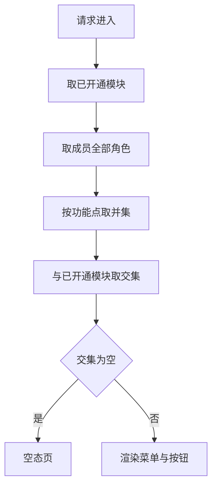
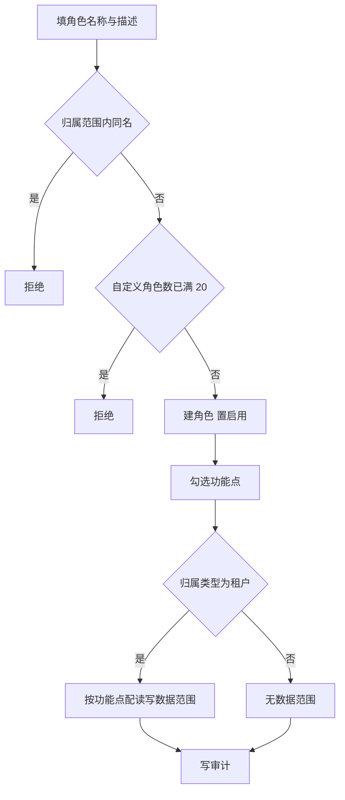
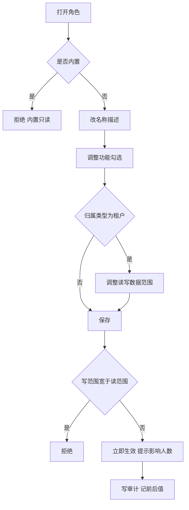
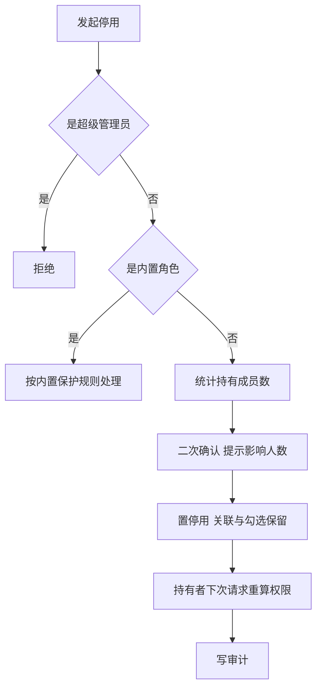
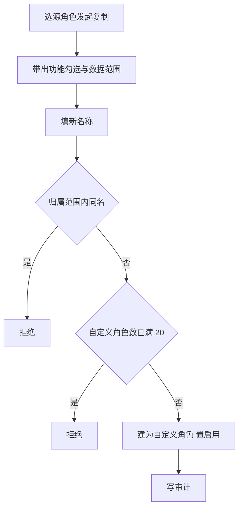
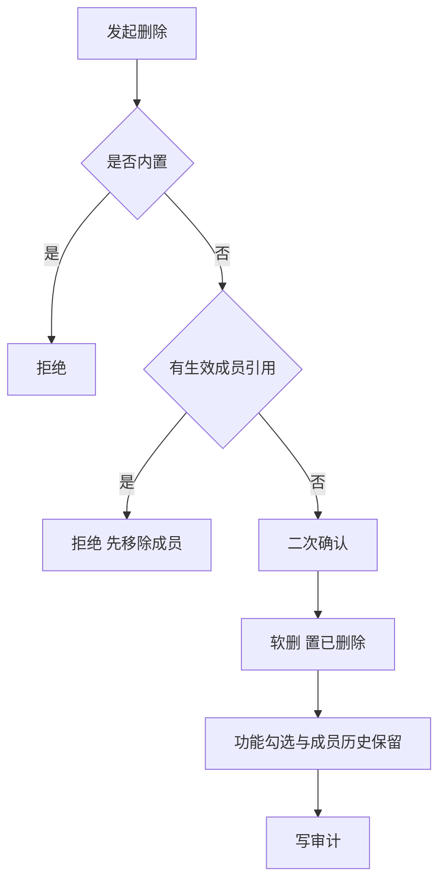
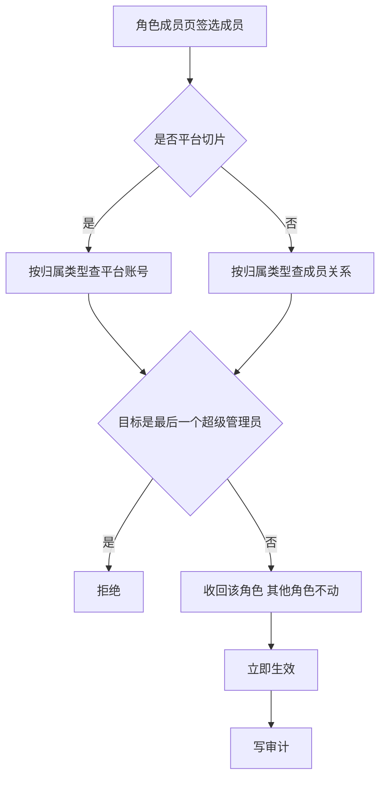

# 角色管理业务 PRD

## 0. 文档基础信息

| 项目 | 内容 |
| :--- | :--- |
| 文档名称 | 角色管理业务 PRD |
| 版本 | V0.4 |
| 状态 | 草稿 |
| 模块名称 | 角色管理（平台后台：平台角色管理；租户端：角色管理） |
| 所属层级 | 平台后台 → 平台角色管理（只展示平台角色）；租户端 → 角色管理（只展示本租户角色） |
| 依据 | 产品碳足迹核算工具-用户体系 PRD（精简版）v3.5.1 §5.3、§5.7、§3.1、§3.2；租户管理业务 PRD V0.9 §1.4、§4.17（角色隔离与租户管理员角色初始化） |
| 范围边界 | 只做角色管理，数据上按归属类型分平台、租户两个切片，**页面入口分设且各看各的**：平台后台「平台角色管理」只列出平台角色（无租户切片 Tab），租户端「角色管理」只列出本租户角色。不涉及账号本身（平台账号 PRD 覆盖）、租户成员与成员关系（成员管理，后续覆盖）、功能目录维护（功能管理 PRD 覆盖）、部门维护（部门管理，后续覆盖）、租户模块授权与开户时的角色初始化触发（租户管理覆盖，本模块只定义被创建角色的口径）。数据范围只定义配置与生效规则，业务表三字段由各业务模块落实 |
| 更新时间 | 2026-10-23 |

**变更记录**

| 日期 | 版本 | 变更内容 |
| :--- | :--- | :--- |
| 2026-10-23 | V0.4 | **内置角色收敛**：平台切片内置角色由 4 个（超级管理员、租户运营、财务、客服）收敛为 2 个（超级管理员、平台运营人员）；租户切片内置角色由 3 个（租户管理员、核算员、只读）收敛为 1 个（租户管理员）。其余岗位角色不预置，由超级管理员 / 租户管理员按需新增自定义角色。同步修订 §2、§4.1、§5.1-2、§5.2-4、AC02、AC20、AC28 |
| 2026-10-23 | V0.3 | **平台侧入口改名并去掉租户切片**：平台侧页面定名「平台角色管理」，列表**只展示平台角色**，不再提供归属类型 Tab；租户端「角色管理」只展示本租户角色。新增 §1.6 R6、§4.1 说明、AC28 |
| 2026-10-23 | V0.2 | **角色隔离口径定稿**：平台角色与租户角色完全隔离、不混用；平台角色只给平台人员，不向租户下发；租户角色由租户自建自管、只在租户内生效；新增「租户管理员」角色随租户开户自动创建并默认授予租户全部功能权限的口径。新增 §1.6，修订 §1.2、§5.1、§5.11、E18–E19、AC24–AC27、D12–D14 |
| 2026-10-21 | V0.1 | 初版：输出前置问题、平台与租户两切片功能 PRD 与四张表字段清单 |

**关联链接**

| 文档 | 路径 |
| :--- | :--- |
| 字段清单（字段唯一真相源） | `02prd/02-1后台管理/14 角色管理/角色管理字段清单.md` |
| 用户体系 PRD v3.5.1 | `00业务设计/产品碳足迹核算工具-用户体系v3.0.md` |
| 平台账号业务 PRD | `02prd/02-1后台管理/12 平台账号/平台账号业务PRD.md` |
| 功能管理业务 PRD | `02prd/02-1后台管理/15 功能管理/功能管理业务PRD.md` |

---

## 1. 前置问题

### 1.1 平台角色与租户角色是一张表还是两张

**结论：一张角色表，用归属类型字段区分平台 / 租户两个切片。**

| 对象 | 落表 | 关系 | 说明 |
| :--- | :--- | :--- | :--- |
| 角色 | 角色表，全局 1 份 | 主对象 | 名称、归属类型、状态、内置标记 |
| 平台切片 | 同表，归属类型 = 平台 | 筛选视图 | 只挂平台账号，只给平台端功能，不产生数据范围 |
| 租户切片 | 同表，归属类型 = 租户 | 筛选视图 | 属租户数据，带功能勾选与数据范围 |

判断依据：

1. §5.3-1 明确要求「角色表加归属类型字段，取值平台 / 租户，不用租户标识为空推断」。
2. §3.4-8 已将「平台角色、租户角色各做一套功能」合并为一个角色管理，按归属范围区分。
3. §5.3-6 功能码同表、用适用端区分，勾选列表互不出现对方条目——角色侧与功能侧采用同一切分思路。

推论：

1. 归属类型在新建时固定，建后不可改，不提供「转为另一归属类型」的入口。
2. 两切片互不引用：角色不可跨归属复制或指派（§5.3-2）。
3. 平台角色不写租户标识（以固定占位值表达，见字段清单），租户角色必写租户标识。

### 1.2 平台切片与租户切片的边界

| 维度 | 平台切片 | 租户切片 |
| :--- | :--- | :--- |
| 挂载对象 | 平台账号（N:N） | 租户成员关系（N:N） |
| 可选功能 | 仅平台端功能（scope = platform）：基础数据类（产品分类 / 产品信息库 / 工艺流程 / 工序 / 物料库 / 能源库 / 计量单位库 / 生命周期阶段 / 标准文件库 / 行业库 / 核算模型 / 因子库管理）与组织与权限类（租户管理 / 平台账号 / 账号查询 / 平台角色管理 / 菜单管理 / 数据字典） | 仅租户端功能（scope = tenant），不按租户类型过滤 |
| 数据范围 | 无，表单不含数据范围字段（§5.3.1-7） | 有，五档读写各配一档（§5.7.3） |
| 数据归属 | 平台数据，超管可见可管 | 租户数据，超管默认不可见不可改（§5.3-4） |
| 可指派对象 | 平台账号（平台人员），不含任何租户成员 | 本租户成员关系，不含平台账号，不含其他租户成员 |
| 创建与管理方 | 平台侧（持有角色管理功能码的平台角色） | 租户管理员（租户端），平台侧不代建代管 |
| 生效范围 | 平台后台全局 | 仅本租户内，不跨租户复用、不跨租户可见 |
| 成员页签查询对象 | 平台账号（§5.3-7） | 成员关系（§5.3-7） |
| 超管进入租户时 | — | 角色页只读（§5.3-5） |

### 1.3 数据范围为什么只属于租户切片

**结论：平台角色不产生数据范围，数据范围是租户切片的专属配置。**

| 项 | 内容 |
| :--- | :--- |
| 依据 | §5.3-3 平台角色「不产生数据范围」；§5.3.1-7 平台角色表单不含数据范围字段 |
| 租户侧依据 | §5.7.3 五档、读写各配一档、多角色取最宽 |
| 配置粒度 | 按「角色 × 功能点」分别配读范围与写范围（§5.5.3-1 按功能点分列展示） |
| 落地 | 角色与功能关联表上带读、写两个范围字段；指定部门另建表存部门列表 |

### 1.4 成员的有效功能如何计算

**结论：有效功能 = 已开通模块内功能点 ∩ 所持角色勾选功能点，多角色按功能点取并集。**

依据 §5.7.2：模块授权在租户管理（§5.1.4），角色勾选在本模块，两者取交集；多角色并集在前、交集在后。

### 1.5 角色名额与数量约束

| 项 | 规则 | 依据 |
| :--- | :--- | :--- |
| 平台账号持有平台角色数 | 1 至 5 个，至少 1 个 | 平台账号 PRD §5.1、§5.3 |
| 租户成员持有租户角色数 | 1 至 5 个，至少 1 个 | §5.5.1-4 |
| 自定义平台角色数 | 上限 20 个 | §5.3.1-2 |
| 自定义租户角色数 | 每租户上限 20 个 | §5.7.1-4 |
| 多角色权限合并 | 按功能点取并集；数据范围取最宽一档 | §5.3.2-2、§5.7.3-3 |

### 1.6 角色隔离红线与租户管理员角色（V0.2）

**结论：平台角色与租户角色完全隔离、不混用；租户角色由租户自建自管，只在租户内生效；租户的权限起点是开户时自动创建的「租户管理员」角色。**

| # | 口径 | 说明 |
| :--- | :--- | :--- |
| R1 | 完全隔离、不混用 | 两切片互不引用、互不出现对方条目，不可跨归属复制或指派；接口层按归属类型二次校验 |
| R2 | 平台角色只给平台人员 | 平台角色只能挂在平台账号上；租户成员的角色下拉不出现平台角色，平台后台也不得把平台角色指派给成员（租户管理 PRD E33） |
| R3 | 租户角色租户自管 | 租户角色由租户管理员在租户端创建、编辑、复制、停用、删除与指派；平台侧不代建、不代改，超管进入租户时只读（§5.10） |
| R4 | 租户角色只在租户内生效 | 租户角色必写租户标识，只在所属租户的角色列表与成员指派中出现，不跨租户复用、不跨租户可见 |
| R5 | 开户自动初始化 | 平台管理员创建租户并关联主管理员后，系统在该租户内自动创建「租户管理员」角色并分配给该账号，默认勾选租户端全部功能点、数据范围读写均「全部」（租户管理 PRD §4.17） |
| R6 | **两个入口、各看各的** | 平台后台入口定名「平台角色管理」，列表与查询只返回归属类型 = 平台的角色，**不提供归属切换 Tab、不出现租户角色**；租户端入口为「角色管理」，只返回本租户角色。两侧页面都不承载对方切片 |

四条推论：

1. 主管理员的租户权限只来自租户角色；账号是否持有平台角色与其租户内权限无关，二者互不影响。
2. 「租户管理员」是租户内置保护角色：不可删除、不可停用；功能勾选与数据范围可被租户管理员收窄，可复制出自定义角色（§5.1-10）。
3. 「默认拥有租户全部功能权限」只作用于角色勾选侧，实际生效仍为「已开通模块内功能点 ∩ 角色勾选功能点」，不绕过模块授权。
4. 平台侧不再承担租户角色的任何展示：平台管理员要看租户角色须「进入租户」后在其租户端角色管理中查看（只读，§5.10）。

---

## 2. 需求描述

按归属范围维护角色：平台侧内置超级管理员与平台运营人员，其余岗位由超管按需新增；租户侧以租户管理员为唯一起点，按需自建岗位并控功能与数据范围。一个角色管理功能，按归属类型隔离两个切片，替代原平台、租户各做一套的做法。

> 两切片**完全隔离、不混用**：平台角色只授予平台人员，不向租户下发；租户角色由租户管理员在租户端自建自管，只在租户内生效。租户的权限起点为开户时自动创建的「租户管理员」角色，默认拥有租户全部功能权限（§1.6）。

---

## 3. 业务流程

### 3.1 新建角色

### 3.2 编辑角色

### 3.3 停用与启用角色

### 3.4 复制角色

### 3.5 删除角色

### 3.6 移除角色成员

---

## 4. 功能清单

### 4.1 平台切片（平台后台入口：平台角色管理）

> 平台侧页面定名「**平台角色管理**」：列表、查询、新增、复制、授权均只作用于归属类型 = 平台的角色，
> **不提供归属类型切换 Tab，不展示任何租户角色**（§1.6 R6）。租户角色只在租户端「角色管理」维护。

| 角色 | 系统 | 一级模块 | 二级模块 | 业务用例 | 操作功能 | 调整说明 |
| :--- | :--- | :--- | :--- | :--- | :--- | :--- |
| 角色管理操作角色 | 平台后台 | 平台角色管理 | — | 核查岗位 | 查看列表与详情 | 【新增】 |
| 角色管理操作角色 | 平台后台 | 平台角色管理 | — | 按需划分平台岗位职责 | 新建 | 【新增】 |
| 角色管理操作角色 | 平台后台 | 平台角色管理 | — | 配平台功能 | 编辑（含勾选平台功能） | 【新增】 |
| 角色管理操作角色 | 平台后台 | 平台角色管理 | — | 快速建岗 | 复制 | 【新增】 |
| 角色管理操作角色 | 平台后台 | 平台角色管理 | — | 清理岗位 | 删除 | 【新增】 |
| 角色管理操作角色 | 平台后台 | 平台角色管理 | — | 临时冻结岗位 | 停用 | 【新增】 |
| 角色管理操作角色 | 平台后台 | 平台角色管理 | — | 恢复岗位 | 启用 | 【新增】 |
| 角色管理操作角色 | 平台后台 | 平台角色管理 | — | 核查持有人 | 查看成员 | 【新增】 |
| 角色管理操作角色 | 平台后台 | 平台角色管理 | — | 回收权限 | 移除成员 | 【新增】 |

> 「角色管理操作角色」指持有「平台角色管理」功能的平台角色，角色定义见 §5.3，本文不重写。
> 用户体系 §3.1 操作功能未列「停用 / 启用」，但 §5.3.1-5 以停用能力为保护前提，本文按具备该能力设计，口径见 §9 D08。
> 平台切片表单不含数据范围字段，勾选树只出现平台端功能。

### 4.2 租户切片

| 角色 | 系统 | 一级模块 | 二级模块 | 业务用例 | 操作功能 | 调整说明 |
| :--- | :--- | :--- | :--- | :--- | :--- | :--- |
| 租户管理员 | 租户端 | 角色管理 | — | 核查岗位 | 查看列表与详情 | 【新增】 |
| 租户管理员 | 租户端 | 角色管理 | — | 配岗位 | 新建 | 【新增】 |
| 租户管理员 | 租户端 | 角色管理 | — | 配功能点与数据范围 | 编辑（含勾选功能点与设数据范围） | 【新增】 |
| 租户管理员 | 租户端 | 角色管理 | — | 快速建岗 | 复制 | 【新增】 |
| 租户管理员 | 租户端 | 角色管理 | — | 清理岗位 | 删除 | 【新增】 |
| 租户管理员 | 租户端 | 角色管理 | — | 临时冻结岗位 | 停用 | 【新增】 |
| 租户管理员 | 租户端 | 角色管理 | — | 恢复岗位 | 启用 | 【新增】 |
| 租户管理员 | 租户端 | 角色管理 | — | 核查持有人 | 查看成员 | 【新增】 |
| 租户管理员 | 租户端 | 角色管理 | — | 回收权限 | 移除成员 | 【新增】 |

> 租户侧操作人由「角色管理」功能点与数据范围共同决定，通常为内置租户管理员。
> 租户切片勾选树只出现适用端为租户端的功能（scope = tenant），不按租户类型过滤（菜单不建模适用租户类型，见功能管理 PRD §0.2-4）。

---

## 5. 业务规则

### 5.1 角色配置（公共）

1. 归属类型新建时固定为平台或租户，建后不可改。
2. 平台切片内置 2 个：超级管理员、平台运营人员；租户切片内置 1 个：租户管理员。其余岗位角色不预置，由超级管理员（平台侧）/ 租户管理员（租户侧）按需新增。
3. 内置角色不可改名、不可删，可复制；超级管理员与租户管理员额外不可停用；租户管理员的功能勾选与数据范围允许被租户管理员调整（§5.1-11），其余内置角色全部只读。
4. 自定义角色上限：平台 20 个；每租户 20 个。
5. 角色名归属范围内唯一：平台切片平台内唯一，租户切片租户内唯一。
6. 有生效成员引用时不可删。
7. 删除为软删，记录与功能勾选、成员历史保留，角色名不释放。
8. 改角色立即生效，保存前提示影响成员人数。
9. 角色与功能变更记前后值，写审计。
10. 租户内置角色集随租户创建初始化（租户管理 PRD §4.17）：至少含「租户管理员」，且该角色不可删除、不可停用，可复制。
11. 「租户管理员」角色默认勾选该租户类型的全部租户端功能点，数据范围读写均默认「全部」；创建后可由租户管理员收窄，收窄立即生效并提示影响人数。
12. 租户内置角色只在所属租户内可见与可指派，不跨租户复用、不跨租户查询。
13. 平台角色不可指派给租户成员，租户角色不可指派给平台账号；两侧指派列表只出现本归属的启用角色。
14. 平台侧「平台角色管理」的列表、查询、详情只返回归属类型为平台的角色：租户角色不出现在平台侧任何入口，直接访问租户角色详情时提示「该角色为租户角色，由租户自建自管，不在平台角色管理中展示」（§1.6 R6）。

### 5.2 功能分配（平台切片）

1. 平台功能范围（scope = platform，取自功能目录）：基础数据类（产品分类、产品信息库、工艺流程、工序、物料库、能源库、计量单位库、生命周期阶段、标准文件库、行业库）、模型管理类（核算模型、因子库管理）、组织与权限类（租户管理、平台账号、账号查询、平台角色管理、菜单管理、数据字典）。
2. 系统管理整组仅超级管理员可勾。
3. 勾选树只出现适用端为平台端的功能，按启用状态过滤。
4. 平台运营人员默认覆盖租户管理、平台账号、基础库与模型管理类功能；细分岗位（如财务、客服）不预置角色，由超管按需新增并勾选对应功能，计费类功能码待开通——由功能目录的注册与启停控制，见功能管理 PRD。
5. 一人可挂多个平台角色，按功能取并集。
6. 变更立即生效，持有者被踢下线重取权限。
7. 表单不含数据范围字段。

### 5.3 角色成员（平台切片）

1. 成员页签按归属类型查平台账号。
2. 移除成员即收回该角色，不影响该账号的其他角色。
3. 移除最后一个超级管理员时拒绝。
4. 平台账号持有平台角色数保持 1 至 5 个。
5. 指派的发起入口在平台账号模块（分配平台角色），角色页只查看与移除。

### 5.4 功能权限（租户切片）

1. 有效功能等于已开通模块内功能点与角色勾选功能点的交集。
2. 多角色按功能点分别取并集。
3. 勾选树只出现适用端为租户端的功能（scope = tenant），不按租户类型过滤。
4. 功能目录由后台直接增删改（原型菜单管理，见功能管理 PRD §0.2），租户侧角色的可选功能随之变化。
5. 前后端同一套编码，两侧各自校验。
6. 交集为空时进空态页，不渲染菜单与按钮。

### 5.5 数据权限（租户切片）

1. 五档：全部、本部门及下级、本部门、仅本人、指定部门。
2. 读写各配一档，写范围不宽于读范围。
3. 多角色同一功能点取最宽一档。
4. 仅本人按责任人判定，不按创建人。
5. 成员无部门时按仅本人。
6. 范围条件拼在查询语句，禁止前端过滤。
7. 业务表必备三字段：租户、部门、责任人；由各业务模块落实，本 PRD 只定义注入规则。
8. 租户标识由服务端注入，不接收前端传值。
9. 部门标识存创建时快照。
10. 指定部门存 ID 列表，部门删除后自动移除。
11. 不适用数据范围的功能点不配读写范围，由功能目录的「是否适用数据范围」标记决定。

### 5.6 角色成员（租户切片）

1. 成员页签按归属类型查成员关系。
2. 移除成员即收回该角色，不影响该成员的其他角色。
3. 租户成员持有角色数保持 1 至 5 个。
4. 指派的发起入口在成员管理，角色页只查看与移除。

### 5.7 复制

1. 内置与自定义角色均可复制。
2. 复制携带功能勾选与数据范围配置。
3. 新名称必填，且归属范围内不可同名。
4. 复制出的角色为自定义角色。
5. 不可跨归属复制：平台角色只能复制出平台角色，租户角色只能复制出租户角色。

### 5.8 停用与启用

1. 停用立即生效，持有者下次请求重算权限。
2. 停用不删成员关联与功能勾选，恢复后自动生效。
3. 停用后不可被指派，指派列表只展示启用角色。
4. 超级管理员不可停用。
5. 其余内置角色允许停用，口径见 §9 D08。
6. 启用恢复该角色的全部关联与勾选。

### 5.9 删除

1. 无生效成员引用才可删。
2. 删除为软删，已删除角色不可编辑、不可指派、不可启停。
3. 已删除角色的成员页只读，供审计追溯。
4. 角色名不释放，不可再建同名角色。

### 5.10 超管进入租户

1. 超管进入租户时，角色页只读（§5.3-5）。
2. 不可新建、编辑、复制、删除、停用、启用、移除成员。
3. 进出均写审计，租户侧可见。

### 5.11 通用

1. 两切片互不引用，角色不可跨归属复制或指派。
2. 租户角色的定义、功能勾选、数据范围、成员绑定属租户数据，超管默认不可见不可改（§5.3-4）。
3. 所有写操作记审计，角色与功能变更记前后值。
4. 操作人身份由服务端从会话取，不接收前端传值。
5. 平台角色只授予平台人员，不向租户下发：租户端角色列表与成员指派下拉不出现平台角色，接口层拒绝把平台角色指派给成员关系。
6. 租户角色只在租户内生效：所有查询与写入均带租户标识过滤，跨租户读取、复制、指派一律拒绝。

---

## 6. 异常与拦截

| # | 场景 | 拦截环节 | 系统行为 |
| :--- | :--- | :--- | :--- |
| E01 | 归属范围内已存在同名角色 | 新建 / 编辑 / 复制保存 | 阻断，提示角色名已存在 |
| E02 | 自定义角色数已达 20 | 新建 / 复制保存 | 阻断，提示自定义角色上限 20 个 |
| E03 | 删除有生效成员引用的角色 | 删除提交 | 阻断，提示先移除成员 |
| E04 | 移除最后一个超管的超级管理员角色 | 移除成员提交 | 阻断，提示系统至少保留 1 个超管 |
| E05 | 编辑内置角色 | 进入编辑 | 阻断，内置角色只读，引导走复制 |
| E06 | 停用超级管理员 | 停用提交 | 阻断，提示保护角色不可停用 |
| E07 | 跨归属复制或指派 | 入口 | 不出现对方归属条目，接口层拒绝 |
| E08 | 勾选停用或失效功能 | 编辑保存 | 阻断，勾选树不展示非启用功能 |
| E09 | 写范围宽于读范围 | 编辑保存 | 阻断，提示写范围不得宽于读范围 |
| E10 | 指定部门已被删除 | 编辑保存 / 部门删除时 | 自动移除该部门引用并提示，不阻断保存 |
| E11 | 成员角色数超 5 个 | 指派保存（账号 / 成员模块） | 阻断，提示上限 5 个 |
| E12 | 无「角色管理」功能码 | 进入菜单 | 阻断，菜单不渲染、接口拒绝 |
| E13 | 租户管理员操作平台切片 | 列表加载 | 只出现租户切片，接口层按归属类型拒绝 |
| E14 | 超管进入租户时写角色 | 保存提交 | 阻断，提示当前为只读模式 |
| E15 | 非超级管理员勾选系统管理组功能 | 编辑保存 | 阻断，提示该组仅超级管理员可勾 |
| E16 | 角色被他人先改 | 保存提交 | 乐观锁失败，提示刷新后重试 |
| E17 | 打开已删除角色详情 | 详情页 | 可查看，所有操作不可用 |
| E18 | 把平台角色指派给租户成员，或把租户角色指派给平台账号 | 指派保存（成员 / 账号模块） | 阻断，提示平台角色只授予平台人员、租户角色只在租户内生效，二者不可混用 |
| E19 | 删除或停用租户「租户管理员」角色 | 删除 / 停用提交 | 阻断，提示该角色为租户内置保护角色 |

---

## 7. 验收标准

### 7.1 新建与编辑角色

| # | Given | When | Then |
| :--- | :--- | :--- | :--- |
| AC01 | 平台切片已登录，名称未占用 | 新建平台角色并勾选 1 个平台功能 | 创建成功，状态为启用，出现在平台角色列表 |
| AC02 | 平台切片已有角色 `平台运营人员` | 再建同名角色 | 阻断，提示角色名已存在 |
| AC03 | 新建表单未勾选任何功能 | 提交 | 阻断，提示至少勾选 1 个功能 |
| AC04 | 平台切片自定义角色已有 20 个 | 再建自定义角色 | 阻断，提示上限 20 个 |
| AC05 | 打开内置角色「超级管理员」 | 尝试改名称或勾选 | 全部只读，提供复制入口 |
| AC06 | 租户切片新建角色，写范围选「全部」、读范围选「本部门」 | 提交 | 阻断，提示写范围不得宽于读范围 |
| AC07 | 编辑租户角色并保存 | 查看审计日志 | 存在 1 条记录，含功能勾选与数据范围前后值 |

### 7.2 功能与数据范围（租户切片）

| # | Given | When | Then |
| :--- | :--- | :--- | :--- |
| AC08 | 租户类型为政府单位 | 打开角色功能勾选树 | 只出现适用政府单位的租户端功能 |
| AC09 | 给角色勾选功能点并配「指定部门」2 个 | 保存后查看该功能点数据范围 | 展示所指定 2 个部门 |
| AC10 | 某功能点被两个角色配置，一为「全部」一为「本部门」 | 查看成员有效权限 | 该功能点取「全部」 |
| AC11 | 成员持有两个角色，功能点 A、B 分别在不同角色勾选 | 进入系统 | 菜单同时出现 A、B 且只出现已开通模块内的 |
| AC12 | 成员所持角色勾选的功能均不在已开通模块内 | 进入系统 | 进空态页，不渲染菜单 |
| AC13 | 成员无部门 | 按「仅本人」档查询业务数据 | 只返回该成员为责任人的数据 |

### 7.3 停用、启用与删除

| # | Given | When | Then |
| :--- | :--- | :--- |
| AC14 | 角色下有 3 个持有成员 | 点击停用 | 确认弹窗提示「3 个成员将受影响」，确认后停用成功 |
| AC15 | 角色已停用 | 持有成员发起请求 | 该角色权限不生效，菜单与按钮相应消失 |
| AC16 | 角色已停用 | 重新启用 | 关联与勾选恢复，成员权限恢复 |
| AC17 | 对超级管理员发起停用 | 提交 | 阻断，提示保护角色不可停用 |
| AC18 | 角色下仍有 1 个生效成员 | 发起删除 | 阻断，提示先移除成员 |
| AC19 | 角色已无成员 | 删除后尝试再建同名角色 | 阻断，名称不释放 |

### 7.4 复制与成员

| # | Given | When | Then |
| :--- | :--- | :--- |
| AC20 | 复制内置角色「租户管理员」 | 提交新名称 | 成功，新角色带出原功能勾选与数据范围，为自定义角色 |
| AC21 | 平台切片已有超管 1 人 | 在角色成员页移除其超级管理员角色 | 阻断，提示至少保留 1 个超管 |
| AC22 | 账号持有 2 个平台角色 | 从角色页移除其中 1 个 | 该角色被收回，另一角色不受影响 |
| AC23 | 超管进入租户 | 打开角色管理页 | 全部只读，无新建 / 编辑 / 删除 / 移除入口 |

### 7.5 角色隔离与租户管理员角色初始化

| # | Given | When | Then |
| :--- | :--- | :--- | :--- |
| AC24 | 租户端成员配角色 | 打开角色下拉 | 只出现本租户启用状态的租户角色，不出现任何平台角色 |
| AC25 | 平台后台为平台账号分配角色 | 打开角色下拉 | 只出现启用状态的平台角色，不出现任何租户角色 |
| AC26 | 新租户已由平台管理员开户并关联主管理员 | 打开该租户角色管理页 | 存在内置角色「租户管理员」，创建人为系统（开户初始化），功能点为租户端全选、数据范围读写均为「全部」；主管理员成员关系持有该角色 |
| AC27 | 租户管理员发起删除或停用「租户管理员」角色 | 提交 | 阻断，提示该角色为租户内置保护角色；复制入口仍可用 |
| AC28 | 平台管理员打开「平台角色管理」 | 进入列表 | 只列出平台角色（内置超管 / 平台运营人员，及超管新增的自定义平台角色），无归属类型切换 Tab，不出现任何租户角色 |
| AC29 | 平台管理员直接访问某租户角色的详情地址 | 打开详情 | 提示该角色为租户角色、由租户自建自管，不在平台角色管理中展示 |

---

## 8. 状态与操作矩阵

### 8.1 角色状态矩阵

| 状态 | 可查看 | 可编辑 | 可复制 | 可停用 | 可启用 | 可删除 | 可查看成员 | 可移除成员 | 可被指派 |
| :--- | :---: | :---: | :---: | :---: | :---: | :---: | :---: | :---: | :---: |
| 启用 | 是 | 是（非内置） | 是 | 是（非超管） | 否 | 是（无生效引用） | 是 | 是 | 是 |
| 停用 | 是 | 是（非内置） | 是 | 否 | 是 | 是（无生效引用） | 是 | 是 | 否 |
| 已删除 | 是 | 否 | 否 | 否 | 否 | 否 | 是（只读） | 否 | 否 |

### 8.2 成员引用约束

| 项 | 规则 |
| :--- | :--- |
| 平台账号角色数 | 1 至 5 个，至少 1 个；移除最后一个时阻断 |
| 租户成员角色数 | 1 至 5 个，至少 1 个；移除最后一个时阻断 |
| 超级管理员保护 | 不可移除最后一个超管的超级管理员角色关联 |
| 停用角色 | 引用保留，权限暂失效；恢复后自动生效 |

---

## 9. 设计决策

| 编号 | 事项 | 决议 | 落点 |
| :--- | :--- | :--- | :--- |
| D01 | 表结构 | 一张角色表 + 归属类型字段，平台与租户两切片共用，不拆表 | §1.1 |
| D02 | 归属类型 | 新建时固定不可改，不提供转换入口 | §5.1-1 |
| D03 | 隔离边界 | 两切片互不引用，不可跨归属复制或指派；租户数据超管默认不可见不可改 | §5.11 |
| D04 | 数据范围粒度 | 按「角色 × 功能点」配读写两档，指定部门另建表存 ID 列表 | §5.5 |
| D05 | 角色编码 | **原型修订**：角色增加稳定标识 `code`（全局唯一，系统生成 `ROLE + 序号`；内置角色固定为语义常量，如 `SUPER_ADMIN` / `TENANT_ADMIN`）；内置角色既可用 `code` 也可按 `name` 识别 | §5.1-3、字段清单 §1 code |
| D05b | 超级管理员 / 保护角色属性 | 原型在 `is_builtin` 之外另设 `super_admin` 与 `protected_role` 两个独立布尔属性，与 `is_builtin` 正交：超级管理员（`SUPER_ADMIN`）`super_admin = true` 且不可停用；租户管理员等租户内置角色 `protected_role = true`（不可删、不可停用，但功能勾选与数据范围可被收窄）；其余内置角色仅 `is_builtin = true` 可停用 | §1.6 R4–R5、E19 |
| D06 | 角色状态 | 设启用 / 停用 / 已删除三态；停用不删关联，恢复自动生效 | §5.8 |
| D07 | 删除语义 | 软删，名称不释放，成员历史保留供审计 | §5.9 |
| D08 | 内置角色停用口径 | 原文仅明确超级管理员不可停用；本期按「超级管理员不可停用、其余内置角色可停用」执行，待产品最终确认 | §5.8-5 |
| D09 | 角色删除后名称 | 不释放，唯一索引不排除已删除行，与平台账号注销口径一致 | §5.9-4 |
| D10 | 停用 / 启用功能点 | 用户体系 §3.1 / §3.2 未列，按 §5.3.1-5 保护前提补齐，列入功能清单 | §4 |
| D11 | 成员角色上限 | 平台账号与租户成员均 1 至 5 个，与原文两处口径取一致 | §1.5 |
| D12 | **角色完全隔离** | 平台角色与租户角色完全隔离、不混用：平台角色只给平台人员，租户角色由租户自建自管且只在租户内生效；跨归属复制、指派在接口层拒绝 | §1.6、§5.11、E18 |
| D13 | **租户管理员角色初始化** | 租户创建并关联主管理员后，系统在该租户内自动创建「租户管理员」角色并分配给该账号，默认勾选租户端全部功能点、数据范围读写均「全部」；触发与审计口径在租户管理 PRD §4.17，本模块只定义角色侧口径 | §1.6、§5.1-10/11、AC26 |
| D14 | 租户管理员角色的保护与可调 | 租户内置、不可删除、不可停用（避免租户陷入无管理员状态）；功能勾选与数据范围可由租户管理员收窄，可复制。与平台侧「超级管理员不可停用」同构，收窄兜底见租户管理 PRD T14 | §5.1-10、E19、AC27 |
