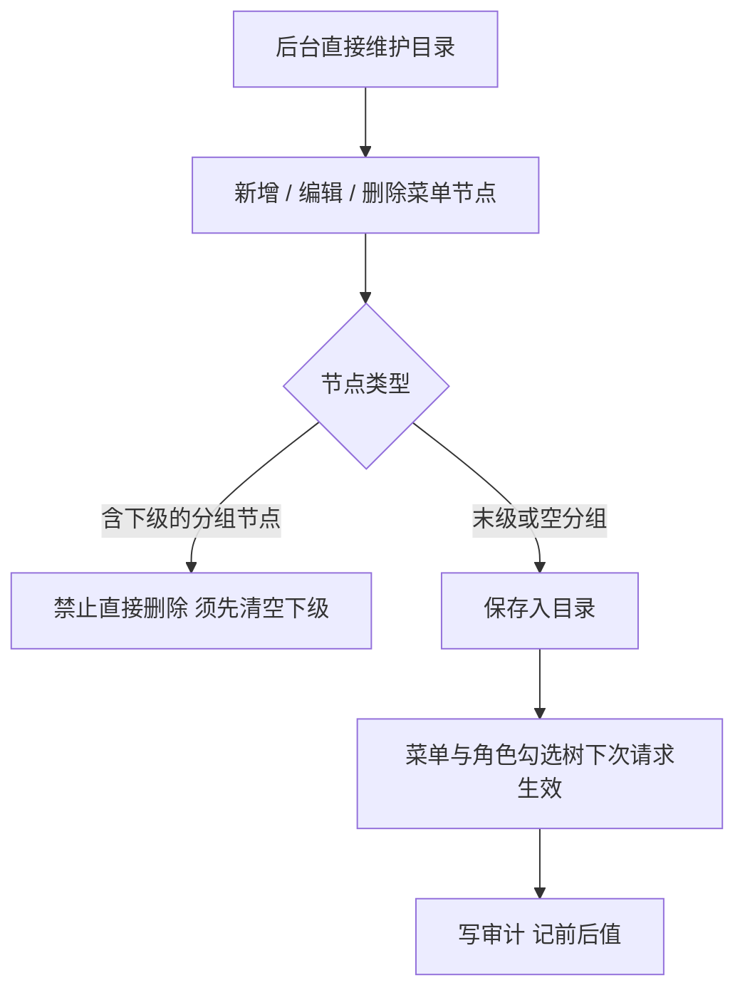
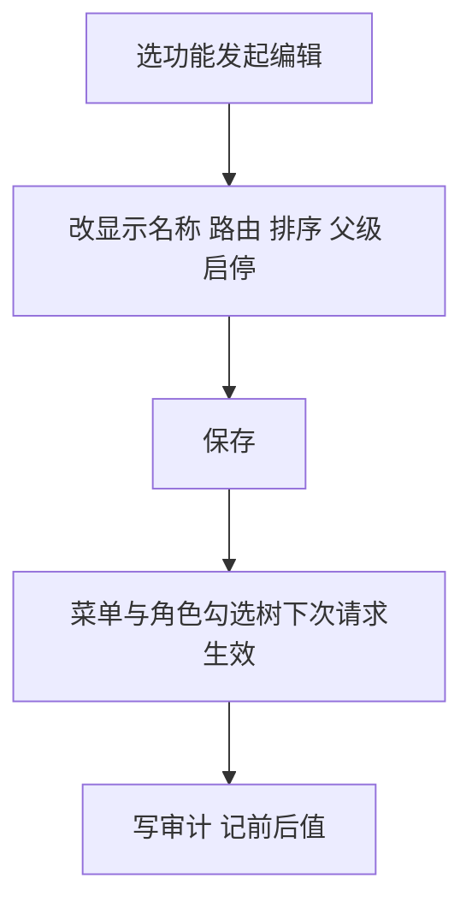
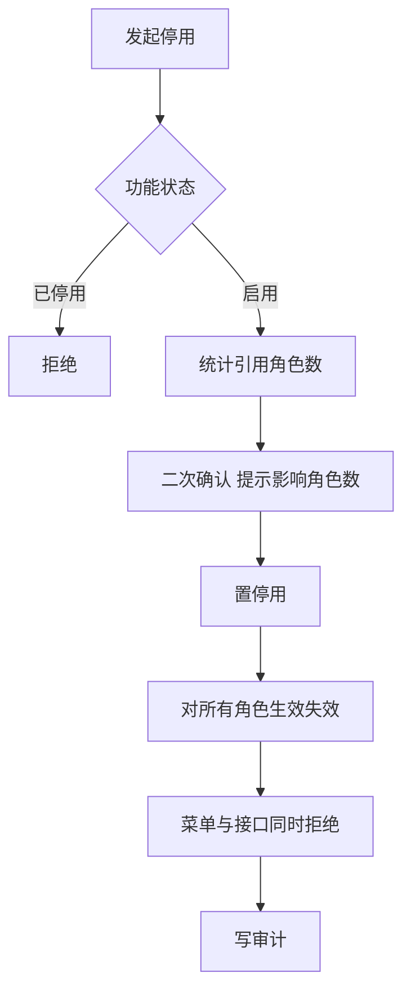
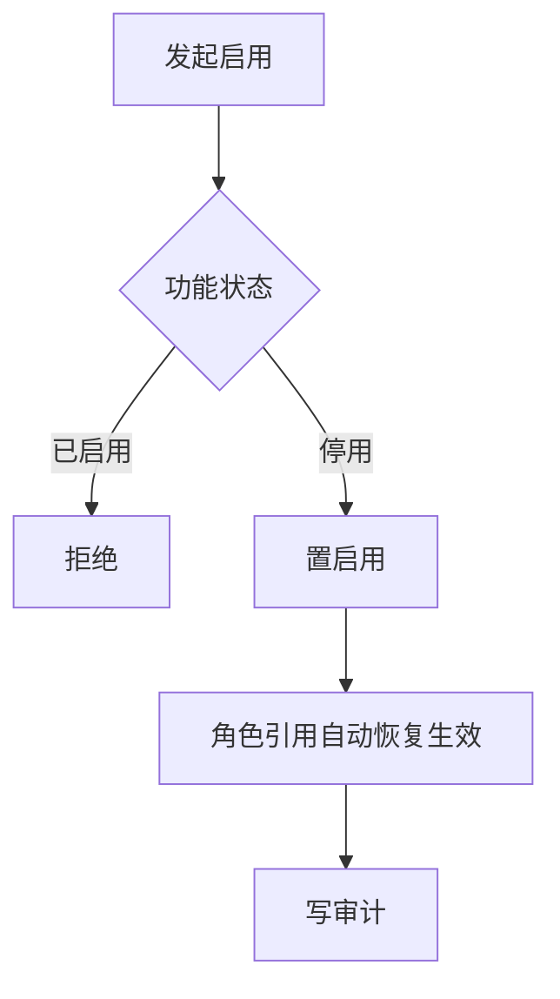

# 功能管理业务 PRD

## 0. 文档基础信息

| 项目 | 内容 |
| :--- | :--- |
| 文档名称 | 功能管理业务 PRD |
| 版本 | V0.1 |
| 状态 | 草稿 |
| 模块名称 | 功能管理 |
| 所属层级 | 平台后台 → 系统管理 → 功能管理 |
| 依据 | 产品碳足迹核算工具-用户体系 PRD（精简版）v3.5.1 §5.4.1、§5.3.2、§3.1 |
| 范围边界 | 只做全站功能目录维护，平台侧使用。不做角色勾选（角色管理 PRD 覆盖）、不做租户模块授权（租户管理覆盖）。**原型已支持后台直接增删改查菜单（含租户侧新建），不再限定「仅代码注册同步」**；不涉及系统参数（§5.4.2） |
| 更新时间 | 2026-10-23 |

**变更记录**

| 日期 | 版本 | 变更内容 |
| :--- | :--- | :--- |
| 2026-10-21 | V0.1 | 初版：原「功能码目录」按产品口径更名为「功能管理」，定位为平台侧功能菜单配置，输出功能 PRD 与两张表字段清单 |
| 2026-10-23 | V0.2 | **对齐原型（菜单树模型）**：取消「功能由代码注册、发布同步、后台不新建」与「适用租户类型」「是否适用数据范围」「失效态」「同步日志」口径；菜单改为树形目录（parent_id / route / scope 两态），后台直接增删改查（见 §0.2）；字段清单同步修订 |

**关联链接**

| 文档 | 路径 |
| :--- | :--- |
| 字段清单（字段唯一真相源） | `02prd/02-1后台管理/15 功能管理/功能管理字段清单.md` |
| 用户体系 PRD v3.5.1 | `00业务设计/产品碳足迹核算工具-用户体系v3.0.md` |
| 角色管理业务 PRD | `02prd/02-1后台管理/14 角色管理/角色管理业务PRD.md` |

---

## 0.2 原型对齐说明（2026-10-23，以原型为准）

> 原型菜单管理（路由 `/system/menu`，命名「菜单管理」，本期与「功能管理」同模块统一表述）对菜单目录提供**直接增删改查与启停**，平台侧功能随版本注册、租户侧功能可由后台新建。据此对原 PRD 做以下口径修订：

1. **删除「无新建入口 / 仅代码注册同步」**：后台可新建、编辑、删除、启停菜单；含下级菜单的分组节点不可直接删除（§5.2、§6 同步相关条目作废）。
2. **树形目录取代模块/分组**：层级由 `parent_id` + `sort` 表达，`parent_id = 0` 为一级；取消原 `module_code` / `module_name` 固定模块与 `group_name` 二级分组字段。
3. **`scope`（platform / tenant）取代「适用端」编码**：平台/租户同树，端的差异仅由 `scope` 表达，注册确定、后台不可改。
4. **取消「适用租户类型（tenant_types）」与「是否适用数据范围（scope_applicable）」**：原型不按租户类型过滤菜单，数据范围在角色侧处理。
5. **状态收敛为两态**：仅 `enabled`（启用）/ `disabled`（停用），取消原「失效（3）」态及与之相关的编辑/启用拦截（§5.5、§5.6、§6 E03/E04/E06/E08/E09、§7 AC05/AC06/AC09 等作废或改写）。
6. **取消「发布同步 + 同步日志」**：目录变更（新增/编辑/删除/启停）记业务审计日志（记前后值），不建 `sys_function_sync_log`（§3.1、§5.3、§5.8 改写）。

详细字段见「功能管理字段清单 V0.2」。

---

## 1. 前置问题

### 1.1 功能管理管的是什么，与菜单是什么关系

**结论：功能管理维护全站功能目录；目录驱动菜单与按钮渲染。**

| 层 | 对象 | 来源 |
| :--- | :--- | :--- |
| 一级模块 | 系统菜单 | 按产品一级功能划分；后台可增删改（§5.1） |
| 功能 | 菜单项与菜单内按钮 | 平台侧随版本注册写入、租户侧后台新建；后台可改展示属性并可增删 |

依据 §3 功能清单说明：一级模块即系统菜单，操作功能即菜单内按钮。功能管理不新建功能，只配置已注册功能的展示与启停，从而控制平台与租户两端「看到什么菜单、点到什么按钮」。

### 1.2 后台能否新建功能（原型：可以）

**结论（原型为准）：后台可新建菜单 / 功能，平台侧功能随版本注册写入，租户侧功能可由后台直接新建（默认 `scope = tenant`）。**

| 项 | 内容 |
| :--- | :--- |
| 修订 | 原「功能由代码注册、发布时同步，后台不可手工新建」口径作废（见 §0.2-1） |
| 新建入口 | 原型菜单管理提供「新增一级菜单」与节点级「新增下级」：填名称、路由、上级菜单、排序、状态，保存即入目录；表单不含 scope，后台新建的功能由系统固定为租户端（`scope = tenant`） |
| 约束 | `scope`（适用端）注册/新建时确定，后台不可改；含下级菜单的分组节点不可直接删除 |
| 后台能做的 | 新增、改显示名称、改路由、改排序、改父级、启用、停用、删除（见 §5.2） |

### 1.3 适用端（scope）

**结论：平台端与租户端功能同表同树，由 `scope` 区分；原型不按租户类型过滤菜单。**

| 项 | 内容 |
| :--- | :--- |
| 同树区分 | 平台端与租户端功能同处一张目录树，端的差异仅由 `scope`（platform / tenant）表达 |
| 修订 | 原「租户端功能额外带适用租户类型（tenant_types）」口径作废（见 §0.2-4）：租户端功能对全部租户类型开放，按租户类型过滤角色勾选树的能力本期不实现 |
| 谁消费 | 角色管理的功能勾选树按 `scope` 与角色归属类型匹配后展示（角色管理 PRD §5.2、§5.4） |
| 可否后台改 | `scope` 注册/新建时确定，后台不可改；其余字段可改 |

### 1.4 停用一个功能会发生什么

**结论：停用后该功能对所有角色失效，菜单与接口同时拒绝，但不清除角色引用。**

| 环节 | 行为 | 依据 |
| :--- | :--- | :--- |
| 角色引用 | 保留，不删除；功能恢复后引用自动生效 | §5.4.1-4 不停引用，只失效 |
| 菜单 | 下次请求即不再渲染 | §5.4.1-4 |
| 接口 | 同时拒绝，写审计 | §5.4.1-4 |
| 已登录会话 | 不追溯，下次请求生效 | §5.4.2-2 同口径 |
| 停用前 | 二次确认，提示被引用角色数 | §5.1.4-4 同口径（取消模块须提示影响人数） |

### 1.5 谁能用功能管理

**结论：仅超级管理员。**

| 项 | 内容 |
| :--- | :--- |
| 依据 | §5.3.2-1 系统管理整组仅超级管理员可勾 |
| 判定 | 账号持有超级管理员角色且状态为启用 |
| 越权 | 无功能码时菜单不渲染；直接调接口返回无权限并写审计 |

---

## 2. 需求描述

平台侧维护全站功能目录：查看功能树、新增菜单（含子节点）、改显示名称、路由、排序、父级、启用、停用、删除。目录是角色勾选与菜单渲染的唯一数据源，变更即时影响两端权限（原型对目录提供直接增删改查，不再依赖代码注册同步，见 §0.2）。

---

## 3. 业务流程

### 3.1 维护目录（原型：直接增删改查，无注册同步）

> 原型取消「发布自动/手动同步代码注册项」与 `sys_function_sync_log` 同步日志（见 §0.2-6）；平台侧功能随版本注册写入，租户侧功能由后台新建。

### 3.2 编辑功能

### 3.3 停用功能

### 3.4 启用功能

---

## 4. 功能清单

| 角色 | 系统 | 一级模块 | 二级模块 | 业务用例 | 操作功能 | 调整说明 |
| :--- | :--- | :--- | :--- | :--- | :--- | :--- |
| 平台超管 | 平台后台 | 系统管理 | 功能管理 | 维护全站功能菜单 | 查看功能树 | 【调整】原「功能码目录」更名 |
| 平台超管 | 平台后台 | 系统管理 | 功能管理 | 维护全站功能菜单 | 编辑（改名称、排序、分组） | 【调整】 |
| 平台超管 | 平台后台 | 系统管理 | 功能管理 | 下线功能 | 停用 | 【调整】 |
| 平台超管 | 平台后台 | 系统管理 | 功能管理 | 恢复功能 | 启用 | 【调整】 |
| 平台超管 | 平台后台 | 系统管理 | 功能管理 | 维护全站功能菜单 | 新增 / 删除菜单 | 【调整】原型支持后台直接增删（§0.2-1） |

> 功能管理仅超级管理员可用（系统管理整组仅超级管理员可勾，§5.3.2-1）。
> 原型支持后台新增、删除菜单（含子节点）；平台侧功能随版本注册、租户侧功能可后台新建（§0.2-1）。
> 树形展示口径：一级功能 → 二级功能（分组）→ 三级 / 末级功能；末级带路由的节点可进入页面，空路由的分组节点仅作层级；平台端与租户端功能同树展示，端的差异由 scope 表达。
> 停用功能不清除角色引用，恢复后自动生效，口径见 §5.4。

---

## 5. 业务规则

### 5.1 目录结构

1. 目录为树形：由 `parent_id` + `sort` 组织，`parent_id = 0` 为一级节点；一级节点即原「系统菜单」概念，可由后台维护（含新建）。
2. 功能即菜单项与菜单内按钮，一条目录记录对应一个功能；末级且带 `route` 的节点可进入页面，空 `route` 的分组节点仅作层级。
3. 平台端与租户端功能同树，由 `scope`（platform / tenant）区分，不拆表、不按模块拆。
4. 原型不按租户类型过滤菜单（原 `tenant_types` 口径作废）；租户端功能对全部租户类型开放。

### 5.2 可改与不可改

1. 后台可改：显示名称、路由（`route`）、排序（`sort`）、父级（`parent_id`）、启用 / 停用（`status`）、删除（不含下级的分组节点）。
2. 后台不可改：`scope`（适用端），注册 / 新建时确定。
3. 变更（新增 / 编辑 / 删除 / 启停）记前后值，写审计。

### 5.3 目录维护（取代原「同步代码注册项」）

1. 平台侧功能随版本注册写入目录；租户侧功能可由后台新建（默认 `scope = tenant`）。
2. 目录变更（新增 / 编辑 / 删除 / 启停）记业务审计日志（记前后值），不建 `sys_function_sync_log`。
3. 含下级菜单的分组节点不可直接删除，须先清空下级。
4. 原「发布自动 / 手动同步代码注册项、失效态、同步日志」口径作废（见 §0.2-5、§0.2-6）。

### 5.4 停用

1. 停用前二次确认，提示被引用角色数。
2. 停用后该功能对所有角色生效失效，菜单与接口同时拒绝。
3. 停用不清除角色引用记录，功能恢复后引用自动生效。
4. 已登录会话不追溯，下次请求即失效。
5. 停用后不可被角色勾选，勾选树只展示启用功能。

### 5.5 启用

1. 启用停用（`disabled`）状态的功能，角色引用自动恢复。

### 5.6 状态两态说明（原型取消「失效」态）

> 原「失效（3）」态（代码已删残留）作废（见 §0.2-5）。目录仅 `enabled` / `disabled` 两态；下线的菜单由 `disabled` 表达或直接删除（`deleteMenu`），不存在不可编辑、不可启停的残留态。原 §5.5「失效状态不可启用」、§6 E03/E04、§7 AC05/AC11 等与之相关条目一并作废。

### 5.7 过滤与展示

1. 功能树为单一目录树整体展示：一级功能 → 二级功能（分组）→ 三级 / 末级功能，按层级缩进；平台端与租户端功能同树混排，端的差异由 `scope` 字段表达，列表不提供 scope 筛选。
2. 列表支持按功能名称 / 路由关键字与状态筛选；命中节点保留其全部祖先，保证树形结构不被打散。
3. 支持全部展开 / 全部折叠；含下级的节点标识「分组 · N」。

### 5.8 审计

1. 目录变更（新增、编辑、删除、启停）全部记业务审计（记前后值），只增不改不删。
2. 角色与模块相关的变更记前后值。
3. 取消独立的同步日志（§0.2-6）；审计覆盖目录变更事件。

### 5.9 通用

1. 操作人身份由服务端从会话取，不接收前端传值。
2. 仅超级管理员可进入本模块，越权访问菜单不渲染、接口拒绝。
3. 功能目录是角色勾选与菜单渲染的唯一数据源，任何变更即时影响两端。

---

## 6. 异常与拦截

| # | 场景 | 拦截环节 | 系统行为 |
| :--- | :--- | :--- | :--- |
| E01 | 无「功能管理」功能码 | 进入菜单 | 阻断，菜单不渲染、接口拒绝 |
| E02 | 非超级管理员访问功能管理 | 进入菜单 / 调接口 | 阻断，返回无权限，写审计 |
| E03 | 修改不可改字段（scope 适用端） | 编辑保存 | 阻断，字段只读；接口层同样拒绝 |
| E04 | 删除含下级菜单的分组节点 | 删除提交 | 阻断，提示须先清空下级节点 |
| E05 | 停用被 N 个角色引用的功能 | 停用提交 | 二次确认，提示 N 个角色将失效，确认后执行 |
| E06 | 功能被他人先改 | 编辑保存 | 乐观锁失败，提示刷新后重试 |

> 原 E03「编辑失效状态」、E04「启用失效状态」、E06「手工新建功能」、E08「同步代码注册表不可达」、E09「重复触发同步」因「失效态 / 同步 / 无新建」口径作废（见 §0.2），已移除。

---

## 7. 验收标准

| # | Given | When | Then |
| :--- | :--- | :--- | :--- |
| AC01 | 超管已登录 | 打开功能管理 | 功能树以单一目录树展示（一级 → 二级分组 → 三级 / 末级），平台端与租户端功能同树，scope 区分适用端 |
| AC02 | 某功能被 3 个角色勾选 | 发起停用 | 确认弹窗提示「3 个角色将受影响」，确认后停用成功 |
| AC03 | 功能已停用 | 持有该功能的成员登录 | 菜单不出现该功能，调用其接口被拒绝 |
| AC04 | 功能已停用 | 重新启用 | 角色引用恢复，成员菜单与接口恢复 |
| AC05 | 超管后台新增一个子菜单 | 保存 | 目录出现该菜单（默认启用），角色勾选树可见 |
| AC06 | 修改功能显示名称与排序 | 保存 | 保存成功，菜单下次请求按新名称新顺序渲染 |
| AC07 | 修改显示名称成功 | 查看审计日志 | 存在 1 条记录，含名称前值与后值 |
| AC08 | 非超管账号已登录 | 进入系统管理菜单 | 功能管理入口不渲染；直接调接口返回无权限 |
| AC09 | 删除含下级的分组节点 | 提交 | 阻断，提示须先清空下级节点 |

---

## 8. 状态与操作矩阵

| 状态 | 可查看 | 可编辑 | 可停用 | 可启用 | 可被角色勾选 | 菜单渲染 | 接口放行 |
| :--- | :---: | :---: | :---: | :---: | :---: | :---: | :---: |
| 启用 | 是 | 是 | 是 | 否 | 是 | 是 | 是 |
| 停用 | 是 | 是 | 否 | 是 | 否 | 否 | 否 |

> 目录仅两态；原「失效」行随 §0.2-5 作废已移除。

---

## 9. 设计决策

| 编号 | 事项 | 决议 | 落点 |
| :--- | :--- | :--- | :--- |
| D01 | 命名 | 原「功能码目录」更名为「功能管理」，定位为平台侧功能菜单配置，不再使用「功能码」叫法 | §0、§2 |
| D02 | 新建入口 | **原型修订**：后台提供新建（新增一级菜单 / 新增下级），平台侧功能随版本注册写入、租户侧功能后台新建（默认 `scope = tenant`）；原「后台不提供新建」口径作废 | §1.2、§5.3 |
| D03 | 不可改字段 | **原型修订**：仅 `scope`（适用端）注册 / 新建时确定、后台不可改；名称、路由、排序、父级、状态后台可改，可删除 | §5.2 |
| D04 | 停用语义 | 停用不清角色引用，恢复后自动生效；已登录会话不追溯，下次请求失效 | §5.4 |
| D05 | 状态模型 | **原型修订**：目录仅 `enabled` / `disabled` 两态；原「失效（3）」态作废，下线由停用或直接删除表达 | §5.6、§8 |
| D06 | 使用范围 | 平台侧功能，仅超级管理员可用 | §1.5 |
| D07 | 变更留痕 | **原型修订**：不建独立同步日志表；目录变更（新增 / 编辑 / 删除 / 启停）全部记业务审计日志（记前后值） | §5.8 |
| D08 | 数据范围标记 | **原型修订**：菜单不建模「是否适用数据范围」与「适用租户类型」；数据范围与租户类型过滤均在角色授权侧处理 | §5.2、角色管理 PRD §5.4 |
