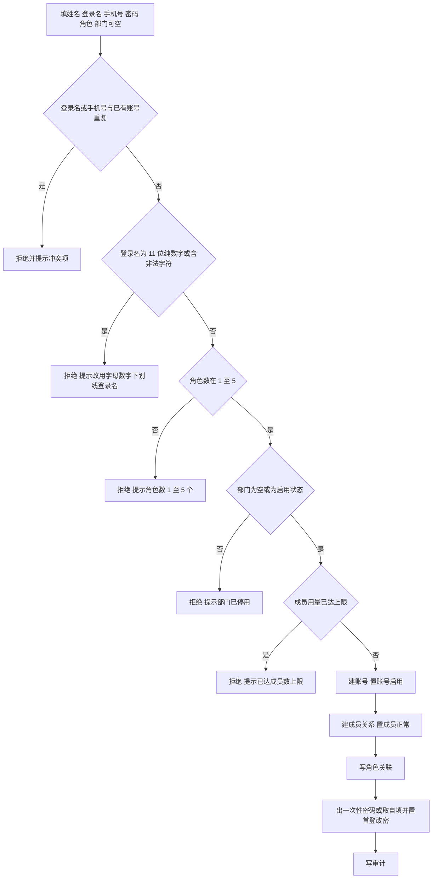
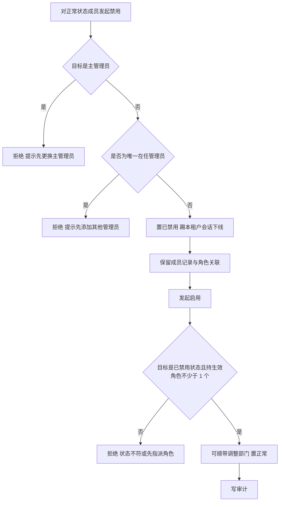
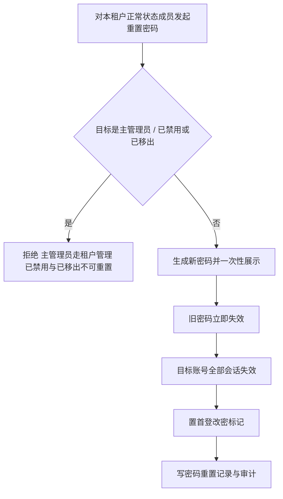

# 成员管理业务 PRD

## 0. 文档基础信息

| 项目 | 内容 |
| :--- | :--- |
| 文档名称 | 成员管理业务 PRD |
| 版本 | V0.3 |
| 状态 | 草稿 |
| 模块名称 | 成员管理 |
| 所属层级 | 租户端 → 成员管理 |
| 依据 | 产品碳足迹核算工具-用户体系 PRD（精简版）v3.5.2 §3.2、§5.5、§5.6、§5.7、§5.8、§5.9；角色管理业务 PRD V0.2 §1.6（角色隔离）、租户管理业务 PRD V0.9 §4.17（租户管理员角色初始化）；《成员管理功能批注》V1.1（本轮「以原型为准」裁决） |
| 范围边界 | 只做租户端成员管理：新建、编辑、禁用 / 启用、重置密码、查看有效权限、查看列表与详情；**关联已有账号、移出（离职）、批量导入本期不实现**（移出收敛为隐藏的高权限终态，常规 UI 不提供入口）。不涉及账号本身（平台账号 PRD 覆盖）、角色定义与 role_member 关联（角色管理 PRD 覆盖）、部门维护（部门管理，后续覆盖）、租户开户与主管理员交接及主管理员密码重置（租户管理 PRD 覆盖）、主动退出租户的入口（个人设置，后续覆盖；其状态变更规则在本模块 §5.9） |
| 更新时间 | 2026-10-26 |

**变更记录**

| 日期 | 版本 | 变更内容 |
| :--- | :--- | :--- |
| 2026-10-26 | V0.3 | **按《成员管理功能批注》V1.1「以原型为准」裁决同步**：① 成员状态术语「启用 / 停用」→「正常 / 已禁用」（账号态、角色态、租户态不变），见 §1.2、§5、§8；② 状态矩阵「已禁用」行：编辑 / 改角色 / 重置密码 / 查看有效权限均改为「否」（仅可启用），见 §5.3、§5.7、§5.8、§8；③ 「关联已有账号」「移出（离职）」标注本期不实现（保留参考口径），见 §3.2、§3.4、§5.2、§5.6、§4、§7；④ 补唯一管理员保护（仅剩 1 名在任管理员禁止禁用），见 §5.4、§6 E07；⑤ 补登录名字符集约束（仅字母 / 数字 / 下划线），见 §5.1、§6 E03；⑥ 补邮箱字段（编辑态、选填、账号级），见 §5.3；⑦ 补姓名长度上限 ≤50，见 §5.1；⑧ 补「启用时可调整部门」，见 §5.5；⑨ 补状态筛选默认「正常」、无「已移出」筛选项，见 §4 |
| 2026-10-23 | V0.2 | **同步角色隔离口径**：成员只能被指派「本租户」的启用租户角色，平台角色不出现在成员侧任何入口（§5.1-9、§5.3-10、§5.10-12/13）；补充主管理员在开户 / 交接时由系统自动获得「租户管理员」角色的引用说明（§5.10-14） |
| 2026-10-21 | V0.1 | 初版：输出前置问题、功能 PRD 与一张表字段清单；批量导入本期不实现，不做模板、上传与结果文件 |

**关联链接**

| 文档 | 路径 |
| :--- | :--- |
| 字段清单（字段唯一真相源） | `02prd/02-1后台管理/16 成员管理/成员管理字段清单.md` |
| 用户体系 PRD v3.5.2 | `00业务设计/产品碳足迹核算工具-用户体系v3.0.md` |
| 平台账号业务 PRD（账号口径，只引用） | `02prd/02-1后台管理/12 平台账号/平台账号业务PRD.md` |
| 平台账号字段清单（account 表，只引用） | `02prd/02-1后台管理/12 平台账号/平台账号字段清单.md` |
| 角色管理业务 PRD（role_member，只引用） | `02prd/02-1后台管理/14 角色管理/角色管理业务PRD.md` |
| 角色管理字段清单（role_member，只引用） | `02prd/02-1后台管理/14 角色管理/角色管理字段清单.md` |
| 租户管理业务 PRD（主管理员交接与重置，只引用） | `02prd/02-1后台管理/13租户管理/租户管理业务PRD.md` |
| 租户管理字段清单（tenant_admin_relation，只引用） | `02prd/02-1后台管理/13租户管理/租户管理字段清单.md` |
| 成员管理功能批注 V1.1（本轮裁决） | `02prd/02-1后台管理/16 成员管理/成员管理功能批注.md` |

---

## 1. 前置问题

### 1.1 成员与账号是什么关系

**结论：账号全局唯一一份，成员是账号在租户上的挂载（成员关系），不另建账号表。**

| 对象 | 落表 | 关系 | 说明 |
| :--- | :--- | :--- | :--- |
| 账号 | 账号表，全局 1 份 | 主对象 | 登录名、手机号、邮箱、密码、账号状态，平台账号字段清单维护 |
| 租户侧身份 | 成员关系表 | N:N | 本模块主对象，关联账号表主键 |
| 角色绑定 | 角色成员关联表 | N:N | 租户角色挂成员关系，角色管理字段清单维护，本模块只触发写入 |

判断依据：

1. §5.9 只有一套登录入口，登录名或手机号二选一，凭证必须唯一，不能按租户复制账号。
2. §5.2.1-1 要求登录名、手机号各自全局唯一——所有账号只有一处存放。
3. §5.5.1-5 要求同账号同租户仅 1 条成员关系、数据库唯一——成员关系是「账号 × 租户」的一行记录，不是账号副本。

推论：

1. 成员没有独立登录凭证，登录名、手机号、姓名、邮箱、密码全部写在账号表；成员表只存租户域属性。
2. 同一账号可同时是多个租户的成员，各租户成员关系互相隔离。
3. 成员管理的新建、编辑最终落两张表：账号表（凭证与姓名、邮箱）加成员关系表（租户域属性），角色另写角色成员关联。

### 1.2 成员状态与账号状态的关系

**结论：两层闸门。账号状态管全系统，成员状态管本租户，登录本租户两者都需有效。**

| 层 | 字段 | 取值 | 作用域 | 归属 |
| :--- | :--- | :--- | :--- | :--- |
| 账号状态 | account.status | 启用 / 停用 / 注销 | 全系统，平台端与租户端同时生效 | 平台账号字段清单 |
| 成员状态 | tenant_member.status | 正常 / 已禁用 / 已移出 | 仅本租户 | 本模块 |

判断依据：

1. §5.5.1-8 停用只作用本租户，不影响他租户——成员状态天然是租户域字段。
2. §5.2.1 账号停用即全站拦截——账号状态天然是全局字段。
3. §5.9 登录校验「账号、成员、租户状态」三项，与两层闸门口径一致。

推论：

1. 放行成员登录本租户 = 账号状态为启用 且 成员状态为正常 且 租户状态为启用。
2. 账号停用或注销时，该账号的全部租户身份同时失效，但成员关系记录保留（§5.5.1-12）。
3. 成员禁用不改账号状态；账号停用也不改任何租户的成员状态。

### 1.3 主管理员在成员管理中的约束

**结论：主管理员是成员标记不是角色（§5.1.3-1），其生效记录在租户管理字段清单的 tenant_admin_relation，本模块按约束执行保护。**

| 项 | 规则 | 依据 |
| :--- | :--- | :--- |
| 识别 | 存在 tenant_admin_relation 中 tenant_id 与 account_id 匹配且 status = 1 的记录 | 租户管理字段清单 §3 |
| 禁用 | 不可禁用 | §5.1.3-2 |
| 移出 | 不可移出（移出本期不实现，规则保留） | §5.1.3-2 |
| 主动退出 | 不可主动退出，须先更换主管理员 | §5.1.3-2、§5.5.1-7 折中，见 §9 D04 |
| 重置密码 | 不可由租户管理员重置，仅超管在租户管理执行 | §5.9-5 |
| 更换 | 入口在平台后台租户管理，本模块只承接降级与移出的结果 | 租户管理 PRD §4.8 |

### 1.4 入职、调岗、离岗、复岗、离职的口径

**结论：本期落地四个操作——入职=新建、调岗=编辑、离岗=禁用、复岗=启用；关联已有账号与离职（移出）本期不实现，不新增状态。**

| 用例（§3.2） | 落点 | 说明 |
| :--- | :--- | :--- |
| 入职 | 新建 | 建账号 + 成员关系并配角色（关联已有账号本期不实现，见 §3.2） |
| 调岗 | 编辑-改部门（启用时亦可调整部门） | 只改成员当前部门，不动历史业务数据快照 |
| 离岗 | 禁用 | 临时冻结本租户身份，可恢复 |
| 复岗 | 启用 | 恢复本租户登录，原角色恢复，可顺带调整部门 |
| 离职 | 移出（本期不实现） | 终态，记录保留，不可登录本租户；收敛为隐藏的高权限终态，见 §3.4 |

### 1.5 成员角色挂载落点

**结论：不新建成员角色关联表，统一走角色管理字段清单的 role_member（member_type = 2 指向成员关系 id）。**

| 项 | 内容 |
| :--- | :--- |
| 写入方 | 本模块的新建、编辑 |
| 读取方 | 登录取权、查看有效权限、角色管理的成员页签 |
| 收回时机 | 移出与主动退出时置 revoked_at；禁用不收回 |
| 数量约束 | 每成员 1 至 5 个，至少 1 个（§5.5.1-4） |

---

## 2. 需求描述

租户管理员维护本租户成员全生命周期：入职建号、调岗改部门、配 1 至 5 个角色、离岗禁用、复岗启用、重置密码、核查有效权限。（关联已有账号、离职移出、批量导入本期不实现。）

---

## 3. 业务流程

### 3.1 新建成员

### 3.2 关联已有账号（本期不实现）

> 本期不实现：原型无「关联已有账号」入口，只提供「新建成员」（建账号 + 成员关系 + 角色）。以下口径留待后续纳入：操作人填手机号 / 部门 / 角色（不填姓名与登录名）→ 按手机号命中已有账号 → 校验该账号在本租户无生效成员关系、角色 1 至 5、部门可用、用量未达上限 → 建成员关系置启用、写角色、立即生效，不建号、不设密码、不改账号任何字段。

### 3.3 禁用与启用

### 3.4 移出（离职）（本期不实现）

> 本期不实现：原型将「移出」收敛为隐藏的高权限终态，常规 UI 不提供入口。以下口径留待后续纳入：对正常 / 已禁用成员发起移出 → 校验非主管理员 → 按业务表责任人字段统计名下业务数据条数 → 二次确认展示条数与只读清单入口（只提示不阻断、不做批量改派）→ 置已移出、记录移出人与时间、收回角色关联（写 revoked_at）、踢会话、保留记录、计入成员数、写审计。

### 3.5 重置密码

---

## 4. 功能清单

| 角色 | 系统 | 一级模块 | 二级模块 | 业务用例 | 操作功能 | 调整说明 |
| :--- | :--- | :--- | :--- | :--- | :--- | :--- |
| 成员管理操作角色 | 租户端 | 成员管理 | — | 核查成员 | 查看列表与详情 | 【新增】 |
| 成员管理操作角色 | 租户端 | 成员管理 | — | 入职 | 新建 | 【新增】 |
| 成员管理操作角色 | 租户端 | 成员管理 | — | 入职 | 关联已有账号 | 【本期不实现】 |
| 成员管理操作角色 | 租户端 | 成员管理 | — | 调岗、改资料、配角色 | 编辑 | 【新增】 |
| 成员管理操作角色 | 租户端 | 成员管理 | — | 离岗 | 禁用 | 【新增】 |
| 成员管理操作角色 | 租户端 | 成员管理 | — | 复岗 | 启用 | 【新增】 |
| 成员管理操作角色 | 租户端 | 成员管理 | — | 离职 | 移出 | 【本期不实现】 |
| 成员管理操作角色 | 租户端 | 成员管理 | — | 凭证遗失 | 重置密码 | 【新增】 |
| 成员管理操作角色 | 租户端 | 成员管理 | — | 核查权限 | 查看有效权限 | 【新增】 |

> 「成员管理操作角色」指持有「成员管理」功能码的租户角色，角色定义见用户体系 PRD §5.7，本文不重写。
> 主管理员密码重置不在本模块，由超管在平台后台租户管理执行，见 §5.7。
> 「查看有效权限」仅持成员查看权限的角色可见，仅「正常」态提供入口，每次打开写审计，见 §5.8。
> 主动退出租户的入口在「个人设置」模块（全部成员可用），本模块只定义其状态变更规则，见 §5.9。
> 列表与详情展示：姓名、登录名、手机号、部门、角色、是否主管理员、状态、加入时间。
> 状态筛选：默认「正常」，筛选项为「全部 / 正常 / 已禁用」，无「已移出」独立筛选项；已移出仅在「全部」下可见。
> 关联已有账号、移出（离职）本期不实现，见 §3.2、§3.4。

---

## 5. 业务规则

### 5.1 新建成员

1. 操作人填写姓名、登录名、手机号、密码、角色；部门可空。
2. 系统校验姓名非空且不超过 50 字符。
3. 系统校验登录名非空。
4. 系统校验登录名不为 11 位纯数字，且仅含字母、数字与下划线。
5. 系统校验登录名全局唯一，不区分大小写、去空格、转半角后判重。
6. 系统校验手机号格式正确。
7. 系统校验手机号全局唯一。
8. 系统校验角色数在 1 至 5 之间。
9. 系统校验所选角色均为归属类型为租户、属本租户且状态为启用的角色；平台角色不出现在候选列表，被提交时拒绝。
10. 系统校验部门为空，或部门存在且为启用状态。
11. 系统校验成员用量未达成员数上限。
12. 系统建账号记录并置账号状态为启用。
13. 系统建成员关系记录并置成员状态为正常。
14. 系统写角色关联，成员类型取租户成员关系。
15. 密码可随机生成或由操作人自填。
16. 系统一次性展示密码明文。
17. 系统置首登改密标记。
18. 系统记录创建人与创建时间。
19. 系统写审计。
20. 系统不允许修改登录名。

### 5.2 关联已有账号（本期不实现）

> 本期不实现，原型无入口；参考口径见 §3.2。账号全局唯一、按手机号命中关联的数据模型结论见 §1.1。

### 5.3 编辑成员

1. 操作人修改姓名。
2. 操作人修改手机号。
3. 操作人可修改邮箱（选填，写在账号表、全局生效）。
4. 系统校验手机号格式正确。
5. 系统校验手机号全局唯一。
6. 系统不修改登录名。
7. 操作人修改部门完成调岗。
8. 系统校验部门为空或存在且为启用状态。
9. 操作人增减角色。
10. 系统校验增减后角色总数在 1 至 5 之间。
11. 系统只展示归属类型为租户、且属本租户的启用角色（租户角色只在租户内生效，不跨租户可见）。
12. 角色变更立即生效并刷新该成员会话权限。
13. 改部门不影响该成员已建业务数据上的部门快照。
14. 仅「正常」状态成员可编辑；「已禁用」「已移出」不提供编辑入口（以原型为准）。
15. 系统记录更新人与更新时间。
16. 系统写审计并记变更字段前后值。

> 姓名、手机号、邮箱写在账号表、全局生效，平台后台「平台账号」列表同步可见；登录名不可改、手机号可改，与平台账号 PRD D02 口径一致。
> 邮箱为选填账号级字段：本期仅在编辑态可维护，新建态不收集；`email` 归属 account 表，字段定义见平台账号字段清单，本清单 §1 末注引用。

### 5.4 禁用（离岗）

1. 操作人对「正常」状态成员发起禁用。
2. 系统校验目标不是主管理员。
3. 系统校验目标不是该租户唯一在任管理员：持有「租户管理员」角色且状态为「正常」的成员仅剩 1 名时，禁止禁用该成员，防止租户无管理员。
4. 操作人为本人时系统在确认弹窗提示本人将被禁用，需勾选确认，不阻断。
5. 系统置成员状态为已禁用。
6. 系统踢该成员在本租户的会话下线。
7. 系统保留成员记录与角色关联，不收回角色。
8. 系统不影响该账号在其他租户的成员关系与登录。
9. 已禁用成员计入成员数。
10. 系统写审计。

### 5.5 启用（复岗）

1. 操作人对「已禁用」状态成员发起启用。
2. 系统校验目标持有的生效角色不少于 1 个。
3. 角色为 0 时系统引导先指派角色。
4. 启用时可顺带调整部门（应对调岗），改后不影响历史业务数据部门快照。
5. 系统置成员状态为正常。
6. 系统写审计。

### 5.6 移出（本期不实现）

> 本期不实现，原型将移出收敛为隐藏的高权限终态、常规 UI 不提供入口；参考口径见 §3.4。已移出为终态：记录保留、计入成员数、不可登录本租户、不可再操作。

### 5.7 重置密码

1. 租户管理员对本租户成员发起重置。
2. 系统校验目标不是主管理员。
3. 系统校验目标成员状态为「正常」；「已禁用」「已移出」不提供重置入口。
4. 操作人选择重置方式：随机生成（默认）或自定义密码。
5. 系统校验自定义密码不少于 8 位且含大写、小写、数字、特殊字符中的三类，两次输入一致。
6. 系统生成新密码并一次性展示，关闭弹窗后不可再次查看。
7. 系统使旧密码立即失效。
8. 系统使目标账号全部会话失效，含其他租户会话，密码为账号级凭证。
9. 系统置首登改密标记。
10. 系统写密码重置记录（reset_type = 3，见平台账号字段清单 §3）。
11. 系统写审计。
12. 系统不要求填写重置原因，操作人与时间由记录留痕。
13. 新密码遗失时只允许再次重置，不提供明文找回。
14. 系统不提供登录页自助找回入口（§5.9-5）。

> 主管理员密码重置由超管在平台后台租户管理执行，见租户管理 PRD §4.9。
> 「已禁用」成员不可重置（以原型为准，替代原 AC26）；「已移出」亦不可重置。
> 重置方式与复杂度校验口径同平台账号模块（原型 `MemberResetModal`：随机生成 / 自定义二选一，默认随机）。

### 5.8 查看有效权限

1. 操作人对目标成员查看有效权限。
2. 系统校验操作人持有成员查看权限。
3. 仅「正常」状态成员提供「有效权限」入口；「已禁用」「已移出」不提供（以原型为准）。
4. 系统展示所持角色清单。
5. 系统展示合并功能点数。
6. 系统按功能点分列展示读范围与写范围。
7. 多角色同一功能点按并集与最宽档合并。
8. 有效功能等于已开通模块内功能点与角色勾选功能点的交集。
9. 页面只读，不可编辑。
10. 系统每次打开写审计。

### 5.9 主动退出租户（个人设置联动）

1. 成员本人在个人设置对本租户发起退出。
2. 系统校验目标不是主管理员。
3. 系统二次确认。
4. 系统置成员关系为已移出，记录退出人为本人、退出方式为主动退出。
5. 系统收回该成员的租户角色关联。
6. 系统立即使本人本租户会话失效。
7. 系统保留成员记录，计入成员数。
8. 入口在个人设置模块（后续覆盖），状态变更规则在本模块。
9. 系统写审计。

### 5.10 通用

1. 系统按角色持有校验成员管理功能码。
2. 系统在无功能码时不渲染菜单并拒绝接口。
3. 系统按「账号状态为启用 且 成员状态为正常 且 租户状态为启用」放行成员登录本租户。
4. 系统按成员数上限与当前用量校验新增成员。
5. 成员数口径含主管理员、含已禁用、含已移出；已注销账号的成员关系不计入，与租户管理 PRD D12 一致。
6. 系统不接收前端传入的操作人身份。
7. 系统对所有写操作写审计。
8. 系统不新建账号表，不新建角色成员关联表。
9. 系统在目标状态已被他人变更时阻断本次操作。
10. 账号注销后成员关系记录保留，责任人可追溯（§5.5.1-12）。
11. 系统只在生成时一次性展示密码明文，列表与详情以掩码展示。
12. 系统只为成员指派本租户的租户角色：平台角色既不展示也不接受写入，跨归属指派一律拒绝（角色管理 PRD E18）。
13. 系统不展示、不改动该成员在平台侧的平台角色关联；同一账号的平台角色与租户角色互不影响。
14. 主管理员的「租户管理员」角色由平台开户 / 主管理员交接时系统自动分配（租户管理 PRD §4.17），本模块只展示其结果，不可移除该角色与主管理员身份的绑定。

---

## 6. 异常与拦截

| # | 场景 | 拦截环节 | 系统行为 |
| :--- | :--- | :--- | :--- |
| E01 | 登录名与已有账号重复 | 新建保存 | 阻断，提示登录名已存在 |
| E02 | 手机号与已有账号重复 | 新建 / 编辑保存 | 阻断，提示手机号已存在 |
| E03 | 登录名为 11 位纯数字或含字母 / 数字 / 下划线以外字符 | 新建保存 | 阻断，提示登录名仅支持字母、数字与下划线且不能为 11 位纯数字 |
| E04 | 角色数为 0 或超过 5 个 | 新建 / 编辑保存 | 阻断，提示角色数 1 至 5 个 |
| E05 | 成员用量已达成员数上限 | 新建保存 | 阻断，提示已达成员数上限 |
| E06 | 手机号命中的账号已是本租户生效成员 | 编辑保存 | 阻断，提示已是本租户成员 |
| E07 | 禁用目标为主管理员，或为该租户唯一在任管理员 | 禁用提交 | 阻断，主管理员提示先更换；唯一管理员提示先添加其他管理员 |
| E08 | 启用目标持有的生效角色为 0 | 启用提交 | 阻断，提示先指派角色 |
| E09 | 移出目标为主管理员（移出本期不实现，规则保留） | 移出提交 | 阻断，提示先更换主管理员 |
| E10 | 重置目标为主管理员 | 重置提交 | 阻断，提示主管理员由超管在租户管理重置 |
| E11 | 重置目标为「已禁用」或「已移出」状态 | 重置提交 | 阻断，提示该状态成员不可重置 |
| E12 | 编辑手机号格式不正确 | 编辑保存 | 阻断，提示手机号格式有误 |
| E13 | 所选部门已停用 | 新建 / 编辑保存 | 阻断，提示部门已停用 |
| E14 | 无成员管理功能码 | 进入菜单 | 阻断，菜单不渲染、接口拒绝 |
| E15 | 无成员查看权限 | 查看有效权限 | 阻断，页面不渲染、接口拒绝 |
| E16 | 主动退出目标为主管理员 | 个人设置提交 | 阻断，提示须先更换主管理员 |
| E17 | 目标成员状态已被他人变更 | 禁用 / 启用提交 | 阻断，提示状态已变更需刷新 |

---

## 7. 验收标准

### 7.1 新建成员

| # | Given | When | Then |
| :--- | :--- | :--- | :--- |
| AC01 | 租户管理员已登录，登录名与手机号均未被占用 | 提交新建并分配 1 个角色 | 创建成功，成员列表出现该成员，状态为正常 |
| AC02 | 已存在登录名 `ops01` 的账号 | 用登录名 `OPS01` 新建成员 | 阻断，提示登录名已存在 |
| AC03 | 新建表单登录名为 11 位纯数字或含中文 | 提交 | 阻断，提示登录名不能为 11 位纯数字、仅支持字母数字下划线 |
| AC04 | 新建表单未选任何角色 | 提交 | 阻断，提示至少选 1 个角色 |
| AC05 | 成员用量已达成员数上限 | 提交新建 | 阻断，提示已达成员数上限 |
| AC06 | 新建成功并拿到一次性密码 | 该成员首次登录租户端 | 强制进入改密页，改密后方可进入 |

### 7.2 关联已有账号（本期不实现）

> 本期不实现，以下验收项（AC07～AC10）留待后续纳入：手机号命中已有账号且非本租户成员 → 关联成功、不生成新密码、立即生效；命中的账号已是本租户成员 → 阻断；被关联账号同时是其他租户成员 → 原租户关系与登录不受影响；关联成功 → 审计存在关联记录。

### 7.3 编辑与调岗

| # | Given | When | Then |
| :--- | :--- | :--- | :--- |
| AC11 | 目标手机号未被占用 | 修改姓名、手机号与邮箱并保存 | 保存成功，账号字段全局更新 |
| AC12 | 已存在手机号 `13800000000` 的账号 | 把该成员手机号改为它 | 阻断，提示手机号已存在 |
| AC13 | 把成员从甲部门调到乙部门 | 保存后查看该成员名下历史业务数据 | 历史业务数据部门快照不变，新数据按新部门归集 |
| AC14 | 目标成员在线 | 修改其角色并保存 | 权限立即刷新，菜单与按钮按新角色渲染 |
| AC14b | 目标成员为「已禁用」状态 | 查看操作列 | 无「编辑」入口（已禁用不可编辑，以原型为准） |

### 7.4 禁用与启用

| # | Given | When | Then |
| :--- | :--- | :--- | :--- |
| AC15 | 对一名正常状态成员发起禁用 | 确认 | 成功置已禁用，该成员本租户会话立即失效 |
| AC16 | 禁用一名同时属于其他租户的成员 | 确认 | 仅本租户禁用，该账号在其他租户登录不受影响 |
| AC17 | 对主管理员发起禁用 | 提交 | 阻断，提示主管理员不可禁用，须先更换 |
| AC17b | 租户仅剩 1 名在任管理员，对其发起禁用 | 提交 | 阻断，提示先添加其他管理员 |
| AC18 | 对一名已禁用成员发起启用 | 确认 | 成功置正常，可重新登录本租户 |
| AC18b | 对一名已禁用成员发起启用并调整部门 | 确认 | 成功置正常，部门按新选更新，历史业务数据部门快照不变 |
| AC19 | 已禁用成员持有的生效角色已被全部移除 | 发起启用 | 阻断，提示先指派角色 |

### 7.5 移出（本期不实现）

> 本期不实现（原型收敛为隐藏终态、常规 UI 无入口），以下验收项（AC20～AC25）留待后续纳入：打开移出确认弹窗展示名下业务数据条数与只读清单入口、不提供批量改派；确认移出普通成员 → 已移出、收回角色、记录保留且计入成员数；对主管理员移出 → 阻断；移出后本租户拒绝登录、其他租户不受影响、名下数据原样保留可追溯。

### 7.6 重置密码

| # | Given | When | Then |
| :--- | :--- | :--- | :--- |
| AC26 | 一名「已禁用」成员 | 查看操作列 | 无「重置密码」入口（已禁用不可重置，以原型为准） |
| AC27 | 对一名已移出成员发起重置 | 提交 | 阻断，提示已移出成员不可重置 |
| AC28 | 对主管理员发起重置 | 在成员管理页查找入口 | 无入口，须由超管在租户管理重置 |
| AC29 | 目标账号在其他租户在线 | 重置其密码 | 该账号全部会话失效，密码为账号级凭证 |
| AC30 | 重置成功 | 查看密码重置记录与审计日志 | 各存在 1 条，含目标、操作人、时间 |

### 7.7 查看有效权限

| # | Given | When | Then |
| :--- | :--- | :--- | :--- |
| AC31 | 操作人持有成员查看权限 | 打开某「正常」成员有效权限页 | 展示所持角色、合并功能点数、按功能点分列的读写范围，只读 |
| AC32 | 操作人无成员查看权限 | 尝试打开 | 菜单不渲染、接口拒绝 |
| AC33 | 连续两次打开同一成员有效权限页 | 查看审计日志 | 存在 2 条查看记录，含操作人、目标、时间 |
| AC31b | 目标成员为「已禁用」状态 | 查看操作列 | 无「有效权限」入口（已禁用不可查看，以原型为准） |

### 7.8 主动退出租户

| # | Given | When | Then |
| :--- | :--- | :--- | :--- |
| AC34 | 普通成员在个人设置对本租户发起退出 | 二次确认后提交 | 成员关系置已移出，退出人为本人，本租户会话失效 |
| AC35 | 主管理员在个人设置尝试退出 | 提交 | 阻断，提示须先更换主管理员 |

---

## 8. 状态与操作矩阵

| 成员状态 | 可编辑 | 可改角色 | 可禁用 | 可启用 | 可移出 | 可重置密码 | 可查看有效权限 | 可登录本租户 |
| :---: | :---: | :---: | :---: | :---: | :---: | :---: | :---: | :---: |
| 正常 | 是 | 是 | 是 | 否 | 否* | 是 | 是 | 是 |
| 已禁用 | 否 | 否 | 否 | 是 | 否* | 否 | 否 | 否 |
| 已移出 | 否 | 否 | 否 | 否 | 否* | 否 | 否 | 否 |

> *「可移出」列：移出（离职）本期不实现，收敛为隐藏的高权限终态，常规 UI 不提供入口，故三态均记为「否」；规则保留待后续纳入（见 §3.4）。
> 主管理员额外受限：不可禁用、不可移出、不可主动退出、密码不可由租户管理员重置，见 §9 D04、D08。
> 唯一在任管理员额外受限：不可禁用（见 §5.4-3、§6 E07）。
> 账号状态为停用或注销时，成员侧一切操作以账号表为准；账号停用不阻断成员编辑（与平台账号口径一致），账号注销不删成员记录。
> 「可登录本租户」还要求账号状态为启用且租户状态为启用，见 §5.10-3。

---

## 9. 设计决策

| 编号 | 事项 | 决议 | 落点 |
| :--- | :--- | :--- | :--- |
| D01 | 账号存储 | 账号全局唯一一份，成员是账号在租户上的挂载，不另建账号表 | §1.1 |
| D02 | 状态分层 | 账号状态管全系统，成员状态管本租户，登录本租户两者均需有效 | §1.2、§5.10 |
| D03 | 登录名、手机号可否编辑 | 登录名不可改；手机号可改，须校验格式与全局唯一，与平台账号 PRD D02 一致 | §5.3 |
| D04 | 主管理员保护 | 不可禁用、不可移出、不可主动退出，须先走更换主管理员 | §1.3、§5.4、§5.9 |
| D05 | 移出时角色处理 | 联动收回 role_member 关联（写 revoked_at），重新加入需重新指派（移出本期不实现，规则保留） | §3.4、§5.6 |
| D06 | 禁用时角色处理 | 不收回角色关联，启用后原角色恢复 | §5.4、§5.5 |
| D07 | 离职数据提示 | 只提示条数与只读清单入口，不批量移交、不改业务数据（本期不实现，规则保留） | §3.4、§5.6 |
| D08 | 主管理员密码重置 | 仅超管可在租户管理执行，本模块不提供入口 | §5.7 |
| D09 | 成员重置密码原因 | 不强制填原因，操作人与时间由记录留痕 | §5.7 |
| D10 | 成员数口径 | 含主管理员、含已禁用、含已移出；已注销账号的成员关系不计入，与租户管理 PRD D12 一致 | §5.10 |
| D11 | 主动退出租户 | 入口在个人设置，状态变更规则在本模块，置已移出并收回角色 | §5.9 |
| D12 | 角色挂载 | 不新建成员角色关联表，走 role_member（member_type = 2） | §1.5 |
| D13 | 启用成员的角色下限 | 启用时须至少 1 个生效角色，与平台账号启用口径对称 | §5.5 |
| D14 | 密码重置记录 | 复用 platform_password_reset_log，新增 reset_type = 3（租户管理员重置），需平台账号字段清单同步 | §5.7、字段清单 §3 |
| D15 | 禁用本人 | 不阻断，确认弹窗提示本人将被禁用，需勾选确认，主管理员可恢复 | §5.4 |
| D16 | 列表与详情展示字段 | 姓名、登录名、手机号、部门、角色、是否主管理员、状态、加入时间 | §4 |
| D17 | 状态术语 | 成员三态为「正常 / 已禁用 / 已移出」（以原型为准）；账号态、角色态、租户态仍为「启用 / 停用」不变 | §1.2、§5、§8 |
| D18 | 唯一管理员保护 | 持有「租户管理员」角色且状态为正常的成员仅剩 1 名时，禁止禁用该成员 | §5.4、§6 E07 |
| D19 | 登录名字符集 | 仅支持字母、数字与下划线，且不能为 11 位纯数字（与平台账号 B15 口径一致） | §5.1、§6 E03 |
| D20 | 邮箱字段 | 选填账号级字段，编辑态可维护、新建态不收集，写在 account 表、平台同步 | §5.3 |
| D21 | 姓名长度 | ≤ 50 字符 | §5.1 |
| D22 | 启用可调整部门 | 启用（复岗）时可顺带改部门，应对调岗，不影响历史快照 | §5.5 |
| D23 | 关联已有账号 / 移出范围 | 本期不实现：关联无入口；移出收敛为隐藏终态，规则保留待后续纳入 | §3.2、§3.4、§5.2、§5.6 |

---

## 10. 待确认问题

| # | 事项 | 说明 |
| :--- | :--- | :--- |
| T01 | 密码重置记录表归属 | 原型维持 `platform_password_reset_log` 表名，以 `reset_type` 区分来源（1 超管重置 / 2 建号初始密码 / 3 租户管理员重置，见平台账号字段清单 V0.10）；**本期不更名**，如后续随表重构评审再统一改为 `password_reset_log` |
| T02 | 移出提示的数据范围 | 「名下业务数据」只读清单覆盖哪些业务表，需与碳核算项目等业务模块对齐；**随移出入口后续纳入时再定**（本期不实现） |
| T03 | 关联通知 | 被关联方是否需站内信或短信通知，上游未提及；**随「关联已有账号」后续纳入时再定**（本期不实现） |
| T04 | 组织架构文档 | 已闭环（2026-10-22）：输出《组织架构业务 PRD》V0.1 与《组织架构字段清单》V0.1（`02prd/02-2前台业务功能/08组织架构/`），模块名统一为「组织架构」，成员 `dept_id` 语义等于 `org_id`；部门停用对存量成员范围的影响以该 PRD §5.4 为准 |
