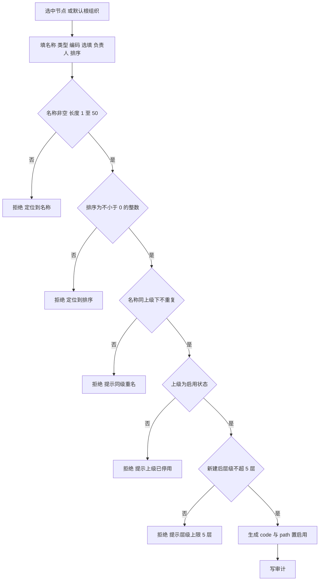
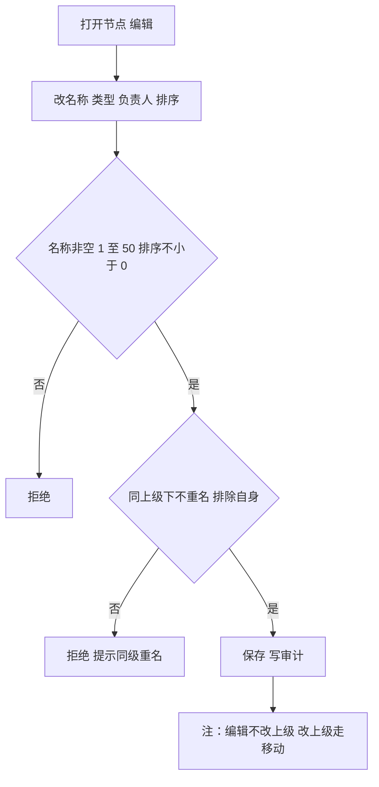
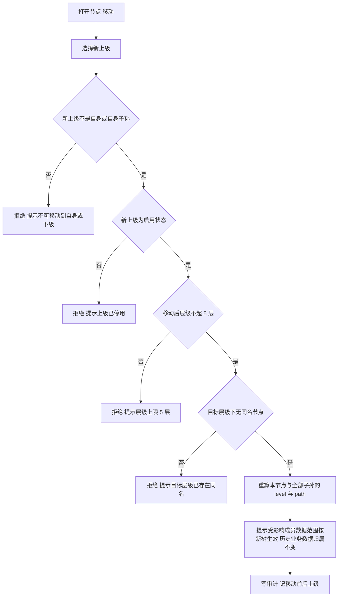
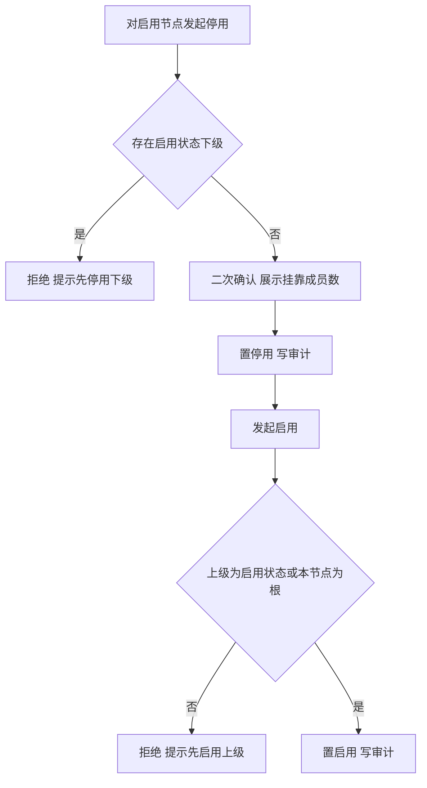
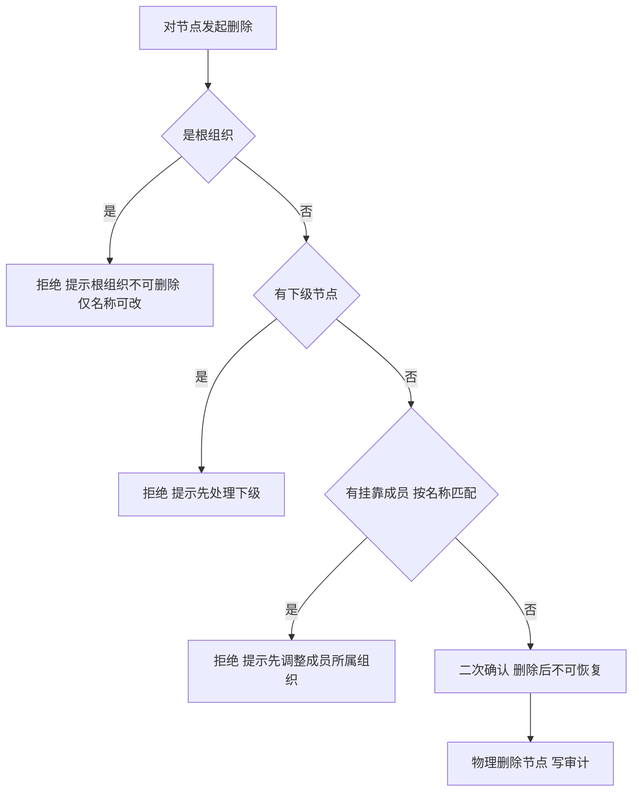

# 组织架构业务 PRD

## 0. 文档基础信息

| 项目 | 内容 |
| :--- | :--- |
| 文档名称 | 组织架构业务 PRD（原型反向生成版） |
| 版本 | V0.1 |
| 状态 | 草稿 |
| 模块名称 | 组织架构 |
| 所属层级 | 租户端 → 组织架构（平台侧不提供跨租户组织树只读查看，代配置须经「进入租户」） |
| 依据 | 原型 `06prototypes/6-1系统原型骨架/src/pages/org/`（TenantOrgPage、OrgNodeModal、orgMeta）、`src/mock/org.ts`、`src/types/index.ts`（OrgNode / OrgNodePayload）；《成员管理业务 PRD》V0.2 §4；《组织架构业务 PRD》V0.2（前向设计，置于 `02prd/02-2前台业务功能/08组织架构/`，本文件为其原型落地镜像，见 §1.4） |
| 范围边界 | 只做租户端组织树维护：查看、新增下级、编辑、移动、启用 / 停用、删除、查看直属成员（只读）。不涉及组织类型字典 CRUD（原型用预置类型下拉，见 §1.3）、成员增删改与角色定义（成员管理 / 角色管理覆盖）、批量导入、组织模板、平台侧只读全景与代配置（前向设计有，原型未实现，见 §1.4） |
| 更新时间 | 2026-10-26 |

**变更记录**

| 日期 | 版本 | 变更内容 |
| :--- | :--- | :--- |
| 2026-10-26 | V0.1 | 初版（原型反向生成）：以 `src/pages/org/` 与 `src/mock/org.ts` 为真相源，输出前置问题、功能 PRD、一张组织节点字段清单；标注与原 `02-2前台业务功能/08组织架构/` 前向 PRD 的差异 |

**关联链接**

| 文档 | 路径 |
| :--- | :--- |
| 字段清单（字段唯一真相源） | `02prd/02-1后台管理/17组织架构/组织架构字段清单.md` |
| 前向设计版业务 PRD（设计态，含多根 / 类型字典 / 模板 / 平台全景 / 代配置） | `02prd/02-2前台业务功能/08组织架构/组织架构业务PRD.md` |
| 成员管理业务 PRD（成员挂靠组织，只引用） | `02prd/02-1后台管理/16 成员管理/成员管理业务PRD.md` |
| 成员管理字段清单（dept_id 语义等于 org.id，只引用） | `02prd/02-1后台管理/16 成员管理/成员管理字段清单.md` |
| 角色管理业务 PRD（数据范围按 org_path 计算，只引用） | `02prd/02-1后台管理/14 角色管理/角色管理业务PRD.md` |
| 租户管理业务 PRD（模块授权 org、根组织随租户开户初始化，只引用） | `02prd/02-1后台管理/13租户管理/租户管理业务PRD.md` |

---

## 1. 前置问题

### 1.1 组织架构与租户的关系

**结论：一个租户有且只有一棵组织树，树根为系统随租户创建自动生成的根组织（名称 = 租户名称），不可删除、不可移动、不可再建同级；其余组织一律挂在根组织或其下级之下。**

| 项 | 原型口径 |
| :--- | :--- |
| 根组织 | `ensureTenantRootOrg(tenantId, tenantName, tenantType)`：租户开户时自动建 1 个根组织，名称取租户名，类型取该租户类型预置字典首项（企业→集团、政府→委办局、机构→总部、园区→园区），`isRoot = true`；已存在则幂等返回 |
| 唯一性 | `getRootOrg` 取本租户唯一根；页面文案「租户内只有一个根组织」「不可再建同级」 |
| 不可删除 / 移动 | 根节点的「删除」「移动」按钮禁用，提示「根组织由系统自动创建，不可删除 / 不可移动，组织名称可改」 |
| 树结构 | 全部节点 `orgId = tenant_id` 隔离，每租户一棵树；`path` 形如 `/ON001/ON002/` |

判断依据：

1. `mock/org.ts` 的 `ensureTenantRootOrg` 与 `getRootOrg` 均基于「每租户一个根」实现，种子数据每租户只 seed 一个 `isRoot` 节点。
2. `TenantOrgPage.tsx` 移动逻辑注释「租户内只有一个根组织，故无『作为根节点』选项」；`OrgNodeModal` 不再支持新建顶级节点（parentId 必填）。
3. 页面 `org-panel-tip` 文案明确「层级上限 5 层；同一上级下名称不可重复；停用节点不可挂新成员，存量成员数据范围不变」。

推论：

1. 原型**不采用**前向 PRD 的「多根节点（parent_id = 0 并列）」方案，统一收敛为单根。
2. 组织节点数不受 5 层上限之外的硬约束；单租户建议不超 500 节点（前向 PRD D15，原型无强制）。
3. 成员 `dept_id` 语义等于 `org.id`，见 §1.2。

### 1.2 「组织架构」与「部门」的关系

**结论：组织节点与成员管理里的「部门」是同一实体，不做两套表。**

| 项 | 口径 |
| :--- | :--- |
| 成员侧字段 | `TenantMemberItem.deptId`（组织节点 id，可空）、`deptName`（组织名称冗余） |
| 父子对应 | 原型按 `deptName === org.name` 匹配组织下的直属成员（见 `TenantOrgPage.memberCounts` / `selectedMembers`） |
| 模块码 | 统一 `org`（orgMeta 注释：「模块码 org，与用户体系 PRD 的『部门』是同一实体」） |

> 原型匹配用「名称相等」，要求组织名称唯一且成员 `deptName` 与组织 `name` 保持一致；字段清单 §6 建议以 `dept_id` 为主键关联，避免改名导致失配。

### 1.3 组织类型在原型中的形态

**结论：原型没有独立的组织类型字典 CRUD，组织类型只是一段来自预置字典的字符串标签（typeName）。**

| 项 | 原型口径 |
| :--- | :--- |
| 预置字典 | `ORG_TYPE_PRESETS` 按租户类型给默认集：企业=[集团,子公司,工厂,车间,部门]、政府=[委办局,处室,科室]、机构=[总部,分支机构,部门]、园区=[园区,片区,企业,部门] |
| 下拉来源 | `orgTypesOf(tenantId, tenantType)` = 预置集 ∪ 本租户已用类型（去重）；编辑 / 新增时从该下拉选 |
| 存储 | 组织节点直接存 `typeName: string`，**不存** `org_type_id` 外键、不存独立字典表 |
| 停用 / 改名 | 无字典行管理；预置类型即选即用，无「停用类型」概念 |

> 与原前向 PRD §5.6（组织类型字典 CRUD + org_type_dict 表）不同，原型把类型简化为标签。如后续需要「类型停用 / 强约束下级类型」，需补 `org_type_dict` 表与 `org_type_id` 外键（见字段清单 §6 T05、本文 §10 T03）。

### 1.4 与原前向 PRD 的差异（务必先读）

`02-2前台业务功能/08组织架构/` 的前向 PRD V0.2 含以下原型**未实现**的能力，本文件仅记录原型已实现项，差异汇总如下：

| # | 前向 PRD 内容 | 原型现状 | 本文件处理 |
| :--- | :--- | :--- | :--- |
| D-01 | 多根节点（parent_id = 0 并列） | 单根（parentId = null，isRoot 唯一） | 以单根为准（§1.1） |
| D-02 | 组织类型字典 CRUD + org_type_dict 表 + org_type_id | 类型只是 `typeName` 字符串标签 | 以标签为准（§1.3） |
| D-03 | 批量导入 | 未实现 | 不纳入，列入§10 T01 |
| D-04 | 组织模板套用 | 未实现（CSS 有弃用样式） | 不纳入，列入§10 T01 |
| D-05 | 平台侧只读全景 / 组织全景导览 | 未实现（orgMeta 注释「原组织架构全景已移除」） | 不纳入，列入§10 T02 |
| D-06 | 平台侧受控代配置（进入租户 + 30 分钟会话） | 未实现 | 不纳入，列入§10 T02 |
| D-07 | 删除前校验「被业务数据归属引用」 | 原型仅校验「有下级 / 有成员」 | 以原型三拦截为准（§5.4）；业务引用校验列入§10 T04 |

> 若需保留前向设计能力，应在原型补齐后再回写本文件；当前本文件仅对原型负责。

---

## 2. 需求描述

租户管理员在租户端维护本租户的组织树：以系统自动生成的根组织为起点，新建下级、编辑、移动、启用 / 停用、删除组织节点，并查看各节点的直属成员（只读）；组织类型从预置字典下拉选择。组织树供成员挂靠、角色数据范围与业务数据归属引用，本模块只负责组织维度本身。

---

## 3. 业务流程

### 3.1 新增下级

### 3.2 编辑

### 3.3 移动

### 3.4 停用与启用

### 3.5 删除

---

## 4. 功能清单

### 4.1 租户端

| 角色 | 系统 | 一级模块 | 二级模块 | 业务用例 | 操作功能 | 调整说明 |
| :--- | :--- | :--- | :--- | :--- | :--- | :--- |
| 租户管理员 / 组织管理员 | 租户端 | 组织架构 | — | 看树 | 查看组织树、查看节点详情 | 【原型已实现】 |
| 租户管理员 / 组织管理员 | 租户端 | 组织架构 | — | 搭架构 | 新增下级、编辑 | 【原型已实现】 |
| 租户管理员 / 组织管理员 | 租户端 | 组织架构 | — | 调整结构 | 移动 | 【原型已实现】 |
| 租户管理员 / 组织管理员 | 租户端 | 组织架构 | — | 生命周期 | 启用 / 停用、删除 | 【原型已实现】 |
| 租户管理员 / 组织管理员 | 租户端 | 组织架构 | — | 看归属 | 查看直属成员（只读） | 【原型已实现；按 deptName 匹配】 |
| 全部成员 | 租户端 | 组织架构 | — | 了解自己 | 查看本人所属组织路径 | 【原型未提供独立入口，本期不实现】 |

> 菜单可见性由租户管理模块授权 `org` 决定；未授权时菜单不渲染、接口拒绝（与原前向 PRD 一致）。
> 组织类型仅为下拉标签，原型无「组织类型字典」独立管理页（见 §1.3）。
> 批量导入、组织模板、平台只读全景、代配置均原型未实现（见 §1.4）。

### 4.2 边界说明

- 不做的（原型未实现）：组织类型字典 CRUD、批量导入、组织模板、平台只读全景、受控代配置、组织合并 / 拆分向导、跨租户组织共享。
- 删除前置仅校验「有下级 / 有成员」两道；前向 PRD「被业务数据引用」第三道校验原型未做，见 §10 T04。

---

## 5. 业务规则

### 5.1 组织树与层级

1. 系统按租户隔离组织树，一个租户一棵树，`orgId`（即 `tenant_id`）贯穿全部节点。
2. 系统确保每租户有且只有一个根组织：`parentId = null`、`isRoot = true`、名称默认 = 租户名称；其余节点一律挂在根或其下级之下。
3. 系统限制节点层级上限为 5 层（原型常量 `ORG_MAX_LEVEL = 5`），第 5 层节点不可再建下级。
4. 系统以 `path` 存储从根到本节点的 ID 路径（形如 `/ON001/ON002/`，含首尾斜杠），用于「含下级」查询与移动校验。
5. 系统以 `level` 存储本节点层级序号（根为 1，逐级加 1）。
6. 系统要求同一上级下组织名称不重复（含根节点之间）。
7. 系统要求组织编码在租户内唯一（大小写不敏感），编码可手填或留空由系统生成（生成后转大写）；创建后可改但保存时判重。
8. 系统按 `sort` 升序排列同级节点；`sort` 为不小于 0 的整数，缺省 1。
9. 组织类型 `typeName` 取本租户可用类型（预置集 ∪ 已用类型），为字符串标签，不约束「该类型下只能挂什么子类型」。

### 5.2 新增下级

1. 操作人选中已有节点（默认根组织）作为上级，点击「新增下级」。
2. 系统校验上级节点处于启用状态；上级为停用时按钮禁用。
3. 操作人填写组织名称（必填）。
4. 操作人选择组织类型（来自类型下拉）。
5. 操作人选填组织编码，不填则系统生成（转大写）。
6. 操作人选填负责人姓名（仅展示，不联动权限）。
7. 操作人填写排序号（默认「同级末位 + 1」，不小于 0）。
8. 系统校验名称非空、长度 1 至 50。
9. 系统校验排序为不小于 0 的整数。
10. 系统校验同一上级下名称不重复。
11. 系统校验组织编码在租户内唯一（不区分大小写）。
12. 系统校验新建后层级不超过 5 层。
13. 系统生成 `path` 与 `level`，置节点为启用状态。
14. 系统写审计，记上级、名称、类型。

### 5.3 编辑

1. 操作人修改组织名称、组织类型、负责人、排序号。
2. 系统校验名称非空且同上级下不重名（排除自身）。
3. 系统校验排序为不小于 0 的整数。
4. 系统校验编码在租户内唯一（排除自身，不区分大小写）。
5. 系统不修改 `parentId`：改上级必须走「移动」操作。
6. 根组织的名称 / 类型 / 负责人 / 排序可改；其余同上。
7. 系统写审计。

### 5.4 移动

1. 操作人发起移动，为目标节点选择新上级（下拉排除自身、自身子孙、停用节点、根组织）。
2. 系统校验新上级不是目标节点自身。
3. 系统校验新上级不是目标节点的子孙节点（以 `path` 前缀判定）。
4. 系统校验新上级处于启用状态。
5. 系统校验移动后目标节点及其子树的最大层级不超过 5 层。
6. 系统校验目标层级下不存在同名节点。
7. 系统在移动成功后重算目标节点与全部子孙节点的 `path` 与 `level`。
8. 系统提示影响：直属成员的数据范围按新树生效，历史业务数据归属不变（原型 `moveConfirm` 文案）。
9. 系统写审计，记移动前后上级与影响。

### 5.5 停用与启用

1. 操作人对启用状态组织发起停用。
2. 系统校验不存在启用状态的下级组织；存在则阻断并提示先停用下级。
3. 系统二次确认并展示挂靠成员数（按名称匹配）。
4. 操作人确认后系统置该节点为停用。
5. 系统禁止向停用节点挂靠新成员（成员管理侧约束）、禁止在其下新建下级。
6. 系统保持存量成员的组织归属不变，其数据范围按原树计算。
7. 操作人对停用状态组织发起启用。
8. 系统校验其上级为启用状态或该节点为根组织；否则阻断并提示先启用上级。
9. 系统置该节点为启用。
10. 系统写审计。

### 5.6 删除

1. 操作人对组织发起删除。
2. 系统校验该节点不是根组织；根组织阻断并提示「根组织由系统自动创建，不可删除，仅可修改组织名称」。
3. 系统校验该节点无下级组织（含已停用节点）。
4. 系统校验该节点无挂靠成员（按 `deptName === org.name` 匹配，含停用成员）。
5. 系统二次确认「删除后不可恢复」。
6. 系统通过全部校验后物理删除节点，写审计，记删除节点的名称、类型、完整路径。
7. 系统不删除任何业务数据；历史业务数据按 `owner_org` 追溯不受影响。

> 原型未实现前向 PRD「被业务数据归属引用」第三道删除拦截（核算项目 / 产品 / 工艺 / 因子 / 活动数据的 `owner_org`），见 §10 T04。

### 5.7 查看直属成员

1. 操作人选中组织节点，右栏展示「直属成员」表（姓名、手机号、角色、成员状态）。
2. 系统按成员 `deptName` 与组织 `name` 相等匹配（见 `TenantOrgPage.selectedMembers`）。
3. 该表只读，成员归属调整在成员管理模块完成。

### 5.8 与其他模块的契约

| 对端 | 契约 | 落点 |
| :--- | :--- | :--- |
| 租户管理 | 模块授权 `org` 决定菜单是否渲染；根组织随租户开户自动初始化 | 租户管理业务 PRD |
| 成员管理 | 成员 `dept_id` 即 `org.id`，可空；为空按「仅本人」；组织停用后不可挂新成员，存量不变 | §5.5、成员管理 PRD §4 |
| 角色管理 | 数据范围「本组织及下级 / 本组织」按 `org_path` 实时计算，不使用快照 | 角色管理 PRD |
| 业务数据 | 核算项目、产品、工艺、工序、因子记录 `owner_org_id`；活动数据、检测、报告继承项目归属 | 整体设计方案 §3.4 |
| 审计日志 | 组织新增、编辑、移动、启用 / 停用、删除全部写审计 | §5 |

### 5.9 通用

1. 系统按角色持有校验组织架构功能码。
2. 系统在无功能码时不渲染菜单并拒绝接口。
3. 系统不接收前端传入的 `tenant_id`，一律按当前会话租户取值。
4. 系统对所有写操作写审计。
5. 系统拒绝任何跨租户的组织节点读写。

---

## 6. 异常与拦截

| # | 场景 | 拦截环节 | 系统行为 |
| :--- | :--- | :--- | :--- |
| E01 | 组织名称为空 | 新建 / 编辑保存 | 阻断，提示名称必填 |
| E02 | 组织名称超过 50 字符 | 新建 / 编辑保存 | 阻断，提示最长 50 字符 |
| E03 | 组织编码在租户内重复（不区分大小写） | 新建 / 编辑保存 | 阻断，提示编码已存在 |
| E04 | 上级组织已停用 | 新增下级 / 移动提交 | 阻断，提示上级已停用 |
| E05 | 新建或移动后层级超过 5 层 | 新增 / 移动提交 | 阻断，提示层级上限 5 层 |
| E06 | 移动目标为自身或自身子孙 / 根组织 | 移动提交 | 阻断，提示不可移动到自身或下级 |
| E07 | 同一上级下组织名称重复 | 新建 / 编辑 / 移动保存 | 阻断，提示同级已存在同名组织 |
| E08 | 停用时尚存在启用下级 | 停用提交 | 阻断，提示先停用下级组织 |
| E09 | 启用时上级为停用状态且非根 | 启用提交 | 阻断，提示先启用上级 |
| E10 | 删除时节点为根组织 | 删除提交 | 阻断，提示根组织不可删除 |
| E11 | 删除时存在下级节点 | 删除提交 | 阻断，提示先处理下级 |
| E12 | 删除时存在挂靠成员 | 删除提交 | 阻断，提示先调整成员所属组织 |
| E13 | 排序不是不小于 0 的整数 | 新建 / 编辑保存 | 阻断，提示排序须为不小于 0 的整数 |

---

## 7. 验收标准

### 7.1 组织树维护

| # | Given | When | Then |
| :--- | :--- | :--- | :--- |
| AC01 | 租户已授权组织架构模块 | 管理员进入组织架构 | 可见组织树，根组织默认存在（名称 = 租户名），不可删不可移 |
| AC02 | 已存在根组织「熊宝家居科技有限公司」 | 在其下新建「核算部」选类型「部门」 | 创建成功，层级 2，path 为 `/根ID/新ID/` |
| AC03 | 同一上级下已有「核算部」 | 再次新建同名节点 | 阻断，提示同级已存在同名组织 |
| AC04 | 节点位于第 5 层 | 在其下新建下级 | 阻断，提示层级上限 5 层 |
| AC05 | 上级组织已停用 | 在其下新建节点 | 阻断，提示上级已停用 |
| AC06 | 组织树有 4 层 | 搜索某一层节点 | 返回该节点并展开其完整祖先路径 |

### 7.2 移动与停用

| # | Given | When | Then |
| :--- | :--- | :--- | :--- |
| AC07 | A 为 B 的上级 | 将 A 移动到 B 下 | 阻断，提示不可移动到下级 |
| AC08 | 「核算部」下有 2 个组、30 名成员 | 将「核算部」移动到「供应链部」下 | 移动成功，工厂与其 2 个组的 level 各变化，提示「30 名成员的数据范围将变化」 |
| AC09 | 「生产部」下有 3 个车间（含启用） | 停用「生产部」 | 阻断，提示先停用下级 |
| AC10 | 「录入组」无下级但有 30 名成员 | 停用「录入组」 | 二次确认展示 30 人，确认后停用；成员归属不变 |
| AC11 | 组织已停用 | 向其挂靠新成员 | 阻断（成员管理侧），提示组织已停用 |

### 7.3 删除保护

| # | Given | When | Then |
| :--- | :--- | :--- | :--- |
| AC12 | 组织有下级 | 删除 | 阻断，提示先处理下级 |
| AC13 | 组织有 1 名停用成员 | 删除 | 阻断，提示先调整成员所属组织 |
| AC14 | 根组织 | 删除 | 阻断，提示根组织不可删除 |
| AC15 | 组织无下级、无成员 | 删除 | 二次确认后物理删除，审计记录完整路径 |

### 7.4 类型与成员展示

| # | Given | When | Then |
| :--- | :--- | :--- | :--- |
| AC16 | 企业租户 | 新增节点打开类型下拉 | 显示 [集团,子公司,工厂,车间,部门] + 已用类型 |
| AC17 | 选中组织节点 | 查看右栏直属成员 | 列出 deptName 等于组织名的成员，只读展示姓名 / 手机号 / 角色 / 状态 |

---

## 8. 状态与操作矩阵

### 8.1 组织节点状态

| 状态 | 可编辑 | 可移动 | 可新增下级 | 可挂新成员 | 可停用 | 可启用 | 可删除 | 数据范围计算 |
| :---: | :---: | :---: | :---: | :---: | :---: | :---: | :---: | :---: |
| 启用 | 是 | 是 | 是 | 是 | 是 | 否 | 是（满足 §5.6） | 参与 |
| 停用 | 是 | 是 | 否 | 否 | 否 | 是 | 是（满足 §5.6） | 仍参与，存量不变 |

> 根组织额外受限：不可删除、不可移动；其余操作与启用态一致（名称 / 类型 / 负责人 / 排序可改）。

---

## 9. 设计决策

| 编号 | 事项 | 决议 | 落点 |
| :--- | :--- | :--- | :--- |
| D01 | 根组织形态 | 单根：每租户一个系统自动创建的根组织（parentId = null，isRoot 唯一），不可删不可移；前向 PRD 多根方案不在原型落地 | §1.1、§5.1 |
| D02 | 术语与模块码 | 对外统一「组织架构」，模块码 `org`；与「部门」同一实体，成员 `dept_id` = `org.id` | §1.2、§5.8 |
| D03 | 层级上限 | 5 层上限（原型 `ORG_MAX_LEVEL`） | §5.1 |
| D04 | 组织类型 | 原型简化为预置字符串标签 `typeName`，无独立字典表 / 外键；如需字典能力需补表（§10 T03） | §1.3、§5.1 |
| D05 | 移动后的数据影响 | 移动只改树结构与 path/level，不改任何业务数据归属；历史业务数据仍按原路径追溯 | §5.4 |
| D06 | 删除策略 | 物理删除；仅「无下级、无成员」两道拦截止删，无业务引用第三道拦截（见 §10 T04） | §5.6 |
| D07 | 成员匹配 | 原型按 `deptName === org.name` 匹配直属成员；字段清单建议改以 `dept_id` 主键关联（§6 T02） | §1.2、§5.7 |
| D08 | 平台侧能力 | 原型未实现只读全景与代配置（前向 PRD 有，见 §1.4 D-05/D-06）；本期不纳入 | §1.4 |

---

## 10. 待确认问题

| # | 事项 | 说明 |
| :--- | :--- | :--- |
| T01 | 批量导入 / 组织模板 | 前向 PRD 有批量导入、模板套用，原型未实现；是否纳入本期需评审 |
| T02 | 平台只读全景 / 代配置 | 前向 PRD 有平台侧组织全景与受控代配置，原型未实现（orgMeta 注释「原组织架构全景已移除」）；是否需要回补待评审 |
| T03 | 组织类型是否升级为字典 | 原型 `typeName` 为标签；若需「类型停用 / 强约束下级类型」，需补 `org_type_dict` 表与 `org_type_id` 外键 |
| T04 | 删除的业务引用拦截 | 原型删除仅校验「有下级 / 有成员」；前向 PRD 还有「被业务数据归属引用」拦截。建议补齐，否则存在删除后业务数据悬空风险 |
| T05 | 成员匹配主键 | 原型用名称匹配，存在改名失配隐患；建议统一以 `dept_id`（= org.id）为主关联键 |
| T06 | 审计 / 版本字段 | 原型 `OrgNode` 未含 `created_by / updated_by / version`；生产化需补乐观锁与操作人留痕（字段清单 §7） |
