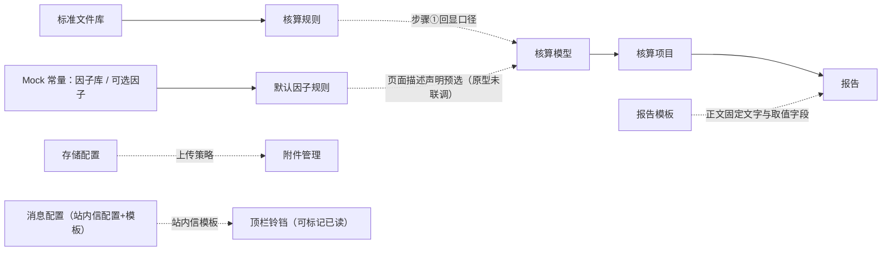

# 系统参数配置业务 PRD

## 0. 文档基础信息

| 项目 | 内容 |
| :--- | :--- |
| 文档名称 | 系统参数配置业务 PRD |
| 版本 | V0.7 |
| 状态 | 待评审（T04–T07 已确认；核算规则 / 报告模板 / 消息配置口径已收敛；**默认因子功能以当前系统原型为准**） |
| 模块名称 | 系统参数配置 |
| 模块类型 | **配置类**（无审核流、无单据下推）；**核算规则为「标准口径档案」，不参与核算求值** |
| 维护形态 | 核算规则：列表 + **四段表单**（基础信息 / 取舍准则 / 可忽略排放项 / 分配）+ 只读详情；报告模板：列表 + 详情 / 编辑页（模板信息 + 取值字段标签 + 富文本正文 + 预览）；存储配置：单页配置表单；**消息配置：单页 2 页签（站内信配置 / 消息模板配置）**；**默认因子：平台级规则列表 + 新增 / 编辑弹窗（菜单「默认因子」，路由 `/config/factor-default`）** |
| 所属层级 | 后台管理（菜单「系统管理」）→ 系统参数配置；原型 `/config/*`；默认因子唯一路由 `/config/factor-default`（页面面包屑仍为「因子库管理 / 默认因子」） |
| 核算规则口径依据 | **以系统原型为准**：`06prototypes/系统原型/src/pages/config/CalcRuleListPage.tsx`、`CalcRuleFormPage.tsx`、`mock/config.ts`，以及项目 / 模型步骤①②的下游引用；与旧版文档冲突处按原型执行，字段定义见《核算规则字段清单 V2.0》 |
| 报告模板口径依据 | **以系统原型为准**：`06prototypes/系统原型/src/pages/config/ReportTemplateListPage.tsx`、`ReportTemplateFormPage.tsx`、`mock/config.ts` §3；与旧版文档冲突处按原型执行，字段定义见《报告模板字段清单 V2.0》 |
| 默认因子口径依据 | **以系统原型为准**：`06prototypes/系统原型/src/pages/factor/DefaultFactorListPage.tsx`、`DefaultFactorFormModal.tsx`、`mock/config.ts` §2（`DefaultFactor` 接口 / 下拉常量 / 演示数据）、`router/menu.ts`、`App.tsx`；与旧版文档冲突处按原型执行，字段定义见《默认因子字段清单 V2.0》 |
| 更新时间 | 2026-11-10 |

**变更记录**

| 日期 | 版本 | 变更内容 |
| :--- | :--- | :--- |
| 2026-10-27 | V0.1 | 初版。依据 2026-10-27 业务确认：① 核算规则 = 上传标准文件 + 配置该标准下的取舍准则、**可忽略的排放项清单**、默认 GWP 口径、计算公式、分配，**本版本仅记录、不参与核算**；② 默认因子**归因子库域**，不落物料库；③ 报告模板轻量化（章节显隐 / 排序 / 固定文案），不做在线设计器；④ 存储与消息按通用标准版功能实现 |
| 2026-10-27 | V0.2 | T04 / T05 / T06 确认：① **默认因子推荐预选一期接入项目建模**（SP-16 升 P0）；② **消息中心本期同期交付**，站内信可见、可标记已读；③ **存储不真实对接对象存储**，为项目验收的模拟实现（Mock 测试连接），验收文档需声明 |
| 2026-11-10 | V0.3 | 因子配置口径收敛：① 去掉作用域，全部规则平台级，删除租户级覆盖；② 去掉平台锁定；③ 去掉匹配测试（SP-14 改为启用 / 停用与批量启停）；④ 行操作新增启停，列表支持勾选批量启停（二次确认、跳过已失效 / 同状态并反馈条数）；⑤ 列表列改为「类型 / 排放数据 / 目标因子（名称 + 值 + 单位）」，表单字段改名并去掉生效版本、规则级别与说明文字；同步 §1.2 / §1.3 / §1.4 / S08 / §3 / §5.7 / §6 / §7 / §9 |
| 2026-11-10 | V0.4 | **核算规则以系统原型为准重构**：① 五段表单收敛为四段（基础信息 / 取舍准则 / 可忽略排放项 / 分配），删除「默认 GWP 口径」「计算公式与试算」两段及忽略项 / 公式变量子表；② 可忽略排放项改为单段 ≤500 字文本；③ 分配收敛为「分配方法（质量 / 数量 / 经济价值）+ 分配规则说明」，数据层 `allow_allocate` 门控下游分配计算；④ 删除规则编号 / 修订号 / 归档态 / 摘要导出 / 依据条款 / 必纳入贡献度；⑤ 状态改为草稿 / 已启用 / 已停用，行操作为查看详情 / 编辑 / 启用或停用 / 删除（二次确认）；⑥ 下游引用改为项目 / 模型步骤①选择已启用规则带回显「核算标准 + 取舍规则」、步骤②按允许分配门控；同步 §0 / §1 / S01–S07 / S12 / §3 / §4 / §5.1–§5.6 / §6 / §7 / §8 / §9 / §10 / 附录 |
| 2026-11-10 | V0.5 | **报告模板以当前系统原型为准重构**：① 由「章节子表（显隐 / 排序 / 固定文案）」改为「模板信息 + 取值字段标签 + 富文本正文 + 预览」，去掉章节子表与适用边界 / 适用标准的查询及匹配校验；② 状态由草稿 / 已启用 / 已停用收敛为启用 / 停用两态，来源标识由 `is_preset` 改为「数据来源：系统预置 / 自定义」，新增模板类型与适用行业；③ **删除规则按来源判定：系统内置（系统预置）不允许删除、自定义允许删除（不受状态限制）**，删除需二次确认；④ 无独立「新建模板」入口，自定义模板仅由「复制」产生且副本默认停用；⑤ 存量报告不回溯、模板不影响核算结果；同步 §0 / §1 / S09 / §3 / §4 / §5.8 / §6 / §7 / §8 / §9 / §10 / 附录，字段定义见《报告模板字段清单 V2.0》 |
| 2026-11-10 | V0.6 | **消息配置简化为「站内信配置 + 消息模板配置」**：① 去掉事件订阅矩阵、邮件 / 短信通道、接收对象 / 频控 / 免打扰、发送记录、测试发送与失败重试；② 站内信配置收敛为启用开关 + 消息保留天数（0–365，0 = 永久）；③ 消息模板为 7 个内置事件各 1 条站内信模板，仅编辑标题 / 正文与启停，保留变量白名单；④ 消费端仅保留顶栏铃铛（可标记已读），不另立消息中心 PRD；同步 §0 / §1.2 / §1.3 / §1.4 / S11 / §3 / §4 / §5.10 / §6 / §7 / §8 / §9 / §10 / 附录 |
| 2026-11-10 | V0.7 | **默认因子（原「因子配置」）以当前系统原型为准重构**：① 菜单名改为「默认因子」，唯一路由 `/config/factor-default`；② 全部规则平台级，删除作用域 / 租户级 / 平台锁定 / 匹配测试；③ 列表列改为 勾选 / 类型 / 排放数据 / 目标因子（名称 + 值 + 单位）/ 优先级 / 状态 / 更新时间 / 操作，6 条件查询、10 条/页；④ 表单「对象类型 / 对象」改名「类型 / 排放数据」，去掉生效版本、规则级别与说明文字，因子库与目标因子并排同一行；⑤ 行操作新增启用停用，支持勾选批量启用停用（二次确认 + 跳过反馈）；⑥ 删除原型未实现的匹配算法与精确度打分、建模侧预选联调、因子失效自动置位、只读反查与变更留痕等口径；同步 §0 / §1 / S08 / §3 / §4 / §5.7 / §6 / §7 / §8 / §9 / §10 / 附录，字段定义见《默认因子字段清单 V2.0》 |

**关联链接**

| 文档 | 路径 |
| :--- | :--- |
| 核算规则字段清单（字段唯一真相源） | `02prd/02-1后台管理/18系统参数配置/核算规则字段清单.md` |
| 默认因子字段清单（字段唯一真相源） | `02prd/02-1后台管理/18系统参数配置/默认因子字段清单.md` |
| 报告模板字段清单（字段唯一真相源） | `02prd/02-1后台管理/18系统参数配置/报告模板字段清单.md` |
| 存储与消息配置字段清单（字段唯一真相源） | `02prd/02-1后台管理/18系统参数配置/存储与消息配置字段清单.md` |
| 标准文件业务 PRD（规则的上游对象） | `02prd/02-1后台管理/06标准文件/标准文件业务PRD.md` |
| 排放因子库业务 PRD（默认因子数据源） | `02prd/02-1后台管理/09因子库/排放因子库业务PRD.md` |
| 报告生成业务 PRD（模板的消费方） | `02prd/02-2前台业务功能/06报告管理/06-3报告生成/报告生成业务PRD.md` |
| 报告模板定义（ZB13002 整竹砧板 V1） | `02prd/02-2前台业务功能/06报告管理/06-3报告生成/报告模板定义（ZB13002整竹砧板V1）.md` |
| 核算模型业务 PRD（下游引用方） | `02prd/02-1后台管理/10模型管理/核算模型业务PRD.md` |
| 整体设计方案 v1.2 | `04产品设计管理/00业务设计/产品碳足迹核算系统_整体设计方案_v1.2.md` |

**文档分工表**

| 文档 | 负责内容 | 不负责内容 |
| :--- | :--- | :--- |
| 四份字段清单 | 字段、类型、必填、默认值、枚举、字段级约束（D01～Dxx） | 业务规则、场景、验收 |
| 业务 PRD（本文） | 定位边界、**四段**规则的业务口径、状态与操作矩阵、上下游、验收 | 完整字段表、页面控件与布局 |
| 系统参数配置_Demo | 页面骨架、控件、校验展示、Mock 数据（**核算规则章节仍为旧五段口径，待单独同步；本轮以本文与字段清单 V2.0 为准**） | 业务规则定义 |
| 标准文件库 | 标准号、名称、状态、附件 | 标准内的核算口径 |
| 核算模型 / 项目核算 | 单次核算的边界 / 阶段 / 数据项 / 因子；步骤①引用核算规则 | 标准级口径的求值 |

---

## 1. 需求概述

### 1.1 需求背景

现状有三个断点：

| # | 断点 | 表现 |
| :--- | :--- | :--- |
| 1 | **标准只存了文件，没存口径** | 标准文件库只有标准号、名称、附件；标准正文里的取舍准则、可忽略排放项、分配方式没有结构化载体 |
| 2 | **模型承载的是"这次怎么算"，不是"标准要求怎么算"** | 核算模型管边界、阶段、数据项、因子绑定；标准差异只在模型层面被动体现，无法回答「这套核算依据的标准允许舍弃什么、按什么方法分配」 |
| 3 | **默认因子散落在人脑里** | 每次建模都要手工从背景库 / 我的因子库挑因子，重复劳动且口径不一致 |

本模块把上述口径沉淀为**可配置、可展示、可回显、可追溯**的档案，服务于**项目验收**：能证明"标准可结构化落地、参数可配、默认值可管"，且**不改变现有核算结果**。核算规则的字段范围以系统原型为准，详见《核算规则字段清单 V2.0》。

### 1.2 需求目标

| # | 目标 | 可验证口径 |
| :--- | :--- | :--- |
| G1 | 标准与规则一一对应 | 业务定位为「按标准号 = 一套规则」；演示数据每个标准号唯一（原型新建未做重复校验，见 §10 T01） |
| G2 | 四段规则可配置 | 基础信息 / 取舍准则 / 可忽略排放项 / 分配，四段均可保存，并在只读详情页回显一致 |
| G3 | 可忽略排放项以文本维护 | 单段 ≤500 字多行文本，允许为空；不再逐条维护对象清单 |
| G4 | 取舍准则可生成回显文本 | 按「是否允许舍弃 + 单环节阈值 + 累计上限 + 补充说明」生成表单摘要预览与下游「取舍规则」文本，**不落库为计算参数、不入引擎** |
| G5 | 规则状态可管理 | 草稿 / 已启用 / 已停用；启用、停用、删除均有二次确认；仅「已启用」规则可被项目 / 模型选择 |
| G6 | 规则可被只读引用 | 项目核算 / 模型步骤①选择已启用规则 → 回显「核算标准 + 取舍规则」；步骤②按 `allow_allocate` 门控分配计算入口；**不参与求值** |
| G7 | 默认因子可按维度配置并管理启用状态 | 按 行业 / 阶段 / 类型 / 排放数据 / 区域 / 年度 维护**平台级**规则；列表展示 类型 / 排放数据 / 目标因子（名称 + 值 + 单位）/ 优先级 / 状态；单条与批量启用停用走二次确认；**原型未实现匹配算法与建模侧联调**（§5.7 / §10） |
| G8 | 报告模板可复制后改固定文字 | 系统预置模板只读且不可删除；复制为自定义模板后可改模板信息与正文固定文字、插入取值字段标签、启停与删除；存量报告不回溯 |
| G9 | 存储与消息可配可存 | 存储「测试连接」返回结果；站内信配置与消息模板保存后可回显 |

### 1.3 In Scope / Out of Scope

**In Scope**

| 子功能 | 能力 |
| :--- | :--- |
| 核算规则 | 标准关联、四段规则配置（基础信息 / 取舍准则 / 可忽略排放项文本 / 分配方法与说明）、表单内摘要预览、只读详情、启用 / 停用 / 删除与二次确认 |
| 默认因子 | 平台级规则列表（6 条件查询、8 列、10 条/页）、新增 / 编辑弹窗（类型 / 排放数据 / 因子库 / 目标因子 / 优先级 / 备注）、启用 / 停用与勾选批量启停、二次确认、已失效行换因子；字段与枚举见《默认因子字段清单 V2.0》 |
| 报告模板 | 模板列表（名称 / 类型 / 状态 / 数据来源）、模板信息与富文本正文、取值字段标签、预览最终报告、复制、启停、删除（仅自定义）；取值字段与系统装配只读 |
| 存储配置 | 存储方式与凭证、上传策略、租户配额、保留策略、用量展示、连通性测试 |
| 消息配置 | **站内信配置**（启用 / 消息保留天数）+ **消息模板配置**（7 个内置事件各 1 条站内信模板，编辑文案与启停、变量白名单）；顶栏铃铛可查看并标记已读 |
| 通用 | 变更留痕（前值 → 后值 + 操作人 + 时间）、平台级配置标识、二次确认（**默认因子侧为前端 Mock，无留痕实现**） |

**Out of Scope**

| 不做项 | 说明 |
| :--- | :--- |
| **核算规则参与计算** | 本版本仅记录，不进引擎、不求值、不影响核算结果（R-002） |
| 规则版本化 / 修订号 | 不建版本对象、不设修订号；规则变更用状态 + 变更留痕（原型为预留组件）表达 |
| 默认 GWP 口径 / 计算公式与试算 | 原型无此两段：不采集默认口径、GWP 集、生物碳、结果单位、有效数字、公式方法、表达式、变量表，也不做沙盒试算 |
| 结构化忽略项清单与依据条款 | 原型以单段文本承载可忽略排放项；不采集对象类型 / 忽略方式 / 忽略理由 / 依据条款，也不采集取舍与分配的依据条款、必纳入贡献度阈值 |
| 规则摘要独立页与导出 | 原型仅在表单内展示「摘要预览」单行，无摘要页、无 md / docx 导出 |
| 归档态 | 原型状态为草稿 / 已启用 / 已停用，无归档、无归档后重新启用 |
| **默认因子作用域 / 租户级 / 平台锁定** | 全部规则平台级；原型无 `scope` / `tenant_id` / `locked_by_platform` 字段、无作用域列与锁定列 |
| **默认因子匹配测试与匹配算法** | 匹配测试弹窗已删除；原型无匹配键精确度打分、命中层级与命中理由，仅工具条保留「优先级数值越小越先命中」提示文案 |
| **默认因子建模侧预选联调** | 页面描述声明「建模时预选推荐、可替换留痕」，但建模页未引用 `DEFAULT_FACTORS` / `fetchDefaultFactors`；本期不作为验收项（§10 T04 / T08） |
| **默认因子失效自动联动与只读反查** | `expired` 为演示数据初始状态，告警条按列表统计；原型无因子库 / 库版本下架联动、无失效原因字段、无只读反查入口 |
| 在线报告设计器 / 章节子表 | 不做像素级排版、字体 / 页边距 / 图表样式配置，也不做章节显隐、排序、固定文案子表；正文为单一富文本，取值字段标签与系统装配只读 |
| 独立新建报告模板 | 列表页无「新建模板」按钮；自定义模板仅由行「复制」产生，副本默认停用 |
| 事件订阅矩阵、邮件 / 短信通道 | **消息配置本期简化**：不配事件订阅、通道参数、接收对象、频控 / 免打扰；站内信为系统内置通道，邮件 / 短信不做，页面无置灰入口 |
| 发送记录、测试发送与失败重试 | 本期不做发送记录查询页、测试消息与重试留痕；站内信只保留顶栏铃铛的查看与标记已读 |
| 真实对象存储切换 | **本期为验收演示的模拟实现**：保存配置 + 测试连接均返回预设结果，不接入真实对象存储、不切换底层实现（T06） |
| 独立消息中心 PRD / 消息列表页 | 仅顶栏铃铛作为站内信消费端，不另立 PRD、不建消息列表页（T05 调整） |
| 权限模型改造 | 复用「菜单管理 + 角色功能勾选 + 数据范围」；**默认因子原型未做角色权限判断** |
| 分配的实际计算 | 归「分配计算」与项目 / 模型侧；本页只记录分配方法与说明，`allow_allocate` 仅用于门控下游入口 |

### 1.4 涉及角色

| 角色 | 数据域 | 在本模块的职责 |
| :--- | :--- | :--- |
| 平台运营管理员 | 平台域 | 核算规则、默认因子（平台级配置与启停）、报告模板（预置）、存储配置、站内信配置与消息模板 |
| 专业配置人员 | 平台域 | 核算规则、默认因子（平台级配置与启停）、报告模板 |
| 组织管理员 | `SUB_TREE` | 报告模板（复制后自建，可编辑 / 启停 / 删除；系统预置只读且不可删）；**消息配置只读**，不维护订阅与接收对象；默认因子无租户级覆盖能力（**原型未做角色权限判断**） |
| 核算人员 / 填报人 | `CURRENT` / `SELF` | **不可见后台配置页**；在项目核算 / 模型步骤①可选择「已启用」核算规则，使用其带出的核算标准与取舍规则 |
| 审核人员 | `SUB_TREE` | 只读查看核算规则详情（`/config/calc-rule/:id`），无编辑 / 启停 / 删除权限 |

### 1.5 影响范围

| 方向 | 模块 | 影响 |
| :--- | :--- | :--- |
| 上游 | 标准文件库 A1-3 | 规则关联标准号；标准被替代 / 作废时提示 |
| 上游 | 行业库 A1-4 | 规则与默认因子的适用行业引用；**默认因子原型取值来自 `INDUSTRY_OPTIONS` 常量，未接后端库表** |
| 上游 | 生命周期阶段 A1-10 | 默认因子的阶段维度取值来自 `LIFECYCLE_OPTIONS` 常量；**核算规则不再引用阶段维度** |
| 上游 | 物料库 / 能源库 A1-1 / A1-2 | 默认因子的排放数据取值来自 `OBJECT_OPTIONS` 常量；**物料库不新增任何因子字段** |
| 上游 | 排放因子库 A2-6 | 默认因子的因子库 / 可选因子取值来自 `FACTOR_LIB_OPTIONS` / `FACTOR_OPTIONS` 常量；**原型未接因子库接口** |
| 上游 | 数据字典 §C4 | 区域取值来自 `REGION_OPTIONS` 常量 |
| 下游 | 项目核算 / 核算模型 P19–P21、A2-3 | 步骤①选择「已启用」规则 → 回显核算标准与取舍规则（可编辑）；步骤②按 `allow_allocate` 门控「分配计算」入口；**不参与求值** |
| 下游 | 报告详情 | 展示由核算规则带出的「取舍规则」文本 |
| 下游 | 报告生成 P26 | 正文固定文字与取值字段标签按模板装配；报告记录模板与版本 |
| 下游 | 附件管理 §C6 | 存储配置约束上传上限、格式、保留期 |
| 下游 | 顶栏铃铛（站内信消费端） | 按内置事件与模板产出站内信，可标记已读；不做发送记录查询 |
| 下游 | 项目建模 P19–P21 | 页面描述声明「建模时预选推荐、可替换留痕」；**当前原型未与建模页联调**（§5.7 / §10） |
| 边界 | 计算引擎 §6.1 | **无调用关系**（R-002） |

---

## 2. 用户与使用场景

### S01 新建核算规则并关联标准

| 项 | 内容 |
| :--- | :--- |
| 触发条件 | 平台需要沉淀某标准（如 `GB/T 24067-2024`）的取舍与分配口径 |
| 操作流程 | 核算规则列表「新建规则」→ 填规则名称 → 选标准号（下拉取标准文件库，**仅新建态可改**）→ 自动带出标准名称 → 选适用行业（可空 = 全行业通用）→ 填备注 → 保存 |
| 预期结果 | 生成规则标识；规则进入草稿态；标准名称回显；进入详情页后标准号只读 |

### S02 配置取舍准则

| 项 | 内容 |
| :--- | :--- |
| 触发条件 | 标准正文规定了舍弃阈值 |
| 操作流程 | 编辑页「取舍准则」段 → 选是否允许舍弃 → 填单环节阈值（默认 1%）、舍弃累计上限（默认 5%）、补充说明 → 查看段底「摘要预览」→ 保存 |
| 预期结果 | 允许舍弃时摘要为「舍弃单个环节影响 < 1%；所有舍弃环节累计 < 5%。」；选「否」时两阈值置灰、摘要为「本标准不允许舍弃。」；原型不做阈值范围与大小关系校验 |

### S03 填写可忽略排放项

| 项 | 内容 |
| :--- | :--- |
| 触发条件 | 标准规定可忽略 / 仅提示的排放项 |
| 操作流程 | 「可忽略排放项」段 → 在**单个多行文本框**录入自然语言说明（≤500 字），如「废弃与循环阶段仅作提示，不纳入核算」 |
| 预期结果 | 文本保存并在只读详情回显；为空表示标准未规定可忽略项；无清单子表、无逐条对象 / 忽略方式 / 理由 / 条款 |

### S04 配置分配

| 项 | 内容 |
| :--- | :--- |
| 触发条件 | 标准规定了共生产品分配方法 |
| 操作流程 | 「分配」段 → 选分配方法（质量 / 数量 / 经济价值，默认质量）→ 填分配规则说明（≤500 字）→ 保存 |
| 预期结果 | 保存并回显；段底提示「实际分配计算在「分配计算」与项目侧执行，本页仅记录标准规定」；下游按数据层 `allow_allocate` 决定是否展示「分配计算」入口 |

### S05 查看只读详情与能力边界

| 项 | 内容 |
| :--- | :--- |
| 触发条件 | 需要复核某标准口径，或对外说明能力边界 |
| 操作流程 | 列表点规则名称 / 行「查看详情」→ 进入 `/config/calc-rule/:id` → 四段字段全部只读，章节导航额外显示「只读引用」 |
| 预期结果 | 字段与编辑态一致，无保存按钮；列表描述、编辑页顶部提示条、分配段页脚三处声明「不参与核算求值」；标准状态非「现行」时顶部警示「该标准已被…请确认是否继续沿用」（不阻断） |

### S06 启用 / 停用 / 删除规则

| 项 | 内容 |
| :--- | :--- |
| 触发条件 | 规则配置完成需上线，或需临时下线、清理草稿 |
| 操作流程 | 列表行点「启用」（草稿 / 已停用）或「停用」（已启用）或「删除」（非已启用）→ 二次确认弹窗 → 确认 |
| 预期结果 | 状态按 `draft → enabled ⇄ disabled` 变化并 Toast 提示；删除后列表移除且不可恢复；已启用规则不可删；仅「已启用」规则可被项目 / 模型选择 |

### S07 项目 / 模型引用核算规则

| 项 | 内容 |
| :--- | :--- |
| 触发条件 | 新建核算项目或核算模型时确定核算标准与取舍口径 |
| 操作流程 | 项目核算 / 模型步骤①点「选择核算规则」→ 弹窗仅列「已启用」规则（规则名称 / 标准文件 / 适用行业 / 更新时间）→ 选中并「确认选择」 |
| 预期结果 | 按标准号匹配标准文件库，回显只读「核算标准」；按取舍准则生成**可编辑**的「取舍规则」文本；下游记录规则 `id`；步骤②仅在 `allow_allocate = yes` 时展示「分配计算」入口；**不参与求值** |

### S08 配置默认因子并启用 / 停用

| 项 | 内容 |
| :--- | :--- |
| 触发条件 | 需要新增 / 调整某类排放数据的默认因子，或需要临时下线、恢复某条规则 |
| 操作流程 | 系统参数配置 →「默认因子」→「新增规则」→ 填匹配键（适用行业 / 生命周期阶段 / 类型 / 排放数据 / 区域 / 适用年度）→ 选因子库 + 目标因子（同行并排，选中后带出数值与单位）→ 填优先级、备注 → 保存（默认已启用）→ 行「停用 / 启用」，或勾选多条后「批量停用 / 批量启用」→ 二次确认 |
| 预期结果 | 规则保存为平台级并出现在列表；列表展示 类型 / 排放数据 / 目标因子（名称 + 值 + 单位）/ 优先级 / 状态 / 更新时间；启停与批量启停更新状态与更新时间，返回成功 / 跳过条数；已失效行不可勾选，需「换因子」恢复；**原型无匹配测试、无建模侧联调** |

### S09 维护报告模板

| 项 | 内容 |
| :--- | :--- |
| 触发条件 | 需要调整报告正文的固定文字，或下线 / 清理自建模板 |
| 操作流程 | 模板列表行「复制」→ 进入编辑页（默认名 `{原名称} 副本`、数据来源「自定义」、状态「停用」）→ 改模板名称 / 类型 / 适用行业 / 说明 → 在右侧富文本正文修改固定文字、从左侧点击插入取值字段标签 → 「预览最终报告」确认 → 「保存模板」→ 回列表「启用」；系统预置模板只读，仅可查看、预览、复制 |
| 预期结果 | 自定义模板启用后可用于新生成报告；取值字段标签与系统装配内容不可删改；系统预置模板无编辑 / 停用 / 删除入口，自定义模板可删除（含启用态），删除经二次确认后不可恢复 |

### S10 配置存储

| 项 | 内容 |
| :--- | :--- |
| 触发条件 | 平台初始化 / 更换存储 |
| 操作流程 | 存储配置页 → 选存储方式 → 填地址、Bucket、区域、密钥 → 设上传策略、配额、保留策略 → 「测试连接」→ 保存 |
| 预期结果 | 测试返回连通 / 失败原因；保存后附件上传按新策略校验；租户侧仅见用量 |

### S11 配置消息

| 项 | 内容 |
| :--- | :--- |
| 触发条件 | 平台初始化，或需要调整站内信文案 |
| 操作流程 | 消息配置页 → 「站内信配置」页签设置启用开关与消息保留天数 → 保存 → 「消息模板配置」页签编辑某事件的标题 / 正文与启用状态 → 保存 |
| 预期结果 | 配置与模板保存后重新进入可回显；命中事件按模板产出站内信，收件人可在顶栏铃铛查看并标记已读 |

### S12 只读反查（原型待补）

| 项 | 内容 |
| :--- | :--- |
| 触发条件 | 在标准文件库或核算模型里确认口径来源 |
| 操作流程 | **原型现状**：核算规则详情页已具备只读形态（S05），但标准文件详情「核算规则」区块、核算模型详情「依据核算规则」跳转入口未在本模块原型中体现 |
| 预期结果 | **不写成已交付能力**；落地时跳转 `/config/calc-rule/:id` 只读页，未配置显示「未配置」（见 §10 T03、字段清单 §8 P-08） |

---

## 3. 功能清单

| 编号 | 一级功能 | 二级功能 | 说明 | 优先级 |
| :--- | :--- | :--- | :--- | :---: |
| SP-01 | 核算规则 | 规则列表 | 4 条件查询（规则名称 / 标准号 / 规则状态 / 适用行业）+ 6 列（规则名称 / 标准号+名称 / 适用行业 / 状态 / 更新时间 / 操作）+ 每页 10 条 | P0 |
| SP-02 | 核算规则 | 新建 / 编辑 / 只读详情 | 四段表单；标准号仅新建可选；详情全字段只读 + 「只读引用」 | P0 |
| SP-03 | 核算规则 | 基础信息 | 规则名称（必填）/ 标准号（必填）/ 标准名称带出 / 标准状态 / 适用行业（多选，空 = 全行业）/ 备注 ≤500 字 | P0 |
| SP-04 | 核算规则 | 取舍准则 | 是否允许舍弃 + 单环节阈值 + 累计上限 + 补充说明，段底「摘要预览」 | P0 |
| SP-05 | 核算规则 | 可忽略排放项 | 单段 ≤500 字多行文本（替代原清单子表），可为空 | P0 |
| SP-06 | 核算规则 | 分配 | 分配方法（质量 / 数量 / 经济价值）+ 分配规则说明；数据层 `allow_allocate` 门控下游入口 | P0 |
| SP-07 | 核算规则 | 状态与行操作 | 查看详情 / 编辑 / 启用 / 停用 / 删除（非启用态）；三者均需二次确认 | P0 |
| SP-08 | 核算规则 | 摘要预览与提示 | 表单内单行摘要预览；三处「不参与核算求值」声明；标准失效警示条 | P0 |
| SP-09 | 核算规则 | 项目 / 模型侧引用 | 步骤①仅列已启用规则，回显核算标准与取舍规则；步骤②按允许分配门控 | P0 |
| SP-10 | 核算规则 | 变更留痕 | **预留**：`ChangeLogModal` 与 Mock 数据已存在，列表 / 表单未挂入口，非本期交付 | P1 |
| SP-11 | 核算规则 | 上游只读反查 | **待补**：标准文件 / 核算模型详情的跳转入口未在本模块原型体现（S12） | P1 |
| SP-12 | 默认因子 | 规则列表 | 6 条件查询；列：勾选 / 类型 / 排放数据 / 目标因子（名称 + 值 + 单位）/ 优先级 / 状态 / 更新时间 / 操作；10 条/页（全部平台级） | P0 |
| SP-13 | 默认因子 | 新增 / 编辑弹窗 | 6 项匹配键 + 因子库 / 目标因子（同行并排）+ 因子单位只读 + 优先级 + 备注；3 项必填校验；同键冲突覆盖确认 | P0 |
| SP-14 | 默认因子 | 启用 / 停用与批量启停 | 行启停 + 勾选批量启停，共用二次确认；已失效 / 同状态规则跳过并反馈成功与跳过条数 | P0 |
| SP-15 | 默认因子 | 已失效行与换因子 | 已失效行标红、禁用勾选、显示「换因子」，告警条按列表统计；换因子后恢复已启用（**原型无因子库自动置位联动**） | P1 |
| SP-16 | 默认因子 | 建模侧推荐预选 | **原型未实现**：页面描述声明「建模时预选推荐、可替换留痕」，建模页未引用规则数据；联调范围待确认（§10 T04 / T08） | 待确认 |
| SP-17 | 报告模板 | 模板列表 | 模板名称 / 模板类型 / 状态 / 数据来源 / 操作；查询含名称、类型、状态、数据来源 | P0 |
| SP-18 | 报告模板 | 模板信息 | 名称（必填）、模板类型、适用行业、模板说明；编号 / 版本只读 | P0 |
| SP-19 | 报告模板 | 模板正文与预览 | 取值字段标签面板（只读，点击插入）+ 富文本正文（仅改固定文字）+「预览最终报告」（不保存） | P0 |
| SP-20 | 报告模板 | 复制模板 | 行「复制」→ 生成自定义停用态副本，深拷贝标签与章节内容块 | P0 |
| SP-21 | 报告模板 | 启停、删除与只读 | 启用 / 停用二次确认；**系统预置不可删、自定义可删（不看状态）**；系统预置整页只读 | P0 |
| SP-22 | 存储配置 | 存储参数与凭证 | 存储方式、地址、密钥、上传策略 | P0 |
| SP-23 | 存储配置 | 配额与保留 | 租户配额、超限策略、保留期、回收站 | P0 |
| SP-24 | 存储配置 | 连通性测试与用量 | 测试连接；已用容量 / 文件数只读 | P1 |
| SP-25 | 消息配置 | 站内信配置 | 平台级单例：启用开关、消息保留天数（0–365，0 = 永久），保存即生效 | P0 |
| SP-26 | 消息配置 | 消息模板配置 | 7 个内置事件各 1 条站内信模板；标题 / 正文 / 启停 / 变量白名单 / 示例值预览 | P0 |
| SP-30 | 通用 | 变更留痕 | 前值 → 后值、操作人、时间、原因 | P0 |
| SP-31 | 通用 | 只读反查 | 各配置侧只读展示；核算规则上游反查入口待补（S12 / SP-11） | P1 |

> 共 28 项：P0 20 项、P1 7 项、待确认 1 项（SP-16）。原 SP-27～SP-29（消息模板旧口径、发送记录、测试发送）随消息配置简化取消，编号保留不复用。

---

## 4. 定位边界（核心章节）

### 4.1 管什么 / 不管什么

| 问题 | 归属 | 本模块角色 |
| :--- | :--- | :--- |
| 这套标准是否允许舍弃、阈值多少 | **核算规则（本模块）** | 唯一记录方 |
| 这套标准允许忽略哪些排放项 | **核算规则（本模块）** | 以单段文本记录，非结构化清单 |
| 这套标准规定的共生产品分配方法 | **核算规则（本模块）** | 唯一记录方，只记录不执行 |
| 默认 GWP 口径 / 计算公式与试算 | **不在本期范围** | 原型无对应配置段，不落字段 |
| 某个项目实际怎么算 | 核算模型 A2-3 / 项目 P19–P21 | 步骤①回显口径、步骤②门控分配入口，**不干预求值** |
| 因子数值、库、版本 | 排放因子库 A2-6 | 业务上唯一维护方；**默认因子原型取值来自 `FACTOR_OPTIONS` 等 Mock 常量，并把数值 / 单位作为展示副本随规则保存，不参与计算** |
| 哪些排放项默认用哪个因子 | **默认因子（本模块菜单入口）** | 平台级规则唯一记录方；当前原型未与建模页联调 |
| 报告正文写什么固定文字、在哪些位置取系统字段 | **报告模板（本模块）** | 唯一记录方；取值字段编码与系统装配内容由研发内置，本模块只读 |
| 附件存哪、能存多大、留多久 | **存储配置（本模块）** | 唯一记录方 |
| 站内信是否启用、保留多久、各事件文案怎么写 | **消息配置（本模块）** | 唯一记录方；事件清单内置、接收人由事件自动确定，不配订阅与通道 |

### 4.2 为什么核算规则不接引擎

| # | 理由 |
| :--- | :--- |
| 1 | 本版本验收目标是"标准可结构化落地"，不是"改规则改结果"；接引擎会把验收风险从"配置是否完整"扩大到"计算结果是否一致" |
| 2 | 引擎已按内置默认口径实现（2026-10-23 已下线「核算配置」分组与公式管理）；重新引入求值入口会让两套口径并存 |
| 3 | 计算引擎的因子匹配、分配、检测阈值已随项目快照冻结（方案 §4.9）；引入可编辑规则会打破"同一数据 + 同一规则版本 → 同一结论" |

**风险控制（原型三处标注"不参与核算"，验收文档同步声明）**

1. 核算规则列表页 `PageHeader.description`：「本配置仅用于标准口径记录与展示，不参与核算求值」；
2. 编辑 / 新建页顶部提示条：「本配置仅用于标准口径记录与展示，不参与核算求值，不影响核算结果」；
3. 分配段页脚提示：「实际分配计算在「分配计算」与项目侧执行，本页仅记录标准规定」。

> 另在 §9.3 能力边界声明中同步说明；原「导出摘要首段标注」「核算模型详情行尾标注」随原型删除导出摘要与上游反查入口而废止（SP-11 待补）。

### 4.3 默认因子为什么归因子库，不归物料库

| 维度 | 因子库 | 物料库 |
| :--- | :--- | :--- |
| 领域归属 | 因子的唯一归属地 | 物料业务 PRD §8 明确「**因子本身归排放因子库，本模块不存因子**」 |
| 维度承载 | 已有库 / 版本 / 区域 / 年度 / 单位 / 状态 | 轻量字典字段，放不下「物料 × 区域 × 年度 × 标准」 |
| 版本一致性 | 库级版本 + 发布 + 下架，默认值可随版本失效 | 无版本，默认值可能指向已下架因子 |
| 权限 | 全部规则平台级，由平台侧统一维护；**不设租户级配置** | 平台基础库，租户无法维护自己的默认因子 |
| 入口数量 | 一处 | 因子维度 + 物料维度两处，必然不一致 |

**落位（以原型为准）**：功能菜单在「系统管理 → 系统参数配置 → **默认因子**」，唯一路由 `/config/factor-default`；页面 `PageHeader` 面包屑仍显示「因子库管理 / 默认因子」，但原型**不存在** `/model/factor-default` 路由，也没有第二套页面。取值源为 `mock/config.ts` 常量，未接因子库 / 物料库接口。

### 4.4 五个子功能的关系



> 注：`DEF → MODEL` 为业务目标口径（页面描述声明建模时预选），**当前原型未与建模页联调**；默认因子取值来自前端 Mock 常量，不接后端库表。

---

## 5. 规则设计（核心章节）

### 5.1 核算规则与标准文件

| 项 | 口径 |
| :--- | :--- |
| 关系 | **业务定位 1:1**：按标准号 = 一套规则；标准号引用标准文件库（原型下拉占位「请选择标准规范库」），含年份（如 `GB/T 24067-2024`） |
| 标识 | `id`（演示数据 `RULE-YYYYMMDDNNN`）；新建态原型暂用 `RULE-${Date.now()}`，命名待补（字段清单 §8 P-01） |
| 新增入口 | 仅核算规则列表「新建规则」；标准文件详情反查入口待补（S12 / SP-11） |
| 标准号 | 仅**新建态**下拉可选；编辑 / 详情只读；选择后带出标准名称、标准状态置「现行」 |
| 标准状态联动 | 状态为「被替代 / 作废」时，编辑 / 详情页顶部展示警示条，**不阻断、不自动停用、不列表灰标** |
| 标准文件 | 本模块不重复上传附件；标准附件入口归标准文件库 |
| 修订与留痕 | 不建版本对象、不设修订号；`ChangeLogModal` 与 Mock 数据为**预留**，列表 / 表单未挂入口 |
| 唯一性 | 演示数据每个标准号唯一，但**原型新建未做重复校验**、下拉未过滤已配置标准（T01） |

### 5.2 列表、查询与行操作

| 项 | 口径 |
| :--- | :--- |
| 查询条件 | 规则名称（模糊）/ 标准号（下拉精确）/ 规则状态（下拉精确）/ 适用行业（下拉精确，多选命中任一）；叠加「与」过滤 |
| 列表列 | 规则名称（跳详情）/ 标准号 + 标准名称 / 适用行业（前 2 项 + `+N`，空 = 全行业）/ 规则状态 `Tag` / 更新时间 / 操作 |
| 分页 | 每页 10 条；查询变化回第 1 页；工具条显示「共 N 条」；无勾选列、无批量操作、无导出 |
| 行操作 | 查看详情、编辑、**启用或停用**、删除（仅非「已启用」显示）；所有状态均可查看详情 / 编辑 |
| 二次确认 | 启用「启用后规则「{}」可被模型只读引用」；停用「停用规则「{}」后将不再被模型引用」；删除「删除规则「{}」后不可恢复」；均含取消 + 语义化确认按钮 |
| 编辑态离开 | 存在未保存修改时，返回弹「放弃修改」二次确认 |

### 5.3 四段表单 · 基础信息与取舍准则

**基础信息**

| 参数 | 控件 | 口径 |
| :--- | :--- | :--- |
| 规则名称 | `Input` | **必填**，非空校验；详情只读 |
| 标准号 | `Select`（仅新建） | **必填**，非空校验；编辑只读；引用标准文件库（原型占位「请选择标准规范库」） |
| 标准名称 | 只读文本 | 随标准号带出，不可编辑；编辑页副标题展示该值 |
| 适用行业 | 多选标签 | 竹木制品 / 人造板 / 家具制造 / 造纸和纸制品；空 = 全行业通用 |
| 备注 | `Textarea` | ≤ 500 字，带字数统计 |

**取舍准则**

| 参数 | 默认 | 口径 |
| :--- | :--- | :--- |
| 是否允许舍弃 | 是 | 单选「是 / 否」 |
| 单环节舍弃阈值 | 1% | 数值输入；「否」时置灰但保留原值 |
| 舍弃累计上限 | 5% | 数值输入；「否」时置灰但保留原值 |
| 补充说明 | 空 | ≤ 500 字 |

- **原型不做** 0–100 范围、单环节 ≤ 累计上限、必填校验；也无「必纳入贡献度阈值」「依据条款」字段。
- 摘要预览与下游回显模板：

```text
允许舍弃 → 舍弃单个环节影响 < {单环节}%；所有舍弃环节累计 < {累计}%。
不允许舍弃 → 本标准不允许舍弃。
下游「取舍规则」回显（cutOffRuleTextOf）→ 单个环节影响 < {单环节}%；所有舍弃环节累计 < {累计}%。{补充说明}
```

### 5.4 四段表单 · 可忽略排放项

| 项 | 口径 |
| :--- | :--- |
| 控件 | **单个多行文本框**（rows=4），≤ 500 字，带 `{已输入}/500` 字数统计 |
| 内容 | 自然语言描述该标准可忽略 / 仅提示的排放项，如「废弃与循环阶段仅作提示，不纳入核算；包装质量占比低于取舍阈值，完全忽略。」 |
| 空值 | 允许为空，表示标准未规定可忽略项 |
| 边界 | **不做**对象类型、对象、忽略方式、忽略理由、依据条款、排序号的结构化清单；不引用生命周期阶段库 / 工序库 |

### 5.5 四段表单 · 分配

| 参数 | 口径 |
| :--- | :--- |
| 分配方法 | 单选：`质量`（按重量分摊）/ `数量`（按数量分摊）/ `经济价值`（按产值分摊），默认 `质量` |
| 分配规则说明 | `Textarea`，≤ 500 字，带字数统计 |
| 是否允许分配 | 数据层字段 `allow_allocate`（`yes` / `no`），**表单未渲染控件**；模型 / 项目步骤②读取它门控「分配计算」入口：`yes` 才展示，未关联规则时默认可用，已关联但查不到时保守隐藏 |
| 不做项 | 无分配层级顺序 / 副产品处理 / 放弃上层需填原因 / 比例合计 / 分配依据条款 |
| 页脚提示 | 「实际分配计算在「分配计算」与项目侧执行，本页仅记录标准规定。」 |

### 5.6 状态、摘要与下游引用

**状态与操作矩阵**

| 状态 | 查看详情 | 编辑 | 启用 | 停用 | 删除 | 可被项目 / 模型选择 |
| :--- | :---: | :---: | :---: | :---: | :---: | :---: |
| `draft` 草稿 | 是 | 是 | 是 | — | 是 | 否 |
| `enabled` 已启用 | 是 | 是 | — | 是 | 否 | 是 |
| `disabled` 已停用 | 是 | 是 | 是 | — | 是 | 否 |

- 闭环：`draft → enabled ⇄ disabled`；删除为终态且不可恢复；**无归档态、无重新启用（归档）、无编辑触发的修订号 +1**。
- 保存校验只有 2 项：规则名称、标准号；不通过时 Toast「共 N 项待修正」并滚动到「基础信息」段。

**摘要与声明**

| 项 | 口径 |
| :--- | :--- |
| 摘要预览 | 表单「取舍准则」段底部单行展示 `buildRuleSummary` 第一行；完整三行摘要（取舍 / 可忽略排放项 / 分配）仅用于数据派生，**无独立摘要页、无导出文件** |
| 不参与核算声明 | 列表页描述、编辑页顶部提示条、分配段页脚提示（详见 §4.2） |

**下游引用（原型实际行为）**

| 环节 | 行为 |
| :--- | :--- |
| 项目核算 / 模型步骤① | 「选择核算规则」弹窗，仅列 `status = enabled` 的规则；列为规则名称 / 标准文件（标准号 + 名称）/ 适用行业 / 更新时间 |
| 确认选择后 | 按 `standard_no` 匹配标准文件库 → 回显只读「核算标准」；`cutOffRuleTextOf` 生成**可编辑**「取舍规则」文本；下游存规则 `id`（`calc_rule_no`） |
| 模型 / 项目步骤② | 按 `allow_allocate` 门控「分配计算」入口 |
| 报告详情 | 展示「取舍规则」文本 |
| 计算引擎 | **无调用关系**，规则不进引擎、不求值（R-002） |

### 5.7 默认因子规则（以系统原型为准）

| 项 | 口径 |
| :--- | :--- |
| 规则级别 | 全部规则**平台级**，作用于整个平台；原型无 `scope` / `tenant_id` / `locked_by_platform` 字段，无租户级配置与平台锁定 |
| 入口 | 菜单「系统管理 → 系统参数配置 → **默认因子**」，唯一路由 `/config/factor-default`；页面面包屑仍为「因子库管理 / 默认因子」，无第二套页面 |
| 匹配键 | 适用行业 + 生命周期阶段 + 类型（`物料` / `能源`）+ 排放数据（编码 / 名称）+ 区域 + 适用年度；列表以「类型」「排放数据」两列展示；取值均来自 `mock/config.ts` 常量 |
| 目标因子 | 因子库 + 因子名称 + 生效版本 + 因子数值 + 因子单位；选中因子后自动带出，列表「目标因子」列展示 **名称 + 值 + 单位**（不含库名与版本） |
| 表单 | 匹配键 6 项 + 因子库 / 目标因子（并排同一行）+ 因子单位只读 + 优先级 + 备注；**无生效版本、规则级别字段与说明文字**；3 项必填（类型 / 排放数据 / 目标因子） |
| 优先级 | 整数，默认 10，`min=1`，原型无上限校验；工具条提示「数值越小越先命中」，**原型未实现匹配算法与精确度打分** |
| 唯一性 | 六个匹配键组合唯一；保存时存在同键且非 `expired` 的其他规则 → 弹「覆盖已有规则」二次确认 |
| 状态 | `enabled` 已启用 / `disabled` 已停用 / `expired` 已失效；新建默认 `enabled`；表单无状态控件；`expired` 为演示数据初始状态，**原型无因子库下架自动置位联动** |
| 启停 | 行「启用 / 停用」+ 勾选后「批量启用 / 批量停用」，共用二次确认；已失效不可勾选；同状态 / 已失效记录跳过并反馈成功与跳过条数；启停刷新 `updated_at` |
| 失效与恢复 | 已失效行整行浅红底、禁用勾选、显示「换因子」；告警条按列表统计；编辑并更换因子名称保存后恢复 `enabled` |
| 推荐预选 | **原型未实现**：页面描述声明建模时预选推荐、可替换留痕；建模页未引用 `DEFAULT_FACTORS` / `fetchDefaultFactors`，未与 E03 联动（§10 T04 / T08） |
| 数据性质 | 前端 Mock 内存态：`fetchDefaultFactors()` 返回浅拷贝，列表 `setList` 本地更新；无接口、无持久化、无变更留痕、无导入导出、无只读反查 |
| 字段定义 | 见《默认因子字段清单 V2.0》 |

### 5.8 报告模板

| 项 | 口径 |
| :--- | :--- |
| 模板来源 | 系统预置 1 个（`RPT-PCF-ZB13002-001`，研发线下整理并内置、整页只读）；自定义模板**仅由行「复制」产生**，列表无「新建模板」入口 |
| 列表与查询 | 列：模板名称（链接）、模板类型、状态、数据来源、操作；查询：模板名称（模糊）、模板类型、状态、数据来源；分页 10 条/页 |
| 模板类型 | `碳足迹报告` / `碳标签报告`；适用行业取行业库，空 = 全行业 |
| 数据来源 | `系统预置` / `自定义`（系统写入，不可编辑）；系统预置模板只读、不可停用、**不可删除** |
| 模板信息 | 模板名称（唯一必填校验）、模板类型、适用行业、模板说明（≤200 字）；模板编号 `RPT-YYYYMMDD-NNN` 与版本号由系统生成，表单只读 |
| 取值字段标签 | 研发内置的 9 个 `{{CODE}}` 标签（产品名称 / 规格 / 生产者 / 标准 / 边界 / 声明单位 / 单位碳足迹 / 合计排放 / 报告编号），左侧面板只读取值来源，点击插入正文后锁定，不可删改 |
| 模板正文 | 单一富文本编辑器（加粗 / 标题 / 列表 / 表格 / 插入字段标签），仅可改固定文字；系统装配内容块与锁定章节只读；原型正文基线 7 章（`SEC-*`），其中核算结果、结论与建议 2 章锁定 |
| 预览 | 「预览最终报告」把 `{{CODE}}` 替换为演示取值生成预览，**预览不保存任何修改** |
| 复制 | `/config/report-template/new?copy={id}`，无命名弹窗；副本默认名 `{原名称} 副本`、`自定义`、停用态、版本 1，深拷贝标签与章节内容块，记录 `source_template_id` |
| 状态与启停 | `enabled` 启用 / `disabled` 停用两态（无草稿）；启用、停用均需二次确认，停用后不再用于新生成报告 |
| 删除 | **系统内置（系统预置）不允许删除**：不渲染删除入口且接口拒绝；**自定义允许删除**，不受状态限制（启用中亦可删），复用共享二次确认弹窗（危险态），删除后不可恢复 |
| 选择规则 | 本期后台不做「边界 + 标准」自动匹配与报告侧模板切换，仅维护启用状态；模板消费口径见《报告生成业务 PRD》 |
| 回溯 | 换模板 / 编辑 / 删除只影响新生成报告；存量报告记录 `templateId + templateVersion`，不回溯 |
| 与核算的关系 | **无关系**：模板只影响报告呈现，不改变任何计算结果 |

### 5.9 存储配置

| 分组 | 口径 |
| :--- | :--- |
| 存储方式 | 本地存储 / 对象存储；切换需二次确认并提示"仅影响新上传附件" |
| 连接参数 | 服务地址、Bucket、区域、访问域名、路径前缀 |
| 凭证 | AccessKey ID / Secret **加密存储、保存后不回显**，仅平台运营可改 |
| 上传策略 | 单文件上限（默认 50MB，1–500）、允许格式（pdf / jpg / jpeg / png / xlsx / docx）、图片最大边长（默认 2048px） |
| 配额 | 租户总容量（GB）、单租户附件数上限、超限策略（仅告警 / 禁止上传） |
| 保留 | 附件保留期（天，0 = 永久）、回收站天数（默认 30）、报告与凭证永久保留开关 |
| 测试连接 | **模拟实现**：不发起真实网络探测，按预设规则返回连通 / 失败（如 Endpoint 含 `invalid` 返回失败），并写入验证状态与验证信息 |
| 用量 | 已用容量、文件数、附件数（只读，按租户维度汇总；由附件管理统计，Mock 数据） |
| 本期边界 | **验收演示功能**：参数可配、可保存、可回显、测试连接返回 Mock 结果；**不接入真实对象存储、不切换上传实现、不执行真实清理任务**（T06） |

### 5.10 消息配置

**本期范围**：消息配置简化为「**站内信配置 + 消息模板配置**」2 页签；不做事件订阅矩阵、邮件 / 短信通道、接收对象 / 频控 / 免打扰、发送记录、测试发送与失败重试。

**内置事件清单（模板归类用，不做订阅配置）**

| 事件编码 | 事件名 | 触发点 | 默认接收（系统自动确定） |
| :--- | :--- | :--- | :--- |
| `CALC_DONE` | 核算完成 | 项目核算成功 | 项目创建人 |
| `CALC_FAILED` | 核算失败 | 引擎返回失败 | 项目创建人 |
| `CHECK_BLOCKED` | 检测存在阻断项 | 数据检测不通过 | 项目创建人 |
| `REPORT_GENERATED` | 报告生成完成 | 报告落库 | 报告创建人 |
| `SHARED_DATA_UPDATED` | 共享数据集更新 | 主项目发布新快照 | 关联项目负责人 |
| `MEMBER_CHANGED` | 成员 / 角色变更 | 成员新增或角色调整 | 组织管理员 |
| `QUOTA_WARNING` | 存储配额预警 | 用量 ≥ 阈值（默认 80%） | 组织管理员 |

**站内信配置**

| 项 | 口径 |
| :--- | :--- |
| 配置对象 | 平台级单例 `message_inapp_config`，全表 1 条，保存即生效 |
| 启用开关 | 默认启用；停用后不再产生新消息，已有消息保留 |
| 消息保留天数 | 0–365 天，默认 30；0 = 永久；演示环境不执行真实清理 |
| 通道参数 | 站内信为系统内置通道，**无** SMTP / 网关 / 密钥 / 验证状态 / 测试发送 |
| 接收人 | 由事件自动确定（事件相关人 / 组织管理员），不配置接收对象、频控、免打扰 |

**消息模板配置**

| 项 | 口径 |
| :--- | :--- |
| 模板 | 7 个内置事件各 1 条站内信模板，事件编码唯一；不可新增 / 删除模板 |
| 可编辑字段 | 标题 ≤ 100 字、正文 ≤ 1000 字、启用 / 停用；事件编码与名称只读 |
| 变量白名单 | `{产品名称}` `{项目编号}` `{报告链接}` `{租户名称}` `{用量}`；白名单外手写 `{}` 内容保存时阻断 |
| 预览 | 编辑 / 预览弹窗以示例值替换变量展示，预览不保存 |
| 投递 | 站内信启用且模板启用时，命中事件按模板生成站内信；模板停用则不投递 |

**本期边界（消费端）**：仅顶栏铃铛展示站内信并可标记已读（已读时间回写 `read_at`）；不建消息列表页 / 发送记录查询页、不另立消息中心 PRD（T05 调整）。演示环境的铃铛消息为 Mock 数据。

---

## 6. 业务规则

| 规则编号 | 规则名称 | 触发条件 | 处理逻辑 | 例外策略 |
| :--- | :--- | :--- | :--- | :--- |
| R-001 | 标准号绑定 | 新建 / 编辑规则 | 业务定位「按标准号 = 一套规则」；标准号仅新建态可选，编辑 / 详情只读；选择后带出标准名称 | 演示数据唯一，但**原型未做重复校验、未过滤已配置标准**（待补，T01） |
| R-002 | **规则不参与核算** | 保存 / 启用 / 被引用时 | 规则只写配置库，不调用引擎；下游仅回显「核算标准 + 取舍规则」并门控分配入口 | 无例外 |
| R-003 | 基础信息必填 | 保存表单 | 仅校验规则名称、标准号 2 项；不通过时 Toast 并定位到「基础信息」段 | 标准状态非「现行」只提示、不阻断 |
| R-004 | 取舍准则联动 | 编辑 / 保存取舍段 | 「不允许舍弃」时两阈值置灰但保留原值；摘要与下游输出「本标准不允许舍弃。」 | 原型不做 0–100、单环节 ≤ 累计校验（待补，T02） |
| R-005 | 可忽略排放项文本 | 编辑 / 保存 | 单段多行文本 ≤ 500 字，允许为空；不生成结构化清单 | 无例外 |
| R-006 | 分配方法与门控 | 编辑 / 保存、步骤②载入 | 分配方法三值单选；说明 ≤ 500 字；`allow_allocate = no` 时下游隐藏「分配计算」入口；本页不执行分配 | 未关联规则时入口默认可用，已关联但查不到时隐藏 |
| R-007 | 规则状态与行操作 | 列表行操作 | 草稿 / 已启用 / 已停用；启用、停用、删除均二次确认；已启用不可删；删除不可恢复 | 无归档态、无编辑二次确认、无修订号 |
| R-008 | 只读引用 | 项目 / 模型步骤① | 弹窗仅列「已启用」规则；确认后按标准号回显只读核算标准、生成可编辑取舍规则文本，并记录规则 `id` | 标准文件库无匹配时提示人工确认，不阻断 |
| R-009 | 摘要与能力边界声明 | 进入表单 / 列表 | 表单内单行「摘要预览」；列表描述、编辑页提示条、分配段页脚三处声明不参与核算求值 | **无**摘要页与导出文件 |
| R-010 | 默认因子保存与联动 | 新增 / 编辑弹窗保存 | 仅校验 类型 / 排放数据 / 目标因子 3 项非空；切换类型清空排放数据编码；切换因子库清空目标因子；选中目标因子带出 库 / 版本 / 数值 / 单位，`objectName` 由取值源 label 带出 | 原型不校验行业 / 区域 / 年度 / 优先级范围 |
| R-011 | 默认因子唯一与覆盖 | 保存规则 | 六个匹配键组合为唯一键；存在同键且非 `expired` 的其他规则时弹「覆盖已有规则」二次确认，确认后覆盖保存；全部规则平台级 | 无作用域 / 租户维度 |
| R-012 | 默认因子状态与失效 | 新建 / 启停 / 换因子 | 新建默认 `enabled`；`expired` 为演示数据初始状态，列表标红、不可勾选；更换 `factorName` 保存后恢复 `enabled`；告警条按列表统计 | **原型无**因子下架 / 库下架 / 版本转历史的自动置位联动，无 `expire_reason` |
| R-013 | 默认因子启用停用与批量启停 | 行操作 / 工具条批量操作 | 单条与批量共用二次确认；确认后逐条变更 `status` 与 `updated_at`；`expired` 与同状态记录跳过并反馈条数；完成后清空勾选 | 停用后不参与预选为页面文案口径，原型未与建模页联调 |
| R-014 | 报告模板只读与删除 | 查看 / 编辑 / 启停 / 删除模板 | 系统预置模板整页只读，仅可查看、预览、复制；取值字段标签与系统装配由研发内置不可删改；**删除按数据来源判定：系统预置不渲染删除入口且接口拒绝，自定义可删除（不受状态限制），删除需二次确认且不可恢复** | 无例外；启用 / 停用亦需二次确认 |
| R-015 | 报告模板不回溯 | 复制 / 编辑 / 启停 / 删除模板 | 仅影响新生成报告；存量报告保留 `templateId + templateVersion`，不因模板变更或删除而改变 | 需要新口径须重新生成报告 |
| R-016 | 存储凭证与连通性 | 保存 / 测试连接 | 密钥加密存储、不回显；测试失败可保存但标「未验证」 | 保存不强制测试通过 |
| R-017 | 配额与超限 | 附件上传时 | 超出租户容量或附件数时按策略处理：仅告警则放行并通知，禁止上传则阻断 | 阻断提示联系管理员扩容 |
| R-018 | 站内信投递与保留 | 事件触发 / 保存配置 | 站内信启用且模板启用时按模板生成站内信；停用后不产生新消息、已有消息保留；按保留天数清理（演示环境不执行真实清理） | 无频控、无免打扰、无失败重试 |
| R-019 | 变更留痕 | 任一配置保存 | 记录字段、前值、后值、操作人、时间、原因（关键参数必填原因） | 核算规则侧为**预留组件**，列表 / 表单未挂入口（SP-10 / 字段清单 §8 P-04） |
| R-020 | 默认因子平台级统一配置 | 进入列表 / 表单 | 全部规则平台级；原型无作用域选择、无租户字段、无平台锁定开关、无匹配测试入口、无匹配算法实现、无角色权限判断 | 与旧版文档冲突处按原型执行，字段定义见《默认因子字段清单 V2.0》 |

> 规则总数 **20 条**。

---

## 7. 状态与操作矩阵

### 7.1 状态维度

| 对象 | 状态 | 取值 | 说明 |
| :--- | :--- | :--- | :--- |
| 核算规则 | 规则状态 | `draft` 草稿 / `enabled` 已启用 / `disabled` 已停用 | 无版本维度、无修订号；停用后可再启用 |
| 默认因子 | 规则状态 | `enabled` 已启用 / `disabled` 已停用 / `expired` 已失效 | `expired` 为演示数据初始状态，原型无系统自动置位；换因子后恢复 `enabled` |
| 报告模板 | 模板状态 | `enabled` 启用 / `disabled` 停用 | 两态、无草稿；副本默认 `disabled`；系统预置模板恒为 `enabled` 且整页只读 |
| 存储 | 配置状态 | 已保存 / 未验证 / 已验证 | `未验证` = 测试连接未通过 |
| 站内信配置 / 消息模板 | 配置状态 | 已保存；模板 `enabled` 启用 / `disabled` 停用 | 无验证态；模板停用后不投递 |

### 7.2 操作矩阵

**A. 核算规则**

| 规则状态 | 查看详情 | 编辑四段 | 摘要预览 | 启用 | 停用 | 删除 | 被项目 / 模型引用 |
| :--- | :---: | :---: | :---: | :---: | :---: | :---: | :---: |
| `draft` 草稿 | 是 | 是 | 是 | 是 | — | 是 | 否（不可选） |
| `enabled` 已启用 | 是 | 是 | 是 | — | 是 | **否** | 是 |
| `disabled` 已停用 | 是 | 是 | 是 | 是 | — | 是 | 否（不可选） |

> 启用 / 停用 / 删除均需二次确认；编辑态有未保存修改时离开需「放弃修改」确认。原型**无**试算、导出摘要、归档、修订号、编辑二次确认。

**B. 默认因子**

| 规则状态 | 编辑 | 启用 | 停用 | 批量启停 | 参与预选（页面文案口径） | 删除 / 换因子 | 恢复 |
| :--- | :---: | :---: | :---: | :---: | :---: | :---: | :---: |
| `enabled` 已启用 | 是 | — | 是 | 可勾选 | 是 | 删除 | — |
| `disabled` 已停用 | 是 | 是 | — | 可勾选 | 否 | 删除 | 启用 |
| `expired` 已失效 | 是（换因子） | — | — | 不可勾选 | 否 | 换因子 | 更换因子后启用 |

> 单条启停、批量启停、删除、覆盖均复用共享二次确认弹窗；表头全选仅作用于当前页，跨页保留已选；**原型未与建模页联调，"参与预选"仅为页面文案口径**。

**C. 报告模板**（按数据来源 × 状态）

| 数据来源 / 状态 | 查看 / 预览 | 编辑模板信息 | 编辑正文固定文字 | 启用 | 停用 | 删除 | 复制 | 用于新生成报告 |
| :--- | :---: | :---: | :---: | :---: | :---: | :---: | :---: | :---: |
| 系统预置 · `enabled` | 是 | 否 | 否 | — | 否 | **否** | 是 | 是 |
| 自定义 · `enabled` | 是 | 是 | 是 | — | 是 | **是** | 是 | 是 |
| 自定义 · `disabled` | 是 | 是 | 是 | 是 | — | **是** | 是 | 否 |

> 删除入口仅对 `来源 = 自定义` 渲染，系统预置不渲染假按钮；启用 / 停用 / 删除均复用共享二次确认弹窗，删除为危险态且不可恢复。

**闭环校验**

- 规则：草稿 → 已启用 ⇄ 已停用 正向可达，已停用 → 启用 一条回退边；删除为终态（不可恢复）；无归档态、无死状态。
- 默认因子：已启用 ⇄ 已停用；`expired` 为演示数据初始状态，须更换因子后回 `enabled`；原型无外部因子失效自动置位联动。
- 报告模板：启用 ⇄ 停用；复制产生停用态自定义模板；系统预置模板独立只读且不可删除；本期不做边界 / 标准的模板匹配校验。
- 存储：无状态机，但「未验证」必须可重测；站内信配置与消息模板无状态机，保存即生效。

---

## 8. 上下游与引用关系

| 方向 | 关联模块 | 引用字段 | 联动规则 |
| :--- | :--- | :--- | :--- |
| 上游 | 标准文件库 A1-3 | 标准号 / 标准名称 / 标准状态 | 规则新建时选择标准号并带出名称；标准失效仅在编辑页提示，不自动停用 |
| 上游 | 行业库 A1-4 | 适用行业 | 规则与默认因子引用；为空 = 全行业通用；**默认因子原型取自 `INDUSTRY_OPTIONS` 常量** |
| 上游 | 生命周期阶段 A1-10 | 阶段 | 仅默认因子引用；**核算规则不再引用阶段维度**；原型取自 `LIFECYCLE_OPTIONS` 常量 |
| 上游 | 物料库 / 能源库 A1-1 / A1-2 | 排放数据 | 默认因子取值源；原型取自 `OBJECT_OPTIONS` 常量；**物料库不新增因子字段** |
| 上游 | 排放因子库 A2-6 | 库 + 因子 + 生效版本 | 业务唯一维护方；**默认因子原型取自 `FACTOR_LIB_OPTIONS` / `FACTOR_OPTIONS` 常量，并把数值 / 单位作为展示副本随规则保存**，未接因子库接口 |
| 上游 | 数据字典 §C4 | 区域 | 默认因子匹配键；原型取自 `REGION_OPTIONS` 常量 |
| 下游 | 项目核算 / 核算模型 P19–P21、A2-3 | 规则 `id`（`calc_rule_no`）、标准号、取舍准则、`allow_allocate` | 步骤①仅选已启用规则并回显核算标准与取舍规则；步骤②门控分配入口；**不参与求值** |
| 下游 | 报告详情 | 取舍规则 | 展示由规则带出的取舍规则文本 |
| 下游 | 项目建模 P19–P21 | 默认因子推荐（**原型未联调**） | 页面描述声明「建模时预选推荐、可替换留痕」；建模页未引用 `DEFAULT_FACTORS` / `fetchDefaultFactors`，无 E03 联动 |
| 下游 | 报告生成 P26 | 模板正文 / 取值字段编码 | 按启用模板装配正文并自动取值；报告记录模板与版本 |
| 下游 | 附件管理 §C6 | 上传策略 / 配额 / 保留期 | 存储配置为约束源 |
| 下游 | 顶栏铃铛（站内信消费端） | 站内信模板 / 已读时间 | 按内置事件与模板产出站内信；标记已读回写 `read_at` |
| 边界 | 计算引擎 §6.1 | — | **无调用关系** |
| 边界 | 分配计算 / 分配规则 A2-8 | `allow_allocate` | 本模块只记录分配方法与说明；`allow_allocate` 仅用于门控下游入口，不执行分配 |

---

## 9. 验收标准

### 9.1 功能验收

| 编号 | 验收项 | 通过标准 |
| :--- | :--- | :--- |
| AC01 | 关联标准新建规则 | 填规则名称 + 选标准号后可保存，标准名称自动带出；进入详情后标准号只读；缺任一项时阻断并定位到「基础信息」段 |
| AC02 | 四段保存与回显 | 四段填写后保存，进入 `/config/calc-rule/:id` 全部字段只读回显一致 |
| AC03 | 取舍准则与摘要预览 | 允许舍弃 1% / 5% → 摘要「舍弃单个环节影响 < 1%；所有舍弃环节累计 < 5%。」；切「不允许舍弃」→ 两阈值置灰、摘要「本标准不允许舍弃。」 |
| AC04 | 可忽略排放项文本 | 录入 ≤500 字文本可保存并回显；清空可保存；超过 500 字不可继续输入 |
| AC05 | 分配配置 | 分配方法可在质量 / 数量 / 经济价值间切换；分配规则说明 ≤500 字可保存；段底展示「实际分配计算在「分配计算」与项目侧执行」 |
| AC06 | 只读详情与能力边界 | 详情页字段全只读、无保存按钮、导航含「只读引用」；列表描述 / 编辑提示条 / 分配段页脚三处均含「不参与核算求值」声明 |
| AC07 | 标准失效提示 | 标准状态为「被替代 / 作废」的规则进入编辑页展示警示条，且仍可保存 |
| AC08 | 状态与二次确认 | 草稿 → 启用、已启用 → 停用、非启用 → 删除均弹二次确认；确认后状态 `Tag` 与列表正确；已启用行无「删除」入口 |
| AC09 | 列表查询与分页 | 4 个条件叠加过滤正确；「重置」清空并回到第 1 页；每页 10 条；点规则名称进详情 |
| AC10 | 项目 / 模型引用 | 步骤①弹窗仅列已启用规则（规则名称 / 标准文件 / 适用行业 / 更新时间）；确认后回显只读核算标准与可编辑取舍规则；`allow_allocate = no` 时步骤②无「分配计算」入口 |
| AC11 | 编辑离开确认 | 编辑态修改字段后点返回弹「放弃修改」；取消保留数据，确认返回列表 |
| AC12 | 默认因子唯一性与覆盖 | 同六个匹配键组合且已有非 `expired` 规则时弹「覆盖已有规则」二次确认，确认后覆盖保存；无作用域 / 租户维度 |
| AC13 | 默认因子列表与表单 | 列表 8 列（含勾选）、6 条件查询、10 条/页；表单字段与原型一致（类型 / 排放数据 / 因子库 + 目标因子同行 / 因子单位只读 / 优先级 / 备注），无生效版本、规则级别与说明文字；3 项必填 Toast 校验；目标因子列仅展示名称 + 值 + 单位 |
| AC14 | 默认因子启用停用与批量启停 | 行停用后状态为「已停用」、启用后恢复；勾选多条批量启停二次确认后生效，已失效与目标状态一致的记录跳过并反馈成功 / 跳过条数；已失效行不可勾选；启停刷新更新时间 |
| AC15 | 默认因子已失效行与换因子 | `expired` 行整行浅红底、告警条按列表统计；点「换因子」打开编辑弹窗，更换因子名称保存后恢复「已启用」；**原型无因子下架自动置位联动，不验收该联动** |
| AC16 | 报告模板只读与正文 | 系统预置模板整页只读；正文仅可改固定文字，取值字段标签与系统装配不可删改；「预览最终报告」不保存修改 |
| AC17 | 报告模板删除规则 | 系统预置行无「删除」入口且接口拒绝删除；自定义行（含启用态）可删除，经危险态二次确认后记录消失且不可恢复 |
| AC18 | 报告模板复制 / 启停 / 不回溯 | 复制生成停用态自定义副本并可编辑保存；启用 / 停用需二次确认；模板变更或删除后已生成报告不变，新报告按新模板 |
| AC19 | 存储配置（模拟） | 密钥保存后不回显；格式白名单外文件上传被阻断；超配额按策略处理；「测试连接」返回 Mock 结果并刷新验证状态；**验收时明确声明未接入真实对象存储** |
| AC20 | 消息配置（简化） | 站内信启用开关与保留天数保存后回显一致（0–365，0 = 永久）；7 条内置模板可编辑标题 / 正文 / 启停，白名单外变量被拦截，预览以示例值替换；站内信可在顶栏铃铛查看并标记已读；页面无事件订阅 / 邮件通道 / 发送记录 / 测试发送入口 |
| AC21 | 变更留痕 | 任一配置修改均产生一条留痕，含前值、后值、操作人、时间（**核算规则侧 SP-10 为预留组件，不作为本期验收项；默认因子侧原型无留痕，亦不作为本期验收项**） |
| AC22 | 平台级统一配置 | 默认因子列表与表单无作用域选择、无租户字段、无平台锁定开关、无匹配测试入口；全部规则作用于整个平台；原型未做角色权限判断与匹配算法 |

### 9.2 验收演示脚本

| 步 | 操作 | 观察点 |
| :-- | :--- | :--- |
| 1 | 标准文件库确认 `GB/T 24067-2024` 存在 | 新建规则时标准号下拉可选，带出标准名称 |
| 2 | 核算规则新建 → 填名称 / 选标准 → 配置四段 → 保存 | 四段保存成功；详情只读回显一致；标准号只读 |
| 3 | 「可忽略排放项」录入一段说明 →「分配」选「质量」并填说明 | 字数统计 ≤500；取舍准则段摘要预览按阈值生成 |
| 4 | 取舍准则切「不允许舍弃」再切回 | 两阈值置灰 / 恢复；摘要文案随之切换 |
| 5 | 列表行「停用」→ 二次确认 → 再「启用」 | 状态 `Tag` 变化；停用期间步骤①弹窗不出现该规则 |
| 6 | 新建项目步骤①「选择核算规则」→ 选中该规则 | 回显只读核算标准与可编辑取舍规则；步骤②按 `allow_allocate` 展示 / 隐藏分配入口 |
| 7 | 系统参数配置 →「默认因子」→ 新增「生产阶段 + 电力 + 2024」→ 保存 → 行停用 → 勾选两条批量启用 | 新增行展示 类型 / 排放数据 / 目标因子（名称 + 值 + 单位）/ 优先级 / 状态；停用后状态为「已停用」；批量启用二次确认后恢复「已启用」，已失效行不可勾选并计入跳过条数 |
| 7b | 已失效行点「换因子」→ 更换目标因子并保存 | 状态由「已失效」恢复「已启用」；建模侧预选在当前原型未联调，不作为验收演示步骤 |
| 8 | 报告模板：预置模板查看（无删除入口）→ 行「复制」→ 改正文固定文字 / 插入取值字段标签 → 预览 → 保存 → 启用 → 再删除自定义副本 | 副本为「自定义 / 停用」，标签不可删改、预览不落库；启用态副本仍可删除，预置模板全程只读 |
| 9 | 存储配置改单文件上限 10MB → 上传 20MB 文件 | 阻断并提示 |
| 10 | 消息配置「站内信配置」改保留天数为 60 → 保存 →「消息模板配置」编辑「核算完成」正文并停用 → 保存 → 顶栏铃铛点开一条未读消息 | 刷新后配置与模板回显一致；模板状态为「已停用」；白名单外变量被拦截；铃铛消息置为已读 |

### 9.3 能力边界声明（验收必须同步说明）

| 能证明 | 不能证明 |
| :--- | :--- |
| 标准口径可结构化配置、可展示、可回显、可追溯；可被项目 / 模型步骤①引用 | 修改核算规则会改变核算结果（本版本不参与核算）；规则摘要可导出；GWP 口径 / 公式试算可由本模块配置 |
| 默认因子可按维度配置、可启停与批量启停，列表与表单口径可回显 | 默认因子会替代人工确认或改变 E03 阻断；已接入建模侧预选；已有匹配算法与自动失效联动 |
| 报告模板可复制后改正文固定文字、插入取值字段标签、启停与删除（仅自定义） | 模板能改变排版、字体、图表样式；能修改取值字段编码与系统装配内容；能删除系统内置模板 |
| 存储参数可配、可保存、可测试（**模拟**）；站内信配置与消息模板可保存回显，站内信在铃铛可见可读 | 存储已真实接入对象存储、附件已真实落盘与清理；已真实发送邮件 / 短信；消息具备发送记录、频控与失败重试能力 |

---

## 10. 待确认事项

| 编号 | 问题 | 影响 | 当前建议 | 状态 |
| :--- | :--- | :--- | :--- | :--- |
| T01 | 标准号唯一性校验 / 新建时过滤已配置标准是否补齐 | 新建表单、数据一致性（字段清单 §8 P-02） | 原型未实现；建议补齐，落地前以原型实际行为为准 | 待确认（原型待补） |
| T02 | 取舍阈值是否补 0–100 范围与「单环节 ≤ 累计」校验 | §5.3、字段清单 D09 / §8 P-06 | 原型未实现；建议补齐 | 待确认（原型待补） |
| T03 | 上游只读反查（S12 / SP-11）、变更留痕（SP-10）、`allow_allocate` 采集入口（P-03）是否本期交付 | 上下游闭环、预留组件 | 原型未挂入口，建议列 P2；`allow_allocate` 目前仅来自 Mock 数据 | 待确认（原型待补） |
| T04 | 默认因子「推荐预选」是否接入项目建模 | SP-16、联调范围 | 业务侧曾确认一期接入；**当前原型未与建模页联调**（建模页未引用 `DEFAULT_FACTORS` / `fetchDefaultFactors`），仅页面描述保留该声明；落地前需确认联调范围 | 业务已确认 / 原型待补（待确认） |
| T05 | 消息中心（站内信消费端）交付范围 | 站内信是否可被看到 | **已调整：仅顶栏铃铛**（可查看、可标记已读），不建消息列表页 / 发送记录页、不另立 PRD | 已确认 2026-11-10 |
| T06 | 存储本期是否真实对接对象存储 | SP-22～SP-24 | **已确认：不真实对接**；作为项目验收的模拟功能，测试连接返回 Mock 结果 | 已确认 2026-10-27 |
| T07 | 报告模板是否需要「按行业」区分 | §5.8、模板信息字段 | **已确认：本期维护「适用行业」字段**（可空 = 全行业），仅作模板信息标注；本期不做按边界 / 标准 / 行业的模板自动匹配，也无边界 / 标准查询项 | 已确认 2026-11-10 |
| T08 | 默认因子是否补齐匹配算法、失效自动联动、变更留痕与后端接口 | SP-15 / SP-16、R-012、《默认因子字段清单 V2.0》§6 | 原型为前端 Mock，仅实现配置、列表、启停与批量启停；匹配算法 / 精确度打分、因子下架自动置位、留痕与持久化均未实现，建议列 P2 | 待确认（原型待补） |

---

## 附：受影响的文档

| 文档 | 影响 |
| :--- | :--- |
| 功能清册 v1.0 | 新增模块「系统参数配置」（1 模块 / 28 功能点）；因子库管理新增二级功能「默认因子」 |
| 标准文件业务 PRD / 字段清单 | 详情页「核算规则」只读反查区块为待补（S12 / SP-11）；字段不变 |
| 核算模型业务 PRD / 字段清单 | 建模步骤①新增「选择已启用核算规则 → 回显核算标准与取舍规则」；步骤②按 `allow_allocate` 门控分配入口；建模因子选择的「默认因子预选」为页面描述口径，**当前原型未联调**；不新增可编辑配置字段 |
| 系统参数配置_Demo / 功能批注 | 消息章节已按本文 V0.6～V0.7 同步；核算规则章节仍为旧五段口径，需按本文核算规则章节（§1 / §5.1–§5.6）与《核算规则字段清单 V2.0》单独同步；**默认因子章节需按本文 V0.7 与《默认因子字段清单 V2.0》核对分页、查询项与原型未实现项** |
| 报告生成业务 PRD | 模板口径改为「系统预置只读 + 复制生成自定义模板（可改正文字 / 启停 / 删除）」；本期后台不做边界 + 标准匹配与报告侧模板切换；报告记录 `templateId + templateVersion`，存量不回溯 |
| 排放因子库业务 PRD | 业务上新增二级功能「默认因子」（规则层，不改因子字段）；**当前原型取值来自 Mock 常量，未接因子库接口，建模侧预选接口未联调** |
| 消息中心 PRD | **不再另立 PRD**：本期仅顶栏铃铛消费站内信；演示口径见《系统参数配置_Demo》§6.3 |
| 物料业务 PRD / 字段清单 | **无变更**（明确不承载任何因子字段） |
| 整体设计方案 v1.2 | 附录二登记两项：① 核算规则为「档案型配置、不接引擎」；② 报告模板由固定模板改为「系统预置只读 + 复制自定义正文」，且系统内置不可删、自定义可删 |
| 原型 `menu.ts` / `App.tsx` | 新增 5 个菜单节点与路由；**「因子配置」菜单改名为「默认因子」**，路由仅 `/config/factor-default`（原型无 `/model/factor-default`）；消息配置菜单描述改为「站内信配置 + 消息模板配置」 |
