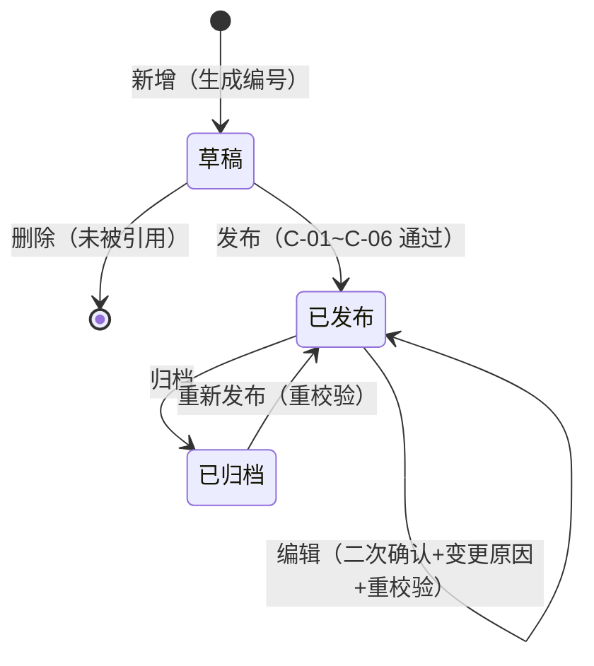

# 行业基线业务 PRD

## 0. 文档基础信息

| 项目 | 内容 |
| :--- | :--- |
| 文档名称 | 行业基线业务 PRD |
| 版本 | V1.1 |
| 状态 | 草稿（待业务评审） |
| 模块名称 | 行业基线录入（核心对象：行业基线） |
| 模块类型 | 基础数据维护 + 发布，**无审核流、无版本化** |
| 维护形态 | 列表 + 独立新增/编辑页（上表单 + 下阶段值表格）+ 独立详情页 |
| 所属层级 | 后台管理 → 产品碳基线库 → 行业基线录入（需求边界 §2.2；方案 §八 待增补 P33） |
| 更新时间 | 2026-10-27 |

**变更记录**

| 日期 | 版本 | 变更内容 |
| :--- | :--- | :--- |
| 2026-10-27 | V1.0 | 初版：确立「行业基线 = 排放强度基准值」「分阶段 = 生命周期阶段」两项口径；定义基线身份、阶段覆盖、合计校验、版本与发布、对标匹配规则、状态机 |
| 2026-10-27 | V1.1 | 按业务确认收敛：① **取消版本化**（去掉新建版本 / 版本对比 / 自动归档），改为「已发布可编辑 + 保存重校验 + 下游快照留史」；② 行业**必须为末级**，对标按「末级 → 逐级向上回退」；③ **开放组织自建**，新增数据来源与归属组织、平台/自建对标优先级；④ 状态收敛为草稿 / 已发布 / 已归档三态；⑤ Q01 / Q03 / Q05 / Q08 / Q09 关闭 |

**关联链接**

| 文档 | 路径 |
| :--- | :--- |
| 字段清单（字段唯一真相源） | `02prd/02-1后台管理/19产品碳基线库/行业基线字段清单.md` |
| 项目需求边界（模块范围） | `02全局背景/项目需求边界.md` §2.2 |
| 整体设计方案 | `04产品设计管理/00业务设计/产品碳足迹核算系统_整体设计方案_v1.2.md` |
| 行业库字段清单（口径 A） | `02prd/02-1后台管理/07行业/行业库字段清单.md` §9.1 |
| 生命周期阶段字段清单 / 业务 PRD | `02prd/02-1后台管理/05生命周期管理/` |
| 报告管理（对标展示消费方） | `02prd/02-2前台业务功能/06报告管理/` |

**文档分工表**

| 文档 | 负责内容 | 不负责内容 |
| :--- | :--- | :--- |
| 字段清单 | 字段、类型、来源、必填性、枚举、D01～D19 字段级约束 | 业务规则、发布与对标机制 |
| 业务 PRD（本文） | 定位边界、阶段覆盖与合计规则、变更与发布、对标匹配、状态矩阵 | 完整字段表、页面控件与布局 |
| Demo PRD | 页面骨架、控件选型、列宽、表格交互、校验展示、Mock 数据 | 业务规则定义 |
| 生命周期阶段 | 阶段字典、层级、适用系统边界 | 行业排放数值 |
| 报告 / 优势分析 | 对标结论的展示与措辞 | 基线数据维护 |

---

## 1. 需求概述

### 1.1 需求背景

需求边界把「产品碳基线库」定义为三块能力：**行业基线录入、分阶段排放基准值、产品碳标签模板**，定位是「用于对标、标签和报告展示，**不等同于政府或行业权威基准发布平台**」。本模块只做前两块。

现状缺口的实质是：系统能算出企业的产品碳足迹，但**没有一把行业尺子**。报告里「2.18 kgCO₂e/m³」这个数字，读者无法判断是行业领先还是落后；优势分析、减排诊断也无从下结论。

必须先解决三个口径问题，否则模块会被设计成另一个东西：

| # | 风险 | 本 PRD 的处理 |
| :-- | :--- | :--- |
| 1 | **与「阶段基线」撞名** | 系统内「阶段基线」已定义为「按边界从阶段库查出的**阶段集合**」（`生命周期阶段字段清单` §1.2、方案 §4.2.4 修订说明），只有骨架、无数值。本模块的「行业基线」是**排放强度数值**。全文统一：本模块不产生阶段集合、不参与项目阶段加载 |
| 2 | **「分阶段」被理解为时间分期** | 明确：**分阶段 = 生命周期阶段**（一级 / 二级），时间维度只有「基准年」；不设 2030 / 2035 目标值字段 |
| 3 | **基线被误用进核算链路** | 基线是**参考数据**，只用于对标与披露；核算引擎不读取基线数值（字段清单 D15） |

另有两条已确认的实现口径，直接决定数据结构：

| 决策 | 结论 | 对结构的影响 |
| :--- | :--- | :--- |
| **行业粒度** | 基线只绑**末级行业** | 一条基线一个末级行业；对标按「末级 → 逐级向上回退」，上级不重复建基线 |
| **版本化** | **不做** | 无版本号 / 版本表 / 新建版本；已发布可编辑并重新校验，历史由下游引用快照保护 |

同时，「行业基线由行业库承载」的旧表述（方案 §4.2.4 决策 D2 原文）与《行业库字段清单》§9.1 的口径 A（行业库不承载参数模板）冲突。本模块立场：**行业库只提供行业编码，基线数值独立建档**，需在方案附录二登记该口径修订。

### 1.2 需求目标

| # | 目标 | 可验证口径 |
| :--- | :--- | :--- |
| G1 | 建立行业级排放强度基准 | 每条基线可唯一定位到「数据来源 + 归属组织 + 末级行业 + 产品分类 + 边界 + 基准年 + 口径 + GWP 版本」 |
| G2 | 支持分阶段基准值维护 | 一级阶段全覆盖；合计与总值一致（±0.5%）；二级可选下钻且不重复计入 |
| G3 | 基线变更不污染历史 | 已发布可编辑但须重新校验；已出报告按引用快照冻结，不随主数据变化 |
| G4 | 对标可复现、不静默降级 | 同一匹配条件下必得同一基线；无匹配时明确提示 |
| G5 | 来源可举证、可区分归属 | 已发布基线必填来源类型 / 发布机构 / 基准年；平台基准与企业自建可区分并在报告标注 |

### 1.3 In Scope / Out of Scope

**In Scope**

| 能力 | 说明 |
| :--- | :--- |
| 基线列表与查询 | 按行业、产品分类、边界、基准年、状态、数据来源、来源类型、编号/名称筛选 |
| 新增 / 编辑基线 | 基线信息 + 阶段基准值（一级必填、二级选填） |
| 分阶段基准值维护 | 按边界带出阶段、逐项录入、实时汇总与覆盖率提示 |
| 发布 / 重新发布 | 发布前置校验（D02 / D08 / D09 / D10），通过后对外可引用 |
| 编辑已发布记录 | 二次确认 + 强制重新校验 + 变更原因，写操作日志 |
| 归档 | 退出对标候选，保留可查；可重新发布 |
| 查看详情 | 基线信息 + 阶段值 + 引用情况 |
| 组织自建基线 | 租户维护本组织基线，标注来源，不覆盖平台基线 |
| 对标引用 | 报告 / 优势分析按规则匹配并快照复制 |

**Out of Scope**

| 不做项 | 说明 |
| :--- | :--- |
| **版本化** | 不设版本号、版本表、新建版本、版本对比；历史靠下游快照（D14） |
| 阶段骨架维护 | 归生命周期阶段（A1-10）；本模块只读引用 |
| 纳入 / 排除规则 | 归阶段库「适用系统边界」+ 项目 P20；本模块不设纳入规则字段 |
| 核算公式 / 排放因子 | 归计算规则模板、排放因子库；本模块不承载 |
| 时间分期目标值（2025 / 2030 / 2035） | 本期不做；若需要另立「行业减排目标」对象 |
| 多级审核流 | 本期不做；「发布」动作即轻量把关，记录发布人 / 时间 |
| 权威性认定 / 政府背书 | 明确不做；平台仅如实记录来源，不判定基线权威性 |
| 界面导入 / 导出 | 不做（对齐基础库口径）；首发系统预置数据由平台一次性导入 |
| 碳标签模板 | 同属产品碳基线库，但独立模块 |

### 1.4 涉及角色

| 角色 | 数据域 | 在本模块的职责 |
| :--- | :--- | :--- |
| 平台运营管理员 | 平台域 | 维护**系统预置**基线（新增 / 编辑 / 发布 / 归档），全平台基准的唯一维护方 |
| 组织管理员 | `SUB_TREE` | 维护本组织**组织自建**基线；对系统预置基线只读 |
| 专业配置人员 | `SUB_TREE` | 只读，用于确认报告对标的基线口径 |
| 核算 / 报告人员 | `CURRENT` | 只读；在报告与对标分析中消费基线 |
| 审核员 / 核查员 | `SUB_TREE` | 只读；核查时核对基线来源、基准年与归属 |

### 1.5 影响范围

| 方向 | 模块 | 影响 |
| :--- | :--- | :--- |
| 上游 | 行业库（A1-4） | 只读引用**末级**行业编码；不回写、不加字段 |
| 上游 | 生命周期阶段（A1-10） | 只读引用阶段编码、层级、适用系统边界；阶段改名不回写已发布基线 |
| 上游 | 产品分类 / 计量单位库 / 数据字典 | 产品分类多选、功能单位、边界与 GWP 版本取值 |
| 上游 | 附件管理 | 承载依据文件 |
| 上游 | 组织架构 | 组织自建基线的归属组织与数据权限 |
| 下游 | 报告生成（P26） | 「行业对标」章节引用基线快照，须标注来源 / 基准年 / 数据质量；使用自建基线时须标注「企业自建基线」 |
| 下游 | 优势分析 / 减排诊断（三期） | 以基线为比较对象输出「优于 / 劣于行业」结论 |
| 下游 | 敏感性分析 | **无关联**：其「基准情景」是项目自身结果基线，与本模块同名不同物 |
| 边界 | 核算引擎 | **不读取**基线数值；核算结果不因基线变化而改变（D15） |

---

## 2. 用户与使用场景

### S01 维护一版新的木竹行业基线

| 项 | 内容 |
| :--- | :--- |
| 触发条件 | 协会发布 2025 年纤维板行业碳足迹统计值，需要入库供客户报告对标 |
| 操作流程 | 新增 → 选末级行业「纤维板制造 C2021」+ 产品分类「纤维板」+ 边界「摇篮到大门」+ 基准年 2025 + 功能单位「1 m³」→ 录入来源类型 / 发布机构 / 依据文件 → 系统按边界带出阶段 → 逐项录入阶段值 → 查看汇总（Σ = 总值、覆盖率 3/3）→ 发布 |
| 预期结果 | 生成 `IB-2025-C2021-001`，数据来源「系统预置」，状态「已发布」，全租户可对标引用 |

### S02 已发布基线数值录错，需要修正

| 项 | 内容 |
| :--- | :--- |
| 触发条件 | 已发布后发现「生产」阶段值取错，应改为 1.42 |
| 操作流程 | 详情页点「编辑」→ 二次确认（提示已被 N 份报告引用）→ 填写变更原因 → 修改阶段值 → 保存（自动重新校验） |
| 预期结果 | 记录就地更新，`updatedBy / updatedAt` 刷新，变更原因写入操作日志；**已引用该基线的历史报告仍显示快照值，不受影响**；新生成的报告使用新值 |

### S03 同一行业两个边界各建一条

| 项 | 内容 |
| :--- | :--- |
| 触发条件 | 客户既要摇篮到大门报告，也要摇篮到坟墓报告 |
| 操作流程 | 先建 `gate` 基线，再点「复制为新基线」改边界为 `grave`、补录运输 / 使用 / 末期阶段 |
| 预期结果 | 两条独立基线，编号不同；**不得在一条基线内混用两个边界**（D04） |

### S04 同一行业按品类细分

| 项 | 内容 |
| :--- | :--- |
| 触发条件 | 「木材加工」行业内，纤维板与家具的排放强度差异过大，合并一条会误导对标 |
| 操作流程 | 建两条基线：产品分类分别选「纤维板」「家具」，**行业均选同一个末级行业**，其余维度一致 |
| 预期结果 | 两条基线并存；对标时按产品分类命中，未命中分类时取「全品类」基线 |

### S05 发布时阶段缺失被阻断

| 项 | 内容 |
| :--- | :--- |
| 触发条件 | 录入时漏填「生产」阶段 |
| 操作流程 | 点「发布」 |
| 预期结果 | 发布置灰 / 阻断，提示「当前边界下必需阶段缺失：生产（一级）」并定位到行；补齐后方可发布（D08） |

### S06 阶段值与总值不一致

| 项 | 内容 |
| :--- | :--- |
| 触发条件 | Σ 阶段值 2.41，但手工把总值改为 2.30（超 ±0.5%） |
| 操作流程 | 修改总值 → 系统提示超差 → 强制填写差异说明 |
| 预期结果 | 未填说明则阻断保存；填写后可发布，详情页展示「总值经手工调整 + 差异说明」（D09） |

### S07 报告对标时无可用基线

| 项 | 内容 |
| :--- | :--- |
| 触发条件 | 产品的末级行业为「竹制品制造」，该行业尚未维护基线，且上级行业也无基线 |
| 操作流程 | 生成报告 → 查看「行业对标」章节 |
| 预期结果 | 显示「暂无可用行业基线」并给出原因；**不得跨行业借用、不得取未来基准年**（M5） |

### S08 阶段库改名 / 禁用后的回显

| 项 | 内容 |
| :--- | :--- |
| 触发条件 | 阶段「生产过程」被改名为「生产制造」，或该阶段被禁用 |
| 操作流程 | 查看已发布基线的详情 |
| 预期结果 | 已发布基线仍显示**录入时的阶段名称快照**（D12）；禁用阶段不出现在新建基线的可选列表，但历史基线可正常回显 |

### S09 租户维护本企业的基线（组织自建）

| 项 | 内容 |
| :--- | :--- |
| 触发条件 | 某集团有平台未覆盖的细分产品，且内部有实测汇总值，希望用于内部对标 |
| 操作流程 | 组织管理员新增基线 → 数据来源自动记为「组织自建」、归属组织为本组织 → 填写来源类型「企业实测汇总」+ 样本数 → 发布 |
| 预期结果 | 基线仅本组织及上级可见；报告引用时显示「企业自建基线（非平台基准）」，且不顶替同身份的平台预置基线（D19） |

### S10 平台基线与自建基线同身份并存

| 项 | 内容 |
| :--- | :--- |
| 触发条件 | 平台已发布「2025 纤维板 · 摇篮到大门」，某租户又自建了一条同身份基线 |
| 操作流程 | 该租户生成报告 → 查看对标 |
| 预期结果 | **默认取平台预置基线**；自建基线作为可选对照，切换使用时须在报告中显式标注并留痕（见 Q11） |

---

## 3. 功能清单

| 模块 | 功能点 | 功能描述 | 优先级 |
| :--- | :--- | :--- | :---: |
| 行业基线 | 基线列表 | 分页展示编号 / 名称 / 数据来源 / 行业 / 边界 / 基准年 / 功能单位 / 总值 / 状态 / 更新时间 | P0 |
| 行业基线 | 查询 | 行业、产品分类、边界、基准年区间、状态、数据来源、来源类型、编号 / 名称 | P0 |
| 行业基线 | 新增基线 | 基线信息表单 + 阶段值表格（按边界带出阶段；行业仅末级可选） | P0 |
| 行业基线 | 编辑基线 | 草稿直接编辑；已发布编辑需二次确认 + 变更原因 + 重新校验 | P0 |
| 行业基线 | 分阶段基准值维护 | 一级必填、二级选填；实时汇总、覆盖率、二级合计校验 | P0 |
| 行业基线 | 发布 / 重新发布 | 前置校验（阶段覆盖 / 合计 / 唯一键）；记录发布人 / 时间 | P0 |
| 行业基线 | 归档 | 退出对标候选，保留可查；支持重新发布 | P0 |
| 行业基线 | 查看详情 | 基线信息 + 阶段值（含占比条形）+ 引用情况 + 操作日志入口 | P0 |
| 行业基线 | 复制为新基线 | 按不同边界 / 品类快速派生（身份不同，编号重新生成） | P1 |
| 行业基线 | 组织自建基线 | 租户维护本组织基线，数据来源与归属组织自动写入 | P1 |
| 行业基线 | 批量导入 | 界面不做；首发系统预置数据由平台一次性导入（Q06） | P2 |

---

## 4. 基线与阶段基准值规则

### 4.1 基线身份（业务唯一键）

| # | 规则 |
| :-- | :--- |
| B1 | 基线身份 = **数据来源 + 归属组织 + 末级行业 + 产品分类组合 + 系统边界 + 基准年 + 排放口径 + GWP 版本** |
| B2 | 同一身份下**仅一条记录**（不分版本）；组织自建与平台预置可同身份并存，但同一组织内不得重复（D02） |
| B3 | 身份不同则各自独立：不同边界、不同基准年、不同产品分类均为不同基线，编号各自生成 |
| B4 | 「适用产品分类」为空表示**该末级行业全品类**；同行业下，分类命中的基线优先级高于全品类基线 |
| B5 | 身份字段（行业 / 分类 / 边界 / 基准年 / 口径 / GWP）创建后不可改；确需变更请新建基线（基准年 D05 明确只读） |

### 4.2 阶段来源与覆盖

| # | 规则 |
| :-- | :--- |
| P1 | 阶段候选**只读引用**生命周期阶段库，且只取「启用」状态 |
| P2 | 候选范围 = 阶段库中「适用系统边界为空 **或** 包含本基线边界」的阶段（与项目加载阶段的判定同源） |
| P3 | 一级阶段**必须全覆盖**才能发布（D08）；二级阶段**选填下钻** |
| P4 | 录入二级阶段时，其所属一级阶段必须已有值；否则阻断（S2） |
| P5 | 同一基线内阶段编码不重复（D07） |
| P6 | 阶段名称 / 层级**引用即复制**；阶段库后续改名、调层级、禁用不回写已发布基线（D12） |
| P7 | 边界变更 = 阶段集合变更：切换边界时清空已录阶段值并二次确认（C1） |

### 4.3 数值与合计

| # | 规则 |
| :-- | :--- |
| N1 | 阶段值单位固定为 **kgCO₂e / 功能单位**；功能单位为「数值 + 单位」（如 `1 m³`），必填 |
| N2 | 阶段值 `≥ 0`，最多 4 位小数；不允许留空表示 0（0 必须显式录入，与「未录入」区分） |
| N3 | `totalEmission` 默认 = Σ 一级阶段值（**不含二级**，避免重复计入） |
| N4 | 合计一致性校验：Σ一级与 `totalEmission` 的相对偏差 ≤ 0.5%；超差须填差异说明（D09） |
| N5 | 二级阶段存在时，`Σ二级 = 所属一级`（容差 0.01），否则阻断发布；**二级值只做结构展示，不进入总值** |
| N6 | `advancedValue`（行业先进值）若填写，须 `≤ stageEmission`；反向填写提示「疑似口径填反」 |
| N7 | `stageShare = stageEmission / totalEmission`，只读派生；总值为 0 时显示「—」 |
| N8 | 功能单位与报告声明单位不一致时**不自动换算**，只提示「单位不可比」（D17） |

### 4.4 变更规则（无版本化）

| # | 规则 |
| :-- | :--- |
| E1 | 草稿：可任意编辑、可删除（未被引用时） |
| E2 | 已发布：**可编辑**，但保存时必须重新通过 D08 / D09 / D10 校验；校验不通过则阻断保存（D11） |
| E3 | 编辑已发布记录须二次确认，弹窗明示「已被 N 份报告引用，历史报告按快照不受影响」，并**强制填写变更原因**（≤200 字符，Q12） |
| E4 | 已发布记录**不产生历史副本**；变更痕迹由「更新人 / 更新时间 + 操作日志（变更原因、变更前后值）」承载 |
| E5 | 已出报告**不受主数据变更影响**：引用时已复制快照（D14）；需按新数值对标须重新生成报告版本 |
| E6 | 已归档：不可编辑；可「重新发布」回到已发布（须重新校验），或保持归档 |
| E7 | 任何状态均**不提供物理删除**（草稿未被引用除外） |

---

## 5. 发布与对标

### 5.1 发布前置校验

```text
点「发布 / 保存已发布记录」
  ├── 身份完整性：数据来源 / 归属组织 / 末级行业 / 边界 / 基准年 / 功能单位 / 口径 / GWP 版本
  ├── 阶段覆盖：该边界下全部一级阶段已录入（D08）
  ├── 二级一致：Σ二级 = 所属一级（D10）
  ├── 合计一致：|Σ一级 − 总值| / 总值 ≤ 0.5%，否则差异说明必填（D09）
  ├── 唯一性：同「数据来源 + 归属组织 + 身份」无其他记录（D02）
  └── 来源完整性：来源类型 / 发布机构 / 基准年 必填；对外披露须有依据文件
        ↓
  全部通过 → 发布成功 / 保存成功
  任一失败 → 阻断并列出失败项，定位到字段 / 行
```

| # | 校验项 | 级别 | 失败表现 |
| :-- | :--- | :---: | :--- |
| C-01 | 身份字段完整性（含末级行业） | 阻断 | 标红对应字段；选到非末级行业时直接禁用选项 |
| C-02 | 一级阶段覆盖 | 阻断 | 列出缺失阶段清单 |
| C-03 | 二级合计一致 | 阻断 | 定位到所属一级阶段行 |
| C-04 | 总值一致（±0.5%） | 阻断（可填说明解除） | 弹窗要求填写差异说明 |
| C-05 | 同身份唯一 | 阻断 | 提示「同身份已存在基线，请直接编辑或调整分类 / 边界 / 年份」 |
| C-06 | 来源与机构必填 | 阻断 | 标红 |
| C-07 | 依据文件 | 提示 | 不影响发布，详情页标注「未附依据」 |
| C-08 | 先进值方向 | 提示 | 提示「疑似口径填反」 |
| C-09 | 变更原因（编辑已发布） | 阻断 | 弹窗内必填，未填不可保存 |

### 5.2 对标匹配规则

```text
报告 / 优势分析请求对标（行业 + 产品分类 + 边界 + 口径 + GWP + 基准年上限）
        ↓
① 过滤：状态 = 已发布；数据来源 ∈ {系统预置, 本组织及上级组织自建}
② 行业：末级精确命中 → 未命中则逐级向上回退（小类 → 中类 → 大类 → 门类）
③ 产品分类：分类命中优先；无命中取「全品类」（productCategoryCodes 为空）
④ 边界 / 口径 / GWP 版本：必须完全一致（不做跨口径换算）
⑤ 基准年：取 ≤ 报告年 的最近一条（不插值、不取未来）
⑥ 同身份平台预置与组织自建并存：**平台预置优先**；自建仅在无平台命中时兜底
        ↓
命中 1 条 → 生成引用快照（编号 + 基准年 + 阶段值 + 来源 + 质量 + 引用时间）
命中 0 条 → 「暂无可用行业基线」，不降级
命中多条 → 按「分类精确 > 数据来源优先 > 基准年新」排序取第一条，并展示候选清单
```

| # | 规则 |
| :-- | :--- |
| M1 | 只匹配「已发布」记录；草稿与已归档不参与 |
| M2 | **边界 / 口径 / GWP 版本必须一致**，禁止跨边界、跨口径对比（否则结论无效） |
| M3 | 基准年取 `≤ 报告年` 的最近值；报告年早于所有基线时显示「无匹配」 |
| M4 | 行业按「末级精确 → 逐级向上」回退；回退命中时，报告须标注「对标至上级行业：木材加工」 |
| M5 | 无匹配时**明确提示，不静默取最新、不跨行业借用** |
| M6 | 引用时**复制快照**；基线后续编辑不影响已出报告，需新版对标须重新生成报告版本 |
| M7 | 快照必须携带：基线编号、基准年、来源类型、发布机构、数据质量、**数据来源（平台 / 自建）**，用于报告披露 |
| M8 | 使用组织自建基线时，报告须标注「企业自建基线（非平台基准）」；平台预置命中时不得使用自建值替代 |

### 5.3 不可比与降级处理

| 场景 | 处理 |
| :--- | :--- |
| 功能单位不同（`1 m³` vs `1 kg`） | 不换算，展示「单位不可比」，可比性提示置灰 |
| 口径不同（`total` vs `fossil`） | 不匹配，提示「口径不一致，建议按同口径基线对比」 |
| 数据质量为「低」 | 允许对标，结论标注「仅供参考」，不进入正式报告的结论句 |
| 基线已归档 | 历史报告仍展示快照并标注「基线已归档」；新报告不使用 |
| 仅命中上级行业基线 | 允许对标，标注「对标至上级行业」，不得表述为「本行业基准」 |

---

## 6. 业务规则

| 规则编号 | 规则名称 | 触发条件 | 处理逻辑 | 例外策略 |
| :--- | :--- | :--- | :--- | :--- |
| R-001 | 编号唯一且不可改 | 新增 / 编辑 | `IB-{基准年}-{行业编码}-{3位流水}`，全平台唯一（D01） | 无例外 |
| R-002 | 同身份唯一 | 新增 / 发布时 | 同「数据来源 + 归属组织 + 身份」仅一条（D02） | 平台与自建可并存 |
| R-003 | 行业必须末级 | 保存时 | 只能选无下级节点且启用的行业（D03） | 行业被禁用后历史基线仍可回显 |
| R-004 | 边界单选且不可混 | 保存时 | 一条基线一个边界；切换即清空阶段值（D04 / P7） | 无例外 |
| R-005 | 基准年仅新增可填 | 保存时 | 4 位、`≤ 当前年`、创建后只读；数据期间落在基准年内（D05） | 换年份需新建基线 |
| R-006 | 功能单位必填 | 保存时 | 数值 > 0 + 启用单位（D06） | 无例外 |
| R-007 | 阶段值合法 | 保存时 | `≥ 0`、4 位小数、不重复、不留空代 0（D07 / N2） | 无例外 |
| R-008 | 一级阶段全覆盖 | 发布 / 保存已发布时 | 缺失即阻断并列出清单（D08） | 无例外 |
| R-009 | 总值一致 | 发布 / 保存已发布时 | 容差 ±0.5%；超差须填差异说明（D09） | 填说明可发布 |
| R-010 | 二级展示不计总 | 发布 / 保存时 | `Σ二级 = 所属一级`（D10）；总值只汇总一级 | 无例外 |
| R-011 | 已发布可编辑、须重校验 | 编辑已发布时 | 二次确认 + 变更原因 + 重新校验；失败即阻断（D11 / E2 / E3） | 无例外 |
| R-012 | 变更留痕 | 已发布记录被修改时 | 写操作日志（变更人 / 时间 / 原因 / 前后值）；不生成历史副本（E4） | 无例外 |
| R-013 | 归档不删除 | 归档 / 删除操作 | 无物理删除；归档可查、可重新发布（D13 / E6） | 无例外 |
| R-014 | 快照不追溯 | 下游引用后 | 基线修改不影响历史报告；重出报告走新报告版本（D14 / M6） | 无例外 |
| R-015 | 不参与核算 | 核算引擎读取时 | 引擎不得读取基线数值（D15） | 架构约束 |
| R-016 | 阶段快照 | 阶段库改名 / 禁用 | 已发布基线保留录入时名称与层级（D12） | 无例外 |
| R-017 | 对标不静默降级 | 匹配失败 | 明确提示无可用基线；不取未来年份、不跨行业借用（M5） | 无例外 |
| R-018 | 不可比提示 | 单位 / 口径 / GWP 不一致 | 不换算、不匹配，提示原因（D17 / §5.3） | 无例外 |
| R-019 | 自建基线隔离 | 组织自建基线 | 仅本组织及上级可见；不覆盖、不顶替平台预置（D18 / D19） | 无例外 |
| R-020 | 平台基线优先对标 | 同身份两类基线并存 | 默认取平台预置；自建仅兜底或显式选择（M8） | 见 Q11 |

---

## 7. 状态与操作矩阵

### 7.1 状态维度

| 状态维度 | 取值 | 来源 |
| :--- | :--- | :--- |
| 基线状态 | 草稿 / 已发布 / 已归档 | 字段清单 §5.5（用户操作） |
| 数据来源 | 系统预置 / 组织自建 | 字段清单 §5.6（系统写入） |
| 引用状态 | 未被引用 / 已被报告或分析引用 | 系统自动关联（只读） |

> 本模块**无版本维度、无审核维度**；「发布」记录发布人 / 时间，修改记录变更原因，作为轻量留痕。

### 7.2 状态机



### 7.3 操作矩阵

| 状态 | 编辑 | 删除 | 发布 | 归档 | 被对标引用 |
| :--- | :---: | :---: | :---: | :---: | :---: |
| 草稿 | 是 | 是（未被引用） | 是 | — | 否 |
| 已发布 | 是（须重校验 + 变更原因，R-011） | 否 | — | 是 | 是 |
| 已归档 | 否 | 否（R-013） | 是（重新发布） | — | 否（历史快照可回显） |

**按数据来源的编辑权限**

| 数据来源 | 平台运营 | 组织管理员 | 其他角色 |
| :--- | :---: | :---: | :---: |
| 系统预置 | 可编辑 / 发布 / 归档 | 只读 | 只读 |
| 组织自建 | 只读（平台不代管租户数据） | 可编辑 / 发布 / 归档（本组织） | 只读（上级组织可见） |

**闭环校验**

- 草稿 → 已发布 → 已归档 主链可达；已归档可「重新发布」回到已发布，状态闭环；
- 已发布不支持回退为草稿（避免下线中的基线仍对外可见的窗口）；
- 删除仅限「草稿 + 未被引用」；已发布与已归档一律不可删；
- 无版本分支、无审核分支，同一身份只维护一条记录。

---

## 8. 上下游与引用关系

| 方向 | 关联模块 | 引用字段 | 联动规则 |
| :--- | :--- | :--- | :--- |
| 上游 | 行业库（A1-4） | `industryCode` | 只读引用**末级**行业；行业禁用后历史基线可回显并标注「行业已禁用」；不回写行业库 |
| 上游 | 生命周期阶段（A1-10） | `stageCode` / `stageLevel` / `boundaries` | 只读引用，按边界过滤候选；阶段改名 / 禁用不影响已发布基线（R-016） |
| 上游 | 产品分类 | `productCategoryCodes` | 多选；为空 = 全品类 |
| 上游 | 计量单位库 / 数据字典 | `unitCode` / `boundary` / `gwpVersion` | 取值来源，不新增枚举 |
| 上游 | 附件管理 | `attachments` | 依据文件；对外披露须附 |
| 上游 | 组织架构 / 数据权限 | `orgId` | 决定组织自建基线的归属与可见范围（`SUB_TREE`） |
| 下游 | 报告生成（P26） | 基线编号 + 基准年 + 阶段值快照 | 报告「行业对标」章节；须标注来源 / 基准年 / 数据质量 / 数据来源 / 上级行业回退说明 |
| 下游 | 优势分析 / 减排诊断（三期） | 同上 | 输出「优于 / 劣于行业」结论，附可比性说明 |
| 下游 | 数据驾驶舱 / 看板（三期） | 基线总值 / 阶段占比 | 只读展示，不参与计算 |
| 边界 | 核算引擎 / 核算结果（P24 / P25） | — | **不读取**（R-015）；核算结果不因基线变化而改变 |
| 边界 | 敏感性分析 | — | **无关联**，其「基准情景」为项目自身结果基线 |

---

## 9. 待确认事项

### 9.1 已确认决策

| 编号 | 结论 |
| :--- | :--- |
| **Q01 行业粒度** | 绑**末级行业**；对标按「末级精确 → 逐级向上回退」命中，上级节点不重复建基线（D03 / M4） |
| **Q03 阶段粒度** | 一级必填全覆盖、二级选填下钻；**二级只做展示，不进入总值**（P3 / N5 / R-010） |
| **Q05 租户自建** | **开放**；以「数据来源 = 组织自建」标注，报告须标注「企业自建基线」，不覆盖平台预置（D18 / D19 / R-019） |
| **Q08 版本化** | **不做**：无版本号 / 版本表 / 新建版本 / 版本对比；已发布可编辑 + 重校验，历史靠快照（E1～E7 / R-011） |
| **Q09 是否进核算** | **不进入**核算链路，仅用于对标与披露（D15 / R-015） |

### 9.2 其他待确认

| 编号 | 问题 | 影响 | 当前建议 | 状态 |
| :--- | :--- | :--- | :--- | :--- |
| Q02 | 是否强制按产品分类细分？ | B4、M3 | 不强制；同行业品类差异大时建议细分，为空视为全品类 | 待确认 |
| Q04 | 是否保留「行业先进值」？ | N6、对标结论 | 保留（行业前 10% / P5），支撑「先进性」判断 | 待确认 |
| Q06 | 是否开放界面导入 / 导出？ | 功能清单 | 均不做；首发系统预置数据由平台一次性导入（对齐基础库口径） | 待确认 |
| Q07 | 多口径：只维护 `total` 还是四口径？ | `caliber`、对标匹配 | 本期只维护主口径（默认 `total`）；其余口径留空 | 待确认 |
| Q10 | 首发预置数据范围 | Mock / 预置 | 通用制造业 1 套 + 木竹（纤维板、竹地板）2 套 | 待确认 |
| **Q11** | 报告是否允许**主动选择**自建基线（而非仅作兜底）？ | M8、R-020 | 默认平台优先、自建兜底；若允许切换，报告须显式标注并留痕 | 待确认 |
| **Q12** | 编辑已发布基线是否强制填写「变更原因」？ | E3、C-09 | 强制（≤200 字符），便于核查时解释数值变化 | 待确认 |
| Q13 | 「行业基线由行业库承载」的方案表述如何处理？ | 方案 §4.2.4 决策 D2、附录二 | 在方案附录二登记偏离：基线数值独立建档，行业库仅提供编码 | 待确认 |

---

## 附一：预置数据示例（Mock，仅示意结构，非业务真值）

**示例 A：木竹 · 纤维板 · 摇篮到大门（`IB-2025-C2021-001`）**

| 项 | 值 |
| :--- | :--- |
| 数据来源 / 归属组织 | 系统预置 / 全平台 |
| 适用行业 | 制造业 / 木材加工和木、竹、藤、棕、草制品业 / 人造板制造 / **纤维板制造（末级）** |
| 适用产品分类 | 纤维板 |
| 系统边界 | 摇篮到大门 `gate` |
| 基准年 | 2025 |
| 功能单位 | `1 m³` |
| 排放口径 / GWP | `total` / IPCC AR6 GWP100 |
| 来源类型 / 发布机构 | 行业统计 / 中国林产工业协会 |
| 数据质量 | 中 |

| 一级阶段 | 二级阶段（选填，不计总） | 基准值 kgCO₂e/m³ | 先进值 | 占比 |
| :--- | :--- | ---: | ---: | ---: |
| 种植与培育 | 育苗与种植 / 抚育管理 | 0.21 | 0.15 | 9.6% |
| 原材料获取 | 原材料获取 / 原材料运输 | 0.62 | 0.48 | 28.4% |
| 生产 | 生产过程 / 碳化处理 | 1.35 | 1.02 | 61.9% |
| **合计** | — | **2.18** | — | **100.0%** |

**示例 B：木竹 · 纤维板 · 摇篮到坟墓（`IB-2025-C2021-002`）**

| 一级阶段 | 基准值 | 说明 |
| :--- | ---: | :--- |
| 种植与培育 | 0.21 | 同 A |
| 原材料获取 | 0.62 | 同 A |
| 生产 | 1.35 | 同 A |
| 运输与交付 | 0.18 | 新增（`gate` 下不适用） |
| 使用 | 0.05 | 新增 |
| 生命周期末期 | 0.12 | 含回收与最终处置；若计入固碳须含生物碳释放 |
| **合计** | **2.53** | — |

**示例 C：组织自建基线（`IB-2025-C2021-003`）**

| 项 | 值 |
| :--- | :--- |
| 数据来源 / 归属组织 | 组织自建 / 某竹木集团 |
| 身份维度 | 同示例 A（纤维板 / `gate` / 2025 / `total` / AR6） |
| 来源类型 / 数据质量 | 企业实测汇总（样本 12） / 中 |
| 对标表现 | 平台基线优先；本记录仅在报告主动选用时展示，并标注「企业自建基线」 |

> 示例 B 的「生命周期末期」与生物碳对称规则（E16）相关：若企业在原料端计入 CO₂ 吸收，末期必须对称计入生物碳释放，否则对标结论须标注「口径不可比」（D16）。

---

## 附二：受影响的文档

| 文档 | 影响 |
| :--- | :--- |
| 行业基线字段清单 | 已同步 V1.1（取消版本化、末级行业、数据来源 / 归属组织） |
| 整体设计方案 v1.2 §4.2.4 / 附录二 | 需登记两点偏离：① 行业基线数值独立建档、行业库仅提供编码；② 基线不设版本化（原「按行业预置多套基线」的版本语义） |
| 方案 §八 页面清单 | 需增补 P33「行业基线录入」 |
| 物料 / 行业库字段清单 | 本模块**保留**「数据来源」，与两模块「不设数据来源」形成有意偏离，需在附录二说明理由 |
| 报告生成（P26） | 「行业对标」章节须引用本模块快照，并标注来源 / 基准年 / 质量 / 数据来源 / 回退行业 |
| 优势分析 / 减排诊断（三期） | 以本模块为比较对象，需复用 §5.2 匹配规则 |
| 生命周期阶段字段清单 | 无需改动；本模块只消费其阶段与边界枚举 |
