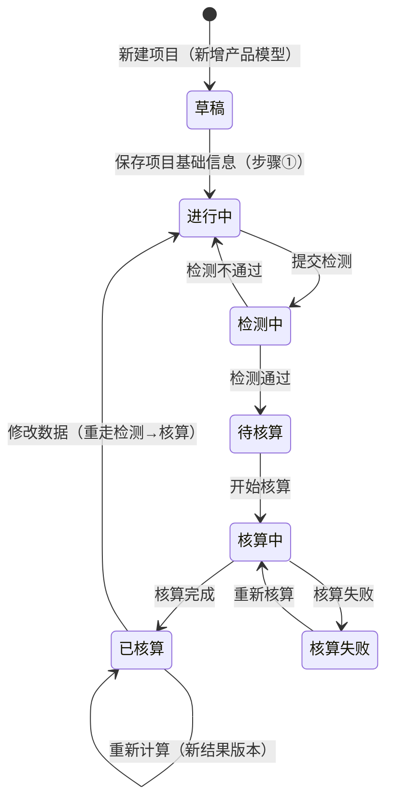

# 碳核算项目 · 模块拆分与交互骨架

> **【去模型修订声明 · 2026-09-24，全文优先】**：核算模型已整体废弃，项目**不再引用核算模型**，改为**直接选择产品 → 复制带入工艺 + 工序（含公式）**。本文正文涉及以下口径按新规则理解：
> - 「核算项目 = 1 产品 + 1 边界 + 1 模型快照」「上游依赖核算模型」「引用核算模型」→ 删除模型相关口径（项目 = 1 产品 + 1 边界，工序与公式从产品复制带入）；
> - 步骤②「工序与数据」→ 更名「**工序与数据**」；
> - 「按「阶段 → 工艺流程 → 核算工序」查看模型结构」「阶段纳入确认」→ 阶段仅作为工序/工艺的**标签**展示，**不再有阶段勾选 / 排除**；
> - 「数据项绑定模型公式」→ **数据项绑定「工序投入产出项公式」**（公式下沉到工序、随工序带入、前台只读）；
> - 产品总碳排放 = **Σ 各工序排放**（引擎自动汇总，无需配置）。
> 具体规则见《工序业务 PRD》§4.8 与《核算模型业务 PRD》文首废弃声明。

> **【以原型为准修订声明 · 2026-10-13（V1.2），全文优先，废止 2026-09-24 旧声明中的过时条款】**：以下口径以**前端原型**（`06prototypes/6-1系统原型骨架/src/pages/pcf/`）为唯一真相源，本文及各子模块文档如有冲突**一律以原型为准**：
>
> **① 列表改为「扁平一层」**：一级 `/pcf/project` = **核算记录列表**（一行 = 一条核算记录，同一产品可有多条记录）。列 = 产品名称（链接）/ 核算编号 / 系统边界 / 时间边界 / 完成状态 / 更新时间 / 操作（`编辑`或`查看` + `删除`）；查询 = 产品名称（模糊）+ 更新时间（起止区间）；**删除不受状态限制**（任意状态均可删除，二次确认「删除后不可恢复」）。原「产品维度两层结构 + 二级 `/pcf/project/product/:productId`」**已废弃**（原型 `ProjectListPage.tsx`）。
>
> **② 新增流程 = 「新增产品模型」下拉**：列表右上主按钮下拉三项——**自定义核算**（空白草稿，不强制选产品）/ **从平台模型库选择** / **从我的模型库选择**（打开选模型弹窗，确认后带模型进入草稿）。草稿路由 = `/pcf/project/new`（自定义）、`/pcf/project/new/model/:modelId`（选模型）、`/pcf/project/new/:productId`（从产品进入）；**草稿不落库**（仅内存），步骤①「保存」才创建核算项目并跳转正式项目。原「新增产品 → 弹窗选上架产品 → 直接建草稿」口径**作废**（原型 `NewProjectModelMenu.tsx` / `ModelPickerModal.tsx` / `ProjectWorkbenchPage.tsx`）。
>
> **③ 步骤条 = 4 步**：① 目标与范围 ② **产品建模** ③ 数据检测 ④ **碳足迹核算与结果**。**报告环节已于 2026-10-12 从核算流程移除**（核算结果为最后一个节点），报告能力改由「前台业务平台 · 报告管理」（企业信息维护 / 报告编制 / 敏感性分析 / 数据质量评价，**暂占位**）承载；「已归档」状态已移除（核算记录不做归档，删除不受状态限制）。
>
> **④ 步骤①「目标与范围」= 两面板**：面板一「基本信息与产品」= 统计时间（必填）/ 核算标准（必填，引用标准文件库）/ 产品名称（必填，可自行录入或「引用产品」带出）/ 规格 / 产品分类 / 所属行业 / **声明/功能单位（必填：数值 + 单位）** / **产品图片（必填）**；面板二「生命周期阶段」= **系统边界**（卡片式单选，取值来自「平台支撑 · 数据字典 · 系统边界」启用项）+「生命周期阶段配置」弹窗（一级/二级阶段勾选，一级联动二级，可全选/全不选）+ 已纳入 X/Y 汇总。**已移除**：项目名称（按产品名称自动生成、仅内部留存）、核算主体组织（自动带出）、备注、型号、产品编码/产品版本展示、核算公式（引擎内置）、单位转换系数、产品净重/净重单位。产品候选来自「**我的产品库**」（自己新增 / 引用平台产品，仅上架可选）。
>
> **⑤ 生命周期阶段库 = 5 个通用一级阶段 + 二级阶段**（二级挂一级下，按「适用系统边界」带出，如「原材料获取-原材料运输」）；原「只保留 5 个通用一级、删除二级阶段」口径**作废**；步骤①按**核算边界**带出、默认全部纳入、可取消（原型 `LifecycleStageConfigModal.tsx`）。
>
> **⑥ 步骤②「产品建模」（原「工序与数据」已更名且重构）**：左树 = **生命周期阶段（仅末级可点击）** + **继续追溯链路**（数据项递归）；右侧 = **统一数据列表**（输入/输出合并在同一张表），列 = 名称 / 数据项类型（原辅料 / 自然资源 / 能源及能源介质 / 产品 / 中间产品 / 副产品 / 排放物 + 排放物子类 废水/废渣/废气）/ **单位产品用量（可为负）** / 单位 / **上游过程名称**（未追溯时「引用因子」或「继续追溯」二选一；已引用因子可更换或撤回）/ 操作（**数据凭证**附件 + 删除）；支持 **CSV 导入**（下载模板 → 上传 → 校验 → 导入）；保存校验 = 名称 + 单位产品用量必填。原「工序 / 工艺流程 / 绑定公式列 / 动态变量列 / 排放来源列 / 分配比例 / 新增工序」口径**全部作废**（原型 `ProjectStepTwo.tsx`）。
>
> **⑦ 计算入口**：步骤① **不再引用「核算公式」**（V0.8，2026-10-12）——碳核算计算引擎内置代码层级，暂按默认口径（行级 `数量 × 排放因子` → 阶段 `SUM` → 全局 `SUM`）求值；《碳足迹核算业务 PRD》「项目引用核算公式」口径**作废**（原型 `mock` `runPcfCalc` 注释）。

## 0. 文档基础信息

| 项目 | 内容 |
| :--- | :--- |
| 文档名称 | 碳核算项目 · 模块拆分与交互骨架 |
| 版本 | V1.3 |
| 状态 | 草稿（待业务确认） |
| 模块名称 | 产品碳足迹核算（前台业务平台主链） |
| 文档定位 | 前台核算主链的**模块级基线文档**：定义子模块拆分、交互容器形态、步骤条、状态映射、页面清单与路由。是后续各子模块《字段清单 / 业务 PRD / Demo PRD / 原型》的**公共前置**，本身不含字段与控件细节 |
| 上游依据 | 《整体设计方案 v1.2 r4》§2.3 B1、§四、§5.1、§5.2、§5.3、§5.4、§5.5、§八；《角色可见范围分层与本期后置清单 v1.0》§2.3 |
| 落地位置 | 文档：`04产品设计管理/02prd/02-2前台业务功能/01 碳核算项目/`；原型：`06prototypes/6-1系统原型骨架/src/pages/pcf/` |

**本文件不做**：字段定义与枚举（→ 各子模块《字段清单》）、控件类型与校验时机（→ 《Demo PRD》）、接口与库表结构。

**变更记录**

| 日期 | 版本 | 变更内容 |
| :--- | :--- | :--- |
| 2026-09-23 | V0.1 | 初版：按方案 §5 主流程/状态机 + §八 页面清单，拆出 6 个交付批次，定义「列表 + 项目工作台（左侧步骤导航）」交互骨架与状态映射 |
| 2026-09-23 | **V0.2** | 按业务反馈修订（P1–P4）：**P1 步骤导航由左侧改为「顶部步骤条」**（新建 / 编辑页同样在表单上方展示，见 §4）；**P2 报告确认由核算人员执行**（§9 D10）；**P3 移除「已作废」状态与作废动作**，取消项目统一走「删除」（§5 / §6 / §9 D08）；**P4 核算主体组织不由用户手选**，默认取当前登录用户所属组织（§9 D09，字段仍保留为数据权限锚点） |
| 2026-09-23 | **V0.3** | 按业务反馈修订（P5–P8）：**P5 产品仅允许引用产品库**，取消项目内自定义产品（§9 D11）；**P6 步骤合并**：「目标与范围」与「产品与边界」合并为第①步，步骤条 9 步 → 8 步（§4.3 / §9 D12）；**P7 编辑约束放宽**：核算完成前均可编辑（§5.2 / §9 D13）；**P8 单位口径**：界面统一叫「单位」、取值来自计量单位库（§9 D14） |
| 2026-09-23 | **V0.4** | 按业务反馈修订：**P9 核算方法改为可选**，选项来自标准文件库（仅现行标准），未交付前用假数据（§9 D15）；**P10「核算年度」与「核算周期」合并为「统计时间」**（起止区间），并**删除「核算地点」**（§9 D16 / §4.3 / 线框） |
| 2026-09-23 | **V0.5** | 按业务反馈修订：**P11 字段可编辑性放开**——步骤①除「引用产品带出字段」外其余字段均可修改（§9 D17）；**P12 步骤①表单重排**为「基本信息 / 核算依据 / 产品 / 单位与净重」四个分组面板（纯界面优化，不改字段） |
| 2026-09-23 | **V0.6** | 按业务反馈修订（P13–P17）：**P13 工艺流程绑定生命周期阶段**——一个工艺流程对应一个阶段，产品引用工艺即带出该阶段（§4.3 / §9 D18）；**P14 工序阶段不再手工指定**——项目内阶段随工艺自动带出、只读（§4.3）；**P15 步骤合并**——原 ②生命周期模型 + ③分配场景 + ④数据填报 合并为 ②「工序与数据」，步骤条 8 步 → **6 步**（§3 / §4 / §5 / §9 D19）；**P16 分配简化**——取消独立「分配场景配置」，改为在多产出的工序产出项上直接填**分配比例**（合计 100%），P16 分配规则管理**不再是硬依赖**（§9 D20）；**P17 数据不预填**——工序投入产出数量默认留空，工艺基准值仅作输入框提示（§9 D21） |
| 2026-09-23 | **V0.7** | 业务裁定：**步骤② 工序投入 / 产出数量为必填**——每条数据项均须填数量（≥ 0）方可保存并进入步骤③；未填项输入框标红，保存时阻断并提示待填条数（§6 S-001 前置加强 / §10 Q08 关闭） |
| 2026-09-23 | **V0.8** | 业务裁定：**排放来源（因子）本版手动匹配**——不做自动匹配 / 不预选；投入项必选、产出项选填，因子名称与因子值随选择写入项目（§9 D22 / §6 S-001 前置补充 / §10 Q11 关闭） |
| 2026-09-23 | **V0.9** | 业务裁定：**因子归项目层（方案 A）**——模型公式中的「排放因子 / 运输因子 / 能源因子」等因子类因素由"绑定具体因子"改为**参数占位**（`sourceType = parameter`，运行时由项目选定的因子代入），消除"模型绑死因子 vs 项目手动选因子"的双源冲突（§9 D22 补充） |
| 2026-09-23 | **V1.0** | 业务裁定（Q1/Q2/Q3）：**数据项绑定模型公式，填报字段按公式 `activity` 因素动态生成**（运输 = 运输重量 + 运输距离）；工序绑定公式在模型阶段完成、前台只读；**单因子**（§9 D23） |
| 2026-09-28 | **V1.1** | 按业务反馈修订（P18）：**步骤合并**——原 ④碳足迹核算 + ⑤核算结果 合并为 ④「碳足迹核算与结果」，步骤条 **6 步 → 5 步**（§3 / §4.3 / §7 / §9 D24）；核算完成后结果在同页展开，不再跨步骤跳转；报告步骤由 ⑥ 变 ⑤、路由 `:id/6` → `:id/5` |

**文档分工表**

| 文档 | 负责内容 | 不负责内容 |
| :--- | :--- | :--- |
| 本文（交互骨架） | 子模块拆分、容器形态、步骤条、状态映射、路由、批次计划 | 字段、控件、校验、接口 |
| 各子模块《字段清单》 | 字段、类型、来源、必填性、枚举、字段级约束 | 业务规则、状态流转、页面表现 |
| 各子模块《业务 PRD》 | 状态机、动作矩阵、核心规则（R-xxx）、边界异常 | 完整字段表、页面控件与布局 |
| 各子模块《Demo PRD》 | 页面骨架、控件选型、弹窗、校验展示、Mock 数据 | 业务规则定义 |
| 《整体设计方案 v1.2》 | 领域模型、主流程、异常编号、报告准入（**第一真相源**） | 页面级交互（归本文） |

**关联链接**

| 文档 | 路径 |
| :--- | :--- |
| 整体设计方案 v1.2 r4（第一真相源） | `04产品设计管理/00业务设计/产品碳足迹核算系统_整体设计方案_v1.2.md` |
| 角色可见范围分层与本期后置清单 v1.0 | `04产品设计管理/00业务设计/角色可见范围分层与本期后置清单_v1.0.md` |
| 后台 · 核算模型业务 PRD（前台引用的前置标准） | `04产品设计管理/02prd/02-1后台管理/10模型管理/核算模型业务PRD.md` |
| 后台 · 排放因子库 / 生命周期阶段 / 产品信息库 | `04产品设计管理/02prd/02-1后台管理/09因子库/`、`/05生命周期管理/`、`/02产品库/` |

---

## 1. 模块定位

**一句话**：前台业务平台唯一主链，承载「创建核算项目 → 配边界与阶段 → 填数据 → 检测 → 核算 → 出报告」的完整闭环。

**核心对象：核算项目**（方案 §1.4）

```text
核算项目 = 1 个产品 + 1 种边界（模型仅在新建时作为可选来源，引用即复制，不作为项目快照维度）
  ├── 同一产品多边界 → 分别创建项目（关联项目本期后置，见 §2）
  └── 项目内一切数据（阶段数据项 / 检测结果 / 核算结果）归属项目
```

| 维度 | 说明 |
| :--- | :--- |
| 业务归属 | 前台业务平台 → 产品碳足迹核算 |
| 主对象 | 核算项目（业务单据 + 结果单双属性：既是填报载体，也产出版本化结果） |
| 上游依赖 | 生命周期阶段、我的产品库（引用平台产品）、计量单位库、排放因子库 / 我的因子库 |
| 下游产出 | 核算结果（版本化）、碳足迹报告（全版本留存） |
| 使用角色 | 核算人员（主，含报告确认）、数据填报人（仅填报段）、组织管理员（只读 + 组织自建库） |
| 菜单入口 | 前台业务平台 → 产品碳足迹核算（`/pcf/project`） |

> **角色变更（P2）**：报告确认由**核算人员**执行；本期**不单设审核员角色**参与报告确认。

---

## 2. 功能范围

**In Scope（本期）** —— 方案 §2.3 B1-1 ~ B1-9、§八 P17 ~ P26

| # | 功能 | 对应页面 |
| :-: | :--- | :--- |
| 1 | 核算项目列表 / 新建项目 | P17、P18 |
| 2 | ~~产品与边界配置~~（**V0.3 已并入①「目标与范围」**：产品、单位、净重、统计时间、边界、核算方法） | P19（并入 P18） |
| 3 | **产品建模**（原「工序与数据」V1.2 更名重构：生命周期阶段数据项 + 上游过程追溯 + 引用因子 + 数据凭证 + CSV 导入） | **P20 + P21 + P22（已合并为一步）** |
| 6 | 数据检测（提交检测、问题清单、修改后重检） | P23 |
| 7 | **碳足迹核算与结果**（执行核算、状态查看、失败重试 / 重新计算 + 总量 / 阶段 / 数据项 / 排放源 / 导出结果明细与核算清册） | **P24 + P25（V1.1 已合并为一步）** |
| 8 | ~~报告生成与编辑~~（**V1.2 已移出核算流程**：改由「前台业务平台 · 报告管理」承载，暂占位） | P26（占位） |

**Out of Scope（本期不做，已在方案登记）**

| 不做项 | 归属 / 原因 |
| :--- | :--- |
| 关联项目 / 共享数据集（P30） | **本骨架第一版后置**：先跑通单边界（摇篮到大门）闭环；双边界复杂度高，见 §9 D02 |
| 我的产品库（P27）、我的工艺库（P28） | 《角色可见范围 v1.0》§4 后置（产品主链已在后台产品信息库完成） |
| 第三方核查工作流 | 方案 §十 阶段三 |
| 分析域（多产品对比、看板、降碳模拟） | 方案 §2.1 本期不做 |
| 多气体（CH₄ / N₂O）特征化 | 方案 §6.1.2 预留扩展位，本期 CO₂ 口径 |
| 公式级自定义、模型内配置 | 属后台管理，前台仅引用 |
| 移动端填报 | 方案 §2.1 本期不做 |

**边界约束（贯穿全文）**

> 项目段与填报段**不得出现配置段概念**（公式、绑定、命中优先级、检测规则编号、异常编号 E01–E17、快照术语）。用户侧只看「人话问题 + 修改入口」（见《角色可见范围分层 v1.0》§3 / §3.1）。

---

## 3. 子模块拆分与交付批次

「碳核算项目」不是单模块，而是**一组有序步骤**。按依赖与主链优先级拆为 6 批：

| 批次 | 子模块 | 对应页面 | 产物目录 | 关键依赖 | 状态 |
| :-: | :--- | :--- | :--- | :--- | :--- |
| **0** | **模块拆分与交互骨架** | 承载 P17–P26 | `01 碳核算项目/00...骨架.md`（本文） | 无 | 已产出（V0.2） |
| 1 | 核算记录列表（扁平一层）/ 新增产品模型（自定义 / 平台模型库 / 我的模型库） | P17 | `01 碳核算项目/01 项目列表与新建/` | 无 | 已产出（V0.1+） |
| ~~2~~ | ~~产品与边界配置~~ —— **V0.3 已并入批次 1（步骤①合并）** | P19 | `01 碳核算项目/02 产品与边界配置/`（文档保留，页面并入步骤①） | 产品信息库 ✅、计量单位库 ✅ | 已产出 |
| 3 | **工序与数据**（原「生命周期模型 + 分配场景 + 数据填报」合并） | P20、P21、P22 | `01 碳核算项目/03 生命周期模型配置/`（**V0.6 起本批全部产物统一落此目录**，不另建 `04`） | 生命周期阶段 ✅、工艺流程/工序 ✅、核算模型 ✅；**P16 分配规则管理不再是硬依赖**（分配已简化为产出比例，见 D20） | **已产出（V0.1；V0.6 起三步合并）** |
| 5 | 数据检测 / 碳足迹核算 / 核算结果 | P23、P24、P25 | `01 碳核算项目/05 检测核算与结果/` | 生命周期阶段 ✅、排放因子库 / 我的因子库 ✅；计算引擎内置（不依赖公式配置） | **已产出** |
| 6 | 报告生成与编辑 | P26 | `01 碳核算项目/06 报告生成/` | 报告固定模板（D1）✅ | **已移出核算流程（V1.2，报告管理承载）** |
| 后置 | 关联项目 / 共享数据集 | P30 | — | 依赖批次 1–6 全部落地 | 后置 |

> 每批统一走：**字段清单 → 业务 PRD → Demo PRD → 原型页面**（见 `04prompt/模块文档套件输出Prompt.md`）。

---

## 4. 交互骨架

### 4.1 两级结构

```text
一级：核算记录列表（P17，扁平一层：一行 = 一条核算记录）
        └── 点击产品名称 / 操作「编辑|查看」→
二级：项目工作台（承载 P18–P25；新建走草稿路由，步骤①保存后落库）
        ├── 顶部：项目摘要条（编号 / 系统边界 / 状态 Tag / 产品 / 统计时间 / 引用模型）
        ├── 顶部：步骤条（**4 步**，显示完成态 / 当前步 / 不可进入）
        └── 下方：当前步骤内容区（SPA 内路由切换，不整页刷新）
```

**为什么是「顶部步骤条」**

| 理由 | 说明 |
| :--- | :--- |
| 步骤有序且有前置换算关系 | 未配阶段不能填报、未检测不能核算，步骤条能直接表达「进度 + 可进入性」 |
| 横向空间更值钱 | 内容区大多是多列表格（数据填报、核算结果），横向铺满比左侧占 208px 更实用 |
| 与新建 / 编辑页统一 | **新建/编辑项目页同样在表单上方展示步骤条**（当前落在第①步），用户始终知道「这是 4 步中的哪一步」 |

### 4.2 项目工作台线框（顶部步骤条）

> 整页壳层只画一次；各步骤内容区在各自 Demo PRD 独立展开。线框宽度按 90~100 字符。

```text
+-------------------------------------------------------------------------------------------------------+
| 面包屑：前台业务平台 / 产品碳足迹核算 / PCF-20260923-001                                              |
+-------------------------------------------------------------------------------------------------------+
| PCF-20260923-001  [摇篮到大门] [进行中]                                        [返回列表] [保存]      |
| 产品：全竹碳化筷子 240mm｜240mm / 5mm   统计时间：2026-01-01 ~ 2026-12-31   引用模型：通用·GB/T 24067-2024 |
+-------------------------------------------------------------------------------------------------------+
| ①目标与范围 ✓ ─ ②产品建模 ● ─ ③数据检测 ○ ─ ④碳足迹核算与结果 ○ |
+-------------------------------------------------------------------------------------------------------+
| [ 当前步骤内容区 ]                                                                                    |
|                                                                                                       |
|   [ 该步骤的表单 / 列表 / 配置区 ]                                                                    |
|                                                                                                       |
+-------------------------------------------------------------------------------------------------------+
| 数据变更后需重新检测并核算 / 最后更新：2026-09-23 11:20                                                |
+-------------------------------------------------------------------------------------------------------+
```

**图例**：`✓` 已完成 · `●` 当前步骤（浅绿底高亮） · `○` 未开始（灰显不可点） · 未交付步骤尾缀 `待交付`

### 4.3 步骤条定义

| # | 步骤名 | 承载页面 | 步骤目的 | 可进入条件（前置） | 内容区形态 |
| :-: | :--- | :--- | :--- | :--- | :--- |
| ① | 目标与范围 | P18 + P19（**已合并**） | 统计时间 + 核算标准 + 产品（可引用我的产品库或自行录入）+ 声明/功能单位 + 产品图片 + 系统边界与生命周期阶段勾选 | 项目已创建（草稿态固定第①步） | 两面板表单 + 产品选择弹窗 + 阶段配置弹窗 |
| ② | **产品建模** | P20 + P21 + P22（**V0.6 三步合并；V1.2 更名重构**） | 按步骤①勾选的生命周期阶段维护**阶段数据项**（名称 / 类型 / 单位产品用量 / 单位）；投入项**引用排放因子**或**继续追溯**上游过程；上传数据凭证 | ①已完成 | **左树（阶段 + 追溯链路）右表（统一数据列表）** + CSV 导入 |
| ③ | 数据检测 | P23 | 提交检测、查看问题、修改后重检 | ②有数据 | 结果清单 |
| ④ | **碳足迹核算与结果** | P24 + P25（**V1.1 两步合并**） | 执行核算、查看状态、失败重试 / 已核算后重新计算；核算完成后**同页**查看总量 / 阶段 / 数据项 / 排放源并导出（结果明细 + 核算清册） | ③检测通过 | 执行态 + 结果图表 / 多维表格 |

> **V0.6 合并说明（P15）**：原 ②生命周期模型、③分配场景、④数据填报三步偏"配置视角"，实际是同一件事（在工序上把数据填进去）。合并后用户在**一个环节**内完成「看模型 → 填数据 → 分比例」，减少 2 次步骤跳转；阶段与工序结构**由产品工艺带出**，用户只做"确认 + 填数"。
>
> **V1.1 合并说明（P18）**：原 ④碳足迹核算 + ⑤核算结果两步是**同一个核算闭环**——核算执行完成后立即产出结果版本，拆成两个步骤节点会让用户"点完核算再跳一步看结果"。合并后步骤④ 上半区为核算执行状态卡、下半区为结果总览 / 阶段 / 工序 / 排放源 / 明细，减少 1 次步骤跳转；步骤条 6 步 → **5 步**。
>
> **V1.2 变更说明（2026-10-12，以原型为准）**：**报告环节移出核算流程**——原步骤⑤「报告」从步骤条删除（报告能力改由「前台业务平台 · 报告管理」承载，暂占位），步骤条 **5 步 → 4 步**，「碳足迹核算与结果」为最后一个节点；同时步骤②由「工序与数据」更名并重构为「**产品建模**」（数据载体 = 生命周期阶段 → 阶段数据项，支持上游过程追溯与因子引用，见文首修订声明⑥）。

**步骤条交互口径**

| 项 | 规则 |
| :--- | :--- |
| 已完成 | `seq < 当前步骤` → `✓`（可点击回看） |
| 当前步 | `seq = 当前步骤` → 高亮 + 可编辑（受状态约束） |
| 未到达 | `seq > 当前步骤` → 灰显 + `disabled`（不渲染可点击态） |
| 未交付 | 批次 > 1 的步骤尾缀 `待交付`；点击后内容区展示占位说明，不做假入口 |

### 4.4 步骤内容区的容器形态归属（避免越界设计）

| 内容 | 归属 |
| :--- | :--- |
| 步骤内的字段、控件、校验时机 | 各步骤《Demo PRD》 |
| 全局弹窗（Excel 导入、产品选择器、确认类） | 各步骤《Demo PRD》 |
| 步骤之间的流转与前置校验 | 本文 §6 + 批次 1《业务 PRD》 |
| 项目状态机 | 本文 §5 + 批次 1《业务 PRD》 |

---

## 5. 状态机与步骤映射

### 5.1 双维度口径（本骨架的关键设计）

方案 §5.2 状态机为**业务口径**（面向审计与追溯），§5.1 主流程为**动作口径**，两者粒度不一致，直接映射到界面会产生歧义。本骨架明确：

```text
项目状态（业务口径）= 对外可追溯的项目所处阶段，方案 §5.2，不进界面文案的"步骤"栏
当前步骤（界面口径）= 用户在步骤条所处的位置，决定内容区渲染
二者关系：状态是"步骤集合"的汇总；步骤前进受状态约束（见 §5.2）
```

### 5.2 状态 → 步骤映射表

| 方案状态（§5.2） | 界面表现 | 当前步骤 | 可编辑步骤 | 说明 |
| :--- | :--- | :--- | :--- | :--- |
| 草稿 | `新建` | ① | ① | 新建未保存 |
| 目标与范围编辑中 | `进行中` | ① | ① | 已保存项目基础信息未完成 |
| 产品模型创建中 | `进行中` | ①–② | ①–② | 工序与数据阶段（可回溯修改） |
| 产品模型检测中 | `检测中` | ③ | ①–②（**可编辑**） | 检测执行中；**核算完成前允许修改**（V0.3） |
| 检测异常（系统异常） | `检测中` | ③ | ①–②（可编辑） | 可重新检测 |
| 待核算 | `待核算` | ④ | ①–②（可编辑） | 检测通过 |
| 核算中 | `核算中` | ④ | 只读 | 核算执行中 |
| 核算失败 | `核算失败` | ④ | ①–②（可编辑） | 支持重试 |
| 已核算 | `已核算` | ④ | ①–②（**修改即回退重算**）；结果区支持「重新计算」生成新版本 | 结果可查看导出；**末节点** |
| 报告生成中 / 报告生成失败 | `报告生成中` | —（历史态） | 只读 | 报告环节移除后工作流不再产生；枚举保留供「报告管理」复用 |
| 报告编制中 | `报告编制中` | —（历史态） | 只读 | 同上 |
| 已完成 | `已完成` | —（历史态） | 只读 | 同上 |

> **V0.3 可编辑性放宽（D13）**：**「已核算」之前均可编辑**（含「检测中 / 待核算 / 核算失败」）；「已核算」修改 → 回退「进行中」并重走检测 → 核算（E13），或在步骤④「重新计算」按当前数据生成新结果版本；仅「核算中」（及历史报告态）为只读。
>
> **已移除「已作废」（P3）**：不再保留失效项目记录；取消项目统一走「删除」（物理删除，见 §6 R-006）。
>
> **V1.2 移除「已归档」（2026-10-12）**：核算记录不做归档；**删除不受状态限制**（任意状态均可删除，二次确认、不可恢复）。

> **已移除「已作废」（P3）**：不再保留失效项目记录；取消项目统一走「删除」（物理删除，见 §6 R-006）。
>
> **纠偏登记**：方案 §5.2 状态命名（"目标与范围编辑中 / 产品模型创建中"）偏工程化，面向用户收敛为「进行中 / 检测中 / 待核算 / 核算中 / 已核算 / 报告编制中 / 已完成」。**本表为界面文案唯一来源，状态机本体以方案 §5.2 为准**（批次 1《业务 PRD》正式定义）。

### 5.3 状态流转（对齐方案 §5.2，仅列界面可见动作）



> 已核算后修改数据 → 必须重走「检测 → 核算」（E13），生成新结果版本；也可在步骤④「重新计算」直接按当前数据生成新版本。**报告相关流转（报告生成中 / 报告编制中 / 已完成 / 已归档）随 V1.2 报告环节移除而废止**，「报告管理」承载后续报告能力。

---

## 6. 步骤流转规则（S-001 起编号）

> 说明：本节编号 `S-xxx`（Steps）为**交互层规则**，与《业务 PRD》§7 的 `R-xxx`（业务规则）**编号体系相互独立**，不互相引用。

| 规则ID | 规则 | 说明 |
| :--- | :--- | :--- |
| S-001 | **[前进前置]** 步骤 N 的「下一步」仅在前置条件满足时可用：①→② 需步骤①必填完整（统计时间 / 核算标准 / 产品名称 / 产品图片 / 声明功能单位）；②→③ 需步骤②全部数据项的**名称与单位产品用量均已填写**；③→④ 需检测无阻断项；④为末节点（报告环节已移除） | 前置不满足时按钮不可用并给出人话原因 |
| S-002 | **[自由回退]** 已完成步骤可通过步骤条回看；回到可编辑步骤时进入编辑态，未提交的修改不自动前进 | 不丢失已填数据 |
| S-003 | **[修改即失效]** 在「已核算」状态修改 ①–② 任意数据 → 项目回退至「进行中」，需重走检测 → 核算（E13 人话化提示：数据已修改，需要重新检测并核算）；步骤④亦提供「重新计算」直接生成新结果版本 | 保留历史结果版本 |
| S-004 | **[编辑锁]** 项目处于可编辑状态时同一时间仅一个用户持编辑锁；其他用户只读（方案 §5.2 约束 7） | 进入编辑页加锁，提交/超时释放 |
| S-005 | **[步骤与状态一致性]** 用户仅能进入「可编辑步骤」与「已到达步骤」；未到达步骤不展示可点击态 | 与 §5.2 映射表一致 |
| S-006 | **[删除边界]** **任意状态均可删除**（二次确认、记录消失、不可恢复；「检测中」及之后同样可删——V1.2 起删除不受状态限制） | V0.2 起替代原「作废」（P3）；V1.2 放宽 |
| S-007 | **[异常编号不外露]** 检测问题在界面只呈现人话问题 + 修改入口，不展示 E01–E17 编号（《角色可见范围 v1.0》§3.1） | 面向填报人/核算人 |

---

## 7. 页面清单与路由

| 页面 | 方案编号 | 原型路由 | 容器形态 | 批次 |
| :--- | :-: | :--- | :--- | :-: |
| 核算记录列表（一级，扁平一层） | P17 | `/pcf/project` | 独立页面（一行 = 一条核算记录） | 1 |
| ~~产品核算记录列表（二级）~~ | — | ~~`/pcf/project/product/:productId`~~ | **已废弃（V1.2 改扁平一层列表）** | — |
| 新建核算草稿 | — | `/pcf/project/new`（自定义）/ `/pcf/project/new/model/:modelId`（选模型）/ `/pcf/project/new/:productId`（从产品进入） | 工作台壳（草稿态仅步骤①可编辑，**保存后才落库**） | 1 |
| 项目工作台（壳） | — | `/pcf/project/:id` | 独立页面（顶部步骤条，**4 步**） | 1 |
| 目标与范围 | P18 + P19（延伸） | `/pcf/project/:id/1` | 工作台步骤 ① | 1 |
| **产品建模** | P20 + P21 + P22 | `/pcf/project/:id/2` | 工作台步骤 ②（左树右表 + 阶段数据项 + 上游追溯 + 引用因子 + 数据凭证 + CSV 导入） | 3 |
| 数据检测结果 | P23 | `/pcf/project/:id/3` | 工作台步骤 ③ | 5 |
| **碳足迹核算与结果** | P24 + P25 | `/pcf/project/:id/4` | 工作台步骤 ④（执行区 + 结果区；**末节点**） | 5 |
| 报告生成与编辑（已移出流程） | P26 | — | **V1.2 起移出核算流程**，改由「报告管理」承载（暂占位） | 6 |
| 关联项目 / 共享数据集 | P30 | — | 后置 | 后置 |

> **路由口径（V1.1）**：工作台内步骤统一走 `/pcf/project/:id/:step`（`step` 为 1~4 的序号），不再使用语义化段名（原 `:id/lifecycle` 等已废弃），与《核算项目业务 PRD》§5.4 的步骤编号一一对应。
>
> **V1.2 路由变更（2026-10-12）**：报告步骤移除后 `:id/5` 不再有语义（越界步骤收敛到最后一步）；新建草稿路由含 `/pcf/project/new/model/:modelId`（从模型库选用模型带入）与 `/pcf/project/new/:productId`（从产品进入），`/pcf/project/new` 为自定义空白草稿。

**菜单改动（批次 1 已执行）**：`src/router/menu.ts` 中 `/pcf/project` 保持叶子节点（列表），其子路由不进入侧栏菜单，由工作台内步骤条承载；`App.tsx` 已从 `PLACEHOLDERS` 中移除 `pcf/project` 并注册真实路由（遵循 `.cursor/rules/prototype-architecture.mdc`）。

---

## 8. 与后台 / 上游的依赖

| 依赖对象 | 来源模块 | 前台引用方式 | 就绪状态 |
| :--- | :--- | :--- | :---: |
| 核算模型（启用态） | 后台 · 模型管理（P14）/ 前台 · 模型库 · 我的模型 | **仅新建时可选源**（「新增产品模型」从平台模型库 / 我的模型库选用，带入目标与范围与产品建模内容，引用即复制） | ✅ |
| 生命周期阶段 | 后台 · 生命周期阶段（P12） | 按「适用系统边界」加载阶段基线（5 个通用一级 + 二级），步骤①勾选纳入 | ✅ |
| 我的产品库 | 前台 · 产品库（P27） | 步骤①「引用产品」的候选来源（自己新增 / 引用平台产品，仅上架可选） | ✅ |
| 产品信息库 / 产品分类 | 后台 · 产品库（P07/P08） | 经「我的产品库」引用后进入核算候选 | ✅ |
| 工艺流程 / 工序 | 后台 · 工艺流程库（P09/P10） | 经「我的产品库」产品组合带入；项目步骤②按阶段维护数据项 | ✅ |
| 计量单位库 | 后台 · 计量单位库（P11） | 声明单位、数据项单位与因子单位口径 | ✅ |
| 排放因子库 | 后台 · 因子库（P15）/ 前台 · 我的因子库 | 步骤②「引用因子」弹窗候选 = 背景数据库（已发布库）+ 我的因子库，人工选择 | ✅ |
| 计算公式 | 后台 · 计算引擎配置（08） | **V1.2 起项目步骤①不再引用公式**；碳核算计算引擎内置代码层级（默认口径：行级「数量 × 排放因子」→ 阶段 SUM → 全局 SUM） | ✅ |
| 分配规则管理 | 后台 · 分配规则（P16） | **不再作为项目引用源**（V1.2 起步骤②无分配比例，原「产出项填比例」口径已随产品建模重构作废） | ➖ 不阻断 |
| 报告模板 | 报告（方案 §4.8，D1 固定模板） | **报告环节已移出核算流程**；报告能力由「报告管理」承载（暂占位） | ➖ 占位 |
| 组织架构 | 平台支撑（P01） | 核算主体组织**自动取当前用户所属组织**（P4） | ✅ |

> **V0.6 依赖变化（重要）**：原 P16「分配规则管理」未产出曾阻断批次 4（P21）；分配简化为"产出项填比例"后，前台分配**不再依赖 P16 场景模板**，该阻断**已解除**。P16 仍可作为后台能力后续补充（经济价值法 / 质量法等复杂分配方法），届时前台再按需开放选择。

---

## 9. 关键设计决策

| # | 决策事项 | 结论 | 依据 |
| :-: | :--- | :--- | :--- |
| D01 | 交互骨架形态 | **项目工作台 = 顶部项目摘要条 + 顶部步骤条 + 下方内容区**（非左侧导航、非 Tab） | 内容区多为横向多列表格，横向空间优先；新建/编辑页同样使用步骤条，形态统一（P1） |
| D02 | 双边界 / 共享数据集（P30） | **第一版后置**，先跑通单边界（摇篮到大门）闭环 | 方案 §5.3 复杂度高，非主链阻断点 |
| D03 | 状态与步骤关系 | **双维度**：项目状态（业务口径，方案 §5.2）+ 当前步骤（界面口径，本文 §4.3） | 方案状态粒度 ≠ 界面步骤粒度 |
| D04 | 填报人入口 | 只保留「我的待填任务 + 数据填报」，其余步骤不可见 | 《角色可见范围 v1.0》§2.3 / N05 |
| D05 | 生物碳对称（E16）归属 | **落数据检测层（提示级 W2）**：结果含生物碳口径（因子 `calibers.gwpBiogenic ≠ 0`）但未纳入生命末期阶段时提示「如为摇篮到大门口径可忽略」 | 模型侧已移除因子开关（核算模型 V1.8）；V1.2 步骤②重构后落点改为检测层 |
| D06 | 异常/配置概念外露 | 前台**不展示**异常编号、公式、绑定、快照术语，只给人话问题 + 修改入口 | 《角色可见范围 v1.0》§3 / §3.1 |
| D07 | 界面状态文案 | 收敛为「新建 / 进行中 / 检测中 / 待核算 / 核算中 / 核算失败 / 已核算」（报告态与「已归档」已移除，见 V1.2 声明⑦） | 本文 §5.2，面向用户通俗化 |
| D08 | 取消项目的表达方式 | **移除「已作废」状态与作废动作**；删除**不受状态限制**（二次确认、不可恢复） | P3 业务反馈：不要作废态；V1.2 放宽删除边界 |
| D09 | 核算主体组织的维护方式 | **表单内不展示**：创建时默认取「当前登录用户所属组织」，作为数据归属与数据权限锚点（项目名称亦不展示，按产品名称自动生成） | P4 业务反馈；V1.2 精简表单；方案 §3.3.4 规则 1 要求项目数据必须归属组织 |
| D10 | 报告确认角色 | **由核算人员执行**；本期不单设审核员参与报告确认 | P2 业务反馈 |
| D11 | 产品取得方式 | **仅允许从产品信息库引用**（上架产品）；**取消「项目内自定义产品」** | V0.3 业务反馈 |
| D12 | 步骤合并 | **原「目标与范围」与「产品与边界」合并为第①步**；步骤条由 9 步收敛为 **8 步** | V0.3 业务反馈 |
| D13 | 编辑约束 | **核算完成前均可编辑**（含检测中 / 待核算 / 核算失败）；「已核算」修改 → 回退「进行中」并需重算（E13）；仅「核算中 / 报告生成中 / 报告编制中 / 已完成 / 已归档」只读 | V0.3 业务反馈 |
| D14 | 单位口径 | 界面字段名统一为「**单位**」（不再叫功能单位）；**取值来自计量单位库**，默认带出产品「单位」，允许项目级重选（不写回产品库） | V0.3 业务反馈 |
| D15 | 核算方法 | **改为可选**：下拉引用**标准文件库**（仅「现行」标准），默认带出模型的标准依据，必填；标准文件库（P05）未交付，本期用**假数据**支撑（服务签名保持稳定，交付后替换实现） | V0.4 业务反馈 |
| D16 | 统计时间 | **原「核算年度」与「核算周期」合并为「统计时间」（起止区间）**，默认当年自然年；**删除「核算地点」字段** | V0.5 业务反馈 |
| D17 | 字段可编辑性 | **步骤①除「引用产品带出字段」外，其余字段均允许修改**（含核算主体 / 核算边界 / 核算模型 / 核算方法）；引用产品带出的编码 / 名称 / 分类 / 型号 / 规格 / 行业 / 版本保持**只读** | V0.5 业务反馈 |
| D18 | 工艺流程与生命周期阶段的关系 | **一个工艺流程对应一个生命周期阶段**：阶段在工艺流程库维护，产品引用工艺时带入副本；**项目内工序的阶段归属自动带出、不可修改** | P13 / P14 业务反馈；消除「同一工艺的工序被分到不同阶段」的口径歧义 |
| D19 | 步骤合并 | **原 ②生命周期模型 + ③分配场景 + ④数据填报 合并为 ②「工序与数据」**；步骤条由 8 步收敛为 **6 步** | P15 业务反馈：三步本质是同一件事（把数据填到工序上） |
| D20 | 分配的处理方式 | **已作废（V1.2）**：原「多产出工序产出项直接填分配比例」随步骤②「产品建模」重构一并取消；原型产品建模不再有分配比例列 | P16 业务反馈；V1.2 以原型为准 |
| D21 | 工序数据的初始值 | 工序投入 / 产出**数量默认留空**（不预填工艺基准值），基准值仅作输入框 `placeholder` 提示 | P17 业务反馈：模型创建阶段不应看起来"已经有数据" |
| D24 | 步骤合并（核算 + 结果） | **原 ④碳足迹核算 + ⑤核算结果 合并为 ④「碳足迹核算与结果」**；步骤条由 6 步收敛为 **5 步**；核算完成不再跨步骤跳转，结果区同页展开 | 业务反馈：核算执行后即产出结果版本，是同一个闭环；拆成两个节点多一次跳转 |
| D22 | 排放来源（因子）的匹配方式与归属 | **步骤②「引用因子」手动匹配**：投入项（原辅料 / 自然资源 / 能源及能源介质）未匹配因子时阻断检测（B2）；因子名称与因子值随选择写入项目（引用即复制），因子口径（GWP 分项 `calibers`）随因子一并快照，作为步骤④ 四口径（总量 / 生物源 / 土地利用 / 化石，`PCF_CALIBERS`）核算依据 | 以原型为准（2026-10-13）/ 多口径（2026-10-10） |
| D23 | 数据项与公式的关系 | **已作废（V1.2）**：原「数据项绑定模型公式、按 activity 因素动态成列」随步骤②「产品建模」重构取消；数据项 = 阶段下的名称 / 类型 / 单位产品用量 / 单位，排放来源为独立「引用因子」动作 | 以原型为准（2026-10-13） |
| D25 | 核算载体与计算入口（**V1.2 · 2026-10-13**） | ① 步骤② 数据载体 = 「**生命周期阶段 → 阶段数据项（行）**」（支持「继续追溯」生成上游过程节点递归录入）；② **步骤①不再引用核算公式**——碳核算计算引擎内置代码层级，暂按默认口径（行级 `数量 × 排放因子` → 阶段 `SUM` → 全局 `SUM`）求值；③ 数据项「数量」口径为「**单位产品用量**」（每 1 个声明单位的消耗 / 产出量，可为负）；④ 单位换算由引擎按计量单位库「基准中转」计算；⑤ 结果支持**四口径**（总量 / 化石 / 生物源 / 土地利用）切换与「重新计算」生成新版本 | 以原型为准（2026-10-13）；口径见《碳足迹核算业务 PRD》§6 |

---

## 10. 待确认事项

| 编号 | 问题 | 影响范围 | 当前建议 | 需确认对象 |
| :-: | :--- | :--- | :--- | :--- |
| Q01 | 步骤条是否允许**跳过**中间步骤（如直接去数据填报） | §4.3 / §6 R-001 | **已裁定（以原型为准，2026-10-14）**：不允许跳步——步骤条中 `seq > 可达步骤` 的节点锁定不可点，仅允许回到已到达步骤 | 已裁定 |
| Q02 | 删除范围是否确认放宽到「进行中」（原「作废」的适用范围） | §6 R-006 | **已裁定（V1.1，以原型为准）**：删除不受状态限制，任意状态（含检测中 / 已核算）均可删除 | 已裁定 |
| Q03 | 核算主体组织是否需要支持**多组织用户手动切换** | §9 D09 | 本期自动带出、只读；多组织切换后置 | 业务 |
| Q04 | P30 关联项目的确切后置时点 | §3 批次表 | 批次 1–6 完成后启动 | 业务 |
| Q05 | ~~P16 分配规则管理是否先补 PRD~~ | — | **已消解（V0.6 D20）**：前台分配不再依赖 P16 场景模板 | 已关闭 |
| Q06 | 「交付/运输」阶段数据是否在单边界项目内可填（供后续扩展） | 步骤② 数据填报 | 按边界过滤，摇篮到大门不显示运输/使用/末期阶段 | 业务 |
| Q07 | 报告确认是否需要二次确认与留痕（确认后正式版只读） | 批次 6 | 采纳：确认后锁定、留确认人与时间 | 业务 |
| Q08 | 步骤② 的工序投入产出数量是否必须填全 | 步骤② 前进前置（S-001） | **已裁定（2026-09-23）：必填**——每条投入 / 产出项均须填数量（≥ 0）方可保存并进入步骤③；未填项输入框标红 | 已裁定 |
| Q09 | 多产出的分配比例是否需要**按经济价值 / 质量等快捷方式**预填 | 步骤② 分配比例 | 本期只提供纯数字输入；快捷方式后置（P16 补齐后再开放） | 业务 |
| Q10 | 生物碳对称（E16）在产出项上的**填报形式**（负数 / 独立列 / 标记） | 步骤② 产出项 | 建议末期阶段的生物碳产出按"碳储量"独立标记，核算时抵扣；待业务裁定 | 业务 |
| Q11 | ~~排放来源是否自动匹配~~ | 步骤② 排放来源 | **已裁定（2026-09-23）：本版手动匹配**（投入项必选 / 产出项选填，不做自动推荐） | 已裁定 |

---

## 11. 后续批次产出计划

| 批次 | 产出物 | 前置 |
| :-: | :--- | :--- |
| **1（已完成）** | 《核算项目字段清单》《核算项目业务 PRD》《列表/新建/工作台 Demo PRD》+ 原型 `/pcf/project`、`/pcf/project/new`、`/pcf/project/:id`；**V0.3 起并入原批次 2（产品与边界）** | 本文确认 |
| ~~2~~ | ~~产品与边界配置~~ —— **已并入批次 1**（步骤①合并） | — |
| **3（已完成；V0.6 起吸收原批次 4）** | 「工序与数据」字段清单（见《核算项目字段清单》§6）+ 业务 PRD + Demo PRD + 原型 `ProjectStepTwo.tsx`（**工序引用即复制 + 阶段随工艺带出 + 投入产出填报 + 产出分配比例**） | 批次 1；**不再依赖 P16** |
| ~~4~~ | ~~分配场景配置 + 数据填报~~ —— **已并入批次 3**（D19 步骤合并 + D20 分配简化） | — |
| 5 | 《数据检测 / 核算 / 结果字段清单 / 业务 PRD / Demo PRD》+ 原型（工作台步骤 ③④） | 批次 3 |
| 6 | ~~《报告字段清单 / 业务 PRD / Demo PRD》+ 原型（工作台步骤 ⑥）~~ | **报告环节已移出核算流程（V1.2）**：报告能力改由「前台业务平台 · 报告管理」承载（暂占位），`06生成报告/` 文档保留为建设参考 |

---

## 修订记录

| 日期 | 版本 | 变更摘要 |
| :--- | :--- | :--- |
| 2026-09-23 | V0.1 | 初版：拆 6 批 + 工作台交互骨架 + 状态步骤映射 + 路由清单 |
| 2026-09-23 | V0.2 | 步骤导航改顶部步骤条（P1）；报告确认归核算人员（P2）；移除「已作废」与作废动作、取消走删除（P3）；核算主体自动带出、不由用户手选（P4） |
| 2026-09-23 | V0.3 | 步骤合并：①目标与范围 + 产品与边界 → 第①步（8 步）；编辑约束放宽；单位口径统一 |
| 2026-09-23 | V0.4 | 核算方法改为可选（引用标准文件库）；「核算年度 + 核算周期」合并为「统计时间」；删除「核算地点」 |
| 2026-09-23 | V0.5 | 字段可编辑性放开（步骤①除引用产品带出字段外均可改）；步骤①表单重排为四个分组面板 |
| 2026-09-23 | **V0.6** | **工艺流程绑定生命周期阶段**（工序阶段随工艺带出、项目内不可改，D18）；**步骤合并 8 步 → 6 步**（②工序与数据 = 原②③④，D19）；**分配简化**为产出项填比例、解除对 P16 的依赖（D20）；**工序数据不预填**（D21）；路由改为 `:id/:step` 序号制 |
| 2026-09-23 | **V0.7** | 业务裁定：步骤② 投入 / 产出**数量必填**（S-001 前置加强；Q08 关闭） |
| 2026-09-23 | **V0.8** | 业务裁定：排放来源**手动匹配**（D22；S-001 前置补充；Q11 关闭） |
| 2026-09-23 | **V0.9** | 业务裁定：因子归项目层——模型公式因子因素参数化（D22 补充） |
| 2026-09-23 | **V1.0** | 业务裁定：数据项绑定模型公式、按 activity 因素动态出填报字段（D23） |
| 2026-09-28 | **V1.1** | **步骤合并**：原 ④碳足迹核算 + ⑤核算结果 合并为 ④「碳足迹核算与结果」（P24 + P25），步骤条 **6 步 → 5 步**（§3 / §4 / §7 / §9 D24）；核算完成不再跨步骤跳转，结果区同页展开；报告路由由 `:id/6` 前移为 `:id/5` |
| 2026-10-13 | **V1.2** | **以原型为准全面修订**：① 列表改**扁平一层**（一行 = 一条核算记录），废弃产品维度两层结构与二级路由；② 新增入口改「**新增产品模型**」下拉（自定义 / 平台模型库 / 我的模型库）+ 草稿路由（保存后才落库）；③ **报告环节移出核算流程**（步骤条 5 步 → **4 步**，报告能力归「报告管理」占位）；④ 步骤② 更名重构为「**产品建模**」（阶段数据项 + 上游过程追溯 + 引用因子 + 数据凭证 + CSV 导入，原工序 / 公式 / 分配比例口径作废）；⑤ 步骤①精简为两面板（移除项目名称 / 核算主体 / 备注 / 型号 / 编码版本展示 / 核算公式 / 单位转换系数 / 净重，新增产品图片必填与声明单位数值，产品候选来自我的产品库）；⑥ 阶段库恢复**二级阶段**；⑦ 移除「已归档」状态、**删除不受状态限制**；⑧ 计算入口改为引擎内置默认口径（步骤①不再引用核算公式）（§2 / §4.3 / §5.2 / §6 / §7 / §8 / §9） |
| 2026-10-14 | **V1.3** | **原型核对修订**：批次 5 依赖改为「生命周期阶段 / 因子库 + 引擎内置」（原「核算模型 / 计算公式」口径作废）；§4.1 步骤条口径 5 步 → 4 步；§9 D22 四口径顺序对齐原型 `PCF_CALIBERS`（总量 / 生物源 / 土地利用 / 化石）；§10 Q01 / Q02 按原型裁定（不跳步、删除不限状态）；§11 批次 5 原型范围收敛为步骤 ③④、批次 6 标注报告环节已移出 |
