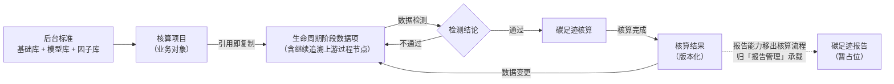
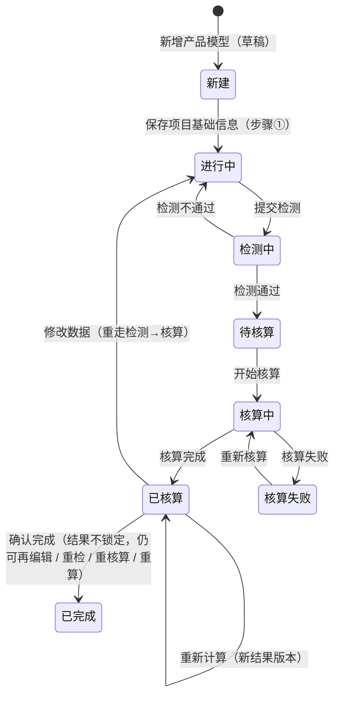

# 核算项目业务 PRD

> **【去模型修订声明 · 2026-09-24，全文优先】**：核算模型已整体废弃，项目**不再引用核算模型**，改为**直接选择产品 → 复制带入工艺 + 工序（含公式）**。本文正文涉及以下口径按新规则理解：
> - 「选择 / 引用核算模型」「模型快照」「模型默认已选」「引用模型生成快照」→ **删除**（项目不再有模型选择、模型快照与模型一致性校验）；
> - 「数据项绑定模型公式 / 工序公式配置阶段完成」→ **数据项绑定「工序投入产出项公式」**（公式下沉到工序，随工序「引用即复制」带入，前台只读）；
> - 步骤②「工序与数据」→ 更名「**工序与数据**」；
> - 「核算方法默认带出引用模型的标准依据」→ **核算方法由用户在步骤①从标准文件库选择**（不再有模型兜底）；
> - 生命周期阶段仅作为**工序/工艺的「所属生命周期阶段」标签**展示（项目内不再有阶段勾选 / 排除面板）；
> - 产品总碳排放 = **Σ 各工序排放**（引擎自动汇总，无需配置）。
> 具体规则见《工序业务 PRD》§4.8 / R-023 / R-024 与《核算模型业务 PRD》文首废弃声明。

> **【以原型为准修订声明 · 2026-10-13（V1.1），全文优先，废止 2026-09-24 旧声明中的过时条款】**：本文与前端原型（`06prototypes/6-1系统原型骨架/src/pages/pcf/`）冲突之处，**一律以原型为准**。当前原型口径要点：
> - **列表 = 扁平一层**（一行 = 一条核算记录；列 = 产品名称 / 核算编号 / 系统边界 / 时间边界 / 完成状态 / 更新时间 / 操作）；查询 = 产品名称 + 更新时间区间；**删除不受状态限制**（任意状态均可删除）。原「产品维度两层结构 + `/pcf/project/product/:productId`」**已废弃**。
> - **新增 = 列表右上「新增产品模型」下拉**（自定义核算 / 从平台模型库选择 / 从我的模型库选择）→ 草稿路由 `/pcf/project/new`、`/pcf/project/new/model/:modelId`、`/pcf/project/new/:productId`；**草稿不落库，步骤①「保存」才创建项目**。
> - **步骤条 = 4 步**（①目标与范围 ②产品建模 ③数据检测 ④碳足迹核算与结果）；**报告环节已移出核算流程**（归「报告管理」承载，暂占位）。
> - **步骤②「产品建模」**：左树 = 生命周期阶段（仅末级可点）+ 继续追溯链路；右侧统一数据列表（名称 / 数据项类型 / 单位产品用量 / 单位 / 上游过程名称[引用因子|继续追溯] / 操作[数据凭证|删除]）；CSV 导入；保存校验 = 名称 + 单位产品用量必填。原「工序 / 绑定公式 / 动态变量列 / 排放来源列 / 分配比例」口径**全部作废**（R-014 ~ R-018 按此改写）。
> - **步骤①** = 两面板（基本信息与产品 / 生命周期阶段）；表单**不展示**项目名称（自动生成）、核算主体（自动带出）、备注、型号、产品编码 / 版本、核算公式、单位转换系数、净重；**产品图片必填**；产品候选来自「我的产品库」。
> - **状态机**：移除「已归档」；**「已完成」重新进入工作流（V0.9，2026-10-14，以原型为准）**——步骤④「碳足迹核算与结果」在「已核算」态提供「**确认完成**」：二次确认后项目流转为「已完成」。**V1.1 口径（2026-10-14 业务裁定）：确认完成后结果不锁定** —— 仍可继续编辑 / 重新检测 / 重新核算 / 重新计算；编辑保存后回退「进行中」重走检测 → 核算。报告三态中「报告生成中 / 报告编制中」仍为历史保留枚举。
> - **「已核算」前均可编辑**，步骤④支持「重新计算」生成新结果版本。
> - **回退保留结论（V1.1，2026-10-14）**：「已核算 / 已完成」修改步骤①②数据保存 → 项目回退「进行中」，**检测结论与核算结果保留**——步骤③默认展示原检测数据、步骤④展示原结果（历史版本标记），**不强制重新检测 / 重新核算**；用户可主动重检或「重新计算」生成新版本。

## 0. 文档基础信息

| 项目 | 内容 |
| :--- | :--- |
| 文档名称 | 核算项目业务 PRD（项目列表 + 新建项目 + 项目工作台） |
| 版本 | V1.4 |
| 状态 | 草稿 |
| 模块名称 | 产品碳足迹核算（前台业务平台主链） |
| 模块类型 | **业务对象 + 结果载体**（有状态机、有下游产出、跨步骤逐步完善）；无审核流、无 ERP 下推 |
| 维护形态 | 列表页 + 新建页（顶部步骤条第①步）+ **项目工作台（顶部步骤条）** |
| 所属层级 | 前台业务平台 · 产品碳足迹核算（方案 §2.3 B1、§5.1、§5.2、§八 P17/P18） |
| 字段真相源 | `02prd/02-2前台业务功能/01 碳核算项目/01 项目列表与新建/核算项目字段清单.md`（当前为粗纲） |
| 上游基线 | `02prd/02-2前台业务功能/01 碳核算项目/00碳核算项目_模块拆分与交互骨架.md`（V0.6） |
| 更新时间 | 2026-10-14 |

**变更记录**

| 日期 | 版本 | 变更内容 |
| :--- | :--- | :--- |
| 2026-09-23 | V0.1 | 初版：定义项目状态机（界面口径）、列表与新建的功能与规则、工作台壳与步骤流转；各步骤内部业务规则留待批次 2–6 |
| 2026-09-23 | **V0.2** | 按业务反馈修订：**① 步骤导航改「顶部步骤条」**（新建 / 编辑页同样在表单上方展示）；**② 报告确认由核算人员执行**（§7 R-010）；**③ 移除「已作废」状态与作废动作**，取消项目统一走「删除」（§5 / §6 / §7 R-009）；**④ 核算主体组织不由用户手选**，默认取当前登录用户所属组织（§2 S01 / §3） |
| 2026-09-23 | **V0.3** | 按业务反馈修订：**① 步骤合并**——原「产品与边界」并入步骤①，步骤条 9 步 → 8 步（§5.4）；**② 编辑约束放宽**——核算完成前均可编辑（§5.4 / §6 / §7 R-006）；**③ 产品仅允许引用产品库**（取消自定义产品）；**④「功能单位」更名「单位」**（取值来自计量单位库） |
| 2026-09-23 | **V0.4** | 按业务反馈修订：**① 核算方法改为可选**（引用标准文件库，仅现行标准）；**②「核算年度 + 核算周期」合并为「统计时间」**（起止区间），**删除「核算地点」**；**③ 字段可编辑性放开**（步骤①除引用产品带出字段外均可改） |
| 2026-09-23 | **V0.5** | 按业务反馈修订（同步骨架 V0.6）：**① 工艺流程绑定生命周期阶段**——工序的阶段随工艺带出、项目内只读（R-014）；**② 步骤合并 8 步 → 6 步**——②「工序与数据」= 原②③④（§5.4 / R-006）；**③ 分配简化**——产出项直接填分配比例、合计 100%，不再引用后台分配规则（R-015）；**④ 工序数据不预填**（R-016）；新增验收 V16–V18 |
| 2026-09-23 | **V0.6** | 业务裁定：**步骤② 投入 / 产出数量为必填**（R-016 升级为"数量必填"、R-006 前置加强为"②→③ 需数量填全"）；新增验收 **V19**；Q09 关闭 |
| 2026-09-23 | **V0.7** | 业务裁定：**排放来源（因子）本版手动匹配**（新增 R-017；R-006 前置补充"②→③ 需投入项已匹配排放来源"）；新增验收 **V20** |
| 2026-09-23 | **V0.8** | 业务裁定：**因子归项目层（方案 A）**——模型公式的因子类因素参数化（R-017 补充）；消除"模型绑死因子 vs 项目手动选因子"的双源冲突 |
| 2026-09-23 | **V0.9** | 业务裁定（Q1/Q2/Q3）：**数据项绑定模型公式、填报字段按 activity 因素动态生成**（新增 R-018）；新增验收 V21 |
| 2026-10-10 | **V1.0** | **「多口径」口径同步**：R-017 补充——因子口径（GWP 分项 `factorCalibers`：化石 / 生物碳 / 土地利用）随排放来源一并快照进项目，作为步骤④「含生物碳 / 不含生物碳」双口径核算依据 |

**关联链接**

| 文档 | 路径 |
| :--- | :--- |
| 模块拆分与交互骨架 | `02prd/02-2前台业务功能/01 碳核算项目/00碳核算项目_模块拆分与交互骨架.md` |
| 核算项目字段清单（字段唯一真相源） | `02prd/02-2前台业务功能/01 碳核算项目/01 项目列表与新建/核算项目字段清单.md` |
| 整体设计方案 v1.2 r4（第一真相源：§5.1/§5.2/§5.4/§5.5） | `04产品设计管理/00业务设计/产品碳足迹核算系统_整体设计方案_v1.2.md` |
| 角色可见范围分层与本期后置清单 v1.0 | `04产品设计管理/00业务设计/角色可见范围分层与本期后置清单_v1.0.md` |
| 核算模型业务 PRD（模型引用前置） | `02prd/02-1后台管理/10模型管理/核算模型业务PRD.md` |

**文档分工表**

| 文档 | 负责内容 | 不负责内容 |
| :--- | :--- | :--- |
| 字段清单 | 字段、类型、来源、必填性、枚举、字段级约束 | 业务规则、状态流转、页面表现 |
| 业务 PRD（本文） | 状态机、动作矩阵、核心规则（R-xxx）、边界异常、验收 | 完整字段表、控件与布局 |
| 各步骤 Demo PRD | 页面骨架、控件选型、弹窗、校验展示、Mock | 业务规则定义 |
| 批次 3–6 业务 PRD | 各步骤内部业务规则 | 项目级状态机与步骤流转（归本文） |

---

## 1. 需求概述

### 1.1 需求背景

核算项目是**前台唯一主链的载体**：用户必须先有项目，才能配置边界、填数据、算结果、出报告（方案 §5.1）。

```text
后台沉淀"标准"（基础库 + 模型库 + 因子库）
        ↓
前台创建核算项目（新增产品模型：自定义 / 平台模型库 / 我的模型库，引用即复制）
        ↓
按步骤完成：目标与范围 → 产品建模（阶段数据项 + 引用因子 / 继续追溯）→ 数据检测 → 碳足迹核算与结果
```

**本批次的定位**：只解决「**项目怎么建、怎么找、怎么进、怎么控**」四件事，不深入各步骤的业务计算。

### 1.2 需求目标

| # | 目标 | 可验证口径 |
| :-: | :--- | :--- |
| G1 | **30 分钟内跑通一个样板项目**（不看文档） | 核算人员按默认路径：新增产品模型（自定义核算）→ 步骤①填写保存 → 进入工作台；全程无需配置 |
| G2 | **一项目一边界的口径不变** | 项目始终只对应 1 种边界；边界可在步骤①修改（V0.4 放开），修改后需重配阶段数据项；多边界须新建项目 |
| G3 | **模型 / 产品变更不污染已建项目** | 选用模型 / 引用产品即「引用即复制」带入内容；后续编辑不影响本项目已带入的数据 |
| G4 | **步骤可进入性由状态强制** | 未到达步骤不展示可点击态；「下一步」仅在前置满足时可用 |
| G5 | **数据变更强制重算** | 「已核算」后修改 ①–② 数据 → 项目回退「进行中」，需重走检测 → 核算 |
| G6 | **配置段概念不外露** | 列表与工作台不出现公式、绑定、命中优先级、异常编号 E01–E17、快照术语 |

### 1.3 范围（In Scope / Out of Scope）

**In Scope**

| # | 范围 |
| :-: | :--- |
| 1 | 核算记录列表（扁平一层）：查询（产品名称 / 更新时间区间）、进入工作台、删除 |
| 2 | 新增产品模型：自定义核算 / 从平台模型库选择 / 从我的模型库选择 → 草稿（不落库）→ 步骤①保存后创建项目 |
| 3 | 项目工作台：项目摘要条 + **顶部步骤条（4 步）** + 内容区 + 底部状态条 |
| 4 | 项目状态机（界面口径）与步骤映射（骨架 §5.2 落地） |
| 5 | 项目级动作：编辑（步骤①②，保存即回退重算）、**删除（任意状态）** |
| 6 | 编辑锁（并发编辑控制） |
| 7 | 核算主体组织**自动带出**（取当前登录用户所属组织，表单内不展示） |

**Out of Scope**

| 不做项 | 归属 / 原因 |
| :--- | :--- |
| 各步骤内部业务（**工序与数据**、检测、核算、结果、报告） | 批次 3–6 |
| 关联项目 / 共享数据集 | P30 后置 |
| 第三方核查 | 方案 §十 阶段三 |
| 项目内多级会签 / 审核流 | 方案 §7.1 本期不设复杂多级会签 |
| **项目「作废」状态** | **已移除**：取消项目统一走「删除」（V0.2） |
| **核算主体组织手选 / 多组织切换** | 本期自动带出、只读（V0.2；多组织切换后置） |
| 跨项目对比、看板 | 分析域，本期不做 |

### 1.4 与其他文档的边界

| 归属 | 模块 | 本文的角色 |
| :--- | :--- | :--- |
| 项目状态机、步骤流转、列表与新建功能 | **本文** | 唯一维护方 |
| 项目主对象字段、枚举、必填性 | **字段清单** | 只引用字段名 |
| 状态文案与步骤条界面文案 | **骨架 §5 + 本文 §5.1** | 本文为最终口径 |
| 各步骤字段与规则 | 批次 3–6 | 本文只声明前置与流转 |
| 页面控件与布局 | 各步骤 Demo PRD | 不写 |
| 报告准入校验项 | 方案 §5.5 | 引用，不复制 |

---

## 2. 用户与使用场景

| 场景ID | 场景 | 类型 | 说明 |
| :--- | :--- | :--- | :--- |
| S01 | 新建核算（新增产品模型） | **主流程** | 列表「新增产品模型」下拉 → 自定义核算（空白草稿）/ 从平台模型库选择 / 从我的模型库选择（选模型弹窗）→ 草稿工作台（仅步骤①可编辑）→ 保存后落库并跳转正式项目 |
| S02 | 列表查询与定位 | **主流程** | 按产品名称模糊、更新时间区间筛选；默认按更新时间倒序 |
| S03 | 进入项目工作台 | **主流程** | 列表点击产品名称或「编辑 / 查看」→ 工作台（摘要条 + 顶部 4 步步骤条 + 内容区），落在当前步骤 |
| S04 | 编辑项目基础信息 | 支线 | 工作台步骤①修改统计时间 / 核算标准 / 产品 / 声明单位 / 产品图片 / 生命周期阶段（**项目名称、核算主体不展示、自动生成**）→ 保存 |
| S05 | 删除项目 | 辅助 | **任意状态**可删除（二次确认、不可恢复）；删除后列表不再展示 |
| S10 | 确认完成核算 | 辅助 | 步骤④「已核算」态点「确认完成」→ 二次确认 → 项目流转「已完成」（**结果不锁定**：仍可再编辑 / 重检 / 重核算 / 重算；编辑保存后回退「进行中」重走检测 → 核算） |
| S06 | 并发编辑冲突 | 辅助 | 他人持有编辑锁时，进入编辑态只读并提示编辑人 |
| S07 | 填报人查看待填 | 支线 | 填报人只见「我的待填」入口，列表不展示「新增」 |
| S08 | ~~核算人员确认报告~~ | 支线 | **已废止（V1.2）**：报告环节移出核算流程，报告能力归「报告管理」承载 |
| S09 | 维护阶段数据项（产品建模） | **主流程** | 工作台步骤②：左树选末级阶段 / 追溯节点 → 右侧统一数据列表维护数据项（名称 / 类型 / 单位产品用量 / 单位）；「引用因子」或「继续追溯」；上传数据凭证 |

---

## 3. 功能清单

| 模块 | 功能点 | 功能描述 | 优先级 |
| :--- | :--- | :--- | :---: |
| 核算记录列表 | 列表查询 | 产品名称（模糊）、更新时间（起止区间）筛选；重置 | P0 |
| | 列表展示 | 产品名称、核算编号、系统边界、时间边界、完成状态、更新时间、操作 | P0 |
| | 进入工作台 | 点击产品名称或「编辑 / 查看」进入工作台 | P0 |
| | 新增入口 | 列表工具条「新增产品模型」下拉（自定义核算 / 从平台模型库选择 / 从我的模型库选择） | P0 |
| | 删除 | **任意状态可删除**，二次确认、不可恢复 | P0 |
| | 确认完成 | 「已核算」态在步骤④结果区确认，项目流转「已完成」并锁定（不可再编辑 / 重检 / 重核算；结果仍可查看与下载清册） | P0 |
| 新建核算 | 草稿创建 | 自定义 = 空白草稿；选模型 = 带入「目标与范围」与产品建模内容（引用即复制） | P0 |
| | 保存落库 | 草稿仅内存，步骤①「保存」时才创建核算项目（生成编号）并跳转正式项目 | P0 |
| | 步骤条 | 草稿态固定第①步，展示 4 步步骤条 | P0 |
| 项目工作台 | 项目摘要条 | 编号 / 系统边界 / 状态 Tag / 产品 / 统计时间 / 引用模型；页面级动作 | P0 |
| | 顶部步骤条 | **4 步**（目标与范围 / 产品建模 / 数据检测 / 碳足迹核算与结果），显示完成态 / 当前步 / 未到达锁定 | P0 |
| | 状态展示 | 项目状态 Tag 与进度 | P0 |
| | 底部状态条 | 数据变更提示、上次保存时间 | P1 |
| | 编辑锁提示 | 他人持锁时只读 + 提示 | P1 |

**不做**：批量操作、复制新增、导出列表（P2 后置，《角色可见范围 v1.0》§4）；项目作废（V0.2 移除）。

---

## 4. 单据定位与实体关系

### 4.1 基本定位

| 项目 | 内容 |
| :--- | :--- |
| 对象层级 | **核算业务域主体**（既是业务单，也产出结果单） |
| 核心职责 | 记录"一次产品碳足迹核算的完整过程与结论" |
| 来源 | 手动创建（本期无下推） |
| 下游产出 | 核算结果（版本化）、碳足迹报告（全版本留存） |
| 间接结果 | 项目状态、快照引用关系、组织数据归属 |

### 4.2 系统链路图



### 4.3 实体关系说明

| 关系 | 说明 |
| :--- | :--- |
| 核算项目 : 产品 | **N:1**（一个产品可被多个项目引用；一个项目只绑一个产品） |
| 核算项目 : 核算模型 | **仅新建时可选来源**（选用即「引用即复制」，记录 `sourceModelId` / `sourceModelName`，不作为项目快照维度） |
| 核算项目 : 阶段数据项 / 检测 / 结果 | **1:N**（报告环节已移出核算流程，归「报告管理」承载） |
| 核算项目 : 关联项目（后置） | **N:N**（同一产品版本下多边界项目组） |

---

## 5. 状态机

### 5.1 项目状态（界面口径，最终定义）

| 状态 | 含义 | 是否终态 |
| :--- | :--- | :---: |
| 新建 | 已创建、基础信息未保存 | 否 |
| 进行中 | 配置与填报阶段（步骤 ①–②） | 否 |
| 检测中 | 检测执行中（含系统异常） | 否 |
| 待核算 | 检测通过、待核算 | 否 |
| 核算中 | 核算执行中 | 否 |
| 核算失败 | 核算异常，可重试 | 否 |
| 已核算 | 核算完成，结果可看可导、可重新计算 | 否 |
| **已完成** | **确认完成核算（V0.9）；结果不锁定（V1.1），仍可编辑 / 重检 / 重核算 / 重算** | 否 |
| 报告生成中 | 报告生成执行中（含生成失败） | 否 |
| 报告编制中 | 报告草稿编辑中 | 否 |

> **V1.4 变更（2026-10-14，以原型为准）**：**「已完成」重新进入当前工作流（V0.9）且结果不锁定（V1.1 业务裁定）**——步骤④「碳足迹核算与结果」结果区在「已核算」态提供「**确认完成**」（`confirmPcfProject`，仅 `calculated` 可执行）：二次确认后项目流转为「已完成」，**但不锁定结果** —— 仍可继续编辑步骤①②（保存即回退「进行中」重走检测 → 核算）、重新检测、重新核算、重新计算；「已完成」态不再展示「确认完成」入口（可「重新计算」生成新版本）。
>
> **V1.1 变更（2026-10-13，以原型为准）**：**移除「已归档」**（核算记录不做归档，删除不受状态限制）；报告三态中的「报告生成中 / 报告编制中」为**历史保留枚举**——V1.2 报告环节移出核算流程后工作流不再产生，仅供「报告管理」复用与兼容既有 mock 数据。
>
> **口径说明**：本表为**界面文案唯一来源**，由方案 §5.2 工程态名收敛而来（方案「目标与范围编辑中 / 产品模型创建中」→ 本表「进行中」；「检测异常」→ 归入「检测中」；「报告生成失败」→ 归入「报告生成中」）。状态机本体与追溯口径仍以方案 §5.2 为准。

### 5.2 状态流转图



### 5.3 状态流转表

| 当前状态 | 动作 | 前置条件 | 结果状态 | 二次确认 | 后置影响 | 失败处理 |
| :--- | :--- | :--- | :--- | :--- | :--- | :--- |
| 新建 | 保存 | 步骤①必填完整（统计时间 / 核算标准 / 产品名称 / 产品图片 / 声明单位数值与单位）；核算主体自动带出 | 进行中 | 无 | 生成项目编号 | 字段下方红字提示，定位首错 |
| 任意状态 | 删除 | — | （记录消失） | 「删除后不可恢复（核算记录消失）；已完成的记录同样可删除。确认删除？」 | 不可再进入工作台 | — |
| 进行中 | 提交检测 | 步骤①必填完整 + **步骤②全部数据项的名称与单位产品用量已填全** | 检测中 | 无 | 冻结步骤①②字段 | 阻断并提示缺失项 |
| 检测中 | 检测通过 | 无阻断级问题 | 待核算 | 无 | — | — |
| 检测中 | 检测不通过 | 存在阻断级问题 | 进行中 | 无 | 解冻①② | 问题清单 + 修改入口 |
| 待核算 | 开始核算 | 检测通过 | 核算中 | 无 | 异步核算任务 | — |
| 核算中 | 核算完成 | — | 已核算 | 无 | 生成结果版本 | — |
| 核算中 | 核算失败 | — | 核算失败 | 无 | 保留失败记录 | 「重新核算」可重试 |
| 已核算 / 已完成 | 修改数据 | 编辑步骤①–② | 进行中 | 「数据已修改，需要重新检测并核算，确认继续？」 | **检测结论与核算结果保留**：步骤③默认展示原检测数据、步骤④展示原结果（历史版本）；**不强制重新检测 / 重新核算** | — |
| 已核算 | 重新计算 | 步骤④结果区操作 | 已核算（新版本） | 无 | 按版本号递增生成新结果版本，历史版本保留 | 失败可重试 |
| 已核算 | **确认完成** | 步骤④结果区操作（仅 `calculated` 可执行） | **已完成** | 「确认完成后，该项目将变为『已完成』状态（结果不锁定：后续仍可继续编辑数据、重新检测、重新核算或重新计算；如修改数据并保存，项目将重走检测 → 核算）。确认完成『{产品名称}』？」 | **结果不锁定（V1.1）**：仍可编辑 / 重检 / 重核算 / 重算；「已完成」态不再展示「确认完成」 | 「仅『已核算』状态可确认完成」 |
| ~~已核算~~ | ~~生成报告~~ | — | ~~报告生成中~~ | — | **报告环节已移出核算流程（V1.2）** | — |
| ~~报告编制中~~ | ~~确认已完成~~ | — | ~~已完成~~ | — | 同上（能力归「报告管理」） | — |
| ~~已完成~~ | ~~归档~~ | — | ~~已归档~~ | — | **「已归档」已移除（V1.1）** | — |

> **删除不受状态限制（V1.1，以原型为准）**：任意状态（含检测中 / 已核算 / 历史报告态）均可删除，二次确认、不可恢复。

### 5.4 步骤与状态映射

| 项目状态 | 当前步骤 | 可编辑步骤 |
| :--- | :-: | :--- |
| 新建 | ① | ① |
| 进行中 | 最近所处步骤 | ①–② |
| 检测中 | ③ | ①–②（**可编辑**） |
| 待核算 | ④ | ①–②（可编辑） |
| 核算中 | ④ | 只读 |
| 核算失败 | ④ | ①–②（可编辑） |
| 已核算 | ④（**末节点**） | ①–②（改动即回退重算）；结果区「重新计算」可直接生成新版本 |
| **已完成** | ④ | ①–②（改动即回退重算）；④可「重新计算」/ 下载清册；**结果不锁定（V1.1）** |
| 报告生成中（历史态） | — | 只读 |
| 报告编制中（历史态） | — | 只读 |

> **V0.3 放宽（骨架 D13）**：**「已核算」之前均可编辑**（含检测中 / 待核算 / 核算失败）；「已核算」修改 → 回退「进行中」并需重算（E13）；仅「**核算中**」「**已完成**」（及历史报告态）只读。
>
> 步骤定义见骨架 §4.3（**① 目标与范围 ② 产品建模 ③ 数据检测 ④ 碳足迹核算与结果**；报告步骤已移除，V1.2）。

---

## 6. 动作能力矩阵

| 动作 | 新建 | 进行中 | 检测中 | 待核算 | 核算中/失败 | 已核算 | 已完成 | 报告生成中 | 报告编制中 |
| :--- | :-: | :-: | :-: | :-: | :-: | :-: | :-: | :-: | :-: |
| 进入工作台 | ✅ | ✅ | ✅ | ✅ | ✅ | ✅ | ✅ | ✅ | ✅ |
| 编辑步骤①（目标与范围） | ✅ | ✅ | ✅ | ✅ | ✅（核算中只读） | ✅（条件） | ✅（条件） | ❌ | ❌ |
| 编辑步骤②（产品建模：阶段数据项 + 引用因子 + 追溯） | ❌ | ✅ | ✅ | ✅ | ✅（核算中只读） | ✅（条件） | ✅（条件） | ❌ | ❌ |
| 删除 | ✅ | ✅ | ✅ | ✅ | ✅ | ✅ | ✅ | ✅ | ✅ |
| 查看结果 | ❌ | ❌ | ❌ | ❌ | ❌ | ✅ | ✅ | ✅ | ✅ |
| 导出结果 | ❌ | ❌ | ❌ | ❌ | ❌ | ✅ | ✅ | ✅ | ✅ |
| 重新计算（新结果版本） | ❌ | ❌ | ❌ | ❌ | ❌ | ✅ | ✅ | ❌ | ❌ |
| **确认完成（转「已完成」，不锁定）** | ❌ | ❌ | ❌ | ❌ | ❌ | ✅ | ❌ | ❌ | ❌ |
| ~~查看报告~~ | ❌ | ❌ | ❌ | ❌ | ❌ | ❌ | ❌ | ✅ | ✅ |
| ~~**确认报告**（核算人员）~~ | ❌ | ❌ | ❌ | ❌ | ❌ | ❌ | ❌ | ❌ | ✅ |

> ✅（条件）= 允许但有前置：进入「检测中」后编辑需先回退（本文 R-006）。
> **V0.2 变更**：移除「作废」动作；删除范围由「仅新建」放宽为「新建 / 进行中」；**V1.1 起删除不受状态限制（任意状态可删）**。
> **V1.3 / V1.4 变更（2026-10-14）**：新增「**确认完成**」动作——仅「已核算」态可用，确认后流转「已完成」；**V1.4 起「已完成」结果不锁定**（可编辑 / 重检 / 重算 / 重新计算），编辑保存后回退「进行中」重走检测 → 核算。
> **红线**：不渲染 disabled 假入口——不可用动作直接不展示。

---

## 7. 核心业务规则

| 规则ID | 规则 | 依据 |
| :--- | :--- | :--- |
| R-001 | **[编号生成]** 项目编号由系统按 `PCF-YYYYMMDD-NNN` 生成，全局唯一、不可修改；同一天内序号连续 | 字段清单 D01 |
| R-002 | **[一项目一边界]** 项目创建时确定核算边界（摇篮到大门 / 摇篮到坟墓），**可在步骤①修改**（V0.5 放开，骨架 D17）；同一产品多边界须新建项目（关联项目 P30 后置） | 方案 §5.3 / 骨架 D17 |
| R-003 | **[模型引用约束]** 模型仅在**新建时**作为可选来源（「新增产品模型 → 从平台模型库 / 我的模型库选择」），选用后按「引用即复制」带入「目标与范围」与「产品建模」内容并记录来源模型（`sourceModelId` / `sourceModelName`，摘要条展示「引用模型」） | 以原型为准（2026-10-13） |
| R-004 | **[引用即复制]** 选用模型 / 产品时，其阶段、数据项等内容复制进项目；模型 / 产品后续编辑不影响本项目；采用新口径须重走检测 → 核算并生成新结果版本（E13） | 方案 §4.9 口径 2 |
| R-005 | **[数据归属]** 项目所有数据（阶段数据项 / 检测 / 结果）归属「项目核算主体组织」，不随填报人组织变化；可见性按组织数据域过滤 | 方案 §3.3.4 规则 1 |
| R-006 | **[步骤前进前置与回退]** 步骤前进仅在前置满足时可用（①→② 需步骤①必填完整；**②→③ 需步骤②全部数据项的名称与单位产品用量均已填写**；③→④ 需检测无阻断项；④为末节点）；已到达步骤可回看；**「已核算」之前（含检测中 / 待核算 / 核算失败）步骤①–②均可编辑**；「已核算」修改任意可编辑步骤数据 → 项目回退「进行中」，需重走检测 → 核算，历史结果版本保留 | 骨架 §6 / D13 / 以原型为准（2026-10-13） |
| R-007 | **[编辑锁]** 项目处于可编辑状态时同一时间仅一个用户持编辑锁（进入编辑页面加锁、提交/超时释放）；其他用户进入只读并提示当前编辑人 | 方案 §5.2 约束 7 |
| R-008 | **[核算主体自动带出]** 核算主体组织**取当前登录用户所属组织**，创建与编辑时**表单内不展示**（自动带出、仅内部留存），不提供选择器；本期不支持同一用户跨组织建项目 | V0.2 业务反馈 / 方案 §3.3.4 / V1.2 精简表单 |
| R-009 | **[删除边界]** **任意状态均支持删除**（二次确认、记录消失、不可恢复）；**本项目不设「作废」「已归档」状态** | V1.1 以原型为准（原型删除弹窗：「已完成的记录同样可删除」） |
| R-019 | **[确认完成]** 「已核算」态在步骤④结果区提供「确认完成」：二次确认后项目流转「已完成」。**结果不锁定（V1.1）**——仍可继续编辑步骤①②（保存即回退「进行中」重走检测 → 核算）、重新检测、重新核算、重新计算；「已完成」态不再展示「确认完成」入口（可「重新计算」生成新版本）。仅「已核算」态可确认（其余状态不展示入口） | 以原型为准（V0.9 / V1.1，2026-10-14，原型 `ProjectStepFour.tsx` / mock `confirmPcfProject`） |
| R-048 | **[回退保留结论]** 「已核算 / 已完成」修改步骤①②数据并保存 → 项目回退「进行中」；**检测结论与核算结果保留**——步骤③默认展示原检测数据（问题清单可回看）、步骤④展示原结果（历史版本标记）；**不强制重新检测 / 重新核算**，用户可主动重检或「重新计算」生成新版本 | 以原型为准（V1.1，2026-10-14，mock 回退不清空 `pcfCheckStore` / `pcfCalcResultStore`） |

> **编号说明（V1.4）**：R-048 起为本文新增规则，编号接续《产品建模业务 PRD》（R-035 ~ R-047），全链编号不重排。
| R-010 | ~~**[报告确认角色]** 报告确认由核算人员执行~~ | **已废止（V1.2）**：报告环节移出核算流程，报告能力归「报告管理」承载 |
| R-011 | **[概念不外露]** 列表与工作台不展示公式、绑定、命中优先级、异常编号（E01–E17）、快照术语；检测问题只呈现人话问题 + 修改入口 | 《角色可见范围 v1.0》§3 / §3.1 |
| R-012 | **[角色可见性]** 填报人仅见「我的待填 + 数据填报」，列表不展示「新增」入口；核算人员可见全链路 | 《角色可见范围 v1.0》§2.3 / N05 |
| R-013 | **[列表默认排序]** 默认按「更新时间」倒序；不做表头排序 | Demo 约定 |
| R-014 | **[生命周期阶段勾选]** 步骤① 在「生命周期阶段」面板**勾选纳入的生命周期阶段**（阶段库 = 5 个通用一级 + 二级阶段，按「适用系统边界」带出，默认全部纳入、可取消；一级联动二级，支持全选 / 全不选）；步骤② 左树按勾选阶段展示（**仅末级阶段可点击录入**） | 以原型为准（2026-10-13）/ 字段清单 §6 |
| R-015 | ~~**[分配按产出比例]**~~ | **已废止（V1.2）**：产品建模不再有分配比例列（原多产出分配口径随步骤重构取消） |
| R-016 | **[数据项必填 + 单位产品用量口径]** 阶段数据项的**名称与单位产品用量必填**（用量 = 每 1 个声明单位的消耗 / 产出量，可为负）；未填全不得保存、不得进入步骤③；空白行不落库 | 以原型为准（2026-10-13）/ 骨架 D25 |
| R-017 | **[排放来源（因子）引用]** 数据项通过「**引用因子**」弹窗选择排放因子（候选 = 背景数据库已发布库 + 我的因子库），**投入项（原辅料 / 自然资源 / 能源及能源介质）未匹配因子时阻断检测**（B2）；因子名称 / 因子值 / 因子口径（GWP 分项 `calibers`）随选择写入项目（引用即复制），作为步骤④ 四口径核算依据；已引用因子可更换或撤回 | 以原型为准（2026-10-13）/ 骨架 D22 |
| R-018 | **[上游过程追溯]** 数据项可通过「**继续追溯**」生成上游过程节点（递归挂在该数据项下，进入左树），在节点内录入其自身数据项；已引用因子的数据项不再支持追溯；取消追溯将移除该节点内已录入数据 | 以原型为准（2026-10-13） |

---

## 8. 边界与异常处理

### 8.1 并发控制

| 场景 | 处理方式 |
| :--- | :--- |
| 两人同时编辑同一项目 | 后进入者只读，工作台提示「当前项目由 XXX 编辑中」，不可进入编辑态 |
| 编辑锁超时 | 超时自动释放（时长【待确认】Q07），释放后其他人可编辑 |
| 两人同时提交检测 | 以项目状态为准，后提交者提示「项目状态已变更，请刷新后重试」 |

### 8.2 重复与幂等

| 场景 | 处理方式 |
| :--- | :--- |
| 同一「产品版本 + 边界 + 核算年度 + 核算主体」重复建项目 | 保存时提示重复（【待确认】Q05），阻断保存 |
| 重复点击「保存并进入」 | 前端按钮节流；服务端按项目编号幂等，不重复创建 |
| 重复点击「开始核算」 | 状态非「待核算」时入口不展示，不产生重复核算任务 |

### 8.3 边界场景

| 场景 | 规则 |
| :--- | :--- |
| 系统中无「启用」态模型 | 新建时「从平台模型库选择」无可选模型（空态「平台暂无符合条件的已发布模型」）；仍可走「自定义核算」 |
| 当前用户无归属组织 | 核算主体为空，阻断保存并提示「当前账号未配置所属组织，请联系管理员」 |
| 引用产品已被下架 | 允许进入项目继续（快照已固化）；但**新选**产品下拉不展示已下架产品 |
| 核算记录列表为空 | 空状态文案「暂无核算记录，点击右上角「新增产品模型」开始」 |
| 项目已删除 | 记录消失；若其他页面持有旧链接 → 提示「项目不存在或已被删除」并返回列表 |
| 组织数据域变更（用户调岗） | 已建项目仍归属原核算主体组织；用户按新数据域可见（方案 §3.3.4） |

---

## 9. 待确认事项

| 编号 | 问题 | 影响 | 当前建议 | 状态 |
| :-: | :--- | :--- | :--- | :--- |
| Q01 | 核算边界在「新建」还是步骤①确定 | 新建表单 / 状态机 | 新建时确定，**步骤①可改**（V0.4 放开，R-002 / 骨架 D17） | 已裁定（V0.4） |
| Q02 | 步骤条是否允许跳过中间步骤 | 步骤条 / R-006 | **已裁定（以原型为准，2026-10-14）**：不允许跳步，未到达步骤在步骤条锁定不可点 | 已裁定 |
| Q03 | 核算主体组织是否需要支持**多组织用户手动切换** | R-008 | **本期自动带出、只读**；多组织切换后置 | 已裁定（V0.2） |
| Q04 | 「报告确认」由谁执行 | R-010 | **核算人员** | **已裁定（V0.2）** |
| Q05 | 「产品版本 + 边界 + 年度 + 主体」是否唯一 | §8.2 重复校验 | 唯一并阻断 | 待确认 |
| Q06 | 删除范围是否确认放宽到「进行中」 | R-009 / §5.3 | **已裁定（V1.1，以原型为准）**：删除不受状态限制，任意状态均可删除（二次确认、不可恢复） | 已裁定 |
| Q07 | 编辑锁超时时长 | §8.1 | 建议 30 分钟，可配 | 待确认 |
| Q08 | 列表是否需要「我创建的 / 我的待填」视图切换 | 列表 | 填报人默认「我的待填」；核算人员默认全部 | 待确认 |
| Q09 | 步骤② 的工序投入产出数量是否必须填全 | R-006 / 步骤② | **已裁定（V0.6）：必填**——未填全不得保存、不得进入步骤③ | 已裁定 |
| Q10 | 多产出分配比例是否需要**经济价值 / 质量等快捷方式** | R-015 | **已废止（V1.2）**：产品建模不再有分配比例列，原口径随步骤②重构取消 | 已关闭 |
| Q11 | 「确认完成」后是否允许**重新打开**项目继续修改 | R-019 / §5.1 | **已裁定（V1.1，2026-10-14）**：允许——「已完成」结果不锁定，可继续编辑 / 重新检测 / 重新核算 / 重新计算；编辑保存后回退「进行中」重走检测 → 核算 | 已裁定 |

---

## 10. 验收标准

| # | 验收项 | 输入条件 | 预期结果 |
| :-: | :--- | :--- | :--- |
| V01 | **一项目一边界** | 已建摇篮到大门项目，在步骤①切换系统边界为摇篮到坟墓 | 系统边界卡片可切换（取值来自数据字典），切换后按新边界重新带出生命周期阶段 |
| V02 | **模型选用** | 新建时打开「从平台模型库选择」 | 选模型弹窗展示平台已发布模型（卡片网格 + 过滤），选用后带入目标与范围与产品建模内容 |
| V03 | **引用即复制** | 项目创建后，后台修改所引用的模型 / 产品 | 项目内口径与结果不变，无变化提示 |
| V04 | **步骤条前置** | 步骤② 未填任何数据项时点击步骤条「数据检测」 | 该步骤不可点击并提示需先填报；已完成步骤可回看 |
| V05 | **修改即失效** | 「已核算」项目修改步骤① / ② 数据并保存 | 项目回退「进行中」，二次确认文案含「需要重新检测并核算」；**检测界面默认展示原检测数据，不强制重新检测** |
| V06 | **检测中仍可编辑** | 项目处于「检测中」，尝试编辑步骤① / ② | 按 R-006：**「已核算」前仍可编辑**（V0.3 放宽）；仅进入「核算中」后才只读 |
| V07 | **删除不受状态限制** | 分别对「进行中」与「已核算」项目查看操作列 | 两者均有删除入口（二次确认、不可恢复） |
| V08 | **无作废 / 归档入口** | 全流程走查列表与工作台 | 不出现「作废」「归档」按钮、不出现「已作废」「已归档」状态 |
| V09 | **编号规则** | 同一天连续创建 2 个项目 | 编号形如 `PCF-20260923-001`、`PCF-20260923-002` |
| V10 | **核算主体自动带出** | 以某组织用户新建项目 | 步骤①表单不展示核算主体（自动归属当前用户组织），无选择器 |
| V11 | ~~报告确认角色~~ | — | **已废止（V1.2）**：报告环节移出核算流程 |
| V12 | **草稿步骤条** | 打开 `/pcf/project/new`（自定义核算） | 表单上方展示 **4 步**步骤条，当前落在第①步且不可切换；保存后落库跳转正式项目 |
| V13 | **概念不外露** | 全流程走查列表与工作台 | 无公式/绑定/异常编号/快照术语出现 |
| V14 | **填报人可见性** | 以填报人登录 | 列表无「新增产品模型」，仅「我的待填」 |
| V15 | **编辑锁** | A 进入编辑态，B 进入同一项目 | B 只读并提示「当前项目由 A 编辑中」 |
| V16 | **阶段勾选（R-014）** | 打开步骤①「生命周期阶段配置」弹窗 | 一级 / 二级阶段可勾选（一级联动二级），默认全部纳入；步骤②左树仅末级阶段可点击 |
| V17 | ~~分配比例校验~~ | — | **已废止（V1.2）**：产品建模无分配比例列 |
| V18 | **数据项必填（R-016）** | 步骤② 留任意一条数据项的名称或单位产品用量为空后点「保存」 | 阻断保存并提示「还有 N 条数据项未填写单位产品用量」；空白行不落库 |
| V19 | **排放来源引用（R-017）** | 步骤② 某投入项未「引用因子」即提交检测 | 检测不通过，问题清单含 B2「投入项未匹配排放因子」（阻断） |
| V20 | **上游过程追溯（R-018）** | 步骤② 对某数据项点「继续追溯」 | 生成上游过程节点并进入左树，可在节点内录入其数据项；已引用因子后不可追溯 |
| V21 | **数据凭证** | 步骤② 对某数据项上传凭证附件 | 操作列显示「数据凭证（N）」；凭证选填、可多个；数据列表无分配比例输入框、无因子列 |
| V22 | **确认完成** | 「已核算」项目在步骤④点「确认完成」并二次确认 | 项目流转「已完成」；**结果不锁定**：步骤①②仍可编辑（保存即回退重算）、步骤③可重新检测、步骤④可重新计算 / 下载清册；列表「完成状态」展示「已完成」，操作列为「编辑」 |
| V23 | **回退保留结论** | 「已核算」项目修改步骤②数据保存后打开步骤③ / ④ | 步骤③默认展示原检测数据（问题清单可回看）、步骤④展示原结果（历史版本标记）；不强制重新检测 / 重新核算 |

---

## 11. 附录

### 11.1 术语表

| 术语 | 含义 |
| :--- | :--- |
| 核算项目 | 一次 PCF 核算的业务载体，绑定 1 产品 + 1 边界（模型仅新建时可选来源） |
| 项目快照 | 引用模型/产品后冻结的副本，保证历史可还原（方案 §4.9 口径 2） |
| 步骤条 | 工作台与草稿页顶部的 **4 步**导航，界面口径 |
| 项目状态 | 项目所处业务阶段，界面口径见本文 §5.1 |
| 编辑锁 | 同一时间仅一个用户可编辑项目的并发控制机制 |
| 核算主体组织 | 项目的业务归属组织，决定数据归属与可见性；本期由当前用户组织自动带出 |

### 11.2 下游文档影响清单

| 下游文档 | 受影响内容 |
| :--- | :--- |
| 批次 1《Demo PRD》 | 步骤条位置、行操作（删除替代作废）、状态 Tag 配色、核算主体只读 |
| 原型 `pages/pcf/` | `PcfSteps.tsx`（顶部步骤条，**4 步**）；`ProjectListPage.tsx`（扁平一层列表）/ `ProjectWorkbenchPage.tsx`（工作台壳 + 草稿）/ `ProjectStepOne.tsx`（目标与范围）/ `ProjectStepTwo.tsx`（产品建模）/ `ProjectStepThree.tsx`（数据检测）/ `ProjectStepFour.tsx`（碳足迹核算与结果，含「重新计算 / 确认完成」）；`ProjectStepFive.tsx`（报告）**已随报告环节移除而下线（代码保留未路由）** |
| 批次 3–6 业务 PRD | 以本文 §5.4 映射与步骤条规则为前置约束 |

---

## 修订记录

| 日期 | 版本 | 变更摘要 |
| :--- | :--- | :--- |
| 2026-09-23 | V0.1 | 初版：项目状态机（界面口径）+ 步骤映射 + 列表/新建/工作台的功能与规则 + 验收标准 |
| 2026-09-23 | V0.2 | 顶部步骤条；报告确认归核算人员（R-010）；移除「已作废」与作废动作、删除范围放宽（R-009）；核算主体自动带出（R-008） |
| 2026-09-23 | V0.3 | 步骤合并（产品与边界并入步骤①，9 步 → 8 步）；核算完成前均可编辑（R-006）；产品仅引用产品库；「功能单位」更名「单位」 |
| 2026-09-23 | V0.4 | 核算方法改为可选（标准文件库）；「核算年度 + 核算周期」合并为「统计时间」、删除「核算地点」；字段可编辑性放开 |
| 2026-09-23 | **V0.5** | **工序阶段随工艺流程带出**（R-014）；**步骤合并 8 步 → 6 步**（②工序与数据，§5.4 / R-006）；**分配改为产出项填比例**（R-015）；**工序数据不预填**（R-016）；新增验收 V16–V18、场景 S09、待确认 Q09–Q10 |
| 2026-09-23 | **V0.6** | 业务裁定：步骤② 投入产出**数量必填**（R-006 / R-016 加强，Q09 关闭，新增验收 V19） |
| 2026-09-23 | **V0.7** | 业务裁定：排放来源（因子）**手动匹配**（R-017 新增；R-006 前置补充；新增验收 V20） |
| 2026-09-23 | **V0.8** | 业务裁定：因子归项目层——模型公式因子因素参数化（R-017 补充） |
| 2026-09-23 | **V0.9** | 业务裁定：数据项绑定模型公式、活动量按公式动态（R-018 新增，验收 V21） |
| 2026-10-10 | **V1.0** | **「多口径」口径同步**：R-017 补充——因子口径（GWP 分项 `factorCalibers`：化石 / 生物碳 / 土地利用）随排放来源一并快照进项目，作为步骤④「含生物碳 / 不含生物碳」双口径核算依据 |
| 2026-10-13 | **V1.1** | **以原型为准全面修订**：① 列表改扁平一层（一行 = 一条核算记录），查询 = 产品名称 + 更新时间区间；② 新增入口改「新增产品模型」下拉（自定义 / 平台模型库 / 我的模型库）+ 草稿路由（保存后才落库）；③ 步骤条 5 步 → **4 步**（报告环节移出，归「报告管理」占位）；④ 步骤② 更名重构为「产品建模」（阶段数据项 + 上游追溯 + 引用因子 + 数据凭证，R-014 ~ R-018 全部改写，分配比例 / 绑定公式 / 动态变量列口径废止）；⑤ 步骤①精简（项目名称 / 核算主体 / 备注 / 型号 / 编码版本展示 / 核算公式 / 单位转换系数 / 净重不再展示，产品图片必填，产品候选来自我的产品库）；⑥ 移除「已归档」，**删除不受状态限制**；⑦ 状态流转表 / 动作矩阵 / 场景 / 验收同步更新 |
| 2026-10-14 | **V1.2** | **原型核对修订**：① §1.1 主链路图按原型改写（后台标准含模型库；步骤为「目标与范围 → 产品建模 → 数据检测 → 碳足迹核算与结果」，报告节点改虚指「报告管理」）；② §1.2 G1 / G2 / G3 改写（「模型默认已选」口径作废，模型仅新建可选来源、引用即复制）；③ §4.2 系统链路图去掉「核算工序 / 活动数据 / 产出分配比例 / 报告」旧口径；④ §4.3 实体关系改为「产品 N:1 + 模型仅新建来源 + 数据项/检测/结果 1:N」；⑤ §5.3 新建保存前置补「声明单位数值与单位」；⑥ §5.4 删除重复的旧步骤定义注记（原「工序与数据 / ⑥报告」残留）；⑦ §9 Q02 / Q06 按原型裁定（不跳步 / 删除不限状态）、Q10 标注分配比例已废止；⑧ V21 验收行修复（补全预期结果列） |
| 2026-10-14 | **V1.3** | **原型核对修订（「确认完成」纳入状态机）**：① §1.3 In Scope / §3 补「确认完成」项目级动作；② §5.1「已完成」由历史保留态改回**当前工作流终态**（V0.9 原型步骤④「确认完成」入口，`confirmPcfProject`：`calculated` → `done`，结果锁定：不可编辑 / 重检 / 重核算，结果仍可查看与下载清册）；③ §5.2 状态流转图 / §5.3 流转表 / §5.4 映射 / §6 动作矩阵同步（新增「确认完成」行与「已完成」列）；④ §7 新增 R-019；⑤ §9 新增 Q11（确认完成后是否可重新打开）；⑥ §10 新增验收 V22；⑦ §11.2 下游影响同步 |
| 2026-10-14 | **V1.4** | **口径裁定修订（V1.1 业务裁定，2026-10-14）**：① 「**确认完成」结果不锁定**——「已完成」态仍可编辑 / 重新检测 / 重新核算 / 重新计算（编辑保存后回退「进行中」重走检测 → 核算）；「已完成」态不再展示「确认完成」入口；② 新增「**回退保留结论**」口径（R-048）：已核算 / 已完成修改数据保存回退后，检测结论与核算结果保留，步骤③默认展示原检测数据、步骤④展示原结果（历史版本），**不强制重新检测 / 重新核算**；③ §5.1 / §5.2 / §5.3 / §5.4 / §6 动作矩阵同步（「已完成」列从只读改为可编辑 / 可重算）；④ §9 Q11 关闭（允许重新打开）；⑤ §10 新增验收 V23、V22 更新 |
