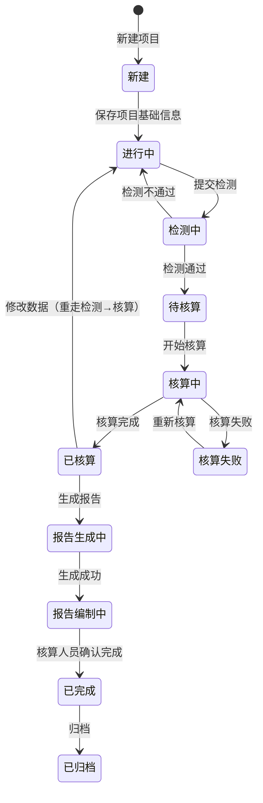

# 核算项目业务 PRD

> **【去模型修订声明 · 2026-09-24，全文优先】**：核算模型已整体废弃，项目**不再引用核算模型**，改为**直接选择产品 → 复制带入工艺 + 工序（含公式）**。本文正文涉及以下口径按新规则理解：
> - 「选择 / 引用核算模型」「模型快照」「模型默认已选」「引用模型生成快照」→ **删除**（项目不再有模型选择、模型快照与模型一致性校验）；
> - 「数据项绑定模型公式 / 工序公式配置阶段完成」→ **数据项绑定「工序投入产出项公式」**（公式下沉到工序，随工序「引用即复制」带入，前台只读）；
> - 步骤②「工序与数据」→ 更名「**工序与数据**」；
> - 「核算方法默认带出引用模型的标准依据」→ **核算方法由用户在步骤①从标准文件库选择**（不再有模型兜底）；
> - 生命周期阶段仅作为**工序/工艺的「所属生命周期阶段」标签**展示（项目内不再有阶段勾选 / 排除面板）；
> - 产品总碳排放 = **Σ 各工序排放**（引擎自动汇总，无需配置）。
> 具体规则见《工序业务 PRD》§4.8 / R-023 / R-024 与《核算模型业务 PRD》文首废弃声明。

> **【以原型为准修订声明 · 2026-09-24，全文优先】**：本文与前文「去模型声明」如有与前端原型冲突之处，**一律以原型为准**（详见《00碳核算项目_模块拆分与交互骨架.md》文首「以原型为准修订声明」）。要点：
> - **列表两层结构**：`/pcf/project` = 产品维度列表（非项目列表）；`/pcf/project/product/:productId` = 产品核算记录列表；删除 `/pcf/project/new` 独立新建页（S01/S02 场景与「新建核算项目」功能作废）。
> - **一个产品多次核算**（1:N）；新增 = 「新增产品」→ 选上架产品 → 直接创建草稿进步骤①。
> - **恢复生命周期阶段勾选**（步骤①），阶段库仅 5 个通用一级；**步骤②按勾选阶段对齐工序**（R-014 改写）。
> - **绑定公式可修改**（R-018 原「前台只读」作废）；**排放来源默认带出公式绑定因子、可改**（R-017 原「手动匹配、不预选」作废）。
> - 步骤① 删除「产品净重」「净重单位」、删除「产品编码/版本」展示、删除「核算依据」面板（核算方法入基本信息、核算边界入生命周期阶段面板）。

## 0. 文档基础信息

| 项目 | 内容 |
| :--- | :--- |
| 文档名称 | 核算项目业务 PRD（项目列表 + 新建项目 + 项目工作台） |
| 版本 | V0.9 |
| 状态 | 草稿 |
| 模块名称 | 产品碳足迹核算（前台业务平台主链） |
| 模块类型 | **业务对象 + 结果载体**（有状态机、有下游产出、跨步骤逐步完善）；无审核流、无 ERP 下推 |
| 维护形态 | 列表页 + 新建页（顶部步骤条第①步）+ **项目工作台（顶部步骤条）** |
| 所属层级 | 前台业务平台 · 产品碳足迹核算（方案 §2.3 B1、§5.1、§5.2、§八 P17/P18） |
| 字段真相源 | `02prd/02-2前台业务功能/01 碳核算项目/01 项目列表与新建/核算项目字段清单.md`（当前为粗纲） |
| 上游基线 | `02prd/02-2前台业务功能/01 碳核算项目/00碳核算项目_模块拆分与交互骨架.md`（V0.6） |
| 更新时间 | 2026-09-23 |

**变更记录**

| 日期 | 版本 | 变更内容 |
| :--- | :--- | :--- |
| 2026-09-23 | V0.1 | 初版：定义项目状态机（界面口径）、列表与新建的功能与规则、工作台壳与步骤流转；各步骤内部业务规则留待批次 2–6 |
| 2026-09-23 | **V0.2** | 按业务反馈修订：**① 步骤导航改「顶部步骤条」**（新建 / 编辑页同样在表单上方展示）；**② 报告确认由核算人员执行**（§7 R-010）；**③ 移除「已作废」状态与作废动作**，取消项目统一走「删除」（§5 / §6 / §7 R-009）；**④ 核算主体组织不由用户手选**，默认取当前登录用户所属组织（§2 S01 / §3） |
| 2026-09-23 | **V0.3** | 按业务反馈修订：**① 步骤合并**——原「产品与边界」并入步骤①，步骤条 9 步 → 8 步（§5.4）；**② 编辑约束放宽**——核算完成前均可编辑（§5.4 / §6 / §7 R-006）；**③ 产品仅允许引用产品库**（取消自定义产品）；**④「功能单位」更名「单位」**（取值来自计量单位库） |
| 2026-09-23 | **V0.4** | 按业务反馈修订：**① 核算方法改为可选**（引用标准文件库，仅现行标准）；**②「核算年度 + 核算周期」合并为「统计时间」**（起止区间），**删除「核算地点」**；**③ 字段可编辑性放开**（步骤①除引用产品带出字段外均可改） |
| 2026-09-23 | **V0.5** | 按业务反馈修订（同步骨架 V0.6）：**① 工艺流程绑定生命周期阶段**——工序的阶段随工艺带出、项目内只读（R-014）；**② 步骤合并 8 步 → 6 步**——②「工序与数据」= 原②③④（§5.4 / R-006）；**③ 分配简化**——产出项直接填分配比例、合计 100%，不再引用后台分配规则（R-015）；**④ 工序数据不预填**（R-016）；新增验收 V16–V18 |
| 2026-09-23 | **V0.6** | 业务裁定：**步骤② 投入 / 产出数量为必填**（R-016 升级为"数量必填"、R-006 前置加强为"②→③ 需数量填全"）；新增验收 **V19**；Q09 关闭 |
| 2026-09-23 | **V0.7** | 业务裁定：**排放来源（因子）本版手动匹配**（新增 R-017；R-006 前置补充"②→③ 需投入项已匹配排放来源"）；新增验收 **V20** |
| 2026-09-23 | **V0.8** | 业务裁定：**因子归项目层（方案 A）**——模型公式的因子类因素参数化（R-017 补充）；消除"模型绑死因子 vs 项目手动选因子"的双源冲突 |
| 2026-09-23 | **V0.9** | 业务裁定（Q1/Q2/Q3）：**数据项绑定模型公式、填报字段按 activity 因素动态生成**（新增 R-018）；新增验收 V21 |

**关联链接**

| 文档 | 路径 |
| :--- | :--- |
| 模块拆分与交互骨架 | `02prd/02-2前台业务功能/01 碳核算项目/00碳核算项目_模块拆分与交互骨架.md` |
| 核算项目字段清单（字段唯一真相源） | `02prd/02-2前台业务功能/01 碳核算项目/01 项目列表与新建/核算项目字段清单.md` |
| 整体设计方案 v1.2 r4（第一真相源：§5.1/§5.2/§5.4/§5.5） | `04产品设计管理/00业务设计/产品碳足迹核算系统_整体设计方案_v1.2.md` |
| 角色可见范围分层与本期后置清单 v1.0 | `04产品设计管理/00业务设计/角色可见范围分层与本期后置清单_v1.0.md` |
| 核算模型业务 PRD（模型引用前置） | `02prd/02-1后台管理/10模型管理/核算模型业务PRD.md` |

**文档分工表**

| 文档 | 负责内容 | 不负责内容 |
| :--- | :--- | :--- |
| 字段清单 | 字段、类型、来源、必填性、枚举、字段级约束 | 业务规则、状态流转、页面表现 |
| 业务 PRD（本文） | 状态机、动作矩阵、核心规则（R-xxx）、边界异常、验收 | 完整字段表、控件与布局 |
| 各步骤 Demo PRD | 页面骨架、控件选型、弹窗、校验展示、Mock | 业务规则定义 |
| 批次 3–6 业务 PRD | 各步骤内部业务规则 | 项目级状态机与步骤流转（归本文） |

---

## 1. 需求概述

### 1.1 需求背景

核算项目是**前台唯一主链的载体**：用户必须先有项目，才能配置边界、填数据、算结果、出报告（方案 §5.1）。

```text
后台沉淀"标准"（基础库 + 核算模型 + 因子）
        ↓
前台创建核算项目（引用标准 → 生成项目快照）
        ↓
按步骤完成：目标与范围 → 工序与数据（阶段 / 工序 / 投入产出 / 分配比例）→ 检测 → 核算 → 结果 → 报告
```

**本批次的定位**：只解决「**项目怎么建、怎么找、怎么进、怎么控**」四件事，不深入各步骤的业务计算。

### 1.2 需求目标

| # | 目标 | 可验证口径 |
| :-: | :--- | :--- |
| G1 | **30 分钟内跑通一个样板项目**（不看文档） | 核算人员按默认路径：新建（填名称 + 选边界）→ 模型默认已选 → 进入工作台；全程无需配置 |
| G2 | **一项目一边界的口径不变** | 项目始终只对应 1 种边界；边界可在步骤①修改（V0.4 放开），修改后需重配工序与数据；多边界须新建项目 |
| G3 | **模型变更不污染已建项目** | 项目引用模型即生成快照；模型后续编辑不影响本项目结果 |
| G4 | **步骤可进入性由状态强制** | 未到达步骤不展示可点击态；「下一步」仅在前置满足时可用 |
| G5 | **数据变更强制重算** | 「已核算」后修改 ①–② 数据 → 项目回退「进行中」，需重走检测 → 核算 |
| G6 | **配置段概念不外露** | 列表与工作台不出现公式、绑定、命中优先级、异常编号 E01–E17、快照术语 |

### 1.3 范围（In Scope / Out of Scope）

**In Scope**

| # | 范围 |
| :-: | :--- |
| 1 | 核算项目列表：查询、筛选、分页、进入工作台 |
| 2 | 新建核算项目：填写项目基础信息（名称、年度、边界、模型），进入工作台步骤① |
| 3 | 项目工作台：项目摘要条 + **顶部步骤条（6 步）** + 内容区 + 底部状态条 |
| 4 | 项目状态机（界面口径）与步骤映射（骨架 §5.2 落地） |
| 5 | 项目级动作：编辑基础信息、删除（限「新建 / 进行中」） |
| 6 | 编辑锁（并发编辑控制） |
| 7 | 核算主体组织**自动带出**（取当前登录用户所属组织，表单内只读） |

**Out of Scope**

| 不做项 | 归属 / 原因 |
| :--- | :--- |
| 各步骤内部业务（**工序与数据**、检测、核算、结果、报告） | 批次 3–6 |
| 关联项目 / 共享数据集 | P30 后置 |
| 第三方核查 | 方案 §十 阶段三 |
| 项目内多级会签 / 审核流 | 方案 §7.1 本期不设复杂多级会签 |
| **项目「作废」状态** | **已移除**：取消项目统一走「删除」（V0.2） |
| **核算主体组织手选 / 多组织切换** | 本期自动带出、只读（V0.2；多组织切换后置） |
| 跨项目对比、看板 | 分析域，本期不做 |

### 1.4 与其他文档的边界

| 归属 | 模块 | 本文的角色 |
| :--- | :--- | :--- |
| 项目状态机、步骤流转、列表与新建功能 | **本文** | 唯一维护方 |
| 项目主对象字段、枚举、必填性 | **字段清单** | 只引用字段名 |
| 状态文案与步骤条界面文案 | **骨架 §5 + 本文 §5.1** | 本文为最终口径 |
| 各步骤字段与规则 | 批次 3–6 | 本文只声明前置与流转 |
| 页面控件与布局 | 各步骤 Demo PRD | 不写 |
| 报告准入校验项 | 方案 §5.5 | 引用，不复制 |

---

## 2. 用户与使用场景

| 场景ID | 场景 | 类型 | 说明 |
| :--- | :--- | :--- | :--- |
| S01 | 新建核算项目 | **主流程** | 列表「新建」→ 步骤条显示第①步 → 填项目名称 / 统计时间 / 核算边界（**核算主体自动带出、只读**）→ 模型默认已选 → 保存并进入工作台步骤①（继续选产品、填单位与净重、核算方法） |
| S02 | 列表查询与定位 | **主流程** | 按名称/编号模糊、状态、边界、年度筛选；默认按更新时间倒序 |
| S03 | 进入项目工作台 | **主流程** | 列表点击项目名称 → 工作台（摘要条 + 顶部步骤条 + 内容区），落在当前步骤 |
| S04 | 编辑项目基础信息 | 支线 | 工作台步骤①修改名称 / 统计时间 / 边界 / 模型 / 核算方法 / 单位与净重（**引用产品带出的字段只读**，V0.4 起其余可改）→ 保存 |
| S05 | 删除项目 | 辅助 | 「新建 / 进行中」态可删除（二次确认、不可恢复）；删除后列表不再展示 |
| S06 | 并发编辑冲突 | 辅助 | 他人持有编辑锁时，进入编辑态只读并提示编辑人 |
| S07 | 填报人查看待填 | 支线 | 填报人只见「我的待填」入口，列表不展示「新建」 |
| S08 | 核算人员确认报告 | 支线 | 步骤⑥由**核算人员**确认报告完成 → 项目转「已完成」（V0.2） |
| S09 | 填报工序投入产出 | **主流程** | 工作台步骤②：左树选工序 → 右侧投入 / 产出表填数量；多产出工序填分配比例（合计 100%） |

---

## 3. 功能清单

| 模块 | 功能点 | 功能描述 | 优先级 |
| :--- | :--- | :--- | :---: |
| 项目列表 | 列表查询 | 名称/编号（模糊）、状态、核算边界、核算年度筛选；重置 | P0 |
| | 列表展示 | 编号、名称、产品、边界、年度、状态、更新时间、操作 | P0 |
| | 进入工作台 | 点击项目名称或「打开」进入工作台 | P0 |
| | 新建入口 | 列表工具条「新建核算项目」（填报人不可见） | P0 |
| | 删除 | 「新建 / 进行中」态可删除，二次确认 | P0 |
| 新建项目 | 基础信息填写 | 项目名称、统计时间、核算边界、备注 | P0 |
| | 核算主体（自动） | 取当前登录用户所属组织，只读展示，不提供选择器 | P0 |
| | 模型选择 | 核算模型默认已选（可切换，仅「启用」态），生成快照 | P0 |
| | 步骤条 | 表单上方展示顶部步骤条，当前落在第①步 | P0 |
| | 保存并进入 | 保存成功后跳转工作台步骤① | P0 |
| 项目工作台 | 项目摘要条 | 名称/编号/产品/边界/状态 Tag；页面级动作 | P0 |
| | 顶部步骤条 | **6 步**，显示完成态 / 当前步 / 未到达锁定 / 未交付标注 | P0 |
| | 状态展示 | 项目状态 Tag 与进度 | P0 |
| | 底部状态条 | 数据变更提示、上次保存时间 | P1 |
| | 编辑锁提示 | 他人持锁时只读 + 提示 | P1 |

**不做**：批量操作、复制新增、导出列表（P2 后置，《角色可见范围 v1.0》§4）；项目作废（V0.2 移除）。

---

## 4. 单据定位与实体关系

### 4.1 基本定位

| 项目 | 内容 |
| :--- | :--- |
| 对象层级 | **核算业务域主体**（既是业务单，也产出结果单） |
| 核心职责 | 记录"一次产品碳足迹核算的完整过程与结论" |
| 来源 | 手动创建（本期无下推） |
| 下游产出 | 核算结果（版本化）、碳足迹报告（全版本留存） |
| 间接结果 | 项目状态、快照引用关系、组织数据归属 |

### 4.2 系统链路图


### 4.3 实体关系说明

| 关系 | 说明 |
| :--- | :--- |
| 核算项目 : 产品版本 | **N:1**（一个产品版本可被多个项目引用；一个项目只绑一个产品版本） |
| 核算项目 : 核算模型 | **N:1**（项目引用模型并生成快照） |
| 核算项目 : 活动数据 / 检测 / 结果 / 报告 | **1:N** |
| 核算项目 : 关联项目（后置） | **N:N**（同一产品版本下多边界项目组） |

---

## 5. 状态机

### 5.1 项目状态（界面口径，最终定义）

| 状态 | 含义 | 是否终态 |
| :--- | :--- | :---: |
| 新建 | 已创建、基础信息未保存 | 否 |
| 进行中 | 配置与填报阶段（步骤 ①–⑤） | 否 |
| 检测中 | 检测执行中（含系统异常） | 否 |
| 待核算 | 检测通过、待核算 | 否 |
| 核算中 | 核算执行中 | 否 |
| 核算失败 | 核算异常，可重试 | 否 |
| 已核算 | 核算完成，结果可看可导 | 否 |
| 报告生成中 | 报告生成执行中（含生成失败） | 否 |
| 报告编制中 | 报告草稿编辑中 | 否 |
| 已完成 | 报告确认完成（**核算人员确认**） | **是** |
| 已归档 | 归档 | **是** |

> **V0.2 变更**：**移除「已作废」状态**（原 12 个状态收敛为 11 个）。取消项目统一走「删除」，不保留失效记录。
>
> **口径说明**：本表为**界面文案唯一来源**，由方案 §5.2 工程态名收敛而来（方案「目标与范围编辑中 / 产品模型创建中」→ 本表「进行中」；「检测异常」→ 归入「检测中」；「报告生成失败」→ 归入「报告生成中」）。状态机本体与追溯口径仍以方案 §5.2 为准。

### 5.2 状态流转图



### 5.3 状态流转表

| 当前状态 | 动作 | 前置条件 | 结果状态 | 二次确认 | 后置影响 | 失败处理 |
| :--- | :--- | :--- | :--- | :--- | :--- | :--- |
| 新建 | 保存 | 项目名称、统计时间、核算边界必填；核算主体自动带出 | 进行中 | 无 | 生成项目编号；按「行业+边界」加载阶段快照；按模型生成模型快照 | 字段下方红字提示，定位首错 |
| 新建 / 进行中 | 删除 | — | （记录消失） | 「删除后不可恢复（记录消失）。仅「新建 / 进行中」状态的项目可删除。确认删除？」 | 不可再进入工作台 | — |
| 进行中 | 提交检测 | 步骤①必填完整 + **步骤②全部投入 / 产出数量已填全** | 检测中 | 无 | 冻结步骤①②字段 | 阻断并提示缺失项 |
| 检测中 | 检测通过 | 无阻断级问题 | 待核算 | 无 | — | — |
| 检测中 | 检测不通过 | 存在阻断级问题 | 进行中 | 无 | 解冻①② | 问题清单 + 修改入口 |
| 待核算 | 开始核算 | 检测通过 | 核算中 | 无 | 异步核算任务 | — |
| 核算中 | 核算完成 | — | 已核算 | 无 | 生成结果版本 | — |
| 核算中 | 核算失败 | — | 核算失败 | 无 | 保留失败记录 | 「重新核算」可重试 |
| 已核算 | 修改数据 | 编辑步骤①–② | 进行中 | 「数据已修改，需要重新检测并核算，确认继续？」 | 历史结果版本保留 | — |
| 已核算 | 生成报告 | 结果已确认 + 准入校验通过（方案 §5.5） | 报告生成中 | 无 | — | 阻断项未关闭时仅可生成草稿/问题清单 |
| 报告编制中 | 确认已完成 | 报告必填章节完整；**操作人 = 核算人员** | 已完成 | 「确认后报告正式版本只读，确认完成？」 | 报告版本锁定、记录确认人与时间；项目转终态 | — |
| 已完成 | 归档 | — | 已归档 | 无 | — | — |

> **不可删除**：「检测中」及之后（含已完成 / 已归档）不提供删除入口。

### 5.4 步骤与状态映射

| 项目状态 | 当前步骤 | 可编辑步骤 |
| :--- | :-: | :--- |
| 新建 | ① | ① |
| 进行中 | 最近所处步骤 | ①–② |
| 检测中 | ③ | ①–②（**可编辑**） |
| 待核算 | ④ | ①–②（可编辑） |
| 核算中 | ④ | 只读 |
| 核算失败 | ④ | ①–②（可编辑） |
| 已核算 | ⑤ | ①–②（改动即回退重算） |
| 报告生成中 | ⑥ | 只读 |
| 报告编制中 | ⑥ | ⑥（仅说明性内容） |
| 已完成 / 已归档 | ⑥ | 只读 |

> **V0.3 放宽（骨架 D13）**：**核算完成前均可编辑**（含检测中 / 待核算 / 核算失败）；仅「核算中 / 报告生成中 / 报告编制中 / 已完成 / 已归档」只读。

> 步骤定义见骨架 §4.3（**① 目标与范围 ② 工序与数据 ③ 数据检测 ④ 碳足迹核算 ⑤ 核算结果 ⑥ 报告**）。
>
> **V0.5 变更**：原 ②生命周期模型 + ③分配场景 + ④数据填报 合并为 ②「工序与数据」（骨架 D19），步骤编号整体前移；工序的阶段归属随工艺流程带出、项目内只读（骨架 D18）。

---

## 6. 动作能力矩阵

| 动作 | 新建 | 进行中 | 检测中 | 待核算 | 核算中/失败 | 已核算 | 报告生成中 | 报告编制中 | 已完成/已归档 |
| :--- | :-: | :-: | :-: | :-: | :-: | :-: | :-: | :-: | :-: |
| 进入工作台 | ✅ | ✅ | ✅ | ✅ | ✅ | ✅ | ✅ | ✅ | ✅ |
| 编辑步骤①（目标与范围） | ✅ | ✅ | ✅ | ✅ | ✅（核算中只读） | ✅（条件） | ❌ | ❌ | ❌ |
| 编辑步骤②（工序与数据：工序投入产出 + 分配比例） | ❌ | ✅ | ✅ | ✅ | ✅（核算中只读） | ✅（条件） | ❌ | ❌ | ❌ |
| 删除 | ✅ | ✅ | ❌ | ❌ | ❌ | ❌ | ❌ | ❌ | ❌ |
| 查看结果 | ❌ | ❌ | ❌ | ❌ | ❌ | ✅ | ✅ | ✅ | ✅ |
| 导出结果 | ❌ | ❌ | ❌ | ❌ | ❌ | ✅ | ✅ | ✅ | ✅ |
| 查看报告 | ❌ | ❌ | ❌ | ❌ | ❌ | ❌ | ❌ | ✅ | ✅ |
| **确认报告**（核算人员） | ❌ | ❌ | ❌ | ❌ | ❌ | ❌ | ❌ | ✅ | ❌ |

> ✅（条件）= 允许但有前置：进入「检测中」后编辑需先回退（本文 R-006）。
> **V0.2 变更**：移除「作废」动作；删除范围由「仅新建」放宽为「新建 / 进行中」。
> **红线**：不渲染 disabled 假入口——不可用动作直接不展示。

---

## 7. 核心业务规则

| 规则ID | 规则 | 依据 |
| :--- | :--- | :--- |
| R-001 | **[编号生成]** 项目编号由系统按 `PCF-YYYYMMDD-NNN` 生成，全局唯一、不可修改；同一天内序号连续 | 字段清单 D01 |
| R-002 | **[一项目一边界]** 项目创建时确定核算边界（摇篮到大门 / 摇篮到坟墓），**可在步骤①修改**（V0.5 放开，骨架 D17）；同一产品多边界须新建项目（关联项目 P30 后置） | 方案 §5.3 / 骨架 D17 |
| R-003 | **[模型引用约束]** 核算模型选择器仅返回「**启用**」态模型（默认带出启用中的首个模型）；停用模型不出现在候选中 | 核算模型 PRD G1 |
| R-004 | **[引用即复制]** 项目选定模型后生成**项目快照**（模型基本信息 + 阶段 + 公式绑定 + 检测/报告口径）；模型后续编辑不影响本项目；采用新口径须重走检测 → 核算并生成新结果版本（E13） | 方案 §4.9 口径 2 / 核算模型 PRD G3 |
| R-005 | **[数据归属]** 项目所有数据（活动数据 / 检测 / 结果 / 报告）归属「项目核算主体组织」，不随填报人组织变化；可见性按组织数据域过滤 | 方案 §3.3.4 规则 1 |
| R-006 | **[步骤前进前置与回退]** 步骤前进仅在前置满足时可用（①→② 需步骤①必填完整；**②→③ 需步骤②全部投入 / 产出数量均已填写 + 每条投入项已匹配排放来源**；③→④ 需检测无阻断项；④→⑤ 需核算完成；⑤→⑥ 需结果确认且准入校验通过）；已到达步骤可回看；**核算完成前（含检测中 / 待核算 / 核算失败）步骤①–②均可编辑**；「已核算」修改任意可编辑步骤数据 → 项目回退「进行中」，需重走检测 → 核算，历史结果版本保留 | 骨架 §6 / D13 / D19 / D22 / 方案 §5.5 |
| R-007 | **[编辑锁]** 项目处于可编辑状态时同一时间仅一个用户持编辑锁（进入编辑页面加锁、提交/超时释放）；其他用户进入只读并提示当前编辑人 | 方案 §5.2 约束 7 |
| R-008 | **[核算主体自动带出]** 核算主体组织**取当前登录用户所属组织**，创建与编辑时均只读展示，不提供选择器；本期不支持同一用户跨组织建项目 | V0.2 业务反馈 / 方案 §3.3.4 |
| R-009 | **[删除边界]** 「新建 / 进行中」状态支持**删除**（物理删除、记录消失、二次确认）；「检测中」及之后不可删除；**本项目不设「作废」状态** | V0.2 业务反馈（替代原作废规则） |
| R-010 | **[报告确认角色]** 报告确认**由核算人员执行**；确认后报告正式版本只读、记录确认人与时间；本期不单设审核员参与确认 | V0.2 业务反馈 |
| R-011 | **[概念不外露]** 列表与工作台不展示公式、绑定、命中优先级、异常编号（E01–E17）、快照术语；检测问题只呈现人话问题 + 修改入口 | 《角色可见范围 v1.0》§3 / §3.1 |
| R-012 | **[角色可见性]** 填报人仅见「我的待填 + 数据填报」，列表不展示「新建」入口、不可删除；核算人员可见全链路并执行结果/报告确认 | 《角色可见范围 v1.0》§2.3 / N05 |
| R-013 | **[列表默认排序]** 默认按「更新时间」倒序；不做表头排序 | Demo 约定 |
| R-014 | **[阶段勾选 + 按阶段对齐工序]** 步骤① 在「生命周期阶段」面板**勾选纳入的生命周期阶段**（阶段库仅 5 个通用一级阶段，按核算边界带出，默认全勾选、可取消）；步骤② **按勾选阶段对齐展示工序**——工序所属阶段与勾选阶段一致才显示，未匹配到产品工艺的阶段显示**空分组**（可新增工艺流程 / 工序补充） | 以原型为准（2026-09-24）/ 字段清单 §6 |
| R-015 | **[分配按产出比例]** 工序产出项 ≥ 2 时须填写**分配比例**，同工序产出比例合计须为 **100%**（否则阻断保存）；单产出固定 100% 且不显示填写；项目**不引用**后台「分配规则管理（P16）」的场景模板 | 骨架 D20 / 字段清单 §6.4 |
| R-016 | **[工序数据不预填 + 数量必填]** 工序投入 / 产出数量**初始为空**（工艺流程的基准数量仅作输入框 placeholder 提示，不得当作已填数据）；**每条投入 / 产出项的数量为必填**（数值 ≥ 0），未填全不得保存、不得进入步骤③；未填项输入框标红 | 骨架 D21 / V0.6 裁定（Q09） |
| R-017 | **[排放来源默认带出公式因子 + 可修改]** 工序投入项排放来源（因子）**默认带出公式绑定的因子**（公式 `parameter` 因素绑定 `sourceCode` 时，如运输因子 → 公路货运 F-301、能源因子 → 电力 F-001），**允许修改**；投入项必选、产出项选填；因子名称与因子值随选择写入项目（引用即复制，因子库后续变更不影响本项目）；公式未绑定默认因子的仍需手动选择 | 以原型为准（2026-09-24）/ 骨架 D22 |
| R-018 | **[数据项绑定公式可改 + 活动量动态成列]** 每个投入 / 产出项**绑定工序投入产出项公式**，公式在表格「绑定公式」列**可修改**（下拉改选启用态公式）；填报列 = 公式 `activity` 因素**动态成列**（如运输 = 运输重量 + 运输距离 → 「运输重量」「运输距离」两列），每个活动量均必填；改选公式后按新公式**重建变量列**并**重置默认因子**（原填报值清空）；公式 `constant` 因素前台不出现 | 以原型为准（2026-09-24）/ 骨架 D23 |

---

## 8. 边界与异常处理

### 8.1 并发控制

| 场景 | 处理方式 |
| :--- | :--- |
| 两人同时编辑同一项目 | 后进入者只读，工作台提示「当前项目由 XXX 编辑中」，不可进入编辑态 |
| 编辑锁超时 | 超时自动释放（时长【待确认】Q07），释放后其他人可编辑 |
| 两人同时提交检测 | 以项目状态为准，后提交者提示「项目状态已变更，请刷新后重试」 |

### 8.2 重复与幂等

| 场景 | 处理方式 |
| :--- | :--- |
| 同一「产品版本 + 边界 + 核算年度 + 核算主体」重复建项目 | 保存时提示重复（【待确认】Q05），阻断保存 |
| 重复点击「保存并进入」 | 前端按钮节流；服务端按项目编号幂等，不重复创建 |
| 重复点击「开始核算」 | 状态非「待核算」时入口不展示，不产生重复核算任务 |

### 8.3 边界场景

| 场景 | 规则 |
| :--- | :--- |
| 系统中无「启用」态模型 | 新建时模型不可选，阻断保存并提示「暂无可用核算模型，请联系配置人员启用」 |
| 当前用户无归属组织 | 核算主体为空，阻断保存并提示「当前账号未配置所属组织，请联系管理员」 |
| 引用产品已被下架 | 允许进入项目继续（快照已固化）；但**新选**产品下拉不展示已下架产品 |
| 项目列表为空 | 展示空状态插图 + 「新建核算项目」引导 |
| 项目已删除 | 记录消失；若其他页面持有旧链接 → 提示「项目不存在或已被删除」并返回列表 |
| 组织数据域变更（用户调岗） | 已建项目仍归属原核算主体组织；用户按新数据域可见（方案 §3.3.4） |

---

## 9. 待确认事项

| 编号 | 问题 | 影响 | 当前建议 | 状态 |
| :-: | :--- | :--- | :--- | :--- |
| Q01 | 核算边界在「新建」还是步骤①确定 | 新建表单 / 状态机 | 新建时确定，**步骤①可改**（V0.4 放开，R-002 / 骨架 D17） | 已裁定（V0.4） |
| Q02 | 步骤条是否允许跳过中间步骤 | 步骤条 / R-006 | 不允许跳步 | 待确认 |
| Q03 | 核算主体组织是否需要支持**多组织用户手动切换** | R-008 | **本期自动带出、只读**；多组织切换后置 | 已裁定（V0.2） |
| Q04 | 「报告确认」由谁执行 | R-010 | **核算人员** | **已裁定（V0.2）** |
| Q05 | 「产品版本 + 边界 + 年度 + 主体」是否唯一 | §8.2 重复校验 | 唯一并阻断 | 待确认 |
| Q06 | 删除范围是否确认放宽到「进行中」 | R-009 / §5.3 | 采纳：「新建 / 进行中」可删除 | 待确认 |
| Q07 | 编辑锁超时时长 | §8.1 | 建议 30 分钟，可配 | 待确认 |
| Q08 | 列表是否需要「我创建的 / 我的待填」视图切换 | 列表 | 填报人默认「我的待填」；核算人员默认全部 | 待确认 |
| Q09 | 步骤② 的工序投入产出数量是否必须填全 | R-006 / 步骤② | **已裁定（V0.6）：必填**——未填全不得保存、不得进入步骤③ | 已裁定 |
| Q10 | 多产出分配比例是否需要**经济价值 / 质量等快捷方式** | R-015 | 本期纯数字输入；P16 分配规则补齐后再开放 | 待确认 |

---

## 10. 验收标准

| # | 验收项 | 输入条件 | 预期结果 |
| :-: | :--- | :--- | :--- |
| V01 | **一项目一边界** | 已建摇篮到大门项目，尝试改为摇篮到坟墓 | 边界字段只读，无修改入口 |
| V02 | **模型仅启用态可选** | 模型列表含 1 启用 + 1 停用 | 选择器仅展示启用模型 |
| V03 | **引用即复制** | 项目创建后，后台修改所引用的模型 | 项目内口径与结果不变，无变化提示 |
| V04 | **步骤条前置** | 步骤② 未填任何活动数据时点击步骤条「数据检测」 | 该步骤不可点击并提示需先填报；已完成步骤可回看 |
| V05 | **修改即失效** | 「已核算」项目修改步骤①名称 | 项目回退「进行中」，二次确认文案含「需要重新检测并核算」 |
| V06 | **检测中仍可编辑** | 项目处于「检测中」，尝试编辑步骤① / ② | 按 R-006：**核算完成前仍可编辑**（V0.3 放宽）；仅进入「核算中」后才只读 |
| V07 | **删除边界（新建 / 进行中可删）** | 分别对「进行中」与「已核算」项目查看操作列 | 「进行中」有删除入口；「已核算」无删除入口 |
| V08 | **无作废入口** | 全流程走查列表与工作台 | 不出现「作废」按钮、不出现「已作废」状态 |
| V09 | **编号规则** | 同一天连续创建 2 个项目 | 编号形如 `PCF-20260923-001`、`PCF-20260923-002` |
| V10 | **核算主体自动带出** | 以某组织用户新建项目 | 核算主体只读展示为该用户所属组织，无选择器 |
| V11 | **报告确认角色** | 以核算人员打开「报告编制中」项目步骤⑨ | 可见并可执行「确认已完成」 |
| V12 | **步骤条出现在新建 / 编辑页** | 打开 `/pcf/project/new` | 表单上方展示 **6 步**步骤条，当前落在第①步 |
| V13 | **概念不外露** | 全流程走查列表与工作台 | 无公式/绑定/异常编号/快照术语出现 |
| V14 | **填报人可见性** | 以填报人登录 | 列表无「新建」，仅「我的待填」；不可删除 |
| V15 | **编辑锁** | A 进入编辑态，B 进入同一项目 | B 只读并提示「当前项目由 A 编辑中」 |
| V16 | **阶段随工艺带出（R-014）** | 打开步骤②，查看任一核算工序的阶段 | 阶段展示工艺流程所属阶段，**无编辑入口**；排除该阶段后再保存 → 阻断并提示 |
| V17 | **分配比例校验（R-015）** | 某工序有 2 个产出，比例填 60 + 30 后保存 | 阻断保存并提示「分配比例合计须为 100%（当前 90%）」 |
| V18 | **工序数据不预填（R-016）** | 首次进入步骤② | 所有数量输入框为**空**，仅 placeholder 显示「参考 X 单位」 |
| V19 | **数量必填（R-016 / R-006）** | 步骤② 留任意一条数据项数量为空后点「保存」 | 阻断保存并提示「还有 N 条数据项未填数量，投入产出数量为必填」；未填项输入框**标红**；填全后可保存并进入步骤③ |
| V20 | **排放来源手动匹配（R-017）** | 步骤② 某投入项不选排放来源后点「保存」 | 阻断保存并提示「还有 N 条投入项未匹配排放来源，请手动选择排放因子」；未匹配项下拉**标红**；产出项可不选 |
| V21 | **活动量按公式动态（R-018）** | 打开含「公路运输」工序的项目步骤② | 运输项显示「运输重量 + 运输距离」两个输入框 + 1 个运输因子选择；燃料燃烧项只显示「燃料消耗量」一个输入框、无因子列 |

---

## 11. 附录

### 11.1 术语表

| 术语 | 含义 |
| :--- | :--- |
| 核算项目 | 一次 PCF 核算的业务载体，绑定 1 产品 + 1 边界 + 1 模型快照 |
| 项目快照 | 引用模型/阶段/产品后冻结的副本，保证历史可还原（方案 §4.9 口径 2） |
| 步骤条 | 工作台与新建/编辑页顶部的 **6 步**导航，界面口径 |
| 项目状态 | 项目所处业务阶段，界面口径见本文 §5.1 |
| 编辑锁 | 同一时间仅一个用户可编辑项目的并发控制机制 |
| 核算主体组织 | 项目的业务归属组织，决定数据归属与可见性；本期由当前用户组织自动带出 |

### 11.2 下游文档影响清单

| 下游文档 | 受影响内容 |
| :--- | :--- |
| 批次 1《Demo PRD》 | 步骤条位置、行操作（删除替代作废）、状态 Tag 配色、核算主体只读 |
| 原型 `pages/pcf/` | `PcfSteps.tsx`（顶部步骤条，**6 步**）；列表 / 新建 / 工作台 / `ProjectStepTwo.tsx`（工序与数据：左树右表 + 投入产出填报 + 分配比例） |
| 批次 3–6 业务 PRD | 以本文 §5.4 映射与步骤条规则为前置约束 |

---

## 修订记录

| 日期 | 版本 | 变更摘要 |
| :--- | :--- | :--- |
| 2026-09-23 | V0.1 | 初版：项目状态机（界面口径）+ 步骤映射 + 列表/新建/工作台的功能与规则 + 验收标准 |
| 2026-09-23 | V0.2 | 顶部步骤条；报告确认归核算人员（R-010）；移除「已作废」与作废动作、删除范围放宽（R-009）；核算主体自动带出（R-008） |
| 2026-09-23 | V0.3 | 步骤合并（产品与边界并入步骤①，9 步 → 8 步）；核算完成前均可编辑（R-006）；产品仅引用产品库；「功能单位」更名「单位」 |
| 2026-09-23 | V0.4 | 核算方法改为可选（标准文件库）；「核算年度 + 核算周期」合并为「统计时间」、删除「核算地点」；字段可编辑性放开 |
| 2026-09-23 | **V0.5** | **工序阶段随工艺流程带出**（R-014）；**步骤合并 8 步 → 6 步**（②工序与数据，§5.4 / R-006）；**分配改为产出项填比例**（R-015）；**工序数据不预填**（R-016）；新增验收 V16–V18、场景 S09、待确认 Q09–Q10 |
| 2026-09-23 | **V0.6** | 业务裁定：步骤② 投入产出**数量必填**（R-006 / R-016 加强，Q09 关闭，新增验收 V19） |
| 2026-09-23 | **V0.7** | 业务裁定：排放来源（因子）**手动匹配**（R-017 新增；R-006 前置补充；新增验收 V20） |
| 2026-09-23 | **V0.8** | 业务裁定：因子归项目层——模型公式因子因素参数化（R-017 补充） |
| 2026-09-23 | **V0.9** | 业务裁定：数据项绑定模型公式、活动量按公式动态（R-018 新增，验收 V21） |
