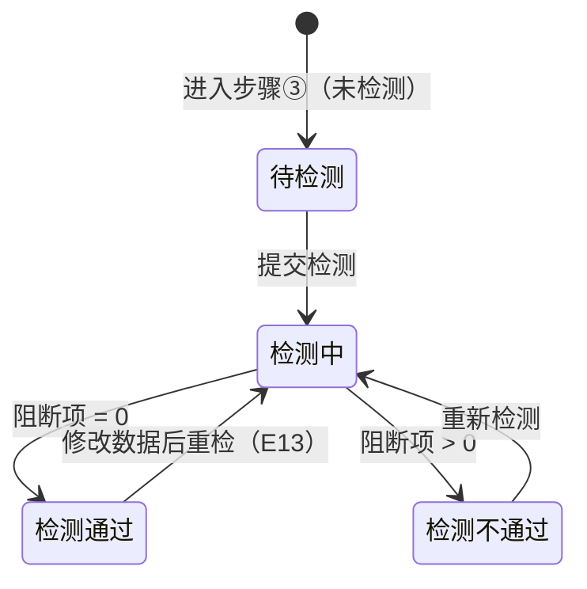

# 数据检测业务 PRD（工作台步骤③）

> **文档定位**：批次 5「数据检测」环节的**业务规则真相源**，定义检测状态流转、动作矩阵、检测规则（R-xxx）、边界异常与验收标准。字段结构见《数据检测字段清单》，页面呈现见《数据检测_Demo》。

> **【以原型为准修订声明 · 2026-10-13（V0.4），全文优先】**：本文与前端原型（`ProjectStepThree.tsx` / `mock` `submitPcfCheck`）冲突之处，**一律以原型为准**：
> - 步骤② 已更名重构为「**产品建模**」（阶段数据项口径）；检测对象 = 阶段数据项（不再有工序 / 分配比例）。
> - **原型实际生成的检测项**：B1 数据完整性（用量未填）/ B2 数据完整性（投入项未匹配因子）/ B4 因子单位（跨单位类型不可换算）/ B5 阶段覆盖（已纳入一级阶段无数据项）/ W2 生物碳（提示级）。**B3「分配比例不闭合」与 W1「质量平衡偏差」在当前原型中不产生**（分配比例随产品建模重构取消；质量平衡后置）——检测类别枚举（`allocation` / `massBalance`）保留但无生成逻辑。
> - 检测通过 → 项目「待核算」且**当前步骤推进到 ④**（碳足迹核算与结果）；检测不通过 → 回「进行中」、停留 ③。
> - 步骤③ 界面含：检测说明、检测结论卡（四态：尚未提交检测 / 检测中… / 检测通过 / 检测不通过）、阻断问题与提示问题两个分组清单（每条含类别 Tag、标题、描述、定位、「去修改」入口）。
> - **「提交检测」仅项目状态为「进行中 / 检测中」时可用**；「进入碳足迹核算」按钮在检测通过且项目为「待核算」时展示。
> - **V0.5（2026-10-14，以原型为准）**：① 「**确认完成**」纳入项目状态机后，步骤③在「已完成」态**只读**（无「提交检测」入口，回看最近一次结论）；② 原型步骤③新增「**预览模型**」入口（流程画布 `PcfFlowCanvas`，只读预览建模数据，各状态恒显）；③ 原型检测说明文案仍含「分配比例 / 质量平衡」字样（历史残留，实际检测项不含 B3 / W1）——**待业务裁定是否改文案**（见 §8 Q5）。
> - **V0.6（2026-10-14，V1.1 业务裁定，以原型为准）**：① 「**确认完成」结果不锁定**——「已完成」态步骤③**可提交 / 重新检测**（与「进行中 / 检测中」同等）；② 「**回退保留结论**」——已核算 / 已完成修改步骤①②数据保存 → 项目回退「进行中」时**检测结论保留**，步骤③**默认展示原检测数据**（问题清单可回看），**不强制重新检测**；用户主动重检后覆盖。

## 0. 文档基础信息

| 项目 | 内容 |
| :--- | :--- |
| 文档名称 | 数据检测业务 PRD（工作台步骤③） |
| 版本 | V0.6 |
| 状态 | 草稿（待业务确认） |
| 模块名称 | 产品碳足迹核算 · 数据检测 |
| 模块类型 | **项目内校验步骤**（子对象：检测结果 + 检测问题） |
| 维护形态 | 工作台步骤③ 内容区（检测结论 + 问题清单） |
| 所属层级 | 前台业务平台 · 产品碳足迹核算（方案 §2.3 B1-7、§八 P23、§5.1 步骤12 质量校验） |
| 字段真相源 | `02prd/02-2前台业务功能/01 碳核算项目/05 检测核算与结果/数据检测字段清单.md` |
| 上游基线 | `00碳核算项目_模块拆分与交互骨架.md`（V1.0）、`01 项目列表与新建/核算项目业务PRD.md`（V0.9） |
| 上游真相源 | 整体设计方案 v1.2 r4 §5.4（异常 E01–E16）、§5.5（报告准入） |
| 更新时间 | 2026-10-10 |

**变更记录**

| 日期 | 版本 | 变更内容 |
| :--- | :--- | :--- |
| 2026-09-24 | V0.1 | 初版：定义检测状态流转、动作矩阵、检测规则 R-034 ~ R-041、边界异常与验收标准 |
| 2026-10-09 | V0.2 | **单位换算口径对齐**：B4「因子单位不匹配」明确为**跨单位类型**才阻断；**同类型不同量级（如 `t` vs `kg`）不阻断**，量级换算由核算引擎按计量单位库「基准中转」计算 `[当前行.单位换算系数]` 完成（见《碳足迹核算业务 PRD》§6.1） |
| 2026-10-10 | V0.3 | **「多口径」口径同步**：新增检测项 **W2「生物碳未在生命末期闭环」（提示级）**；§1.3 Out of Scope / §6 检测规则 / R-036 / Q2 同步——**生物碳对称（E16）由「本期后置」改为本期纳入（提示级）** |

**关联链接**

| 文档 | 路径 |
| :--- | :--- |
| 模块拆分与交互骨架（步骤定义 / 状态映射） | `02prd/02-2前台业务功能/01 碳核算项目/00碳核算项目_模块拆分与交互骨架.md` |
| 核算项目业务 PRD（项目状态机 / 步骤流转 R-006） | `02prd/02-2前台业务功能/01 碳核算项目/01 项目列表与新建/核算项目业务PRD.md` |
| 数据检测字段清单（检测项 / 字段） | `02prd/02-2前台业务功能/01 碳核算项目/05 检测核算与结果/数据检测字段清单.md` |
| 整体设计方案 v1.2 r4（§5.4 / §5.5） | `04产品设计管理/00业务设计/产品碳足迹核算系统_整体设计方案_v1.2.md` |

---

## 1. 需求概述

### 1.1 需求背景

步骤③「数据检测」是**进入核算前的最后一道质量闸门**：在工序与数据（步骤②）填报完成后，系统对活动数据、排放来源、分配比例、阶段覆盖、因子单位、质量平衡做一次全面校验，输出「人话问题 + 修改入口」的问题清单。

```text
步骤② 产品建模（维护阶段数据项：用量 / 单位 / 引用因子 / 追溯）
        ↓ 提交检测
步骤③ 数据检测（校验 → 问题清单）
        ↓ 阻断项清零
步骤④ 碳足迹核算与结果（执行核算）
```

**没有检测这道闸门，脏数据会直接进入核算，产生错误的结果与报告。**

### 1.2 需求目标

| # | 目标 | 可验证口径 |
| :-: | :--- | :--- |
| G1 | **一键提交检测** | 步骤③ 提供「提交检测」入口，提交后进入「检测中」，随后返回检测结论 |
| G2 | **阻断项必须整改** | 存在阻断级问题 → 检测不通过，禁止进入步骤④；问题清单给出定位与修改入口 |
| G3 | **提示项不阻断** | 提示级问题仅作风险标注，不阻断进入核算 |
| G4 | **修改后重检** | 整改后可「重新检测」，检测结果随项目留存（最近一次结论） |
| G5 | **概念不外露** | 问题清单只呈现「人话问题 + 修改入口」，不展示异常编号（E01–E16）、公式、因子绑定术语 |

### 1.3 范围（In Scope / Out of Scope）

**In Scope**

| # | 范围 |
| :-: | :--- |
| 1 | 提交检测（生成检测结果 + 问题清单） |
| 2 | 检测结论展示（通过 / 不通过 / 检测中 / 待检测） |
| 3 | 问题清单展示（按阻断级 / 提示级分组，含定位 + 修改入口） |
| 4 | 重新检测（整改后重检，覆盖最近一次结论） |
| 5 | 检测通过后进入步骤④ 碳足迹核算的入口 |

**Out of Scope**

| 不做项 | 归属 / 原因 |
| :--- | :--- |
| 检测规则的后台配置（检测项清单 / 阈值参数） | 已随核算模型废弃；检测口径系统内置（方案 §5.4 修订声明） |
| 摇篮到坟墓特有检测项（运输距离 E05 / 末期处理比例 E12） | 本期后置（见字段清单 C01 / Q2）；**生物碳对称（E16）本期纳入为提示级（W2）**，不再后置 |
| 能量平衡检测（E15） | 本期后置（见字段清单 Q1） |
| 第三方核查工作流 | 方案 §十 阶段三 |
| 检测结果的跨项目复用 / 历史版本比对 | 本期不做 |

### 1.4 与上下游的边界

| 归属 | 模块 | 本文的角色 |
| :--- | :--- | :--- |
| 项目状态机与步骤流转（R-006） | 核算项目业务 PRD | 引用，不重复定义 |
| 检测项、问题级别、检测结果字段 | 数据检测字段清单 | 引用，不重复定义 |
| 步骤④ 碳足迹核算的准入（阻断项清零） | 批次 5（碳足迹核算） | 本文定义准入前置 |
| 页面控件与布局 | 数据检测_Demo | 不写 |

---

## 2. 用户与使用场景

| 场景ID | 场景 | 类型 | 说明 |
| :--- | :--- | :--- | :--- |
| S01 | 首次提交检测 | **主流程** | 完成步骤②后进入步骤③，点击「提交检测」→ 检测中 → 返回结论 |
| S02 | 检测通过 | **主流程** | 无阻断项 → 结论「检测通过」+ 「进入碳足迹核算」入口 |
| S03 | 检测不通过 | **主流程** | 存在阻断项 → 结论「检测不通过」+ 问题清单（定位 + 修改入口） |
| S04 | 整改后重检 | **主流程** | 点击问题清单的修改入口跳转步骤①/② 修改 → 回到步骤③「重新检测」 |
| S05 | 查看历史检测结论 | 支线 | 项目已检测通过后回看步骤③，展示最近一次检测结论 |
| S06 | 只读查看 | 辅助 | 项目处于只读态（核算中及之后）时步骤③ 整体只读 |

---

## 3. 功能清单

| 模块 | 功能点 | 功能描述 | 优先级 |
| :--- | :--- | :--- | :---: |
| 检测执行 | 提交检测 | 触发检测，生成检测结果 + 问题清单 | P0 |
| | 重新检测 | 整改后重检，覆盖最近一次结论 | P0 |
| 检测结论 | 结论展示 | 待检测 / 检测中 / 通过 / 不通过 四态展示 | P0 |
| 问题清单 | 分组展示 | 阻断级 / 提示级 分组，展示条数统计 | P0 |
| | 定位与入口 | 每条问题展示定位 + 修改入口（跳步骤①/②） | P0 |
| | 通过后入口 | 「进入碳足迹核算」按钮（阻断项清零时展示） | P0 |
| 模型预览 | 预览模型 | 流程画布只读预览建模数据（输入 / 输出 + 追溯链路）；各状态恒显 | P1 |
| 只读态 | 只读展示 | 「核算中」「已完成」（及历史报告态）只读，无「提交检测」入口 | P1 |

**不做**：检测项后台配置、问题批量忽略/关闭、问题留痕注释。

---

## 4. 核心业务规则

> 编号承接批次 3（R-025 ~ R-033），本批次从 **R-034** 起。

| 规则ID | 规则 | 依据 |
| :--- | :--- | :--- |
| R-034 | **[检测触发]** 步骤③「提交检测」仅当项目状态为「进行中 / 检测中 / **已完成**」时可用（V1.1 起已完成不锁定）；提交后项目状态置「检测中」（原型模拟异步，约 1 秒后返回结论）；**步骤①②仍可编辑**（「已核算」前均可编辑，R-006） | 方案 §5.2 / 核算项目 PRD §5.3 / 以原型为准 |
| R-035 | **[阻断项判定]** 检测结果为「通过」当且仅当**阻断级问题数为 0**；存在任一阻断级问题 → 检测不通过，项目回退「进行中」，展示问题清单 | 方案 §5.2「检测不通过 → 产品模型创建中」 |
| R-036 | **[提示项不阻断]** 提示级问题仅作风险标注（标「提示」Tag），不阻断检测通过与进入核算。**生物碳对称（W2）为提示级**：结果含生物碳口径但未纳入生命末期（释放）时提示「如为摇篮到大门口径可忽略」 | 方案 §5.4「可计算但标风险」/ 多口径（2026-10-10） |
| R-037 | **[检测通过推进]** 检测通过后项目状态置「待核算」、当前步骤推进到④；步骤③展示「进入碳足迹核算」入口 | 骨架 S-001（③→④ 需检测无阻断项） |
| R-038 | **[概念不外露]** 问题清单只呈现「人话问题 + 修改入口」，不展示异常编号（E01–E16）、检测规则编号、公式、因子绑定术语 | 《角色可见范围 v1.0》§3 / §3.1 / 骨架 S-007 |
| R-039 | **[修改入口定位]** 每条问题携带「修改入口」（步骤①或步骤②）；点击后跳转到对应步骤内容区，用户整改后回到步骤③ 重新检测 | 骨架 S-002（自由回退） |
| R-040 | **[检测结果留存]** 检测结果随项目留存（最近一次结论），「重新检测」覆盖；**回退保留结论（V1.1）**——「已核算 / 已完成」修改数据保存 → 项目回退「进行中」时检测结论保留，步骤③**默认展示原检测数据**，**不强制重新检测**；用户主动重检后覆盖 | 方案 §4.9 / E13 / 以原型为准 |
| R-041 | **[编辑约束]** 承接 R-006（骨架 D13）：**「已核算」之前（含检测中 / 待核算 / 核算失败）步骤①②可编辑**；**「已完成」同样可编辑 / 可检测**（V1.1 不锁定）；仅「核算中」及历史报告态只读 | 骨架 D13 / V1.4 |

---

## 5. 状态与动作

### 5.1 检测状态流转（本步骤内部）



> 检测状态（`pending / checking / passed / failed`）为**本步骤内部口径**；项目状态（`ongoing / checking / toCalc`）按 §5.2 同步流转。

### 5.2 检测状态 → 项目状态映射

| 检测状态 | 项目状态 | 当前步骤 | 可执行动作 |
| :--- | :--- | :---: | :--- |
| `pending`（待检测） | 进行中 | ③ | 提交检测 / 回步骤②修改 |
| `checking`（检测中） | 检测中 | ③ | 等待（只读） |
| `failed`（不通过） | 进行中 | ③ | 重新检测 / 跳步骤②修改 |
| `passed`（通过） | 待核算 | ③（可进④） | 进入碳足迹核算 / 回步骤②修改（修改后需重检） |
| `passed` 回看 | 待核算 / 已核算等 | ③ | 「查看核算结果」入口（非待核算态时） |
| `passed` / `failed` 回看 | **已完成（不锁定，V1.1）** | ③ | 默认展示原检测数据；可「提交 / 重新检测」（不强制） |

### 5.3 动作能力矩阵

| 动作 | 待检测 | 检测中 | 不通过 | 通过 | 已完成（不锁定） | 只读（核算中 / 历史报告态） |
| :--- | :-: | :-: | :-: | :-: | :-: | :-: |
| 提交检测 / 重新检测 | ✅ | ❌ | ✅ | ✅（改数据后） | ✅ | ❌ |
| 查看问题清单 | ❌ | ❌ | ✅ | ✅（空清单） | ✅ | ✅ |
| 跳转修改入口 | ✅（回步骤②） | ❌ | ✅ | ✅（改数据后） | ✅ | ❌ |
| 进入碳足迹核算 | ❌ | ❌ | ❌ | ✅ | ✅ | ✅（回看步骤④） |
| 预览模型 | ✅ | ✅ | ✅ | ✅ | ✅ | ✅ |

> **红线**：不渲染 disabled 假入口——不可用动作直接不展示（对齐核算项目 PRD §6）。

---

## 6. 检测规则（对齐字段清单 §4 检测项）

| 编号 | 检测项 | 级别 | 触发条件 | 问题文案（原型实际） |
| :--- | :--- | :---: | :--- | :--- |
| B1 | 数据完整性 · 用量缺失 | 阻断 | 数据项的「单位产品用量」为空（`quantity == null`） | 标题「数据项「X」的数量未填写」；描述「请补充该数据项的数量后重新检测。」；定位「阶段：Y / 数据项：X」；修改入口「去填写」 |
| B2 | 数据完整性 · 排放来源缺失 | 阻断 | 投入项（类型 ∈ 原辅料 / 自然资源 / 能源及能源介质）未匹配排放因子 | 标题「投入项「X」未匹配排放因子」；描述「该投入项参与计算需匹配排放来源，请选择排放因子。」；修改入口「去匹配因子」 |
| B3 | ~~分配比例不闭合~~ | ~~阻断~~ | **不再产生（V1.2）**：产品建模无分配比例 | — |
| B4 | 因子单位不匹配 | 阻断 | 数据项单位与因子分母单位**跨单位类型**不可换算（同类型不同量级由引擎按「基准中转」换算，不阻断） | 标题「数据项「X」的数量单位与因子单位不可换算」；描述含双方单位与整改建议；修改入口「去修改」 |
| B5 | 阶段覆盖 · 阶段无数据 | 阻断 | 步骤①勾选纳入的**一级阶段**在该阶段下无任何数据项 | 标题「阶段「X」已纳入但未录入数据项」；描述「该阶段已纳入核算，但尚未录入任何数据项，请到步骤②补充该阶段的数据。」；定位「阶段：X」；修改入口「去补充」 |
| W1 | ~~质量平衡偏差~~ | ~~提示~~ | **本期不产生（后置）**：质量平衡检测未在原型落地 | — |
| W2 | **生物碳未在生命末期闭环** | 提示 | 存在数据项的因子口径 `calibers.gwpBiogenic ≠ 0` 但纳入的一级阶段中无「生命末期 / 末期 / 废弃 / 处置 / 回收」阶段 | 标题「生物碳未在生命末期闭环」；描述「本次核算含生物碳口径，但未纳入生命末期（释放）阶段，含生物碳净值可能未闭合；如为摇篮到大门口径可忽略。」；修改入口「去调整边界」（fixStep = 1） |

> **检测类别界面文案**（`CHECK_CATEGORY_TEXT`，不展示编号）：数据完整性 / 因子单位 / 分配比例（保留）/ 阶段覆盖 / 质量平衡（保留）/ 生物碳。
> **提交口径**：仅纳入的一级阶段下的数据项参与检测（二级阶段数据项上卷到一级阶段判定）。

---

## 7. 边界与异常处理

| 场景 | 系统行为 |
| :--- | :--- |
| 项目无任何数据项 | 检测结果为「不通过」，问题清单含 B5（各纳入一级阶段无数据项）；提示「请先完成步骤②」 |
| 检测中重复点击「提交检测」 | 按钮禁用，展示「检测中」态，不重复提交 |
| 检测执行超时 / 异常 | 项目状态回「检测中」，提示「检测异常，请重新检测」（方案「检测异常 → 重新检测」） |
| 项目已被他人修改（并发） | 提交检测时以项目状态为准，状态已变更则提示「项目状态已变更，请刷新后重试」 |
| 检测通过后修改步骤②数据 | 项目回退「进行中」，**检测结论保留**：步骤③默认展示原检测数据（R-040），不强制重新检测；主动重检后覆盖 |
| 项目「已完成」（确认完成，不锁定） | 步骤③默认展示原检测数据；可「提交 / 重新检测」（V1.1） |

---

## 8. 待确认事项

| 编号 | 问题 | 影响 | 当前建议 | 状态 |
| :--- | :--- | :--- | :--- | :--- |
| Q1 | 检测项最终清单（质量平衡 / 能量平衡是否本期纳入） | §6 检测项 | 本期落质量平衡（W1）；能量平衡后置 | 待确认 |
| Q2 | 摇篮到坟墓特有检测项（E05 / E12 / E16）是否本期纳入 | §6 检测项 | **生物碳对称（E16）本期纳入（提示级 W2）**；运输距离（E05）/ 末期处理比例（E12）后置 | 待确认 |
| Q3 | 质量平衡偏差阈值 | W1 | 建议 5%，可配 | 待确认 |
| Q4 | 检测不通过后项目状态回「进行中」还是保留「检测中」 | §5.2 | 回「进行中」 | 待确认 |
| Q5 | 检测说明文案是否去除「分配比例 / 质量平衡」 | §6 / 检测说明 | 原型说明条仍写「对活动数据、排放来源、分配比例、阶段覆盖、因子单位与质量平衡进行校验」（历史残留，实际检测项 = B1 / B2 / B4 / B5 / W2）；建议改为现行口径 | **原型已表现·待业务裁定** |

---

## 9. 验收标准

| # | 验收项 | 输入条件 | 预期结果 |
| :-: | :--- | :--- | :--- |
| V01 | **提交检测** | 步骤②已填全数据，进入步骤③点击「提交检测」 | 状态转「检测中」，随后返回检测结论 |
| V02 | **检测通过推进** | 项目无阻断项，检测完成 | 结论「检测通过」，项目状态「待核算」，展示「进入碳足迹核算」入口 |
| V03 | **检测不通过** | 项目存在阻断项（如某数据项活动量未填） | 结论「检测不通过」，项目回「进行中」，展示问题清单 |
| V04 | **问题清单分组** | 检测不通过且含提示项 | 阻断级 / 提示级分组展示，各带条数统计 |
| V05 | **修改入口跳转** | 点击问题清单的「去填写」入口 | 跳转到步骤②对应内容区，可回步骤③重检 |
| V06 | **重新检测** | 整改完成后点击「重新检测」 | 重新执行检测，覆盖最近一次结论 |
| V07 | **提示项不阻断** | 项目仅含提示级问题，无阻断项 | 检测「通过」，提示项以「提示」Tag 展示 |
| V08 | **只读态** | 项目「核算中」打开步骤③ | 展示最近一次结论，无「提交检测」入口 |
| V09 | **概念不外露** | 全流程走查问题清单 | 不出现异常编号（E01–E16）、公式、因子绑定术语 |
| V10 | **预览模型** | 步骤③点「预览模型」 | 打开流程画布（末级阶段根卡片 + 上游过程子卡片 + 输入 / 输出 + 追溯连线），只读 |
| V11 | **已完成不锁定** | 「已完成」项目打开步骤③ | 默认展示原检测数据；可「提交 / 重新检测」（V1.1） |
| V12 | **回退保留结论** | 「已核算」项目修改步骤②保存后打开步骤③ | 默认展示原检测数据（问题清单可回看），不强制重新检测 |

---

## 10. 附录

### 10.1 术语表

| 术语 | 含义 |
| :--- | :--- |
| 数据检测 | 核算前对活动数据 / 因子 / 分配 / 阶段 / 单位 / 质量的全面校验 |
| 检测结果 | 一次检测动作的结论快照（待检测 / 检测中 / 通过 / 不通过） |
| 检测问题 | 检测结果中的一条问题，含级别、类别、定位与修改入口 |
| 阻断级 | 必须整改后才能进入核算的问题级别 |
| 提示级 | 建议关注、可标风险继续核算的问题级别 |
| 人话问题 | 面向用户、不含配置段术语与异常编号的问题描述 |

### 10.2 下游文档影响清单

| 下游文档 | 受影响内容 |
| :--- | :--- |
| 本批次 Demo PRD | 页面骨架、控件、校验展示、Mock |
| 原型 `pages/pcf/ProjectStepThree.tsx` | 工作台步骤③ 内容区 |
| 批次 5（碳足迹核算 / 核算结果） | 步骤④准入 = 检测通过（阻断项清零） |
| 批次 6（报告） | 报告准入校验（方案 §5.5）引用检测结论 |

---

## 修订记录

| 日期 | 版本 | 变更摘要 |
| :--- | :--- | :--- |
| 2026-09-24 | V0.1 | 初版：检测状态流转 + 动作矩阵 + 检测规则 R-034 ~ R-041 + 验收标准 |
| 2026-10-09 | V0.2 | B4 单位检测口径对齐：仅跨单位类型阻断，同类型量级换算下沉到核算引擎（基准中转） |
| 2026-10-10 | V0.3 | **「多口径」口径同步**：新增检测项 W2「生物碳未在生命末期闭环」（提示级）；生物碳对称（E16）由后置改为本期纳入提示级 |
| 2026-10-13 | V0.4 | **以原型为准修订**：① 文首新增修订声明（步骤② 改「产品建模」；原型实际检测项 = B1 / B2 / B4 / B5 / W2）；② §6 检测项 B3（分配比例）与 W1（质量平衡）标注**不再产生**；③ R-034 / R-041 按原型编辑约束改写（「已核算」前均可编辑）；④ §5.2 补充 passed 回看态；⑤ §7 边界场景「工序数据」改「数据项」 |
| 2026-10-14 | V0.5 | **原型核对修订（「确认完成」纳入 + 原型口径补全）**：① 文首声明补「已完成」态只读、「预览模型」入口、检测说明文案残留待确认；② §3 功能清单补「预览模型」；③ §5.2 / §5.3 补「已完成」只读行与「预览模型」动作行；④ §6 检测项表补原型实际标题 / 描述 / 定位 / 修改入口文案与检测类别界面文案、提交口径（仅纳入一级阶段下数据项）；⑤ §7 补「已完成」边界场景；⑥ §8 新增 Q5（检测说明文案残留）；⑦ §9 新增验收 V10 / V11；⑧ 版本号 V0.4 → V0.5 |
| 2026-10-14 | **V0.6** | **口径裁定修订（V1.1，2026-10-14）**：① 文首声明补「确认完成不锁定」与「回退保留结论」口径；② R-034 提交条件加「已完成」；③ R-040 改「回退保留结论」（默认展示原检测数据、不强制重新检测）；④ R-041「已完成」改可编辑 / 可检测；⑤ §5.2 映射 / §5.3 动作矩阵 / §7 边界同步；⑥ §9 V11 改「已完成不锁定」、新增 V12；⑦ 版本号 V0.5 → V0.6 |
