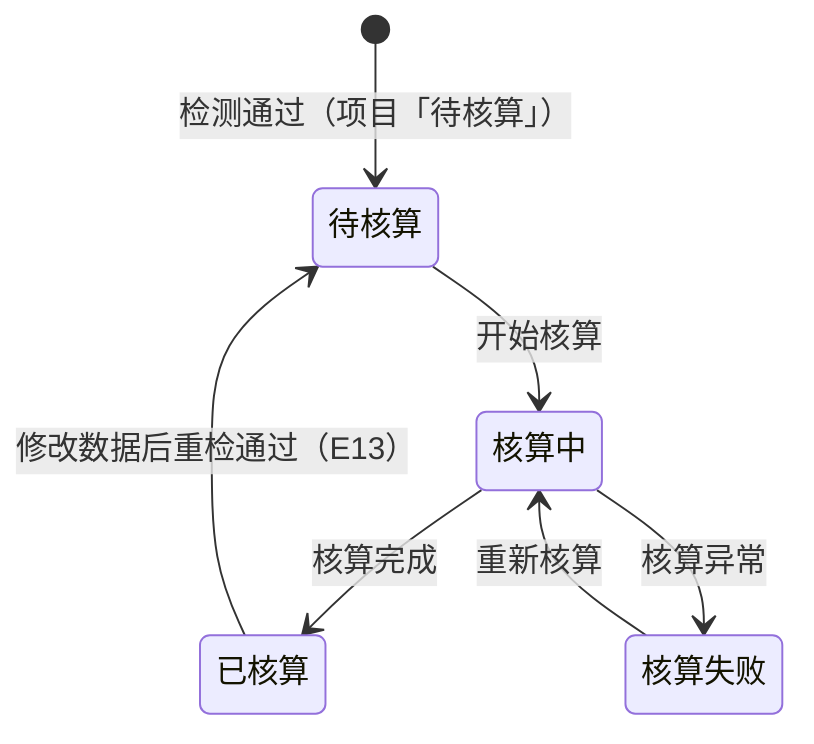

# 碳足迹核算与结果业务 PRD（工作台步骤④）

> **文档定位**：批次 5「碳足迹核算与结果」环节的**业务规则真相源**，定义核算状态流转、动作矩阵、核算计算口径、结果版本化、边界异常与验收标准。字段结构见《碳足迹核算字段清单》，页面呈现见《碳足迹核算_Demo》。
>
> **合并说明（V0.2）**：原步骤④「碳足迹核算」（P24，执行核算 / 状态查看 / 失败重试）与步骤⑤「核算结果」（P25，总量 / 阶段 / 工序 / 排放源 / 导出）**合并为同一个步骤④节点「碳足迹核算与结果」**——核算执行后即产出结果版本，两者是不可分割的闭环，无需拆成两个步骤节点。合并后工作台步骤条 6 步 → **5 步**（①目标与范围 / ②工序与数据 / ③数据检测 / ④碳足迹核算与结果 / ⑤报告）。步骤③→④ 的衔接如下：
>
> ```text
> 步骤③ 数据检测（通过 → 阻断项清零）
>         ↓ 进入核算
> 步骤④ 碳足迹核算与结果
>     ├─ 执行区：开始核算 → 核算中 → 已核算 / 核算失败（可重试）
>     └─ 结果区：总量 / 阶段 / 工序 / 排放源 / 明细 / 导出（核算完成即在同页产出）
> ```

## 0. 文档基础信息

| 项目 | 内容 |
| :--- | :--- |
| 文档名称 | 碳足迹核算与结果业务 PRD（工作台步骤④） |
| 版本 | V0.2 |
| 状态 | 草稿（待业务确认） |
| 模块名称 | 产品碳足迹核算 · 碳足迹核算与结果 |
| 模块类型 | **项目内执行步骤 + 结果载体**（子对象：核算任务 + 核算结果 + 结果明细） |
| 维护形态 | 工作台步骤④ 单页：执行区（核算状态 + 执行动作）+ 结果区（总览 + 多维表格） |
| 所属层级 | 前台业务平台 · 产品碳足迹核算（方案 §2.3 B1-8、B1-9、§八 P24/P25、§5.1 步骤11 执行核算 / 步骤13 结果确认） |
| 字段真相源 | `02prd/02-2前台业务功能/01 碳核算项目/05 检测核算与结果/碳足迹核算字段清单.md` |
| 上游基线 | `00碳核算项目_模块拆分与交互骨架.md`（V1.0）、`01 项目列表与新建/核算项目业务PRD.md`（V0.9）、`数据检测业务PRD.md`（V0.1） |
| 上游真相源 | 整体设计方案 v1.2 r4 §6.1（计算引擎）、§4.7（核算结果）、§5.4（异常 E01–E16）、§5.5（报告准入） |
| 更新时间 | 2026-09-28 |

**变更记录**

| 日期 | 版本 | 变更内容 |
| :--- | :--- | :--- |
| 2026-09-24 | V0.1 | 初版：定义核算状态流转、动作矩阵、计算口径（去模型 / 公式下沉到工序）、结果版本化、验收标准 |
| 2026-09-28 | V0.2 | **步骤④⑤合并为步骤④「碳足迹核算与结果」**：执行区与结果区同页承载，取消「查看核算结果」跨步跳转；状态→步骤映射与动作矩阵收敛到步骤④；工作台步骤条 6 步 → 5 步 |

**关联链接**

| 文档 | 路径 |
| :--- | :--- |
| 模块拆分与交互骨架（步骤定义 / 状态映射） | `02prd/02-2前台业务功能/01 碳核算项目/00碳核算项目_模块拆分与交互骨架.md` |
| 核算项目业务 PRD（项目状态机 / 步骤流转 R-006） | `02prd/02-2前台业务功能/01 碳核算项目/01 项目列表与新建/核算项目业务PRD.md` |
| 数据检测业务 PRD（步骤④准入 = 检测通过） | `02prd/02-2前台业务功能/01 碳核算项目/05 检测核算与结果/数据检测业务PRD.md` |
| 碳足迹核算字段清单（核算任务 / 结果字段） | `02prd/02-2前台业务功能/01 碳核算项目/05 检测核算与结果/碳足迹核算字段清单.md` |
| 整体设计方案 v1.2 r4（§6.1 / §4.7 / §5.4 / §5.5） | `04产品设计管理/00业务设计/产品碳足迹核算系统_整体设计方案_v1.2.md` |

---

## 1. 需求概述

### 1.1 需求背景

步骤③「数据检测」通过后，项目进入「待核算」态。步骤④「碳足迹核算与结果」把**已填报的活动数据 + 匹配的排放因子 + 工序绑定公式**按计算规则换算成碳排放量，并在同一步骤内把结果按「总量 / 阶段 / 工序 / 排放源」多维呈现、支持下钻与导出，作为生成报告（步骤⑤）的数据来源。

```text
工序绑定公式（引用即复制，公式下沉到工序投入产出项）
        ↓
步骤② 填报：活动量（动态 activity 因素）+ 排放来源（parameter 因子）
        ↓ 检测通过
步骤④ 计算：逐填报行 → 逐工序 → 逐阶段 → 汇总
        ↓ 核算完成（同页产出）
步骤④ 结果：总碳足迹 + 阶段/工序/排放源多维汇总 + 下钻 + 导出
```

**没有核算这一步，填报的数据只是原始台账，无法形成可追溯、可复核的碳足迹结论。**

### 1.2 需求目标

| # | 目标 | 可验证口径 |
| :-: | :--- | :--- |
| G1 | **一键执行核算** | 步骤④「开始核算」→ 核算中 → 核算完成（已核算），全程无需额外配置 |
| G2 | **核算失败可重试** | 核算异常 → 状态「核算失败」+「重新核算」入口，重试幂等 |
| G3 | **结果版本化** | 每次核算生成新结果版本，旧版本保留；修改数据后重算生成新版本（E13） |
| G4 | **多维结果下钻** | 总量 / 阶段 / 工序 / 排放源四维可查，工序级可下钻至「数据 → 因子 → 公式」 |
| G5 | **结果可导出** | 结果明细导出，作为报告数据来源 |
| G6 | **概念不外露** | 界面不出现公式 DSL、计算引擎、快照术语；只呈现人话结果与排放构成 |

### 1.3 范围（In Scope / Out of Scope）

**In Scope**

| # | 范围 |
| :-: | :--- |
| 1 | 执行核算（生成核算任务 + 结果版本） |
| 2 | 核算状态展示（待核算 / 核算中 / 已核算 / 核算失败） |
| 3 | 失败重试（重新核算） |
| 4 | 核算结果展示（总量 / 阶段 / 工序 / 排放源） |
| 5 | 结果明细下钻（工序 → 数据项 → 因子 → 公式） |
| 6 | 结果导出 |

**Out of Scope**

| 不做项 | 归属 / 原因 |
| :--- | :--- |
| 多气体（CH₄ / N₂O）特征化 | 方案 §6.1.2 预留，本期 CO₂ 口径 |
| 公式级自定义、计算引擎配置 | 后台管理（A2-3），前台仅引用 |
| 分析域（多产品对比、看板、降碳模拟） | 方案 §2.1 本期不做 |
| 第三方核查工作流 | 方案 §十 阶段三 |
| 结果跨项目复用 / 共享数据集比对 | P30 后置 |
| 结果确认的独立「审核」环节 | 报告确认归步骤⑥（核算人员执行，V0.2） |

### 1.4 与上下游的边界

| 归属 | 模块 | 本文的角色 |
| :--- | :--- | :--- |
| 项目状态机与步骤流转（R-006） | 核算项目业务 PRD | 引用，不重复定义 |
| 步骤④准入（检测通过、阻断项清零） | 数据检测业务 PRD R-037 | 引用为前置 |
| 核算任务、核算结果、结果明细字段 | 碳足迹核算字段清单 | 引用，不重复定义 |
| 报告生成准入（方案 §5.5） | 批次 6（报告） | 本文产出结果版本作为报告输入 |
| 页面控件与布局 | 碳足迹核算_Demo | 不写 |

---

## 2. 用户与使用场景

| 场景ID | 场景 | 类型 | 说明 |
| :--- | :--- | :--- | :--- |
| S01 | 首次执行核算 | **主流程** | 检测通过后进入步骤④，点击「开始核算」→ 核算中 → 核算完成 |
| S02 | 核算失败重试 | **主流程** | 核算异常 → 状态「核算失败」→「重新核算」→ 核算完成 |
| S03 | 查看核算结果 | **主流程** | 核算完成后在本步骤下方结果区直接查看总量 / 阶段 / 工序 / 排放源（无需跨步骤跳转） |
| S04 | 结果明细下钻 | 支线 | 点击工序 → 查看该工序的数据项明细（数据 / 因子 / 公式） |
| S05 | 导出结果 | 支线 | 结果总览卡「导出结果」→ 下载结果明细（作为报告数据来源） |
| S06 | 修改数据后重算 | 辅助 | 已核算后修改步骤①② → 项目回退「进行中」→ 重走检测 → 核算 → 新结果版本 |
| S07 | 只读回看 | 辅助 | 项目「报告生成中」及之后回看步骤④，结果区只读展示最近版本、无执行入口 |

---

## 3. 功能清单

| 模块 | 功能点 | 功能描述 | 优先级 |
| :--- | :--- | :--- | :---: |
| 核算执行 | 开始核算 | 触发异步核算任务，生成结果版本 | P0 |
| | 重新核算 | 失败 / 已核算后重算，覆盖或新增结果版本 | P0 |
| 核算状态 | 状态展示 | 待核算 / 核算中 / 已核算 / 核算失败 四态展示 | P0 |
| 核算结果 | 总览卡 | 单位产品碳足迹 + 总排放量 + 结果单位 + 核算时间 | P0 |
| | 阶段汇总 | 各一级生命周期阶段排放量与占比（柱状 / 表格） | P0 |
| | 工序汇总 | 各核算工序排放量与贡献率 | P0 |
| | 排放源汇总 | 材料 / 能源 / 运输 / 废弃物 等分类排放与占比 | P0 |
| | 明细下钻 | 工序 → 数据项 → 因子 / 公式 | P1 |
| | 导出 | 结果明细导出 | P1 |
| 只读态 | 只读展示 | 报告生成中及之后只读、无执行入口 | P1 |

**不做**：结果在线编辑、结果确认（归步骤⑥）、多项目结果对比、图表导出为图片。

---

## 4. 核心业务规则

> 编号承接数据检测业务 PRD（R-034 ~ R-041），本环节从 **R-042** 起。

| 规则ID | 规则 | 依据 |
| :--- | :--- | :--- |
| R-042 | **[核算准入]** 步骤④「开始核算」仅当项目状态为「待核算」（检测通过、阻断项清零）时可用；未检测或检测不通过不可进入 | 骨架 S-001（③→④ 需检测无阻断项）/ 方案 §5.5 |
| R-043 | **[异步核算]** 核算任务异步执行：提交后项目状态置「核算中」，冻结编辑；完成后置「已核算」并生成结果版本；异常置「核算失败」可重试 | 方案 §6.1 异步执行 |
| R-044 | **[计算口径]** 单条填报行排放 = `Π(活动量) × Π(常量) × 因子值`（含 `parameter` 因素时）；工序排放 = Σ 该工序填报行排放；阶段排放 = Σ 该阶段工序排放；总排放 = Σ 全部工序排放。**单位换算系数在原型层简化（检测 B4 已保证单位可换算），真实换算见方案 §6.1.1** | 方案 §6.1.1 基本公式 |
| R-045 | **[排放范围]** 参与计算的数据项 = 工序投入 / 产出中 `disposal = formula` 的填报行；中间品 / 产品（`excluded`）不计入（其排放已计入上游工序，避免重复计算） | 方案 §4.2.2 / 公式下沉口径 |
| R-046 | **[结果版本化]** 每次核算生成新结果版本（版本号递增），旧版本保留不可篡改；「重新核算」生成新版本而非覆盖 | 方案 §4.9 / §6.3 |
| R-047 | **[修改即失效]** 已核算后修改步骤①②数据 → 项目回退「进行中」并清空核算结论与结果引用，需重走检测 → 核算（E13）；历史结果版本保留 | 骨架 D13 / E13 |
| R-048 | **[失败重试幂等]** 核算失败保留失败记录；「重新核算」以当前项目数据重算，不产生重复任务；同一状态仅一个核算任务 | 方案 §6.1 幂等与版本 |
| R-049 | **[概念不外露]** 结果页只呈现人话排放构成（总量 / 阶段 / 工序 / 排放源），不展示公式 DSL、计算引擎、快照、异常编号 | 《角色可见范围 v1.0》§3 / 骨架 S-007 |
| R-050 | **[可解释下钻]** 每个结果可下钻至「数据 → 因子 → 公式模板」四要素（方案 §6.1 可解释）；工序明细行展示活动量、匹配因子、因子值、公式名称 | 方案 §6.1 可解释 |
| R-051 | **[结果单位口径]** 总碳足迹以「kgCO₂e / 功能单位」表达；结果单位取项目「单位」（`functionalUnit`）作为分母口径；本期 CO₂ ≡ CO₂e | 方案 §6.1.1 因子口径 / §4.7 |

---

## 5. 状态与动作

### 5.1 核算状态流转（本环节内部）



> 核算状态（`idle / calculating / done / failed`）为**本环节内部口径**；项目状态（`toCalc / calculating / calculated / calcFailed`）按 §5.2 同步流转。

### 5.2 核算状态 → 项目状态映射

| 核算状态 | 项目状态 | 当前步骤 | 可执行动作 |
| :--- | :--- | :---: | :--- |
| `idle`（待核算） | 待核算 | ④ | 开始核算 / 回步骤②修改 |
| `calculating`（核算中） | 核算中 | ④ | 等待（只读） |
| `failed`（核算失败） | 核算失败 | ④ | 重新核算 / 回步骤②修改 |
| `done`（核算完成） | 已核算 | ④ | 查看结果（同页结果区）/ 导出 / 回步骤②修改（改后重算） |

### 5.3 动作能力矩阵

| 动作 | 待核算 | 核算中 | 核算失败 | 已核算 | 只读（报告生成中及之后） |
| :--- | :-: | :-: | :-: | :-: | :-: |
| 开始核算 / 重新核算 | ✅ | ❌ | ✅ | ✅（改数据后） | ❌ |
| 查看结果（本步骤结果区） | ❌ | ❌ | ❌ | ✅ | ✅（回看） |
| 导出结果 | ❌ | ❌ | ❌ | ✅ | ✅ |
| 明细下钻 | ❌ | ❌ | ❌ | ✅ | ✅ |
| 回步骤②修改 | ✅ | ❌ | ✅ | ✅（改后重算） | ❌ |

> **红线**：不渲染 disabled 假入口——不可用动作直接不展示（对齐核算项目 PRD §6）。
>
> **合并后说明**：核算完成不再跨步骤跳转，结果区在本步骤内容区下方直接展开；「已核算」态若项目数据已发生变更，结果区展示最近版本并标注「历史版本」，提示需重新核算。

---

## 6. 核算计算口径

> 本节是核算引擎的**业务口径**（面向实现对齐），编号 `C` 系列；技术实现见《碳足迹核算_Demo》§五 Mock 规格。

### 6.1 单条填报行排放量

对每条参与计算的填报行（`PcfActivityData`，`disposal = formula`）：

```text
活动量乘积    = activityValues[0].value × activityValues[1].value × …（各 activity 因素连乘）
常量乘积      = 公式 constant 因素的 value 连乘（parseFloat；支持 "44/12" 简单表达式）
因子值        = requiresFactor ? factorValue : 1（parameter 因素代入项目选定因子）

排放量 = 活动量乘积 × 常量乘积 × 因子值
```

| 公式类型 | 示例 | 计算展开 |
| :--- | :--- | :--- |
| 因子法（单 activity） | 因子法 `活动数据×排放因子` | `排放 = 活动量 × 因子值` |
| 因子法（多 activity） | 运输 t·km 法 `运输重量×运输距离×运输因子` | `排放 = 运输重量 × 运输距离 × 因子值` |
| 能耗法（碳平衡） | 燃料燃烧 `燃料消耗量×低位发热量×含碳量×氧化率×44/12` | `排放 = 燃料消耗量 × 常量连乘` |
| 碳排法 | 制冷剂泄漏 `泄漏量×GWP` | `排放 = 泄漏量 × GWP(常量)` |

> **单位换算简化**：检测 B4 已保证「活动量单位 ↔ 因子分母单位」可换算，原型核算直接按因子值计算，不引入单位换算系数（真实系统换算系数见方案 §6.1.1，待后置）。
>
> **负排放**：生物碳 / 回收信用因子为负值（如「毛竹固碳」`-1.83`），负值参与加总实现扣减；对称性校验（E16）在检测 / 报告层处理。

### 6.2 逐级汇总

```text
工序排放  = Σ 该工序全部填报行排放量
阶段排放  = Σ 该阶段（processStage）下工序排放量
排放源汇总 = 按填报行因子分类（材料 / 能源 / 运输 / 废弃物 / 生物碳 …）归类加总
总排放    = Σ 全部工序排放量
单位产品碳足迹 = 总排放（以项目「单位」为功能单位口径）
```

### 6.3 分配比例的口径

| 场景 | 处理 |
| :--- | :--- |
| 单产出工序 | 产出项固定分配比例 100%，不参与拆分 |
| 多产出工序 | 产出项填报分配比例（合计 100%）；**原型简化：总碳足迹 = Σ 各工序投入排放，不做副产品替代法扣减**，分配比例在结果明细中作参考展示 |
| 替代法 / 系统扩展（副产品扣减） | **本期后置**（方案 §6.4 / §4.5） |

---

## 7. 边界与异常处理

| 场景 | 系统行为 |
| :--- | :--- |
| 项目无任何填报行 | 核算入口不可用（前置检测已阻断），提示「请先完成数据填报与检测」 |
| 核算中重复点击「开始核算」 | 按钮禁用，展示「核算中」态，不重复提交 |
| 核算执行超时 / 异常 | 项目状态置「核算失败」，保留失败记录，展示「重新核算」入口 |
| 已核算后修改步骤②数据 | 项目回退「进行中」、清空核算结论（R-047），需重走检测 → 核算，历史结果版本保留 |
| 因子在核算前被禁用 | 不影响本项目：因子已「引用即复制」写入项目快照（因子值随选择固化） |
| 项目已被他人修改（并发） | 开始核算时以项目状态为准，状态已变更则提示「项目状态已变更，请刷新后重试」 |
| 结果版本过多 | 全版本留存（不可篡改），列表默认展示最近版本，历史版本可切换查看 |

---

## 8. 待确认事项

| 编号 | 问题 | 影响 | 当前建议 | 状态 |
| :--- | :--- | :--- | :--- | :--- |
| Q1 | 步骤④与步骤⑤是否合并为「一个核算环节」交付 | 交付范围 | **已确认合并**：合并为步骤④「碳足迹核算与结果」，步骤条 6 步 → 5 步 | 已确认 |
| Q2 | 单位换算系数是否在核算原型中实现 | §6.1 | 原型简化（检测已保证可换算），真实换算后置 | 待确认 |
| Q3 | 多产出工序的**副产品替代法扣减**是否本期实现 | §6.3 | 本期后置，总排放 = Σ 投入排放 | 待确认 |
| Q4 | 结果**导出格式**（Excel / CSV） | §3 导出 | 原型导出 CSV（演示），正式 Excel 后置 | 待确认 |
| Q5 | 结果版本**历史查看**是否需要切换入口 | §7 版本 | 本期仅展示最近版本，历史切换后置 | 待确认 |
| Q6 | 单位产品碳足迹是否需除以**产品数量**折算 | §6.2 | 以项目「单位」为 1 个功能单位，不引入产品数量折算 | 待确认 |

---

## 9. 验收标准

| # | 验收项 | 输入条件 | 预期结果 |
| :-: | :--- | :--- | :--- |
| V01 | **核算准入** | 检测通过（待核算）项目进入步骤④ | 展示「开始核算」入口 |
| V02 | **核算执行** | 点击「开始核算」 | 状态转「核算中」，随后转「已核算」，生成结果版本 |
| V03 | **核算失败重试** | 模拟核算异常 | 状态「核算失败」+「重新核算」，重试后完成 |
| V04 | **结果总览** | 核算完成（同页结果区） | 展示单位产品碳足迹 + 总排放量 + 结果单位 |
| V05 | **阶段汇总** | 查看阶段汇总 | 各一级阶段排放量与占比，合计 = 100% |
| V06 | **工序汇总** | 查看工序汇总 | 各工序排放量与贡献率 |
| V07 | **排放源汇总** | 查看排放源汇总 | 材料 / 能源 / 运输 / 废弃物 分类排放 |
| V08 | **明细下钻** | 点击某工序 | 展示该工序数据项的活动量 / 因子 / 公式（同页过滤，不跨步骤） |
| V09 | **导出** | 结果总览卡点「导出结果」 | 下载结果明细 |
| V10 | **修改即失效** | 已核算项目修改步骤② | 项目回退「进行中」，需重走检测 → 核算，历史版本保留 |
| V11 | **只读态** | 项目「报告生成中」打开步骤④ | 展示最近结果，无执行入口 |
| V12 | **概念不外露** | 走查步骤④ | 不出现公式 DSL、计算引擎、快照、异常编号 |

---

## 10. 附录

### 10.1 术语表

| 术语 | 含义 |
| :--- | :--- |
| 碳足迹核算 | 将已填报活动数据 + 匹配因子按工序绑定公式换算为碳排放量的执行环节 |
| 核算任务 | 一次「开始核算」动作触发的异步计算任务，含状态与起止时间 |
| 核算结果 | 一次核算的结论快照（总排放 + 阶段 / 工序 / 排放源汇总），版本化留存 |
| 结果明细 | 结果下钻到「工序 → 数据项 → 因子 → 公式」的明细行 |
| 单位产品碳足迹 | 以项目「单位」（功能单位）为口径的单位产品碳排放量（kgCO₂e） |
| 排放源 | 按因子分类（材料 / 能源 / 运输 / 废弃物 / 生物碳等）归类的排放构成 |

### 10.2 下游文档影响清单

| 下游文档 | 受影响内容 |
| :--- | :--- |
| 本批次《字段清单》《Demo PRD》 | 核算任务 / 结果对象、页面结构（合并为单页）、Mock 规格 |
| 原型 `ProjectStepFour.tsx` | 工作台步骤④「碳足迹核算与结果」内容区（执行区 + 结果区）；`ProjectStepFive.tsx` 已移除 |
| 步骤定义 `pcfMeta.ts` `PCF_STEPS` | 6 步 → 5 步，步骤④ 更名「碳足迹核算与结果」，报告步骤由 ⑥ 变 ⑤ |
| 批次 6（报告） | 报告生成准入（方案 §5.5）引用核算结果版本 |

---

## 修订记录

| 日期 | 版本 | 变更摘要 |
| :--- | :--- | :--- |
| 2026-09-24 | V0.1 | 初版：核算状态流转 + 动作矩阵 + 计算口径（R-042 ~ R-051）+ 结果版本化 + 验收标准 |
| 2026-09-28 | V0.2 | 步骤④⑤合并为步骤④「碳足迹核算与结果」（执行区 + 结果区同页），状态→步骤映射与动作矩阵收敛，Q1 关闭 |
