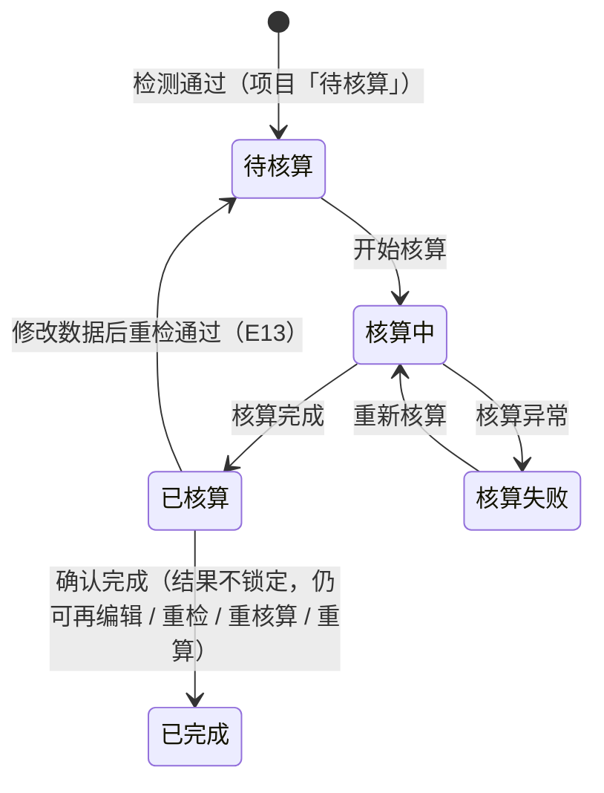

# 碳足迹核算与结果业务 PRD（工作台步骤④）

> **文档定位**：批次 5「碳足迹核算与结果」环节的**业务规则真相源**，定义核算状态流转、动作矩阵、核算计算口径、结果版本化、边界异常与验收标准。字段结构见《碳足迹核算字段清单》，页面呈现见《碳足迹核算_Demo》。
>
> **【以原型为准修订声明 · 2026-10-13（V0.6），全文优先】**：本文与前端原型（`ProjectStepFour.tsx` / `mock` `runPcfCalc` / `exportPcfInventory`）冲突之处，**一律以原型为准**：
> - **计算入口**：步骤① **不再引用「核算公式」**（V0.8，2026-10-12）——碳核算计算引擎**内置代码层级**，暂按默认口径求值（行级 `数量 × 排放因子` → 阶段 `SUM` → 全局 `SUM`）；「项目引用核算公式（三层受控表达式）」口径**作废**（R-044 / §6.1 / 术语表同步改写）；结果不再展示「核算公式名称」，`unitEmissionBreakdown` 换算口径（单位转换系数派生）亦不再展示（步骤①已移除单位转换系数）。
> - **「工序汇总」更名「数据项汇总」**：列为 数据项 / 所属过程 / 所属阶段 / 最末级阶段 / 排放量 / 贡献率 / 查看明细（原型按排放量降序）。
> - **四口径切换**：结果区以卡片切换 **GWP 四分量**——`total` 总量（不含生物源CO₂）/ `biogenic` 生物源（不含CO₂）/ `luluc` 直接土地利用变化 / `fossil` 化石；无 GWP 分项的因子按单一口径呈现（不出现切换卡片）。阶段 / 数据项 / 排放源 / 明细均按当前口径实时汇总。
> - **「重新计算」入口（新增）**：「已核算」态在结果区提供「重新计算」——按当前活动数据与排放因子重算，**按版本号递增生成新结果版本，历史版本保留不可篡改**（不回退「进行中」）；修改步骤①②数据保存仍走「回退 → 重走检测 → 核算」（E13）。
> - **导出（两项）**：「导出结果明细」（CSV）；「**导出核算清册**」（Excel 多工作表：**总表 + 每个最末级生命周期阶段各 1 张表**，按当前口径生成，含「影响评价指标」行）。
> - **明细列（原型实际）**：数据项名称 / 类别 / 流向 / 活动量 / 最末级阶段 / 排放因子 / 排放系数（含因子单位）/ 背景数据来源（源库 + 版本）/ 所属过程 / 排放量 / 其中生物源 / 其中土地利用。
> - **「确认完成」（V0.9，2026-10-14 新增）**：「已核算」态结果区提供「**确认完成**」——二次确认后项目流转「**已完成**」。**V1.1 口径（2026-10-14 业务裁定）：确认完成后结果不锁定** —— 仍可继续编辑 / 重新检测 / 重新核算 / 重新计算（编辑保存后回退「进行中」重走检测 → 核算）；「已完成」态不再展示「确认完成」入口（mock `confirmPcfProject`：仅 `calculated` 可执行）。
> - **导出入口（原型实际）**：结果区仅有「**下载清册**」一个按钮（按当前口径下载核算清册 Excel：总表 + 每个最末级生命周期阶段各 1 张表）；mock 中「导出结果明细 CSV」（`exportPcfResult`）已实现但**界面未接线**——「导出结果明细」入口待确认（见 §8 Q7）。
> - **预览模型**：步骤④ 与步骤②③ 一致提供「预览模型」入口（流程画布 `PcfFlowCanvas`，只读预览建模数据）。
> - **回退保留结论（V1.1，2026-10-14）**：「已核算 / 已完成」修改步骤①②数据保存 → 项目回退「进行中」时**核算结论保留**——步骤④展示原结果（历史版本标记），**不强制重新核算**；检测界面同样默认展示原检测数据（见《数据检测业务 PRD》R-040）。
> - **状态口径**：报告态（报告生成中及之后）为历史保留态；只读判定 = 项目状态 ∉ 可编辑集合（`new/ongoing/checking/toCalc/calcFailed/calculated/done`）。

> **合并说明（V0.2）**：原步骤④「碳足迹核算」（P24，执行核算 / 状态查看 / 失败重试）与步骤⑤「核算结果」（P25，总量 / 阶段 / 数据项 / 排放源 / 导出）**合并为同一个步骤④节点「碳足迹核算与结果」**——核算执行后即产出结果版本，两者是不可分割的闭环，无需拆成两个步骤节点。合并后工作台步骤条 6 步 → **5 步**（①目标与范围 / ②产品建模 / ③数据检测 / ④碳足迹核算与结果；报告步骤 V1.2 已移除）。步骤③→④ 的衔接如下：
>
> ```text
> 步骤③ 数据检测（通过 → 阻断项清零）
>         ↓ 进入核算
> 步骤④ 碳足迹核算与结果
>     ├─ 执行区：开始核算 → 核算中 → 已核算 / 核算失败（可重试）
>     └─ 结果区：总量 / 阶段 / 工序 / 排放源 / 明细 / 导出（核算完成即在同页产出）
> ```

## 0. 文档基础信息

| 项目 | 内容 |
| :--- | :--- |
| 文档名称 | 碳足迹核算与结果业务 PRD（工作台步骤④） |
| 版本 | V0.8 |
| 状态 | 草稿（待业务确认） |
| 模块名称 | 产品碳足迹核算 · 碳足迹核算与结果 |
| 模块类型 | **项目内执行步骤 + 结果载体**（子对象：核算任务 + 核算结果 + 结果明细） |
| 维护形态 | 工作台步骤④ 单页：执行区（核算状态 + 执行动作）+ 结果区（总览 + 多维表格） |
| 所属层级 | 前台业务平台 · 产品碳足迹核算（方案 §2.3 B1-8、B1-9、§八 P24/P25、§5.1 步骤11 执行核算 / 步骤13 结果确认） |
| 字段真相源 | `02prd/02-2前台业务功能/01 碳核算项目/05 检测核算与结果/碳足迹核算字段清单.md` |
| 上游基线 | `00碳核算项目_模块拆分与交互骨架.md`（V1.0）、`01 项目列表与新建/核算项目业务PRD.md`（V0.9）、`数据检测业务PRD.md`（V0.1） |
| 上游真相源 | 整体设计方案 v1.2 r4 §6.1（计算引擎）、§4.7（核算结果）、§5.4（异常 E01–E16）、§5.5（报告准入） |
| 更新时间 | 2026-10-10 |

**变更记录**

| 日期 | 版本 | 变更内容 |
| :--- | :--- | :--- |
| 2026-09-24 | V0.1 | 初版：定义核算状态流转、动作矩阵、计算口径（去模型 / 公式下沉到工序）、结果版本化、验收标准 |
| 2026-09-28 | V0.2 | **步骤④⑤合并为步骤④「碳足迹核算与结果」**：执行区与结果区同页承载，取消「查看核算结果」跨步跳转；状态→步骤映射与动作矩阵收敛到步骤④；工作台步骤条 6 步 → 5 步 |
| 2026-10-08 | V0.3 | **排放源归类措辞对齐**：因因子字段精简（因子不再设「因子分类」），核算结果「排放源」维度统一表述为「**排放源归类（非因子字段）**」，不再表述为「匹配因子的分类」；`FactorCategory` 仅作为核算结果排放源归类的**内部枚举**（原型 `PcfCalcSourceType`），**不再属于因子字段**。涉及 §3 功能清单、§6.2 汇总口径、§10.1 术语表，全文无编号重排 |
| 2026-10-09 | V0.4 | **核算口径对齐（公式驱动 + 单位换算落地）**：① §1.1 背景与链路改为「**核算公式为唯一计算入口**」（行级 → 阶段汇总 → 全局三层），不再表述为「工序绑定公式」；② §6「核算计算口径」重写：新增三段式公式、变量取值表、兜底规则，单位换算由「原型层简化」改为「引擎按计量单位库基准中转计算 `[当前行.单位换算系数]`」；③ 单位产品碳足迹口径由「总排放（1 功能单位）」改为「**全局公式结果**」，换算口径由项目「单位转换系数」派生；④ R-044 改写、R-049 措辞调整、R-051 补充；⑤ §10.1 术语表同步 |
| 2026-10-10 | V0.5 | **「多口径」口径同步**：新增 §6.4「双口径口径（含生物碳 / 不含生物碳）」及混合口径兜底规则；§6.1「负排放」补双口径说明；R-044（计算口径，双口径单独求值）、R-051（结果双口径披露）同步改写 |
| 2026-10-13 | V0.6 | **以原型为准全面修订**：① 文首新增修订声明；② **计算入口改为引擎内置默认口径**（步骤①不再引用核算公式，§6.1 重写、R-044 / 术语表改写）；③ 「工序汇总」更名「**数据项汇总**」；④ §6.3 改「**四口径输出**」（GWP 四分量卡片切换，`PCF_CALIBERS`），原 §6.4 双口径并入；⑤ §6.4「分配比例口径」标注**废止**；⑥ 新增「**重新计算**」入口与动作矩阵行（已核算态生成新版本、不回退）；⑦ 新增「**导出核算清册**」（Excel 多工作表 + 每最末级阶段 1 张表）；⑧ R-045 / R-047 / R-050 / R-051 按原型改写；⑨ 场景 / 边界 / 验收 / 下游清单同步（报告步骤移除、`ProjectStepFive.tsx` 下线） |
| 2026-10-14 | V0.7 | **原型核对修订（「确认完成」纳入）**：① 文首声明补「确认完成」（`calculated` → `done`，结果锁定、仍可查看与下载清册）、导出入口口径（原型仅「下载清册」，`exportPcfResult` CSV 未接线）、预览模型入口、只读判定含「已完成」；② §1.1 链路图补「确认完成」节点；③ §3 功能清单补「确认完成」「预览模型」，导出收敛为「下载清册」；④ §4 新增 R-052；⑤ §5.1 状态流转图 / §5.2 映射 / §5.3 动作矩阵同步（「已完成」列、确认完成与预览模型行）；⑥ §7 补「已完成锁定」边界；⑦ §8 新增 Q7（结果明细 CSV 是否接线）；⑧ §9 新增验收 V15 / V16；⑨ §10.1 术语表补「确认完成」、四口径顺序对齐原型；⑩ 版本号 V0.6 → V0.7 |
| 2026-10-14 | **V0.8** | **口径裁定修订（V1.1，2026-10-14）**：① 文首声明：「确认完成」改「结果不锁定」口径、新增「回退保留结论」、只读判定加 `done`；② S06 / S08 场景同步；③ §3 功能清单「确认完成」描述改不锁定；④ R-047 改「修改即失效 + 结论保留」（不强制重新检测 / 重新核算）；R-052 改「确认完成不锁定」；⑤ §5.1 流转图 / §5.2 映射 / §5.3 动作矩阵同步（「已完成」列可编辑 / 可重算，「确认完成」仅已核算态）；⑥ §7 边界改「已完成不锁定」；⑦ §9 V15 更新；⑧ §10.1 术语表「确认完成」改不锁定义；⑨ 版本号 V0.7 → V0.8 |

**关联链接**

| 文档 | 路径 |
| :--- | :--- |
| 模块拆分与交互骨架（步骤定义 / 状态映射） | `02prd/02-2前台业务功能/01 碳核算项目/00碳核算项目_模块拆分与交互骨架.md` |
| 核算项目业务 PRD（项目状态机 / 步骤流转 R-006） | `02prd/02-2前台业务功能/01 碳核算项目/01 项目列表与新建/核算项目业务PRD.md` |
| 数据检测业务 PRD（步骤④准入 = 检测通过） | `02prd/02-2前台业务功能/01 碳核算项目/05 检测核算与结果/数据检测业务PRD.md` |
| 碳足迹核算字段清单（核算任务 / 结果字段） | `02prd/02-2前台业务功能/01 碳核算项目/05 检测核算与结果/碳足迹核算字段清单.md` |
| 整体设计方案 v1.2 r4（§6.1 / §4.7 / §5.4 / §5.5） | `04产品设计管理/00业务设计/产品碳足迹核算系统_整体设计方案_v1.2.md` |

---

## 1. 需求概述

### 1.1 需求背景

步骤③「数据检测」通过后，项目进入「待核算」态。步骤④「碳足迹核算与结果」把**已填报的活动数据 + 匹配的排放因子**代入**项目引用的核算公式**换算成碳排放量，并在同一步骤内把结果按「总量 / 阶段 / 数据项 / 排放源」多维呈现、支持下钻与导出，作为生成报告（步骤⑤）的数据来源。

```text
碳核算计算引擎（内置代码层级，暂按默认口径求值）
        ↓
步骤② 填报：阶段数据项（数量）+ 排放来源（因子）
        ↓ 检测通过
步骤④ 计算：行级（数量 × 排放因子） → 阶段 SUM → 全局 SUM
        ↓ 核算完成（同页产出）
步骤④ 结果：单位产品碳足迹（四口径切换） + 阶段/数据项/排放源多维汇总 + 下钻 + 导出（核算清册 Excel）
        ↓ 「确认完成」（V0.9）
项目流转「已完成」（结果不锁定：仍可再编辑 / 重检 / 重核算 / 重算）
```

> **V0.6 口径（2026-10-13，以原型为准）**：步骤① **不再引用「核算公式」**（V0.8 移除）——引擎**内置代码层级**暂按默认口径求值：行级 `数量 × 排放因子`（单位换算由引擎按计量单位库「基准中转」计算）→ 阶段 `SUM` → 全局 `SUM`。后续引擎建设（可配置算法）再迭代，**不阻断核算**。

**没有核算这一步，填报的数据只是原始台账，无法形成可追溯、可复核的碳足迹结论。**

### 1.2 需求目标

| # | 目标 | 可验证口径 |
| :-: | :--- | :--- |
| G1 | **一键执行核算** | 步骤④「开始核算」→ 核算中 → 核算完成（已核算），全程无需额外配置 |
| G2 | **核算失败可重试** | 核算异常 → 状态「核算失败」+「重新核算」入口，重试幂等 |
| G3 | **结果版本化** | 每次核算生成新结果版本，旧版本保留；修改数据后重算生成新版本（E13） |
| G4 | **多维结果下钻** | 总量 / 阶段 / 工序 / 排放源四维可查，工序级可下钻至「数据 → 因子 → 公式」 |
| G5 | **结果可导出** | 按当前口径下载核算清册（Excel：总表 + 每个最末级阶段 1 张表），作为报告数据来源 |
| G7 | **完成后可锁定** | 「已核算」态可「确认完成」流转「已完成」并锁定（不可再变更，结果仍可查看与下载清册） |
| G6 | **概念不外露** | 界面不出现公式 DSL 本体、计算引擎、快照术语；只呈现人话结果与排放构成，公式仅以「名称」标注 |

### 1.3 范围（In Scope / Out of Scope）

**In Scope**

| # | 范围 |
| :-: | :--- |
| 1 | 执行核算（生成核算任务 + 结果版本） |
| 2 | 核算状态展示（待核算 / 核算中 / 已核算 / 核算失败） |
| 3 | 失败重试（重新核算） |
| 4 | 核算结果展示（总量 / 阶段 / 工序 / 排放源） |
| 5 | 结果明细下钻（工序 → 数据项 → 因子 → 公式） |
| 6 | 结果导出 |

**Out of Scope**

| 不做项 | 归属 / 原因 |
| :--- | :--- |
| 多气体（CH₄ / N₂O）特征化 | 方案 §6.1.2 预留，本期 CO₂ 口径 |
| 公式级自定义、计算引擎配置 | 后台管理（A2-3），前台仅引用 |
| 分析域（多产品对比、看板、降碳模拟） | 方案 §2.1 本期不做 |
| 第三方核查工作流 | 方案 §十 阶段三 |
| 结果跨项目复用 / 共享数据集比对 | P30 后置 |
| 结果确认的独立「审核」环节 | 报告确认归步骤⑥（核算人员执行，V0.2） |

### 1.4 与上下游的边界

| 归属 | 模块 | 本文的角色 |
| :--- | :--- | :--- |
| 项目状态机与步骤流转（R-006） | 核算项目业务 PRD | 引用，不重复定义 |
| 步骤④准入（检测通过、阻断项清零） | 数据检测业务 PRD R-037 | 引用为前置 |
| 核算任务、核算结果、结果明细字段 | 碳足迹核算字段清单 | 引用，不重复定义 |
| 报告生成准入（方案 §5.5） | 批次 6（报告） | 本文产出结果版本作为报告输入 |
| 页面控件与布局 | 碳足迹核算_Demo | 不写 |

---

## 2. 用户与使用场景

| 场景ID | 场景 | 类型 | 说明 |
| :--- | :--- | :--- | :--- |
| S01 | 首次执行核算 | **主流程** | 检测通过后进入步骤④，点击「开始核算」→ 核算中 → 核算完成 |
| S02 | 核算失败重试 | **主流程** | 核算异常 → 状态「核算失败」→「重新核算」→ 核算完成 |
| S03 | 查看核算结果 | **主流程** | 核算完成后在本步骤下方结果区直接查看单位产品碳足迹（四口径切换）/ 阶段 / 数据项 / 排放源（无需跨步骤跳转） |
| S04 | 结果明细下钻 | 支线 | 点击「数据项汇总」行「查看明细」→ 同页过滤展示该数据项的明细（活动量 / 因子 / 排放系数 / 背景数据来源） |
| S05 | 下载清册 | 支线 | 结果总览卡「下载清册」（Excel 多工作表：总表 + 每个最末级阶段各 1 张表，按当前口径生成） |
| S08 | 确认完成 | 辅助 | 「已核算」态点「确认完成」→ 二次确认 → 项目流转「已完成」（**结果不锁定**：仍可再编辑 / 重检 / 重核算 / 重算） |
| S06 | 修改数据后重算 | 辅助 | 已核算 / 已完成后修改步骤①② → 项目回退「进行中」→ 重走检测 → 核算 → 新结果版本（**检测界面默认展示原检测数据、不强制重新检测 / 重新核算**；亦可直接「重新计算」生成新版本） |
| S07 | 只读回看 | 辅助 | 项目「核算中」（及历史报告态）回看步骤④，结果区只读展示最近版本、无执行入口 |

---

## 3. 功能清单

| 模块 | 功能点 | 功能描述 | 优先级 |
| :--- | :--- | :--- | :---: |
| 核算执行 | 开始核算 | 触发异步核算任务，生成结果版本 | P0 |
| | 重新核算 | 失败后重试 | P0 |
| | 重新计算 | **已核算态按当前数据重算，按版本号递增生成新结果版本（历史版本保留）** | P0 |
| | **确认完成** | **已核算态确认后项目流转「已完成」（结果不锁定：仍可再编辑 / 重检 / 重核算 / 重算）** | P0 |
| 核算状态 | 状态展示 | 待核算 / 核算中 / 已核算 / 核算失败 四态展示 | P0 |
| 核算结果 | 总览卡 | 单位产品碳足迹（按当前口径）+ 核算时间 + 结果版本 + **四口径切换卡片** | P0 |
| | 阶段汇总 | 各（一级）生命周期阶段排放量与占比 | P0 |
| | 数据项汇总 | 各数据项排放量与贡献率（按排放量降序；原「工序汇总」更名） | P0 |
| | 明细下钻 | 数据项汇总 → 结果明细（同页过滤） | P1 |
| | 下载清册 | **按当前口径下载核算清册（Excel 多工作表：总表 + 每个最末级阶段 1 张表）** | P1 |
| 模型预览 | 预览模型 | 流程画布只读预览建模数据（输入 / 输出 + 追溯链路）；各状态恒显 | P1 |
| 只读态 | 只读展示 | 「核算中」及历史报告态只读、无执行入口（「已完成」不锁定，V1.1） | P1 |

**不做**：结果在线编辑、结果确认（报告环节已移除）、多项目结果对比、图表导出为图片。

---

## 4. 核心业务规则

> 编号承接数据检测业务 PRD（R-034 ~ R-041），本环节从 **R-042** 起。

| 规则ID | 规则 | 依据 |
| :--- | :--- | :--- |
| R-042 | **[核算准入]** 步骤④「开始核算」仅当项目状态为「待核算」（检测通过、阻断项清零）时可用；未检测或检测不通过不可进入 | 骨架 S-001（③→④ 需检测无阻断项）/ 方案 §5.5 |
| R-043 | **[异步核算]** 核算任务异步执行：提交后项目状态置「核算中」，冻结编辑；完成后置「已核算」并生成结果版本；异常置「核算失败」可重试 | 方案 §6.1 异步执行 |
| R-044 | **[计算口径]** **碳核算计算引擎内置代码层级，暂按默认口径求值**（行级 `数量 × 单位换算系数 × 排放因子` → 阶段 `SUM` → 全局 `SUM`）；**单位换算系数由引擎按计量单位库「基准中转」计算**（数据项单位 → 因子分母单位；不可换算时为 1）。**四口径**：因子带 GWP 分项（`calibers`）时，按 `total` 总量（不含生物源CO₂）/ `fossil` 化石 / `biogenic` 生物源 / `luluc` 直接土地利用变化四分量单独求值，结果区卡片切换（§6.3）。**步骤①不再引用「核算公式」**（V0.8 移除，原三层受控表达式口径作废） | 方案 §6.1.1 / 以原型为准（2026-10-13） |
| R-045 | **[排放范围]** 参与计算的数据项 = 步骤①纳入阶段下的全部阶段数据项（含「继续追溯」节点内数据项）；无因子行因子值记 0 参与计算 | 以原型为准（2026-10-13） |
| R-046 | **[结果版本化]** 每次核算 / 重新计算生成新结果版本（版本号递增），旧版本保留不可篡改；「重新计算」生成新版本而非覆盖 | 方案 §4.9 / §6.3 |
| R-047 | **[修改即失效]** 已核算 / 已完成后修改步骤①②数据并保存 → 项目回退「进行中」，需重走检测 → 核算（E13）；**核算结论与检测结论保留**——步骤④展示原结果（历史版本标记）、步骤③默认展示原检测数据，**不强制重新检测 / 重新核算**；历史结果版本保留；**亦可直接在步骤④「重新计算」生成新版本（不回退）** | 骨架 D13 / E13 / 以原型为准（V1.1） |
| R-052 | **[确认完成]** 「已核算」态结果区提供「确认完成」：二次确认（「确认完成后，该项目将变为『已完成』状态（结果不锁定：后续仍可继续编辑数据、重新检测、重新核算或重新计算；如修改数据并保存，项目将重走检测 → 核算）。确认完成『{产品名称}』？」）后项目流转「**已完成**」。**结果不锁定（V1.1）**——仍可继续编辑步骤①②（保存即回退「进行中」重走检测 → 核算）、重新检测、重新核算 / 重新计算；「已完成」态不再展示「确认完成」入口（可「重新计算」生成新版本）。仅「已核算」态可确认（其余状态不展示入口） | 以原型为准（V0.9 / V1.1，2026-10-14，原型 `ProjectStepFour.tsx` / mock `confirmPcfProject`） |
| R-048 | **[失败重试幂等]** 核算失败保留失败记录；「重新核算」以当前项目数据重算，不产生重复任务；同一状态仅一个核算任务 | 方案 §6.1 幂等与版本 |
| R-049 | **[概念不外露]** 结果页只呈现人话排放构成（单位产品碳足迹 / 阶段 / 数据项 / 排放源 / 明细），不展示公式 DSL、计算引擎、快照术语与异常编号 | 《角色可见范围 v1.0》§3 / 骨架 S-007 |
| R-050 | **[可解释下钻]** 每个结果可下钻至明细（数据项 → 活动量 → 匹配因子 → 因子值 / 排放系数 → 背景数据来源 → 所属过程）；「数据项汇总」行点「查看明细」同页过滤 | 方案 §6.1 可解释 / 以原型为准 |
| R-051 | **[结果单位口径]** 核算结果以「kgCO₂e / 项目单位」表达，单位取项目「单位」（`functionalUnit`）；**数据项用量即「数量」口径**，故核算结果 = 清单合计，无需再除以产量；**结果同时输出四口径**（`emissionBreakdown`：总量 / 化石 / 生物源 / 土地利用），清册按所选口径生成；本期 CO₂ ≡ CO₂e | 方案 §6.1.1 因子口径 / §4.7 / 以原型为准 |

---

## 5. 状态与动作

### 5.1 核算状态流转（本环节内部）



> 核算状态（`idle / calculating / done / failed`）为**本环节内部口径**；项目状态（`toCalc / calculating / calculated / calcFailed / done`）按 §5.2 同步流转。

### 5.2 核算状态 → 项目状态映射

| 核算状态 | 项目状态 | 当前步骤 | 可执行动作 |
| :--- | :--- | :---: | :--- |
| `idle`（待核算） | 待核算 | ④ | 开始核算 / 回步骤②修改 |
| `calculating`（核算中） | 核算中 | ④ | 等待（只读） |
| `failed`（核算失败） | 核算失败 | ④ | 重新核算 / 回步骤②修改 |
| `done`（核算完成） | 已核算 | ④ | 查看结果（同页结果区）/ 下载清册 / **重新计算（新版本）** / **确认完成（转「已完成」，不锁定）** / 回步骤②修改（改后重算） |
| `done` 回看 | **已完成（不锁定，V1.1）** | ④ | 查看结果 / 下载清册 / **重新计算**；可回步骤②修改（改后重算） |

### 5.3 动作能力矩阵

| 动作 | 待核算 | 核算中 | 核算失败 | 已核算 | 已完成（不锁定） | 只读（历史报告态） |
| :--- | :-: | :-: | :-: | :-: | :-: | :-: |
| 开始核算 / 重新核算 | ✅ | ❌ | ✅ | ❌ | ✅ | ❌ |
| 重新计算（新结果版本） | ❌ | ❌ | ❌ | ✅ | ✅ | ❌ |
| **确认完成（转「已完成」，不锁定）** | ❌ | ❌ | ❌ | ✅ | ❌ | ❌ |
| 查看结果（本步骤结果区） | ❌ | ❌ | ❌ | ✅ | ✅ | ✅（回看） |
| 下载核算清册 | ❌ | ❌ | ❌ | ✅ | ✅ | ✅ |
| 明细下钻 | ❌ | ❌ | ❌ | ✅ | ✅ | ✅ |
| 回步骤②修改 | ✅ | ❌ | ✅ | ✅（改后重算） | ✅（改后重算） | ❌ |
| 预览模型 | ✅ | ✅ | ✅ | ✅ | ✅ | ✅ |

> **红线**：不渲染 disabled 假入口——不可用动作直接不展示（对齐核算项目 PRD §6）。
>
> **合并后说明**：核算完成不再跨步骤跳转，结果区在本步骤内容区下方直接展开；「已核算」态可直接「重新计算」生成新版本（无需先回退），亦可修改步骤①②数据走「回退 → 重走检测 → 核算」（E13）；「已核算」态亦可「确认完成」流转「已完成」（**V1.1 起不锁定**：可继续编辑 / 重检 / 重算，R-052）。

---

## 6. 核算计算口径

> 本节是核算引擎的**业务口径**（面向实现对齐），编号 `C` 系列；技术实现见《碳足迹核算_Demo》§五 Mock 规格。

### 6.1 引擎内置默认口径（V0.6：步骤①不再引用核算公式）

核算按「行级 → 阶段汇总 → 全局」三层依次求值。**V0.8（2026-10-12）起步骤①不再引用「核算公式」**——碳核算计算引擎内置代码层级，暂按默认口径求值：

```text
行级   数量 × 单位换算系数 × 排放因子        ← 逐条阶段数据项求值 → 行碳排
              ↓
阶段汇总 SUM(该阶段各行碳排)                ← 集合 = 该阶段各行碳排
              ↓
全局    SUM(各阶段碳排)                     ← 得核算结果（单位产品碳足迹）
```

**变量与取值**

| 变量 | 作用域 | 取值来源 |
| :--- | :--- | :--- |
| `[当前行.数量]` | 行级 | 该数据项填报的「数量」（`quantity`，可为负） |
| `[当前行.单位换算系数]` | 行级 | 数据项单位 → **因子分母单位**的换算系数；引擎按计量单位库「**基准中转**」计算（`f_from ÷ f_to`），无法换算时为 1 |
| `[当前行.排放因子]` | 行级 | 该数据项匹配因子的因子值（`factorValue` 快照） |
| `[当前阶段.总碳排]` | 阶段 / 全局 | 集合变量：阶段汇总时 = 该阶段各行碳排；全局汇总时 = 各阶段碳排 |

**规则**

| 项 | 口径 |
| :--- | :--- |
| 计算入口 | **引擎内置代码层级**（默认口径如上）；原「项目步骤①引用核算公式（后台 · 核算配置 · 公式管理，三层受控表达式）」口径**已作废（V0.6 / V0.8）** |
| 计算范围 | 参与计算的数据项 = 步骤①纳入阶段下的全部数据项（含追溯节点内数据项）；无因子行因子值记 0 |
| 可配置算法 | **后置**：待引擎建设支持「改公式即改算法」后再开放项目级公式引用 |
| 重新计算 | 「已核算」态点「重新计算」→ 按当前数据重算，**版本号递增生成新结果版本**，历史版本保留不可篡改 |

> **负排放**：生物碳 / 回收信用因子为负值（如「毛竹固碳」`-1.83`），负值参与加总实现扣减；对称性校验（E16）在检测层处理（W2 提示）。
> **四口径（多口径）**：因子带 GWP 分项（`calibers`：化石 / 生物碳 / 土地利用，选填）时，结果按 **`total` 总量（不含生物源CO₂）/ `fossil` 化石 / `biogenic` 生物源 / `luluc` 直接土地利用变化** 四分量单独求值并支持卡片切换（见 §6.3）。

### 6.2 逐级汇总

```text
行碳排      = 行级口径（逐行求值）
阶段碳排    = SUM 该阶段各行碳排
总碳排      = Σ 各阶段碳排                          ← totalEmission（用于占比与「总量」展示）
核算结果    = Σ 各阶段碳排                          ← unitEmission（单位产品碳足迹）
```

> **排放源维度说明（V1.7）**：结果页**不再单独输出「排放源归类」汇总维度**（材料 / 能源 / 运输 / 废弃物 / 末期处理 / 生物碳），仅保留「阶段 / 数据项 / 结果明细」三维汇总；如需按来源拆分，可经结果明细的「数据项类型 / 背景数据来源」自行透视。原 `PcfCalcSourceType` / `sourceOfItem` 等归类逻辑已从原型移除（代码、类型、引擎汇总一致处理）。

### 6.3 四口径输出（V0.6：GWP 四分量）

因子库支持「多口径」（GWP 分项：化石 / 生物碳 / 土地利用，选填），核算结果输出**四口径**（原型 `PCF_CALIBERS`，顺序即界面 / 清册展示顺序）：

| 口径 key | 界面文案 | 简称 | 影响评价指标（竞品对齐） |
| :--- | :--- | :--- | :--- |
| `total` | 总量（不含生物源CO₂） | 总量 | Climate change: total (excl. biogenic CO₂) - GWP100 |
| `biogenic` | 生物源（不含CO₂） | 生物源 | Climate change: biogenic (excl. CO₂) - GWP100 |
| `luluc` | 直接土地利用变化 | 土地利用 | Climate change: direct land use change - GWP100 |
| `fossil` | 化石 | 化石 | Climate change: fossil - GWP100 |

**逐行口径规则（混合口径兜底）**：

| 行的因子情况 | 各口径取值 |
| :--- | :--- |
| **有分项口径**（提供 `gwpFossil` / `gwpBiogenic` / `gwpLuluc`） | 各分量按分项值代入行级口径求值 |
| **只有总值**（无分项口径） | 总量 = 总值算；化石 = 总量；生物碳记 0；土地利用记 0 |

> **汇总范围**：总量 / 阶段 / 数据项 / 排放源 / 明细**均按当前口径实时汇总**（结果页口径卡片切换仅影响展示与导出，不改变原始明细）。
> **无分项时**：本项目所选因子均未提供 GWP 分项 → 结果区按单一口径呈现（不出现口径切换卡片）。
> **对称性（E16）**：由检测层处理（见《数据检测业务 PRD》§6 W2）；报告披露口径见「报告管理」（承载后）。

### 6.4 ~~分配比例的口径~~（已废止）

| 场景 | 处理 |
| :--- | :--- |
| 单产出 / 多产出数据项 | **已废止（V1.2）**：产品建模不再有分配比例字段；多产出分配口径随步骤重构取消 |
| 替代法 / 系统扩展（副产品扣减） | **本期后置**（方案 §6.4 / §4.5） |

---

## 7. 边界与异常处理

| 场景 | 系统行为 |
| :--- | :--- |
| 项目无任何数据项 | 核算入口不可用（前置检测已阻断），提示「请先完成数据填报与检测」 |
| 核算中重复点击「开始核算」 | 按钮禁用，展示「核算中」态，不重复提交 |
| 核算执行超时 / 异常 | 项目状态置「核算失败」，保留失败记录，展示「重新核算」入口 |
| 已核算 / 已完成后修改步骤②数据 | 项目回退「进行中」，**核算结论与检测结论保留**（R-047）：步骤④展示原结果（历史版本）、步骤③默认展示原检测数据；不强制重新检测 / 重新核算，历史结果版本保留 |
| **已确认完成（「已完成」不锁定，V1.1）** | 步骤④可「重新计算」/ 下载清册；步骤①②可编辑（保存即回退重算）；不再展示「确认完成」入口 |
| 因子在核算前被禁用 | 不影响本项目：因子已「引用即复制」写入项目快照（因子值随选择固化） |
| 项目已被他人修改（并发） | 开始核算时以项目状态为准，状态已变更则提示「项目状态已变更，请刷新后重试」 |
| 结果版本过多 | 全版本留存（不可篡改），列表默认展示最近版本，历史版本可切换查看 |

---

## 8. 待确认事项

| 编号 | 问题 | 影响 | 当前建议 | 状态 |
| :--- | :--- | :--- | :--- | :--- |
| Q1 | 步骤④与步骤⑤是否合并为「一个核算环节」交付 | 交付范围 | **已确认合并**：合并为步骤④「碳足迹核算与结果」，步骤条 6 步 → 5 步 | 已确认 |
| Q2 | 单位换算系数是否在核算原型中实现 | §6.1 | 原型简化（检测已保证可换算），真实换算后置 | 待确认 |
| Q3 | 多产出工序的**副产品替代法扣减**是否本期实现 | §6.3 | 本期后置，总排放 = Σ 投入排放 | 待确认 |
| Q4 | 结果**导出格式**（Excel / CSV） | §3 导出 | **原型已落地**：核算清册 Excel（总表 + 每最末级阶段 1 张表，按口径生成）；结果明细 CSV 已实现但界面未接线（见 Q7） | 已确认（以原型为准） |
| Q5 | 结果版本**历史查看**是否需要切换入口 | §7 版本 | 本期仅展示最近版本，历史切换后置 | 待确认 |
| Q6 | 单位产品碳足迹是否需除以**产品数量**折算 | §6.2 | 以项目「单位」为 1 个功能单位，不引入产品数量折算 | 待确认 |
| Q7 | 「导出结果明细」（CSV）是否需要在界面接线 | §3 导出 | mock `exportPcfResult` 已实现（CSV：数据项名称 / 所属阶段 / 所属过程 / 流向 / 数量 / 排放因子 / 排放量），但原型界面仅「下载清册」一个入口；建议保留 CSV 导出或明确下线 | **原型已表现·待业务裁定** |

---

## 9. 验收标准

| # | 验收项 | 输入条件 | 预期结果 |
| :-: | :--- | :--- | :--- |
| V01 | **核算准入** | 检测通过（待核算）项目进入步骤④ | 展示「开始核算」入口 |
| V02 | **核算执行** | 点击「开始核算」 | 状态转「核算中」，随后转「已核算」，生成结果版本 |
| V03 | **核算失败重试** | 模拟核算异常 | 状态「核算失败」+「重新核算」，重试后完成 |
| V04 | **结果总览** | 核算完成（同页结果区） | 展示单位产品碳足迹 + 总排放量 + 结果单位 |
| V05 | **阶段汇总** | 查看阶段汇总 | 各（一级）阶段排放量与占比，合计 = 100% |
| V06 | **数据项汇总** | 查看数据项汇总 | 各数据项排放量与贡献率（按排放量降序，可查看明细） |
| V08 | **明细下钻** | 点击某数据项「查看明细」 | 同页过滤展示该数据项明细（活动量 / 因子 / 排放系数 / 背景数据来源） |
| V09 | **下载清册** | 结果总览卡点「下载清册」 | 下载核算清册 Excel（总表 + 每个最末级阶段 1 张表，按当前口径生成，含影响评价指标行） |
| V13 | **重新计算** | 「已核算」态点击「重新计算」 | 生成新结果版本（版本号递增），历史版本保留，项目不回退 |
| V14 | **四口径切换** | 结果区口径卡片切换 | 阶段 / 数据项 / 排放源 / 明细按所选口径实时汇总；无 GWP 分项时按单一口径呈现 |
| V10 | **修改即失效** | 已核算项目修改步骤② | 项目回退「进行中」，需重走检测 → 核算，历史版本保留 |
| V11 | **只读态** | 项目「核算中」打开步骤④ | 展示最近结果，无执行入口 |
| V12 | **概念不外露** | 走查步骤④ | 不出现公式 DSL、计算引擎、快照、异常编号 |
| V15 | **确认完成** | 「已核算」态点击「确认完成」并二次确认 | 项目流转「已完成」；**结果不锁定**：步骤①②仍可编辑（保存即回退重算）、步骤③可重新检测、步骤④可重新计算 / 下载清册；「已完成」态不再展示「确认完成」入口 |
| V16 | **预览模型** | 步骤④点「预览模型」 | 打开流程画布（输入 / 输出 + 追溯链路），只读 |

---

## 10. 附录

### 10.1 术语表

| 术语 | 含义 |
| :--- | :--- |
| 碳足迹核算 | 将已填报阶段数据项（数量）+ 匹配因子代入**引擎内置默认口径**（行级 → 阶段 SUM → 全局 SUM）换算为碳排放量的执行环节 |
| 核算公式 | ~~后台「核算配置 · 公式管理」三层受控表达式~~ | **已作废（V0.6 / V0.8）**：步骤①不再引用公式，引擎内置代码层级暂按默认口径求值 |
| 核算任务 | 一次「开始核算」动作触发的异步计算任务，含状态与起止时间 |
| 核算结果 | 一次核算的结论快照（单位产品碳足迹 + 阶段 / 数据项 / 排放源汇总），版本化留存 |
| 结果明细 | 结果下钻到「数据项 → 活动量 / 因子 / 排放系数 / 背景数据来源」的明细行 |
| 单位产品碳足迹 | 以项目「单位」为口径的单位产品碳排放量（kgCO₂e）= 清单合计（数据项用量即数量口径，无需再除产量） |
| 排放源 | 按**排放源归类**（材料 / 能源 / 运输 / 废弃物 / 末期处理 / 生物碳等，非因子字段）归类的排放构成 |
| 四口径 | GWP 四分量：总量（不含生物源CO₂）/ 生物源 / 直接土地利用变化 / 化石（`PCF_CALIBERS`，顺序即界面 / 清册展示顺序），结果区卡片切换与清册导出口径 |
| 确认完成 | 「已核算」态在步骤④确认后项目流转「已完成」：结果不锁定（V1.1），仍可再编辑 / 重新检测 / 重新核算 / 重新计算；编辑保存后回退「进行中」重走检测 → 核算 |

### 10.2 下游文档影响清单

| 下游文档 | 受影响内容 |
| :--- | :--- |
| 本批次《字段清单》《Demo PRD》 | 核算任务 / 结果对象、页面结构（合并为单页）、Mock 规格 |
| 原型 `ProjectStepFour.tsx` | 工作台步骤④「碳足迹核算与结果」内容区（执行区 + 结果区：四口径卡片 / 阶段汇总 / 数据项汇总 / 结果明细 / 下载清册 / 重新计算 / 确认完成 / 预览模型）；`ProjectStepFive.tsx`（报告）**已随报告环节移除而下线（代码保留未路由）** |
| 步骤定义 `pcfMeta.ts` `PCF_STEPS` | **4 步**（目标与范围 / 产品建模 / 数据检测 / 碳足迹核算与结果），报告步骤已移除 |
| 批次 6（报告） | 报告生成准入（方案 §5.5）引用核算结果版本 |

---

## 修订记录

| 日期 | 版本 | 变更摘要 |
| :--- | :--- | :--- |
| 2026-09-24 | V0.1 | 初版：核算状态流转 + 动作矩阵 + 计算口径（R-042 ~ R-051）+ 结果版本化 + 验收标准 |
| 2026-09-28 | V0.2 | 步骤④⑤合并为步骤④「碳足迹核算与结果」（执行区 + 结果区同页），状态→步骤映射与动作矩阵收敛，Q1 关闭 |
| 2026-10-08 | V0.3 | 排放源归类措辞对齐：结果「排放源」统一为「排放源归类（非因子字段）」，`FactorCategory` 仅作结果归类内部枚举、不再属于因子字段（同步《排放因子库字段清单》V0.3） |
| 2026-10-09 | V0.4 | 核算口径对齐（公式驱动 + 单位换算落地）：引擎以「核算公式」为唯一计算入口；`unitEmission` 改「全局公式结果」并新增 `unitEmissionBreakdown` / `formulaName`；单位换算由引擎按「基准中转」计算 |
| 2026-10-10 | V0.5 | 「多口径」口径同步：新增双口径（含生物碳 / 不含生物碳）与混合口径兜底规则；汇总对象补双口径字段 |
| 2026-10-13 | V0.6 | 以原型为准全面修订：计算入口改为引擎内置默认口径（步骤①不再引用公式）；「工序汇总」更名「数据项汇总」；四口径输出（`PCF_CALIBERS`）；新增「重新计算」与「导出核算清册」；分配比例口径废止 |
| 2026-10-14 | **V0.7** | **原型核对修订（「确认完成」纳入）**：① 文首声明补「确认完成」、导出入口口径（仅「下载清册」）、预览模型、只读判定含「已完成」；② §1.1 链路图补「确认完成」节点；③ §3 功能清单补「确认完成」「预览模型」，导出收敛为「下载清册」；④ §4 新增 R-052；⑤ §5.1 / §5.2 / §5.3 状态流转与动作矩阵同步（「已完成」列、确认完成与预览模型行）；⑥ §7 补「已完成锁定」边界；⑦ §8 新增 Q7；⑧ §9 新增验收 V15 / V16；⑨ 术语表补「确认完成」、四口径顺序对齐原型 |
