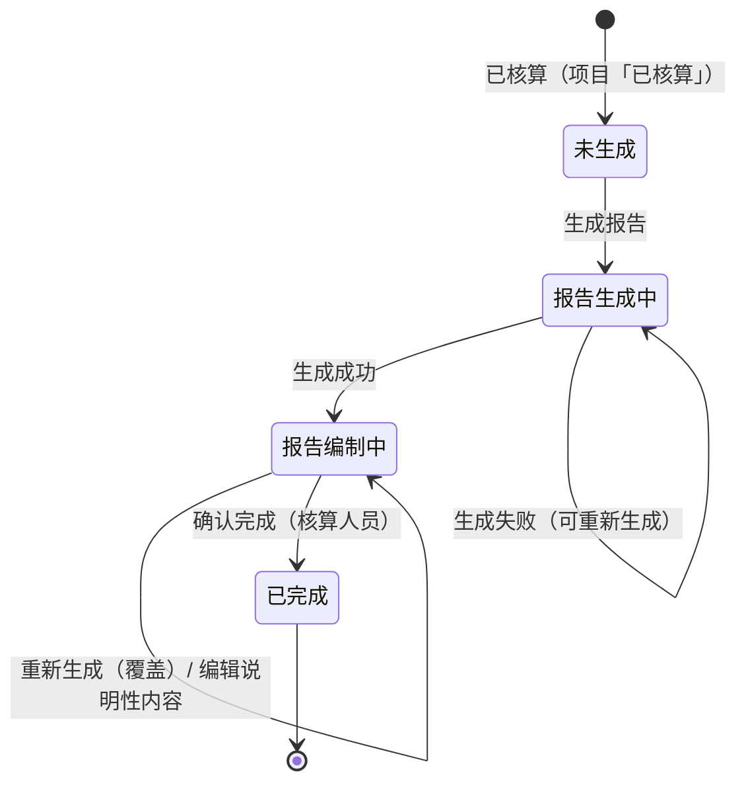

# 报告生成与编辑业务 PRD（工作台步骤⑤）

> **文档定位**：批次 6「报告生成与编辑」环节的**业务规则真相源**，定义报告生成准入、生成流程与模板选择、封面 / 概况信息补充、章节编辑边界、确认完成与锁定、预览与下载、边界异常与验收标准。字段结构见《报告生成字段清单》，章节 / 变量 / 表 1 表 2 图 2 见《报告模板定义（系统预置V1）》，页面呈现见《报告生成_Demo》。
>
> **本版口径摘要（继承字段清单 6 条裁定）**：
> - **① 报告单一版本**：不设多版本，**重新生成直接覆盖**；
> - **② 模板系统预置**（后台模板配置本期未交付）；**③ 本期仅 1 个模板**（`applicableBoundary = all`，结构上预留多模板）；
> - **④ 确认后全部锁定**（报告 + 步骤①~④只读），**仅保留预览 / 下载**；
> - **⑤ 输出格式 doc + 在线预览**；**⑥ 不设「已归档」**（报告终态为「已完成」，项目状态收敛为 10 个）。
>
> **本版已确认（业务裁定）**：报告编号 `PCF-R-YYYYMMDDNNN`；图 2 分布图**本期占位**；结果单位**取项目实际计算单位**。

## 0. 文档基础信息

| 项目 | 内容 |
| :--- | :--- |
| 文档名称 | 报告生成与编辑业务 PRD（工作台步骤⑤） |
| 版本 | V0.1 |
| 状态 | 草稿（待业务确认） |
| 模块名称 | 产品碳足迹核算 · 报告生成与编辑 |
| 模块类型 | **项目内执行步骤 + 报告载体**（子对象：报告 / 报告封面信息 / 报告模板引用 / 报告章节） |
| 维护形态 | 工作台步骤⑤ 单页：生成区（模板选择 + 生成）+ 封面 / 概况信息区 + 报告编辑区 + 动作区（预览 / 下载 / 确认完成） |
| 所属层级 | 前台业务平台 · 产品碳足迹核算（方案 §2.3 B1-9 生成报告、§八 P26、§5.1 步骤 14 生成碳足迹报告、§5.5 报告生成准入） |
| 字段真相源 | `02prd/02-2前台业务功能/01 碳核算项目/06生成报告/报告生成字段清单.md` |
| 模板真相源 | `02prd/02-2前台业务功能/01 碳核算项目/06生成报告/报告模板定义（系统预置V1）.md` |
| 上游基线 | `00碳核算项目_模块拆分与交互骨架.md`（V1.1）、`01 项目列表与新建/核算项目业务PRD.md`（V0.9）、`05 检测核算与结果/碳足迹核算业务PRD.md`（V0.2） |
| 上游真相源 | 整体设计方案 v1.2 r4 §4.8（报告）、§5.5（报告生成准入）、§4.9（版本）、§6.3（数据追溯） |
| 落地位置 | 文档：`04产品设计管理/02prd/02-2前台业务功能/01 碳核算项目/06生成报告/`；原型：`06prototypes/6-1系统原型骨架/src/pages/pcf/ProjectStepFive.tsx`（新建） |
| 更新时间 | 2026-09-28 |

**变更记录**

| 日期 | 版本 | 变更内容 |
| :--- | :--- | :--- |
| 2026-09-28 | V0.1 | 初版：报告生成准入与流程、模板选择、封面 / 概况补充、编辑边界、预览 / 下载、确认完成与锁定、修改即失效；业务规则 R-052 ~ R-066；报告状态流转与动作矩阵；验收 V01–V16 |

**关联链接**

| 文档 | 路径 |
| :--- | :--- |
| 模块拆分与交互骨架（步骤定义 / 状态映射 / S-001） | `02prd/02-2前台业务功能/01 碳核算项目/00碳核算项目_模块拆分与交互骨架.md` |
| 核算项目业务 PRD（项目状态机 / R-010 报告确认） | `02prd/02-2前台业务功能/01 碳核算项目/01 项目列表与新建/核算项目业务PRD.md` |
| 碳足迹核算业务 PRD（步骤④，核算准入与结果口径） | `02prd/02-2前台业务功能/01 碳核算项目/05 检测核算与结果/碳足迹核算业务PRD.md` |
| 报告生成字段清单（报告 / 封面信息 / 模板引用 / 章节字段） | `02prd/02-2前台业务功能/01 碳核算项目/06生成报告/报告生成字段清单.md` |
| 报告模板定义（系统预置V1，章节 / 变量 / 表 1 表 2 图 2） | `02prd/02-2前台业务功能/01 碳核算项目/06生成报告/报告模板定义（系统预置V1）.md` |
| 整体设计方案 v1.2 r4（§4.8 / §5.5 / §4.9 / §6.3） | `04产品设计管理/00业务设计/产品碳足迹核算系统_整体设计方案_v1.2.md` |

---

## 1. 需求概述

### 1.1 需求背景

步骤④核算完成后，项目处于「已核算」态。步骤⑤「报告」把**核算结果 + 项目 / 产品信息 + 用户补充的说明性内容**按**所选报告模板**装配成一份可预览、可下载的产品碳足迹报告，并由**核算人员确认完成**，作为本次核算闭环的终态产出（可对外披露 / 存档）。

```text
步骤④ 核算完成（已核算，结果版本）
        ↓ 准入校验（方案 §5.5）
步骤⑤ 报告
    ├─ 生成区：选模板（本期 1 个系统预置）→ 生成报告
    ├─ 报告区：系统章节（核算结果自动填充、只读）+ 封面/概况补充 + 说明性章节（可编辑）
    └─ 动作区：预览 / 下载 / 确认完成（核算人员）
        ↓ 确认完成
报告锁定（只读）+ 项目「已完成」（终态）→ 仅可预览 / 下载
```

**没有报告这一步，核算结果只是内部数据，无法形成可对外披露、可追溯的标准报告。**

### 1.2 需求目标

| # | 目标 | 可验证口径 |
| :-: | :--- | :--- |
| G1 | **一键生成报告** | 步骤⑤ 选模板 →「生成报告」→ 报告生成中 → 报告编制中，无需额外配置 |
| G2 | **模板可选（本期单模板）** | 生成区提供模板选择，默认带出系统预置模板；本期仅 1 个、结构预留多模板 |
| G3 | **章节自动装配** | `system` 章节由核算结果 / 项目信息自动填充（表 1 / 表 2 / 结果值 / 边界 / 时间范围），只读 |
| G4 | **可补充 + 可编辑** | 封面与概况信息可补充；说明性章节提供默认文案、可编辑 |
| G5 | **可预览可下载** | 页内预览全篇；导出 doc 文件 |
| G6 | **确认即锁定** | 核算人员「确认完成」→ 报告锁定、步骤①~④只读，仅保留预览 / 下载 |
| G7 | **概念不外露** | 报告页不出现公式 DSL、因子绑定、计算引擎、快照、异常编号 |

### 1.3 范围（In Scope / Out of Scope）

**In Scope**

| # | 范围 |
| :-: | :--- |
| 1 | 报告生成（模板选择 + 生成动作 + 生成状态） |
| 2 | 报告编号生成（`PCF-R-YYYYMMDDNNN`） |
| 3 | 封面 / 概况信息补充（生产者信息、产品信息） |
| 4 | 报告章节装配与编辑（`system` 自动填充 + `editable` 可编辑） |
| 5 | 在线预览 |
| 6 | 报告下载（doc） |
| 7 | 确认完成（核算人员）+ 确认后锁定 |
| 8 | 生成失败重新生成 |

**Out of Scope**

| 不做项 | 归属 / 原因 |
| :--- | :--- |
| 后台报告模板配置（模板增删改 / 章节配置 / 变量编辑） | 后台管理，本期未交付；本期**系统预置 1 个模板** |
| 报告多版本 / 历史版本切换 | 本版口径 ①：**单一版本，重新生成覆盖** |
| 报告在线协同编辑 / 批注 / 审批流 | 本期不做；确认由核算人员单人执行（骨架 D10） |
| 报告 PDF 导出 / 自定义导出格式 | 本期输出 **doc**（口径 ⑤） |
| 图 2 各阶段碳排放分布图**真实图表渲染** | 业务裁定：**本期先占位** |
| 第三方核查 / 电子签章 / 报告编号归档台账 | 方案 §十 阶段三 |
| 报告模板样式（字体 / 版式）精细还原 | 原型用 HTML 近似还原；正式模板由后台后置 |

### 1.4 与上下游的边界

| 归属 | 模块 | 本文的角色 |
| :--- | :--- | :--- |
| 项目状态机与步骤流转（R-006 / R-010） | 核算项目业务 PRD | 引用，不重复定义 |
| 报告生成准入（方案 §5.5） | 整体设计方案 | 引用为前置（④核算完成 + 阻断项可处置） |
| 核算结果字段 / 结果版本 | 碳足迹核算字段清单 / 业务 PRD | 引用结果作为 `system` 章节数据源 |
| 报告 / 封面 / 模板引用 / 章节字段 | 报告生成字段清单 | 引用，不重复定义 |
| 模板章节 / 变量 / 表 1 表 2 图 2 | 报告模板定义（系统预置V1） | 引用，不重复定义 |
| 页面控件与布局 | 报告生成_Demo | 不写 |

---

## 2. 用户与使用场景

| 场景ID | 场景 | 类型 | 说明 |
| :--- | :--- | :--- | :--- |
| S01 | 首次生成报告 | **主流程** | 已核算项目进入步骤⑤，确认模板 →「生成报告」→ 报告生成中 → 报告编制中 |
| S02 | 补充封面 / 概况信息 | **主流程** | 填写报告日期 / 出具机构、生产者信息、产品功能 / 介绍等 |
| S03 | 编辑说明性章节 | **主流程** | 修改量化目的 / 取舍准则 / 数据来源 / 数据质量评价等默认文案 |
| S04 | 预览报告 | **主流程** | 点「预览」→ 页内弹窗全篇浏览 |
| S05 | 下载报告 | 支线 | 点「下载」→ 导出 doc 文件 |
| S06 | 确认完成 | **主流程** | 核算人员点「确认完成」→ 二次确认 → 报告锁定、项目「已完成」 |
| S07 | 生成失败重新生成 | 支线 | 生成异常 → 状态回到可重新生成 →「重新生成」（覆盖） |
| S08 | 修改数据导致报告失效 | 辅助 | 报告编制中修改步骤①~④数据 → 项目回退「进行中」→ 重走检测 → 核算 → 重新生成报告 |
| S09 | 只读回看 | 辅助 | 项目「已完成」回看步骤⑤，报告整体只读，仅预览 / 下载 |

---

## 3. 功能清单

| 模块 | 功能点 | 功能描述 | 优先级 |
| :--- | :--- | :--- | :---: |
| 生成区 | 模板选择 | 选择报告模板，本期默认带出系统预置模板 | P0 |
| | 生成报告 | 触发报告生成，装配章节、生成编号 | P0 |
| | 重新生成 | 生成失败 / 已生成后重生成（覆盖） | P1 |
| 报告区 | 封面区 | 展示带出字段，补充报告日期 / 出具机构 | P0 |
| | 概况 · 生产者信息 | 补充地址 / 法定代表人 / 授权人 / 联系电话 / 企业概况 | P0 |
| | 概况 · 产品信息 | 补充产品功能 / 产品介绍 / 产品图片 | P1 |
| | 系统章节 | 量化方法 / 量化范围 / 清单结果（表 1）/ 影响评价 / 结果解释（表 2 + 图 2）自动填充、只读 | P0 |
| | 说明性章节 | 量化目的 / 取舍准则 / 数据来源 / 分配说明 / 数据质量评价可编辑（含默认文案） | P0 |
| 动作区 | 在线预览 | 页内弹窗全篇预览 | P0 |
| | 下载 | 导出 doc | P0 |
| | 确认完成 | 核算人员二次确认，确认后锁定 | P0 |
| 只读态 | 只读展示 | 已完成项目报告只读，仅预览 / 下载 | P1 |

**不做**：报告多版本、模板在线配置、审批流、PDF 导出、真实图表渲染（图 2 占位）。

---

## 4. 核心业务规则

> 编号承接碳足迹核算业务 PRD（R-042 ~ R-051），本环节从 **R-052** 起。

| 规则ID | 规则 | 依据 |
| :--- | :--- | :--- |
| R-052 | **[报告准入]** 「生成报告」仅当项目状态为「已核算」且核算结果无未处置阻断项时可用；存在未关闭阻断项时**仅可生成草稿 / 问题清单**，不可确认完成 | 方案 §5.5 / 骨架 S-001（④→⑤ 需核算完成） |
| R-053 | **[生成动作]** 点击「生成报告」→ 项目状态置「报告生成中」；装配成功后置「报告编制中」并生成报告编号；生成异常保留在「报告生成中」并提供「重新生成」（不产出半成品报告） | 方案 §5.2 状态机 |
| R-054 | **[模板选择]** 报告模板**可选**，默认带出系统预置模板（`applicableBoundary = all`）；本期仅 1 个模板，结构上预留后续多模板按边界过滤 | 字段清单口径 ③ |
| R-055 | **[章节装配]** 章节集合取自所选模板；`system` 章节由核算结果 / 项目信息**自动填充且只读**；`editable` 章节提供**默认文案**、允许用户编辑 | 模板定义 §3 |
| R-056 | **[封面信息]** 产品名称 / 产品规格 / 生产者名称系统带出只读；`reportDate`（报告日期）**必填**、默认生成当日；`issuer`（出具报告机构）选填 | 字段清单 §3.1 |
| R-057 | **[概况补充]** 生产者信息（地址 / 法定代表人 / 授权人（联系人）/ 联系电话 / 企业概况）与产品信息（产品功能 / 产品介绍 / 产品图片）由用户补充，均为**选填** | 字段清单 §3.2 / §3.3 |
| R-058 | **[报告编号]** 按 `PCF-R-YYYYMMDDNNN` 生成（`YYYYMMDD` 为生成日，`NNN` 为当日 3 位顺序号），形如 `PCF-R-20260928001`；全局唯一、只读不变 | 业务裁定（本版已确认） |
| R-059 | **[单一版本 / 重新生成覆盖]** 报告不设多版本；「重新生成」**直接覆盖**历史报告及已填写的封面补充与说明性章节内容 | 字段清单口径 ① |
| R-060 | **[结果单位口径]** 报告结果值（每声明单位碳足迹）与表 2 的展示单位**取项目实际计算单位**（项目「单位」），**不做强制 t↔kg 换算** | 业务裁定（本版已确认）/ 核算 PRD R-051 |
| R-061 | **[在线预览]** 提供「预览」，页内弹窗按模板版式全篇渲染浏览，预览为只读 | 字段清单口径 ⑤ |
| R-062 | **[下载]** 提供「下载」，导出 doc 文件，文件名 `{产品名称}_产品碳足迹报告_{YYYYMMDD}.doc`；下载**不受锁定限制** | 字段清单口径 ⑤ |
| R-063 | **[确认完成]** 「确认完成」由**核算人员**执行，需二次确认；确认前校验：封面必填字段齐备（报告日期）+ 说明性章节非空（未编辑时保留默认文案视为非空）；确认后项目转「已完成」 | 骨架 D10 / 核算项目 PRD R-010 / Q07 |
| R-064 | **[确认后锁定]** 确认完成后报告整体锁定（`locked = true`）：报告只读、步骤①~④只读，**仅保留预览 / 下载**，不保留「编辑 / 重新生成」入口 | 字段清单口径 ④ |
| R-065 | **[修改即失效]** 在「已核算 / 报告生成中 / 报告编制中」修改步骤①~④数据 → 项目**回退「进行中」**，需重走检测 → 核算 → 重新生成报告（E13 人话化提示）；历史核算结果版本保留 | 骨架 S-003 / E13 |
| R-066 | **[概念不外露]** 报告页只呈现报告正文与人话结论，不展示公式 DSL、因子绑定、计算引擎、快照、异常编号 | 骨架 D06 / S-007 |

---

## 5. 状态与动作

### 5.1 报告环节内部状态流转



> 报告状态（`reportGenerating / reportEditing / done`）为本环节内部口径；项目状态（`reportGenerating / reportEditing / done` 分别映射「报告生成中 / 报告编制中 / 已完成」）按 §5.2 同步流转。**不设「已归档」**（字段清单口径 ⑥）。

### 5.2 报告状态 → 项目状态映射

| 报告状态 | 项目状态 | 当前步骤 | 可执行动作 |
| :--- | :--- | :---: | :--- |
| 未生成（`null`） | 已核算 | ⑤ | 选模板 / 生成报告 / 回步骤②修改 |
| `reportGenerating`（报告生成中） | 报告生成中 | ⑤ | 等待；失败可「重新生成」 |
| `reportEditing`（报告编制中） | 报告编制中 | ⑤ | 编辑封面 / 说明性章节 / 预览 / 下载 / 重新生成 / 确认完成 |
| `done`（已完成） | 已完成 | ⑤ | 预览 / 下载（只读） |

### 5.3 动作能力矩阵

| 动作 | 未生成（已核算） | 报告生成中 | 报告编制中 | 已完成（只读） |
| :--- | :-: | :-: | :-: | :-: |
| 选择模板 | ✅ | ❌ | ❌ | ❌ |
| 生成报告 | ✅ | ❌ | ❌ | ❌ |
| 重新生成（覆盖） | ❌ | ✅（失败时） | ✅ | ❌ |
| 编辑封面 / 概况信息 | ❌ | ❌ | ✅ | ❌ |
| 编辑说明性章节 | ❌ | ❌ | ✅ | ❌ |
| 预览 | ❌ | ❌ | ✅ | ✅ |
| 下载 | ❌ | ❌ | ✅ | ✅ |
| 确认完成 | ❌ | ❌ | ✅ | ❌ |
| 回步骤②修改 | ✅ | ❌ | ✅（触发失效重算） | ❌ |

> **红线**：不渲染 disabled 假入口——不可用动作直接不展示（对齐核算项目 PRD §6）。
>
> **锁定态**：已完成项目进入步骤⑤仅呈现报告只读视图 + 预览 / 下载，无编辑与生成入口。

---

## 6. 报告生成规则

### 6.1 生成准入清单（方案 §5.5）

| # | 准入条件 | 不满足时的表现 |
| :-: | :--- | :--- |
| 1 | 项目状态 = 「已核算」，存在核算结果版本 | 「生成报告」不可用，提示「请先完成核算」 |
| 2 | 核算结果无未处置阻断项 | 可生成**草稿 / 问题清单**（标注待处置），不可确认完成 |
| 3 | 存在可用报告模板 | 无可用模板时「生成报告」不可用，提示「暂无可用报告模板」 |

### 6.2 生成流程

```text
已核算 → 步骤⑤ 生成区
  ① 带出模板（本期 1 个系统预置，默认选中）→ 用户可确认 / 切换
  ② 点击「生成报告」→ 项目置「报告生成中」
  ③ 装配：
       · 生成报告编号 PCF-R-YYYYMMDDNNN
       · 带出封面字段（产品名称 / 规格 / 生产者名称）
       · system 章节 = 核算结果 + 项目信息（表 1 / 表 2 / 结果值 / 边界 / 时间范围 / 量化方法）
       · editable 章节 = 模板默认文案
  ④ 生成成功 → 项目置「报告编制中」（报告状态 reportEditing），报告区展开
```

### 6.3 模板选择与章节装配

| 项 | 规则 |
| :--- | :--- |
| 模板来源 | 系统预置（本期 1 个，`applicableBoundary = all`）；默认选中 |
| 模板切换 | 本期单模板无实际切换场景；结构保留选择控件，后续多模板按项目边界过滤 |
| 章节集合 | 由所选模板决定（封面 + 六章，见《报告模板定义（系统预置V1）》§2） |
| 模板变更 | 报告生成后修改模板须**重新生成**（覆盖），不做章节增量合并 |

### 6.4 章节填充规则

| 章节 | 类型 | 填充方式 |
| :--- | :--- | :--- |
| 封面 | 带出 + 补充 | 产品名称 / 规格 / 生产者名称带出只读；报告编号系统生成；报告日期 / 出具机构用户补充 |
| 一、概况 1.生产者信息 | 补充（表） | 生产者名称带出只读；其余用户补充 |
| 一、概况 2.产品信息 | 带出 + 补充 | 产品名称带出；产品功能 / 介绍 / 图片补充 |
| 一、概况 3.量化方法 | 自动 | 固定文案「依据标准：GB/T 24067」+ 项目核算方法 |
| 二、量化目的 | 默认文案（可编辑） | 默认文案，用户可改 |
| 三、量化范围 | 自动 + 可编辑 | 功能单位 ← 项目「单位」；系统边界 ← 项目「核算边界」；时间范围 ← 项目「统计时间」；取舍准则为默认文案可编辑 |
| 四、清单分析 | 自动 + 可编辑 | 表 1 ← 核算结果明细；分配原则 ← 多产出工序分配比例；数据来源说明 / 数据质量评价为默认文案可编辑 |
| 五、影响评价 | 自动 | 特征化因子固定文案（IPCC AR6 GWP100）；结果值 ← 核算结果（`unitEmission`，单位取项目「单位」） |
| 六、结果解释 | 自动 + 可编辑 | 结果说明句式自动生成（可补充）；表 2 ← 阶段汇总；图 2 **本期占位** |

> 表 1 / 表 2 的列定义与数据映射见《报告模板定义（系统预置V1）》§5。

### 6.5 确认完成的前置校验

| # | 校验项 | 不通过表现 |
| :-: | :--- | :--- |
| 1 | 报告日期已填 | 阻断并定位到封面字段 |
| 2 | 说明性章节内容非空（含默认文案） | 阻断并定位到对应章节 |
| 3 | 报告已生成（报告编制中） | 按钮不可用 |
| 4 | 操作人 = 核算人员 | 无「确认完成」入口 |

---

## 7. 编辑边界与锁定

### 7.1 可编辑范围

| 报告状态 | 封面 / 概况 | `system` 章节 | `editable` 章节 |
| :--- | :--- | :--- | :--- |
| 报告生成中 | 只读 | 只读 | 只读 |
| 报告编制中 | **可编辑** | 只读 | **可编辑** |
| 已完成 | 只读 | 只读 | 只读 |

### 7.2 锁定规则（R-064）

- 确认完成后：报告 `locked = true`，报告整体只读；
- 步骤①~④（含核算结果）同步只读；
- 步骤⑤ 仅保留**预览 / 下载**，**不保留**「编辑 / 重新生成 / 确认完成」入口；
- 项目进入终态「已完成」（不设「已归档」，项目状态由 11 个收敛为 **10 个**）。

---

## 8. 预览与下载

| 项 | 规则 |
| :--- | :--- |
| 在线预览 | 页内弹窗（弹窗内滚动浏览报告全篇），按模板版式渲染，只读 |
| 下载格式 | `doc`（原型：前端拼 HTML → `.doc` Blob 下载演示；正式：服务端生成） |
| 下载文件名 | `{产品名称}_产品碳足迹报告_{YYYYMMDD}.doc` |
| 下载权限 | 「报告编制中」与「已完成」均可下载；下载不受锁定限制 |
| 预览 / 下载前置 | 报告须已生成（报告编制中 / 已完成） |

---

## 9. 边界与异常处理

| 场景 | 系统行为 |
| :--- | :--- |
| 未核算即进入步骤⑤ | 「生成报告」不可用，提示「请先完成核算」 |
| 存在未处置阻断项 | 仅可生成草稿 / 问题清单并标注，确认完成不可用 |
| 无可用模板 | 「生成报告」不可用，提示「暂无可用报告模板」 |
| 生成中重复点击「生成报告」 | 按钮禁用，展示「报告生成中」，不重复提交 |
| 报告生成失败 | 保留在「报告生成中」并提供「重新生成」；**不产出半成品报告** |
| 报告编制中修改步骤①~④数据 | 项目回退「进行中」，提示「数据已修改，需要重新检测并核算，报告需重新生成」（E13）；历史核算结果版本保留 |
| 报告编制中切换模板 | 需重新生成，覆盖当前报告内容（二次确认） |
| 确认完成后再次尝试编辑 | 无编辑入口（只读），仅预览 / 下载 |
| 并发编辑（他人已确认） | 以项目状态为准，状态已变更提示「项目状态已变更，请刷新后重试」 |
| 图 2 分布图 | 本期**占位展示**（标注「分布图」占位区），不做真实图表渲染 |

---

## 10. 待确认事项

| 编号 | 问题 | 影响 | 当前建议 | 状态 |
| :--- | :--- | :--- | :--- | :--- |
| Q1 | 报告编号规则 | R-058 | `PCF-R-YYYYMMDDNNN`（生成日 + 当日 3 位顺序号） | **已确认** |
| Q2 | 图 2 分布图本期是否实现 | §6.4 / §9 | **本期占位**，不做真实图表 | **已确认** |
| Q3 | 结果单位口径 | R-060 | 取**项目实际计算单位**，不强制 t↔kg 换算 | **已确认** |
| Q4 | 确认完成后是否保留「重新生成」入口 | §7.2 | **不保留**；仅保留预览 / 下载（口径 ④） | 待确认 |
| Q5 | 产品图片 / 企业 Logo 是否本期支持上传 | 字段清单 §3.3 | 本期**不做图片上传**，字段保留、选填（与字段清单 Q1 联动） | 待确认 |
| Q6 | doc 生成方式（原型演示） | §8 | 原型前端拼 HTML → `.doc` Blob 下载；正式由服务端生成 | 待确认 |
| Q7 | 说明性章节「非空」判定是否以默认文案为准 | §6.5 | 用户未编辑时，模板默认文案即视为非空 | 待确认 |
| Q8 | 「草稿 / 问题清单」生成形态 | R-052 | 本期简化为「可生成但标注待处置、不可确认完成」；独立问题清单后置 | 待确认 |

---

## 11. 验收标准

| # | 验收项 | 输入条件 | 预期结果 |
| :-: | :--- | :--- | :--- |
| V01 | **报告准入** | 「已核算」项目进入步骤⑤ | 展示模板选择（默认预置模板）+「生成报告」入口 |
| V02 | **生成报告** | 点「生成报告」 | 状态转「报告生成中」→「报告编制中」，生成报告编号，报告区展开 |
| V03 | **报告编号** | 生成成功后查看编号 | 形如 `PCF-R-20260928001`，只读、全局唯一 |
| V04 | **封面带出** | 报告生成后查看封面 | 产品名称 / 规格 / 生产者名称已带出且只读 |
| V05 | **封面补充** | 填写报告日期 / 出具机构 | 保存成功，报告日期必填校验生效 |
| V06 | **概况补充** | 填写生产者信息 / 产品信息 | 保存成功，内容进入报告对应章节 |
| V07 | **系统章节自动填充** | 报告生成后查看正文 | 量化方法 / 量化范围 / 表 1 / 影响评价 / 表 2 由结果自动填充且只读 |
| V08 | **说明性章节编辑** | 修改量化目的 / 数据来源等 | 可编辑并保存，内容随报告更新 |
| V09 | **结果单位口径** | 查看结果值与表 2 | 单位 = 项目「单位」，无强制换算 |
| V10 | **图 2 占位** | 查看六、结果解释 | 展示分布图占位区 |
| V11 | **预览** | 点「预览」 | 弹窗内按模板版式全篇浏览，只读 |
| V12 | **下载** | 点「下载」 | 下载 doc 文件，文件名含产品名称与日期 |
| V13 | **确认完成** | 核算人员点「确认完成」→ 二次确认 | 项目转「已完成」，记录确认人与时间 |
| V14 | **确认后锁定** | 已完成项目回看步骤⑤ / ①~④ | 全部只读，仅预览 / 下载，无编辑与生成入口 |
| V15 | **修改即失效** | 报告编制中修改步骤②数据 | 项目回退「进行中」，需重走检测 → 核算 → 重新生成报告 |
| V16 | **概念不外露** | 走查步骤⑤ | 不出现公式 DSL、因子绑定、计算引擎、快照、异常编号 |

---

## 12. 附录

### 12.1 术语表

| 术语 | 含义 |
| :--- | :--- |
| 报告 | 步骤⑤ 产出物，按所选模板装配的碳足迹报告，单一当前版本 |
| 报告模板 | 报告版式与章节结构的来源（引用对象）；本期系统预置 1 个 |
| 系统章节（`system`） | 由核算结果 / 项目信息自动填充、只读的报告章节 |
| 说明性章节（`editable`） | 提供默认文案、用户可编辑的报告章节 |
| 确认完成 | 核算人员对报告执行确认，报告锁定、项目进入终态 |
| 报告编号 | 报告唯一标识，`PCF-R-YYYYMMDDNNN` |

### 12.2 下游文档影响清单

| 下游文档 | 受影响内容 |
| :--- | :--- |
| 本批次《报告生成_Demo》 | 页面骨架（生成区 + 报告区 + 动作区）、控件、校验展示、Mock 数据；图 2 占位 |
| 本批次《报告生成字段清单》 | 报告编号规则落定（Q2 关闭）；模板定义引用 |
| 原型 `ProjectStepFive.tsx` | 工作台步骤⑤ 报告生成与编辑内容区 |
| `pcfMeta.ts` `PCF_STEPS` | 报告步骤为第 **⑤** 步（V1.1 步骤合并后；原第 ⑥ 步口径作废） |
| 核算项目业务 PRD §5.1 | 「已归档」状态移除、项目状态收敛为 10 个（待同步） |

### 12.3 修订记录

| 日期 | 版本 | 变更摘要 |
| :--- | :--- | :--- |
| 2026-09-28 | V0.1 | 初版：报告生成准入 / 流程 / 模板选择 / 章节装配 / 封面补充 / 编辑边界 / 预览下载 / 确认锁定 / 修改即失效；R-052 ~ R-066；验收 V01–V16；报告编号、图 2 占位、单位口径三项裁定落定 |
