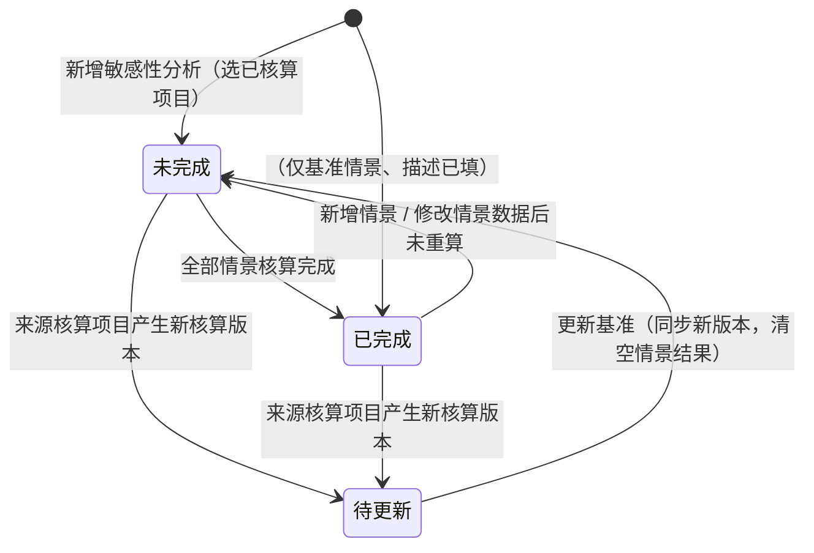

# 敏感性分析业务 PRD（报告管理）

> **【模块归属声明 · 2026-10-14】**：敏感性分析（Sensitivity Analysis）归属「**前台业务平台 · 报告管理**」分组，与「企业信息维护 / 报告编制 / 数据质量评价」并列；菜单与路由 `/report/sensitivity`（原型 `App.tsx` `PLACEHOLDERS` 现为占位页）。本模块**不改变核算主链**——核算项目步骤①~④始终只读引用，情景变更数据存于敏感性分析自己的副本中。
>
> **【竞品对齐声明】**：本 PRD 结构对齐竞品（供应商-庄驰 敏感性分析）的「列表 → 详情（基准情景 + 情景 1..N）→ 填写情景N数据」三段式交互，并在其基础上补齐：**四口径**、**OAT 快捷扰动**、**敏感性排序**、**基准失效（待更新）**四个能力。

> **文档定位**：敏感性分析模块的**业务规则真相源**，定义对象结构、状态机、动作矩阵、重算口径、页面骨架与验收标准。字段结构见《敏感性分析字段清单》（待产出），页面控件见《敏感性分析_Demo》（待产出）。
>
> **上游依据**：`00碳核算项目_模块拆分与交互骨架.md`（V1.2 · 报告环节移出核算流程）、`05 检测核算与结果/碳足迹核算业务PRD.md`（V0.6 · 引擎内置口径 / 四口径）、`06生成报告/报告生成业务PRD.md`（V0.2 · 报告管理承载口径）。

## 0. 文档基础信息

| 项目 | 内容 |
| :--- | :--- |
| 文档名称 | 敏感性分析业务 PRD（报告管理） |
| 版本 | V0.1 |
| 状态 | 草稿（待业务确认） |
| 模块名称 | 报告管理 · 敏感性分析 |
| 模块类型 | **独立业务单据 + 分析结果载体**（子对象：基准情景 + 变更情景 + 情景结果） |
| 维护形态 | 列表页（一行 = 一个敏感性分析）+ 详情页（基准情景 + 情景区）+ 情景数据编辑弹窗 |
| 所属层级 | 前台业务平台 · 报告管理（对标竞品一级菜单「敏感性分析」） |
| 字段真相源 | `02prd/02-2前台业务功能/06报告管理/敏感性分析字段清单.md`（待产出） |
| 上游基线 | `01 碳核算项目/00碳核算项目_模块拆分与交互骨架.md`、`01 碳核算项目/05 检测核算与结果/碳足迹核算业务PRD.md`、`01 碳核算项目/01 项目列表与新建/核算项目字段清单.md` |
| 落地位置 | 文档：`04产品设计管理/02prd/02-2前台业务功能/06报告管理/`；原型：`src/pages/report/SensitivityListPage.tsx`（列表）+ `SensitivityDetailPage.tsx`（详情）+ `ScenarioDataDrawer.tsx`（填写情景数据抽屉）+ `sensitivityMeta.ts` + `SensitivityPage.css`；`src/types/sensitivity.ts`（类型）、`src/mock/sensitivity.ts`（Mock 服务）——**已于 2026-10-14 落地** |
| 更新时间 | 2026-10-14 |

**变更记录**

| 日期 | 版本 | 变更内容 |
| :--- | :--- | :--- |
| 2026-10-14 | V0.1 | 初版：定义「分析单 → 情景 → 情景结果」三对象、未完成/待更新/已完成状态机、情景重算与变化率口径、列表 + 详情 + 情景数据弹窗三段式交互、R-067~R-082、验收 V01–V18 |

**关联链接**

| 文档 | 路径 |
| :--- | :--- |
| 模块拆分与交互骨架（核算主链 / 报告环节移出） | `02prd/02-2前台业务功能/01 碳核算项目/00碳核算项目_模块拆分与交互骨架.md` |
| 碳足迹核算业务 PRD（引擎内置口径 / 四口径 / 重新计算） | `02prd/02-2前台业务功能/01 碳核算项目/05 检测核算与结果/碳足迹核算业务PRD.md` |
| 碳足迹核算字段清单（核算结果 / 结果明细字段） | `02prd/02-2前台业务功能/01 碳核算项目/05 检测核算与结果/碳足迹核算字段清单.md` |
| 核算项目字段清单（阶段数据项 / 单位产品用量 / 因子快照） | `02prd/02-2前台业务功能/01 碳核算项目/01 项目列表与新建/核算项目字段清单.md` |
| 报告生成业务 PRD（报告管理承载口径参考） | `02prd/02-2前台业务功能/01 碳核算项目/06生成报告/报告生成业务PRD.md` |

---

## 1. 需求概述

### 1.1 需求背景

**敏感性分析解决什么问题**：产品碳足迹结果不是唯一确定的数字——它依赖三组「选择」：**假设**（如运输距离、使用次数）、**方法**（如分配方式、GWP 版本）、**数据**（如原料用量、因子取值）。当其中一个选择改变时，碳足迹会变化多少，是本项目结果是否可信、是否可用于对外声明的关键。

`GB/T 24067-2024` / `ISO 14067` 要求在量化报告中识别关键假设并开展敏感性分析；`CAL-10`（业务需求分析）已登记「多情景敏感性分析」为必做项。核算主链产出的是**单一确定结果**，缺少「如果……会怎样」的推演能力。

```text
核算项目（步骤④ 已核算）
    ├── 核算结果版本 v_n（unitEmission + 四口径 + 阶段/数据项/排放源汇总）
    └── 数据清单（阶段数据项：单位产品用量 + 因子快照）
                ↓ 只读引用（不修改主链）
敏感性分析（报告管理）
    ├── 基准情景    = 锁定核算结果版本 v_n（只读，不可编辑数值）
    ├── 情景 1..N   = 基于基准清单「改若干数据项的单位产品用量」→ 重算 → 情景碳足迹 + 变化率
    └── 结论        = 敏感性排序（按 |变化率| 降序）+ 关键参数识别
```

**没有这一步，核算结果只是"一个数"，客户/审核方无法判断结果的稳健性与关键驱动因素。**

### 1.2 需求目标

| # | 目标 | 可验证口径 |
| :-: | :--- | :--- |
| G1 | **一键起分析** | 「已核算」项目 → 新增敏感性分析 → 自动带出基准情景（结果 + 数据清单），无需重复录入 |
| G2 | **多情景推演** | 一个分析下可增删任意数量的变更情景，每个情景独立描述、独立变更集、独立结果 |
| G3 | **局部改数** | 情景只允许修改数据项的「情景数量」（单位产品用量），其余继承基准，避免整单重填 |
| G4 | **重算即出结果** | 情景数据保存 → 点「核算碳足迹」→ 输出情景碳足迹值 + 变化率（含四口径） |
| G5 | **基准失效可感知** | 核算项目产生新核算版本 → 分析转「待更新」，提示并支持一键同步基准 |
| G6 | **看懂谁最关键** | 详情页提供情景对比表，按变化率绝对值排序，标注关键敏感数据项 |
| G7 | **不污染主链** | 敏感性分析全程不写回核算项目；删除分析不影响核算结果与报告 |

### 1.3 范围（In Scope / Out of Scope）

**In Scope（本期）**

| # | 范围 |
| :-: | :--- |
| 1 | 敏感性分析列表（查询 / 分页 / 右侧摘要） |
| 2 | 新增敏感性分析（选「已核算」核算项目） |
| 3 | 基准情景（描述 + 结果自动带出、只读锁定） |
| 4 | 变更情景（新增 / 编辑描述 / 删除 / 排序） |
| 5 | 情景数据编辑（阶段 Tab + 左树 + 右侧数据列表，改「情景数量」） |
| 6 | 情景核算（重算碳足迹 + 变化率 + 四口径） |
| 7 | 情景对比（排序 / 结果与变化率一览） |
| 8 | 状态管理（未完成 / 待更新 / 已完成）与删除 |
| 9 | 导出（情景对比 Excel，P1） |

**Out of Scope（本期不做）**

| 不做项 | 归属 / 原因 |
| :--- | :--- |
| 更换排放因子（组合敏感性） | 本期与竞品对齐，**仅支持改数量**；换因子 + 换方法留二阶段 |
| 自动 OAT 扰动（±10%/±20% 一键生成情景） | 建议二阶段增强（见 §9 Q2）；本期仅手动情景 |
| 蒙特卡洛 / 概率分布敏感性 | 依赖不确定性量化引擎，本期不做 |
| 多产品 / 跨项目敏感性对比 | 分析域，本期不做（骨架 §2） |
| 敏感性分析写入报告章节 | 「报告编制」承载（后续联调），本期仅提供数据 |
| 分析单多版本 / 历史版本切换 | 本期单一当前版本（对齐报告口径 ①） |
| 情景结果在线编辑 / 二次修数 | 不改结果，仅可回弹窗改数据重算 |

### 1.4 与上下游的边界

| 归属 | 模块 | 本文的角色 |
| :--- | :--- | :--- |
| 核算项目状态机 / 核算结果版本 | 核算项目业务 PRD / 碳足迹核算业务 PRD | 引用（准入 = 「已核算」）；不重复定义 |
| 情景重算引擎（行级 → 阶段 → 全局 / 四口径） | 碳足迹核算业务 PRD §6 | **复用同一引擎口径**，仅替换变更数据项的数量 |
| 数据项清单结构（阶段 / 过程节点 / 单位产品用量 / 因子快照） | 核算项目字段清单 §6 | 只读引用为基准清单 |
| 报告引用敏感性分析结论 | 报告管理 · 报告编制 | 本文产出结论，报告编制按需引用（后续） |
| 页面控件与布局、字段级约束 | 《敏感性分析_Demo》《敏感性分析字段清单》 | 不写 |

---

## 2. 用户与使用场景

| 场景ID | 场景 | 类型 | 说明 |
| :--- | :--- | :--- | :--- |
| S01 | 新建敏感性分析 | **主流程** | 报告管理 → 敏感性分析 →「新增敏感性分析」→ 选择一个「已核算」项目 → 生成分析单（基准情景自动带出） |
| S02 | 补充基准情景描述 | **主流程** | 填写情景描述（本次分析说明，必填，≤500 字） |
| S03 | 新增变更情景 | **主流程** | 「新增敏感性分析情景」→ 生成情景 N（描述为空、结果为空） |
| S04 | 填写情景数据并核算 | **主流程** | 情景行「编辑情景数据」→ 弹窗按阶段改「情景数量」→「核算碳足迹」→ 回填情景碳足迹 + 变化率 |
| S05 | 对比多情景 | **主流程** | 详情页情景对比表：各情景碳足迹、变化率、按 \|变化率\| 降序排序、关键项标注 |
| S06 | 删除情景 | 支线 | 情景行「删除情景」→ 二次确认 → 移除情景及其结果 |
| S07 | 基准失效后同步 | 支线 | 核算项目重新核算 → 分析转「待更新」→ 详情页提示 →「更新基准」同步新版本、清空情景结果待重算 |
| S08 | 删除分析 | 支线 | 列表行「删除」→ 二次确认 → 分析单及其情景全部移除（不影响核算项目） |
| S09 | 只读回看 | 辅助 | 组织管理员 / 非创建人进入详情页，仅查看，无编辑与核算入口 |

---

## 3. 功能清单

| 模块 | 功能点 | 功能描述 | 优先级 |
| :--- | :--- | :--- | :---: |
| 列表 | 查询 | 按 核算项目（模糊）/ 产品名称（模糊）/ 分析状态 查询 | P0 |
| | 列表展示 | 序号 / 核算项目（链接）/ 产品名称 / 敏感性分析状态 / 分析结果更新时间 / 操作 | P0 |
| | 右侧摘要 | 选中行的项目摘要（系统边界 / 声明单位 / 统计时间 / 基准结果）+「新增敏感性分析」主按钮 | P1 |
| 新增 | 新增敏感性分析 | 选择「已核算」核算项目 → 生成分析单（基准情景自动带出） | P0 |
| 基准情景 | 基准信息 | 影响评价方法 / 评价指标 / 基准碳足迹结果（只读带出） | P0 |
| | 情景描述 | 基准情景说明文字（必填，≤500 字） | P0 |
| 变更情景 | 新增情景 | 生成「情景 N」，支持多个 | P0 |
| | 情景描述 | 每个情景的假设说明（必填，≤500 字） | P0 |
| | 编辑情景数据 | 弹窗改「情景数量」，其余继承基准 | P0 |
| | 核算碳足迹 | 情景重算 → 碳足迹结果 + 变化率 | P0 |
| | 删除情景 | 移除情景及其结果 | P0 |
| 情景对比 | 对比表 | 情景 / 描述 / 碳足迹结果 / 变化率，按 \|变化率\| 降序 | P0 |
| | 关键参数标注 | 变更集非空且 \|变化率\| 最大的情景标注「关键敏感项」 | P1 |
| | 导出对比 | 导出情景对比 Excel | P1 |
| 状态 | 状态展示 | 未完成 / 待更新 / 已完成 | P0 |
| | 更新基准 | 基准失效后一键同步新核算版本 | P0 |
| 只读 | 只读展示 | 非创建人 / 只读角色仅查看 | P1 |

**不做**：自动扰动生成情景、换因子/换方法的组合敏感性、概率分析、分析单版本化、结果在线编辑。

---

## 4. 核心业务规则

> 编号承接报告生成业务 PRD（R-052 ~ R-066），本模块从 **R-067** 起。编号体系与核算主链 `S-xxx` 交互规则相互独立。

| 规则ID | 规则 | 依据 |
| :--- | :--- | :--- |
| R-067 | **[创建准入]** 仅「**已核算**」的核算项目可作为敏感性分析的数据来源；非已核算项目不出现在「新增敏感性分析」的选择列表中，已核算后转其他状态的项目可正常引用（引用的是结果快照，不随主链回退失效，仅按 R-078 转「待更新」） | 核算 PRD R-042 / 骨架 §5.2 |
| R-068 | **[基准锁定]** 创建分析时，系统锁定核算项目**最近一次核算结果版本**为基准情景（`baselineVersion` / `baselineEmission`），并复制当次数据清单为基准清单；此后主链变化**不自动改写**基准 | 核算 PRD R-046（结果版本化） |
| R-069 | **[基准不可编辑]** 基准情景仅可编辑「情景描述」；碳足迹结果、影响评价方法、评价指标、数据清单均为只读，不可删除基准情景 | 竞品「基准情景」只读口径 |
| R-070 | **[情景变更集]** 变更情景的记录粒度 = **数据项级**：每个数据项可单独设置「情景数量」，未设置者**继承基准情景数量**；不允许新增 / 删除数据项、不允许更换因子、不允许增删阶段 | 竞品「填写情景N数据」仅开放数量列 |
| R-071 | **[情景数量校验]** 情景数量为数值，**可为负**（对齐单位产品用量口径）；留空 = 继承基准；不可填非数字 | 核算项目字段清单 §6.1 |
| R-072 | **[情景核算]** 「核算碳足迹」按**与核算主链同一引擎口径**重算：行级 `情景数量 × 单位换算系数 × 排放因子` → 阶段 `SUM` → 全局 `SUM`；变更项用情景数量、其余用基准数量 | 核算 PRD R-044 / 以原型为准 |
| R-073 | **[四口径]** 情景结果同时输出四口径（`total` 总量（不含生物源CO₂）/ `fossil` 化石 / `biogenic` 生物源 / `luluc` 土地利用）；口径切换仅影响展示与导出，不改变变更集 | 核算 PRD §6.3 / 字段清单 §1.2 |
| R-074 | **[变化率]** 变化率 = `(情景碳足迹 − 基准碳足迹) ÷ 基准碳足迹 × 100%`，保留 1 位小数；基准值为 0 时变化率显示「—」并标注「基准为 0，无法计算变化率」 | 竞品「碳足迹结果变化率」列 |
| R-075 | **[重算幂等]** 同一情景重复点「核算碳足迹」以当前变更集重算并覆盖该情景结果，不产生重复记录；场景数量或描述变更后需重新核算 | 对齐核算 PRD R-048 |
| R-076 | **[状态-未完成]** 分析单下**存在任一情景未完成核算**（无结果）→ 状态「未完成」 | 竞品「未完成」态 |
| R-077 | **[状态-已完成]** 全部分析情景均已核算（含仅有基准、无变更情景时的基准描述已填）→ 状态「已完成」 | 竞品「已完成」态 |
| R-078 | **[状态-待更新]** 核算项目产生**新的核算结果版本**（或基准结果值变化）→ 分析单转「待更新」，提示「来源核算数据已更新，当前结论可能失效」；用户可「更新基准」同步新版本（同步后清空全部情景结果 → 回「未完成」），或忽略继续（保留原结论但标记待更新） | 竞品「待更新」态 / 核算 PRD R-046 |
| R-079 | **[不污染主链]** 敏感性分析的一切操作不写回核算项目；删除分析单 / 情景不影响核算结果版本与报告 | 骨架 §2 边界约束 |
| R-080 | **[权限]** 核算人员可创建、编辑、核算、删除本组织分析单；组织管理员只读；跨组织不可见 | 《角色可见范围 v1.0》§2.3 |
| R-081 | **[删除边界]** 删除情景需二次确认（「删除后不可恢复」）；删除分析单需二次确认（「删除分析单将同时移除全部情景，不影响来源核算项目」） | 对齐骨架 S-006 |
| R-082 | **[概念不外露]** 界面不出现公式 DSL、计算引擎、快照、异常编号；只呈现「基准情景 / 情景 / 碳足迹结果 / 变化率」人话口径 | 骨架 S-007 |

---

## 5. 状态与动作

### 5.1 分析状态流转



### 5.2 分析状态 → 界面表现

| 分析状态 | 列表文案 | 详情页表现 | 可执行动作 |
| :--- | :--- | :--- | :--- |
| 未完成 | 未完成（灰点） | 基准正常；存在无结果的情景 | 编辑描述 / 编辑情景数据 / 核算碳足迹 / 增删情景 |
| 已完成 | 已完成（绿点） | 基准 + 全部情景有结果 | 编辑描述 / 增删情景 / 导出对比 / 删除 |
| 待更新 | 待更新（橙点） | 顶部提示条「来源核算数据已更新，结论可能失效」 | 更新基准 / 查看原结论 / 删除 |

> **列表排序**：默认按「分析结果更新时间」倒序。

### 5.3 动作能力矩阵

| 动作 | 未完成 | 待更新 | 已完成 | 只读角色 |
| :--- | :-: | :-: | :-: | :-: |
| 编辑基准情景描述 | ✅ | ✅ | ✅ | ❌ |
| 新增 / 删除情景 | ✅ | ❌ | ✅ | ❌ |
| 编辑情景数据 | ✅ | ❌ | ✅ | ❌ |
| 核算碳足迹 | ✅ | ❌ | ✅（重算覆盖） | ❌ |
| 更新基准 | ❌ | ✅ | ❌ | ❌ |
| 导出情景对比 | ❌ | ✅（按原结论） | ✅ | ✅ |
| 删除分析单 | ✅ | ✅ | ✅ | ❌ |

> **红线**：不可用动作直接不展示，不渲染 disabled 假入口（对齐核算项目 PRD §6）。「待更新」态下情景编辑与核算入口整体收起，仅保留「更新基准」与「查看 / 导出原结论」。

---

## 6. 计算口径（情景重算）

> 本节为**业务口径**（面向实现对齐），技术实现见《敏感性分析_Demo》Mock 规格；引擎口径与核算主链**完全一致**（核算 PRD §6.1）。

### 6.1 重算输入

| 输入 | 取值 |
| :--- | :--- |
| 数据项清单 | 基准清单（创建分析时从核算项目复制的快照），含阶段 / 过程节点 / 数据项 / 单位 / 因子快照（`factorValue` / `factorCalibers` / `factorUnit`） |
| 数量 | 变更项取「情景数量」；未变更项取「基准情景数量」 |
| 计算范围 | 基准清单全部数据项（含追溯节点内数据项）；无因子行因子值记 0 |

### 6.2 重算链路

```text
行级   情景数量 × 单位换算系数 × 排放因子        ← 逐条数据项求值 → 行碳排
              ↓
阶段汇总 SUM(该阶段各行碳排)
              ↓
全局    SUM(各阶段碳排)                          ← 情景碳足迹结果（kgCO₂e / 声明单位）
              ↓
对比    Δ% = (情景结果 − 基准结果) ÷ 基准结果 × 100%
```

> **单位换算系数**沿用核算引擎口径（数据项单位 → 因子分母单位，按计量单位库「基准中转」计算，无法换算为 1）。

### 6.3 四口径与混合兜底

情景结果按 **GWP 四分量**分别求值（与核算结果同口径）：`total` 总量（不含生物源CO₂）/ `fossil` 化石 / `biogenic` 生物源 / `luluc` 直接土地利用变化。逐行兜底规则同核算 PRD §6.3：有分项口径按分项单独算，只有总值时化石 = 总量、生物源与土地利用记 0。基准值无 GWP 分项时，详情页按单一口径呈现（不出现口径切换卡片）。

### 6.4 基准清单复制口径（引用即复制）

创建分析时**复制**基准清单（含因子快照），与核算主链解耦：

| 主链后续变化 | 对已创建分析的影响 |
| :--- | :--- |
| 因子库中因子被禁用 / 改值 | **无影响**（分析内是快照） |
| 数据项增删 / 数量修改 / 重新核算 | 不自动改写基准；产生新核算版本 → 分析转「待更新」（R-078） |

---

## 7. 页面结构与交互

### 7.1 页面清单与路由

| 页面 | 路由 | 容器形态 | 优先级 |
| :--- | :--- | :--- | :-: |
| 敏感性分析列表 | `/report/sensitivity` | 独立页面（左列表 + 右摘要） | P0 |
| 敏感性分析详情 | `/report/sensitivity/:id` | 独立页面（基准区 + 情景区 + 结论区） | P0 |
| 新增敏感性分析 | 列表页内弹窗 | 选择「已核算」核算项目 | P0 |
| 填写情景 N 数据 | 详情页内抽屉 / 弹窗 | 阶段 Tab + 左树 + 数据列表 + 核算按钮 | P0 |

### 7.2 列表页线框（对齐竞品截图 1）

```text
+-------------------------------------------------------------------------------------------+
| 敏感性分析                                                                                |
| [核算项目 请输入] [产品名称 请输入] [分析状态 ▼]                         [查询] [重置]     |
+-------------------------------------------------------------------------------------------+
| 序号 | 核算项目 ↑   | 产品名称     | 分析结果更新时间    | 敏感性分析状态 | 操作         |
|  1   | 供应商-庄驰  | 竹板坯       | 2026-07-28 19:28:53 | ● 未完成      | 编辑 删除    |      |
|  2   | 整竹砧板     | ZB13002 整竹砧板 | 2026-08-23 19:00:05 | ● 待更新   | 编辑 删除    |      |
|  3   | 测试模型     | 筷子         | 2026-10-12 16:11:09 | ● 已完成      | 编辑 删除    |      |
+-------------------------------------------------------------------------------------------+  右侧摘要面板
|                                        共 3 条  [10条/页 ▼]  ◀ 1 ▶  前往 __ 页         |  ┌──────────────────────┐
+-------------------------------------------------------------------------------------------+  │ 系统边界 摇篮到大门   │
                                                                                              │ 声明/功能单位 1.0 双  │
                                                                                              │ 统计时间 2025-01-01~  │
                                                                                              │ 基准结果 6.726E-7     │
                                                                                              │ [ ＋ 新增敏感性分析 ] │
                                                                                              └──────────────────────┘
```

**列定义（对齐竞品 + 本系统口径）**

| 列 | 来源 | 说明 |
| :--- | :--- | :--- |
| 序号 | 系统 | 分页内序号 |
| 核算项目 | 关联核算项目 | 蓝色链接进详情页；即竞品「模型名称」列 |
| 产品名称 | 核算项目 | 取项目产品名称 |
| 分析结果更新时间 | 系统 | 最近一次情景核算成功时间；未核算时 = 创建时间 |
| 敏感性分析状态 | 系统 | 未完成（灰）/ 待更新（橙）/ 已完成（绿） |
| 操作 | 系统 | 编辑 / 删除（删除二次确认） |

### 7.3 详情页线框（对齐竞品截图 2 / 3 / 4）

```text
+-------------------------------------------------------------------------------------------+
| 面包屑：前台业务平台 / 报告管理 / 敏感性分析 / PCF-SA-20260728001                        |
| 供应商-庄驰 敏感性分析                                                       [ 返回 ] [导出对比]|
| 敏感性分析：用于估计与产品碳足迹研究结果相关假设、方法和数据的选择影响的系统方法。        |
+-------------------------------------------------------------------------------------------+
| 核算项目[供应商-庄驰]  产品名称[竹板坯]  影响评价方法[IPCC 2021]  评价指标[Climate change: total - GWP100] |
+-------------------------------------------------------------------------------------------+
| ▌基准情景                                                                  碳足迹结果       |
| *情景描述  [________________________________________]                    6.726E-7 kgCO₂e   |
|                                                                (0 / 500)                  |
+-------------------------------------------------------------------------------------------+
|                           ＋ 新增敏感性分析情景                                            |
+-------------------------------------------------------------------------------------------+
| ▌情景 1                                        [ ✎ 编辑情景数据 ]  [ 删除情景 ]            |
| *情景描述  [________________________________________]   碳足迹结果   碳足迹结果变化率      |
|                                              (0 / 500)   7.410E-7      +10.2%              |
+-------------------------------------------------------------------------------------------+
| ▌情景 2 ...                                                                                |
+-------------------------------------------------------------------------------------------+
| ▌情景对比（按 |变化率| 降序）                                                               |
| 情景 | 描述摘要 | 碳足迹结果 | 变化率 | 关键敏感项                                          |
| 情景1| 原竹用量+10% | 7.410E-7 | +10.2% | ★ 原竹                                            |
+-------------------------------------------------------------------------------------------+
```

**详情页区块**

| 区块 | 内容 | 可编辑性 |
| :--- | :--- | :--- |
| 头部信息 | 核算项目 / 产品名称 / 影响评价方法 / 评价指标 | 只读带出 |
| 基准情景 | 情景描述（必填）+ 碳足迹结果 | 描述可编辑，结果只读 |
| 情景区 | 情景 1..N（描述 + 结果 + 变化率 + 编辑情景数据 + 删除情景） | 可编辑 |
| 情景对比 | 对比表（按 \|变化率\| 降序）+ 关键敏感项标注 | 只读 |
| 状态提示 | 「待更新」时顶部橙色提示条 +「更新基准」 | 动作 |

> **影响评价方法 / 评价指标**取值：来自基准核算结果的口径（`lciaMethod` / 四口径指标名），如 `IPCC 2021` + `Climate change: total (excl. biogenic CO₂) - GWP100`；与因子库 `特征化方法` / `GWP 版本` 口径一致。

### 7.4 情景数据编辑弹窗（对齐竞品截图 5 / 6）

```text
+---------------------------------------------------------------------------+
| 填写情景 1 数据                                                       [×] |
| 核算项目：供应商-庄驰        产品名称：竹板坯                              |
+---------------------------------------------------------------------------+
| [ 原材料获取 ]  生产   ...            ← 阶段 Tab（按项目纳入阶段）          |
| 原材料获取 ▸ 原材料运输                ← 阶段内二级阶段切换                |
+---------------------------------------------------------------------------+
| 左树                    | 产品产出：竹板坯                                 |
| ▾ 全部                 | 数据列表：产品分配系数 1                [ 编辑 ]  |
|   ▾ 原材料获取          | 流名称   | 基准情景数量 | 情景数量 | 单位 | 上游过程名称 |
|      原竹（过程节点）    | 原竹     | 1846.28     | 1846.28  | kg   | 竹秆\|竹林可持续管理 |
|      胶水（过程节点）    | 胶水     | 2.16        | 2.16     | kg   | 脲醛树脂\|脲醛树脂生产 |
+---------------------------------------------------------------------------+
|                                              [ 取消 ]   [ 核算碳足迹 ]    |
+---------------------------------------------------------------------------+
```

**弹窗交互**

| 项 | 规则 |
| :--- | :--- |
| 阶段 Tab | 按基准清单纳入的生命周期阶段渲染；一级阶段下存在二级阶段时，Tab 内提供二级切换（对应竞品「原材料获取 / 原材料运输」） |
| 左树 | 阶段 → 过程节点（继续追溯链路）→ 数据项；仅用于定位「当前数据列表」 |
| 数据列表 | 列 = 流名称 / **基准情景数量（只读）** / **情景数量（可编辑）** / 单位 / 上游过程名称 |
| 编辑 | 点「编辑」进入可编辑态（情景数量列变输入框）；未进入编辑态时只读 |
| 核算碳足迹 | 保存变更集 → 重算 → 回填情景结果与变化率 → 关闭弹窗；无变更时提示「未修改任何数据」（R-075） |
| 取消 | 丢弃未保存的变更集 |

---

## 8. 边界与异常处理

| 场景 | 系统行为 |
| :--- | :--- |
| 新建时无「已核算」项目 | 选择列表为空，提示「暂无可用于敏感性分析的核算项目，请先完成核算」 |
| 基准碳足迹为 0 | 变化率显示「—」，并标注「基准为 0，无法计算变化率」 |
| 情景未做任何修改即核算 | 允许，结果 = 基准、变化率 = 0.0%；提示「未修改任何数据，结果与基准一致」 |
| 情景数量填入非数字 | 输入框校验拦截，阻断保存并定位 |
| 情景数量清空 | 视为「继承基准数量」，不参与变更集 |
| 核算过程中重复点击 | 按钮禁用，展示「核算中」，不重复提交 |
| 情景数量修改后未点核算即关闭 | 变更集已保存（草稿），情景结果标记「待重算」，分析状态回「未完成」 |
| 来源项目产生新核算版本 | 分析转「待更新」，顶部提示条；情景编辑入口收起 |
| 来源项目被删除 | 分析单保留（基准为快照），但「核算项目」链接置灰标注「来源已删除」；不可更新基准，可查看 / 导出 / 删除 |
| 并发编辑（他人同时改同一分析） | 以最新保存为准，提交时若版本已变更提示「分析单已被他人更新，请刷新后重试」 |
| 情景数量过多 | 本期不限制情景数量；对比表按 \|变化率\| 降序全量展示 |

---

## 9. 待确认事项

| 编号 | 问题 | 影响 | 当前建议 | 状态 |
| :--- | :--- | :--- | :--- | :--- |
| Q1 | 敏感性分析归属：独立一级菜单 还是「报告管理」子项 | 菜单与路由 | 采纳**报告管理子项**（`/report/sensitivity`），与现系统规划一致 | 待确认 |
| Q2 | 是否支持 **OAT 自动扰动**（对高贡献数据项一键生成 ±10% / ±20% 情景） | 功能范围 | 建议二阶段增强：本期仅手动情景，先跑通闭环 | 待确认 |
| Q3 | 情景是否允许**更换排放因子 / 影响评价方法** | 分析深度 | 本期仅改数量；换因子 + 换方法（IPCC AR5/AR6 对比）二阶段 | 待确认 |
| Q4 | 「待更新」态是否需要**强制重算**才可导出／引用 | 结论可信度 | 允许查看 / 导出但打「待更新」水印，不强制 | 待确认 |
| Q5 | 分析单是否需要**版本化** | 追溯 | 本期单一当前版本（对齐报告口径 ①） | 待确认 |
| Q6 | 情景数量是否需要**批量填充**（如整阶段 ×1.1） | 效率 | 本期不做；OAT 落地后由自动扰动覆盖 | 待确认 |
| Q7 | 「关键敏感项」判定阈值 | 结论呈现 | 建议 \|变化率\| ≥ 5% 标★；阈值待业务确认 | 待确认 |
| Q8 | 情景对比导出格式 | 交付 | 建议 Excel（多列：情景 / 描述 / 四口径结果 / 变化率） | 待确认 |

---

## 10. 验收标准

| # | 验收项 | 输入条件 | 预期结果 |
| :-: | :--- | :--- | :--- |
| V01 | **创建准入** | 打开「新增敏感性分析」 | 仅列出「已核算」项目；无已核算项目时给出空态提示 |
| V02 | **基准带出** | 选择某已核算项目创建 | 基准情景自动带出碳足迹结果 + 影响评价方法 / 评价指标，数据清单与核算项目一致 |
| V03 | **基准只读** | 尝试编辑基准结果 | 结果不可编辑；仅情景描述可改，基准不可删除 |
| V04 | **新增情景** | 点「新增敏感性分析情景」 | 生成情景 N（描述为空、结果为「—」），分析状态「未完成」 |
| V05 | **情景数据编辑** | 点「编辑情景数据」 | 弹窗按阶段 Tab + 左树 + 数据列表展示；基准数量只读、情景数量可编辑 |
| V06 | **情景核算** | 修改若干数量 →「核算碳足迹」 | 回填情景碳足迹结果与变化率，分析状态更新（全部完成则「已完成」） |
| V07 | **变化率口径** | 情景结果 7.410E-7、基准 6.726E-7 | 变化率 = +10.2%（保留 1 位小数） |
| V08 | **基准为 0 兜底** | 基准结果 = 0 | 变化率显示「—」并提示无法计算 |
| V09 | **多情景** | 新增情景 2、情景 3 并分别核算 | 各情景独立结果与变化率，互不影响 |
| V10 | **对比排序** | 查看情景对比表 | 按 \|变化率\| 降序排列，关键敏感项标注 |
| V11 | **删除情景** | 情景行「删除情景」 | 二次确认后移除该情景及其结果，其余情景不受影响 |
| V12 | **状态-待更新** | 来源核算项目重新核算 | 分析转「待更新」，顶部提示条，情景编辑入口收起 |
| V13 | **更新基准** | 「待更新」态点「更新基准」 | 基准同步为新核算版本，全部情景结果清空，状态回「未完成」 |
| V14 | **不污染主链** | 完成情景核算后查看核算项目 | 核算项目数据与结果版本无任何变化 |
| V15 | **删除分析** | 列表行「删除」 | 二次确认后分析单与全部情景移除，核算项目与报告不受影响 |
| V16 | **四口径** | 基准含 GWP 分项时切换口径 | 情景结果与变化率按所选口径实时呈现 |
| V17 | **权限** | 组织管理员 / 非创建人进入详情页 | 仅查看与导出，无编辑 / 核算 / 删除入口 |
| V18 | **概念不外露** | 走查列表 / 详情 / 弹窗 | 不出现公式 DSL、计算引擎、快照、异常编号 |

---

## 11. 附录

### 11.1 对象结构（概要）

> 完整字段表见《敏感性分析字段清单》（待产出），本节仅给对象关系。

```text
敏感性分析（SensitivityAnalysis） 1
   ├── 1 基准情景（BaselineScenario）        ← 创建时锁定核算结果版本 + 数据清单快照
   └── N 变更情景（Scenario）
           ├── 1 变更集（ScenarioItem[]）      ← 数据项级：dataItemId / 基准数量 / 情景数量
           └── 1 情景结果（ScenarioResult）     ← 碳足迹结果（四口径）+ 变化率 + 核算时间
```

### 11.2 术语表

| 术语 | 含义 |
| :--- | :--- |
| 敏感性分析 | 用于估计与产品碳足迹研究结果相关的**假设、方法和数据的选择**影响的系统方法（GB/T 24067 / ISO 14067） |
| 基准情景 | 创建分析时锁定的核算结果版本与其数据清单，作为所有情景的对比基准，只读 |
| 变更情景 | 基于基准清单、通过修改若干数据项「情景数量」构造的假设情景 |
| 情景数量 | 某一数据项在该情景下的「单位产品用量」取值；未设置时继承基准数量 |
| 情景碳足迹结果 | 按引擎口径对变更清单重算得到的碳足迹值（kgCO₂e / 声明单位） |
| 变化率 | `(情景结果 − 基准结果) ÷ 基准结果 × 100%`，保留 1 位小数 |
| 待更新 | 来源核算项目产生新核算版本后，分析结论可能失效的状态 |
| 关键敏感项 | 使碳足迹变化率绝对值最大的变更数据项（阈值见 Q7） |

### 11.3 竞品对齐与差异

| 竞品能力 | 本方案 | 差异说明 |
| :--- | :--- | :--- |
| 列表：模型名称 / 产品名称 / 状态 / 更新时间 | 核算项目 / 产品名称 / 状态 / 更新时间 | 本系统已废弃「核算模型」，改挂「核算项目」 |
| 基准情景：描述 + 碳足迹结果 | 同 | 基准结果新增「影响评价方法 / 评价指标」带出 |
| 情景：描述 + 结果 + 变化率 + 编辑数据 / 删除 | 同 | 增加四口径切换 |
| 情景数据弹窗：阶段 Tab + 左树 + 数量列 | 同（基准数量 / 情景数量 / 单位 / 上游过程名称） | 数据项映射核算项目步骤②阶段数据项 |
| 状态：未完成 / 待更新 / 已完成 | 同 | 「待更新」绑定核算结果版本变化（R-078） |
| —（竞品无） | 情景对比排序 + 关键敏感项标注（P1） | 本方案增强，帮助识别关键驱动 |
| —（竞品无） | OAT 自动扰动（二阶段） | 见 §9 Q2 |

### 11.4 下游文档影响清单

| 下游文档 | 受影响内容 |
| :--- | :--- |
| 《敏感性分析字段清单》 | 分析单 / 基准情景 / 变更情景 / 变更集 / 情景结果对象与枚举 |
| 《敏感性分析_Demo》 | 列表页、详情页、情景数据弹窗的骨架、控件、校验展示、Mock 规格 |
| 原型 `SensitivityListPage.tsx` / `SensitivityDetailPage.tsx` / `ScenarioDataDrawer.tsx` | 已替换 `/report/sensitivity` 占位页（`App.tsx` `PLACEHOLDERS` 移除 + 注册真实路由） |
| `menu.ts` | `/report/sensitivity` 保持报告管理子项（已存在） |
| 报告管理 · 报告编制 | 后续可引用敏感性分析结论进入报告「结果解释」章节 |
