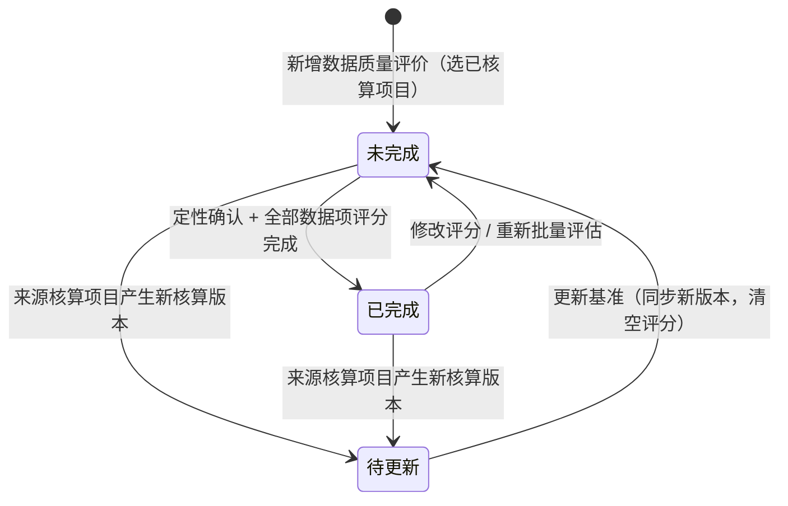

# 数据质量评价业务 PRD（报告管理）

> **【模块归属声明 · 2026-10-14】**：数据质量评价（DQR，Data Quality Rating）归属「**前台业务平台 · 报告管理**」分组，与「企业信息维护 / 报告编制 / 敏感性分析」并列；菜单与路由 `/report/quality`（原型 `App.tsx` `PLACEHOLDERS` 现为占位页，`menu.ts` 已存在 `data quality`）。本模块**不改变核算主链**——核算项目步骤①~④只读引用，评价过程与结论存于数据质量评价自己的副本中。
>
> **【竞品对齐声明】**：本 PRD 结构对齐竞品（供应商-庄驰 数据质量评价）的「**核算完成后新增评价 → ① 定性数据质量评价 → ② 定量数据质量评价 → ③ 数据质量评价结果**」三段式向导，并在其基础上补齐：**竞品口径四项谱系评分（TiR/TeR/GeR/C）+ 1–5 分判定标准**、**弹窗评分会话（批量勾选逐项打分）**、**不确定度量化**、**基准失效（待更新）**、**查看 / 编辑双模式**五个能力。
>
> **【评分口径对齐声明 · 2026-10-19】**：定量评分指标由原「五维（可靠性/完整性/时间/地理/技术相关性）」**收紧为竞品四项**——**时间代表性 TiR / 技术代表性 TeR / 地理代表性 GeR / 完整性 C**，每项 1–5 分并附竞品原文判定标准（1 分最优 → 5 分最差）；定性覆盖范围由 3 项**扩为 9 项**（时间/地理/技术覆盖范围 + 完整性/代表性/一致性/再现性/数据来源/信息的不确定性）。方法论锚点：`GB/T 24067-2024` / `ISO 14067`、ILCD Handbook 数据质量谱系矩阵、竞品评分矩阵（供应商-庄驰）。
>
> **【原型落地声明 · 2026-10-19】**：本版按 6-1 系统原型骨架实际实现修订——步骤② 改为**弹窗评分**（`数据质量评估` 弹窗：标题 / `‹ 数据名 ›` 切换 / 完成进度 / 确定），批量评估改为**勾选数据项后打开评分会话逐项打分**（不再默认启发式自动打分）；列表去掉「整体 DQR」列，操作改为**查看（只读）/ 编辑 / 删除**；步骤③ 只展示**定性 + 定量**两段结果（定性九项列表 + 定量摘要条与数据项明细表），分布、DQR 计算口径与结论卡片下线（结论导出仍可用）。

> **文档定位**：数据质量评价模块的**业务规则真相源**，定义对象结构、三步向导状态机、动作矩阵、DQR 计算口径、页面骨架与验收标准。字段结构见《数据质量评价字段清单》（待产出），页面控件见《数据质量评价_Demo》（待产出）。
>
> **上游依据**：`00碳核算项目_模块拆分与交互骨架.md`（V1.2 · 报告环节移出核算流程）、`05 检测核算与结果/碳足迹核算业务PRD.md`（V0.6 · 引擎内置口径 / 四口径）、`01 项目列表与新建/核算项目字段清单.md`（V1.4 · 阶段数据项 / 因子快照）、`06生成报告/报告生成业务PRD.md`（V0.2 · 报告管理承载口径）、`06报告管理/敏感性分析业务PRD.md`（V0.1 · 同组模块口径参照）。

## 0. 文档基础信息

| 项目 | 内容 |
| :--- | :--- |
| 文档名称 | 数据质量评价业务 PRD（报告管理） |
| 版本 | V0.2 |
| 状态 | 草稿（待业务确认） |
| 模块名称 | 报告管理 · 数据质量评价 |
| 模块类型 | **独立业务单据 + 评价结果载体**（子对象：定性覆盖范围 + 定量数据项评分 + 评价结果） |
| 维护形态 | 列表页（一行 = 一个数据质量评价）+ 详情页（三步向导：定性 → 定量 → 结果） |
| 所属层级 | 前台业务平台 · 报告管理（对标竞品一级菜单「数据质量评价」） |
| 字段真相源 | `02prd/02-2前台业务功能/06报告管理/06-2数据质量评价/数据质量评价字段清单.md`（已产出，同版修订） |
| 上游基线 | `01 碳核算项目/00碳核算项目_模块拆分与交互骨架.md`、`01 碳核算项目/05 检测核算与结果/碳足迹核算业务PRD.md`、`01 碳核算项目/01 项目列表与新建/核算项目字段清单.md` |
| 落地位置 | 文档：`04产品设计管理/02prd/02-2前台业务功能/06报告管理/06-2数据质量评价/`；原型：`06prototypes/6-1系统原型骨架/src/pages/report/QualityListPage.tsx` / `QualityDetailPage.tsx`（已落地，6-1 系统原型骨架） |
| 更新时间 | 2026-10-19 |

**变更记录**

| 日期 | 版本 | 变更内容 |
| :--- | :--- | :--- |
| 2026-10-14 | V0.1 | 初版：定义「评价单 → 定性覆盖范围 → 定量数据项评分 → 评价结果」四对象、未完成/待更新/已完成状态机、谱系矩阵五维评分与 DQR 计算口径、列表 + 三步向导交互、R-083~R-100、验收 V01–V20 |
| 2026-10-19 | V0.2 | 对齐 6-1 原型落地：评分指标收紧为竞品四项（TiR/TeR/GeR/C，附 1–5 分判定标准）；定性扩为 9 项；步骤② 改弹窗评分（含 ‹数据名› 切换与完成进度）；批量评估改勾选驱动、弹窗逐项打分；新增查看（只读）/ 编辑双模式与返回列表入口；评价指标切换联动数据项排放/贡献率重算；支持跳过定量评价；步骤③ 只保留定性 + 定量两段结果（摘要条 + 数据项明细 + 分页），分布 / 计算口径 / 结论卡片下线；规则补充 R-101~R-104、验收补充 V21–V24 |

**关联链接**

| 文档 | 路径 |
| :--- | :--- |
| 模块拆分与交互骨架（核算主链 / 报告环节移出） | `02prd/02-2前台业务功能/01 碳核算项目/00碳核算项目_模块拆分与交互骨架.md` |
| 碳足迹核算业务 PRD（引擎内置口径 / 四口径 / 重新计算） | `02prd/02-2前台业务功能/01 碳核算项目/05 检测核算与结果/碳足迹核算业务PRD.md` |
| 核算项目字段清单（阶段数据项 / 因子快照 / 数据凭证） | `02prd/02-2前台业务功能/01 碳核算项目/01 项目列表与新建/核算项目字段清单.md` |
| 敏感性分析业务 PRD（同组模块 · 状态机与三段式交互参照） | `02prd/02-2前台业务功能/06报告管理/敏感性分析业务PRD.md` |
| 整体设计方案 v1.2 r4（§4.6 活动数据 / §4.8 报告 / 术语表 DQR） | `04产品设计管理/00业务设计/产品碳足迹核算系统_整体设计方案_v1.2.md` |

---

## 1. 需求概述

### 1.1 需求背景

**数据质量评价解决什么问题**：产品碳足迹结果依赖两类输入——**活动数据**（企业实测 / 统计 / 估算）与**排放因子**（背景数据库 / 供应商）。这两类输入都存在**不确定性**（时间、地域、技术的代表性差异），核算主链产出的却是一个**确定的数字**，客户与审核方无法判断「这个数字有多可信、偏差可能来自哪里」。

`GB/T 24067-2024` / `ISO 14067` 要求在量化报告中开展数据质量评价并披露其影响；`整体设计方案 v1.2` 术语表已登记「数据质量等级（DQR）」；`方案 §十 阶段三`已登记「数据质量评价（DQR 完整评分）」为规划能力；报告模板「四、清单分析」亦预留「数据质量评价」章节文案。

```text
核算项目（步骤④ 已核算）
    ├── 核算结果版本 v_n（unitEmission + 四口径 + 阶段/数据项/排放源汇总）
    └── 数据清单（阶段数据项：单位产品用量 + 因子快照 + 数据凭证）
                ↓ 只读引用（不修改主链）
数据质量评价（报告管理）
    ├── ① 定性数据质量评价  = 9 项定性覆盖范围描述（时间 / 地理 / 技术覆盖范围、完整性、代表性、一致性、再现性、数据来源、信息的不确定性；自动生成初稿 + 可编辑）
    ├── ② 定量数据质量评价  = 逐数据项「竞品四项评分（TiR / TeR / GeR / C，1–5 分 + 判定标准）」→ DQR 分值 / 等级 / 不确定度；弹窗评分 + 勾选批量
    └── ③ 数据质量评价结果  = 定性 9 项展示 + 定量结果（按评价指标切换：碳足迹结果 + 数据项 DQR / 贡献率明细）
```

**没有这一步，核算结果只是一个"数"，报告缺一段"数据可信度"声明，无法满足标准披露与第三方核查的门槛。**

> **与「敏感性分析」的分工**：敏感性分析回答「**如果假设/数据变了，结果变多少**」（情景推演）；数据质量评价回答「**当前数据的质量有多好、不确定度多大**」（质量评级）。两者均归属报告管理、均只读引用已核算项目、均不污染主链，但结论维度正交，共同支撑报告的「结果解释」与「数据质量声明」。

### 1.2 需求目标

| # | 目标 | 可验证口径 |
| :-: | :--- | :--- |
| G1 | **一键起评价** | 「已核算」项目 → 新增数据质量评价 → 自动带出数据清单（数据项 + 因子快照 + 凭证），无需重复录入 |
| G2 | **定性有初稿** | 9 项定性覆盖范围描述由系统根据数据项周期与因子背景自动生成初稿（时间 / 地理 / 技术覆盖自动生成，其余为默认文案），用户可编辑 |
| G3 | **评分有据可依** | 每项指标 1–5 分均展示判定标准原文；弹窗评分带完成进度，逐项打分、确定后批量保存 |
| G4 | **批量可勾选** | 勾选 N 个数据项 → 打开评分会话逐项打分 → 确定统一保存；未打分的项不会被写入默认值 |
| G5 | **结果可量化** | 输出数据项级与整体级 DQR 分值、等级、相对不确定度（%）；步骤③ 按评价指标切换展示碳足迹结果与数据项明细 |
| G6 | **基准失效可感知** | 核算项目产生新核算版本 → 评价转「待更新」，提示并支持一键同步基准 |
| G7 | **不污染主链** | 数据质量评价全程不写回核算项目；删除评价不影响核算结果与报告 |
| G8 | **查看 / 编辑分离** | 列表「查看」= 只读模式（含「仅查看」标识，编辑入口全收起，可自由浏览步骤）；「编辑」= 完整可评可改 |

### 1.3 范围（In Scope / Out of Scope）

**In Scope（本期）**

| # | 范围 |
| :-: | :--- |
| 1 | 数据质量评价列表（查询 / 分页 / 右侧摘要） |
| 2 | 新增数据质量评价（选「已核算」核算项目） |
| 3 | 步骤① 定性数据质量评价（9 项定性覆盖范围：时间 / 地理 / 技术覆盖范围，完整性、代表性、一致性、再现性、数据来源、信息的不确定性；自动初稿 + 可编辑） |
| 4 | 步骤② 定量数据质量评价（数据项多选列表 + 勾选批量 + 弹窗评分（四项 TiR/TeR/GeR/C，1–5 分判定标准）+ 跳过定量评价） |
| 5 | 步骤③ 数据质量评价结果（定性 9 项展示 + 定量摘要条（碳足迹结果随指标切换）+ 数据项明细表（排放量 / 贡献率 / DQR）+ 分页） |
| 6 | 状态管理（未完成 / 待更新 / 已完成）与删除 |
| 7 | 导出（数据质量评价结果 Excel，P1） |

**Out of Scope（本期不做）**

| 不做项 | 归属 / 原因 |
| :--- | :--- |
| 蒙特卡洛 / 概率分布不确定度传播 | 依赖不确定度量化引擎，本期用谱系矩阵简化口径（见 §6） |
| 因子级 DQR 字段（因子库维护数据质量等级） | 因子字段清单 V0.4 已移除因子级 DQR；本期 DQR 承载点 = 数据项级（含因子快照质量），不回归因子主数据 |
| 自动匹配「数据来源 → 默认评分」的完整规则库 | 本期「批量评估」用启发式默认口径（见 §6.4）；可配置规则库二阶段 |
| 多产品 / 跨项目数据质量对比 | 分析域，本期不做（骨架 §2） |
| 数据质量评价写入报告章节并联动 | 「报告编制」承载（后续联调），本期仅提供数据 |
| 评价单多版本 / 历史版本切换 | 本期单一当前版本（对齐敏感性分析口径） |
| 评价结果在线编辑 / 二次修分 | 结果由评分派生，仅可回步骤②改分重算 |

### 1.4 与上下游的边界

| 归属 | 模块 | 本文的角色 |
| :--- | :--- | :--- |
| 核算项目状态机 / 核算结果版本 | 核算项目业务 PRD / 碳足迹核算业务 PRD | 引用（准入 = 「已核算」）；不重复定义 |
| 数据项清单结构（阶段 / 过程节点 / 单位产品用量 / 因子快照 / 数据凭证） | 核算项目字段清单 §6 | 只读引用为评价范围 |
| 阶段划分与分组（生命周期一 / 二级阶段） | 核算项目步骤① 阶段配置 | 只读引用；步骤② 按二级阶段分组 |
| 四口径 / 影响评价方法 / 评价指标 | 碳足迹核算业务 PRD §6.3 | 头部口径带出（与敏感性分析同源） |
| 报告引用数据质量结论 | 报告管理 · 报告编制 | 本文产出结论，报告编制按需引用（后续） |
| 页面控件与布局、字段级约束 | 《数据质量评价_Demo》《数据质量评价字段清单》 | 不写 |

---

## 2. 用户与使用场景

| 场景ID | 场景 | 类型 | 说明 |
| :--- | :--- | :--- | :--- |
| S01 | 新建数据质量评价 | **主流程** | 报告管理 → 数据质量评价 →「新增数据质量评价」→ 选择一个「已核算」项目 → 生成评价单（数据项自动带出） |
| S02 | 填写定性覆盖范围 | **主流程** | 步骤① 复核 / 编辑 9 项定性覆盖范围描述 |
| S03 | 勾选批量评估 | **主流程** | 步骤② 勾选 N 个数据项 →「批量评估」→ 评分弹窗按数据项逐项打分（‹数据名› 切换 + 完成进度）→「确定」统一保存 |
| S04 | 单项评价 | **主流程** | 行内「评价 / 重新评价」→ 弹窗内调整四项 1–5 分（判定标准常驻展示）→ 保存后行级 DQR 实时刷新 |
| S05 | 查看评价结果 | **主流程** | 步骤③ 查看定性 9 项 + 定量结果（随评价指标切换：碳足迹结果、数据项 DQR / 贡献率明细） |
| S06 | 导出结果 | 支线 | 步骤③「导出结果」→ 数据质量评价结果 CSV（含整体 DQR / 不确定度汇总） |
| S07 | 基准失效后同步 | 支线 | 核算项目重新核算 → 评价转「待更新」→ 详情页提示 →「更新基准」同步新版本、清空评分待重评 |
| S08 | 删除评价 | 支线 | 列表行「删除」→ 二次确认 → 评价单及其评分全部移除（不影响核算项目） |
| S09 | 只读回看 | 辅助 | 列表「查看」→ 只读模式：「仅查看」标识、编辑入口收起、步骤可自由浏览、仍可导出 |
| S10 | 跳过定量评价 | 支线 | 步骤② 勾选「本次不做定量数据质量评价」→ 直接进入步骤③（仅定性，不计算 DQR） |

---

## 3. 功能清单

| 模块 | 功能点 | 功能描述 | 优先级 |
| :--- | :--- | :--- | :---: |
| 列表 | 查询 | 按 核算项目（模糊）/ 产品名称（模糊）/ 评价状态 查询 | P0 |
| | 列表展示 | 序号 / 核算项目（链接）/ 产品名称 / 评价状态 / 评价结果更新时间 / 操作（查看 / 编辑 / 删除） | P0 |
| | 返回列表 | 详情页页头「← 返回列表」+ 底部操作栏「返回」 | P0 |
| 新增 | 新增数据质量评价 | 选择「已核算」核算项目 → 生成评价单（数据项自动带出），进入编辑模式 | P0 |
| ① 定性 | 定性覆盖范围 | 9 项定性覆盖范围（自动初稿 + 可编辑，选填确认，每项 ≤500 字） | P0 |
| | 定性确认 | 步骤①「下一步」触发定性确认（记录确认时间） | P0 |
| ② 定量 | 数据项列表 | 多选勾选列 + 二级阶段 / 数据名称 / 数据质量评估（DQR · 等级）/ 操作（评价 / 重新评价） | P0 |
| | 批量评估 | 勾选 N 项 → 打开评分弹窗逐项打分 →「确定」统一保存（无默认自动打分） | P0 |
| | 单项评价 | 行内「评价 / 重新评价」→ 弹窗四项评分（1–5，判定标准常驻 + 选中格实底高亮） | P0 |
| | 跳过定量 | 勾选「本次不做定量数据质量评价」→ 直接进入步骤③ | P1 |
| | 评分依据 | 弹窗内展示数据项依据（阶段 / 数据来源 / 凭证 / 因子来源），支撑可解释 | P1 |
| ③ 结果 | 定性结果 | 定性 9 项描述列表展示 | P0 |
| | 定量结果 | 摘要条（评价信息 + 随指标切换的碳足迹结果）+ 数据项明细表（序号 / 阶段 / 数据名称 / 排放量 / 贡献率 / 数据质量 DQR）+ 分页 | P0 |
| | 评价指标切换 | 头部「评价指标」下拉切换口径 → 数据项排放 / 贡献率与结果联动重算 | P0 |
| | 导出结果 | 导出数据质量评价结果 CSV（含整体 DQR / 不确定度汇总） | P1 |
| 状态 | 状态展示 | 未完成 / 待更新 / 已完成 | P0 |
| | 更新基准 | 基准失效后一键同步新核算版本 | P0 |
| 查看 | 查看模式 | 列表「查看」→ 只读（含「仅查看」标识、编辑入口收起、步骤自由浏览） | P0 |

**不做**：因子级 DQR 字段、概率分布不确定度、批量规则库配置、跨项目对比、评价单版本化、结果在线编辑。

---

## 4. 核心业务规则

> 编号承接敏感性分析业务 PRD（R-067 ~ R-082），本模块从 **R-083** 起。编号体系与核算主链 `S-xxx` 交互规则相互独立。

| 规则ID | 规则 | 依据 |
| :--- | :--- | :--- |
| R-083 | **[创建准入]** 仅「**已核算**」的核算项目可作为数据质量评价的数据来源；非已核算项目不出现在「新增数据质量评价」的选择列表中；已核算后转其他状态的项目可正常引用（引用的是结果快照，不随主链回退失效，仅按 R-094 转「待更新」） | 核算 PRD R-042 / 骨架 §5.2 |
| R-084 | **[评价范围]** 评价范围 = 该核算项目**最近一次核算结果版本**参与计算的全部数据项（含「继续追溯」节点内数据项），与核算 R-045「排放范围」口径一致；无因子行仍纳入（因子维度记「无背景因子」） | 核算 PRD R-045 |
| R-085 | **[清单复制]** 创建评价时**复制**数据清单快照（含因子快照 `factorValue` / `factorCalibers` / `factorUnit` / 背景数据来源 / 数据凭证引用），与核算主链解耦；此后主链变化不自动改写评价，仅按 R-094 转「待更新」 | 敏感性分析 R-068 同构 |
| R-086 | **[定性覆盖范围]** 步骤① 共 **9 项描述**——**时间覆盖范围 / 地理覆盖范围 / 技术覆盖范围 / 完整性 / 代表性 / 一致性 / 再现性 / 数据来源 / 信息的不确定性**——由系统按「数据项统计时间 + 因子背景」生成初稿（前 3 项自动生成，后 6 项为默认文案），用户可编辑；每项 ≤500 字；全部**选填**（未编辑时保留初稿文案） | 竞品截图 1 / 3 |
| R-087 | **[四项评分]** 步骤② 每个数据项按**竞品四项**独立评分，取值 **1（最优）–5（最差）**：`temporal` 时间代表性 TiR / `technological` 技术代表性 TeR / `geographical` 地理代表性 GeR / `completeness` 完整性 C；每项附 1–5 分**逐级判定标准**（竞品原文口径，见 §6.1），评分矩阵常驻展示 | 竞品评分矩阵 |
| R-088 | **[数据项 DQR]** 单数据项 DQR = 四项算术平均：`DQR = (TiR + TeR + GeR + C) / 4`，保留 1 位小数；映射到等级（见 §6.2） | ILCD DQR 公式 |
| R-089 | **[数据项不确定度]** 单数据项相对不确定度 `u_item` 由四项分数经谱系系数换算后合成：`u_item = sqrt(Σ u_dim(s)²)`（见 §6.3） | 谱系矩阵基础不确定度 |
| R-090 | **[整体结果]** 整体 DQR = 各数据项 DQR 按**排放贡献率加权平均**（权重取贡献率**小数**，`Σ w_i = 1`）；整体相对不确定度 `u_total = sqrt(Σ (w_i × u_item_i)²)`；总贡献为 0 时退化为算术平均 | 加权口径（Q4 待确认） |
| R-091 | **[批量评估]** 「批量评估」**不自动打分**：勾选 N 个数据项 → 打开评分弹窗会话，按数据项逐项由用户打分（`‹ 数据名 ›` 切换 + 完成进度）→「确定」统一保存；未勾选时点击提示「请先勾选需要批量评估的数据项」；「确定」仅保存本次打过分的项与原本已有评分项，**不写入默认值** | 竞品「批量评估」+ 交互优化 |
| R-092 | **[评分可追溯]** 每个数据项记录评分来源（`manual`）与评分人、评分时间；评分变更后结果自动刷新 | 可解释要求 |
| R-093 | **[结果只读]** 步骤③ 结果由步骤② 评分派生，**不可手工编辑**；修改评分后结果自动刷新 | 对齐敏感性分析 R-069 |
| R-101 | **[查看 / 编辑模式]** 列表「查看」进入**只读模式**（`?mode=view`）：标题旁「仅查看」标识，定性文本 / 评分 / 批量 / 跳过 / 步骤流程按钮全部收起，步骤条可自由切换浏览，导出保留；「编辑」进入完整模式（新增创建后亦为编辑模式）。只读模式不改变数据与状态 | 2026-10-19 新增 |
| R-102 | **[指标切换联动]** 头部「评价指标」（总量 / 化石 / 生物源 / 直接土地利用变化）切换时，按口径重算各数据项排放量与贡献率并刷新结果页数据（原型演示拆分比例：化石 70% / 生物源 22% / LULUC 8%）；评分不随口径变化 | 竞品结果页按指标切换 |
| R-103 | **[跳过定量]** 步骤② 勾选「本次不做定量数据质量评价」后「下一步」直达步骤③；结果页提示「尚未进行任何定量数据质量评价，未计算 DQR 与不确定度」 | 2026-10-19 新增 |
| R-104 | **[评分弹窗]** 评分统一在弹窗完成：头部为「数据质量评估」标题 + `‹ 数据名 ›` 上下切换 + 「完成进度：已评 X / 共 N 项」；矩阵按四项 × 1–5 分判定标准展示，点击整格选中（选中格以该分档色实底高亮）；底部「确定」逐项提交评分 | 竞品评分弹窗 |
| R-094 | **[状态-待更新]** 核算项目产生**新的核算结果版本**（或基准结果值变化）→ 评价单转「待更新」，提示「来源核算数据已更新，当前评价结论可能失效」；用户可「更新基准」同步新版本（同步后清空全部评分 → 回「未完成」），或忽略继续（保留原结论但标记待更新） | 敏感性分析 R-078 同构 |
| R-095 | **[状态-未完成]** 存在任一数据项**未评分**或步骤① 未确认 → 状态「未完成」 | 竞品「未完成」态 |
| R-096 | **[状态-已完成]** 全部数据项均已评分 **且** 步骤① 定性已确认 **且** 已生成结果（进入步骤③）→ 状态「已完成」 | 竞品「已完成」态 |
| R-097 | **[不污染主链]** 数据质量评价的一切操作不写回核算项目；删除评价单不影响核算结果版本与报告 | 骨架 §2 边界约束 |
| R-098 | **[权限]** 核算人员可创建、评分、删除本组织评价单；组织管理员只读；跨组织不可见 | 《角色可见范围 v1.0》§2.3 |
| R-099 | **[删除边界]** 删除评价单需二次确认（「删除数据质量评价将同时移除全部评分，不影响来源核算项目」） | 对齐骨架 S-006 |
| R-100 | **[概念不外露]** 界面不出现公式 DSL、计算引擎、快照、异常编号；只呈现「定性覆盖范围 / 数据质量评分 / DQR 等级 / 不确定度」人话口径 | 骨架 S-007 |

---

## 5. 状态与动作

### 5.1 评价状态流转



> **向导步骤状态**（独立于评价状态，控制步骤条可进入性）：① 定性（未确认 / 已确认）→ ② 定量（未评估完 / 已评估完）→ ③ 结果（未生成 / 已生成）。

### 5.2 评价状态 → 界面表现

| 评价状态 | 列表文案 | 详情页表现 | 可执行动作 |
| :--- | :--- | :--- | :--- |
| 未完成 | 未完成（灰点） | 三步向导正常；存在未评分数据项或定性未确认 | 编辑定性 / 评价 / 勾选批量 / 跳过定量 / 查看结果 |
| 已完成 | 已完成（绿点） | 三步均有内容，③ 结果完整 | 编辑定性（回①）/ 重新评价（回②）/ 导出 / 删除 |
| 待更新 | 待更新（橙点） | 顶部提示条「来源核算数据已更新，评价结论可能失效」 | 更新基准 / 查看原结论 / 删除 |
| （页面模式） | 查看 / 编辑 | 「查看」= 只读模式（「仅查看」标识，编辑入口收起，步骤自由浏览）；「编辑」= 完整可评可改 | 查看模式：浏览 + 导出 |

> **页面模式独立于评价状态**：由列表入口决定（查看 → `?mode=view`；编辑 → 默认），不影响评价状态机；待更新态优先级高于页面模式（评估入口一律收起）。

> **列表排序**：默认按「评价结果更新时间」倒序。

### 5.3 动作能力矩阵

| 动作 | 未完成 | 待更新 | 已完成 | 查看模式 |
| :--- | :-: | :-: | :-: | :-: |
| 编辑定性覆盖范围 | ✅ | ❌ | ✅（回①） | ❌ |
| 单项评价 / 重新评价 | ✅ | ❌ | ✅（回②） | ❌ |
| 勾选批量评估（弹窗逐项打分） | ✅ | ❌ | ✅ | ❌ |
| 勾选「跳过定量」 | ✅ | ❌ | ✅ | ❌ |
| 查看结果（步骤③） | ✅（有评分即预览） | ✅（按原结论） | ✅ | ✅（自由浏览三步） |
| 导出结果 | ❌ | ✅（按原结论） | ✅ | ✅ |
| 更新基准 | ❌ | ✅ | ❌ | ❌ |
| 删除评价单 | ✅ | ✅ | ✅ | ❌ |

> **红线**：不可用动作直接不展示，不渲染 disabled 假入口（对齐核算项目 PRD §6）。「待更新」态下评估入口整体收起，仅保留「更新基准」与「查看 / 导出原结论」。

### 5.4 步骤条规则（三步向导）

| 步骤 | 步骤名 | 可进入条件 | 「下一步」前置 | 导航按钮 |
| :-: | :--- | :--- | :--- | :--- |
| ① | 定性数据质量评价 | 评价单已创建 | 无（9 项选填）→ 记录定性确认 | 返回 / 下一步 |
| ② | 定量数据质量评价 | ①已确认 | 全部数据项已评分；或勾选「跳过定量评价」直接放行 | 返回 / 上一步 / 下一步 |
| ③ | 数据质量评价结果 | ②已评估完或已跳过 | 末节点 | 返回 / 上一步 / 导出结果 |

> **查看模式**：步骤条可点击任意步骤自由浏览；底部仅渲染「返回」与步骤③ 的「导出结果」，不渲染上一步 / 下一步 / 定性确认类按钮。

> 步骤条与竞品一致（①定性 → ②定量 → ③结果）；已完成步骤显示 `✓`，当前步高亮，未到达步骤 `disabled`。步骤间通过「上一步 / 下一步」与步骤条双向导航。

---

## 6. DQR 计算口径

> 本节是数据质量评价引擎的**业务口径**（面向实现对齐），编号 `Q` 系列；技术实现见《数据质量评价_Demo》Mock 规格。**方法学常量（等级阈值、谱系系数、默认评分规则）集中登记于 §9，原型阶段可配置。**

### 6.1 谱系矩阵（竞品四项评分）

对**每个数据项**，按四项指标独立评分，取值 **1–5**（1 = 最优，5 = 最差）；每项均附**逐级判定标准**（竞品原文口径），评分矩阵常驻展示，选中格以该分档色实底高亮：

| 维度 key | 维度名 | 1 分 | 3 分 | 5 分 |
| :--- | :--- | :--- | :--- | :--- |
| `temporal` | 时间代表性 TiR | 基准年在数据集有效期内，且与最新发布年/基准年相差 ≤3 年 | 与有效期相差 ≤3 年，且与最新发布年/基准年相差 ≤5 年 | 与有效期相差 >4 年，或与最新发布年/基准年相差 >6 年 |
| `technological` | 技术代表性 TeR | 核算过程技术与数据集代表的技术一致 | 包含在数据集组合技术中，生产工艺差异显著 | 与数据集代表的技术不同 |
| `geographical` | 地理代表性 GeR | 核算过程在数据集代表的国家省市或区域内（如中国华东） | 数据集代表的地理区域之一（如全球平均） | 不满足上述情况 |
| `completeness` | 完整性 C | 所需数据全部获取，覆盖相关单元过程（≥95%） | 存在少量数据缺失（≥75%） | 数据严重缺失（<50%） |

> **完整 1–5 分判定标准**（含 2 / 4 分中间档）以竞品评分矩阵原文为准，已随原型 `qualityMeta.ts` 的 `rubric` 字段固化，页面评分矩阵逐格展示。
> **与定性步骤的映射**：定性的「时间 / 地理 / 技术覆盖范围」= 三项代表性维度的**整体定性描述**；其余 6 项为定性补充说明，不参与定量评分。

### 6.2 DQR 分值与等级

**单数据项 DQR 分值**：

```text
DQR_item = (temporal + technological + geographical + completeness) / 4   （保留 1 位小数）
```

**整体 DQR 分值**（按排放贡献率加权，权重为小数）：

```text
DQR_overall = Σ ( w_i × DQR_item_i )      w_i = 该数据项排放量 / 清单合计排放量（Σ w_i = 1）
```

**DQR 等级映射**（默认五档，阈值见 §9 Q1，可配置）：

| 等级 | 界面文案 | DQR 区间（默认） | 颜色 |
| :--- | :--- | :--- | :--- |
| `excellent` | 优 | 1.0 ≤ DQR < 1.5 | 绿 |
| `good` | 良 | 1.5 ≤ DQR < 2.0 | 浅绿 |
| `fair` | 中 | 2.0 ≤ DQR < 3.0 | 黄 |
| `poor` | 差 | 3.0 ≤ DQR < 4.0 | 橙 |
| `veryPoor` | 极差 | 4.0 ≤ DQR ≤ 5.0 | 红 |

### 6.3 不确定度（相对，%）

**单维度不确定度系数**（谱系系数表，示意值见 §9 Q2，可配置）：每一维度分数 `s ∈ {1..5}` 映射到一个相对不确定度 `u_dim(s)`（%）。

**单数据项不确定度**：

```text
u_item = sqrt( Σ_dim u_dim(s_dim)² )     ← 四项独立，平方和开方
```

**整体不确定度**（权重用贡献率**小数**，平方和传播）：

```text
u_total = sqrt( Σ_i ( w_i × u_item_i )² )     w_i = 贡献率小数（Σ w_i = 1）
```

> **权重归一化铁律**：加权一律使用贡献率**小数**（如 0.48），严禁使用百分点（48）；否则整体不确定度被放大约 100 倍（原型曾出现 ±852% 的不合理值，2026-10-19 已在口径中修正，落地代码同步整改）。
> **无背景因子的数据项**：四项口径对活动数据同样适用，无需单独拆分。
> **本期为简化口径**：不做概率分布（蒙特卡洛），谱系系数与传播公式为工程近似；正式不确定度引擎二阶段建设（§1.3 Out of Scope）。

### 6.4 评分方式（弹窗评分会话）

评分不再使用「默认口径自动打分」，全部由用户在弹窗中完成：

| 项 | 规则 |
| :--- | :--- |
| 入口 | 行内「评价 / 重新评价」（单项）或勾选 N 项后「批量评估」（批量会话） |
| 弹窗头部 | 「数据质量评估」标题 + `‹ 数据项名 ›` 上/下切换（批量会话有效）+「完成进度：已评 X / 共 N 项」 |
| 弹窗主体 | 四项 × 1–5 分评分矩阵：列头为分值（1–5 分档色 + 虚线标识），指标列为浅蓝 pill，每格为该分档判定标准；点击整格选中，选中格以该分档色实底白字 |
| 弹窗信息 | 数据项依据（生命周期阶段 / 统计数据来源 / 数据凭证 / 排放因子来源）+ 当前评分预览（DQR / 等级 / 不确定度实时计算） |
| 保存 | 「确定」逐项提交；仅保存本次打过分的项与原本已有评分项；未打分的项不写入默认值（「确定」在无任何可保存项时置灰） |

### 6.5 结果分布

步骤③ 页面**不再展示**分布卡片（按阶段 / 按数据项 / 按数据类别、关键来源）；分布派生字段仍在结果对象中计算，供**导出结果**使用（V0.2 页面以「定性 9 项 + 定量摘要与明细」两段替代）。

---

## 7. 页面结构与交互

### 7.1 页面清单与路由

| 页面 | 路由 | 容器形态 | 优先级 |
| :--- | :--- | :--- | :-: |
| 数据质量评价列表 | `/report/quality` | 独立页面（左列表 + 右摘要） | P0 |
| 数据质量评价详情 | `/report/quality/:id` | 独立页面（三步向导：定性 / 定量 / 结果） | P0 |
| 新增数据质量评价 | 列表页内弹窗 | 选择「已核算」核算项目 | P0 |
| 单项评分面板 | 步骤②内展开 | 五维评分 + 评分依据 + 该行 DQR | P0 |

### 7.2 列表页线框（对齐竞品截图）

```text
+-------------------------------------------------------------------------------------------+
| 数据质量评价                                                                              |
| [核算项目 请输入] [产品名称 请输入] [评价状态 ▼]                         [查询] [重置]     |
+-------------------------------------------------------------------------------------------+
| 序号 | 核算项目 ↑   | 产品名称     | 评价结果更新时间    | 评价状态      | 操作           |
|  1   | 测试模型     | 筷子         | 2026-10-12 16:11:09 | ● 已完成      | 编辑 删除      |
|  2   | 供应商-庄驰  | 竹板坯       | 2026-07-28 19:28:53 | ● 未完成      | 编辑 删除      |
|  3   | 整竹砧板     | ZB13002 整竹砧板 | 2026-08-23 19:00:05 | ● 待更新  | 编辑 删除      |
+-------------------------------------------------------------------------------------------+  右侧摘要面板
|                                        共 3 条  [10条/页 ▼]  ◀ 1 ▶  前往 __ 页         |  ┌──────────────────────┐
+-------------------------------------------------------------------------------------------+  │ 系统边界 摇篮到大门   │
                                                                                              │ 声明/功能单位 1.0 双  │
                                                                                              │ 统计时间 2025-01-01~  │
                                                                                              │ 基准结果 6.726E-7     │
                                                                                              │ [＋新增数据质量评价]  │
                                                                                              └──────────────────────┘
```

| 列 | 来源 | 说明 |
| :--- | :--- | :--- |
| 序号 | 系统 | 分页内序号 |
| 核算项目 | 关联核算项目 | 蓝色链接进详情页（默认编辑模式）；即竞品「模型名称」列 |
| 产品名称 | 核算项目 | 取项目产品名称 |
| 评价结果更新时间 | 系统 | 最近一次评分/结果生成成功时间；未评估时 = 创建时间 |
| 评价状态 | 系统 | 未完成（灰）/ 待更新（橙）/ 已完成（绿） |
| 操作 | 系统 | 查看（只读 `?mode=view`）/ 编辑 / 删除（删除二次确认） |

> V0.2 调整：**「整体 DQR」列删除**（结果只在详情步骤③ 与导出中呈现）；「查看 / 编辑」双入口区分只读与可编辑两种页面模式（R-101）。

### 7.3 详情页 · 三步向导线框（对齐竞品截图 1 / 2 / 3）

```text
+-------------------------------------------------------------------------------------------+
| ← 返回列表 / 数据质量评价 / PCF-DQ-20261019002                                            |
| 竹板坯 · 摇篮到大门 数据质量评价         [仅查看]  [待更新]                                 |
| 数据质量评价是指：用来量化由于模型不确定性、输入不确定性和数据变动的累计而给生命周期清单分析  |
| 结果带来的不确定性的系统化程序，并对可能引起偏差的原因进行定性描述。                        |
+-------------------------------------------------------------------------------------------+
| ① 定性数据质量评价 ── ② 定量数据质量评价 ── ③ 数据质量评价结果      ← 步骤条（✓/●/○）      |
+-------------------------------------------------------------------------------------------+
| [影响评价方法 IPCC 2021]  [评价指标 ▼ 总量（不含生物源CO₂）]  ← 切换即重算结果（R-102）      |
+-------------------------------------------------------------------------------------------+
| ▌定性数据质量评价（9 项）                                                                  |
|   时间覆盖范围：初级数据来自 {企业}{统计时间}的生产数据。次级数据采用 {因子库版本}。           |
|   地理覆盖范围：特定数据采集自 {地域}。次级数据的地理位置包括 {因子适用区域列表}。           |
|   技术覆盖范围：采集数据均代表当前技术水平。                                              |
|   完整性 / 代表性 / 一致性 / 再现性 / 数据来源 / 信息的不确定性（默认文案，可编辑）          |
+-------------------------------------------------------------------------------------------+
|                                              [ 返回 ]   [ 下一步 ]                        |
+-------------------------------------------------------------------------------------------+
```

**步骤② 定量数据质量评价**（勾选批量 + 弹窗评分，V0.2）：

```text
+-------------------------------------------------------------------------------------------+
| ① ✓ ── ② ● ── ③ ○                                    [影响评价方法 ▼] [评价指标 ▼]        |
+-------------------------------------------------------------------------------------------+
| ☑ 本次不做定量数据质量评价（直接生成结果，仅保留定性覆盖范围说明）                          |
+-------------------------------------------------------------------------------------------+
| ▌定量数据质量评价                                                                          |
|   已选 2 / 4 项                            [ 清除选择 ] [ 批量评估 ]                      |
+-------------------------------------------------------------------------------------------+
| ☐ │ 生命周期二级阶段 │ 数据名称    │ 数据质量评估    │ 操作                                 |
| ☑ │ 原材料获取       │ 原竹        │ DQR 1.6 · 良    │ 重新评价                             |
| ☑ │ 原材料获取       │ 脲醛树脂胶  │ DQR 2.3 · 中    │ 重新评价                             |
| ☐ │ 生产             │ 电力(外购)  │ DQR 1.6 · 优    │ 重新评价                             |
| ☐ │ 生产             │ 竹粉(边角料)│ 未评价          │ 评价                                 |
+-------------------------------------------------------------------------------------------+
|                                              [ 返回 ] [ 上一步 ] [ 下一步 ]                |
+-------------------------------------------------------------------------------------------+

  「批量评估」/「评价」→ 数据质量评估弹窗（版式对齐竞品，R-104）：
  +-------------------------------------------------------------------------------------------+
  | 数据质量评估                          ‹   原竹   ›                完成进度：2 / 4           |
  +-------------------------------------------------------------------------------------------+
  | 数据质量评价指标                                                                          |
  | 指标得分 │   1     │    2     │    3     │    4     │    5     │  ← 列头=分值（分档色+虚线） |
  | 时间代表性│基准年在│与有效期│与有效期│与有效期│相差>4年或                              |
  |  TiR     │有效期内│相差<2年│相差≤3年│相差≤4年│>6年                                     |
  | 技术代表性│核算过程│…      │…      │…      │与数据集代表                                |
  |  TeR     │技术一致│       │       │       │技术不同                                    |
  | 地理代表性│…（每格显示该分档判定标准原文）                                                |
  | GeR      │                                                                               |
  | 完整性 C │…                                                                             |
  +-------------------------------------------------------------------------------------------+
  | 评分依据：生命周期阶段 / 统计数据来源 / 数据凭证 / 排放因子来源                             |
  | 当前评分 DQR 2.0（中） | 不确定度 ±15%                                                     |
  +-------------------------------------------------------------------------------------------+
  | 点击指标对应分值完成打分，确定后批量保存                                    [ 确定 ]       |
  +-------------------------------------------------------------------------------------------+

  选中格以对应分档色实底填充（1 绿 → 2 青 → 3 蓝 → 4 橙 → 5 红），白字加粗；整格点击。
```

**步骤③ 数据质量评价结果**（只保留定性 + 定量两段，V0.2 重构）：

```text
+-------------------------------------------------------------------------------------------+
| ① ✓ ── ② ✓ ── ③ ●                                    [影响评价方法 ▼] [评价指标 ▼]        |
+-------------------------------------------------------------------------------------------+
| ▌定性数据质量评价                                                                          |
|   时间覆盖范围    | 初级数据来自 测试模型企业的 2026年08月 至 2026年08月 的生产数据。…        |
|   地理覆盖范围    | 特定数据采集自 国内制造商。次级数据的地理位置包括全球、中国、印度。…      |
|   …（共 9 项，斑马纹两栏列表；未填写显示「未填写」）                                        |
+-------------------------------------------------------------------------------------------+
| ▌定量数据质量评价                                                                          |
|   竹板坯 · 摇篮到大门                                    碳足迹结果 2.12 kgCO₂e             |
|   PCF-DQ-20261019002 · 竹板坯 · 张 · 总量（不含生物源CO₂）                                  |
+-------------------------------------------------------------------------------------------+
| 序号 │ 生命周期二级阶段 │ 数据名称    │ 排放量(kgCO₂e) │ 贡献率 │ 数据质量 DQR              |
|  1   │ 原材料获取       │ 原竹        │ 1.2            │ 56%    │ 1.6 · 良                  |
|  2   │ 原材料获取       │ 脲醛树脂胶  │ 0.6            │ 28%    │ 2.3 · 中                  |
|  3   │ 生产             │ 电力(外购)  │ 0.32           │ 15%    │ 1.6 · 优                  |
|  4   │ 生产             │ 竹粉(边角料)│ 0              │ 1%     │ 未评价                    |
+-------------------------------------------------------------------------------------------+
|                                            共 4 条数据    10 条/页   ◀ 1 ▶                 |
+-------------------------------------------------------------------------------------------+
|                                              [ 返回 ] [ 上一步 ] [ 导出结果 ]              |
+-------------------------------------------------------------------------------------------+
```

> V0.2 说明：步骤③ 不再显示「整体 DQR / 整体不确定度 / 等级分布 / 阶段与类别分布 / 关键来源 / DQR 计算口径 / 评价结论」；定量摘要与明细随**评价指标**切换联动（R-102）；全部未评分时显示黄色提示「尚未进行任何定量数据质量评价，以下结果仅基于定性覆盖范围说明，未计算 DQR 与不确定度」。

### 7.4 新增弹窗

| 项 | 规则 |
| :--- | :--- |
| 选择范围 | 仅列出「已核算」核算项目（按更新时间倒序）；无已核算项目时空态提示 |
| 搜索 | 按 核算项目名 / 产品名称 模糊 |
| 确认 | 选中 →「确定」→ 生成评价单，自动带出数据清单，进入详情页步骤① |

---

## 8. 边界与异常处理

| 场景 | 系统行为 |
| :--- | :--- |
| 新建时无「已核算」项目 | 选择列表为空，提示「暂无可用于数据质量评价的核算项目，请先完成核算」 |
| 项目数据项为空 | 新建拦截（前置：核算已完成，数据项必非空），提示「来源核算项目无有效数据项」 |
| 步骤② 存在未评分数据项即点「下一步」 | 阻断并提示「还有 N 项数据未评估」，定位首个未评项；勾选「跳过定量评价」时放行直达步骤③ |
| 批量评估未勾选数据项 | 点击提示「请先勾选需要批量评估的数据项」，不打开弹窗、不改数据 |
| 批量评分会话未打任何分 | 「确定」置灰，提示「点击指标对应分值完成打分，确定后批量保存」 |
| 评分填非 1–5 值 | 控件为单选（1–5），无自由输入，天然拦截 |
| 结果为空（未评分） | 步骤③ 显示黄色提示「尚未进行任何定量数据质量评价，以下结果仅基于定性覆盖范围说明，未计算 DQR 与不确定度」 |
| 评价指标切换 | 按重算后的贡献率刷新摘要与明细；无分项的数据（如化石口径下无排放项）显示 0，加权为 0 的项不参与 |
| 贡献率为 0 的数据项 | 参与 DQR 明细展示，加权时贡献率记 0（不影响整体），标注「贡献 0%」 |
| 清单合计排放为 0 | 无法加权 → 整体 DQR 退化为**算术平均**，并标注「按算术平均（总排放为 0）」 |
| 来源项目产生新核算版本 | 评价转「待更新」，顶部提示条；评估入口收起 |
| 来源项目被删除 | 评价单保留（清单为快照），但「核算项目」链接置灰标注「来源已删除」；不可更新基准，可查看 / 导出 / 删除 |
| 并发编辑（他人同时改同一评价） | 以最新保存为准，提交时若版本已变更提示「评价单已被他人更新，请刷新后重试」 |
| 数据项数量过多 | 本期不限制；可分页展示（10 条 / 页） |

---

## 9. 待确认事项

| 编号 | 问题 | 影响 | 当前建议 | 状态 |
| :--- | :--- | :--- | :--- | :--- |
| Q1 | DQR **等级阈值**（5 档区间） | §6.2 | 采用 `1.0/1.5/2.0/3.0/4.0/5.0` 五档（对齐 ILCD 惯例）；待业务确认 | 待确认 |
| Q2 | **谱系系数表**（每维分数 → 相对不确定度 %） | §6.3 | 采用 ILCD/ecoinvent 谱系矩阵基础不确定度表（原型可配置）；待确认 | 待确认 |
| Q3 | 整体不确定度**传播公式**（平方和开方 vs 线性叠加） | §6.3 | 建议按贡献率平方和开方（保守度中等）；待确认 | 待确认 |
| Q4 | 整体 DQR 是否**按贡献率加权** | §6.2 / R-090 | 建议加权（关键数据项权重更高）；若业务要简单口径可改算术平均 | 待确认 |
| Q5 | 「数据获取方式」字段是否本期落地 | §6.4 | V0.2 起评分全部由用户在弹窗完成，不再依赖该字段做默认评分；它继续作为评分依据展示 | 待确认 |
| Q6 | 评分维度口径 | §6.1 | **已定（2026-10-19）**：竞品四项 TiR / TeR / GeR / C（1–5 分 + 判定标准）；不再拆五维 | 已定 |
| Q11 | 整体不确定度**权重归一化** | §6.3 | **已定（2026-10-19）**：加权一律使用贡献率小数（Σw=1）；原型曾误用百分点导致放大约 100 倍 | 已定 |
| Q12 | 评分方式：默认口径自动打分 vs 用户逐项打分 | §6.4 | **已定（2026-10-19）**：不自动打分；勾选后弹窗逐项打分、确定统一保存 | 已定 |
| Q13 | 步骤③ 展示范围 | §6.5 / §7.3 | **已定（2026-10-19）**：仅定性 9 项 + 定量摘要与明细；分布 / 计算口径 / 结论页面下线（导出仍含汇总） | 已定 |
| Q7 | 定性覆盖范围 9 项中后 6 项是否提供行业模板 | R-086 | 当前为统一默认文案（完整性 / 代表性 / 一致性 / 再现性 / 数据来源 / 信息的不确定性）；按行业给模板二阶段 | 待确认 |
| Q8 | 「关键不确定度来源」判定阈值 | §6.5 / 导出 | 建议按贡献率 & 不确定度排序取 TopN，阈值待业务确认（页面已不展示） | 待确认 |
| Q9 | 导出结果字段集与格式 | §3 | 建议 Excel：数据项 × 四项 + DQR + 不确定度 + 整体结果（原型为 CSV） | 待确认 |
| Q10 | 是否允许**只评关键数据项**（贡献率 ≥ 阈值） | R-084 | 本期全量评估；关键项子集评估二阶段（对齐 PEF 惯例） | 待确认 |

---

## 10. 验收标准

| # | 验收项 | 输入条件 | 预期结果 |
| :-: | :--- | :--- | :--- |
| V01 | **创建准入** | 打开「新增数据质量评价」 | 仅列出「已核算」项目；无已核算项目时给出空态提示 |
| V02 | **清单带出** | 选择某已核算项目创建 | 数据清单自动带出，数据项与核算项目一致（含因子快照、凭证） |
| V03 | **定性自动初稿** | 进入步骤① | 9 项定性覆盖范围均已生成初稿，可编辑 |
| V04 | **定性确认** | 步骤①点「下一步」 | 记录定性确认；进入步骤② |
| V05 | **数据项列表** | 进入步骤② | 多选勾选列 + 二级阶段 / 数据名称 / 数据质量评估 + 评价入口 |
| V06 | **批量评估** | 勾选 N 项 → 点「批量评估」 | 打开评分弹窗（逐项切换 + 完成进度），打分后「确定」统一保存；未勾选时提示先勾选 |
| V07 | **单项评价** | 行内「评价 / 重新评价」 | 弹窗四项评分（1–5 判定标准常驻 + 选中格实底高亮）；保存后行级 DQR 实时刷新 |
| V08 | **DQR 分值口径** | 四项 = 1/2/1/1 | DQR = 1.3（良） |
| V09 | **不确定度口径** | 查看单项与整体 | 单数据项按四项平方和开方；整体按贡献率（小数）平方和传播，无百倍放大 |
| V10 | **步骤② 前置** | 存在未评分项即点「下一步」 | 阻断并提示待评条数；勾选「跳过定量评价」时放行直达步骤③ |
| V11 | **结果页** | 进入步骤③ | 只展示定性 9 项 + 定量摘要条（碳足迹结果）+ 数据项明细表 + 分页 |
| V12 | **贡献率加权** | 两数据项 DQR 与贡献率不同 | 整体 DQR = 加权均值；总排放为 0 时退化为算术平均并标注 |
| V21 | **查看 / 编辑模式** | 列表「查看」vs「编辑」 | 查看：只读 +「仅查看」标识 + 编辑入口收起 + 步骤自由浏览；编辑：完整可用 |
| V22 | **指标切换联动** | 切换「评价指标」 | 数据项排放 / 贡献率与结果页摘要、明细按该口径重算；分页回首页 |
| V23 | **返回列表** | 详情页页头「← 返回列表」 | 一键回到 `/report/quality` |
| V24 | **列表无整体 DQR 列** | 打开列表 | 列表不含「整体 DQR」列；整体口径仅在详情与导出口径可见 |
| V13 | **状态-未完成** | 存在未评分项或定性未确认 | 列表与详情显示「未完成」 |
| V14 | **状态-已完成** | 三步完成 | 状态转「已完成」，绿点 |
| V15 | **状态-待更新** | 来源核算项目重新核算 | 评价转「待更新」，顶部提示条，评估入口收起 |
| V16 | **更新基准** | 「待更新」态点「更新基准」 | 清单同步为新核算版本，全部评分清空，状态回「未完成」 |
| V17 | **不污染主链** | 完成评价后查看核算项目 | 核算项目数据与结果版本无任何变化 |
| V18 | **删除评价** | 列表行「删除」 | 二次确认后评价单与全部评分移除，核算项目与报告不受影响 |
| V19 | **权限** | 组织管理员 / 非创建人进入详情页 | 仅查看与导出，无评估 / 编辑 / 删除入口 |
| V20 | **概念不外露** | 走查列表 / 三步向导 / 弹窗 | 不出现公式 DSL、计算引擎、快照、异常编号 |

---

## 11. 附录

### 11.1 对象结构（概要）

> 完整字段表见《数据质量评价字段清单》（待产出），本节仅给对象关系。

```text
数据质量评价（DataQualityAssessment） 1
   ├── 1 定性覆盖范围（QualitativeAssessment）      ← 9 项定性描述 + 确认状态
   ├── N 评价数据项（AssessmentItem）                ← 复制核算项目阶段数据项（含因子快照、凭证）
   │        ├── 1 谱系评分（PedigreeScore）          ← 四项分数（TiR/TeR/GeR/C）+ 评分来源
   │        └── 1 数据项结果（ItemResult）           ← DQR 分值 / 等级 / 不确定度（派生）
   └── 1 评价结果（AssessmentResult）                ← 整体 DQR / 等级 / 不确定度 / 分布 / 结论（页面仅用摘要，导出含汇总）
```

| 结构 | 对象 | 与主对象关系 | 唯一标识 | 说明 |
| :--- | :--- | :--- | :--- | :--- |
| 主对象 | 数据质量评价 | 主对象 | 评价编号（`PCF-DQ-YYYYMMDDNNN`） | 本清单定义范围 |
| 子对象 · 定性 | 定性覆盖范围 | 1:1 | 评价编号 | 9 项描述 + 确认状态 |
| 子对象 · 数据项 | 评价数据项 | 1:N | 评价编号 + 数据项 id | 复制核算项目步骤②阶段数据项 |
| 子对象 · 评分 | 谱系评分 | 1:1（内嵌数据项） | 数据项 id | 四项分数（1–5） |
| 子对象 · 结果 | 评价结果 | 1:1 | 评价编号 | 整体 DQR / 等级 / 不确定度 / 分布 |
| 关联对象（只读） | 核算项目 | N:1 | 项目编号 | 来源，只读引用、不写回 |

### 11.2 术语表

| 术语 | 含义 |
| :--- | :--- |
| 数据质量评价（DQR） | 量化模型不确定性、输入不确定性与数据变动给清单分析结果带来的不确定性的系统化程序，并对偏差原因进行定性描述（GB/T 24067 / ISO 14067） |
| 定性数据质量评价 | 对时间 / 地理 / 技术覆盖范围的定性描述，说明数据的代表性 |
| 定量数据质量评价 | 对每个数据项按竞品四项（TiR/TeR/GeR/C）评分的定量程序 |
| 谱系矩阵（Pedigree Matrix） | 数据质量评分矩阵，四项 1–5 分（竞品口径 TiR/TeR/GeR/C） |
| DQR 分值 | 四项算术平均（单数据项）/ 按贡献率加权平均（整体） |
| DQR 等级 | 由分值映射的质量档位（优 / 良 / 中 / 差 / 极差） |
| 相对不确定度 | 由谱系分数换算并传播得到的相对百分比（%） |
| 批量评估 | 勾选数据项后打开评分弹窗逐项打分、确定统一保存（不自动打分） |
| 待更新 | 来源核算项目产生新核算版本后，评价结论可能失效的状态 |

### 11.3 竞品对齐与差异

| 竞品能力 | 本方案 | 差异说明 |
| :--- | :--- | :--- |
| 列表：模型名称 / 产品名称 / 状态 / 更新时间 | 核算项目 / 产品名称 / 状态 / 更新时间 | 本系统已废弃「核算模型」，改挂「核算项目」 |
| 三步：定性 → 定量 → 结果 | 同 | 步骤条口径一致 |
| 定性：时间 / 地理 / 技术覆盖范围 | 同 | 自动生成初稿 + 可编辑（R-086） |
| 头部：影响评价方法 + 评价指标下拉 | 同（IPCC 2021 + 四口径指标名） | 与敏感性分析同源 |
| 定量：数据项表 + 批量评估 + 数据质量评估列 | 同（勾选列 + 阶段 / 数据名称 / 数据质量评估 + 评价入口） | 批量评估改为竞品式评分弹窗（TiR/TeR/GeR/C 矩阵 + ‹数据名› 切换 + 完成进度） |
| 状态：未完成 / 待更新 / 已完成 | 同 | 「待更新」绑定核算结果版本变化（R-094） |
| 定性：时间 / 地理 / 技术覆盖范围 | 同 + 完整性 / 代表性 / 一致性 / 再现性 / 数据来源 / 信息的不确定性 | 定性扩为 9 项（R-086） |
| 结果：整体 DQR + 不确定度摘要 + 数据项表 | 同 + 「按指标切换」 | 结果页只保留定性 + 定量两段，摘要随评价指标切换（R-102） |
| —（竞品未知） | 四项评分 + 1–5 分判定标准 + DQR 等级 + 不确定度量化 | 口径与竞品一致；判定标准固化 + 不确定度量化为增强 |
| —（竞品未知） | 查看 / 编辑双模式、返回列表、跳过定量评价 | 本方案交互增强（R-101 / R-103） |

### 11.4 下游文档影响清单

| 下游文档 | 受影响内容 |
| :--- | :--- |
| 《数据质量评价字段清单》 | 评价单 / 定性覆盖范围 / 评价数据项 / 谱系评分 / 评价结果对象与枚举、DQR 常量 |
| 《数据质量评价_Demo》 | 列表页、三步向导、单项评分面板的骨架、控件、校验展示、Mock 规格 |
| 原型 `QualityPage.tsx` | 替换 `/report/quality` 占位页（`App.tsx` `PLACEHOLDERS`） |
| `menu.ts` | `/report/quality` 保持报告管理子项（已存在） |
| 报告管理 · 报告编制 | 后续可引用数据质量结论进入报告「四、清单分析 · 数据质量评价」章节 |
| 核算项目字段清单 | 若采纳 Q5，需补「数据获取方式」字段（活动数据维度，供批量评估可靠性判断） |

### 11.5 修订记录

| 日期 | 版本 | 变更摘要 |
| :--- | :--- | :--- |
| 2026-10-14 | V0.1 | 初版：定义「评价单 → 定性覆盖范围 → 评价数据项 → 评价结果」四对象、未完成/待更新/已完成状态机、三步向导、谱系矩阵五维评分与 DQR 计算口径、R-083~R-100、验收 V01–V20；登记 Q1–Q10 |
| 2026-10-19 | V0.2 | 对齐 6-1 原型落地：评分指标收紧为竞品四项（TiR/TeR/GeR/C + 1–5 分判定标准）；定性扩为 9 项；步骤② 改弹窗评分（‹数据名› 切换 + 完成进度）；批量评估改勾选驱动逐项打分（不自动打分）；新增查看 / 编辑双模式、返回列表、跳过定量、指标切换联动；步骤③ 重构为定性 + 定量两段；整体不确定度权重归一化修正；规则补充 R-101~R-104、验收补充 V21–V24、Q6/Q11/Q12/Q13 结项 |
