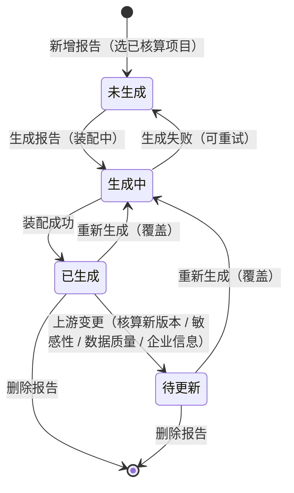

# 报告生成业务 PRD（报告管理 · 报告编制）

> **【模块归属声明 · 2026-10-14】**：报告生成（产品碳足迹报告）归属「**前台业务平台 · 报告管理**」分组，子项名为「**报告编制**」，与「企业信息维护 / 敏感性分析 / 数据质量评价」并列；菜单与路由 `/report/prepare`（原型 `App.tsx` `PLACEHOLDERS` 现为占位页）。本模块**不改变核算主链**——核算项目步骤①~④、报告管理其它子项均为**只读引用**。
>
> **【核心口径声明 · 本版最高优先，全文适用】**：本模块报告**零人工编辑（唯一例外 = 企业信息）**。报告正文的**每一个字符都来自两类来源**：① **前序环节数据自动装配**（核算项目 / 敏感性分析 / 数据质量评价 / 企业信息维护 / 产品主数据）；② **模板固定文案**（标准条款、说明性文字、评分依据）。报告正文**不提供任何输入框 / 富文本编辑 / 图片上传**；**企业信息（封面报告主体 / 基本信息表企业名称·地址 / 表 1 生产者信息）读取『企业信息维护』并允许编辑、缺失允许现场录入**（R-104 例外）。与旧版《06生成报告/报告生成业务PRD》的「封面可补充 + 说明性章节可编辑」口径**相反**，冲突处以本文为准。
>
> **【模板声明 · 2026-10-14】**：本模块报告版式依据业务提供的《**ZB13002 整竹砧板碳足迹评价报告.docx**》（口径：`ISO 14067:2018` / `GB/T 24067-2024` / `LY/T 3436-2025 竹木产品碳足迹评价指南`）转换为系统模板，结构见《报告模板定义（ZB13002 整竹砧板 V1）》。**旧模板（系统预置 V1 · 六章 GB/T 24067 结构）作废**。
>
> **【文档定位】**：报告生成模块的**业务规则真相源**，定义报告对象、生成准入、装配规则、状态机、动作矩阵、预览 / 下载口径、数据缺口依赖与验收标准。章节结构、变量、表格与数据映射见《报告模板定义（ZB13002 整竹砧板 V1）》，页面控件见《报告生成_Demo》（V0.1），字段表见《报告生成字段清单》（V0.1）。
>
> **上游依据**：`00碳核算项目_模块拆分与交互骨架.md`（V1.3 · 报告环节移出核算流程）、`05 检测核算与结果/碳足迹核算业务PRD.md`（V0.6 · 引擎内置口径 / 四口径）、`06报告管理/敏感性分析业务PRD.md`（V0.1）、`06报告管理/数据质量评价业务PRD.md`（V0.1）。

## 0. 文档基础信息

| 项目 | 内容 |
| :--- | :--- |
| 文档名称 | 报告生成业务 PRD（报告管理 · 报告编制） |
| 版本 | V0.3 |
| 状态 | 草稿（待业务确认） |
| 模块名称 | 报告管理 · 报告编制（报告生成） |
| 模块类型 | **独立业务单据 + 报告正文载体**（子对象：报告 / 报告正文章节 / 报告表格 / 报告图） |
| 维护形态 | 列表页（一行 = 一份报告）+ 详情页（报告信息卡 + 全篇只读预览 + 动作区）/ 报告预览控件 |
| 所属层级 | 前台业务平台 · 报告管理（对标竞品子项「报告编制」） |
| 字段真相源 | `02prd/02-2前台业务功能/06报告管理/06-3报告生成/报告生成字段清单.md`（V0.1） |
| 模板真相源 | `02prd/02-2前台业务功能/06报告管理/06-3报告生成/报告模板定义（ZB13002整竹砧板V1）.md` |
| 上游基线 | `01 碳核算项目/00碳核算项目_模块拆分与交互骨架.md`、`01 碳核算项目/05 检测核算与结果/碳足迹核算业务PRD.md`、`01 碳核算项目/01 项目列表与新建/核算项目字段清单.md` |
| 落地位置 | 文档：`04产品设计管理/02prd/02-2前台业务功能/06报告管理/06-3报告生成/`；原型：`src/pages/report/ReportListPage.tsx`（列表）+ `ReportDetailPage.tsx`（详情）+ `ReportPreview.tsx`（预览控件）（**待新建**） |
| 更新时间 | 2026-10-14 |

**变更记录**

| 日期 | 版本 | 变更内容 |
| :--- | :--- | :--- |
| 2026-10-14 | V0.1 | 初版：定义「报告 → 报告章节 → 报告表格 → 报告图」四对象、未生成/生成中/已生成/待更新状态机、**零人工编辑装配口径**、模板 `ZB13002` 章节与数据映射、预览 / 下载、R-101~R-124、验收 V01–V24 |
| 2026-10-14 | V0.2 | **业务裁定落地**：① 企业信息维护同批交付，企业信息**允许编辑 / 缺失可补录**（R-104 例外，移除生成准入中的企业信息阻断）；② 删除「干基含水率 / 含碳率 / 碳储量 / 净碳储量」字段（R-113）；③ 取消「分配原则」章节；④ 删除表 9「飞机运输排放」行；⑤ 封面「报告生成」取值 = `{产品名称}产品碳足迹报告` |
| 2026-10-14 | V0.3 | **裁定收敛**：Q1 报告编号**不正文打印**（仅系统内部标识）；Q7 本期**不加**核算项目步骤④「生成报告」入口（主入口 = 报告管理） |

**关联链接**

| 文档 | 路径 |
| :--- | :--- |
| 模块拆分与交互骨架（核算主链 / 报告环节移出） | `02prd/02-2前台业务功能/01 碳核算项目/00碳核算项目_模块拆分与交互骨架.md` |
| 碳足迹核算业务 PRD（引擎内置口径 / 四口径 / 结果版本） | `02prd/02-2前台业务功能/01 碳核算项目/05 检测核算与结果/碳足迹核算业务PRD.md` |
| 碳足迹核算字段清单（核算结果 / 结果明细字段） | `02prd/02-2前台业务功能/01 碳核算项目/05 检测核算与结果/碳足迹核算字段清单.md` |
| 核算项目字段清单（项目 / 产品 / 阶段数据项 / 因子快照） | `02prd/02-2前台业务功能/01 碳核算项目/01 项目列表与新建/核算项目字段清单.md` |
| 敏感性分析业务 PRD（报告「五、敏感性分析」数据源） | `02prd/02-2前台业务功能/06报告管理/敏感性分析业务PRD.md` |
| 数据质量评价业务 PRD（报告「六 + 附录」数据源） | `02prd/02-2前台业务功能/06报告管理/数据质量评价业务PRD.md` |
| 报告模板定义（ZB13002 V1 · 章节 / 变量 / 表格 / 映射） | `02prd/02-2前台业务功能/06报告管理/06-3报告生成/报告模板定义（ZB13002整竹砧板V1）.md` |
| 旧版报告生成 PRD（**已作废，仅历史参考**） | `02prd/02-2前台业务功能/01 碳核算项目/06生成报告/报告生成业务PRD.md` |

---

## 1. 需求概述

### 1.1 需求背景

核算主链产出的是**结构化的结果数据**（总量 / 四口径 / 阶段 / 数据项 / 明细），它可查询、可导出表格，但**不是一份可以对外披露的标准文件**。客户、采购方、第三方核查方要的是一份**版式固定、内容可追溯、依据标准声明**的产品碳足迹报告。

`ISO 14067:2018` / `GB/T 24067-2024` 要求量化结果以报告形式披露，且报告须包含：报告主体与产品信息、量化目的与方法、系统边界、清单结果、影响评价结果、敏感性分析、数据质量评价与结论。模板另参考 `LY/T 3436-2025 竹木产品碳足迹评价指南`（**本期报告不设碳储量 / 分配原则等未落字段**，见 §7）。

```text
核算项目（步骤④ 已核算，结果版本 v_n）
    ├── 项目 / 产品信息（名称 / 规格 / 单位 / 边界 / 统计时间 / 标准 / 图片 / 工艺流程）
    ├── 核算结果（unitEmission + 四口径 + 阶段汇总 + 数据项汇总 + 明细行）
    ├── 敏感性分析（报告管理 · 情景结果 + 变化率）
    ├── 数据质量评价（报告管理 · DQR 评分 + 覆盖范围）
    └── 企业信息（报告管理 · 企业信息维护：单位名称 / 信用代码 / 法定代表人 / 地址）
                ↓ 只读引用（不修改上游）
        报告（报告管理 · 报告编制）
            └── 按模板 `ZB13002` 装配 = 封面 + 基本信息表 + 目录 + 一~七章 + 附录
                ↓ 预览（只读） / 下载（docx）
```

**没有这一步，核算数据只是"内部表格"，无法形成可对外披露、可追溯、符合标准披露项的标准报告。**

### 1.2 需求目标

| # | 目标 | 可验证口径 |
| :-: | :--- | :--- |
| G1 | **一键生成报告** | 选一个「已核算」项目 →「生成报告」→ 无需任何填写，直接产出报告正文 |
| G2 | **全数据前序装配** | 报告每个字段均可定位到唯一上游来源（项目 / 产品 / 核算结果 / 敏感性 / 数据质量 / 企业信息），**无需人工录入**（**企业信息除外**，见 R-104） |
| G3 | **版式对标真实报告** | 章节、表格、图、结论句式与《ZB13002 报告.docx》一致（章节树见模板定义） |
| G4 | **可预览** | 详情页内嵌 / 弹窗全篇只读预览，按 A4 分页浏览 |
| G5 | **可下载** | 导出 `docx` 文件，文件名 `{产品名称}_产品碳足迹报告_{YYYYMMDD}.docx` |
| G6 | **上游变更可感知** | 上游（核算结果新版 / 敏感性 / 数据质量 / 企业信息）变化 → 报告转「待更新」，可一键重新生成（覆盖） |
| G7 | **口径一致** | 报告结果单位、阶段、口径与核算结果页面**完全一致**（不二次换算、不二次四舍五入后回算） |
| G8 | **概念不外露** | 报告页不出现公式 DSL、因子绑定、计算引擎、快照、异常编号 |

### 1.3 范围（In Scope / Out of Scope）

**In Scope（本期）**

| # | 范围 |
| :-: | :--- |
| 1 | 报告列表（查询 / 分页 / 右侧摘要） |
| 2 | 新增报告（选「已核算」核算项目 → 一键生成） |
| 3 | 报告自动装配（封面 + 基本信息表 + 目录 + 一~七章 + 附录，见模板定义） |
| 4 | 报告正文全篇只读预览（A4 分页） |
| 5 | 报告下载（docx） |
| 6 | 状态管理（未生成 / 生成中 / 已生成 / 待更新）与删除 |
| 7 | 重新生成（覆盖当前报告，同步最新上游数据） |
| 8 | 报告编号生成（系统内部标识） |

**Out of Scope（本期不做）**

| 不做项 | 归属 / 原因 |
| :--- | :--- |
| 报告正文人工编辑（封面补充 / 说明性章节 / 图片上传 / 富文本） | **本模块核心口径：零人工编辑**（**唯一例外：企业信息**，见 R-104）；其余内容全部由上游装配 |
| 报告多版本 / 历史版本切换 | 本期单一当前版本，重新生成覆盖（对齐敏感性 / 数据质量口径） |
| 后台报告模板配置（模板增删改 / 章节配置 / 变量编辑） | 后台管理，本期**系统预置 1 个模板**（`ZB13002 V1`） |
| 第三方核查工作流 / 电子签章 / 核查意见留痕 | 方案 §十 阶段三 |
| 报告 PDF 导出 / 自定义导出格式 | 本期输出 `docx` |
| 独立「问题清单 / 草稿报告」形态 | 存在未处置阻断项时**阻断生成**（见 R-103），不产出半成品 |
| 在线协同 / 批注 / 审批流 | 本期不做；生成与下载为单人动作 |
| 图 2 分布图**真实图表渲染** | 本期**占位**（如需渲染见 Q2） |

### 1.4 与上下游的边界

| 归属 | 模块 | 本文的角色 |
| :--- | :--- | :--- |
| 核算项目状态机 / 核算结果版本 | 核算项目业务 PRD / 碳足迹核算业务 PRD | 引用（准入 = 「已核算」）；不重复定义 |
| 核算结果字段（总量 / 四口径 / 阶段 / 数据项 / 明细） | 碳足迹核算字段清单 | 只读引用为报告「三 / 四」章数据源 |
| 项目 / 产品字段（名称 / 规格 / 单位 / 边界 / 统计时间 / 标准 / 图片 / 工艺流程） | 核算项目字段清单 / 产品信息字段清单 | 只读引用为报告封面 / 一 / 二章数据源 |
| 情景与变化率 | 报告管理 · 敏感性分析 | 报告「五、敏感性分析」只读引用（**无分析时该章输出「未开展」**，见 R-112） |
| DQR 评分 / 覆盖范围 | 报告管理 · 数据质量评价 | 报告「六 + 附录」只读引用（**无评价时该章输出「未开展」**，见 R-113） |
| 企业信息（名称 / 信用代码 / 法定代表人 / 地址 / 联系方式） | 报告管理 · **企业信息维护** | 与本模块**同批交付**；报告封面 / 基本信息表 / 表 1 引用，**允许编辑**，无记录 / 缺失时允许录入（R-104 例外） |
| 报告模板章节 / 变量 / 表格 / 映射 | 报告模板定义（ZB13002 V1） | 引用，不重复定义 |
| 页面控件与布局 | 《报告生成_Demo》 | 不写 |

---

## 2. 用户与使用场景

| 场景ID | 场景 | 类型 | 说明 |
| :--- | :--- | :--- | :--- |
| S01 | 首次生成报告 | **主流程** | 报告管理 → 报告编制 →「新增报告」→ 选「已核算」项目 → 系统自动装配 → 报告「已生成」 |
| S02 | 预览报告 | **主流程** | 详情页点「预览」→ 打开预览控件 → A4 分页全篇只读浏览 |
| S03 | 下载报告 | 支线 | 详情页点「下载」→ 导出 `docx` |
| S04 | 上游变更后重新生成 | 支线 | 核算项目出新结果版本 / 敏感性或数据质量更新 / 企业信息更新 → 报告「待更新」→「重新生成」覆盖 |
| S05 | 删除报告 | 支线 | 列表行「删除」→ 二次确认 → 报告移除（不影响核算项目与其它模块） |
| S06 | 只读回看 | 辅助 | 组织管理员 / 非创建人进入详情页，仅查看 / 下载，无生成 / 删除入口 |
| S07 | 企业信息缺失补录 | 边界 | 企业信息维护无该企业记录 → **不阻断生成**，报告相应位置显「待补录」→ 现场录入企业信息（R-104 例外） |

---

## 3. 功能清单

| 模块 | 功能点 | 功能描述 | 优先级 |
| :--- | :--- | :--- | :---: |
| 列表 | 查询 | 按 产品名称（模糊）/ 报告状态 / 生成时间（区间）查询 | P0 |
| | 列表展示 | 序号 / 产品名称 / 核算项目（链接）/ 报告状态 / 报告生成时间 / 操作 | P0 |
| | 右侧摘要 | 选中行的项目摘要（系统边界 / 声明单位 / 统计时间 / 核算结果）+「新增报告」主按钮 | P1 |
| 新增 | 新增报告 | 选「已核算」项目 → 生成准入校验 → 一键装配报告 | P0 |
| 报告正文 | 封面 + 基本信息表 | 自动装配（企业 / 产品 / 周期 / 边界 / 单位 / 标准 / 结论） | P0 |
| | 一、报告概括 | 量化目的 / 量化方法（模板固定文案） | P0 |
| | 二、报告主体基本情况 | 生产者信息（企业信息维护，**可编辑**）/ 产品信息 / 系统边界 / 取舍准则 / 局限性说明 | P0 |
| | 三、清单结果及计算 | 表 2~表 8（按二级阶段拆表） | P0 |
| | 四、碳足迹计算结果 | 表 9 细分指标 + 表 10 各阶段 + 图 2 分布图 | P0 |
| | 五、敏感性分析 | 表 11（引用敏感性分析结论） | P1 |
| | 六、数据质量评价 | 覆盖范围描述 + DQR 结果（引用数据质量评价） | P1 |
| | 七、结论 | 自动结论句式（热点阶段） | P0 |
| | 附录 数据质量评价 | DQR 说明 + 附表 12 评分依据（模板固定文案） | P1 |
| 动作 | 预览 | 预览控件全篇 A4 分页只读浏览 | P0 |
| | 下载 | 导出 `docx` | P0 |
| | 重新生成 | 覆盖当前报告，同步最新上游数据 | P0 |
| 状态 | 状态展示 | 未生成 / 生成中 / 已生成 / 待更新 | P0 |
| | 生成失败重试 | 生成异常回「未生成」+ 提示 | P1 |
| 只读 | 只读展示 | 非创建人 / 只读角色仅查看 / 下载 | P1 |

**不做**：正文编辑、报告多版本、模板后台配置、PDF 导出、真实图表渲染（图 2 占位）、审批流。

---

## 4. 核心业务规则

> 编号承接数据质量评价业务 PRD（R-083 ~ R-100），本模块从 **R-101** 起。编号体系与核算主链 `S-xxx` 交互规则相互独立。

| 规则ID | 规则 | 依据 |
| :--- | :--- | :--- |
| R-101 | **[创建准入]** 仅「**已核算**」的核算项目可作为报告数据来源；非已核算项目不出现在「新增报告」选择列表 | 核算 PRD R-042 / 骨架 §5.2 |
| R-102 | **[生成准入]** 生成报告须同时满足：① 项目「已核算」且存在核算结果版本；② 核算结果**无未处置阻断项**；③ 存在可用报告模板。任一不满足 →「生成报告」不可用并给出人话原因（见 §6.1）。**企业信息不作为准入阻断项**（允许引用或现场补录，见 R-104） | 方案 §5.5 |
| R-103 | **[阻断即不生成]** 存在未处置阻断项时不产出「草稿报告 / 问题清单」，**直接阻断生成**并提示先完成核算（区别于旧版 R-052 的草稿口径） | 本版核心口径 |
| R-104 | **[零人工编辑（企业信息例外）]** 报告正文**不提供任何编辑入口**（无输入框 / 富文本 / 图片上传 / 字段补充）；内容 = 上游数据装配 + 模板固定文案。**唯一例外 = 企业信息**：读取『企业信息维护』并**允许编辑**；无记录 / 字段缺失时允许**现场录入**（见 §7 G1） | 本版核心口径（业务裁定 2026-10-14） |
| R-105 | **[单一版本 / 重新生成覆盖]** 报告不设多版本；「重新生成」**直接覆盖**当前报告正文（含结论），不保留历史报告 | 对齐敏感性 / 数据质量口径 |
| R-106 | **[报告编号]** 系统内部标识按 `PCF-R-YYYYMMDDNNN` 生成（生成日 + 当日 3 位顺序号），全局唯一、只读；**默认不在报告正文打印**（模板无此要素，见 Q1） | 沿用旧规则 |
| R-107 | **[模板固定]** 本期仅系统预置 **1 个**模板（`ZB13002 V1`，`applicableBoundary = all`）；前台无模板切换，章节集合由模板固定 | 模板定义 §1 |
| R-108 | **[装配来源唯一]** 报告每个字段必须可追溯到唯一上游来源；缺来源时按「空值 / 未开展 / 待补录」规则呈现，**除企业信息外不允许用户补录** | 模板定义 §6 映射表 |
| R-109 | **[口径一致]** 报告结果值、单位、阶段划分、四口径取值与**核算结果页面完全一致**；单位取项目「声明 / 功能单位」，**不做强制换算**；数值按展示精度呈现，重算不用展示值回代 | 核算 PRD R-060 / §6 |
| R-110 | **[加载时快照]** 生成报告时对上游数据**取快照装配**，报告生成后不再随上游自动改写；上游变化按 R-114 转「待更新」 | 对齐敏感性 R-068 |
| R-111 | **[数据质量评价章留白]** 报告「六、数据质量评价」与「附录」：存在对应数据质量评价单时装配其结论；**不存在时该章输出「本项目未开展数据质量评价」**（不阻断生成） | 数据质量 PRD / 模板定义 §3.6 |
| R-112 | **[敏感性分析章留白]** 报告「五、敏感性分析」：存在对应敏感性分析单时装配其情景结果与变化率；**不存在时该章输出「本项目未开展敏感性分析」**（不阻断生成） | 敏感性 PRD / 模板定义 §3.5 |
| R-113 | **[无碳储量 / 无分配原则]** 本报告模板**不含**「干基含水率 / 含碳率 / 碳储量 / 净碳储量」字段与「分配原则」章节，报告**不装配**相关内容（业务裁定 2026-10-14，见 §7 G2/G3/G4） | 业务裁定（2026-10-14） |
| R-114 | **[上游变更即待更新]** 报告「已生成」后，上游发生以下任一变化 → 报告转「**待更新**」：① 核算项目产生新核算结果版本；② 关联敏感性分析结论更新；③ 关联数据质量评价结论更新；④ 企业信息更新。用户可「重新生成」同步 | 对齐敏感性 R-078 |
| R-115 | **[关联口径]** 报告与敏感性 / 数据质量的关联 = **同一核算项目**下**最近一次**的敏感性分析 / 数据质量评价；多个分析单时取最近更新的一份，并在报告附注标明来源分析单编号 | 敏感性 PRD §11.1 / 数据质量 PRD |
| R-116 | **[下载不受状态限制]** 「预览 / 下载」仅在报告「已生成」或「待更新」时可用；「待更新」态可下载（按原快照），报告页顶部提示结论可能失效 | 对齐敏感性 Q4 |
| R-117 | **[下载文件名]** `{产品名称}_产品碳足迹报告_{YYYYMMDD}.docx`（`YYYYMMDD` 取生成日） | 沿用旧规则 |
| R-118 | **[不污染主链]** 报告的生成 / 重新生成 / 删除**均不写回**核算项目与其它报告管理子项；删除报告不影响核算结果版本、敏感性分析、数据质量评价 | 骨架 §2 边界约束 |
| R-119 | **[权限]** 核算人员可创建 / 生成 / 重新生成 / 删除本组织报告；组织管理员只读；跨组织不可见 | 《角色可见范围 v1.0》§2.3 |
| R-120 | **[删除边界]** 删除报告需二次确认（「删除后不可恢复，不影响核算项目」） | 对齐骨架 S-006 |
| R-121 | **[生成失败]** 生成异常（装配报错 / 上游数据缺失导致无法渲染必备表格）→ 报告回「未生成」，提示「报告生成失败，请稍后重试」，不产出半成品 | 方案 §5.2 |
| R-122 | **[概念不外露]** 界面不出现公式 DSL、因子绑定、计算引擎、快照、异常编号；只呈现「产品碳足迹报告 / 章节 / 表格 / 结果 / 结论」人话口径 | 骨架 S-007 |
| R-123 | **[图 2 占位]** 图 2「各生命周期阶段碳排放分布图」本期渲染**占位区**（标注图题），真实图表后置（见 Q2） | 沿用旧裁定 |
| R-124 | **[模板作废]** 旧版《06生成报告/报告生成业务PRD》的「模板可选 / 章节装配可编辑 / 封面补充 / 确认完成锁定」口径**全部作废**，以本模块为准 | 本文声明 |

---

## 5. 状态与动作

### 5.1 报告状态流转



> **报告状态**（`reportGenerating / reportReady / reportStale`）为本模块内部口径；**不设「已完成 / 已归档」**（报告无确认锁定概念，对齐 V1.2 报告环节移除后的口径）。

### 5.2 报告状态 → 界面表现

| 报告状态 | 列表文案 | 详情页表现 | 可执行动作 |
| :--- | :--- | :--- | :--- |
| 未生成（`null`） | 未生成（灰点） | 空态「尚未生成报告」+ 生成入口 | 生成报告 / 删除 |
| `reportGenerating` | 生成中（蓝点） | 生成中 loading（约 1.2s） | 等待（失败可重试） |
| `reportReady` | 已生成（绿点） | 报告信息卡 + 全篇只读预览 + 动作区 | 预览 / 下载 / 重新生成 / 删除 |
| `reportStale` | 待更新（橙点） | 顶部提示条「上游数据已更新，报告结论可能失效」+ 原报告只读 | 预览 / 下载 / 重新生成 / 删除 |

> **列表排序**：默认按「报告生成时间」倒序。

### 5.3 动作能力矩阵

| 动作 | 未生成 | 生成中 | 已生成 | 待更新 | 只读角色 |
| :--- | :-: | :-: | :-: | :-: | :-: |
| 生成报告 | ✅ | ❌ | ❌ | ❌ | ❌ |
| 重新生成（覆盖） | ❌ | ❌ | ✅ | ✅ | ❌ |
| 预览 | ❌ | ❌ | ✅ | ✅ | ✅ |
| 下载 | ❌ | ❌ | ✅ | ✅ | ✅ |
| 删除报告 | ✅ | ❌ | ✅ | ✅ | ❌ |

> **红线**：不可用动作直接不展示，不渲染 disabled 假入口（对齐核算项目 PRD §6）。
> **无编辑动作**：矩阵中**不存在**任何「编辑正文 / 补充信息 / 保存」动作（R-104）。

---

## 6. 报告生成规则

### 6.1 生成准入清单

| # | 准入条件 | 不满足时的表现 |
| :-: | :--- | :--- |
| 1 | 项目状态 = 「已核算」，存在核算结果版本 | 「生成报告」不可用，提示「请先完成核算」 |
| 2 | 核算结果无未处置阻断项 | 「生成报告」不可用，提示「核算存在未处置问题，暂不可生成报告」（R-103） |
| 3 | 存在可用报告模板 | 「生成报告」不可用，提示「暂无可用报告模板」 |

> **企业信息不作为准入阻断项**：读取『企业信息维护』（允许编辑）；无记录 / 字段缺失时允许现场录入，报告相应位置先显「待补录」（R-104 例外）。

### 6.2 生成流程

```text
报告管理 → 报告编制 →「新增报告」
  ① 选择「已核算」核算项目（弹窗，仅列已核算项目）
  ② 生成准入校验（§6.1）→ 通过
  ③ 报告置「生成中」→ 装配：
       · 生成报告编号 PCF-R-YYYYMMDDNNN
       · 快照上游数据（项目 / 产品 / 核算结果 / 敏感性 / 数据质量 / 企业信息）
       · 按模板 `ZB13002 V1` 逐章装配（封面 + 基本信息表 + 目录 + 一~七章 + 附录）
       · 表格渲染：表 2~表 8 按二级阶段拆表；表 9 四口径；表 10 阶段汇总
       · 图 2 渲染占位
  ④ 装配成功 → 报告置「已生成」（reportReady）→ 详情页展开正文（只读）
```

### 6.3 章节装配规则（概要）

> 逐章明细、占位符、表格列定义与「docx 元素 → 系统字段」映射见《报告模板定义（ZB13002 整竹砧板 V1）》。

| 章节 | 装配方式 | 数据来源 |
| :--- | :--- | :--- |
| 封面 | 自动 | 产品 / 企业信息 / 报告日期（「报告生成」= `{产品名称}产品碳足迹报告`） |
| 产品碳足迹基本信息表 | 自动 | 企业信息 + 项目（周期 / 边界 / 单位 / 标准）+ 结论句式 |
| 目录 | 自动 | 按章节标题生成（Word 域） |
| 一、报告概括 | 固定文案 | 模板默认文案（量化目的 / 量化方法） |
| 二、报告主体基本情况 | 自动 + 固定文案 + **企业信息可编辑** | 企业信息（表 1）+ 产品（图 1 / 工艺流程）+ 项目（边界 / 阶段表）+ 固定文案（取舍准则 / 局限性） |
| 三、清单结果及计算 | 自动 | 核算结果明细 `details`（表 2~表 8） |
| 四、碳足迹计算结果 | 自动 | 四口径（表 9）+ 阶段汇总（表 10）+ 图 2（占位） |
| 五、敏感性分析 | 自动 / 留白 | 敏感性分析（表 11）；无则「未开展」 |
| 六、数据质量评价 | 自动 / 留白 | 数据质量评价（覆盖范围 + DQR）；无则「未开展」 |
| 七、结论 | 自动 | 结论句式（标准 / 主体 / 产品 / 阶段 / 热点） |
| 附录 数据质量评价 | 固定文案 + 自动 | 模板说明文案 + 数据质量评价（附表 12 评分依据） |

### 6.4 缺失来源的呈现规则

| 缺失项 | 呈现 |
| :--- | :--- |
| 敏感性分析单缺失 | 「五、敏感性分析」= 「本项目未开展敏感性分析」（R-112） |
| 数据质量评价单缺失 | 「六、数据质量评价」= 「本项目未开展数据质量评价」；附录仍输出评分依据说明（R-111） |
| 企业信息缺失 | 封面 / 基本信息表 / 表 1 对应位置显「待补录」并提供录入入口（R-104 例外） |
| 产品图片缺失 | 图 1 输出占位框「（未上传产品图片）」 |
| 某阶段无明细 | 该阶段表输出表头 + 空行提示「本阶段无核算数据」 |

---

## 7. 数据缺口与裁定结果

> 本节登记报告装配涉及、但当前系统无落点的数据项，及业务裁定（**2026-10-14**）。

| # | 数据项 | 报告位置 | 裁定结果 |
| :-: | :--- | :--- | :--- |
| G1 | 统一社会信用代码 / 企业地址 / 法定代表人 / 联系方式 | 封面 / 基本信息表 / 表 1 | **读取『企业信息维护』（与本模块同批交付），允许编辑；无记录或字段缺失时允许现场录入；不作为生成准入阻断项**（R-104 例外） |
| G2 | 干基含水率 / 含碳率 | — | **不纳入报告**（报告不含该字段） |
| G3 | 碳储量 / 净碳储量 | — | **不纳入报告**（基本信息表 / 三章 / 结论均不含） |
| G4 | 分配原则 | — | **取消该章节**（系统未做分配，报告不设「分配原则」） |
| G5 | 飞机运输排放 | 表 9 | **取消该行**（表 9 仅保留 总计 / 生物 / 土地利用 三项） |
| G6 | 封面「报告生成」取值 | 封面 | **取值 = `{产品名称}产品碳足迹报告`**（不显示平台名 / 版本） |

---

## 8. 预览与下载

| 项 | 规则 |
| :--- | :--- |
| 在线预览 | 弹窗（全屏遮罩 + 最大化弹窗），内部按 **A4 分页**纵向滚动，只读；工具条含页码 / 缩放 / 适应宽度 / 下载 / 关闭 |
| 预览内容 | 报告全篇（封面 + 基本信息表 + 目录 + 一~七章 + 附录），与下载 docx 内容一致 |
| 下载格式 | `docx`（原型：前端拼 HTML → `.docx` Blob 演示；正式：服务端生成） |
| 下载文件名 | `{产品名称}_产品碳足迹报告_{YYYYMMDD}.docx` |
| 下载权限 | 「已生成」「待更新」均可下载；「待更新」下载按原快照并附「待更新」说明 |
| 预览 / 下载前置 | 报告须「已生成」或「待更新」 |
| 只读 | 预览控件无任何编辑入口（R-104） |

---

## 9. 边界与异常处理

| 场景 | 系统行为 |
| :--- | :--- |
| 未核算即新增报告 | 选择列表不含该项目；无已核算项目时提示「暂无可生成报告的核算项目，请先完成核算」 |
| 存在未处置阻断项 | 「生成报告」不可用，提示先处置核算问题（R-103） |
| 企业信息缺失 | 不阻断生成；封面 / 表 1 对应位置显「待补录」并提供录入入口（读取『企业信息维护』，R-104 例外） |
| 无可用模板 | 「生成报告」不可用，提示「暂无可用报告模板」 |
| 生成中重复点击 | 按钮禁用，展示「生成中」，不重复提交 |
| 生成失败 | 报告回「未生成」，提示「报告生成失败，请稍后重试」，不产出半成品 |
| 已生成后上游出新核算版本 | 报告转「待更新」，顶部提示条；可重新生成覆盖 |
| 敏感性 / 数据质量单缺失 | 对应章节输出「未开展」，不阻断生成 |
| 分配原则 / 碳储量等字段 | 报告**不设**该章节 / 字段（业务裁定），不出现空章节 |
| 「待更新」态下载 | 允许，按原快照导出并标注「上游已更新，结论可能失效」 |
| 来源核算项目被删除 | 报告保留（快照），「核算项目」链接置灰标注「来源已删除」；可查看 / 下载 / 但不可重新生成 |
| 并发生成（他人同时操作同一报告） | 以最新保存为准；提交时若版本已变更提示「报告已被他人更新，请刷新后重试」 |
| 图 2 分布图 | 本期占位展示（标注图题），不做真实图表渲染（R-123） |

---

## 10. 待确认事项

| 编号 | 问题 | 影响 | 当前建议 | 状态 |
| :--- | :--- | :--- | :--- | :--- |
| Q1 | 报告编号是否需在正文打印？ | R-106 | **已裁定（2026-10-14）：不打印**，仅作系统内部标识 | 已裁定 |
| Q2 | 图 2 分布图本期是否真实渲染？ | §6.3 / R-123 | 沿用旧裁定**本期占位**，真实图表后置 | 待确认 |
| Q3 | ~~表 9「飞机运输排放」行~~ | §7 G5 | **已裁定（2026-10-14）：删除该行** | 已裁定 |
| Q4 | ~~「二（五）分配原则」~~ | §7 G4 | **已裁定（2026-10-14）：取消该章节** | 已裁定 |
| Q5 | 封面「报告生成」取值 | §7 G6 | **已裁定（2026-10-14）：`{产品名称}产品碳足迹报告`** | 已裁定 |
| Q6 | ~~碳储量 / 净碳储量~~ | §7 G2/G3 | **已裁定（2026-10-14）：不纳入报告** | 已裁定 |
| Q7 | 核算项目步骤④是否提供「生成报告」入口 | §1.3 | **已裁定（2026-10-14）：本期不加**；主入口 = 报告管理 · 报告编制 | 已裁定 |
| Q8 | 企业信息维护模块的建设时点 | §7 G1 | **已裁定（2026-10-14）：与本模块同批交付；企业信息允许编辑、缺失可补录** | 已裁定 |
| Q9 | 报告是否能被多个核算项目 / 多产品共用 | R-101 | 一份报告 = 一个核算项目；多产品报告不做 | 待确认 |
| Q10 | 图 1 产品图片是否支持多图 | §6.4 | 本期单图（取项目产品图片） | 待确认 |

---

## 11. 验收标准

| # | 验收项 | 输入条件 | 预期结果 |
| :-: | :--- | :--- | :--- |
| V01 | **创建准入** | 打开「新增报告」 | 仅列出「已核算」项目；无已核算项目时给出空态提示 |
| V02 | **企业信息读取 / 补录** | 企业信息维护无记录 | 生成**不阻断**；报告企业信息位置显「待补录」，可当场录入（R-104 例外） |
| V03 | **一键生成** | 选某已核算项目 →「生成报告」 | 无需任何填写，报告转「生成中」→「已生成」，生成报告编号 |
| V04 | **零编辑** | 走查详情页 / 预览控件 | 无任何输入框 / 编辑入口；正文全部只读（R-104） |
| V05 | **封面装配** | 查看报告封面 | 产品名称 / 规格 / 报告主体 / 日期已装配；「报告生成」= `{产品名称}产品碳足迹报告` |
| V06 | **基本信息表** | 查看基本信息表 | 企业 / 产品 / 周期 / 边界 / 生命周期边界 / 单位 / 标准依据均来自上游 |
| V07 | **结论句式** | 查看基本信息表结论 | 自动生成「全生命周期碳足迹 + 各阶段占比」句式，与核算结果一致（**不含碳储量**） |
| V08 | **一、报告概括** | 查看第一章 | 量化目的 / 量化方法为模板固定文案，含 ISO 14067 / GB/T 24067 等标准列表 |
| V09 | **生产者信息表 1** | 查看 表 1 | 单位名称 / 信用代码 / 法定代表人 / 联系方式 / 地址来自企业信息维护 |
| V10 | **产品信息** | 查看 二（二） | 产品基本信息（功能单位句）+ 图 1 产品图片 + 产品工艺流程均装配 |
| V11 | **系统边界** | 查看 二（三） | 边界说明文案 + 阶段包含表（√/×）与项目「系统边界 / 生命周期阶段」一致 |
| V12 | **清单表** | 查看 表 2~表 8 | 按二级阶段拆表；列 = 一级/二级过程名称 / 功能单位活动数据 / 次级数据来源说明 / 结果 |
| V13 | **不设碳储量 / 分配原则** | 走查基本信息表 / 二三章 / 结论 | 报告**不含**「干基含水率 / 含碳率 / 碳储量 / 净碳储量」与「分配原则」（R-113） |
| V14 | **细分指标表 9** | 查看 表 9 | 三项（总计 / 生物 / 土地利用）与核算结果口径一致（**无飞机运输行**） |
| V15 | **阶段表 10** | 查看 表 10 | 一级阶段 + 二级细项结果与百分比，合计 = 100%，与核算阶段汇总一致 |
| V16 | **图 2 占位** | 查看 四 | 展示分布图占位区并标注图题 |
| V17 | **敏感性章** | 存在 / 不存在敏感性分析单 | 存在时装配表 11；不存在时输出「未开展」 |
| V18 | **数据质量章 + 附录** | 存在 / 不存在数据质量评价单 | 存在时装配覆盖范围 + DQR；不存在时输出「未开展」；附录评分依据始终输出 |
| V19 | **预览** | 点「预览」 | 弹窗按 A4 分页全篇只读浏览，含页码 / 缩放 |
| V20 | **下载** | 点「下载」 | 导出 `docx`，文件名 `{产品名称}_产品碳足迹报告_{YYYYMMDD}.docx` |
| V21 | **待更新** | 上游出新核算版本 / 敏感性或数据质量更新 / 企业信息更新 | 报告转「待更新」，顶部提示条；可下载（原快照） |
| V22 | **重新生成覆盖** | 「待更新」态点「重新生成」 | 覆盖当前报告，同步最新上游数据，状态回「已生成」 |
| V23 | **不污染主链** | 生成 / 重新生成 / 删除报告后查看核算项目与其它子项 | 均无任何变化 |
| V24 | **概念不外露** | 走查列表 / 详情 / 预览 | 不出现公式 DSL、因子绑定、计算引擎、快照、异常编号 |

---

## 12. 附录

### 12.1 对象结构（概要）

> 完整字段表见《报告生成字段清单》（V0.1），本节仅给对象关系。

```text
报告（PcfFootprintReport） 1
   ├── 1 报告信息（ReportMeta）        ← 编号 / 状态 / 模板 / 生成时间 / 来源项目快照
   ├── N 报告章节（ReportSection）      ← 封面 / 基本信息表 / 目录 / 一~七章 / 附录
   │        ├── N 报告表格（ReportTable） ← 表 1~表 12
   │        └── N 报告图（ReportFigure）  ← 图 1 产品图片 / 图 2 分布图（占位）
   └── 1 装配快照（ReportSnapshot）      ← 生成时锁定的上游数据快照（项目 / 核算结果 / 敏感性 / 数据质量 / 企业信息）
```

### 12.2 报告对象字段（概要，非真相源）

| 字段 | 类型 | 来源 | 说明 |
| :--- | :--- | :--- | :--- |
| `id` | string | 系统 | 报告唯一标识 |
| `reportNo` | string | 系统 | `PCF-R-YYYYMMDDNNN`（内部标识） |
| `projectId` | string | 系统 | 来源核算项目 id |
| `productName` | string | 项目 | 冗余展示（列表 / 文件名） |
| `templateId` | string | 系统 | 本期固定 `RPT-PCF-ZB13002-001` |
| `status` | enum | 系统 | `reportGenerating / reportReady / reportStale` |
| `generatedAt` | string | 系统 | 报告生成时间 |
| `sourceCalcVersion` | number | 系统 | 引用核算结果版本号 |
| `sourceSensitivityId` | string | 系统 | 引用敏感性分析单 id（可空） |
| `sourceQualityId` | string | 系统 | 引用数据质量评价单 id（可空） |
| `snapshot` | object | 系统 | 装配快照（上游只读副本） |
| `sections` | `ReportSection[]` | 系统 | 报告章节集合 |
| `staleReason` | string | 系统 | 「待更新」原因（新核算版本 / 敏感性 / 数据质量 / 企业信息） |
| `previewUrl` / `downloadUrl` / `fileName` | string | 系统 | 预览 / 下载 |

### 12.3 术语表

| 术语 | 含义 |
| :--- | :--- |
| 报告（报告编制） | 报告管理模块产出物，按模板 `ZB13002 V1` 装配的产品碳足迹报告 |
| 装配 | 从上游只读取数 + 套用模板固定文案，生成报告正文的过程（无人工参与） |
| 快照 | 生成报告瞬间锁定的上游数据副本；上游后续变化不自动改写报告 |
| 待更新 | 上游数据变化后，报告结论可能失效的状态 |
| 企业信息 | 报告主体 / 生产者信息（名称 / 信用代码 / 法定代表人 / 地址 / 联系方式），维护于『企业信息维护』，报告引用且**允许编辑**（R-104 例外） |

### 12.4 下游文档影响清单

| 下游文档 | 受影响内容 |
| :--- | :--- |
| 《报告模板定义（ZB13002 整竹砧板 V1）》 | 章节 / 变量 / 表格 / docx→字段映射（本 PRD 配套，已产出） |
| 《报告生成字段清单》 | 报告 / 报告章节 / 报告表格 / 报告图对象与枚举（**已产出 V0.1**） |
| 《报告生成_Demo》 | 列表页、详情页、预览控件骨架、控件、校验展示、Mock 规格（**已产出 V0.1**） |
| 原型 `ReportListPage.tsx` / `ReportDetailPage.tsx` / `ReportPreview.tsx` | 替换 `/report/prepare` 占位页（`App.tsx` `PLACEHOLDERS` 移除 + 注册真实路由） |
| `menu.ts` | `/report/prepare` 保持报告管理子项（已存在） |
| 报告管理 · **企业信息维护** | **同批交付**：提供企业信息（名称 / 信用代码 / 法定代表人 / 地址 / 联系方式）维护页，供报告引用（可编辑、缺失可补录） |
| 核算项目 · 产品建模（步骤②） | **本期不涉及**（报告不含干基含水率 / 含碳率 / 碳储量，G2/G3 已裁定剔除） |
| 旧版 `06生成报告/*` | 相关口径作废，标注「报告管理承载」 |
