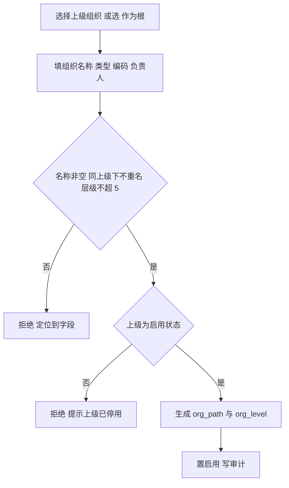
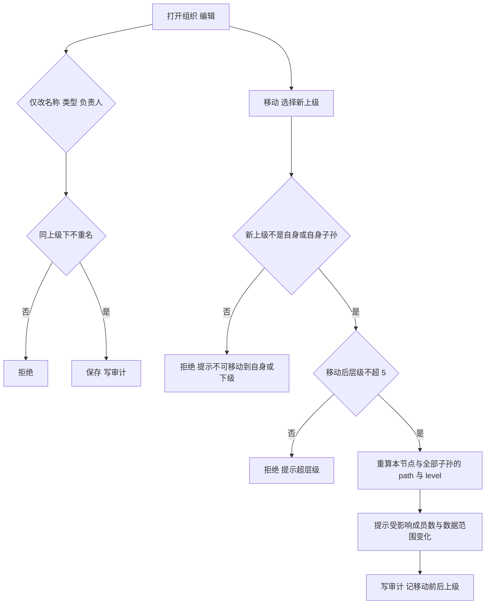
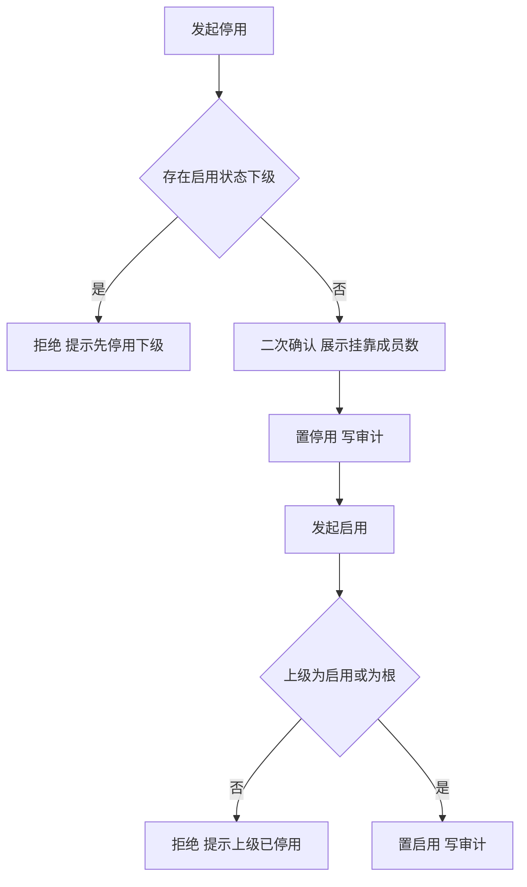
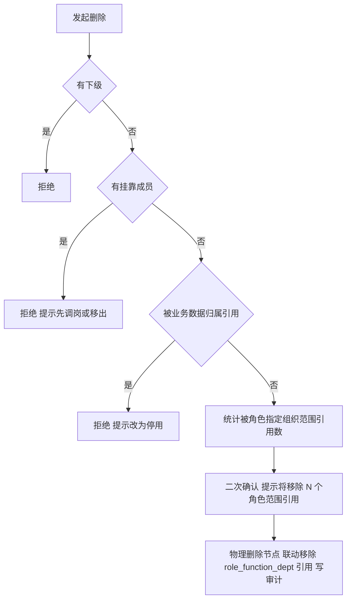
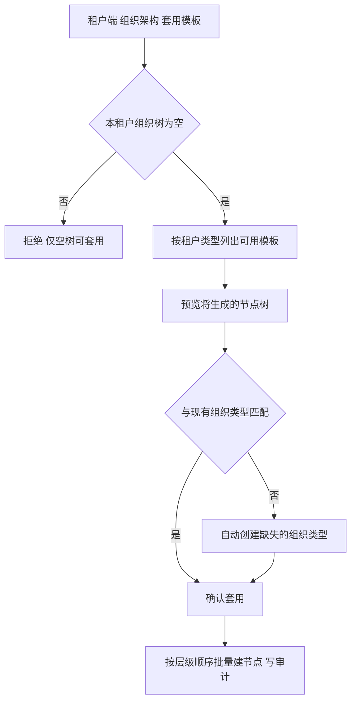
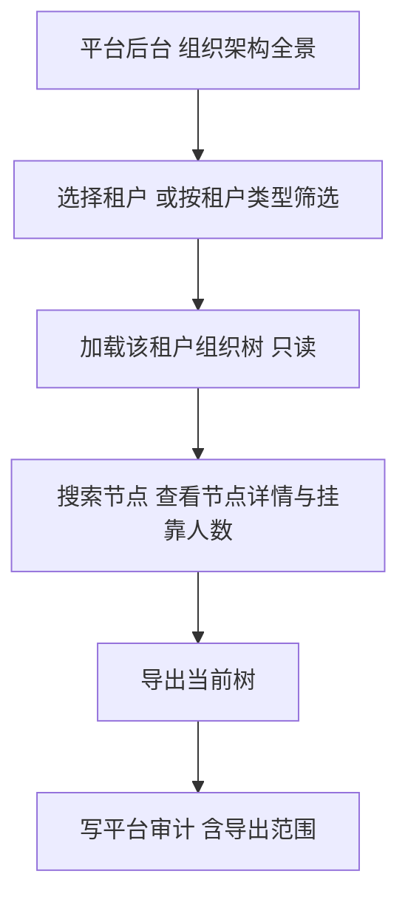
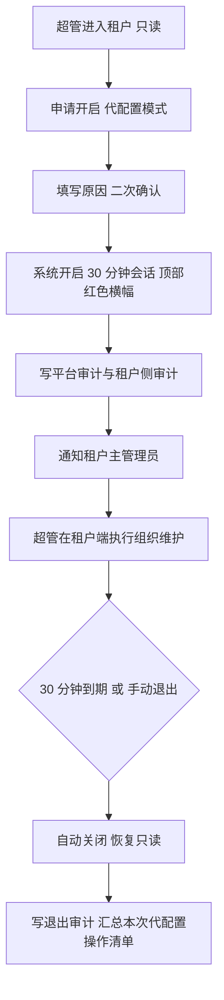

# 组织架构业务 PRD

## 0. 文档基础信息

| 项目 | 内容 |
| :--- | :--- |
| 文档名称 | 组织架构业务 PRD |
| 版本 | V0.2 |
| 状态 | 草稿 |
| 模块名称 | 组织架构 |
| 所属层级 | 租户端 → 组织架构（平台端保留只读全景、受控代配置两项能力；组织模板本期不做） |
| 依据 | 产品碳足迹核算工具-用户体系 PRD（精简版）v3.5.5 §3.2、§5.6；《产品碳足迹核算系统_整体设计方案》v1.3 §三；《租户管理业务 PRD》V0.6；《成员管理业务 PRD》V0.3 |
| 范围边界 | 只做组织树与组织类型字典；不涉及成员增删改、角色定义、数据范围计算（只提供组织维度供其引用）；成员、角色、业务数据只引用不重写 |
| 更新时间 | 2026-10-22 |

**变更记录**

| 日期 | 版本 | 变更内容 |
| :--- | :--- | :--- |
| 2026-10-22 | V0.2 | 组织模板本期不做（原型未实现，客户自建组织树即可）；平台侧能力收敛为只读全景 + 受控代配置两项；D09、D11 同步修订 |
| 2026-10-22 | V0.1 | 初版：组织架构统一放租户端，租户自建组织树；平台侧保留只读全景、组织模板、受控代配置三项能力；承接成员管理 T04、角色管理 D10、租户管理 module_code 的跨模块契约 |

**关联链接**

| 文档 | 路径 |
| :--- | :--- |
| 字段清单（字段唯一真相源） | `02prd/02-2前台业务功能/08组织架构/组织架构字段清单.md` |
| 租户管理业务 PRD（模块授权与配额，只引用） | `02prd/02-1后台管理/13租户管理/租户管理业务PRD.md` |
| 成员管理业务 PRD（成员挂靠组织，只引用） | `02prd/02-1后台管理/16 成员管理/成员管理业务PRD.md` |
| 角色管理业务 PRD（数据范围，只引用） | `02prd/02-1后台管理/14 角色管理/角色管理业务PRD.md` |
| 整体设计方案 v1.3 §三（组织模型与数据权限，只引用） | `00业务设计/产品碳足迹核算系统_整体设计方案_v1.2.md` |

---

## 1. 前置问题

### 1.1 为什么组织架构放在租户端

组织是**客户自己的管理结构**，平台无法预知客户按法人、工厂、车间还是委办局、科室来分层。平台代建必然错，且每次客户调整都要走工单。因此：

| 事项 | 归属 | 理由 |
| :--- | :--- | :--- |
| 组织树维护（增删改停用移动） | 租户端 · 组织管理员 | 客户自己的管理结构，变更频率由客户决定 |
| 组织类型字典 | 租户端 · 组织管理员 | 客户按自身层级命名（集团 / 工厂 / 车间 / 委办局 / 科室） |
| 组织树查看、导出 | 平台端 · 超管 | 排查、交付、跨租户核对需要，只读 |
| 组织模板 | 平台维护 + 租户套用 | 本期不做（原型未实现）；客户可直接手工搭建组织树 |
| 代配置写操作 | 平台端 · 超管（受控） | 仅客户明确求助时开启，限时、留痕、可追溯 |

### 1.2 「组织架构」与「部门」的关系

现状是同一份数据的两个名字：整体设计方案叫「组织」，用户体系 PRD §5.6 与成员管理字段清单叫「部门（dept）」。本 PRD 统一口径：

1. 对外菜单名与模块名统一叫**组织架构**，模块码 `org`（租户管理字段清单 V0.5 已由 `department` 更名）。
2. 组织节点与部门是**同一个实体**，不做两套表。
3. 成员表 `dept_id` 语义等于 `org_id`，本期**不改字段名**，只在文档层声明映射；后续统一更名由技术重构执行，不影响业务规则。
4. 用户体系 PRD §5.6 的六条部门规则全部继承并在 §5 展开，不重复定义。

### 1.3 与租户类型的关系

四类租户的组织形态差异明显，靠「类型字典 + 模板」表达，不写死层级：

| 租户类型 | 典型组织形态 | 建议预置组织类型 | 建议模板 |
| :--- | :--- | :--- | :--- |
| 企业 | 集团 → 子公司 → 工厂 → 车间 / 产线 | 集团、子公司、工厂、车间、部门 | 集团—工厂—车间（三层） |
| 政府单位 | 委办局 → 处室 → 科室 | 委办局、处室、科室 | 委办局—处室（两层） |
| 机构 | 总部 → 分支机构 → 业务部门 | 总部、分支机构、部门 | 总部—部门（两层） |
| 园区 | 园区 → 园中园 / 片区 → 企业 | 园区、片区、企业、部门 | 园区—片区（两层） |

### 1.4 平台侧能力的边界

平台**不做日常维护**，只保留三项能力，且三项都不改变「组织树归租户」这一原则：

| 能力 | 是否写数据 | 触发方式 | 约束 |
| :--- | :--- | :--- | :--- |
| 组织全景（只读） | 否 | 平台后台菜单直接进入 | 跨租户只读；导出留痕 |
| 组织模板管理 | 写模板，不写租户树 | 平台后台维护、租户端套用 | 本期不做（原型未实现） |
| 受控代配置 | 是 | 超管进入租户后显式开启「代配置模式」 | 原因必填、30 分钟自动退出、双写审计、通知主管理员 |

---

## 2. 需求描述

租户管理员在租户端维护本租户的组织树与组织类型，供成员挂靠、角色数据范围、业务数据归属使用；平台超管可跨租户只读查看组织全景，并在客户求助时以受控方式代配置（组织模板本期不做，客户直接手工搭建）。

---

## 3. 业务流程

### 3.1 新建组织

### 3.2 编辑与移动组织

### 3.3 停用与启用

### 3.4 删除组织

### 3.5 套用组织模板

### 3.6 平台侧只读全景

### 3.7 平台侧受控代配置

---

## 4. 功能清单

### 4.1 租户端

| 角色 | 系统 | 一级模块 | 二级模块 | 业务用例 | 操作功能 | 调整说明 |
| :--- | :--- | :--- | :--- | :--- | :--- | :--- |
| 租户管理员 / 组织管理员 | 租户端 | 组织架构 | — | 搭组织架构 | 查看组织树、新建、编辑、移动、停用、启用、删除 | 【新增】 |
| 租户管理员 / 组织管理员 | 租户端 | 组织架构 | — | 批量搭建 | 批量导入（下载模板、上传、查看结果） | 【新增】 |
| 租户管理员 / 组织管理员 | 租户端 | 组织架构 | 组织类型 | 定义层级含义 | 新建类型、编辑、排序、停用、启用 | 【新增】 |
| 租户管理员 / 组织管理员 | 租户端 | 组织架构 | — | 快速建树 | 套用组织模板、预览、确认套用 | 【新增；本期不做】 |
| 租户管理员 / 组织管理员 | 租户端 | 组织架构 | — | 查看归属 | 查看节点详情与挂靠成员数 | 【新增】 |
| 全部成员 | 租户端 | 组织架构 | — | 了解自己在哪 | 查看本人所属组织路径 | 【新增；只读，不占菜单】 |

> 菜单可见性由租户管理的模块授权 `org` 决定；未授权时菜单不渲染、接口拒绝。
> 组织管理员的角色定义与数据范围（本组织及下级）见角色管理 PRD，本文只引用。
> 「批量导入」仅支持新建节点，不支持批量改父级；父级列按「上级组织编码」匹配。

### 4.2 平台端

| 角色 | 系统 | 一级模块 | 二级模块 | 业务用例 | 操作功能 | 调整说明 |
| :--- | :--- | :--- | :--- | :--- | :--- | :--- |
| 平台超管 | 平台后台 | 组织架构全景 | — | 跨租户排查 | 选择租户、查看组织树、搜索节点、查看详情、导出 | 【新增；只读】 |
| 平台超管 | 平台后台 | 组织架构全景 | 组织模板 | 沉淀建树范式 | 新建模板、编辑节点、排序、停用、启用、预览 | 【新增；本期不做】 |
| 平台超管 | 平台后台 | 组织架构全景 | 代配置 | 客户求助时兜底 | 开启代配置、执行组织维护、退出代配置 | 【新增；受控】 |

> 平台端不提供「新建租户组织」的默认入口；代配置必须从「进入租户」流程内开启，不单设独立菜单（见 D09）。
> 平台端组织全景的导出仅含组织名称、类型、层级、成员数，不含成员个人信息。

### 4.3 边界说明

- 不做的：组织合并 / 拆分向导、多级汇总与合并报表、组织变更历史表、组织间数据迁移工具、跨租户组织共享（对齐整体设计方案 §3.5）。
- 不做的：组织级配额、组织级模块授权（授权只到租户）。
- 不做的：成员批量调岗（归成员管理的批量导入）。
- 组织节点数不设硬上限，单租户建议不超过 500 个节点，超出在导入时提示分批。

---

## 5. 业务规则

### 5.1 组织树与层级

1. 系统按租户隔离组织树，一个租户一棵树，`tenant_id` 贯穿全部节点。
2. 系统允许一个租户存在多个根节点（如「集团总部」与「独立法人 B」并列），根节点 `parent_id = 0`。
3. 系统限制节点层级上限为 5 层（继承用户体系 PRD §5.6-3），第 5 层节点不可再建下级。
4. 系统以 `org_path` 存储从根到本节点的 ID 路径（形如 `/12/45/78/`），用于「含下级」查询。
5. 系统以 `org_level` 存储本节点层级序号（根为 1）。
6. 系统在同一上级下要求组织名称不重复（含根节点之间）。
7. 系统要求组织编码在租户内唯一，编码可手填或由系统生成，创建后可改但须判重。
8. 系统按 `sort_no` 升序排列同级节点，同值时按创建时间升序。

### 5.2 新建组织

1. 操作人选择上级组织，或选择「作为根节点」。
2. 操作人填写组织名称。
3. 操作人选择组织类型。
4. 操作人选填组织编码，不填则系统生成。
5. 操作人选填负责人姓名与联系电话。
6. 系统校验名称非空、长度 1 至 100。
7. 系统校验同一上级下名称不重复。
8. 系统校验组织编码在租户内唯一。
9. 系统校验组织类型为本租户启用状态的组织类型。
10. 系统校验上级组织处于启用状态。
11. 系统校验新建后层级不超过 5 层。
12. 系统生成 `org_path` 与 `org_level`。
13. 系统置节点为启用状态。
14. 系统写审计，记上级、名称、类型。

### 5.3 编辑与移动组织

1. 操作人修改组织名称、组织类型、负责人、联系电话、排序号。
2. 系统校验名称非空且同上级下不重名（排除自身）。
3. 系统校验组织类型为本租户启用状态的组织类型。
4. 操作人可发起移动：为目标节点选择新上级。
5. 系统校验新上级不是目标节点自身。
6. 系统校验新上级不是目标节点的子孙节点。
7. 系统校验移动后目标节点及其子树的最大层级不超过 5 层。
8. 系统校验新上级处于启用状态。
9. 系统在移动成功后重算目标节点与全部子孙节点的 `org_path` 与 `org_level`。
10. 系统在移动前展示影响提示：受影响成员数、受影响角色数据范围数。
11. 系统不修改组织节点 ID，历史业务数据的 `owner_org_id` 不因移动而变。
12. 系统写审计，记移动前后上级与影响人数。

### 5.4 停用与启用

1. 操作人对启用状态组织发起停用。
2. 系统校验不存在启用状态的下级组织。
3. 系统二次确认并展示挂靠成员数。
4. 操作人确认后系统置该节点为停用。
5. 系统禁止向停用节点挂靠新成员。
6. 系统禁止在停用节点下新建下级。
7. 系统保持存量成员的组织归属不变，其数据范围按原树计算。
8. 操作人对停用状态组织发起启用。
9. 系统校验其上级为启用状态或该节点为根节点。
10. 系统置该节点为启用。
11. 系统写审计。

### 5.5 删除组织

1. 操作人对组织发起删除。
2. 系统校验该节点无下级组织。
3. 系统校验该节点无挂靠成员（含停用成员、含主管理员）。
4. 系统统计被角色「指定组织」数据范围引用的角色数，在二次确认弹窗中提示，确认后联动移除 `role_function_dept` 引用（对齐角色管理 D10），不阻断删除。
5. 系统校验该节点未被业务数据归属引用（核算项目核算主体、产品 / 工艺 / 工序 / 因子的归属组织、活动数据归属）。
6. 系统在下级、成员、业务引用任一校验不通过时阻断，并给出「改为停用」的替代指引。
7. 系统在全部校验通过后二次确认并物理删除节点，同时清除角色范围引用行。
8. 系统写审计，记删除节点的名称、类型、完整路径、被移除的角色范围引用数。

### 5.6 组织类型字典

1. 操作人在「组织类型」抽屉新建类型。
2. 操作人填写类型名称，选填类型编码与说明。
3. 系统校验类型名称在租户内不重复。
4. 系统校验类型编码在租户内唯一，不填则系统生成。
5. 系统预置一套默认类型供租户直接使用，预置类型可改名、可停用。
6. 系统允许停用类型：停用后不可用于新建组织，存量组织保留原类型并只读展示。
7. 系统禁止删除仍被组织节点引用的类型。
8. 系统写审计。

### 5.7 套用组织模板（本期不做）

> 原型未实现；客户可直接手工搭建组织树，无需平台模板。以下为设计留存，供后续评审。

1. 操作人在组织架构页点击「套用模板」。
2. 系统校验本租户组织树为空（无任何节点），非空时阻断并提示已手工搭建。
3. 系统按租户类型列出可用模板：类型专属模板在前、通用模板在后。
4. 操作人选择模板并预览将生成的节点树。
5. 系统校验模板节点引用的组织类型在本租户是否存在，缺失则自动创建同名类型。
6. 操作人确认后系统按层级顺序批量创建节点。
7. 系统对重名节点自动追加序号，不阻断套用。
8. 系统标记套用来源（模板 ID），便于后续排查。
9. 系统写审计，记模板名称与生成节点数。

### 5.8 批量导入

1. 操作人下载导入模板。
2. 操作人填写并上传文件。
3. 系统校验文件格式、列头、必填列。
4. 系统按「上级组织编码」解析父子关系，一次性校验重名、层级、类型有效性。
5. 系统逐行返回结果：成功 / 失败及原因。
6. 系统对校验通过的行整体入库，失败行不入库。
7. 系统提供结果文件下载。
8. 系统写审计，记导入文件名称与成功条数。

### 5.9 平台侧只读全景

1. 超管进入平台后台「组织架构全景」。
2. 系统按租户维度列出可查看租户，支持按名称与类型筛选。
3. 操作人选择租户后系统加载该租户完整组织树。
4. 系统在页面顶部常驻「只读视图」标识。
5. 系统支持按节点名称、编码、负责人搜索并定位节点。
6. 系统展示节点详情：名称、类型、层级、路径、上级、负责人、挂靠成员数、创建时间。
7. 系统支持导出当前树，导出内容不含成员个人信息。
8. 系统在每次查看与导出时写平台审计。

### 5.10 平台侧受控代配置

1. 超管须先通过租户管理的「进入租户」流程以只读方式进入目标租户。
2. 超管在只读态下点击「开启代配置模式」。
3. 系统要求填写代配置原因（不少于 10 字）。
4. 系统二次确认并提示「代配置期间的全部组织变更将以平台账号身份记录，并同步通知租户主管理员」。
5. 操作人确认后系统开启代配置会话，有效期 30 分钟。
6. 系统在页面顶部展示红色常驻横幅「代配置模式 · 剩余时长」。
7. 系统在代配置期间放开组织架构模块的写操作，其余模块仍只读。
8. 系统对每次写操作双写审计：平台审计 + 租户侧审计，均标记「代配置」。
9. 系统在开启时向租户主管理员发送站内通知，内容含操作人、原因、开始时间。
10. 系统在 30 分钟到期或超管手动退出时自动关闭，恢复只读。
11. 系统在关闭时写汇总审计，列出本次代配置的全部操作。
12. 系统禁止在代配置期间删除组织节点（删除仅限租户本人操作）。

### 5.11 与其他模块的契约

| 对端 | 契约 | 落点 |
| :--- | :--- | :--- |
| 租户管理 | 模块授权 `org` 决定菜单是否渲染；未授权时页面与接口均拒绝 | 租户管理字段清单 §4 |
| 成员管理 | 成员 `dept_id` 即 `org_id`，可空；为空表示未挂组织，数据范围按「仅本人」处理 | 成员管理业务 PRD §4 |
| 成员管理 | 组织停用后不可挂新成员，存量成员归属与数据范围不变 | §5.4 |
| 成员管理 | 组织删除前要求无挂靠成员，成员侧不提供「部门删除后自动清空 dept_id」的兜底 | §5.5 |
| 角色管理 | 数据范围「本组织及下级 / 本组织」按 `org_path` 实时计算，不使用快照 | §5.1 |
| 角色管理 | 数据范围「指定组织」引用 `org_id`；组织删除时由本模块联动移除 `role_function_dept` 引用并提示（对齐角色管理 D10），不阻断删除 | §5.5 |
| 业务数据 | 核算项目、产品、工艺、工序、因子记录 `owner_org_id`；活动数据、检测、报告继承项目归属 | 整体设计方案 §3.4 |
| 业务数据 | 业务数据额外冗余 `owner_org_path` 快照，组织移动后历史数据仍可按原路径追溯（见 D07） | D07 |
| 审计日志 | 组织增删改、移动、类型变更、模板套用、代配置全部写审计 | §5 |

### 5.12 通用

1. 系统按角色持有校验组织架构功能码。
2. 系统在无功能码时不渲染菜单并拒绝接口。
3. 系统不接收前端传入的 `tenant_id`，一律按当前会话租户取值。
4. 系统对所有写操作写审计。
5. 系统在目标节点已被他人变更（版本号不一致）时阻断本次操作。
6. 系统拒绝任何跨租户的组织节点读写。

---

## 6. 异常与拦截

| # | 场景 | 拦截环节 | 系统行为 |
| :--- | :--- | :--- | :--- |
| E01 | 组织名称为空 | 新建 / 编辑保存 | 阻断，提示名称必填 |
| E02 | 同一上级下组织名称重复 | 新建 / 编辑 / 移动保存 | 阻断，提示同级已存在同名组织 |
| E03 | 组织编码在租户内重复 | 新建 / 编辑保存 | 阻断，提示编码已存在 |
| E04 | 上级组织已停用 | 新建 / 移动提交 | 阻断，提示上级已停用 |
| E05 | 新建或移动后层级超过 5 层 | 新建 / 移动提交 | 阻断，提示层级上限 5 层 |
| E06 | 移动目标为自身 | 移动提交 | 阻断，提示不可移动到自身 |
| E07 | 移动目标为自身子孙节点 | 移动提交 | 阻断，提示不可移动到下级 |
| E08 | 停用时尚存在启用下级 | 停用提交 | 阻断，提示先停用下级组织 |
| E09 | 启用时上级为停用状态 | 启用提交 | 阻断，提示先启用上级 |
| E10 | 删除时存在下级 | 删除提交 | 阻断，提示先删除或移走下级 |
| E11 | 删除时存在挂靠成员 | 删除提交 | 阻断，提示先调岗或移出成员 |
| E12 | 删除时被角色指定组织范围引用 | 删除提交 | 允许执行，确认弹窗提示「将移除 N 个角色的组织范围引用」 |
| E13 | 删除时被业务数据归属引用 | 删除提交 | 阻断，提示改为停用 |
| E14 | 组织类型已停用仍被选用于新建 | 新建 / 编辑保存 | 阻断，提示类型已停用 |
| E15 | 删除仍被组织引用的组织类型 | 类型删除 | 阻断，提示该类型下存在组织 |
| E16 | 组织树非空时套用模板 | 套用模板提交 | 阻断，提示已存在组织节点 |
| E17 | 导入文件列头缺失或格式错误 | 批量导入上传 | 阻断，提示模板格式不符 |
| E18 | 导入行引用不存在的上级编码 | 批量导入校验 | 该行失败，返回「上级组织编码不存在」 |
| E19 | 无组织架构模块授权或功能码 | 进入菜单 / 接口调用 | 阻断，菜单不渲染、接口拒绝 |
| E20 | 代配置未从进入租户流程发起 | 开启代配置 | 阻断，提示须先只读进入租户 |
| E21 | 代配置原因少于 10 字 | 开启代配置 | 阻断，提示原因不少于 10 字 |
| E22 | 代配置会话已过期仍提交写操作 | 写操作提交 | 阻断，提示代配置已结束需重新开启 |
| E23 | 代配置期间尝试删除组织 | 删除提交 | 阻断，提示代配置不可删除组织 |
| E24 | 并发修改同节点 | 保存提交 | 阻断，提示数据已变更需刷新 |

---

## 7. 验收标准

### 7.1 组织树维护

| # | Given | When | Then |
| :--- | :--- | :--- | :--- |
| AC01 | 租户已授权组织架构模块 | 主管理员进入组织架构 | 可看到组织树，空树时展示「新建根组织 / 套用模板」引导 |
| AC02 | 已存在根组织「集团总部」 | 在其下新建「华东工厂」并选类型「工厂」 | 创建成功，层级为 2，path 为 `/根ID/新ID/` |
| AC03 | 同一上级下已有「华东工厂」 | 再次新建同名节点 | 阻断，提示同级已存在同名组织 |
| AC04 | 节点位于第 5 层 | 在其下新建下级 | 阻断，提示层级上限 5 层 |
| AC05 | 上级组织已停用 | 在其下新建节点 | 阻断，提示上级已停用 |
| AC06 | 组织树有 4 层 | 搜索某一层节点 | 返回该节点并展开其完整祖先路径 |

### 7.2 移动与停用

| # | Given | When | Then |
| :--- | :--- | :--- | :--- |
| AC07 | A 为 B 的上级 | 将 A 移动到 B 下 | 阻断，提示不可移动到下级 |
| AC08 | 「华东工厂」下有 2 个车间、30 名成员 | 将「华东工厂」移动到「华南子公司」下 | 移动成功，工厂与其 2 个车间的 level 各变化，提示「30 名成员的数据范围将变化」 |
| AC09 | 「华东工厂」下有 3 个车间 | 停用「华东工厂」 | 阻断，提示先停用下级 |
| AC10 | 「华东工厂」无下级但有 30 名成员 | 停用「华东工厂」 | 二次确认展示 30 人，确认后停用；成员归属不变 |
| AC11 | 组织已停用 | 向其挂靠新成员 | 阻断，提示组织已停用 |

### 7.3 删除保护

| # | Given | When | Then |
| :--- | :--- | :--- | :--- |
| AC12 | 组织有下级 | 删除 | 阻断，提示先删除或移走下级 |
| AC13 | 组织有 1 名停用成员 | 删除 | 阻断，提示先调岗或移出成员 |
| AC14 | 组织的 ID 被 2 个角色「指定组织」范围引用 | 删除 | 确认弹窗提示「2 个角色的组织范围引用将被移除」，确认后删除成功且引用行被清除 |
| AC15 | 组织被 1 个核算项目作为核算主体 | 删除 | 阻断，提示改为停用 |
| AC16 | 组织无下级、无成员、无引用 | 删除 | 二次确认后物理删除，审计记录完整路径 |

### 7.4 类型、模板与导入

| # | Given | When | Then |
| :--- | :--- | :--- | :--- |
| AC17 | 租户已有类型「工厂」 | 新建同名类型 | 阻断，提示类型名称重复 |
| AC18 | 类型「车间」下已有 2 个组织 | 删除该类型 | 阻断，提示该类型下存在组织 |
| AC19 | 租户组织树为空，类型为企业 | 套用「集团—工厂—车间」模板 | 生成 3 层节点，缺失类型自动创建，审计记模板名与节点数 |
| AC20 | 租户组织树非空 | 套用模板 | 阻断，提示已存在组织节点 |
| AC21 | 导入文件含 10 行，其中 1 行上级编码不存在 | 提交导入 | 9 行成功入库，1 行失败并返回原因，结果文件可下载 |

### 7.5 平台侧能力

| # | Given | When | Then |
| :--- | :--- | :--- | :--- |
| AC22 | 超管在平台后台 | 打开组织架构全景并选择租户 | 展示该租户完整组织树，顶部标「只读视图」，无任何编辑按钮 |
| AC23 | 只读全景页 | 导出当前树 | 导出成功，内容不含成员姓名与手机号，平台审计新增导出记录 |
| AC24 | 超管未进入租户 | 尝试开启代配置 | 阻断，提示须先只读进入租户 |
| AC25 | 超管已只读进入租户 | 填写 12 字原因并确认开启代配置 | 开启成功，红色横幅展示剩余时长，主管理员收到站内通知 |
| AC26 | 代配置已开启 | 新建 1 个组织节点 | 创建成功，平台审计与租户侧审计各 1 条且标记「代配置」 |
| AC27 | 代配置已开启 | 尝试删除组织 | 阻断，提示代配置不可删除组织 |
| AC28 | 代配置开启满 30 分钟 | 再次提交写操作 | 阻断，提示代配置已结束；横幅消失，恢复只读 |

---

## 8. 状态与操作矩阵

### 8.1 组织节点状态

| 状态 | 可编辑 | 可移动 | 可新建下级 | 可挂新成员 | 可停用 | 可启用 | 可删除 | 数据范围计算 |
| :---: | :---: | :---: | :---: | :---: | :---: | :---: | :---: | :---: |
| 启用 | 是 | 是 | 是 | 是 | 是 | 否 | 是（满足 §5.5） | 参与 |
| 停用 | 是 | 是 | 否 | 否 | 否 | 是 | 是（满足 §5.5） | 仍参与，存量不变 |

### 8.2 组织类型状态

| 状态 | 可否用于新建组织 | 存量组织展示 | 可编辑 | 可删除 |
| :---: | :---: | :---: | :---: | :---: |
| 启用 | 是 | 正常 | 是 | 否（被引用时） |
| 停用 | 否 | 原类型名只读展示 | 是 | 否（被引用时） |

### 8.3 平台侧视图

| 视图 | 可读 | 可写组织 | 可删除组织 | 有效期 |
| :---: | :---: | :---: | :---: | :--- |
| 组织全景 | 是 | 否 | 否 | 长期 |
| 进入租户（只读） | 是 | 否 | 否 | 会话内 |
| 代配置模式 | 是 | 是 | 否 | 30 分钟 |

---

## 9. 设计决策

| 编号 | 事项 | 决议 | 落点 |
| :--- | :--- | :--- | :--- |
| D01 | 组织维护归属 | 组织树与组织类型统一放租户端，由租户管理员 / 组织管理员维护；平台不做日常维护 | §1.1、§4.1 |
| D02 | 术语与模块码 | 对外统一「组织架构」，模块码 `org`；与用户体系 PRD 的「部门」是同一实体，不做两套表；成员表 `dept_id` 语义即 `org_id`，本期不改字段名 | §1.2、§5.11 |
| D03 | 层级上限 | 采用 5 层上限（继承用户体系 PRD §5.6-3），偏离整体设计方案 §3.1「层数不固定」；理由：与既有成员 / 角色实现一致，且超过 5 层的数据范围计算与界面可用性显著下降 | §5.1 |
| D04 | 多根节点 | 允许一个租户存在多个根节点（`parent_id = 0`），不用虚构 ROOT 节点；便于「集团总部」与「独立法人」并列 | §5.1、字段清单 §1 |
| D05 | 组织类型字典归属 | 字典归租户自维护（可改名、可停用、可新增），平台只给预置默认集；类型名称进入界面即客户自己的语言 | §5.6 |
| D06 | 移动后的数据影响 | 移动只改组织树结构与 path，不改任何业务数据的 `owner_org_id`；移动前展示受影响成员数与角色范围数 | §5.3 |
| D07 | 历史数据可追溯 | 不建组织变更历史表（对齐成员管理 D07）；业务数据冗余 `owner_org_path` 快照，组织移动后历史数据仍可按原路径解读 | §5.11、字段清单 §6 |
| D08 | 删除策略 | 组织只做物理删除；无下级、无成员、无业务引用三项阻断删除，角色「指定组织」引用不阻断，改为提示后联动移除（对齐角色管理 D10）；不设软删，避免树上出现幽灵节点 | §5.5 |
| D09 | 平台侧能力形态 | 平台保留两项：只读全景（独立菜单）、受控代配置（仅从进入租户流程内开启，不单设菜单）；组织模板本期不做 | §1.4、§4.2 |
| D10 | 代配置安全边界 | 30 分钟会话、原因不少于 10 字、双写审计、通知主管理员、禁止删除组织、到期自动恢复只读 | §5.10、§6 |
| D11 | 模板套用限制 | 本期不做；若后续实现，仅组织树为空时可套用，避免与手工搭建的树冲突；重名节点自动加序号不阻断 | §5.7 |
| D12 | 批量导入策略 | 逐行校验、整体入库（全成功行入、失败行不入），不做覆盖更新，避免误改父级 | §5.8 |
| D13 | 数据范围计算方式 | 「本组织 / 本组织及下级」按 `org_path` 实时计算，不用快照（继承用户体系 PRD §5.6-6）；组织移动后范围立即生效 | §5.11 |
| D14 | 组织编码 | 租户内唯一、可手填、系统生成兜底；编码用于导入与外部系统对接，不承诺全局唯一 | §5.1、§5.8 |
| D15 | 不做的能力 | 组织合并 / 拆分向导、多级汇总、跨租户共享、组织级授权与配额，均列入后置（对齐整体设计方案 §3.5） | §4.3 |

---

## 10. 待确认问题

| # | 事项 | 说明 |
| :--- | :--- | :--- |
| T01 | 层级上限 5 层是否够用 | 集团—事业部—子公司—工厂—车间恰好 5 层；若客户需再挂「产线」，需放宽到 6 层或允许「工厂」下扁平化。本期按 5 层，超限由客户调整结构 |
| T02 | 组织类型是否支持层级约束 | 当前类型只是标签，不约束「工厂下只能挂车间」。若需要强约束（如「集团下不可直接挂车间」），需在类型上加「允许下级类型」配置 |
| T03 | 组织负责人是否映射为成员 | 本期负责人只是文本字段，不联动成员与权限；若要做「负责人自动获得本组织及下级数据范围」，需在角色侧补规则 |
| T04 | 代配置是否需客户侧同意 | 本期为「通知主管理员」而非「审批」（D10）；若合规要求客户同意，需加「主管理员确认后生效」流程 |
| T05 | 组织树是否需要多版本 / 时点化 | 本期不做版本，业务数据靠 `owner_org_path` 快照追溯（D07）；若后续要做「按当时组织出报表」，需补组织时点表 |
| T06 | 成员 `dept_id` 是否本期更名 `org_id` | 本期只做语义映射不动字段（D02）；更名涉及成员、角色两张表与前端字段，建议随技术重构统一处理 |
| T07 | 单租户节点数上限 | 本期不设硬上限，导入超过 500 节点时提示分批；若客户为大型集团（数千节点），需评估树加载与 path 查询性能 |
