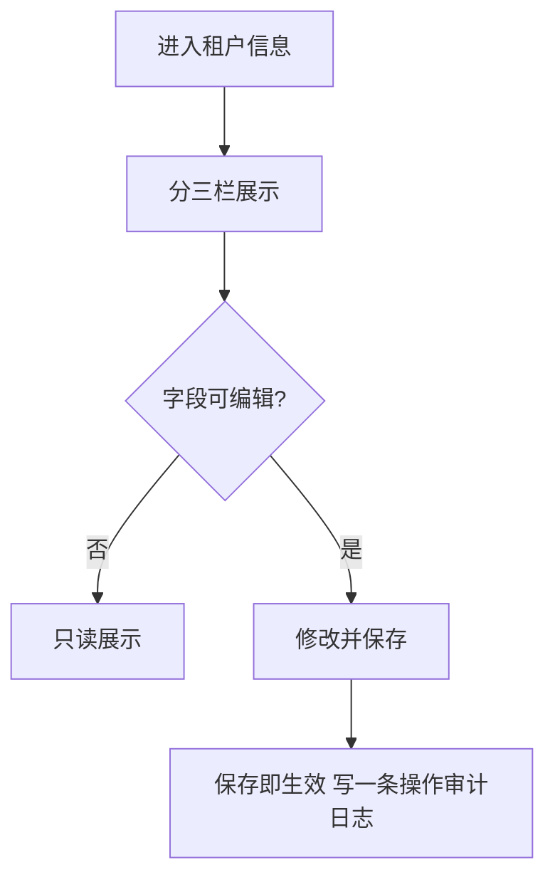
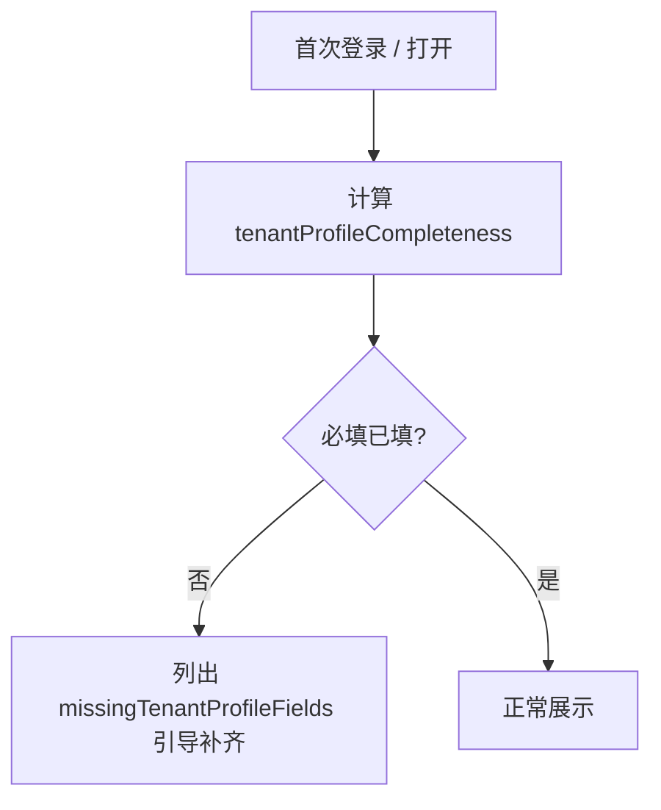

# 租户信息业务 PRD（前台·租户端）

## 0. 文档基础信息

| 项目 | 内容 |
| :--- | :--- |
| 文档名称 | 租户信息业务 PRD（前台·租户端） |
| 版本 | V0.2 |
| 状态 | 草稿（依原型补建） |
| 模块名称 | 租户信息 |
| 所属层级 | 租户端 → 系统管理 → 组织与权限 → 租户信息 |
| 依据 | 用户体系 PRD v3.5.1 §4；原型 `UnitInfoPage`（业务 PRD V0.10 §4.14，MVP 极简版）；《租户管理业务 PRD》《租户管理字段清单》《租户信息字段清单》 |
| 更新时间 | 2026-10-23 |

**变更记录**

| 日期 | 版本 | 变更内容 |
| :--- | :--- | :--- |
| 2026-10-23 | V0.2 | **对齐原型（取消复核流程）**：原型为「部分只读 + 部分自编辑」的 MVP 极简版——日常联络与业务属性由租户管理员直接编辑、**保存后立即生效，无待复核 / 平台审核环节**；原 V0.1「need_review 置待复核、平台审核后生效」口径作废；同步补全保存校验、租户停用整页只读、报告引用联动等原型规则（§4、§5） |
| 2026-10-23 | V0.1 | 依原型 `UnitInfoPage` 补建；与平台侧「租户管理」共用主数据与业务属性模板，本页面聚焦租户端本人可看 / 可改口径 |

**关联链接**

| 文档 | 路径 |
| :--- | :--- |
| 字段清单 | `02prd/02-2前台业务功能/09 租户信息/租户信息字段清单.md` |
| 租户管理业务 PRD | `02prd/02-1后台管理/13租户管理/租户管理业务PRD.md` |
| 租户管理字段清单 | `02prd/02-1后台管理/13租户管理/租户管理字段清单.md` |

---

## 0.2 原型对齐说明（2026-10-23，以原型为准）

> 原型 `UnitInfoPage`（业务 PRD V0.10 §4.14，MVP 极简版）对租户信息采用「**部分只读 + 部分自编辑**」：区块一「法定资质信息」纯只读（灰底），提示「如需修改请联系平台」；区块二「日常联络展示信息」与区块三「业务属性信息」由租户管理员直接编辑（白底），**共用一个【保存修改】按钮，保存后立即生效**，有实际变化时写一条租户侧操作审计日志。据此对原 V0.1 做以下口径修订：

1. **取消复核流程**：租户端保存不产生「待复核」状态，不存在平台审核（通过 / 驳回）环节；法定资质类字段的变更由平台在线下受理后代录（租户管理业务 PRD §4.16）。
2. **`need_review` 语义修正**：`need_review` 是扩展表单模板上「是否平台审核过的准入 / 监管依据」标记（仅 `editable_scope = platform` 的资质字段允许携带），不驱动租户端保存流程。
3. **补全保存规则**：区块二 + 区块三共用一个保存入口；只接受业务属性类字段（`tenant_editable = true`）与联络展示字段，法定资质类字段即使页面带出也不允许直写；保存后写一条操作审计日志（记变更字段前后值）。
4. **补全整页只读条件**：租户停用（`status = disabled`）时数据冻结，整页只读并提示「租户已停用，数据冻结：本页只读，恢复后可继续维护」。
5. **补全报告引用联动**：本页保存的字段如被报告引用，引用该字段的报告将标记为「待更新」。

详细字段见「租户信息字段清单 V0.2」。

---

## 1. 前置问题

### 1.1 租户信息管的是什么，与「租户管理」什么关系
**结论**：租户信息是**租户端自服务视图**，与平台侧「租户管理」读写同一份租户主数据与业务属性模板（key-value `profile`）。平台侧可读全量、可代编辑与审核；租户侧只看自己、只能改「可编辑」栏。

### 1.2 为什么分三栏
**结论**：按可改性分栏，资质类由平台 / 线下背书，联系与业务属性由租户自维护，降低误改资质风险。

| 栏 | 性质 | 租户端 |
| :--- | :--- | :--- |
| 法定资质信息 | 只读 | 不可改（变更走平台侧 / 线下受理代录） |
| 日常联络展示信息 | 可编辑 | 改联络人姓名、联络电话，保存后立即生效 |
| 业务属性信息 | 可编辑 | 改 `tenant_editable = true` 的业务属性，保存后立即生效 |

### 1.3 保存为什么没有审核环节
**结论**：MVP 极简版不做审批流，租户可编辑字段保存即生效；资质类字段本就只读，从源头规避高风险变更。

| 项 | 内容 |
| :--- | :--- |
| 修订 | 原 V0.1「需复核字段保存后进入待复核、平台侧审核后生效」口径作废（见 §0.2-1） |
| 替代兜底 | 法定资质类字段如需变更，提示「请联系平台」，由平台在线下受理后代录并留痕（租户管理业务 PRD §4.16） |
| 留痕 | 每次有实际变化的保存写一条租户侧操作审计日志，记变更字段前后值 |

---

## 2. 需求描述
租户登录后可在「系统管理 → 组织与权限 → 租户信息」查看并维护本租户信息：资质只读展示、日常联络与可编辑业务属性自助修改（保存后立即生效）、查看完整度并补齐必填项。档案未完善不阻断登录与业务，只在完整度条与首次登录引导中提示；租户停用时整页只读。

---

## 3. 业务流程

### 3.1 编辑可编辑字段

### 3.2 完整度引导

---

## 4. 业务规则

### 4.1 只读与可编辑
1. `tenant_editable = false`（法定资质类）字段纯只读（灰底），租户端不提供编辑入口，区块底部提示「法定资质信息由平台维护，如需修改请联系平台」。
2. 日常联络（联络人姓名 `contactName` / 联络电话 `contactPhone`）与 `tenant_editable = true` 的业务属性由租户管理员直接编辑（白底）。
3. 租户停用（`status = disabled`）时整页只读：顶部提示「租户已停用，数据冻结：本页只读，恢复后可继续维护」，保存 / 重置按钮隐藏。

### 4.2 保存
1. 区块二「日常联络展示信息」与区块三「业务属性信息」共用页面顶部一个【保存修改】按钮，无变化时按钮置灰（`dirty = false`）。
2. 只提交业务属性类字段与联络展示字段；法定资质类字段即使页面带出也不允许直写，服务端同样拒绝。
3. 保存后立即生效，并写一条租户侧操作审计日志，记变更字段前后值。
4. 提供【重置】：还原为上次保存的值，仅在有无保存修改时可点。
5. 本页保存的字段如被报告引用，引用该字段的报告标记为「待更新」。

### 4.3 校验
1. 联络人姓名与联络电话须成对填写（只填其一即阻断）。
2. 联络电话须为 11 位手机号。
3. 文本类业务属性受 `max_length` 约束；数字类须为合法数字。
4. 标 * 的必填项未填只在待完善清单提示，不阻断保存与业务。

### 4.4 完整度
1. 完整度 = 已填必填字段数 / 必填字段总数，口径只统计**租户可自编辑**的必填字段（法定资质类缺口由平台侧「档案待完善」呈现）。
2. 缺失必填项通过 `missingTenantProfileFields` 引导补齐；首次登录自动弹出引导（`TenantGuide`），本次会话「跳过」后不再自动弹出，可点「查看引导」再次打开。
3. 引导提供「去完善」与「跳过」两个出口：「去完善」滚动定位到首个缺失字段；跳过不标记为已完成。
4. 未完善不影响登录与业务使用。

### 4.5 通用
1. 操作人身份由服务端从会话取。
2. 业务属性以 key-value 存于 `profile`，字段定义来自 `PROFILE_FIELDS` 模板，按租户类型取不同字段集（与《租户管理字段清单》T14 同源）。
3. 资质栏同时展示租户主数据：租户编号、租户类型、租户状态、有效期（起止）、主管理员（姓名 + 手机号，未指定时展示「未指定」）。

---

## 5. 验收标准

| # | Given | When | Then |
| :--- | :--- | :--- | :--- |
| AC01 | 租户成员已登录 | 打开租户信息 | 资质栏只读，联络 / 业务属性栏可编辑 |
| AC02 | 修改联络或业务属性字段并保存 | 保存 | 立即生效，完整度更新，写一条操作审计日志 |
| AC03 | 无任何修改 | 查看【保存修改】按钮 | 置灰不可点；点【重置】无变化可还原 |
| AC04 | 首登且租户可编辑必填未填 | 打开 | 自动弹出引导，列出缺失必填项；「去完善」定位到首个缺失字段 |
| AC05 | 租户已停用 | 打开租户信息 | 整页只读，提示数据冻结，无保存 / 重置按钮 |
| AC06 | 法定资质类字段被尝试直写（接口） | 提交 | 拒绝并提示「如需修改请联系平台」 |
| AC07 | 联络电话格式错误或姓名电话只填其一 | 保存 | 阻断，提示成对填写 / 11 位手机号 |
