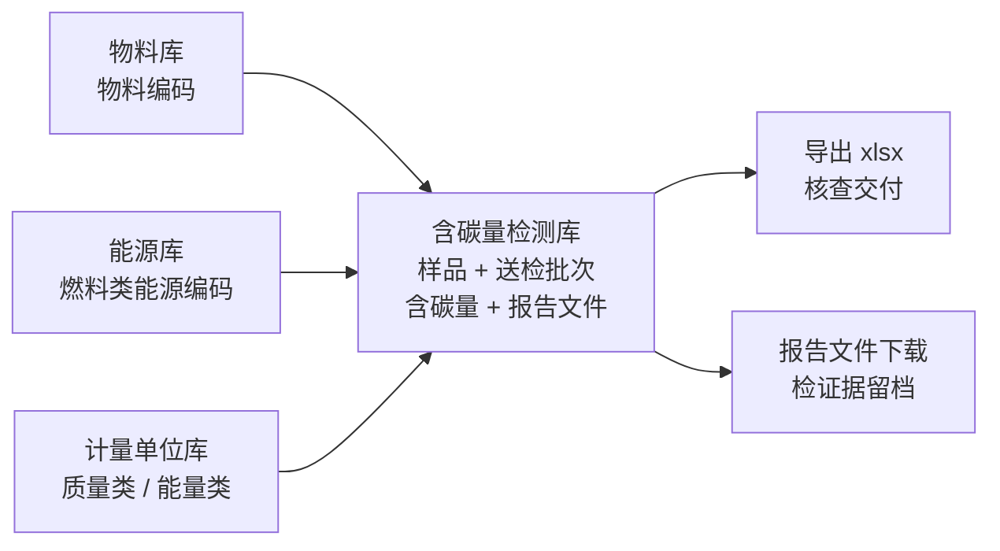

# 含碳量检测库业务 PRD

> **文档定位**：含碳量检测库的业务规则真相源。定义需求范围、使用场景、业务规则、状态与操作矩阵、边界异常。字段结构见《含碳量检测库字段清单》，页面呈现见《含碳量检测库_Demo PRD》。
> **版本**：V1.1（分批输出中，当前完成 §0～§2）
> **状态**：草稿
> **更新时间**：2026-10-26

---

## 0. 文档基础信息

### 0.1 文档属性

| 项目 | 内容 |
| :--- | :--- |
| 文档名称 | 含碳量检测库业务 PRD |
| 模块名称 | 含碳量检测库 |
| 模块类型 | 基础数据维护（轻量）—— 无审核流、无版本化、无操作日志 |
| 所属层级 | 后台管理 → 基础库 |
| 维护形态 | 列表 + 查看 / 新增 / 编辑弹窗；上架 / 下架走行操作，不进表单 |
| 字段真相源 | `10含碳监测库/含碳量检测库字段清单.md`（V1.1） |
| 上游依据 | `03业务分析/竹木_业务需求分析.md`（G-02 / BR-04 / BR-07 / CAL-07 / COM-03）、`02全局背景/项目需求边界.md` |
| 文档成熟度 | 草稿（待业务确认） |

### 0.2 变更记录

| 日期 | 版本 | 变更内容 |
| :--- | :--- | :--- |
| 2026-10-26 | V1.0 | 初版：§0 文档基础信息、§1 需求概述、§2 用户与使用场景 |
| 2026-10-26 | V1.1 | **撤回臆造的下游引用**：核实系统内无含碳率引用点（报告模板 R-113、ZB13002 V1.1、原型均无），删除「产品建模 / 碳固存计算 / 报告生成」三处下游链路与场景 S07；本期定位改为独立数据台账；角色改为不设只读档（2026-10-26 确认）；新增 Q18 记录 CAL-07 落地位置待定 | §1、§2 |

### 0.3 关联链接

| 文档 | 路径 |
| :--- | :--- |
| 字段清单（本文的字段 SST） | `04产品设计管理/02prd/02-2前台业务功能/10含碳监测库/含碳量检测库字段清单.md` |
| 物料字段清单（样品引用口径） | `02prd/02-1后台管理/01物料库/物料字段清单.md`（V0.5） |
| 能源字段清单（样品引用口径、热值字段） | `02prd/02-1后台管理/01物料库/能源字段清单.md` |
| 整体设计方案 v1.2（§4.2.1 / §6.5 生物碳） | `04产品设计管理/00业务设计/产品碳足迹核算系统_整体设计方案_v1.2.md` |
| 业务需求分析（CAL-07 实测覆盖口径） | `03业务分析/竹木_业务需求分析.md` |

### 0.4 文档分工

| 文档 | 管什么 | 不管什么 |
| :--- | :--- | :--- |
| 字段清单 | 字段名称、类型、必填、枚举、字段级校验 | 业务规则、页面控件 |
| **业务 PRD（本文）** | 需求范围、场景、业务规则（R-xxx）、状态与操作矩阵、边界异常 | 字段表、控件与布局 |
| Demo PRD | 页面骨架、控件选型、交互、校验展示、Mock | 业务规则正文（只引用 R-xxx） |

---

## 1. 需求概述

### 1.1 需求背景

竹木产品的生物碳含量按 `GB/T 44290-2024` 计算，标准给出的是含碳率**默认参考值**。企业实际采购的竹木原料因树种、产地、含水率差异，实测含碳率会偏离默认值。

`业务需求分析` CAL-07 要求「含碳率默认参考 GB/T 44290，实测值可覆盖」。本模块承载其中的**实测值与检证据**部分：把检测数据统一归档，解决报告散落在个人电脑与共享盘、核查时找不到原始凭证的问题。

**本期定位：独立的数据台账。** 当前系统内**不存在含碳率的下游引用点**——2026-10-14 业务裁定已从报告模板移除「干基含水率 / 含碳率 / 碳储量 / 净碳储量」（`报告生成业务PRD` R-113），`ZB13002` 模板同步删除「竹木产品碳储量计算」章节，前端原型亦无相关实现。因此本期只做数据的维护、追溯与导出，**不做系统内引用联动**；CAL-07 的「实测覆盖默认」落在核算侧，**落地位置待定**（见 §8 Q18）。

现状问题：

| 问题 | 后果 |
| :--- | :--- |
| 检测报告散落在个人电脑、邮件、共享盘 | 核查时无法定位原始凭证 |
| 含碳率靠手工录入核算表 | 无法追溯是哪份报告、哪个批次、哪个机构 |
| 同一物料多次送检无归档 | 无法比较不同批次，也无法选定采用哪一次 |

### 1.2 需求目标

| # | 目标 | 可验证口径 |
| :-: | :--- | :--- |
| G1 | 检测数据可统一维护 | 支持新增、编辑、查看、删除、导出、上架、下架七类操作，全部可用 |
| G2 | 检测数据可追溯 | 每条记录可定位到样品、送检批次、检测机构、检测报告文件 |
| G3 | 数据可用于对外交付 | 可按当前查询条件导出 xlsx；报告文件可下载 |
| G4 | 与主数据不重复建模 | 样品只引用物料编码 / 能源编码，不复制物料、能源属性 |
| G5 | 为后续引用预留结构 | 样品类型 + 编码 + 名称快照的模型已就位，未来核算侧接入无需改表结构 |

### 1.3 范围界定

**In Scope**

| 功能 | 说明 |
| :--- | :--- |
| 列表与查询 | 支持检测编码、样品类型、样品名称、送检批次、送检时间区间、检测机构、使用状态查询 |
| 新增 | 通过弹窗录入检测记录，含样品引用、检测结果、报告文件 |
| 编辑 | 修改检测结果与凭证；**样品不可更换** |
| 查看 | 弹窗查看全字段，报告文件可预览 / 下载 |
| 上架 / 下架 | 行操作，两态双向切换 |
| 删除 | **仅「已下架」可删**；物理删除，删除后释放「样品 + 送检批次」唯一键 |
| 导出 | 按当前查询条件导出 xlsx |

**Out of Scope**

| 不做的内容 | 原因 / 归属 |
| :--- | :--- |
| 检测业务流程（送检、采样、实验、报告出具） | 边界文档明确排除；本模块只做数据管理 |
| 同一样品 + 批次的复检 / 多次检测 | 唯一键已定为「样品 + 送检批次」；需重测请换送检批次 |
| 审核流、提交 / 驳回、版本化 | 基础库统一无审核流 |
| 操作日志 | 模块定性排除（导出留痕问题见 §8 Q15） |
| Excel 导入 | V1.0 不支持 |
| 批量删除 | 降低误删风险，仅提供单个删除（批量上/下架见 §8 Q11） |
| 灰分、挥发分等工业分析指标 | 本期只需含碳率、水分、低位发热量 |
| 检测机构主数据维护 | 本期为自由文本，机构库超出本模块范围 |
| 检测有效期 / 数据时效校验 | 放到核算侧，避免本库与核算耦合 |
| 排放因子相关字段 | 因子库职责，本库不承载 |
| 计算结果（绝干质量、碳储量）落地 | 本库只存参数，不计算结果 |
| **与核算 / 碳固存 / 报告的系统内引用联动** | 当前无承载点（报告模板 R-113 已移除相关字段，原型亦无实现）；本期只做台账，落地位置见 §8 Q18 |
| 检测数据变更后触发重算 / 报告待更新 | 无引用链路，不存在此联动 |

**与基础库既有口径的两处有意差异**

| # | 差异 | 说明 |
| :--- | :--- | :--- |
| 差异 1 | **保留导出** | `物料字段清单` V0.5（2026-10-13）已将基础库导出统一下线。本模块恢复导出，理由：检测数据是第三方核查的交付物，需要成批提供给核查方与企业内部留档；物料 / 能源是字典，导出价值低。**该差异需在评审时确认，或反向推动物料、能源库恢复导出** |
| 差异 2 | **状态用「上架 / 下架」** | 物料、能源、计量单位、工序统一用「启用 / 禁用」。本模块按已确认口径用「上架 / 下架」，语义等价（见 §8 Q10） |

### 1.4 涉及角色

| 角色 | 权限 |
| :--- | :--- |
| 有基础库维护权限的用户 | 新增、编辑、查看、上架 / 下架、删除、导出 |

> **不设只读档**（2026-10-26 确认）：所有有权进入本模块的用户同等可编辑，与 `物料字段清单` V0.4 口径一致。具体角色清单沿用后台管理模块的权限配置，本文不单独定义。

### 1.5 影响范围

| 方向 | 模块 | 影响 |
| :--- | :--- | :--- |
| 上游 | 物料库 | 样品引用源（物料编码）；物料被删除后检测记录需存活（名称快照） |
| 上游 | 能源库 | 样品引用源，仅「燃料」类可选；实测低位发热量不回写能源库热值 |
| 上游 | 计量单位库 | 送检重量（质量类）、低位发热量（能量类）单位来源 |
| 下游 | **暂无** | 系统内**不存在含碳率引用点**（见 §1.1）。导出与报告文件下载是唯一对外出口 |
| 无关 | 排放因子库 | 因子库管「能量 → 排放量」，本库只是含碳量台账，不交叉 |

### 1.6 业务链路

> 没有下游箭头：本期是独立台账，待 §8 Q18 裁定后再补引用链路。

---

## 2. 用户与使用场景

### S01 录入物料样品的检测记录

| 项 | 内容 |
| :--- | :--- |
| 触发条件 | 收到实验室出具的竹木原料 / 板材含碳量检测报告 |
| 操作流程 | 新增 → 样品类型选「物料」→ 选择物料编码（带出名称）→ 填送检批次、送检时间、检测机构 → 填含碳量、水分、送检重量并选单位 → 选检测方法标准（默认 `GB/T 44290-2024`）→ 上传报告文件 → 保存 |
| 预期结果 | 记录创建成功，使用状态默认「上架」；列表可按样品名称 / 送检批次查到；报告文件可预览与下载 |

### S02 录入能源（燃料）样品的检测记录

| 项 | 内容 |
| :--- | :--- |
| 触发条件 | 收到生物质燃料（竹屑、木屑等）的含碳量 / 热值检测报告 |
| 操作流程 | 新增 → 样品类型选「能源」→ 选择能源编码（**仅「燃料」类可见**）→ 填送检信息 → 填含碳量、送检重量 → 填实测低位发热量并选单位 → 上传报告 → 保存 |
| 预期结果 | 保存成功；「实测低位发热量」字段出现且必填；水分按选填处理；不回写能源库的「热值」 |

### S03 修正已保存的检测记录

| 项 | 内容 |
| :--- | :--- |
| 触发条件 | 录入时含碳量或送检批次填错；或报告更新为新版本 |
| 操作流程 | 列表 → 编辑 → 修改检测结果 / 送检信息 / 重传报告 → 保存 |
| 预期结果 | 修改成功；样品类型与样品为只读，不能更换；若改送检批次后与已有记录冲突，保存被阻断 |
| 边界 | 已下架记录仍可编辑；编辑不回写任何已导出文件或外部台账 |

### S04 上架 / 下架

| 项 | 内容 |
| :--- | :--- |
| 触发条件 | 报告被判定无效、样品已被替代、或误录需要停止对外提供 |
| 操作流程 | 列表 → 行操作「下架」→ 二次确认「确认下架」→ 状态变更 |
| 预期结果 | 状态变为「下架」，下游新建的阶段数据项无法再选用该记录；**已被引用的核算项目保留原值，不回溯**；可随时重新上架 |
| 边界 | 上架无前置条件；下架不受引用状态限制（对齐基础库口径） |

### S05 删除检测记录

| 项 | 内容 |
| :--- | :--- |
| 触发条件 | 误录且无保留价值 |
| 操作流程 | 列表 → 行操作「删除」→ 二次确认「确认删除」→ 记录移除 |
| 预期结果 | **仅「下架」状态展示删除入口**；上架状态不渲染删除按钮（非置灰）；删除为物理删除，删除后「样品 + 送检批次」唯一键释放，可用同键重建 |
| 边界 | 无引用链路，删除不产生下游悬空；二次确认后物理删除，不可恢复 |

### S06 导出检测数据

| 项 | 内容 |
| :--- | :--- |
| 触发条件 | 第三方核查需要检测数据清单；或企业内部留档 |
| 操作流程 | 设置查询条件 → 点「导出」→ 生成 xlsx 下载 |
| 预期结果 | 导出范围为**当前查询条件下的全部记录**（不受分页限制）；导出列 = 列表 11 列 + 报告编号 + 报告文件名；无数据时导出按钮不渲染 |
| 边界 | 超过导出上限（建议 10000 条）时提示缩小范围；导出不含报告文件本体，只含文件名 |

### S07 样品主数据变更或删除后的表现

| 项 | 内容 |
| :--- | :--- |
| 触发条件 | 物料 / 能源被改名、被禁用、被删除 |
| 操作流程 | 打开检测记录列表 / 详情 |
| 预期结果 | **改名**：检测记录显示录入时的名称快照，不随主数据变化；**禁用**：已关联的检测记录不受影响，仍可查看、编辑、上架 / 下架；**删除**：检测记录保留，列表在样品名称后标记「样品已删除」 |
| 边界 | 主数据删除不级联删除检测记录（检测记录是留档凭证） |

---

---

## 3. 功能清单

| 功能编号 | 功能名称 | 功能描述 | 优先级 |
| :--- | :--- | :--- | :---: |
| F01 | 列表与查询 | 按检测编码、样品类型、样品名称、送检批次、送检时间区间、检测机构、使用状态查询；列表展示 §4.1 的 11 列 | P0 |
| F02 | 新增检测记录 | 弹窗录入：选样品类型与样品 → 填送检信息 → 填检测结果 → 上传报告；保存后系统生成检测编码、默认上架 | P0 |
| F03 | 编辑检测记录 | 弹窗修改检测结果与凭证；检测编码、样品类型、样品编码、样品名称只读 | P0 |
| F04 | 查看检测记录 | 弹窗查看全字段；报告文件可预览 / 下载；制单信息固定置底 | P0 |
| F05 | 上架 / 下架 | 行操作，两态切换；下架需二次确认 | P0 |
| F06 | 删除 | 行操作，**仅「已下架」展示删除入口**；二次确认后物理删除，释放唯一键 | P0 |
| F07 | 导出 | 按当前查询条件导出 xlsx；无数据时按钮不渲染 | P0 |
| F08 | 报告文件管理 | 在查看 / 编辑弹窗内上传、预览、下载、替换报告文件 | P0 |
| F09 | 批量上架 / 下架 | 勾选后批量切换状态（见 §8 Q11，待确认） | P1 |

> 优先级定义：P0 = 本期交付；P1 = 待定，不阻塞本期。F01~F08 构成一期范围。

---

## 4. 业务规则

**R-001 检测编码唯一性与生成**
- 检测编码为全租户唯一业务标识，由系统生成，规则见 §8 Q02（建议 `JC + YYYYMMDD + 3 位流水`）
- 编辑态只读，不可修改

**R-002 样品 + 送检批次唯一**
- 同一「样品（编码）+ 送检批次」组合仅允许一条记录
- **下架记录仍占用该键**；删除（物理）后释放，允许用同键重建
- 编辑时若修改送检批次导致与已有记录冲突，保存前拦截并提示「该样品在该送检批次下已存在检测记录」

**R-003 样品类型联动字段显隐与必填**
- 样品类型 = **物料**：显示 含碳量(%)*、水分(%)*、送检重量*
- 样品类型 = **能源**：显示 含碳量(%)*、水分(%)(选填)、送检重量*、实测低位发热量* + 单位*
- 联动在新增 / 编辑弹窗实时生效；能源样品**不渲染**实测低位发热量（非置灰）

**R-004 电力、热力不可选为样品**
- 样品选择器仅展示「能源类型 = 燃料」的能源；电力、热力不出现在可选列表（无可测含碳率）

**R-005 送检重量单位必选且本模块自取**
- 送检重量单位为必填，从计量单位库**质量类**单位中选择
- 不从样品（物料 / 能源）带出，因物料、能源均不设默认单位

**R-006 报告文件必填**
- 每条检测记录必须上传 1 个报告文件（V1.0 限 1 个）
- 格式 `pdf / jpg / jpeg / png`，单文件 ≤ 20MB；保存前执行必填校验

**R-007 检测方法标准默认与可改范围**
- 默认值 `GB/T 44290-2024`（对齐 COM-03）
- 可选「其他」并补填标准编号（≤ 50 字）；是否收窄为单一标准见 §8 Q08

**R-008 上架 / 下架语义**
- 上架：记录可被业务使用（未来接入引用时，仅上架记录可选）
- 下架：停止对外提供；**下架不影响**记录的查看、编辑、导出与报告下载
- 两态双向可逆，无审核、无终态

**R-009 下架后已引用数据保留（本期无引用，规则预留）**
- 本期系统内不存在含碳率引用点（见 §1.1），故下架不产生引用影响
- 规则预留：若未来接入引用，下架记录不再被选入，已选用的历史结果不回溯

**R-010 删除权限与物理删除**
- 仅「已下架」状态展示删除入口；上架状态**不渲染**删除按钮（非置灰）
- 删除为物理删除，二次确认；删除后释放「样品 + 送检批次」唯一键

**R-011 样品主数据变更 / 删除的影响**
- **改名**：检测记录显示录入时名称快照，不随主数据变化
- **禁用**：已关联检测记录不受影响，仍可查看、编辑、上 / 下架
- **删除**：检测记录保留，列表在样品名称后标记「样品已删除」；主数据删除不级联删除检测记录

**R-012 并发编辑**
- 基础库轻量维护，不做乐观锁 / 行锁；同一记录被多人同时编辑时，后保存覆盖先保存
- 因无版本化、无审核流，覆盖不产生业务冲突（如需防误改可后置）

---

## 5. 使用状态与操作矩阵

### 5.1 状态 × 操作

| 操作 \ 状态 | 上架 | 下架 |
| :--- | :---: | :---: |
| 查看 | ✅ | ✅ |
| 编辑 | ✅ | ✅ |
| 上架 | —（当前已是） | ✅ |
| 下架 | ✅ | —（当前已是） |
| 删除 | ❌ | ✅ |
| 导出（按查询条件） | ✅ | ✅ |
| 报告文件预览 / 下载 | ✅ | ✅ |

> 「—」表示该状态下按钮无意义（已处目标态）；「❌」表示不可执行（上架不可删）。

### 5.2 角色 × 操作

| 操作 \ 角色 | 有基础库维护权限的用户 |
| :--- | :---: |
| 全部操作（F01~F08） | ✅ |

> 不设只读档（§1.4 已确认），不区分系统预置 / 组织自建。

---

> 下一批：§6 边界与异常、§7 接口约定（本期无接口）、§8 待确认、§9 验收标准、§10 附录。
