# 产品碳足迹核算系统 · 原型评审标注文档

| 项 | 内容 |
|---|---|
| 文档版本 | v1.1（单租户 + 强制改密） |
| 编制日期 | 2026-10-23 |
| 对应原型 | `06prototypes/6-1系统原型骨架`（Vite + React 18 + TS，前端 Mock） |
| 文档定位 | 原型评审现场使用的**讲解稿 + 口径对照表**：说明评审怎么看、看什么、按什么口径判断 |
| 编排原则 | 只写**跨模块、评审必问**的口径；单页字段级说明见页面内元素批注（"注"标记） |
| 依据 | 用户体系 PRD v3.5、《核算项目业务 PRD》V1.4、《数据检测业务 PRD》V0.5、《碳足迹核算与结果业务 PRD》V0.7、原型 `router/menu.ts` / `mock/*.ts` |

---

# 第一章 核心流程

## 1.1 账号登录业务流程（含首次登录强制改密）

### 1.1.1 流程图

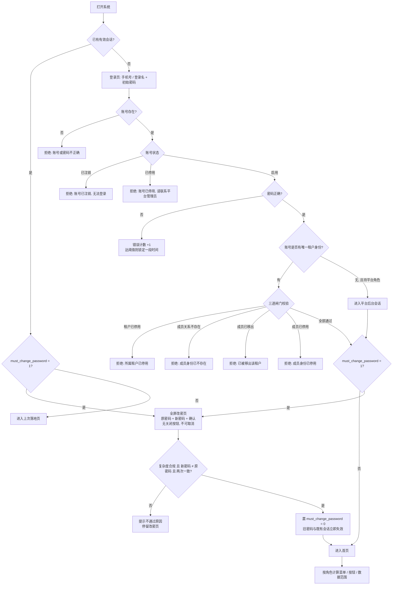

### 1.1.2 关键规则

| # | 规则 | 说明 |
|---|---|---|
| 1 | **单租户绑定** | 一个账号**只能绑定一个租户**；登录直接取该唯一租户，无「选租户」步骤、顶栏无切换入口；多人多租户后置 |
| 2 | **三道闸门** | 账号启用 → 成员关系启用 → 租户启用，任一不满足即拒绝；不允许"能登录但进不了任何租户"的中间态 |
| 3 | **登录标识** | 登录名或手机号均可；登录名不区分大小写，输入去空格、转全角为半角 |
| 4 | **错误提示统一** | 不区分"账号不存在"与"密码错误"，统一提示「账号或密码不正确」，避免账号探测 |
| 5 | **连续错误锁定** | 按系统参数，默认连错 5 次锁定 15 分钟 |
| 6 | **无自助找回** | 成员由租户管理员重置，主管理员由平台超管重置 |
| 7 | **强制改密触发（仅 3 类）** | ① 管理员新建账号；② 租户开户建主管理员；③ 管理员重置密码。三者均置 `must_change_password = true` |
| 8 | **强制改密例外** | 「已有账号直接绑定加入本租户」（如 A 企业调至 B 企业）沿用本人旧密码，**不触发**强制改密 |
| 9 | **拦截不可绕过** | `must_change_password = true` 时，除改密页外任何路由不可达（地址栏直达会被弹回），改密页无关闭 / 取消入口 |
| 10 | **改密结果** | 校验通过 → 置 `false`、旧密码与既有会话失效 → 自动进首页；未通过则停留改密页并提示原因 |
| 11 | **防呆：中途退出** | 改密页关闭浏览器 / 退出登录均不落库改密结果，标记仍在账号上，**下次登录继续拦截** |
| 12 | **防呆：新旧不同** | 新密码不得与原密码相同；复杂度 ≥ 8 位且含大写 / 小写 / 数字 / 特殊字符中的三类 |
| 13 | **平台账号无租户身份** | 只持平台角色、不占租户名额；如需处理租户事务走「进入租户」（只读 + 审计） |

### 1.1.3 原型与设计的差异（评审需知）

| 差异 | 原型现状 | 设计口径 |
|---|---|---|
| 密码校验 | 不校验，任意密码通过 | 服务端校验 + 连续错误锁定 |
| 强制改密 | **已实现**：`must_change_password` + `/change-password` 全屏拦截 | 同左 |
| 多租户 | **单租户**：账号只绑 1 个租户，顶栏不提供切换 | 多租户选择 / 切换后置 |
| 会话 | `sessionStorage`，关闭浏览器即失效 | 按会话有效期配置 |

## 1.2 账号业务流程

### 1.2.1 账号的两种形态（同一张账号表）

| 形态 | 判定 | 归属 | 维护入口 | 是否占租户名额 |
|---|---|---|---|---|
| **平台账号** | 持有 ≥ 1 个平台角色 | 平台 | `/system/account` | 否 |
| **租户成员账号** | 不持平台角色，仅有成员关系 | 租户 | `/system/member` | 是 |

> 登录名、手机号**全平台唯一**，两种形态共用一套唯一性校验。
> **单租户模式**：一个账号最多绑定 1 个租户（同一租户仅 1 条成员关系）；已有其他租户有效成员关系的账号，不能再被指定为另一租户的主管理员。

### 1.2.2 平台账号流程

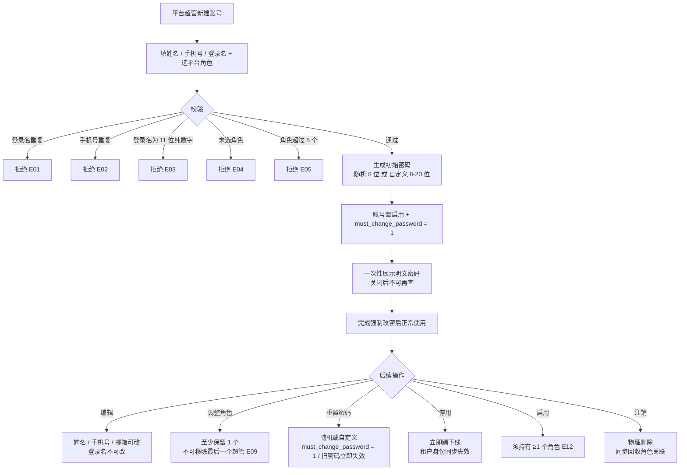

### 1.2.3 账号状态机

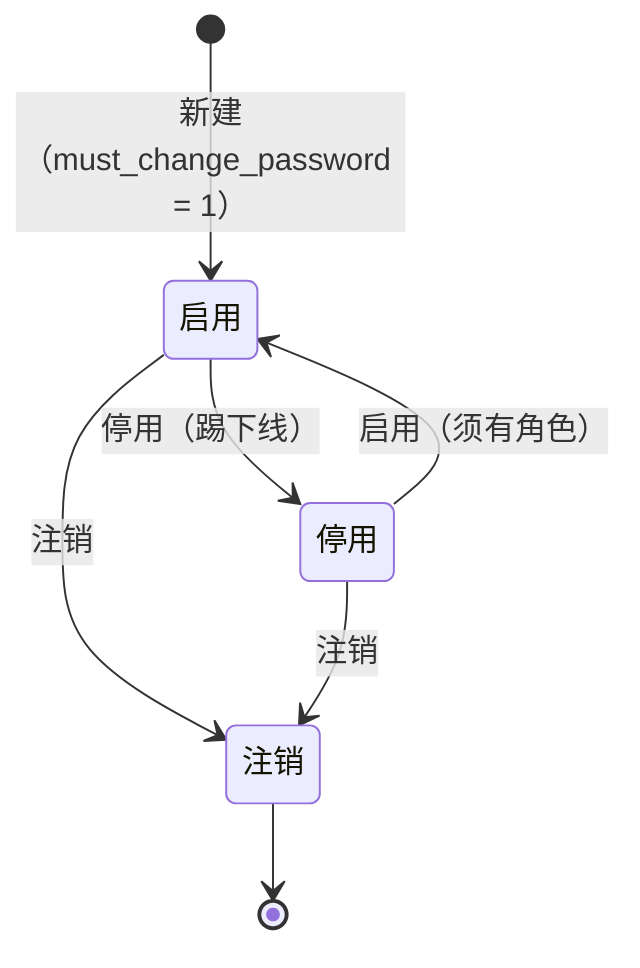

| 状态 | 能否登录 | 数据 | 约束 |
|---|---|---|---|
| 启用 | 是 | 保留 | 不可停用自己；不可停用 / 注销最后一个启用超管 |
| 停用 | 否 | 全部保留 | 恢复后不自动恢复此前单独停用的成员 |
| 注销 | 否 | 账号记录删除，业务数据保留（责任人可追溯） | 同"最后一个超管"保护 |

### 1.2.4 校验规则与错误码

| 码 | 规则 | 提示 |
|---|---|---|
| E01 | 登录名全局唯一（归一化后判重） | 登录名已存在 |
| E02 | 手机号全局唯一 | 手机号已存在 |
| E03 | 登录名不得为 11 位纯数字 | 与手机号登录冲突 |
| E04 | 至少分配 1 个平台角色 | 建号必须带角色 |
| E05 | 平台角色最多 5 个 | 一人多角色有上限 |
| E06 | 不可对自己执行停用 / 注销 | 防自锁 |
| E07 / E08 | 至少保留 1 个启用状态的超管 | 防系统失控 |
| E09 | 不可移除最后一个超管的超管角色 | 同上 |
| E10 | 不可重置自己的密码 | 走他人重置或恢复流程 |
| E12 | 启用前必须有角色 | 避免 0 角色空菜单 |

### 1.2.5 密码与强制改密（`must_change_password`）

**底层标识**：账号表字段 `must_change_password`（布尔），是"是否允许进入系统"的唯一判据，与角色、租户均无关。

**触发条件（仅这三类会置 1）**

| # | 触发场景 | 置位 | 说明 |
|---|---|:--:|---|
| 1 | 管理员给新成员创建账号 | `1` | 平台账号、租户成员、租户开户主管理员均适用 |
| 2 | 管理员给成员重置密码 | `1` | 超管重置 / 租户管理员重置，均适用 |
| 3 | 已有账号直接绑定加入新租户 | **不置位** | 沿用本人旧密码（如 A 企业调至 B 企业），不打断使用 |

**密码生成口径**

| 场景 | 密码生成 | 是否强制改密 |
|---|---|:--:|
| 新建平台账号（随机） | 8 位，含大写 / 小写 / 数字各至少 1 位 | 是 |
| 新建平台账号（自定义） | 8–20 位，须同时含字母与数字 | 是 |
| 重置密码（随机） | 12 位，含大写 / 小写 / 数字 / 特殊字符 | 是 |
| 重置密码（自定义） | ≥ 8 位，含大写 / 小写 / 数字 / 特殊字符中的三类 | 是 |
| 租户开户建主管理员 | 同"新建平台账号" | 是 |
| 租户成员新建 / 重置 | 同上 | 是 |

**改密交互（`/change-password`）**

1. 用户输入手机号 / 登录名 + 初始密码，点击登录；
2. 后端校验密码正确，但读到 `must_change_password = 1`；
3. **不让进入首页**，直接跳转全屏改密页——无关闭按钮、不可取消；
4. 页面提示「为了您的账号安全，首次登录 / 重置密码后请修改初始密码。」；
5. 输入原密码、新密码、确认新密码 → 保存；
6. 校验通过 → 置 `must_change_password = 0`、旧密码与会话失效 → 自动跳转系统首页。

**防呆规则**

| # | 场景 | 系统行为 |
|---|---|---|
| 1 | 改密中途关闭浏览器 / 退出登录 | 改密未完成即不落库，标记仍在；**下次登录继续拦截** |
| 2 | 新密码与初始密码相同 | 前端 / 后端均拒绝，提示「新密码不能与原密码相同」 |
| 3 | 复杂度不足 | 拒绝并提示具体缺失项（长度 / 字符类别） |
| 4 | 两次输入不一致 | 拒绝，停留改密页 |
| 5 | 手动输入业务页面地址 | 命中路由守卫，弹回改密页 |

> 明文密码**仅展示一次**，关闭弹窗后不可再查；重置须填原因并写审计。改密成功写「修改密码」操作记录。

### 1.2.6 账号与租户的联动（单租户）

| 动作 | 对租户侧的影响 |
|---|---|
| 账号停用 | 账号级闸门先于成员级，该账号**立即无法登录**（单租户下即唯一租户入口失效） |
| 账号注销 | 同上，且不再出现在角色成员页签 |
| 手机号 / 姓名修改 | 账号级字段全局生效，成员投影同步 |
| 移除成员 | 该账号失去唯一租户身份；如仍持平台角色，只能进平台后台 |
| 绑定租户 | 一个账号只能绑 1 个租户；已绑其他租户的账号，指定为主管理员时直接拒绝 |

---

# 第二章 租户业务流程

## 2.1 开户流程

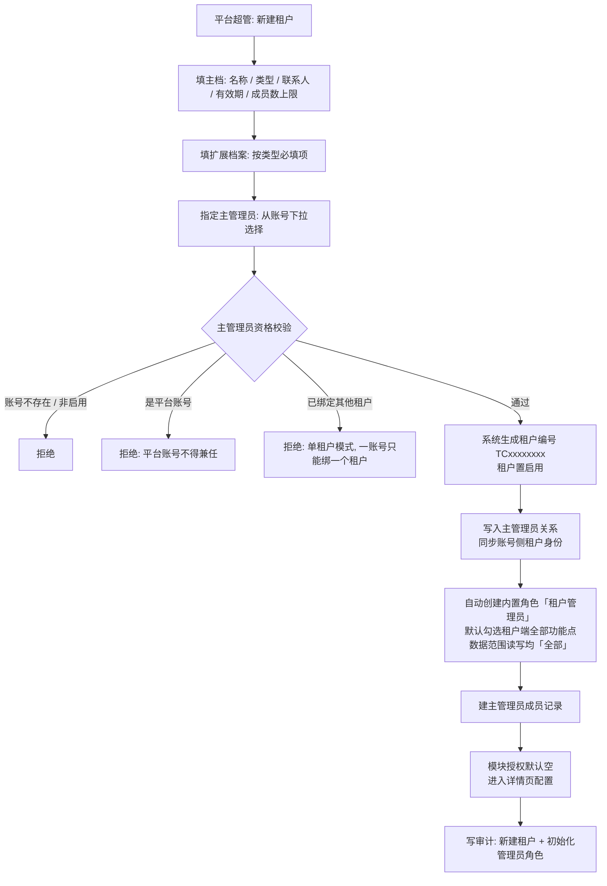

### 2.1.1 开户字段与校验

| 字段 | 必填 | 校验 |
|---|---|---|
| 租户名称 | 是 | ≤ 100 字符 |
| 租户类型 | 是 | 企业 / 政府单位 / 机构 / 园区；**创建后不可改** |
| 统一社会信用代码 | 企业必填 | 18 位大写字母与数字；全平台唯一 |
| 联系人 / 手机号 | 否 | 两者须同时填；手机号 11 位 |
| 有效期 | 否 | 结束不得早于开始 |
| 成员数上限 | 是 | 1–1000，默认 1000；下调不强制移出，只禁新增 |
| 主管理员 | 是 | 见上图形校验 |

### 2.1.2 租户类型与扩展档案

| 类型 | 平台必填扩展字段（示例） |
|---|---|
| 企业 | 统一社会信用代码、注册资本、所属行业、详细地址 |
| 政府单位 | 机关编码、行政级别、上级主管单位、编制人数 |
| 机构 | 资质证书编号、发证机关、资质有效期 |
| 园区 | 园区面积、楼宇数量、入驻企业数、地理位置区划、行政归属区划 |

> 扩展档案字段分三档：`platform`（仅平台可维护）/ `both`（平台与租户均可）/ `tenant`（租户补录）。租户端「租户信息」只开放 `tenant` 与部分 `both` 字段，法定资质类只读。

## 2.2 模块授权

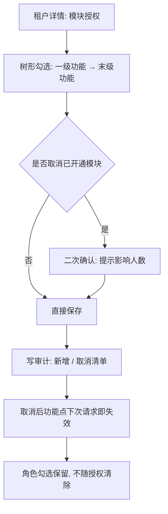

| 规则 | 说明 |
|---|---|
| 授权粒度 | 只授到**末级功能**（有路由的页面），不到按钮 |
| 授权范围 | 只出现「适用端 = 租户端」的功能，平台侧功能（基础库 / 平台账号 / 菜单）不出现 |
| 与角色的关系 | 有效功能 = **已开通模块 ∩ 角色勾选功能点**；授权取消后角色勾选保留，重新授权即恢复 |
| 影响提示 | 取消授权须提示受影响人数 |
| 默认值 | 开户时为空，由平台按合同配置 |

## 2.3 主管理员交接

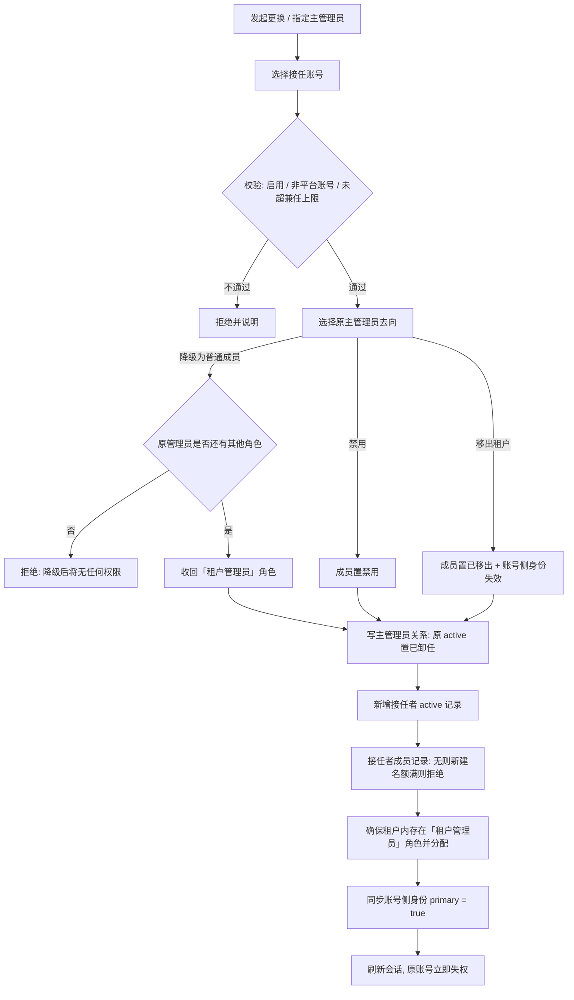

| 约束 | 说明 |
|---|---|
| 每租户 1 个主管理员 | 是成员**标记**，不是角色 |
| 主管理员不可停用 / 移出 | 只能更换或指定 |
| 平台账号不得兼任 | 否则绕过「进入租户」的只读与审计 |
| 一账号一租户 | 单租户模式：一个账号只能绑定 1 个租户；已绑定其他租户（成员关系有效）时，不能再被指定为主管理员 |
| 降级保护 | 原管理员必须保留至少 1 个其他角色 |

## 2.4 停用 / 启用 / 删除

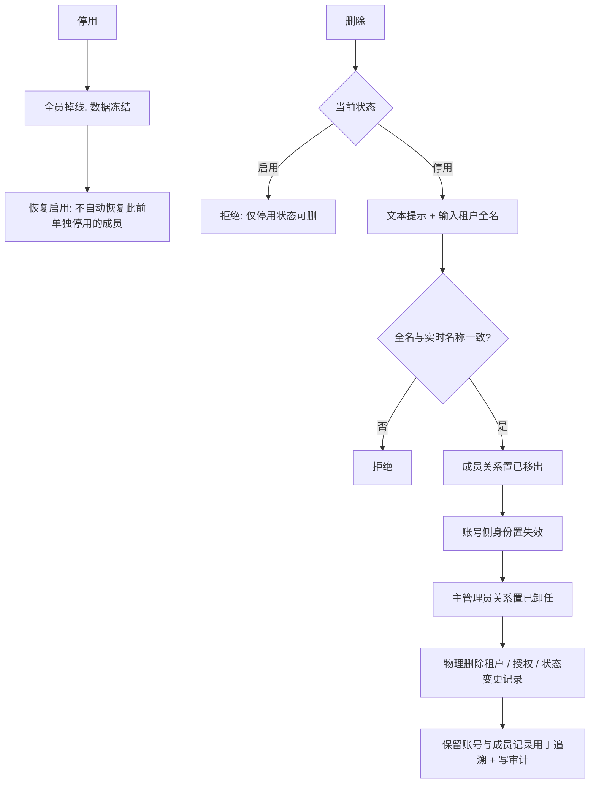

| 动作 | 可逆 | 影响 |
|---|---|---|
| 停用 | 可逆（启用） | 全员无法登录；业务数据冻结；成员单独停用状态不被重置 |
| 启用 | — | 恢复登录，不恢复单独停用的成员 |
| 删除 | **不可逆** | 物理删除，不可恢复；账号与成员记录保留供审计 |

## 2.5 进入租户（平台超管）

| 规则 | 说明 |
|---|---|
| 触发 | 仅平台超管可进入，**原因必填** |
| 模式 | 顶部常驻横幅，业务数据**只读**，写操作全禁 |
| 留痕 | 进出均写审计，且同步写租户侧，客户可查 |
| 目的 | 排障 / 代配置，不能替代租户管理员日常操作 |

## 2.6 租户端自助能力

| 功能 | 路由 | 能力边界 |
|---|---|---|
| 租户信息 | `/system/unit-info` | 法定资质只读；业务属性可编辑，保存立即生效 |
| 组织架构 | `/system/org` | 本租户组织树；层级上限 5 层；有成员 / 有下级不可删 |
| 成员管理 | `/system/member` | 新建 / 关联已有账号 / 编辑 / 停用启用 / 移出 / 重置密码 / 查看有效权限 |
| 角色管理 | `/system/tenant-role` | 本租户角色自建自管；功能授权 + 数据范围；与平台角色完全隔离 |

---

# 第三章 全局角色功能权限与业务权限

## 3.1 角色总表

### 3.1.1 平台角色（归属平台，只授予平台人员）

| ID | 角色 | 内置 | 定位 | 种子成员 |
|---|---|---|---|---|
| R01 | 超级管理员 | 是 | 系统根账户，全功能；系统管理整组仅超管可勾 | 林澈 `admin`、陈墨 |
| R02 | 平台运营人员 | 是 | 日常租户开通、模块授权、平台基础库维护 | 陈墨、苏岐、何屿、周予安 `ops01`、陆见微 |

> 按需由超级管理员在「平台角色管理」新增自定义角色（上限999 个）。

### 3.1.2 租户角色（归属租户，只在租户内生效）

| ID | 角色 | 内置 | 定位 | 数据范围（读 / 写） |
|---|---|---|---|---|
| T01 | 租户管理员 | 是（开户自动创建） | 租户内最高权限，默认全部租户端功能 | 全部 / 全部 |

> 租户侧只内置「租户管理员」：由租户管理员按需新增自定义角色（每租户上限 999 个）。

> **平台角色与租户角色完全隔离**：不跨端授予、不跨租户复用；角色标识在归属范围内唯一；自定义角色上限 999 个；有成员引用时不可删除。

## 3.2 功能权限矩阵（租户端）

图例：`●` 维护 · `◐` 部分 / 受限 · `○` 只读 · `—` 无入口

| 功能（菜单 ID） | 租户管理员 |
|---|:--:|
| 工作台（M101） | ● |
| 碳足迹核算（M102） | ● |
| 报告编制（M109） | ● |
| 企业信息维护（M110） | ● |
| 敏感性分析（M121） | ● |
| 数据质量评价（M122） | ● |
| 我的产品库（M103） | ● |
| 我的工艺库（M104） | ● |
| 背景数据库（M106） | ● |
| 我的因子库（M105） | ● |
| 模型库（M107） | ● |
| 我的模型（M108） | ● |
| 租户信息（M137） | ● |
| 组织架构（M136） | ● |
| 成员管理（M135） | ● |
| 角色管理（M138） | ● |

> 租户侧只内置「租户管理员」，默认勾选租户端全部功能点、数据范围读写均「全部」；核算员、只读等岗位角色由租户管理员按需新增，新增时按「已开通模块 ∩ 角色勾选」与数据范围生效。**功能权限决定"能不能看到"，数据权限决定"能看到谁的数据"。**

## 3.3 功能权限矩阵（平台端）

| 功能（菜单 ID） | 超级管理员 | 平台运营人员 |
|---|:--:|:--:|
| 产品分类（M201） | ● | ● |
| 产品信息库（M202） | ● | ● |
| 工艺流程（M203） | ● | ● |
| 工序（M204） | ● | ● |
| 物料库（M205） | ● | ● |
| 能源库（M206） | ● | ● |
| 计量单位库（M207） | ● | ● |
| 生命周期阶段（M208） | ● | ● |
| 标准文件库（M209） | ● | ● |
| 行业库（M210） | ● | ● |
| 核算模型（M214） | ● | ● |
| 因子库管理（M213） | ● | ● |
| 租户管理（M216） | ● | ● |
| 平台账号（M217） | ● | — |
| 账号查询（M221） | ● | ○ |
| 平台角色管理（M218） | ● | — |
| 菜单管理（M219） | ● | — |
| 数据字典（M220） | ● | ○ |

> **重要说明**：原型中平台角色的功能菜单**默认全部勾选**（便于演示，避免因缺权限看不到页面），因此矩阵上限为"可勾选范围"，实际生效以 `/system/role` 里该角色的勾选结果为准。超级管理员必须要有平台功能： 租户管理 / 平台账号 / 平台角色管理 / 菜单管理 / 数据字典，这些功能不允许去掉。**系统管理整组仅超管可勾**。

## 3.4 业务权限（数据范围）矩阵

### 3.4.1 五档数据范围

| 档位 | 含义 | 排序（宽 → 窄） |
|---|---|:--:|
| 全部 | 本租户内全部数据 | 4 |
| 本部门及下级 | 本部门 + 全部下级部门 | 3 |
| 本部门 | 仅本部门 | 2 |
| 指定部门 | 指定 1..N 个部门 | 1 |
| 仅本人 | 责任人为本人 | 0 |

### 3.4.2 规则

| # | 规则 |
|---|---|
| 1 | 读写**各配一档**，**写范围不得宽于读范围** |
| 2 | 多角色命中同一功能点时，**取最宽一档** |
| 3 | 「仅本人」按**责任人**判定，不按创建人 |
| 4 | 成员无部门时按「仅本人」 |
| 5 | 范围条件拼在查询语句，**禁止前端过滤** |
| 6 | 业务表必备三字段：租户、部门、责任人；租户标识由服务端注入，不接收前端传值 |
| 7 | 部门标识存创建时快照；指定部门存 ID 列表，部门删除后自动移除 |
| 8 | 系统管理类功能（组织 / 成员 / 角色）**不适用**数据范围 |

# 第四章 三条业务链

## 4.1 核算主链

### 4.1.1 流程图

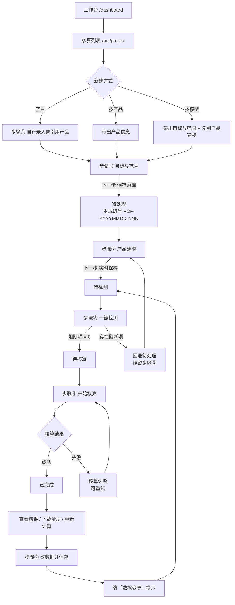

### 4.1.2 四步内容

| 步骤 | 路由 | 核心内容 | 关键校验 |
|---|---|---|---|
| ① 目标与范围 | `/pcf/project/:id/1` | 项目名称 / 组织 / 核算起止 / 核算标准（引用标准文件库）/ 产品信息 / 产品图片 / 声明单位 / 系统边界 / 生命周期阶段配置 | 必填完整；阶段至少纳入 1 个；产品图片必填 |
| ② 产品建模 | `/pcf/project/:id/2` | 阶段树 + 过程节点；数据项（类型 / 排放物类型 / 数量 / 单位）；因子匹配（带口径快照）；数据凭证；CSV 导入导出 | 已填名称的数据项必须填数量 |
| ③ 数据检测 | `/pcf/project/:id/3` | 一键检测 → 问题清单（阻断 / 提示分组）→ 定位修改入口 → 预览模型 | 阻断项清零方可进入核算 |
| ④ 核算与结果 | `/pcf/project/:id/4` | 状态卡（待核算 / 核算中 / 完成 / 失败）、结果总览、GWP 四口径、阶段汇总、数据项汇总与下钻、明细、下载清册 | 仅检测通过后可核算 |

### 4.1.3 状态机

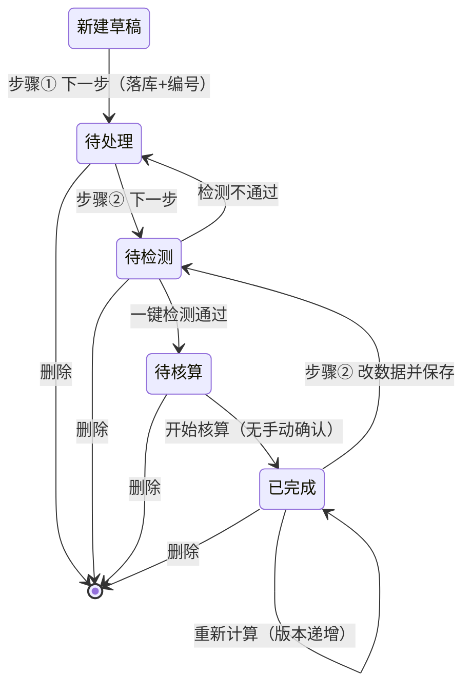

| 规则 | 说明 |
|---|---|
| 状态文案 | 新建 / 待处理 / 待检测 / 待核算 / 已完成（已移除：检测中、核算中、已核算、已作废、已归档） |
| 步骤条 | **不跳步**，超出当前进度的节点锁定 |
| 已完成锁定 | 步骤① 只读；步骤② 可编辑，改数据保存 → 弹「数据变更」→ 回退待检测 |
| 回退不清空 | 原检测结论与核算结果保留，可主动重检 / 重算 |
| 删除 | 任意状态可删，二次确认、不可恢复；不设作废 / 归档 |
| 复制 | 以该记录生成新项目，状态置待处理，名称追加「（副本）」 |

### 4.1.4 检测规则（步骤③）

| 码 | 级别 | 触发条件 |
|---|:--:|---|
| B1 | 阻断 | 数据项数量为空 |
| B2 | 阻断 | 投入项未匹配排放因子 |
| B4 | 阻断 | 数据项单位与因子分母单位**跨单位类型**不可换算（同类型不同量级不阻断，由引擎按基准中转换算） |
| B5 | 阻断 | 步骤① 已纳入的一级阶段下没有任何数据项 |
| W2 | 提示 | 因子含生物碳分量，但未纳入生命末期 / 处置 / 回收阶段 |

> 已下线：B3 分配比例、W1 质量平衡。界面只展示"人话问题 + 修改入口"，**不展示 E01–E16 编号**。

### 4.1.5 计算口径（步骤④）

| 层级 | 公式 |
|---|---|
| 行 | 行碳排 = 数量 × 排放因子 |
| 阶段 | 阶段碳排 = SUM(该阶段下各行碳排) |
| 结果 | 核算结果 = SUM(各阶段碳排) |

| 要点 | 说明 |
|---|---|
| 数量口径 | 每 1 个声明单位下的用量，可为负（扣减 / 流出） |
| 单位一致性 | 数量单位必须与因子分母单位同类型，否则不可计算 |
| 四指标 | 总量 / 化石 / 生物源 / 直接土地利用变化；因子只有总指标时仅出总量 |
| 单位换算 | 计量单位库「基准中转」；复合单位拆分子（碳排放量）+ 分母（活动量） |

## 4.2 报告与结果分析链

### 4.2.1 流程图

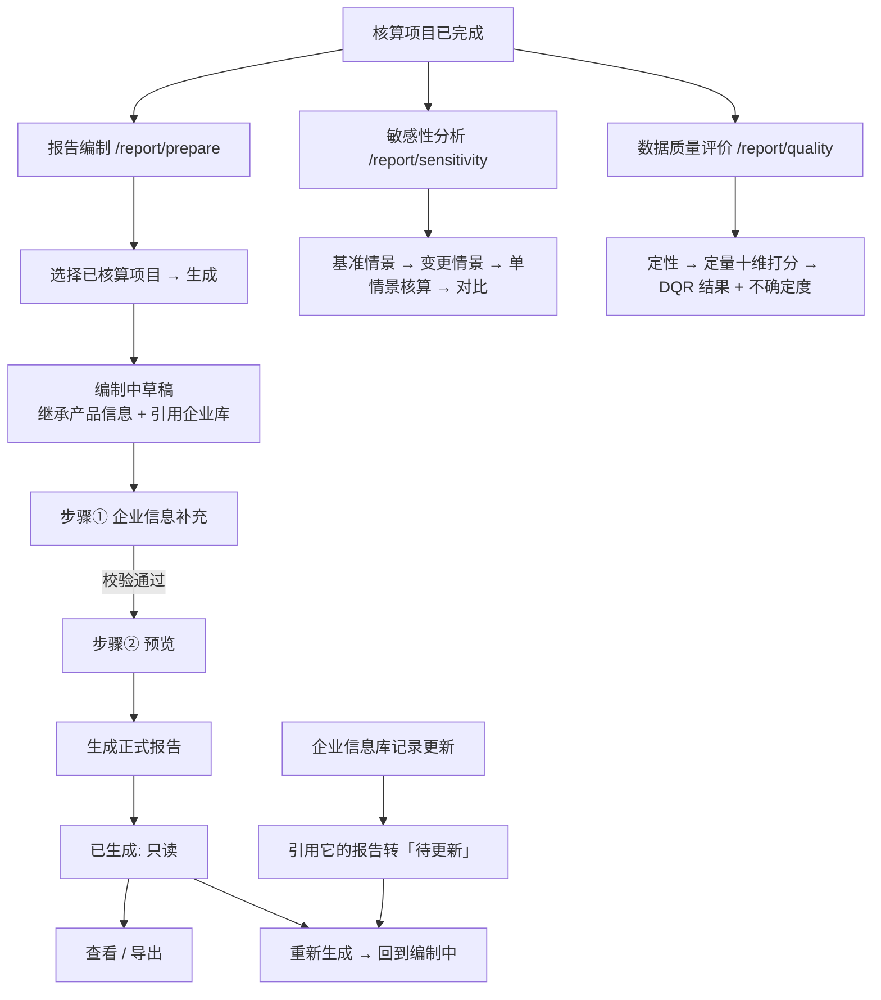

### 4.2.2 三条支链的产出与状态

| 子链 | 路由 | 产出 | 状态 |
|---|---|---|---|
| 报告编制 | `/report/prepare` | 产品碳足迹报告（Word 版式） | 生成中 / 编制中 / 已生成 / 待更新 |
| 敏感性分析 | `/report/sensitivity` | 变更情景与基准情景的变化量、变化率、敏感度 | 未完成 / 待更新 / 已完成 |
| 数据质量评价 | `/report/quality` | DQR 值、等级、不确定度、评价结论 | 未完成 / 待更新 / 已完成 |

### 4.2.3 关键规则

| 规则 | 说明 |
|---|---|
| 报告前置 | 只能对**已完成**的核算项目生成报告 |
| 报告编号 | `PCF-R-YYYYMMDD-NNN` |
| 封面取值 | 自动继承 + 企业库引用；正式报告封面锁定，需改则重新生成 |
| 报告只读 | 正式报告正文由模板装配，不可编辑；仅草稿阶段可补说明性内容 |
| 待更新触发 | 企业信息库记录变更 → 引用该记录的报告转「待更新」 |
| 重新生成 | 覆盖当前报告并同步最新上游数据，生成后回到「编制中」 |
| 敏感性口径 | 单情景独立核算；对比按 GWP 四口径可切换 |
| DQR 计算 | 十维算术平均；等级阈值：优 [1.0,1.5) / 良 [1.5,2.0) / 中 [2.0,3.0) / 差 [3.0,4.0) / 极差 [4.0,5.0] |

## 4.3 基础数据配置链

### 4.3.1 流程图

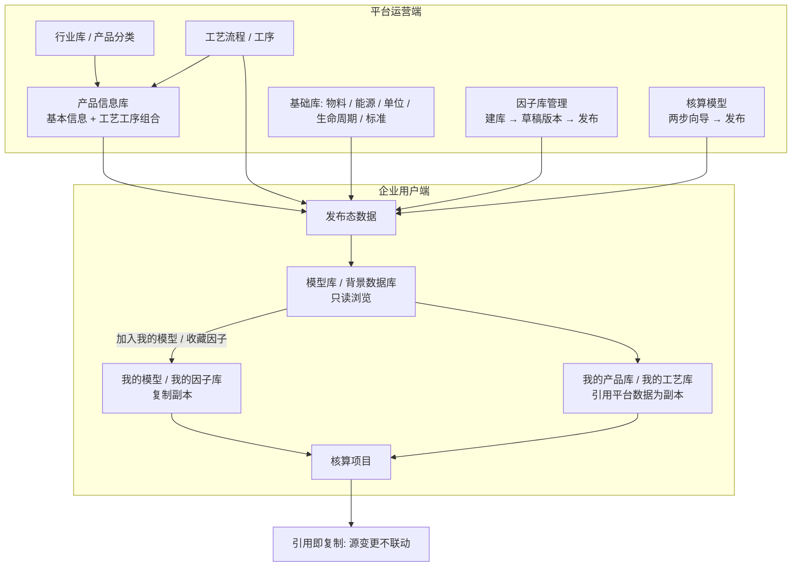

### 4.3.2 发布门禁与状态机

| 对象 | 状态流转 | 门禁 |
|---|---|---|
| 核算模型 | 草稿 → 已发布 → 已停用 → 重新启用 | 已发布前台模型库可见；已发布需先停用才能编辑；仅草稿 / 已停用可删除 |
| 因子库版本 | 草稿 → 生效中 → 历史 | 同一库同时仅 1 个生效版本；草稿未发布不影响前台；可回滚历史版本 |
| 因子（库内） | 商业数据库只读；自建库仅草稿版本可增删改 | 生效中 / 历史版本只读 |
| 产品 / 工艺 | 上架 / 下架、启用 / 停用 | 有引用时不可删除（由引用统计提示） |
| 计量单位 | 启用 ↔ 禁用；仅已禁用可删 | 基准单位不可禁用 / 删除 / 改类型，系数恒为 1 |

### 4.3.3 引用即复制（快照）口径

| 引用动作 | 复制内容 | 源变更是否联动 |
|---|---|---|
| 我的产品库 ← 平台产品 | 基本信息 + 工艺工序组合 + 场景应用 | 否 |
| 我的工艺库 ← 后台工艺 | 工艺路线 + 工序链 | 否 |
| 我的模型 ← 平台模型 | 基本信息 + 产品建模 | 否 |
| 我的因子库 ← 背景因子 | 因子值 + 口径快照（含 / 不含生物碳） | 可「从源因子刷新」手动同步 |
| 核算项目 ← 我的模型 | 目标与范围 + 产品建模 | 否 |
| 报告 ← 企业信息库 | 企业字段 | **是（唯一例外）：库记录更新 → 报告转「待更新」** |

### 4.3.4 配置链的四个关键约束

| # | 约束 | 原因 |
|---|---|---|
| 1 | 平台侧配置、租户侧使用，**基础库不对租户开放维护** | 保证全平台口径一致 |
| 2 | 引用即复制，**不做版本联动** | 保证已建项目结果不被后台改动污染 |
| 3 | 已发布对象**先停用再编辑** | 避免前台正在引用的对象被就地改写 |
| 4 | 因子 / 单位 / 阶段变更**不追溯历史结果** | 重算需用户主动触发 |